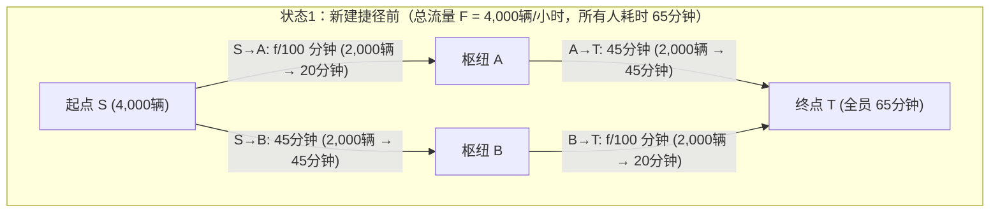
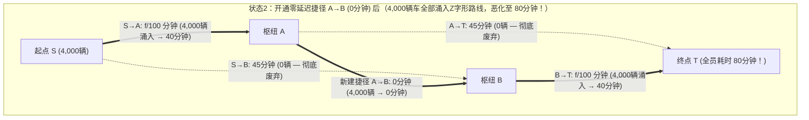

试想一座特大城市的交通规划部门耗资数十亿元，在两条繁忙的通勤主干道之间新建了一座零延迟的超级跨河大桥。按照日常直觉，道路网的总容量增加了，原有的道路一条也没有减少，即便有人不喜欢新桥也可以继续走老路，因此大家的平均通勤时间必然缩短，至少不可能变差。

然而在1968年，德国数学家<strong>迪特里希·布雷斯（Dietrich Braess）</strong>在运筹学期刊 *Unternehmensforschung* 上发表了具有里程碑意义的论文《论交通规划中的一个悖论》（*"Über ein Paradoxon aus der Verkehrsplanung"*），彻底粉碎了这一直觉。布雷斯从数学上严格证明：当每个驾驶员都出于自身利益最大化（即最小化个人通行时间）而独立选择路径——这种去中心化机制被称为<strong>自私路由（Selfish Routing）</strong>——时，<strong>向道路网中增加一条零延迟的高速捷径，反而会导致网络中100%所有驾驶员的均衡通勤时间严格变长！</strong>这一反直觉现象被称为<strong>布雷斯悖论（Braess's Paradox）</strong>。

更令人震惊的是，布雷斯悖论并非源于驾驶员的信息不对称或非理性盲从，而是完全信息下非合作博弈达到纳什均衡（即<strong>沃德罗普均衡，Wardrop Equilibrium</strong>）时的必然产物。由于无生命的物理系统遵循最小势能原理或最小热耗散原理，其控制方程在数学上与自私路由的凸势函数完全同构，因此布雷斯悖论不仅出现在城市交通和互联网数据包路由（OSPF/BGP）中，还直接出现在电网潮流、介观半导体量子环以及经典力学系统中——正如<strong>乔尔·科恩（Joel E. Cohen）与保罗·霍洛维茨（Paul Horowitz）</strong>在1991年《自然》（*Nature*）杂志上所展示的那样：<strong>在一个由弹簧和绳索悬挂重物的力学网络中，用剪刀剪断一根绷紧的承重绳，悬挂的重物不仅不会下落，反而会逆着重力向上升起！</strong>

本文将从布雷斯1968年论文的四节点菱形网络占优策略分析出发，系统阐述<strong>约翰·格伦·沃德罗普（John Glen Wardrop, 1952）</strong>的交通分配两条原理、<strong>贝克曼（Beckmann, 1956）与罗森塔尔（Rosenthal, 1973）</strong>的凸势函数（Potential Function）、<strong>蒂姆·拉夫加登（Tim Roughgarden）与伊娃·塔尔多什（Éva Tardos, 2002）</strong>关于<strong>无秩序代价（Price of Anarchy, $\text{PoA}$）上界 $\frac{4}{3}$</strong> 的完整代数证明、弹簧与绳索力学悖论的精确推导，以及首尔清溪川高架高速拆除、纽约时代广场步行化改造与庇古拥堵税（Pigouvian Congestion Pricing）的现实奇迹。

---

## 1. 布雷斯1968年论文与四节点菱形网络（4-Node Diamond Network）

### 1.1 网络拓扑与边延迟函数（Latency Functions）

假设早高峰期间有总流量 $F = 4,000\text{ 辆/小时}$（归一化单位下 $F = 1$）的汽车需要从起点 $S$（Start）驶往终点 $T$（Terminal），途经两个中间枢纽节点 $A$ 或 $B$。每条有向边 $e \in E$ 的通行时间（延迟函数）$\ell_e(f_e)$ 取决于该道路上的车流量 $f_e$（辆/小时）：

1. <strong>道路 $S \to A$（狭窄的短桥）</strong>：道路狭窄，通行时间随车流量 $f_{SA}$ 线性增长：
   $$\ell_{SA}(f_{SA}) = \frac{f_{SA}}{100}\text{ （分钟）}$$
   例如，若有 $2,000$ 辆车通行则耗时 $20$ 分钟；若全部 $4,000$ 辆车涌入则耗时 $40$ 分钟。
2. <strong>道路 $A \to T$（宽阔但绕远的高速公路）</strong>：车道极宽，无论多少车辆通行都不会拥堵，通行时间恒定为：
   $$\ell_{AT}(f_{AT}) = 45\text{ （分钟）}$$
3. <strong>道路 $S \to B$（宽阔但绕远的高速公路）</strong>：与 $A \to T$ 对称，通行时间恒定且不受流量影响：
   $$\ell_{SB}(f_{SB}) = 45\text{ （分钟）}$$
4. <strong>道路 $B \to T$（狭窄的短桥）</strong>：与 $S \to A$ 相同的狭窄桥梁，通行时间随车流量 $f_{BT}$ 线性增长：
   $$\ell_{BT}(f_{BT}) = \frac{f_{BT}}{100}\text{ （分钟）}$$

### 1.2 状态1：修建新路前的均衡（全员 $65$ 分钟）

在没有连接 $A$ 与 $B$ 的横向道路之前，驾驶员只有两条路径可选：
- <strong>上方路径 $P_{\text{up}} = (S \to A \to T)$</strong>：耗时 $\ell_{\text{up}} = \frac{f_{SA}}{100} + 45$ 分钟。
- <strong>下方路径 $P_{\text{down}} = (S \to B \to T)$</strong>：耗时 $\ell_{\text{down}} = 45 + \frac{f_{BT}}{100}$ 分钟。

由于网络上下完全对称，唯一的纳什均衡（沃德罗普均衡）是总车流 $4,000$ 辆按 $50\% : 50\%$ 平分：上方路径 $f_{\text{up}} = 2,000$ 辆，下方路径 $f_{\text{down}} = 2,000$ 辆。此时每位驾驶员的通勤时间均为：
$$T_{\text{before}} = \frac{2000}{100} + 45 = 20 + 45 = 65\text{ 分钟}$$
没有任何人可以通过单方面改变路线来缩短时间，且这一状态恰好也是全社会总通行时间最小的<strong>社会最优解（Social Optimum）</strong>。

### 1.3 状态2：开通零延迟超高速捷径 $A \to B$（全员恶化至 $80$ 分钟！）

现在，市政当局在枢纽 $A$ 到枢纽 $B$ 之间修建了一条单向超高速通道 $A \to B$，其通行时间为零：$\ell_{AB}(f_{AB}) = 0$ 分钟。

这创造出第三条路径——<strong>Z字形折线路径 $P_{\text{zig}} = (S \to A \to B \to T)$</strong>。让我们用博弈论的<strong>严格占优策略（Strictly Dominant Strategy）</strong>分析每位驾驶员的决策：

1. <strong>在起点 $S$ 的抉择（对比 $S \to A \to B$ 与 $S \to B$）</strong>：
   即便全部 $4,000$ 辆车都涌上窄桥 $S \to A$，通过 $S \to A$ 的最长时间也不过是 $\frac{4000}{100} = 40$ 分钟。到达 $A$ 后经过 $0$ 分钟的捷径 $A \to B$ 即可瞬间抵达 $B$。因此，走 $S \to A \to B$ 到达 $B$ <strong>最多只需 $40$ 分钟</strong>，而走宽阔高速 $S \to B$ 却<strong>恒定需要 $45$ 分钟</strong>！无论其他 $3,999$ 名司机怎么选，在起点选择 $S \to A$ 永远比 $S \to B$ 至少快 $5$ 分钟（严格占优策略）。于是 $100\%$ 的司机都会抛弃 $S \to B$（$f_{SB} = 0$），全部驶入 $S \to A$。
2. <strong>在枢纽 $A$ 的抉择（对比 $A \to B \to T$ 与 $A \to T$）</strong>：
   当所有 $4,000$ 辆车到达 $A$ 后，直接走高速 $A \to T$ 需要 $45$ 分钟；而过桥 $A \to B$（$0$ 分钟）再走窄桥 $B \to T$，即便全员 $4,000$ 辆车都挤在 $B \to T$ 上，最多也只需 $0 + \frac{4000}{100} = 40$ 分钟 $< 45$ 分钟！因此选择 $A \to B \to T$ 同样是严格占优策略，高速 $A \to T$ 也被彻底废弃（$f_{AT} = 0$）。
3. <strong>唯一的纳什均衡（全员 $80$ 分钟的囚徒困境）</strong>：
   最终，全部 $4,000$ 辆车都挤在Z字形路径 $S \to A \to B \to T$ 上，先后经过两座满负荷的窄桥，每个人的通勤时间飙升至：
   $$T_{\text{after}} = \frac{4000}{100} + 0 + \frac{4000}{100} = 40 + 0 + 40 = 80\text{ 分钟！}$$
   任何单独试图改走老路 $S \to A \to T$ 或 $S \to B \to T$ 的司机，都将承受 $40 + 45 = 85$ 分钟的惩罚。因此没有任何人愿意单方面离开，全员被锁死在 $80$ 分钟的均衡中，比修路前的 $65$ 分钟整整多花了 $15$ 分钟（恶化了 $+23.1\%$）！

| 对比指标 | 状态1：新建捷径前（同时也是社会最优 $f^*$） | 状态2：开通零延迟捷径 $A \to B$ 后（沃德罗普均衡 $f^{\text{EQ}}$） | 悖论影响与变化 |
| :--- | :--- | :--- | :--- |
| <strong>上方路径 $S \to A \to T$ 流量</strong> | $2,000\text{ 辆/小时}$（$20 + 45 = 65$ 分钟） | $0\text{ 辆/小时}$（若走需 $40 + 45 = 85$ 分钟） | 高速公路 $A \to T$ 完全闲置 |
| <strong>下方路径 $S \to B \to T$ 流量</strong> | $2,000\text{ 辆/小时}$（$45 + 20 = 65$ 分钟） | $0\text{ 辆/小时}$（若走需 $45 + 40 = 85$ 分钟） | 高速公路 $S \to B$ 完全闲置 |
| <strong>Z字形路径 $S \to A \to B \to T$ 流量</strong> | 不存在 | $4,000\text{ 辆/小时}$（$100\%$ 车辆集中） | 每辆车重复穿过两座窄桥 |
| <strong>每位司机的通勤时间</strong> | <strong>$65\text{ 分钟}$</strong> | <strong>$80\text{ 分钟}$</strong> | <strong>全员严格增加 $+15\text{ 分钟}$（$+23.1\%$）</strong> |
| <strong>社会总通行成本 $C(f)$</strong> | $260,000\text{ 车·分}$ | $320,000\text{ 车·分}$ | <strong>无秩序代价 $\text{PoA} = \frac{80}{65} = \frac{16}{13} \approx 1.231$</strong> |

---

## 2. 沃德罗普两条原理（1952）与贝克曼-罗森塔尔凸势函数（1956）

在一般有向网络 $G = (V, E)$ 上，设总交通需求为 $F$，可行路径流量集合为 $\mathcal{F} = \{f \ge 0 : \sum_{P \in \mathcal{P}} f_P = F\}$，边流量为 $f_e = \sum_{P \ni e} f_P$，每条边的延迟函数为单调递增可微函数 $\ell_e(f_e)$，路径延迟为 $\ell_P(f) = \sum_{e \in P} \ell_e(f_e)$。

### 2.1 沃德罗普第一原理（用户均衡 $f^{\text{EQ}}$）与变分不等式
英国交通学家<strong>约翰·格伦·沃德罗普（John Glen Wardrop, 1952）</strong>提出的第一原理指出：在自私路由达到均衡 $f^{\text{EQ}}$ 时，所有被实际使用的路径（$f_P^{\text{EQ}} > 0$）具有完全相等的通行时间，且不大于任何未被使用路径的通行时间：
$$f_P^{\text{EQ}} > 0 \implies \ell_P(f^{\text{EQ}}) \le \ell_{P'}(f^{\text{EQ}}) \quad (\forall P' \in \mathcal{P})$$
这等价于满足如下<strong>变分不等式（Variational Inequality）</strong>：
$$\sum_{e \in E} \ell_e\bigl(f_e^{\text{EQ}}\bigr)\bigl(f_e - f_e^{\text{EQ}}\bigr) \ge 0 \quad (\forall f \in \mathcal{F})$$

### 2.2 沃德罗普第二原理（社会最优 $f^*$）与庇古拥堵外部性
社会最优流量 $f^*$ 旨在最小化全社会总通行时间 $C(f)$：
$$C(f) = \sum_{P \in \mathcal{P}} f_P \ell_P(f) = \sum_{e \in E} f_e \ell_e(f_e)$$
对每条边的社会成本 $f_e \ell_e(f_e)$ 求导，可得<strong>边际社会成本（Marginal Social Cost, MSC）</strong>：
$$\tilde{\ell}_e(f_e) = \frac{d}{df_e}\bigl[f_e \ell_e(f_e)\bigr] = \underbrace{\ell_e(f_e)}_{\text{私人成本}} + \underbrace{f_e \ell_e'(f_e)}_{\text{庇古拥堵外部性}}$$
自私的驾驶员只考虑自己的私人通行时间 $\ell_e(f_e)$，而完全无视自己进入道路后使已在道路上的 $f_e$ 辆车产生额外延误的<strong>庇古外部性（Pigouvian Externality）$f_e \ell_e'(f_e)$</strong>。正是这一外部性导致了纳什均衡与社会最优的背离。

### 2.3 贝克曼-麦圭尔-温斯顿凸势函数（Beckmann Potential Function）
1956年，Beckmann、McGuire 与 Winsten 证明了沃德罗普均衡 $f^{\text{EQ}}$ 恰好是如下<strong>贝克曼凸势函数 $\Phi(f)$</strong> 的全局极小值点：
$$\Phi(f) = \sum_{e \in E} \int_0^{f_e} \ell_e(u)\,du$$
利用微积分基本定理，势函数对路径流量 $f_P$ 的偏导数恰好等于路径私人延迟：
$$\frac{\partial \Phi(f)}{\partial f_P} = \sum_{e \in P} \frac{\partial}{\partial f_e}\left(\int_0^{f_e} \ell_e(u)\,du\right) = \sum_{e \in P} \ell_e(f_e) = \ell_P(f)$$
由于 $\ell_e(u)$ 单调不减，其积分 $\Phi(f)$ 是紧凸多面体 $\mathcal{F}$ 上的凸函数，从而严格保证了沃德罗普均衡的存在性与边延迟的唯一性。特别地，当延迟函数为线性函数 $\ell_e(u) = a_e u + b_e$ 时：
$$\Phi(f) = \sum_{e \in E}\left(\frac{1}{2}a_e f_e^2 + b_e f_e\right) \quad \text{对比} \quad C(f) = \sum_{e \in E}\left(a_e f_e^2 + b_e f_e\right)$$
自私路由相当于将二次拥堵惩罚项 $a_e f_e^2$ 少算了一半（系数 $\frac{1}{2}$）！

---

## 3. 拉夫加登与塔尔多什定理：无秩序代价（Price of Anarchy）上界 $4/3$ 的严格证明

为了度量去中心化自私路由相对于社会最优的最坏效率损失，Koutsoupias 与 Papadimitriou（1999）定义了<strong>无秩序代价（Price of Anarchy, $\text{PoA}$）</strong>：
$$\text{PoA} = \frac{C(f^{\text{EQ}})}{C(f^*)}$$

在<strong>庇古双链路网络（Pigou's Network, 1920）</strong>中，总流量 $F=1$，上链路恒定延迟 $\ell_1(x)=1$，下链路线性延迟 $\ell_2(x)=x$。均衡时全部流量走下链路（$f_2^{\text{EQ}}=1$），总成本 $C(f^{\text{EQ}}) = 1$；而社会最优解最小化 $C(x) = (1-x)\cdot 1 + x^2$，在 $x^* = \frac{1}{2}$ 处取得最小值 $C(f^*) = \frac{3}{4}$，故 $\text{PoA} = \frac{1}{3/4} = \frac{4}{3}$。

2002年，<strong>蒂姆·拉夫加登（Tim Roughgarden）与伊娃·塔尔多什（Éva Tardos）</strong>在 *Journal of the ACM* 上证明了著名的 $\frac{4}{3}$ 定理：无论网络拓扑多么复杂，只要延迟函数是线性的，$\text{PoA}$ 绝不会超过 $\frac{4}{3}$！

> <strong>定理（Roughgarden & Tardos, 2002）</strong>：
> 对于任意有向网络 $G=(V,E)$ 及任意多商品流需求，若所有边 $e \in E$ 的延迟函数均为仿射线性函数 $\ell_e(x) = a_e x + b_e$（$a_e, b_e \ge 0$），则无秩序代价满足：
> $$\text{PoA}_{\text{linear}} = \frac{C(f^{\text{EQ}})}{C(f^*)} \le \frac{4}{3}$$

<strong>【完整证明】</strong>
1. <strong>应用变分不等式</strong>：由沃德罗普均衡的变分不等式，对社会最优流 $f^* \in \mathcal{F}$ 有：
   $$\sum_{e \in E} \ell_e(f_e^{\text{EQ}})(f_e^* - f_e^{\text{EQ}}) \ge 0 \implies C(f^{\text{EQ}}) = \sum_{e \in E} f_e^{\text{EQ}} \ell_e(f_e^{\text{EQ}}) \le \sum_{e \in E} f_e^* \ell_e(f_e^{\text{EQ}})$$
2. <strong>单边配方不等式</strong>：对任意边 $e$，记 $x = f_e^{\text{EQ}} \ge 0, y = f_e^* \ge 0$。展开 $y \ell_e(x)$ 并对 $y$ 配方：
   $$y \ell_e(x) = y(a_e x + b_e) = y(a_e y + b_e) + a_e(xy - y^2) = y \ell_e(y) + a_e\left[\frac{1}{4}x^2 - \left(y - \frac{x}{2}\right)^2\right] \le y \ell_e(y) + \frac{1}{4}a_e x^2$$
   由于 $b_e x \ge 0$，有 $a_e x^2 \le a_e x^2 + b_e x = x \ell_e(x)$，因此：
   $$y \ell_e(x) \le y \ell_e(y) + \frac{1}{4} x \ell_e(x)$$
3. <strong>全网求和</strong>：对所有边 $e \in E$ 求和：
   $$C(f^{\text{EQ}}) \le \sum_{e \in E} f_e^* \ell_e(f_e^{\text{EQ}}) \le \sum_{e \in E} f_e^* \ell_e(f_e^*) + \frac{1}{4}\sum_{e \in E} f_e^{\text{EQ}} \ell_e(f_e^{\text{EQ}}) = C(f^*) + \frac{1}{4}C(f^{\text{EQ}})$$
   移项即得 $\frac{3}{4}C(f^{\text{EQ}}) \le C(f^*) \implies \text{PoA} \le \frac{4}{3}$。证毕！ $\blacksquare$

更一般地，对于次数不超过 $d$ 的多项式延迟函数（如美国联邦公路局标准四次 <strong>BPR函数</strong> $\ell_e(f_e) = t_e^0[1 + 0.15(f_e/c_e)^4]$，对应 $d=4$），拉夫加登证明了精确上界为：
$$\text{PoA}_d = \frac{(d+1)\sqrt[d]{d+1}}{(d+1)\sqrt[d]{d+1} - d} = \Theta\left(\frac{d}{\ln d}\right)$$
当 $d=4$ 时，$\text{PoA}_4 \approx 2.1505$（即自私路由可使总通行时间恶化至最优解的 $2.15$ 倍以上！）。同时，他们的<strong>双准则定理（Bicriteria Bound）</strong>证明了对任意单调连续延迟函数，总有 $C(f^{\text{EQ}}(F)) \le C(f^*(2F))$。

---

## 4. 物理与生物网络中的布雷斯悖论：剪断绳子重物反而上升！

1991年，<strong>乔尔·科恩（Joel E. Cohen）与保罗·霍洛维茨（Paul Horowitz）</strong>在《自然》（*Nature*）上展示了著名的<strong>弹簧-绳索力学悖论</strong>：
- 用两根刚度为 $k$、原长为 $L_0$ 的相同弹簧（对应窄桥 $S \to A$ 和 $B \to T$）、两根长度为 $L_s$ 的不可伸长安全绳（对应恒定时间高速 $S \to B$ 和 $A \to T$），以及一根连接两弹簧首尾的中央短绳 $A \to B$（长度 $\approx 0$）从天花板悬挂重为 $F = Mg$ 的重物。
- <strong>剪断中央短绳前（串联状态）</strong>：两根弹簧通过中央短绳<strong>串联</strong>，每根弹簧承受全部拉力 $F$，伸长 $\frac{F}{k}$。只要安全绳长度 $L_s > L_0 + \frac{F}{k}$，两侧安全绳完全松弛。重物悬挂深度为：
  $$Y_{\text{before}} = 2L_0 + \frac{2F}{k}$$
- <strong>用剪刀剪断中央短绳后（并联状态）</strong>：两侧安全绳绷紧，两根弹簧变为<strong>并联</strong>分担重量，每根弹簧仅承受一半拉力 $\frac{F}{2}$，伸长量减半为 $\frac{F}{2k}$！新的平衡深度为：
  $$Y_{\text{after}} = L_0 + \frac{F}{2k} + L_s$$
- 只要选取 $L_0 + \frac{F}{k} < L_s < L_0 + \frac{3F}{2k}$（例如 $L_s = L_0 + \frac{5F}{4k}$），剪断承重绳后重物的位置变化为：
  $$\Delta Y = Y_{\text{after}} - Y_{\text{before}} = -\frac{F}{4k} < 0$$
  <strong>剪断绷紧的承重绳，重物反而逆着重力向上升起了 $\frac{F}{4k}$！</strong>

这一现象在<strong>交流电网（Witthaut & Timme, 2012）</strong>（增加高压输电线反而诱发环流并导致电网失步停电）、<strong>介观半导体量子环（Pala et al., 2012）</strong>以及<strong>细胞代谢网络合成拯救（Motter, 2010）</strong>中均得到了实验证实。

---

## 5. 城市规划的真实奇迹与庇古拥堵收费（Congestion Pricing）

在现实城市中，“封路反而治堵”的逆向布雷斯悖论屡见不鲜：
1. <strong>德国斯图加特（1969年）</strong>：在市中心新建一条道路后全城严重拥堵，市政当局被迫将该新路封闭，交通随即恢复顺畅。
2. <strong>纽约市第42街（1990年）与时代广场百老汇大道（2009年）</strong>：百老汇大道斜穿曼哈顿正交网格，恰如布雷斯网络中的对角捷径 $A \to B$。2009年纽约交通局将时代广场段的百老汇大道永久改为步行广场后，中城北向出租车通行时间反而缩短了 $17\%$。
3. <strong>韩国首尔清溪川高架高速公路拆除工程（2003–2005年）</strong>：首尔市政府彻底拆除了日均通行量高达 <strong>$168,000$ 辆</strong>、全长 $5.8$ 公里的双向六车道清溪川高架桥，恢复了被掩埋的清溪川自然河流。由于消除了高架匝道汇入汇出的核心瓶颈，配合公交专用道改革，<strong>首尔市中心的平均车速在高速公路拆除后不仅没有崩溃，反而显著提升</strong>，同时夏季热岛气温下降了 $3.6^\circ\text{C}$。

### 庇古边际成本拥堵税（Marginal Cost Pricing）
拉夫加登（2006）证明，在一般网络中寻找最优子图以消除布雷斯悖论是<strong>强NP困难（Strongly NP-hard）</strong>问题，且多项式时间内无法取得优于 $\frac{4}{3}$ 的近似比。然而，无需拆毁道路，只需在每条边上征收等于社会最优流下拥堵外部性的<strong>庇古税（Pigouvian Toll）</strong>：
$$\tau_e = f_e^* \ell_e'(f_e^*)$$
使驾驶员面对广义成本 $\hat{\ell}_e(f_e) = \ell_e(f_e) + \tau_e$，此时修正后的贝克曼势函数梯度在 $f^*$ 处与社会总成本 $C(f)$ 完全一致，从而将无秩序代价完美降至 $\text{PoA} = 1$！这正是新加坡、伦敦、斯德哥尔摩及纽约曼哈顿拥堵收费区的核心数学基石。
