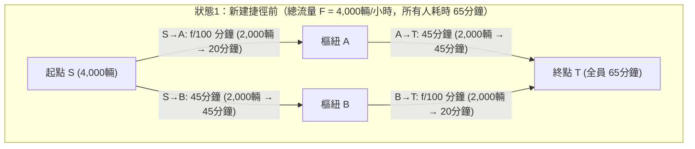
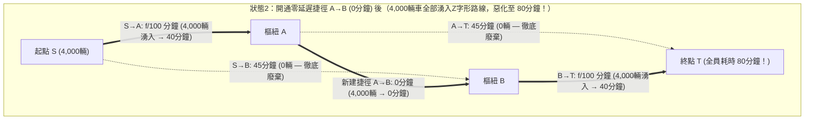

試想一座大都會的交通規劃部門耗資數十億元，在兩條繁忙的通勤主幹道之間新建了一座零延遲的超級跨河大橋。按照日常直覺，道路網的總容量增加了，原有的道路一條也沒有減少，即便有人不喜歡新橋也可以繼續走舊路，因此大家的平均通勤時間必然縮短，至少不可能變差。

然而在1968年，德國數學家<strong>迪特里希·布雷斯（Dietrich Braess）</strong>在作業研究期刊 *Unternehmensforschung* 上發表了具有里程碑意義的論文《論交通規劃中的一個悖論》（*"Über ein Paradoxon aus der Verkehrsplanung"*），徹底粉碎了這一直覺。布雷斯從數學上嚴格證明：當每個駕駛人都出於自身利益最大化（即最小化個人通行時間）而獨立選擇路徑——這種去中心化機制被稱為<strong>自私路由（Selfish Routing）</strong>——時，<strong>向道路網中增加一條零延遲的高速捷徑，反而會導致網路中100%所有駕駛人的均衡通勤時間嚴格變長！</strong>這一反直覺現象被稱為<strong>布雷斯悖論（Braess's Paradox）</strong>。

更令人震驚的是，布雷斯悖論並非源於駕駛人的資訊不對稱或非理性盲從，而是完全資訊下非合作賽局達到納許均衡（即<strong>沃德羅普均衡，Wardrop Equilibrium</strong>）時的必然產物。由於無生命的物理系統遵循最小位能原理或最小熱耗散原理，其控制方程在數學上與自私路由的凸勢函數完全同構，因此布雷斯悖論不僅出現在城市交通和網際網路封包路由（OSPF/BGP）中，還直接出現在電網潮流、介觀半導體量子環以及古典力學系統中——正如<strong>喬爾·科恩（Joel E. Cohen）與保羅·霍洛維茨（Paul Horowitz）</strong>在1991年《自然》（*Nature*）雜誌上所展示的那樣：<strong>在一個由彈簧和繩索懸掛重物的力學網路中，用剪刀剪斷一根繃緊的承重繩，懸掛的重物不僅不會下落，反而會逆著重力向上升起！</strong>

本文將從布雷斯1968年論文的四節點菱形網路占優策略分析出發，系統闡述<strong>約翰·格倫·沃德羅普（John Glen Wardrop, 1952）</strong>的交通分配兩條原理、<strong>貝克曼（Beckmann, 1956）與羅森塔爾（Rosenthal, 1973）</strong>的凸勢函數（Potential Function）、<strong>蒂姆·拉夫加登（Tim Roughgarden）與伊娃·塔爾多什（Éva Tardos, 2002）</strong>關於<strong>無秩序代價（Price of Anarchy, $\text{PoA}$）上界 $\frac{4}{3}$</strong> 的完整代數證明、彈簧與繩索力學悖論的精確推導，以及首爾清溪川高架高速拆除、紐約時代廣場步行化改造與庇古擁堵稅（Pigouvian Congestion Pricing）的現實奇蹟。

---

## 1. 布雷斯1968年論文與四節點菱形網路（4-Node Diamond Network）

### 1.1 網路拓撲與邊延遲函數（Latency Functions）

假設早尖峰期間有總流量 $F = 4,000\text{ 輛/小時}$（歸一化單位下 $F = 1$）的汽車需要從起點 $S$（Start）駛往終點 $T$（Terminal），途經兩個中間樞紐節點 $A$ 或 $B$。每條有向邊 $e \in E$ 的通行時間（延遲函數）$\ell_e(f_e)$ 取決於該道路上的車流量 $f_e$（輛/小時）：

1. <strong>道路 $S \to A$（狹窄的短橋）</strong>：道路狹窄，通行時間隨車流量 $f_{SA}$ 線性增長：
   $$\ell_{SA}(f_{SA}) = \frac{f_{SA}}{100}\text{ （分鐘）}$$
   例如，若有 $2,000$ 輛車通行則耗時 $20$ 分鐘；若全部 $4,000$ 輛車湧入則耗時 $40$ 分鐘。
2. <strong>道路 $A \to T$（寬闊但繞遠的高速公路）</strong>：車道極寬，無論多少車輛通行都不會擁堵，通行時間恆定為：
   $$\ell_{AT}(f_{AT}) = 45\text{ （分鐘）}$$
3. <strong>道路 $S \to B$（寬闊但繞遠的高速公路）</strong>：與 $A \to T$ 對稱，通行時間恆定且不受流量影響：
   $$\ell_{SB}(f_{SB}) = 45\text{ （分鐘）}$$
4. <strong>道路 $B \to T$（狹窄的短橋）</strong>：與 $S \to A$ 相同的狹窄橋樑，通行時間隨車流量 $f_{BT}$ 線性增長：
   $$\ell_{BT}(f_{BT}) = \frac{f_{BT}}{100}\text{ （分鐘）}$$

### 1.2 狀態1：修建新路前的均衡（全員 $65$ 分鐘）

在沒有連接 $A$ 與 $B$ 的橫向道路之前，駕駛人只有兩條路徑可選：
- <strong>上方路徑 $P_{\text{up}} = (S \to A \to T)$</strong>：耗時 $\ell_{\text{up}} = \frac{f_{SA}}{100} + 45$ 分鐘。
- <strong>下方路徑 $P_{\text{down}} = (S \to B \to T)$</strong>：耗時 $\ell_{\text{down}} = 45 + \frac{f_{BT}}{100}$ 分鐘。

由於網路上下完全對稱，唯一的納許均衡（沃德羅普均衡）是總車流 $4,000$ 輛按 $50\% : 50\%$ 平分：上方路徑 $f_{\text{up}} = 2,000$ 輛，下方路徑 $f_{\text{down}} = 2,000$ 輛。此時每位駕駛人的通勤時間均為：
$$T_{\text{before}} = \frac{2000}{100} + 45 = 20 + 45 = 65\text{ 分鐘}$$
沒有任何人可以透過單方面改變路線來縮短時間，且這一狀態恰好也是全社會總通行時間最小的<strong>社會最優解（Social Optimum）</strong>。

### 1.3 狀態2：開通零延遲超高速捷徑 $A \to B$（全員惡化至 $80$ 分鐘！）

現在，市政當局在樞紐 $A$ 到樞紐 $B$ 之間修建了一條單向超高速通道 $A \to B$，其通行時間為零：$\ell_{AB}(f_{AB}) = 0$ 分鐘。

這創造出第三條路徑——<strong>Z字形折線路徑 $P_{\text{zig}} = (S \to A \to B \to T)$</strong>。讓我們用賽局理論的<strong>嚴格占優策略（Strictly Dominant Strategy）</strong>分析每位駕駛人的決策：

1. <strong>在起點 $S$ 的抉擇（對比 $S \to A \to B$ 與 $S \to B$）</strong>：
   即便全部 $4,000$ 輛車都湧上窄橋 $S \to A$，通過 $S \to A$ 的最長時間也不過是 $\frac{4000}{100} = 40$ 分鐘。到達 $A$ 後經過 $0$ 分鐘的捷徑 $A \to B$ 即可瞬間抵達 $B$。因此，走 $S \to A \to B$ 到達 $B$ <strong>最多只需 $40$ 分鐘</strong>，而走寬闊高速 $S \to B$ 卻<strong>恆定需要 $45$ 分鐘</strong>！無論其他 $3,999$ 名司機怎麼選，在起點選擇 $S \to A$ 永遠比 $S \to B$ 至少快 $5$ 分鐘（嚴格占優策略）。於是 $100\%$ 的司機都會拋棄 $S \to B$（$f_{SB} = 0$），全部駛入 $S \to A$。
2. <strong>在樞紐 $A$ 的抉擇（對比 $A \to B \to T$ 與 $A \to T$）</strong>：
   當所有 $4,000$ 輛車到達 $A$ 後，直接走高速 $A \to T$ 需要 $45$ 分鐘；而過橋 $A \to B$（$0$ 分鐘）再走窄橋 $B \to T$，即便全員 $4,000$ 輛車都擠在 $B \to T$ 上，最多也只需 $0 + \frac{4000}{100} = 40$ 分鐘 $< 45$ 分鐘！因此選擇 $A \to B \to T$ 同樣是嚴格占優策略，高速 $A \to T$ 也被徹底廢棄（$f_{AT} = 0$）。
3. <strong>唯一的納許均衡（全員 $80$ 分鐘的囚徒困境）</strong>：
   最終，全部 $4,000$ 輛車都擠在Z字形路徑 $S \to A \to B \to T$ 上，先後經過兩座滿負荷的窄橋，每個人的通勤時間飆升至：
   $$T_{\text{after}} = \frac{4000}{100} + 0 + \frac{4000}{100} = 40 + 0 + 40 = 80\text{ 分鐘！}$$
   任何單獨試圖改走舊路 $S \to A \to T$ 或 $S \to B \to T$ 的司機，都將承受 $40 + 45 = 85$ 分鐘的懲罰。因此沒有任何人願意單方面離開，全員被鎖死在 $80$ 分鐘的均衡中，比修路前的 $65$ 分鐘整整多花了 $15$ 分鐘（惡化了 $+23.1\%$）！

| 對比指標 | 狀態1：新建捷徑前（同時也是社會最優 $f^*$） | 狀態2：開通零延遲捷徑 $A \to B$ 後（沃德羅普均衡 $f^{\text{EQ}}$） | 悖論影響與變化 |
| :--- | :--- | :--- | :--- |
| <strong>上方路徑 $S \to A \to T$ 流量</strong> | $2,000\text{ 輛/小時}$（$20 + 45 = 65$ 分鐘） | $0\text{ 輛/小時}$（若走需 $40 + 45 = 85$ 分鐘） | 高速公路 $A \to T$ 完全閒置 |
| <strong>下方路徑 $S \to B \to T$ 流量</strong> | $2,000\text{ 輛/小時}$（$45 + 20 = 65$ 分鐘） | $0\text{ 輛/小時}$（若走需 $45 + 40 = 85$ 分鐘） | 高速公路 $S \to B$ 完全閒置 |
| <strong>Z字形路徑 $S \to A \to B \to T$ 流量</strong> | 不存在 | $4,000\text{ 輛/小時}$（$100\%$ 車輛集中） | 每輛車重複穿過兩座窄橋 |
| <strong>每位司機的通勤時間</strong> | <strong>$65\text{ 分鐘}$</strong> | <strong>$80\text{ 分鐘}$</strong> | <strong>全員嚴格增加 $+15\text{ 分鐘}$（$+23.1\%$）</strong> |
| <strong>社會總通行成本 $C(f)$</strong> | $260,000\text{ 車·分}$ | $320,000\text{ 車·分}$ | <strong>無秩序代價 $\text{PoA} = \frac{80}{65} = \frac{16}{13} \approx 1.231$</strong> |

---

## 2. 沃德羅普兩條原理（1952）與貝克曼-羅森塔爾凸勢函數（1956）

在一般有向網路 $G = (V, E)$ 上，設總交通需求為 $F$，可行路徑流量集合為 $\mathcal{F} = \{f \ge 0 : \sum_{P \in \mathcal{P}} f_P = F\}$，邊流量為 $f_e = \sum_{P \ni e} f_P$，每條邊的延遲函數為單調遞增可微函數 $\ell_e(f_e)$，路徑延遲為 $\ell_P(f) = \sum_{e \in P} \ell_e(f_e)$。

### 2.1 沃德羅普第一原理（使用者均衡 $f^{\text{EQ}}$）與變分不等式
英國交通學家<strong>約翰·格倫·沃德羅普（John Glen Wardrop, 1952）</strong>提出的第一原理指出：在自私路由達到均衡 $f^{\text{EQ}}$ 時，所有被實際使用的路徑（$f_P^{\text{EQ}} > 0$）具有完全相等的通行時間，且不大於任何未被使用路徑的通行時間：
$$f_P^{\text{EQ}} > 0 \implies \ell_P(f^{\text{EQ}}) \le \ell_{P'}(f^{\text{EQ}}) \quad (\forall P' \in \mathcal{P})$$
這等價於滿足如下<strong>變分不等式（Variational Inequality）</strong>：
$$\sum_{e \in E} \ell_e\bigl(f_e^{\text{EQ}}\bigr)\bigl(f_e - f_e^{\text{EQ}}\bigr) \ge 0 \quad (\forall f \in \mathcal{F})$$

### 2.2 沃德羅普第二原理（社會最優 $f^*$）與庇古擁堵外部性
社會最優流量 $f^*$ 旨在最小化全社會總通行時間 $C(f)$：
$$C(f) = \sum_{P \in \mathcal{P}} f_P \ell_P(f) = \sum_{e \in E} f_e \ell_e(f_e)$$
對每條邊的社會成本 $f_e \ell_e(f_e)$ 求導，可得<strong>邊際社會成本（Marginal Social Cost, MSC）</strong>：
$$\tilde{\ell}_e(f_e) = \frac{d}{df_e}\bigl[f_e \ell_e(f_e)\bigr] = \underbrace{\ell_e(f_e)}_{\text{私人成本}} + \underbrace{f_e \ell_e'(f_e)}_{\text{庇古擁堵外部性}}$$
自私的駕駛人只考慮自己的私人通行時間 $\ell_e(f_e)$，而完全無視自己進入道路後使已在道路上的 $f_e$ 輛車產生額外延誤的<strong>庇古外部性（Pigouvian Externality）$f_e \ell_e'(f_e)$</strong>。正是這一外部性導致了納許均衡與社會最優的背離。

### 2.3 貝克曼-麥圭爾-溫斯頓凸勢函數（Beckmann Potential Function）
1956年，Beckmann、McGuire 與 Winsten 證明了沃德羅普均衡 $f^{\text{EQ}}$ 恰好是如下<strong>貝克曼凸勢函數 $\Phi(f)$</strong> 的全局極小值點：
$$\Phi(f) = \sum_{e \in E} \int_0^{f_e} \ell_e(u)\,du$$
利用微積分基本定理，勢函數對路徑流量 $f_P$ 的偏導數恰好等於路徑私人延遲：
$$\frac{\partial \Phi(f)}{\partial f_P} = \sum_{e \in P} \frac{\partial}{\partial f_e}\left(\int_0^{f_e} \ell_e(u)\,du\right) = \sum_{e \in P} \ell_e(f_e) = \ell_P(f)$$
由於 $\ell_e(u)$ 單調不減，其積分 $\Phi(f)$ 是緊凸多面體 $\mathcal{F}$ 上的凸函數，從而嚴格保證了沃德羅普均衡的存在性與邊延遲的唯一性。特別地，當延遲函數為線性函數 $\ell_e(u) = a_e u + b_e$ 時：
$$\Phi(f) = \sum_{e \in E}\left(\frac{1}{2}a_e f_e^2 + b_e f_e\right) \quad \text{對比} \quad C(f) = \sum_{e \in E}\left(a_e f_e^2 + b_e f_e\right)$$
自私路由相當於將二次擁堵懲罰項 $a_e f_e^2$ 少算了一半（係數 $\frac{1}{2}$）！

---

## 3. 拉夫加登與塔爾多什定理：無秩序代價（Price of Anarchy）上界 $4/3$ 的嚴格證明

為了度量去中心化自私路由相對於社會最優的最壞效率損失，Koutsoupias 與 Papadimitriou（1999）定義了<strong>無秩序代價（Price of Anarchy, $\text{PoA}$）</strong>：
$$\text{PoA} = \frac{C(f^{\text{EQ}})}{C(f^*)}$$

在<strong>庇古雙鏈路網路（Pigou's Network, 1920）</strong>中，總流量 $F=1$，上鏈路恆定延遲 $\ell_1(x)=1$，下鏈路線性延遲 $\ell_2(x)=x$。均衡時全部流量走下鏈路（$f_2^{\text{EQ}}=1$），總成本 $C(f^{\text{EQ}}) = 1$；而社會最優解最小化 $C(x) = (1-x)\cdot 1 + x^2$，在 $x^* = \frac{1}{2}$ 處取得最小值 $C(f^*) = \frac{3}{4}$，故 $\text{PoA} = \frac{1}{3/4} = \frac{4}{3}$。

2002年，<strong>蒂姆·拉夫加登（Tim Roughgarden）與伊娃·塔爾多什（Éva Tardos）</strong>在 *Journal of the ACM* 上證明了著名的 $\frac{4}{3}$ 定理：無論網路拓撲多麼複雜，只要延遲函數是線性的，$\text{PoA}$ 絕不會超過 $\frac{4}{3}$！

> <strong>定理（Roughgarden & Tardos, 2002）</strong>：
> 對於任意有向網路 $G=(V,E)$ 及任意多商品流需求，若所有邊 $e \in E$ 的延遲函數均為仿射線性函數 $\ell_e(x) = a_e x + b_e$（$a_e, b_e \ge 0$），則無秩序代價滿足：
> $$\text{PoA}_{\text{linear}} = \frac{C(f^{\text{EQ}})}{C(f^*)} \le \frac{4}{3}$$

<strong>【完整證明】</strong>
1. <strong>應用變分不等式</strong>：由沃德羅普均衡的變分不等式，對社會最優流 $f^* \in \mathcal{F}$ 有：
   $$\sum_{e \in E} \ell_e(f_e^{\text{EQ}})(f_e^* - f_e^{\text{EQ}}) \ge 0 \implies C(f^{\text{EQ}}) = \sum_{e \in E} f_e^{\text{EQ}} \ell_e(f_e^{\text{EQ}}) \le \sum_{e \in E} f_e^* \ell_e(f_e^{\text{EQ}})$$
2. <strong>單邊配方不等式</strong>：對任意邊 $e$，記 $x = f_e^{\text{EQ}} \ge 0, y = f_e^* \ge 0$。展開 $y \ell_e(x)$ 並對 $y$ 配方：
   $$y \ell_e(x) = y(a_e x + b_e) = y(a_e y + b_e) + a_e(xy - y^2) = y \ell_e(y) + a_e\left[\frac{1}{4}x^2 - \left(y - \frac{x}{2}\right)^2\right] \le y \ell_e(y) + \frac{1}{4}a_e x^2$$
   由於 $b_e x \ge 0$，有 $a_e x^2 \le a_e x^2 + b_e x = x \ell_e(x)$，因此：
   $$y \ell_e(x) \le y \ell_e(y) + \frac{1}{4} x \ell_e(x)$$
3. <strong>全網求和</strong>：對所有邊 $e \in E$ 求和：
   $$C(f^{\text{EQ}}) \le \sum_{e \in E} f_e^* \ell_e(f_e^{\text{EQ}}) \le \sum_{e \in E} f_e^* \ell_e(f_e^*) + \frac{1}{4}\sum_{e \in E} f_e^{\text{EQ}} \ell_e(f_e^{\text{EQ}}) = C(f^*) + \frac{1}{4}C(f^{\text{EQ}})$$
   移項即得 $\frac{3}{4}C(f^{\text{EQ}}) \le C(f^*) \implies \text{PoA} \le \frac{4}{3}$。證畢！ $\blacksquare$

更一般地，對於次數不超過 $d$ 的多項式延遲函數（如美國聯邦公路局標準四次 <strong>BPR函數</strong> $\ell_e(f_e) = t_e^0[1 + 0.15(f_e/c_e)^4]$，對應 $d=4$），拉夫加登證明了精確上界為：
$$\text{PoA}_d = \frac{(d+1)\sqrt[d]{d+1}}{(d+1)\sqrt[d]{d+1} - d} = \Theta\left(\frac{d}{\ln d}\right)$$
當 $d=4$ 時，$\text{PoA}_4 \approx 2.1505$（即自私路由可使總通行時間惡化至最優解的 $2.15$ 倍以上！）。同時，他們的<strong>雙準則定理（Bicriteria Bound）</strong>證明了對任意單調連續延遲函數，總有 $C(f^{\text{EQ}}(F)) \le C(f^*(2F))$。

---

## 4. 物理與生物網路中的布雷斯悖論：剪斷繩子重物反而上升！

1991年，<strong>喬爾·科恩（Joel E. Cohen）與保羅·霍洛維茨（Paul Horowitz）</strong>在《自然》（*Nature*）上展示了著名的<strong>彈簧-繩索力學悖論</strong>：
- 用兩根剛度為 $k$、原長為 $L_0$ 的相同彈簧（對應窄橋 $S \to A$ 和 $B \to T$）、兩根長度為 $L_s$ 的不可伸長安全繩（對應恆定時間高速 $S \to B$ 和 $A \to T$），以及一根連接兩彈簧首尾的中央短繩 $A \to B$（長度 $\approx 0$）從天花板懸掛重為 $F = Mg$ 的重物。
- <strong>剪斷中央短繩前（串聯狀態）</strong>：兩根彈簧透過中央短繩<strong>串聯</strong>，每根彈簧承受全部拉力 $F$，伸長 $\frac{F}{k}$。只要安全繩長度 $L_s > L_0 + \frac{F}{k}$，兩側安全繩完全鬆弛。重物懸掛深度為：
  $$Y_{\text{before}} = 2L_0 + \frac{2F}{k}$$
- <strong>用剪刀剪斷中央短繩後（並聯狀態）</strong>：兩側安全繩繃緊，兩根彈簧變為<strong>並聯</strong>分擔重量，每根彈簧僅承受一半拉力 $\frac{F}{2}$，伸長量減半為 $\frac{F}{2k}$！新的平衡深度為：
  $$Y_{\text{after}} = L_0 + \frac{F}{2k} + L_s$$
- 只要選取 $L_0 + \frac{F}{k} < L_s < L_0 + \frac{3F}{2k}$（例如 $L_s = L_0 + \frac{5F}{4k}$），剪斷承重繩後重物的位置變化為：
  $$\Delta Y = Y_{\text{after}} - Y_{\text{before}} = -\frac{F}{4k} < 0$$
  <strong>剪斷繃緊的承重繩，重物反而逆著重力向上升起了 $\frac{F}{4k}$！</strong>

這一現象在<strong>交流電網（Witthaut & Timme, 2012）</strong>（增加高壓輸電線反而誘發環流並導致電網失步停電）、<strong>介觀半導體量子環（Pala et al., 2012）</strong>以及<strong>細胞代謝網路合成拯救（Motter, 2010）</strong>中均得到了實驗證實。

---

## 5. 城市規劃的真實奇蹟與庇古擁堵收費（Congestion Pricing）

在現實城市中，「封路反而治堵」的逆向布雷斯悖論屢見不鮮：
1. <strong>德國斯圖加特（1969年）</strong>：在市中心新建一條道路後全城嚴重擁堵，市政當局被迫將該新路封閉，交通隨即恢復順暢。
2. <strong>紐約市第42街（1990年）與時代廣場百老匯大道（2009年）</strong>：百老匯大道斜穿曼哈頓正交網格，恰如布雷斯網路中的對角捷徑 $A \to B$。2009年紐約交通局將時代廣場段的百老匯大道永久改為步行廣場後，中城北向計程車通行時間反而縮短了 $17\%$。
3. <strong>韓國首爾清溪川高架高速公路拆除工程（2003–2005年）</strong>：首爾市政府徹底拆除了日均通行量高達 <strong>$168,000$ 輛</strong>、全長 $5.8$ 公里的雙向六車道清溪川高架橋，恢復了被掩埋的清溪川自然河流。由於消除了高架匝道匯入匯出的核心瓶頸，配合公車專用道改革，<strong>首爾市中心的平均車速在高速公路拆除後不僅沒有崩潰，反而顯著提升</strong>，同時夏季熱島氣溫下降了 $3.6^\circ\text{C}$。

### 庇古邊際成本擁堵稅（Marginal Cost Pricing）
拉夫加登（2006）證明，在一般網路中尋找最優子圖以消除布雷斯悖論是<strong>強NP困難（Strongly NP-hard）</strong>問題，且多項式時間內無法取得優於 $\frac{4}{3}$ 的近似比。然而，無需拆毀道路，只需在每條邊上徵收等於社會最優流下擁堵外部性的<strong>庇古稅（Pigouvian Toll）</strong>：
$$\tau_e = f_e^* \ell_e'(f_e^*)$$
使駕駛人面對廣義成本 $\hat{\ell}_e(f_e) = \ell_e(f_e) + \tau_e$，此時修正後的貝克曼勢函數梯度在 $f^*$ 處與社會總成本 $C(f)$ 完全一致，從而將無秩序代價完美降至 $\text{PoA} = 1$！這正是新加坡、倫敦、斯德哥爾摩及紐約曼哈頓擁堵收費區的核心數學基石。
