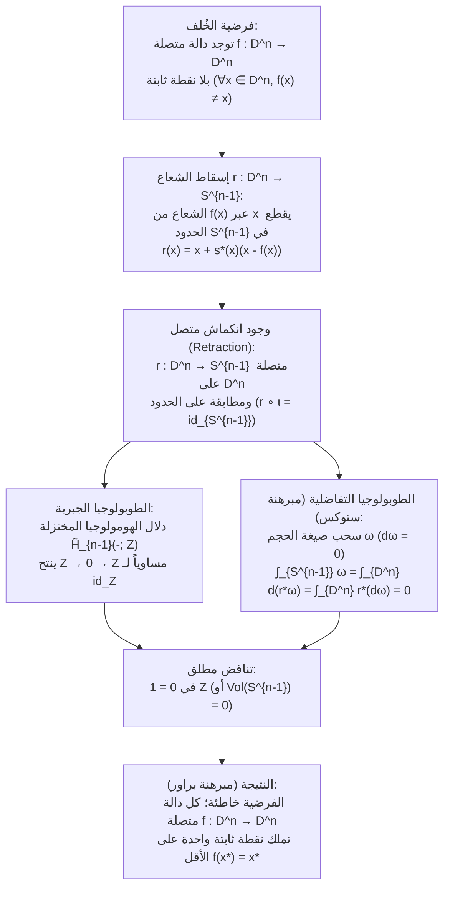
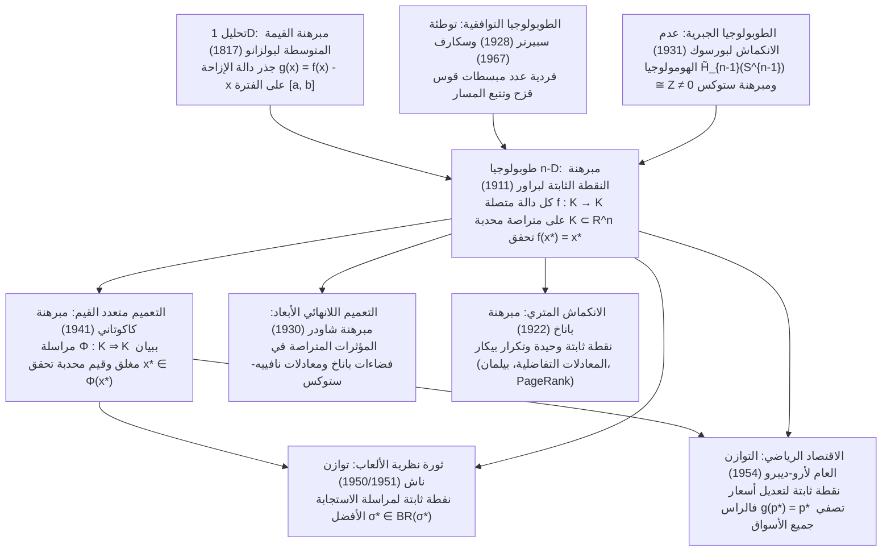

## مقدمة: ثلاث معجزات يومية للحتمية الطوبولوجية

تخيل أنك تصب قهوة ساخنة في كوب أسطواني، وتضيف القليل من الحليب، ثم تحركها بقوة بالملعقة. تنشأ دوامات معقدة وطيات انسيابية داخل السائل. وعندما تهدأ القهوة تماماً، يخبرنا حدسنا أن كل قطرة قد انتقلت بعيداً عن موقعها الأصلي. غير أنه في عام 1911، أثبت عالم الرياضيات الهولندي <strong>لويتزن إغبرتوس يان براور (L.E.J. Brouwer, 1881–1966)</strong> <strong>مبرهنة النقطة الثابتة لبراور (Brouwer's Fixed-Point Theorem)</strong>، التي تؤكد بيقين رياضي مطلق ما يلي:

> [!IMPORTANT]
> <strong>المعجزة 1: النقطة الساكنة في فنجان القهوة بعد تقليبه</strong>
> مهما كانت قوة أو عشوائية تقليبك للقهوة — طالما لم ينسكب السائل خارج الكوب، ولم تتكون فجوات غازية دائمة بالداخل، ولم يتمزق الوسط المتصل — فإنه لحظة سكون السائل، <strong>يوجد حتماً نقطة واحدة على الأقل (جزيء قهوة في النهاية المتصلة) تشغل نفس الإحداثيات المكانية ثلاثية الأبعاد $(x^*, y^*, z^*)$ التي كانت تشغلها بالضبط قبل أن تلمس الملعقة الكوب</strong>!

> [!TIP]
> <strong>المعجزة 2: الخريطة المجعدة الملقاة فوق خريطة مسطحة</strong>
> خذ خريطتين متطابقتين لنفس المنطقة (<strong>الخريطة A</strong> و<strong>الخريطة B</strong>). ابسط الخريطة A مسطحة على مكتبك، واجعل الخريطة B مجعدة على شكل كرة ورقية عشوائية (دون تمزيق الورق)، ثم ألقِها في أي مكان داخل حدود الخريطة A. عندئذٍ، <strong>توجد حتماً نقطة جغرافية واحدة على الأقل $x^*$ على الخريطة المجعدة B تقع عمودياً بالضبط فوق نفس النقطة الجغرافية $x^*$ على الخريطة المسطحة A تحتها</strong>!

وبالمثل، تفسر <strong>مبرهنة الكرة المشعرة (Hairy Ball Theorem)</strong> لبوانكاريه وبراور على الكرة $S^2$ لماذا توجد في رأس كل إنسان <strong>دوامة شعر</strong> واحدة على الأقل، ولماذا توجد في كل لحظة على سطح الأرض نقطة واحدة على الأقل تكون فيها سرعة الرياح الأفقية <strong>صفراً تماماً (عين الإعصار)</strong>.

### الصياغة الرياضية الدقيقة لمبرهنة النقطة الثابتة لبراور (1911)

ليكن $K \subset \mathbb{R}^n$ مجموعة جزئية <strong>غير خالية، متراصة (مغلقة ومحدودة)، ومحدبة (Convex)</strong> في الفضاء الإقليدي $\mathbb{R}^n$ (أو فضاءً طوبولوجياً متشاكلاً مع كرة الوحدة المغلقة $D^n = \{x \in \mathbb{R}^n : \|x\|_2 \le 1\}$). لكل دالة <strong>متصلة</strong> $f: K \to K$، توجد نقطة واحدة على الأقل $x^* \in K$ (تسمى <strong>نقطة ثابتة Fixed Point</strong>) بحيث:

$$
f(x^*) = x^*
$$

---

## 1. لماذا لا يمكن الاستغناء عن أي فرضية؟ أربعة أمثلة مضادة حاسمة

بموجب مبرهنة هاينه-بوريل، يكافئ التراص في $\mathbb{R}^n$ اجتماع <strong>المحدودية</strong> و<strong>الانغلاق</strong>. إذا أسقطنا أياً من الشروط الأربعة (المحدودية، الانغلاق، التحدب/عدم وجود ثقوب، الاتصال)، تنهار المبرهنة فوراً:

1. <strong>إسقاط المحدودية (Unbounded)</strong>: على $K = \mathbb{R}$ (مغلقة ومحدبة)، دالة الإزاحة المتصلة $f(x) = x + 1$ ليس لها نقطة ثابتة ($x^* + 1 = x^*$ مستحيل) لأن جميع النقاط تهرب نحو $+\infty$.
2. <strong>إسقاط الانغلاق (Not Closed)</strong>: على الفترة المفتوحة $K = (0, 1)$ (محدودة ومحدبة)، الدالة $f(x) = \frac{x+1}{2}$ متصلة، لكن نقطتها الثابتة الجبرية الوحيدة $x^* = 1$ تقع على الحدود المحذوفة $\partial K \setminus K$.
3. <strong>إسقاط التحدب / الترابط البسيط (وجود ثقب)</strong>: على دائرة الوحدة $S^1$ أو الحلقة المغلقة (Annulus) $A = \{x \in \mathbb{R}^2 : \frac{1}{2} \le \|x\|_2 \le 1\}$، الدوران $f(x) = R_\theta x$ بزاوية $\theta \in (0, 2\pi)$ لا يملك أي نقطة ثابتة لأن مركز الدوران $(0, 0)$ يقع داخل الثقب الأوسط ($(0, 0) \notin A$).
4. <strong>إسقاط الاتصال (Discontinuous)</strong>: على $K = [0, 1]$، الدالة الدرجية $f(x) = 1$ على $[0, \frac{1}{2}]$ و$f(x) = 0$ على $(\frac{1}{2}, 1]$ تقفز فوق القطر $y = x$ عند $x = \frac{1}{2}$ دون قطعه.

| الفرضية المحذوفة | الشروط المتبقية | المثال المضاد الصريح ($K$ و$f: K \to K$) | السبب الهندسي لاختفاء النقطة الثابتة $f(x^*) = x^*$ |
| :--- | :--- | :--- | :--- |
| <strong>1. المحدودية</strong> | مغلقة، محدبة، متصلة | $K = \mathbb{R}$, $f(x) = x + 1$ | غياب الجدار الخارجي؛ هروب لانهائي نحو $+\infty$ |
| <strong>2. الانغلاق</strong> | محدودة، محدبة، متصلة | $K = (0, 1)$, $f(x) = \frac{x+1}{2}$ | النقطة الثابتة $x^* = 1$ تقع على الحدود المستبعدة |
| <strong>3. التحدب (بلا ثقوب)</strong> | متراصة (مغلقة ومحدودة)، متصلة | $K = S^1$ أو الحلقة $A$، دوران $R_\theta$ | مركز الدوران $(0, 0)$ يسقط داخل الثقب الطوبولوجي |
| <strong>4. الاتصال</strong> | متراصة، محدبة | $K = [0, 1]$، $1$ على $[0,\frac{1}{2}]$ و$0$ على $(\frac{1}{2},1]$ | المنحنى $y = f(x)$ يقفز فوق خط القطر $y = x$ |

---

## 2. البرهان الأول: الحالة أحادية البعد ($n = 1$) عبر مبرهنة القيمة المتوسطة (IVT)

في البعد $n = 1$، كل مجموعة متراصة ومحدبة غير خالية هي فترة مغلقة $K = [a, b]$. لأي دالة متصلة $f: [a, b] \to [a, b]$، نعرّف دالة الإزاحة المتصلة $g(x) = f(x) - x$. بما أن $f(a) \ge a$ و$f(b) \le b$، فإن:

$$
g(a) = f(a) - a \ge 0, \qquad g(b) = f(b) - b \le 0
$$

بموجب <strong>مبرهنة القيمة المتوسطة لبولزانو (Intermediate Value Theorem, IVT)</strong>، توجد نقطة $x^* \in [a, b]$ تحقق $g(x^*) = 0 \iff f(x^*) = x^*$. أما في الأبعاد $n \ge 2$، فإن الفضاء المثقوب $\mathbb{R}^n \setminus \{\mathbf{0}\}$ يظل مترابطاً مسارياً، مما يستلزم استخدام الطوبولوجيا الجبرية أو التوافقية.

---

## 3. البرهان الثاني: الطوبولوجيا الجبرية ومبرهنة عدم الانكماش لبورسوك (1931)

في عام 1931، أثبت عالم الرياضيات البولندي <strong>كارول بورسوك (Karol Borsuk)</strong> أن مبرهنة براور تكافئ <strong>مبرهنة عدم الانكماش (No-Retraction Theorem)</strong>: لا يوجد أي انكماش متصل (Retraction) $r: D^n \to S^{n-1}$ من كرة الوحدة المغلقة $D^n$ إلى غلافها الكروي $S^{n-1} = \partial D^n$ يثبت كل نقطة على الحدود ($r|_{S^{n-1}} = \text{id}_{S^{n-1}}$).

### الخطوة 1: دالة بلا نقطة ثابتة تنشئ انكماشاً متصلاً $r: D^n \to S^{n-1}$

لنفترض جدلاً وجود دالة متصلة $f: D^n \to D^n$ تحقق $f(x) \ne x$ لكل $x \in D^n$. عندئذٍ يكون متجه الإزاحة $u(x) = x - f(x) \ne \mathbf{0}$ غير صفري أبداً. الشعاع المنطلق من $f(x)$ ماراً بـ $x$ وفق المعادلة $\gamma_x(t) = x + s u(x)$ ($s = t - 1 \ge 0$) يقطع الكرة $S^{n-1}$ في نقطة وحيدة:

$$
r(x) = x + s^*(x)\bigl(x - f(x)\bigr), \qquad s^*(x) = \frac{-\langle x, u(x)\rangle + \sqrt{\langle x, u(x)\rangle^2 + \|u(x)\|_2^2(1 - \|x\|_2^2)}}{\|u(x)\|_2^2}
$$

بما أن $\|u(x)\|_2^2 > 0$، فإن $r: D^n \to S^{n-1}$ متصلة على كامل $D^n$، وعندما $x \in S^{n-1}$ ($\|x\|_2^2 = 1$)، نحصل على $s^*(x) = 0$ أي $r(x) = x$. إذن $r$ انكماش متصل!

### الخطوة 2: إثبات التناقض عبر دلال الهومولوجيا $\tilde{H}_{n-1}$ ومبرهنة ستوكس

1. <strong>البرهان عبر الهومولوجيا المختزلة $\tilde{H}_{n-1}$</strong>:
   بتطبيق دلال الهومولوجيا المفردة المختزلة $\tilde{H}_{n-1}(-; \mathbb{Z})$ على $S^{n-1} \xrightarrow{\iota} D^n \xrightarrow{r} S^{n-1}$ ($r \circ \iota = \text{id}_{S^{n-1}}$)، وبما أن الكرة المصمتة $D^n$ قابلة للتقلص ($\tilde{H}_{n-1}(D^n) \cong 0$) بينما $\tilde{H}_{n-1}(S^{n-1}) \cong \mathbb{Z}$، نحصل على:
   $$
   \mathbb{Z} \xrightarrow{\;\iota_*\;} 0 \xrightarrow{\;r_*\;} \mathbb{Z}
   $$
   أي تشاكل يمر عبر الزمرة الصفرية $0$ هو تشاكل صفري ($1 \mapsto 0$)، بينما $(r \circ \iota)_* = \text{id}_{\mathbb{Z}}$ يرسل $1 \mapsto 1$، مما يؤدي إلى التناقض المستحيل $1 = 0$ في $\mathbb{Z}$!
2. <strong>البرهان التحليلي عبر مبرهنة ستوكس</strong>:
   لانكماش أملس $r: D^n \to S^{n-1}$ وصيغة الحجم التفاضلية $\omega$ من الدرجة $(n-1)$ على $S^{n-1}$ ($\int_{S^{n-1}} \omega = \text{Vol}(S^{n-1}) > 0$ و$d\omega = 0$)، تعطي مبرهنة ستوكس:
   $$
   0 < \int_{S^{n-1}} \omega = \int_{\partial D^n} r^*\omega = \int_{D^n} d(r^*\omega) = \int_{D^n} r^*(d\omega) = 0
   $$

---

## 4. البرهان الثالث: التوافقيات البنائية عبر توطئة سبيرنر (1928)

بصفته مؤسس <strong>الحدسية الرياضية (Intuitionism)</strong>، رفض براور لاحقاً برهانه غير البنائي لأنه لا يقدم خوارزمية لحساب إحداثيات $x^*$.

في عام 1928، أثبت <strong>إيمانويل سبيرنر (Emanuel Sperner)</strong> <strong>توطئة سبيرنر</strong>: في أي تثليث لمبسط $\Delta^n = \text{conv}\{v_0, \dots, v_n\}$ مع تلوين سبيرنر $\ell: V(\mathcal{T}) \to \{0, 1, \dots, n\}$ ($\ell(v_i) = i$ وكل وجه حدودي $\text{conv}\{v_{i_0}, \dots, v_{i_k}\}$ يستخدم فقط ألواناً من $\{i_0, \dots, i_k\}$)، <strong>يكون عدد المبسطات الجزئية «قوس قزح» (التي تحمل جميع الألوان $n+1$ المختلفة) دائماً عدداً فردياً، وبالتالي يوجد واحد على الأقل</strong>!

بتلوين كل رأس $w$ باللون $i$ الذي يحقق $\lambda_i(w) > 0$ و$\lambda_i(f(w)) \le \lambda_i(w)$ في الإحداثيات الثقلية، وعندما يؤول قطر الشبكة إلى $0$، يضمن التراص (بولزانو-فايرشتراس) والاتصال تقارب مبسطات قوس قزح إلى نقطة $x^*$ تحقق $\lambda_i(f(x^*)) \le \lambda_i(x^*)$ لكل $i$، ومنه $f(x^*) = x^*$. وفي عام 1967، حوّل الاقتصادي <strong>هربرت سكارف (Herbert Scarf)</strong> هذا المسار إلى <strong>خوارزمية سكارف</strong> لحساب النقاط الثابتة رقمياً.

---

## 5. الهرمية الكبرى لمبرهنات النقطة الثابتة: باناخ، براور، شاودر، وكاكوتاني

1. <strong>مبرهنة الانكماش لباناخ (1922)</strong>: في أي <strong>فضاء متري تام</strong> غير خالٍ $(X, d)$، يمتلك التطبيق الانكماشي $d(Tx, Ty) \le L d(x, y)$ ($0 \le L < 1$) نقطة ثابتة <strong>وحيدة</strong> $x^*$، ويتقارب إليها تكرار بيكار $x_{k+1} = T(x_k)$ هندسياً (أساس مبرهنة بيكار-ليندلوف للمعادلات التفاضلية، و<strong>تكرار القيمة لبيلمان</strong> في التعلم المعزز، وخوارزمية <strong>Google PageRank</strong>).
2. <strong>فخ الأبعاد اللانهائية ومبرهنة شاودر (1930)</strong>: على كرة الوحدة المغلقة $B_{\ell^2}$ في فضاء هلبرت $\ell^2$، الدالة المتصلة $f(x_1, x_2, \dots) = (\sqrt{1 - \|x\|_2^2}, x_1, x_2, \dots)$ <strong>لا تملك نقطة ثابتة</strong> لأن $B_{\ell^2}$ غير متراصة! استعاد <strong>شاودر (1930)</strong> المبرهنة في فضاءات باناخ عندما يكون $T: K \to K$ <strong>مؤثراً متراصاً (Compact Operator)</strong> (حاسم لمعادلات نافييه-ستوكس التفاضلية الجزئية).
3. <strong>مبرهنة شيزو كاكوتاني (1941)</strong>: تعمم مبرهنة براور إلى <strong>المراسلات متعددة القيم</strong> $\Phi: K \rightrightarrows K$ على مجموعة متراصة ومحدبة $K \subset \mathbb{R}^n$. إذا كانت $\Phi(x)$ غير خالية ومحدبة لكل $x$ وكان بيان $\Phi$ <strong>مغلقاً (شبه متصل علويًا)</strong>، فتوجد $x^* \in K$ تحقق $x^* \in \Phi(x^*)$.

| المبرهنة والسنة | الفضاء والمجال $K$ | الشروط على $f$ أو $\Phi$ | الوحدانية والحوسبة | التطبيقات الرئيسية |
| :--- | :--- | :--- | :--- | :--- |
| <strong>باناخ (1922)</strong> | فضاء متري تام $(X, d)$ (بعد منتهٍ أو $\infty$) | انكماش: $d(Tx, Ty) \le L d(x, y)$ ($L < 1$) | <strong>وحيدة</strong>؛ تكرار $x_{k+1}=T(x_k)$ هندسي | المعادلات التفاضلية، بيلمان RL، PageRank |
| <strong>براور (1911)</strong> | متراصة محدبة $K \subset \mathbb{R}^n$ (بعد منتهٍ) | دالة متصلة وحيدة القيمة $f: K \to K$ | <strong>واحدة على الأقل</strong>؛ تحسب بخوارزمية سكارف | المعادلات غير الخطية، ناش (1951)، فالراس |
| <strong>شاودر (1930)</strong> | مغلقة محدودة محدبة $K$ في فضاء باناخ | <strong>مؤثر متراص</strong> متصل $T: K \to K$ | <strong>واحدة على الأقل</strong> | المعادلات التفاضلية الجزئية (نافييه-ستوكس) |
| <strong>كاكوتاني (1941)</strong> | متراصة محدبة $K \subset \mathbb{R}^n$ | مراسلة $\Phi: K \rightrightarrows K$ (قيم محدبة، بيان مغلق) | <strong>واحدة على الأقل</strong> ($x^* \in \Phi(x^*)$) | توازن ناش (1950)، أرو-ديبرو (1954) |

---

## 6. كيف أحدثت الطوبولوجيا ثورة في الاقتصاد ونظرية الألعاب: ناش (1950) وأرو-ديبرو (1954)

### 6.1 جون ناش (1950، 1951): إثبات وجود توازن ناش

في لعبة منتهية ذات $N$ لاعبين، يكون فضاء الاستراتيجيات المختلطة المشتركة $K = \Delta_1 \times \dots \times \Delta_N$ متراصاً ومحدباً.
- <strong>البرهان عبر كاكوتاني (1950)</strong>: <strong>مراسلة الاستجابة الأفضل (Best-Response Correspondence)</strong> $BR_i(\sigma_{-i}) = \arg\max_{\tau_i \in \Delta_i} U_i(\tau_i, \sigma_{-i})$ لها قيم غير خالية ومحدبة (بفضل خطية العائد المتوقع $U_i$ في $\tau_i$) وبيان مغلق. بموجب <strong>مبرهنة كاكوتاني</strong>، توجد $\sigma^* \in BR(\sigma^*)$ وهي <strong>توازن ناش</strong>!
- <strong>البرهان المباشر عبر براور (1951)</strong>: بتعريف المكسب الإضافي $\varphi_{ij}(\sigma) = \max\{0, U_i(s_{ij}, \sigma_{-i}) - U_i(\sigma_i, \sigma_{-i})\}$، فإن الدالة المتصلة
  $$
  f_{ij}(\sigma) = \frac{\sigma_{ij} + \varphi_{ij}(\sigma)}{1 + \sum_{k=1}^{m_i} \varphi_{ik}(\sigma)}
  $$
  تملك نقطة ثابتة $f(\sigma^*) = \sigma^*$ بموجب <strong>براور</strong>، مما يستلزم $\varphi_{ij}(\sigma^*) = 0$ لكل $i, j$.

### 6.2 أرو وديبرو (1954): التوازن التنافسي العام لفالراس

على مبسط الأسعار $\Delta^{L-1} = \{p \in \mathbb{R}_+^L : \sum_{\ell=1}^L p_\ell = 1\}$، تحقق دالة فائض الطلب الكلي $z(p)$ <strong>قانون فالراس</strong> $\sum_{\ell=1}^L p_\ell z_\ell(p) = 0$. دالة تعديل الأسعار $g_\ell(p) = \frac{p_\ell + \max\{0, z_\ell(p)\}}{1 + \sum_{k=1}^L \max\{0, z_k(p)\}}$ تملك نقطة ثابتة $g(p^*) = p^*$ بموجب <strong>براور</strong>. بضرب الطرفين في $z_\ell(p^*)$ والجمع على $\ell$ مع قانون فالراس نحصل على:

$$
\sum_{\ell=1}^L \bigl(\max\{0, z_\ell(p^*)\}\bigr)^2 = 0 \implies z_\ell(p^*) \le 0 \quad (\forall \ell = 1, \dots, L)
$$

وهكذا تتوازن جميع الأسواق في آنٍ واحد!

