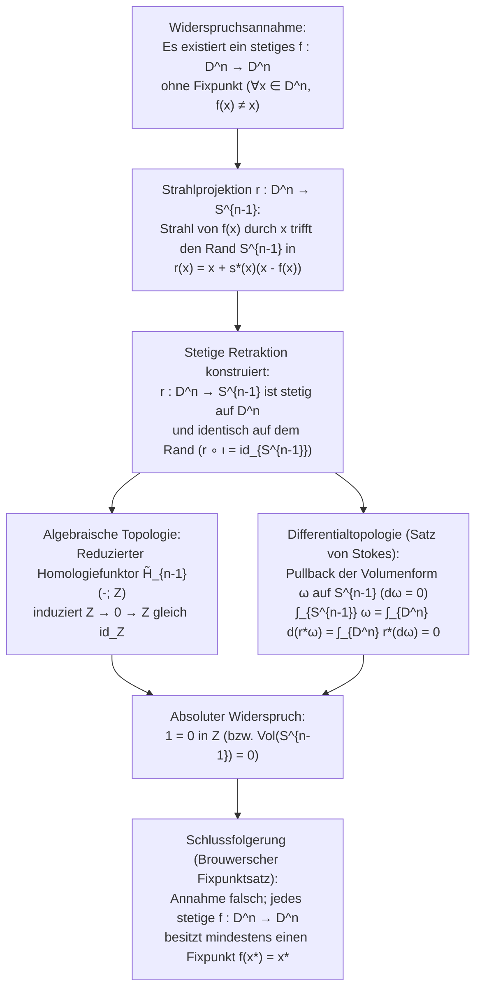
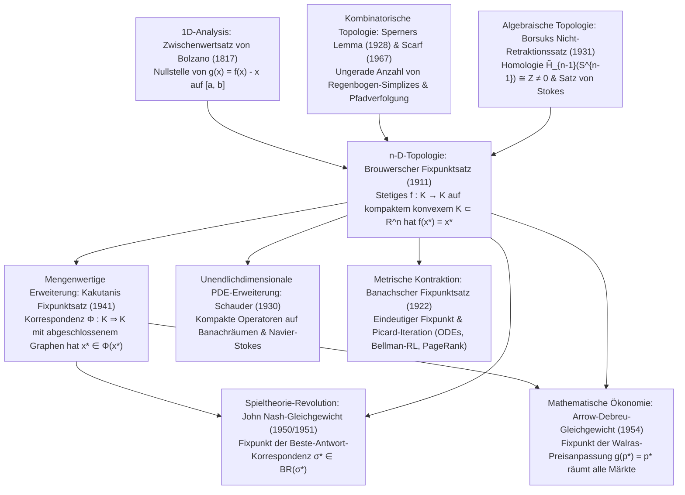

## Einleitung: Drei alltägliche Wunder topologischer Unausweichlichkeit

Stellen Sie sich vor, Sie gießen heißen Kaffee in eine Tasse, geben etwas Milch hinzu und rühren kräftig mit einem Löffel um. Komplexe Wirbel, Turbulenzen und laminare Faltungen durchziehen die Flüssigkeit. Wenn der Kaffee schließlich zur Ruhe kommt, scheint jedes einzelne Molekül weit von seinem Ausgangsort entfernt zu sein. Doch im Jahr 1911 bewies der niederländische Mathematiker <strong>Luitzen Egbertus Jan Brouwer (1881–1966)</strong> den <strong>Brouwerschen Fixpunktsatz (Brouwer's Fixed-Point Theorem)</strong>, der unsere Intuition vollkommen auf den Kopf stellt:

> [!IMPORTANT]
> <strong>Wunder 1: Der unbewegte Punkt in der umgerührten Kaffeetasse</strong>
> Egal wie heftig oder kompliziert Sie Ihren Kaffee umrühren – solange nichts überschwappt, keine Kavitationsblasen Löcher im Inneren aufreißen und das Flüssigkeitskontinuum nicht zerrissen wird –, befindet sich nach dem Zur-Ruhe-Kommen <strong>garantiert mindestens ein Punkt (Kaffeemolekül im Kontinuumslimes) an exakt denselben dreidimensionalen Koordinaten $(x^*, y^*, z^*)$ wie vor dem Umrühren</strong>!

> [!TIP]
> <strong>Wunder 2: Die zerknüllte Landkarte auf dem Schreibtisch</strong>
> Nehmen Sie zwei identische Landkarten derselben Region (<strong>Karte A</strong> und <strong>Karte B</strong>). Legen Sie Karte A flach auf den Tisch, zerknüllen Sie Karte B zu einem beliebigen Papierball (ohne das Papier einzureißen) und legen Sie diesen irgendwo vollständig innerhalb der Ränder von Karte A ab. Dann <strong>liegt mindestens ein geografischer Punkt $x^*$ auf der zerknüllten Karte B exakt senkrecht über demselben geografischen Punkt $x^*$ auf der flachen Karte A darunter</strong>!

Zusammen mit dem verwandten <strong>Satz vom Igel (Hairy Ball Theorem)</strong> von Poincaré und Brouwer erklärt dieselbe Topologie auch, warum jeder Mensch mindestens einen <strong>Haarwirbel</strong> auf dem Kopf hat und warum es auf der Erdoberfläche $S^2$ zu jedem Zeitpunkt mindestens einen Ort mit <strong>absoluter Windstille (etwa das Auge eines Zyklons)</strong> geben muss.

### Formale Aussage des Brouwerschen Fixpunktsatzes (1911)

Sei $K \subset \mathbb{R}^n$ eine <strong>nichtleere, kompakte (beschränkte und abgeschlossene) und konvexe</strong> Teilmenge des $\mathbb{R}^n$ (oder allgemeiner ein zur abgeschlossenen Einheitskugel $D^n = \{x \in \mathbb{R}^n : \|x\|_2 \le 1\}$ homöomorpher Raum). Dann besitzt jede <strong>stetige Abbildung</strong> $f: K \to K$ mindestens einen <strong>Fixpunkt</strong> $x^* \in K$ mit:

$$
f(x^*) = x^*
$$

---

## 1. Warum jede einzelne Voraussetzung unverzichtbar ist: Vier scharfe Gegenbeispiele

Nach dem Satz von Heine-Borel ist $K \subset \mathbb{R}^n$ genau dann kompakt, wenn $K$ <strong>beschränkt</strong> und <strong>abgeschlossen</strong> ist. Lässt man auch nur eine der vier Säulen (Beschränktheit, Abgeschlossenheit, Konvexität/Lochfreiheit, Stetigkeit) weg, bricht der Satz sofort zusammen:

1. <strong>Ohne Beschränktheit</strong>: Auf $K = \mathbb{R}$ (abgeschlossen und konvex) hat die stetige Translation $f(x) = x + 1$ keinen Fixpunkt ($x^* + 1 = x^*$ ist unlösbar), da alle Punkte nach $+\infty$ entweichen.
2. <strong>Ohne Abgeschlossenheit</strong>: Auf dem offenen Intervall $K = (0, 1)$ (beschränkt und konvex) bildet $f(x) = \frac{x+1}{2}$ das Intervall stetig in sich selbst ab, aber der einzige algebraische Fixpunkt $x^* = 1$ liegt auf dem fehlenden Rand $\partial K \setminus K$.
3. <strong>Ohne Konvexität / Einfachzusammenhang (Mengen mit Loch)</strong>: Auf dem Einheitskreis $S^1$ oder dem Kreisring (Annulus) $A = \{x \in \mathbb{R}^2 : \frac{1}{2} \le \|x\|_2 \le 1\}$ ist eine Drehung $f(x) = R_\theta x$ um $\theta \in (0, 2\pi)$ stetig auf einer kompakten Menge, hat aber keinen Fixpunkt, weil das Drehzentrum $(0, 0)$ im inneren Loch liegt ($(0, 0) \notin A$).
4. <strong>Ohne Stetigkeit</strong>: Auf $K = [0, 1]$ springt die Funktion $f(x) = 1$ für $x \in [0, \frac{1}{2}]$ und $f(x) = 0$ für $x \in (\frac{1}{2}, 1]$ bei $x = \frac{1}{2}$ unstetig über die Diagonale $y = x$ hinweg.

| Weggelassene Annahme | Erfüllte Bedingungen | Konkretes Gegenbeispiel ($K$ und $f: K \to K$) | Geometrischer Grund für das Fehlen von $f(x^*) = x^*$ |
| :--- | :--- | :--- | :--- |
| <strong>1. Beschränktheit</strong> | Abgeschlossen, konvex, stetig | $K = \mathbb{R}$, $f(x) = x + 1$ | Keine äußere Randbarriere; Punkte wandern nach $+\infty$ |
| <strong>2. Abgeschlossenheit</strong> | Beschränkt, konvex, stetig | $K = (0, 1)$, $f(x) = \frac{x+1}{2}$ | Der Fixpunkt $x^* = 1$ liegt auf dem entfernten Rand |
| <strong>3. Konvexität (Lochfreiheit)</strong> | Kompakt (beschränkt & abgeschlossen), stetig | $K = S^1$ oder Kreisring $A$, Drehung $R_\theta$ | Das Drehzentrum $(0, 0)$ fällt in das topologische Loch |
| <strong>4. Stetigkeit</strong> | Kompakt, konvex | $K = [0, 1]$, $f(x)=1$ auf $[0,\frac{1}{2}]$, $0$ auf $(\frac{1}{2},1]$ | Der Graph $y = f(x)$ überspringt die Diagonale $y = x$ |

---

## 2. Erster Beweis: Der eindimensionale Fall ($n = 1$) über den Zwischenwertsatz

Im Eindimensionalen ist jede nichtleere kompakte konvexe Menge ein abgeschlossenes Intervall $K = [a, b]$. Für eine stetige Funktion $f: [a, b] \to [a, b]$ betrachten wir die stetige Verschiebungsfunktion $g(x) = f(x) - x$. Wegen $f(a) \ge a$ und $f(b) \le b$ gilt an den Intervallenden:

$$
g(a) = f(a) - a \ge 0, \qquad g(b) = f(b) - b \le 0
$$

Nach dem <strong>Zwischenwertsatz von Bolzano (Intermediate Value Theorem, IVT)</strong> besitzt $g$ mindestens eine Nullstelle $x^* \in [a, b]$ mit $g(x^*) = 0 \iff f(x^*) = x^*$. In höheren Dimensionen ($n \ge 2$) ist $\mathbb{R}^n \setminus \{\mathbf{0}\}$ jedoch wegzusammenhängend, sodass Vektorfelder den Ursprung umfließen können; daher benötigen wir algebraische oder kombinatorische Topologie.

---

## 3. Zweiter Beweis: Algebraische Topologie und Borsuks Nicht-Retraktionssatz (1931)

Der polnische Mathematiker <strong>Karol Borsuk (1931)</strong> zeigte, dass der Brouwersche Fixpunktsatz äquivalent zum <strong>Nicht-Retraktionssatz (No-Retraction Theorem)</strong> ist: Es gibt keine stetige Retraktion $r: D^n \to S^{n-1}$ von der abgeschlossenen Einheitskugel $D^n$ auf ihre Randsphäre $S^{n-1} = \partial D^n$ mit $r|_{S^{n-1}} = \text{id}_{S^{n-1}}$ (man kann kein Trommelfell ohne Zerreißen auf den festen Trommelring plattdrücken).

### Schritt 1: Konstruktion einer Retraktion aus einer fixpunktfreien Abbildung

Angenommen, es gäbe eine stetige Abbildung $f: D^n \to D^n$ mit $f(x) \ne x$ für alle $x \in D^n$. Dann ist $u(x) = x - f(x) \ne \mathbf{0}$ überall von null verschieden. Der von $f(x)$ durch $x$ geschossene Strahl $\gamma_x(t) = x + s u(x)$ ($s = t - 1 \ge 0$) trifft die Randsphäre $S^{n-1}$ im eindeutigen Punkt:

$$
r(x) = x + s^*(x)\bigl(x - f(x)\bigr), \qquad s^*(x) = \frac{-\langle x, u(x)\rangle + \sqrt{\langle x, u(x)\rangle^2 + \|u(x)\|_2^2(1 - \|x\|_2^2)}}{\|u(x)\|_2^2}
$$

Da $\|u(x)\|_2^2 > 0$ auf ganz $D^n$ gilt, ist $r: D^n \to S^{n-1}$ stetig, und für $x \in S^{n-1}$ ($\|x\|_2^2 = 1$) folgt $s^*(x) = 0$, also $r(x) = x$. Somit wäre $r$ eine stetige Retraktion!

### Schritt 2: Widerspruch über Homologiefunktoren $\tilde{H}_{n-1}$ und den Satz von Stokes

1. <strong>Beweis über reduzierte Homologie $\tilde{H}_{n-1}$</strong>:
   Wendet man den $(n-1)$-ten reduzierten singulären Homologiefunktor $\tilde{H}_{n-1}(-; \mathbb{Z})$ auf $S^{n-1} \xrightarrow{\iota} D^n \xrightarrow{r} S^{n-1}$ ($r \circ \iota = \text{id}_{S^{n-1}}$) an, so erhält man wegen der Zusammenziehbarkeit von $D^n$ ($\tilde{H}_{n-1}(D^n) \cong 0$) und $\tilde{H}_{n-1}(S^{n-1}) \cong \mathbb{Z}$ das kommutative Diagramm:
   $$
   \mathbb{Z} \xrightarrow{\;\iota_*\;} 0 \xrightarrow{\;r_*\;} \mathbb{Z}
   $$
   Jeder Homomorphismus, der über die triviale Gruppe $0$ faktorisiert, ist die Nullabbildung ($1 \mapsto 0$), während $\text{id}_{\mathbb{Z}}$ das Element $1 \mapsto 1$ schickt – ein Widerspruch ($1 = 0$ in $\mathbb{Z}$)!
2. <strong>Beweis über Differentialformen und den Satz von Stokes</strong>:
   Für eine glatte Retraktion $r: D^n \to S^{n-1}$ und die Volumenform $\omega \in \Omega^{n-1}(S^{n-1})$ mit $\int_{S^{n-1}} \omega = \text{Vol}(S^{n-1}) > 0$ und $d\omega = 0$ liefert der Satz von Stokes den Widerspruch:
   $$
   0 < \int_{S^{n-1}} \omega = \int_{\partial D^n} r^*\omega = \int_{D^n} d(r^*\omega) = \int_{D^n} r^*(d\omega) = 0
   $$

---

## 4. Dritter Beweis: Konstruktive Kombinatorik über Sperners Lemma (1928)

Als Begründer des <strong>mathematischen Intuitionismus</strong> lehnte Brouwer später seinen eigenen indirekten Widerspruchsbeweis ab, da er keinen konstruktiven Algorithmus zur Berechnung von $x^*$ lieferte.

Die konstruktive Rettung gelang 1928 dem 22-jährigen <strong>Emanuel Sperner</strong> mit <strong>Sperners Lemma</strong>: Wird ein $n$-dimensionales Simplex $\Delta^n = \text{conv}\{v_0, \dots, v_n\}$ trianguliert und jede Ecke mit einer Farbe $\ell(w) \in \{0, 1, \dots, n\}$ gefärbt, sodass $\ell(v_i) = i$ gilt und Ecken auf jeder Randseite $\text{conv}\{v_{i_0}, \dots, v_{i_k}\}$ nur Farben aus $\{i_0, \dots, i_k\}$ tragen, dann <strong>ist die Anzahl der „Regenbogen-Simplizes“ (die alle $n+1$ Farben tragen) stets ungerade, also mindestens eins</strong>!

Färbt man jede Ecke $w$ mit einem Index $i$, für den in baryzentrischen Koordinaten $\lambda_i(w) > 0$ und $\lambda_i(f(w)) \le \lambda_i(w)$ gilt, so konvergieren die Regenbogen-Simplizes für Gitterweite $\delta_k \to 0$ dank Kompaktheit (Bolzano-Weierstraß) und Stetigkeit gegen einen Punkt $x^*$ mit $\lambda_i(f(x^*)) \le \lambda_i(x^*)$ für alle $i$, woraus wegen $\sum_i \lambda_i = 1$ sofort $f(x^*) = x^*$ folgt. 1967 entwickelte <strong>Herbert Scarf</strong> daraus seinen <strong>Scarf-Simplex-Algorithmus</strong> zur numerischen Berechnung von Fixpunkten.

---

## 5. Die große Hierarchie der Fixpunktsätze: Banach, Brouwer, Schauder und Kakutani

1. <strong>Banachscher Fixpunktsatz (Contraction Mapping Principle, 1922)</strong>: Auf jedem nichtleeren <strong>vollständigen metrischen Raum</strong> $(X, d)$ besitzt eine echte Kontraktion $d(Tx, Ty) \le L d(x, y)$ ($0 \le L < 1$) einen <strong>eindeutigen</strong> Fixpunkt $x^*$, gegen den die Iteration $x_{k+1} = T(x_k)$ geometrisch konvergiert (Fundament für den Satz von Picard-Lindelöf bei DGLs, <strong>Bellman-Wertiteration</strong> im Reinforcement Learning und <strong>Google PageRank</strong>).
2. <strong>Unendlichdimensionale Falle & Fixpunktsatz von Schauder (1930)</strong>: Auf der abgeschlossenen Einheitskugel $B_{\ell^2}$ des unendlichdimensionalen Hilbertraums $\ell^2$ hat die stetige Abbildung $f(x_1, x_2, \dots) = (\sqrt{1 - \|x\|_2^2}, x_1, x_2, \dots)$ <strong>keinen Fixpunkt</strong>, da $B_{\ell^2}$ nicht kompakt ist! <strong>Schauder (1930)</strong> bewies, dass der Fixpunktsatz in Banachräumen gültig bleibt, wenn $T: K \to K$ ein <strong>kompakter Operator</strong> ist (zentral für nichtlineare partielle Differentialgleichungen wie Navier-Stokes).
3. <strong>Fixpunktsatz von Shizuo Kakutani (1941)</strong>: Verallgemeinert Brouwer auf <strong>mengenwertige Korrespondenzen</strong> $\Phi: K \rightrightarrows K$ auf kompakten konvexen Mengen $K \subset \mathbb{R}^n$. Ist $\Phi(x)$ für jedes $x \in K$ <strong>nichtleer und konvex</strong> und besitzt $\Phi$ einen <strong>abgeschlossenen Graphen (obere Halbstetigkeit)</strong>, so existiert ein $x^* \in K$ mit $x^* \in \Phi(x^*)$.

| Fixpunktsatz & Jahr | Raum & Definitionsbereich $K$ | Bedingung an $f$ bzw. $\Phi$ | Eindeutigkeit & Berechnung | Hauptanwendungen |
| :--- | :--- | :--- | :--- | :--- |
| <strong>Banach (1922)</strong> | Vollständiger metrischer Raum $(X, d)$ (auch $\infty$-dim.) | Kontraktion: $d(Tx, Ty) \le L d(x, y)$ ($L < 1$) | <strong>Eindeutig</strong>; Iteration $x_{k+1}=T(x_k)$ konvergiert | Picard-Lindelöf (ODEs), Bellman-RL, PageRank |
| <strong>Brouwer (1911)</strong> | Kompakte konvexe Menge $K \subset \mathbb{R}^n$ (endlichdim.) | Beliebige stetige Abbildung $f: K \to K$ | <strong>Mindestens einer</strong>; berechenbar via Scarf-Algorithmus | Nichtlineare Gleichungen, Nash (1951), Markträumung |
| <strong>Schauder (1930)</strong> | Abgeschlossene beschränkte konvexe Menge $K \subset X$ | Stetiger <strong>kompakter Operator</strong> $T: K \to K$ | <strong>Mindestens einer</strong> | Nichtlineare PDEs (Navier-Stokes-Gleichungen) |
| <strong>Kakutani (1941)</strong> | Kompakte konvexe Menge $K \subset \mathbb{R}^n$ | Korrespondenz $\Phi: K \rightrightarrows K$ (konvexwertig, abgeschl. Graph) | <strong>Mindestens einer</strong> ($x^* \in \Phi(x^*)$) | Nash-Gleichgewicht (1950), Arrow-Debreu (1954) |

---

## 6. Wie Topologie die Ökonomie und Spieltheorie revolutionierte: Nash (1950) und Arrow-Debreu (1954)

### 6.1 John Nash (1950, 1951): Existenz des Nash-Gleichgewichts

In einem endlichen $N$-Personen-Spiel ist der Raum der gemischten Strategienprofile $K = \Delta_1 \times \dots \times \Delta_N$ kompakt und konvex.
- <strong>Beweis über Kakutani (1950)</strong>: Die <strong>Beste-Antwort-Korrespondenz</strong> $BR_i(\sigma_{-i}) = \arg\max_{\tau_i \in \Delta_i} U_i(\tau_i, \sigma_{-i})$ hat wegen der Linearität der erwarteten Auszahlung $U_i$ in $\tau_i$ nichtleere, konvexe Werte und einen abgeschlossenen Graphen. Nach <strong>Kakutanis Fixpunktsatz</strong> existiert ein $\sigma^* \in BR(\sigma^*)$ – ein <strong>Nash-Gleichgewicht</strong>!
- <strong>Direkter Beweis über Brouwer (1951)</strong>: Mit dem Zusatzgewinn $\varphi_{ij}(\sigma) = \max\{0, U_i(s_{ij}, \sigma_{-i}) - U_i(\sigma_i, \sigma_{-i})\}$ besitzt die stetige Abbildung
  $$
  f_{ij}(\sigma) = \frac{\sigma_{ij} + \varphi_{ij}(\sigma)}{1 + \sum_{k=1}^{m_i} \varphi_{ik}(\sigma)}
  $$
  nach <strong>Brouwer</strong> einen Fixpunkt $f(\sigma^*) = \sigma^*$. Da nicht alle mit positiver Wahrscheinlichkeit gespielten reinen Strategien besser als ihr gewichteter Durchschnitt sein können, folgt $\varphi_{ij}(\sigma^*) = 0$ für alle $i, j$.

### 6.2 Arrow und Debreu (1954): Allgemeines Walrasianisches Marktgleichgewicht

Auf dem Preissimplex $\Delta^{L-1} = \{p \in \mathbb{R}_+^L : \sum_{\ell=1}^L p_\ell = 1\}$ erfüllt die Überschussnachfrage $z(p)$ das <strong>Walras-Gesetz</strong> $\sum_{\ell=1}^L p_\ell z_\ell(p) = 0$. Die Preisanpassungsabbildung $g_\ell(p) = \frac{p_\ell + \max\{0, z_\ell(p)\}}{1 + \sum_{k=1}^L \max\{0, z_k(p)\}}$ besitzt nach <strong>Brouwer</strong> einen Fixpunkt $g(p^*) = p^*$. Multiplikation mit $z_\ell(p^*)$ und Summation über $\ell$ liefert dank des Walras-Gesetzes:

$$
\sum_{\ell=1}^L \bigl(\max\{0, z_\ell(p^*)\}\bigr)^2 = 0 \implies z_\ell(p^*) \le 0 \quad (\forall \ell = 1, \dots, L)
$$

Damit sind sämtliche Märkte gleichzeitig im Gleichgewicht!

