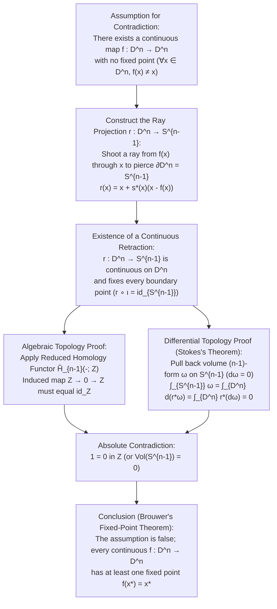
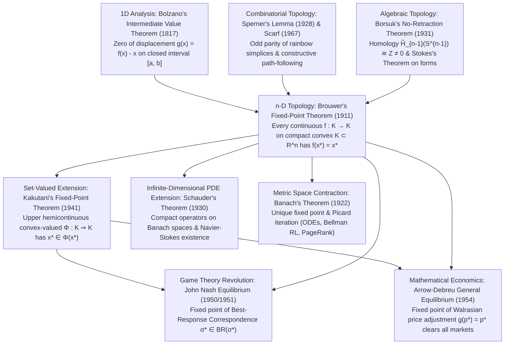

## Introduction: Three Everyday Miracles of Topological Inevitability

Imagine pouring hot coffee into a cylindrical ceramic mug, adding a splash of cream, and stirring it vigorously with a spoon. Chaotic vortices, turbulent eddies, and intricate laminar folds swirl through the dark liquid. Finally, you remove the spoon and wait until the fluid comes completely to rest. Looking at the milky marble pattern on the surface, it seems obvious that every single drop of coffee has been swept far away from where it started.

Yet in 1911, the Dutch mathematician <strong>Luitzen Egbertus Jan Brouwer (1881–1966)</strong> proved a theorem in algebraic topology that overturns our physical intuition with absolute mathematical certainty: <strong>Brouwer's Fixed-Point Theorem</strong>.

> [!IMPORTANT]
> <strong>Miracle 1: The Unmoved Point in a Stirred Cup of Coffee</strong>
> No matter how vigorously, chaotically, or intricately you stir a cup of coffee—provided no liquid splashes out over the rim, no cavitation bubbles open up permanent holes inside the fluid volume, and the fluid continuum is not torn apart—when the liquid comes to rest, <strong>there is guaranteed to be at least one point (coffee molecule in the continuum limit) occupying the exact same three-dimensional spatial coordinates $(x^*, y^*, z^*)$ that it occupied before you touched the spoon</strong>!

"Wait," you might protest, "what if I simply rotate the entire cylinder of coffee around its vertical axis?" Look closely: even in a pure rigid rotation of a cylinder, every point along the central vertical axis of the vortex stays in its exact initial position! What makes Brouwer's theorem breathtaking is that even if you tilt the spoon and stir horizontally, vertically, and diagonally in a wild three-dimensional tangle—intentionally trying to displace the central axis—you still cannot avoid leaving at least one point in the exact spot where it started. (And if you stir the coffee a second time, at least one point will again end up at its original pre-first-stir position, though not necessarily the same point that stood still after the first stir!)

Here is a second manifestation of the exact same theorem that you can test on your desk right now:

> [!TIP]
> <strong>Miracle 2: The Crumpled Map Dropped onto a Flat Map</strong>
> Take two identical printed maps of the same region (say, two identical maps of Tokyo, New York, or the entire world)—<strong>Map A</strong> and <strong>Map B</strong>. Lay Map A flat on your desk. Take Map B, crumple it into a wadded-up three-dimensional ball of arbitrary complexity (creasing and folding it as much as you like, as long as you do not rip or tear the paper), and drop the crumpled ball anywhere so that it rests completely within the borders of flat Map A.
> Then, regardless of how you crumpled Map B or where you dropped it inside Map A, <strong>there exists at least one geographical point $x^*$ on the crumpled Map B that lies vertically directly above the exact same geographical coordinate $x^*$ on the flat Map A beneath it</strong>!

A third closely related topological cousin—the <strong>Poincaré–Brouwer Hairy Ball Theorem</strong> on even-dimensional spheres $S^{2k}$—explains two more everyday phenomena:

> [!NOTE]
> <strong>Miracle 3: The Crown Hair Whorl and the Eye of a Cyclone</strong>
> You can never comb the hair on a spherical head (or a furry coconut) completely flat and continuously everywhere without creating at least one <strong>crown whorl (cowlick / singularity)</strong> where the hair stands straight up or swirls around a zero vector. By the exact same mathematical theorem applied to the horizontal wind-velocity vector field tangent to the Earth's spherical surface $S^2$, <strong>at every single instant in time, there is at least one location on Earth where the horizontal wind speed is strictly zero</strong> (such as the calm eye of a cyclone or center of an anticyclone)!

None of these three phenomena depend on the Navier–Stokes equations of fluid mechanics, the elasticity of paper, or the meteorology of Earth's atmosphere. They are pure consequences of <strong>topology</strong>—the mathematical study of how space hangs together under continuous deformations.

### The Formal Statement of Brouwer's Fixed-Point Theorem (1911)

Let us state Brouwer's Fixed-Point Theorem in precise mathematical terms.

$$
\text{Let } K \subset \mathbb{R}^n \text{ be non-empty, compact, and convex. For every continuous map } f: K \to K, \quad \exists x^* \in K \text{ such that } f(x^*) = x^*.
$$

In words: Let $K \subset \mathbb{R}^n$ be any <strong>non-empty, compact (closed and bounded), and convex</strong> subset of $n$-dimensional Euclidean space. Then for any <strong>continuous</strong> function $f: K \to K$ mapping $K$ into itself, there exists at least one point $x^* \in K$—called a <strong>fixed point</strong> of $f$—such that:

$$
f(x^*) = x^*
$$

More generally, the <strong>Fixed-Point Property (FPP)</strong> is a <strong>topological invariant</strong>: if a topological space $X$ is <strong>homeomorphic</strong> to a non-empty compact convex set $K \subset \mathbb{R}^n$ (or equivalently, homeomorphic to the closed unit ball $D^n = \{x \in \mathbb{R}^n : \|x\|_2 \le 1\}$ via a homeomorphism $h: D^n \xrightarrow{\sim} X$), then for any continuous map $g: X \to X$, the composite map $f = h^{-1} \circ g \circ h : D^n \to D^n$ is continuous on $D^n$ and therefore has a fixed point $z^* \in D^n$, which means $x^* = h(z^*) \in X$ satisfies $g(x^*) = h(f(h^{-1}(h(z^*)))) = h(z^*) = x^*$.

In this comprehensive article, we will explore:
1. Why every single hypothesis of Brouwer's theorem—<strong>boundedness</strong>, <strong>closedness</strong>, <strong>convexity (absence of holes)</strong>, and <strong>continuity</strong>—is strictly indispensable, via four sharp counterexamples.
2. How Brouwer's theorem in <strong>1D ($n = 1$)</strong> reduces to Bolzano's <strong>Intermediate Value Theorem (IVT)</strong>, and why naive IVT fails in higher dimensions ($n \ge 2$).
3. How <strong>Algebraic Topology</strong> conquers $n$ dimensions via <strong>Karol Borsuk's No-Retraction Theorem (1931)</strong>, proved both via the <strong>Homology Functor $\tilde{H}_{n-1}$</strong> and analytically via <strong>Stokes's Theorem on Differential Forms</strong>.
4. Why Brouwer himself—as the radical founder of <strong>Mathematical Intuitionism</strong>—later rejected his own non-constructive proof, and how <strong>Emanuel Sperner's Combinatorial Lemma (1928)</strong> and <strong>Herbert Scarf's Simplicial Algorithm (1967)</strong> turned Brouwer's theorem into a constructive, computer-executable algorithm.
5. How the great hierarchy of fixed-point theorems—<strong>Banach (1922)</strong>, <strong>Brouwer (1911)</strong>, <strong>Schauder (1930)</strong>, and <strong>Shizuo Kakutani (1941)</strong>—forms the mathematical backbone of differential equations, Google PageRank, reinforcement learning, <strong>John Nash's Game-Theoretic Equilibrium (1950/1951)</strong>, and <strong>Arrow–Debreu General Competitive Market Equilibrium (1954)</strong>.

---

## 1. Why Every Hypothesis Is Indispensable: Four Sharp Counterexamples

A great theorem in mathematics is built like a Swiss mechanical watch: remove even a single gear (hypothesis), and the entire mechanism breaks down.

By the <strong>Heine–Borel Theorem</strong>, a subset $K \subset \mathbb{R}^n$ is <strong>compact</strong> if and only if it is both <strong>bounded</strong> and <strong>closed</strong>. Thus, Brouwer's Fixed-Point Theorem relies on four distinct pillars:
1. $K$ is <strong>bounded</strong> (it does not extend infinitely far in any direction).
2. $K$ is <strong>closed</strong> (it contains all of its boundary points $\partial K \subset K$).
3. $K$ is <strong>convex</strong> (or topologically contractible without holes, homeomorphic to $D^n$).
4. $f: K \to K$ is <strong>continuous</strong> (it does not tear space or jump instantaneously).

Let us remove these four hypotheses one by one and construct an explicit counterexample in each case where $f(x) \ne x$ for every $x \in K$.

### 1.1 Dropping Boundedness: Escape to Infinity

Suppose $K$ is closed and convex, and $f: K \to K$ is continuous, but $K$ is <strong>unbounded</strong>. Let $K = \mathbb{R}$ (the entire real line, or the closed half-line $[0, \infty)$), and consider the continuous translation map:

$$
f(x) = x + 1 \quad (x \in \mathbb{R})
$$

Clearly $\mathbb{R}$ is closed and convex, and $f$ is smooth and continuous. Yet if a fixed point $x^* \in \mathbb{R}$ existed, it would have to satisfy $x^* + 1 = x^* \implies 1 = 0$, which is impossible. Because there is no outer boundary wall to stop the motion, every point marches endlessly toward $+\infty$ without ever turning back.

### 1.2 Dropping Closedness: Slipping Through the Missing Boundary

Suppose $K$ is bounded and convex, and $f: K \to K$ is continuous, but $K$ is <strong>not closed</strong> (its boundary points have been surgically removed). Let $K = (0, 1) = \{x \in \mathbb{R} : 0 < x < 1\}$ be the open unit interval, and define the continuous map:

$$
f(x) = \frac{x + 1}{2} \quad \text{or} \quad f(x) = x^2 \quad (x \in (0, 1))
$$

For $f(x) = \frac{x+1}{2}$, whenever $0 < x < 1$, we have $\frac{1}{2} < \frac{x+1}{2} < 1$, so $f$ maps $(0, 1)$ strictly into $(0, 1)$. Geometrically, $f(x)$ moves every point halfway toward the right endpoint $1$. However, solving the fixed-point equation $\frac{x^*+1}{2} = x^*$ yields $x^* = 1$, and $1 \notin (0, 1)$! Similarly, for $f(x) = x^2$ on $(0, 1)$, the only algebraic fixed points are $x = 0$ and $x = 1$, both of which lie on the missing boundary $\partial K \setminus K = \{0, 1\}$. Without closedness, the would-be fixed point escapes onto the missing boundary just outside the domain.

### 1.3 Dropping Convexity / Simple Connectivity: Perpetual Rotation Around a Hole

Suppose $K$ is bounded and closed (hence compact), and $f: K \to K$ is continuous, but $K$ is <strong>not convex and not homeomorphic to $D^n$</strong> because it has a <strong>topological hole</strong> in its interior.

Consider the unit circle $S^1 = \{(x, y) \in \mathbb{R}^2 : x^2 + y^2 = 1\}$ or the closed planar annulus (a flat washer or a donut-shaped coffee trough with a solid pillar in the center):

$$
A = \left\{(x, y) \in \mathbb{R}^2 : \frac{1}{2} \le \sqrt{x^2 + y^2} \le 1\right\}
$$

Both $S^1$ and $A$ are closed and bounded subsets of $\mathbb{R}^2$, hence completely compact. Now define $f: A \to A$ to be a rigid rotation around the origin by any non-zero angle $\theta \in (0, 2\pi)$:

$$
f\begin{pmatrix} x \\ y \end{pmatrix} = \begin{pmatrix} \cos\theta & -\sin\theta \\ \sin\theta & \cos\theta \end{pmatrix} \begin{pmatrix} x \\ y \end{pmatrix}
$$

This rotation is infinitely smooth and maps $A$ onto $A$, yet $f(x, y) \ne (x, y)$ for every $(x, y) \in A$! Why? Because the unique fixed point of a rotation in $\mathbb{R}^2$ is the center of the vortex—the origin $(0, 0)$—which sits squarely inside the <strong>hole</strong> removed from the center of the annulus ($(0, 0) \notin A$). If your coffee mug is shaped like a torus or has a cylindrical pillar running from the bottom to the top, stirring the coffee smoothly in one direction around the pillar leaves zero molecules in their original place!

> [!NOTE]
> <strong>Geometric Convexity vs. Topological Contractibility</strong>
> Strict geometric convexity ($\lambda x + (1-\lambda)y \in K$ for all $x, y \in K$ and $\lambda \in [0, 1]$) is sufficient, not necessary, for the Fixed-Point Property. Any star-shaped region, crescent moon, or deformed clay blob $X \subset \mathbb{R}^n$ that is homeomorphic to the closed ball $D^n$ ($X \cong D^n$) automatically satisfies Brouwer's theorem. What destroys the theorem is a <strong>topological hole</strong>—such as the 1D hole in $S^1$ or the annulus $A$, which prevents the space from being contractible.

### 1.4 Dropping Continuity: Teleporting Across the Diagonal

Finally, suppose $K = [0, 1]$ is compact and convex, but $f: [0, 1] \to [0, 1]$ has a <strong>jump discontinuity</strong>:

$$
f(x) = \begin{cases} 1 & \text{if } 0 \le x \le \dfrac{1}{2} \\[6pt] 0 & \text{if } \dfrac{1}{2} < x \le 1 \end{cases}
$$

Here, for every $x \in [0, 1/2]$ we have $f(x) = 1 \ne x$, and for every $x \in (1/2, 1]$ we have $f(x) = 0 \ne x$. If you plot $y = f(x)$ on the unit square $[0, 1] \times [0, 1]$, the graph jumps instantaneously from $(1/2, 1)$ down to $(1/2, 0)$, teleporting right across the $45^\circ$ diagonal line $y = x$ without ever intersecting it.

| Dropped Hypothesis | Remaining Hypotheses Held | Explicit Counterexample ($K$ and $f: K \to K$) | Why the Fixed Point $f(x^*) = x^*$ Vanishes |
| :--- | :--- | :--- | :--- |
| <strong>1. Boundedness</strong> | Closed, Convex, Continuous | $K = \mathbb{R}$, $f(x) = x + 1$ | No outer boundary wall; every point translates toward $+\infty$ forever |
| <strong>2. Closedness</strong> | Bounded, Convex, Continuous | $K = (0, 1)$, $f(x) = \frac{x+1}{2}$ | The algebraic fixed point $x^* = 1$ lies on the missing boundary $\partial K \setminus K$ |
| <strong>3. Convexity (No Holes)</strong> | Bounded, Closed (Compact), Continuous | $K = S^1$ or Annulus $A$, $f = R_\theta$ ($\theta \ne 0$) | The center of rotation $(0, 0)$ falls inside the central topological hole |
| <strong>4. Continuity</strong> | Bounded, Closed (Compact), Convex | $K = [0, 1]$, $f(x) = 1$ on $[0, \frac{1}{2}]$, $0$ on $(\frac{1}{2}, 1]$ | The graph $y = f(x)$ jumps across the diagonal line $y = x$ at $x = \frac{1}{2}$ |

---

## 2. The First Proof: 1D Brouwer via the Intermediate Value Theorem (IVT)

Let us begin our journey through the proofs of Brouwer's theorem in dimension $n = 1$, where the geometry is completely transparent.

Every non-empty, compact, convex subset $K \subset \mathbb{R}^1$ is a closed and bounded interval $K = [a, b]$ with $a \le b$ (if $a = b$, $K$ is a single point and the theorem holds trivially, so assume $a < b$). Let $f: [a, b] \to [a, b]$ be any continuous function. Why must there exist at least one point $x^* \in [a, b]$ where $f(x^*) = x^*$?

### 2.1 Crossing the $45^\circ$ Diagonal Line

Geometrically, a point $x^* \in [a, b]$ satisfies $f(x^*) = x^*$ if and only if the graph $y = f(x)$ intersects the $45^\circ$ diagonal line $y = x$ inside the square $[a, b] \times [a, b]$.

Because the output of $f$ must always lie inside $[a, b]$, at the left endpoint $x = a$ the function value cannot be smaller than $a$ ($f(a) \in [a, b] \implies f(a) \ge a$), so the graph starts on or above the diagonal line. Conversely, at the right endpoint $x = b$, the function value cannot exceed $b$ ($f(b) \in [a, b] \implies f(b) \le b$), so the graph ends on or below the diagonal line.

To formalize this analytically, define the continuous <strong>displacement function</strong> $g: [a, b] \to \mathbb{R}$ by:

$$
g(x) = f(x) - x
$$

Since both $f(x)$ and $x$ are continuous on $[a, b]$, their difference $g(x)$ is continuous on $[a, b]$. Evaluating $g$ at the two endpoints yields:

$$
g(a) = f(a) - a \ge 0, \qquad g(b) = f(b) - b \le 0
$$

If $g(a) = 0$ or $g(b) = 0$, then $x^* = a$ or $x^* = b$ is already a fixed point. Otherwise, $g(a) > 0$ and $g(b) < 0$. By Bolzano's <strong>Intermediate Value Theorem (IVT, 1817)</strong>, any continuous function on $[a, b]$ that is positive at $a$ and negative at $b$ must cross zero at some interior point $x^* \in (a, b)$:

$$
g(x^*) = 0 \iff f(x^*) - x^* = 0 \iff f(x^*) = x^*
$$

### 2.2 Why Naive IVT Fails in Dimensions $n \ge 2$

Why can we not simply apply the 1D Intermediate Value Theorem component-by-component to $g_i(x) = f_i(x) - x_i = 0$ ($i = 1, \dots, n$) in $\mathbb{R}^n$?

In 1D, removing the origin $0$ from $\mathbb{R}$ splits the line into two disconnected half-lines $(-\infty, 0)$ and $(0, +\infty)$. A continuous path from a positive number $g(a) > 0$ to a negative number $g(b) < 0$ is topologically forced to pass through $0$.

In $\mathbb{R}^n$ for $n \ge 2$, however, removing the origin $\mathbf{0}$ from $\mathbb{R}^n$ leaves a punctured space $\mathbb{R}^n \setminus \{\mathbf{0}\}$ that is still <strong>path-connected</strong>! A continuous vector field $g(x) = f(x) - x$ in 2D or 3D can point inward on every part of the boundary $\partial K$ and yet try to rotate smoothly *around* the zero vector $\mathbf{0}$ without its components $g_1(x), \dots, g_n(x)$ vanishing at the *same* point $x^*$. In 2D, the locus of points where $g_1(x_1, x_2) = 0$ is a curve, and the locus where $g_2(x_1, x_2) = 0$ is another curve; proving that these $n$ zero-sets must intersect at a common point $x^* \in K$ requires capturing the global topological winding of the boundary sphere $S^{n-1} = \partial D^n$. That brings us to Algebraic Topology.

---

## 3. The Second Proof: Algebraic Topology & Karol Borsuk's No-Retraction Theorem (1931)

The most celebrated and conceptually illuminating proof of Brouwer's Fixed-Point Theorem in arbitrary dimension $n \ge 1$ was formulated in 1931 by the Polish topologist <strong>Karol Borsuk (1905–1982)</strong>. Borsuk showed that Brouwer's Fixed-Point Theorem is logically equivalent to a fundamental rigidity property of spheres and balls: the <strong>No-Retraction Theorem</strong>.

### 3.1 What Is a Topological Retraction?

Let $X$ be a topological space and $A \subset X$ a subspace. A continuous map $r: X \to A$ is called a <strong>retraction</strong> of $X$ onto $A$ (and $A$ is called a <strong>retract</strong> of $X$) if $r$ restricts to the identity map on $A$:

$$
r(a) = a \quad \forall a \in A \qquad \left(\text{equivalently, } r \circ \iota = \text{id}_A\right)
$$

where $\iota: A \hookrightarrow X$ denotes the canonical inclusion map $\iota(a) = a$.

Think of the 2D closed unit disk $D^2$ as a rubber drumhead stretched across a rigid circular wooden rim $S^1 = \partial D^2$. A continuous retraction $r: D^2 \to S^1$ would be a continuous deformation that squashes the entire 2D rubber drumhead onto its 1D circular rim <strong>while keeping every point on the rim completely fixed in place</strong>, and <strong>without puncturing or tearing the rubber membrane anywhere</strong>!

Physically, it is obvious that you cannot pull the interior of a drumhead onto its rim while holding the rim fixed unless you poke a hole somewhere in the interior of the drumhead and stretch that hole outward to the rim. In mathematical language:

> [!IMPORTANT]
> <strong>Borsuk's No-Retraction Theorem (1931)</strong>
> For every integer $n \ge 1$, there does not exist any continuous retraction $r: D^n \to S^{n-1}$ from the $n$-dimensional closed unit ball $D^n = \{x \in \mathbb{R}^n : \|x\|_2 \le 1\}$ onto its boundary sphere $S^{n-1} = \partial D^n = \{x \in \mathbb{R}^n : \|x\|_2 = 1\}$.

### 3.2 Step 1: A Fixed-Point-Free Map $f: D^n \to D^n$ Immediately Constructs a Continuous Retraction $r: D^n \to S^{n-1}$

Suppose, for the sake of contradiction (*reductio ad absurdum*), that there exists a continuous map $f: D^n \to D^n$ that has <strong>no fixed point</strong>:

$$
f(x) \ne x \quad \text{for all } x \in D^n
$$

Because $f(x)$ and $x$ are always two distinct points in $D^n$, the displacement vector $u(x) = x - f(x)$ is strictly non-zero ($\|u(x)\|_2 > 0$) everywhere on $D^n$. Therefore, for every $x \in D^n$, we can shoot a unique directed <strong>ray (half-line)</strong> starting at $f(x)$, passing straight through $x$, and continuing outward until it pierces the boundary sphere $S^{n-1} = \partial D^n$:

$$
\gamma_x(t) = f(x) + t\bigl(x - f(x)\bigr) = x + (t - 1)\bigl(x - f(x)\bigr), \quad t \ge 1
$$

Let $r(x) \in S^{n-1}$ be the unique point where this ray $\gamma_x(t)$ ($t \ge 1$) intersects the unit sphere $S^{n-1}$. Let us write down the explicit algebraic formula for $r(x)$ to verify its continuity beyond a shadow of a doubt!

Setting $s = t - 1 \ge 0$ and $u(x) = x - f(x) \ne \mathbf{0}$, the condition $\|\gamma_x(t)\|_2^2 = \|x + s u(x)\|_2^2 = 1$ expands into a quadratic equation in $s$:

$$
\|u(x)\|_2^2 s^2 + 2\langle x, u(x)\rangle s + \bigl(\|x\|_2^2 - 1\bigr) = 0
$$

Since $\|u(x)\|_2^2 > 0$ and $1 - \|x\|_2^2 \ge 0$ for all $x \in D^n$, the discriminant $\Delta = 4\bigl[\langle x, u(x)\rangle^2 + \|u(x)\|_2^2(1 - \|x\|_2^2)\bigr]$ is non-negative, and the unique non-negative root $s^*(x) \ge 0$ is given by the quadratic formula:

$$
s^*(x) = \frac{-\langle x, u(x)\rangle + \sqrt{\langle x, u(x)\rangle^2 + \|u(x)\|_2^2\bigl(1 - \|x\|_2^2\bigr)}}{\|u(x)\|_2^2}
$$

Thus, the ray-projection map $r: D^n \to S^{n-1}$ is given explicitly by:

$$
r(x) = x + s^*(x)\bigl(x - f(x)\bigr)
$$

Let us check the two properties required of a continuous retraction:
1. <strong>Continuity on all of $D^n$</strong>: Because $f(x) \ne x$ everywhere on $D^n$, the denominator $\|u(x)\|_2^2 = \|x - f(x)\|_2^2$ is strictly positive on the entire domain $D^n$. Since $s^*(x)$ is built from continuous inner products, norms, and a square root of a non-negative quantity divided by a non-vanishing denominator, $r: D^n \to S^{n-1}$ is <strong>continuous everywhere on $D^n$</strong>.
2. <strong>Identity on the boundary $S^{n-1}$</strong>: Suppose $x \in S^{n-1}$, so $\|x\|_2^2 = 1$. Since $f(x) \in D^n$ ($\|f(x)\|_2 \le 1$) and $f(x) \ne x$, the Cauchy–Schwarz inequality strictly gives $\langle x, f(x)\rangle < 1$, which implies $\langle x, u(x)\rangle = \|x\|_2^2 - \langle x, f(x)\rangle = 1 - \langle x, f(x)\rangle > 0$. Substituting $\|x\|_2^2 = 1$ into our formula for $s^*(x)$ gives:
   $$
   s^*(x) = \frac{-\langle x, u(x)\rangle + \sqrt{\langle x, u(x)\rangle^2 + 0}}{\|u(x)\|_2^2} = \frac{-\langle x, u(x)\rangle + \langle x, u(x)\rangle}{\|u(x)\|_2^2} = 0
   $$
   Consequently, for every boundary point $x \in S^{n-1}$,
   $$
   r(x) = x + 0 \cdot \bigl(x - f(x)\bigr) = x
   $$

Thus $r: D^n \to S^{n-1}$ is indeed a continuous retraction!

### 3.3 Step 2: Why No Continuous Retraction $r: D^n \to S^{n-1}$ Can Exist (Homology Functor & Stokes's Theorem)

Now we deliver the *coup de grâce* by proving Borsuk's No-Retraction Theorem in two complementary ways: first via <strong>Algebraic Topology (Homology / Fundamental Group)</strong>, and second via <strong>Multivariable Calculus / Differential Forms (Stokes's Theorem)</strong>.

#### (A) Proof via the Reduced Homology Functor $\tilde{H}_{n-1}$ (or Fundamental Group $\pi_1$ for $n = 2$)

Suppose a continuous retraction $r: D^n \to S^{n-1}$ existed. Then composing the inclusion map $\iota: S^{n-1} \hookrightarrow D^n$ with $r: D^n \to S^{n-1}$ yields the identity map on $S^{n-1}$:

$$
S^{n-1} \xrightarrow{\quad \iota \quad} D^n \xrightarrow{\quad r \quad} S^{n-1}, \qquad r \circ \iota = \text{id}_{S^{n-1}}
$$

Now apply the $(n-1)$-th reduced singular homology functor $\tilde{H}_{n-1}(-; \mathbb{Z})$ (or, in the case $n = 2$, the fundamental group functor $\pi_1(-, x_0)$). Because $\tilde{H}_{n-1}$ is a <strong>covariant functor</strong> from the category $\mathbf{Top}$ of topological spaces to the category $\mathbf{Ab}$ of abelian groups, it preserves compositions and identity maps:

$$
(r \circ \iota)_* = r_* \circ \iota_*, \qquad (\text{id}_{S^{n-1}})_* = \text{id}_{\tilde{H}_{n-1}(S^{n-1})}
$$

What are the homology groups of $D^n$ and $S^{n-1}$?
- The solid closed ball $D^n$ is <strong>contractible</strong> (it shrinks continuously to the origin via the straight-line homotopy $H(x, \tau) = (1 - \tau)x$), so it has no topological holes of any dimension: $\tilde{H}_{n-1}(D^n; \mathbb{Z}) \cong 0$ (the trivial one-element group).
- The hollow $(n-1)$-dimensional sphere $S^{n-1}$ encloses an $(n-1)$-dimensional cavity, so its top reduced homology group is infinite cyclic: $\tilde{H}_{n-1}(S^{n-1}; \mathbb{Z}) \cong \mathbb{Z}$.

Applying $\tilde{H}_{n-1}(-; \mathbb{Z})$ to our diagram of spaces produces a diagram of abelian groups and group homomorphisms:

$$
\underbrace{\tilde{H}_{n-1}(S^{n-1})}_{\cong\,\mathbb{Z}} \xrightarrow{\quad \iota_* \quad} \underbrace{\tilde{H}_{n-1}(D^n)}_{\cong\,0} \xrightarrow{\quad r_* \quad} \underbrace{\tilde{H}_{n-1}(S^{n-1})}_{\cong\,\mathbb{Z}}
$$

Look at the middle group: it is the zero group $0 = \{0\}$! Any homomorphism $\iota_*: \mathbb{Z} \to 0$ must send every integer $m \in \mathbb{Z}$ to $0$, and any homomorphism $r_*: 0 \to \mathbb{Z}$ must send $0$ to $0 \in \mathbb{Z}$. Therefore, the composite homomorphism $r_* \circ \iota_*: \mathbb{Z} \to \mathbb{Z}$ is forced to be the <strong>zero map</strong> ($1 \mapsto 0$).

On the other hand, because $r \circ \iota = \text{id}_{S^{n-1}}$, functoriality requires $(r \circ \iota)_* = \text{id}_{\mathbb{Z}}: \mathbb{Z} \to \mathbb{Z}$, which sends the generator $1 \mapsto 1$. Equating the two evaluations at $1 \in \mathbb{Z}$ gives:

$$
1 = \text{id}_{\mathbb{Z}}(1) = (r \circ \iota)_*(1) = r_*\bigl(\iota_*(1)\bigr) = r_*(0) = 0 \implies 1 = 0 \quad \text{in } \mathbb{Z}
$$

This is an absolute contradiction! Therefore, no continuous retraction $r: D^n \to S^{n-1}$ can exist, and every continuous map $f: D^n \to D^n$ must possess at least one fixed point $x^* \in D^n$. $\blacksquare$

#### (B) Analytic Proof via Differential Forms and Stokes's Theorem

We can also prove the impossibility of a retraction using multivariable calculus on manifolds (<strong>Stokes's Theorem</strong>) without invoking homology groups at all!

First, note that if a continuous fixed-point-free map $f: D^n \to D^n$ existed, then by the compactness of $D^n$, the minimum displacement $\delta = \min_{x \in D^n} \|f(x) - x\|_2$ would be strictly positive ($\delta > 0$). By the <strong>Weierstrass Approximation Theorem</strong>, we can approximate each component of $f$ uniformly on $D^n$ by a smooth polynomial map (and scale slightly by $1-\epsilon$ so its image stays in $D^n$) within error $\delta/3$. The resulting $C^\infty$ smooth map $\tilde{f}: D^n \to D^n$ also satisfies $\|\tilde{f}(x) - x\|_2 \ge \delta/3 > 0$ everywhere, so our explicit algebraic ray-projection formula in Step 1 produces a <strong>$C^\infty$ smooth retraction $r: D^n \to S^{n-1}$</strong>.

Now let $\omega \in \Omega^{n-1}(S^{n-1})$ be the standard normalized volume $(n-1)$-form on the unit sphere $S^{n-1}$, so that its integral over $S^{n-1}$ is the surface area of the sphere:

$$
\int_{S^{n-1}} \omega = \text{Vol}(S^{n-1}) > 0
$$

Because $S^{n-1}$ is an $(n-1)$-dimensional smooth manifold, there are no non-zero $n$-forms on $S^{n-1}$; hence the exterior derivative of $\omega$ on $S^{n-1}$ vanishes identically: $d\omega = 0 \in \Omega^n(S^{n-1})$.

Using the smooth retraction $r: D^n \to S^{n-1}$, pull $\omega$ back to a smooth $(n-1)$-form $r^*\omega \in \Omega^{n-1}(D^n)$ on the solid ball $D^n$. Because $r\big|_{S^{n-1}} = \text{id}_{S^{n-1}}$, the restriction of $r^*\omega$ to the boundary $\partial D^n = S^{n-1}$ is simply $\omega$. Applying <strong>Stokes's Theorem</strong> ($\int_{D^n} d\eta = \int_{\partial D^n} \eta$) and the naturality of the exterior derivative under pullbacks ($d(r^*\omega) = r^*(d\omega)$) yields:

$$
0 < \text{Vol}(S^{n-1}) = \int_{S^{n-1}} \omega = \int_{\partial D^n} r^*\omega \stackrel{\text{Stokes}}{=} \int_{D^n} d(r^*\omega) = \int_{D^n} r^*(d\omega) = \int_{D^n} r^*(0) = 0
$$

Once again, we arrive at $0 < 0$—a contradiction!

---

## 4. The Third Proof: Constructive Combinatorics via Sperner's Lemma (1928) & Brouwer's Philosophical Crisis

### 4.1 The Historical Irony of L.E.J. Brouwer's Intuitionism

Here we encounter one of the most fascinating philosophical ironies in the history of science.

Between 1909 and 1912, Brouwer revolutionized mathematics by creating the topological tools—simplicial approximation, topological degree, invariance of dimension, and the fixed-point theorem—that launched modern algebraic topology. Yet almost immediately afterward, Brouwer turned his back on topology to champion <strong>Mathematical Intuitionism</strong>, a radical foundational philosophy that <strong>rejected the Law of the Excluded Middle ($P \lor \neg P$)</strong> and <strong>repudiated non-constructive proofs by contradiction ($\neg\neg P \implies P$)</strong> on infinite sets!

Look back at our No-Retraction proof in Section 3. It proves that *assuming no fixed point exists leads to a contradiction ($1 = 0$)*. From a classical Hilbertian perspective, that settles the matter. But from Brouwer's Intuitionist perspective, proving $\neg\neg(\exists x^*, f(x^*) = x^*)$ gives <strong>zero information</strong> about how to actually compute or locate the coordinates of $x^*$ inside the coffee cup! Consequently, Brouwer later disowned his own famous 1911 fixed-point theorem as invalid within intuitionistic mathematics because it lacked a constructive algorithm.

### 4.2 Emanuel Sperner's Lemma (1928): The Discrete Skeleton of Topology

How can we *constructively* locate a fixed point to any desired accuracy $\epsilon > 0$ using only finite, discrete steps? The breakthrough came in 1928 from a 22-year-old student at the University of Hamburg named <strong>Emanuel Sperner (1905–1980)</strong>, who discovered <strong>Sperner's Lemma</strong>.

Let us state and prove Sperner's Lemma in dimension $n = 2$ on a triangle $\Delta^2 = \text{conv}\{v_0, v_1, v_2\}$ (the exact same induction works for an $n$-dimensional simplex $\Delta^n = \text{conv}\{v_0, v_1, \dots, v_n\}$).

1. Divide the big triangle $\Delta^2 = v_0 v_1 v_2$ into a fine <strong>simplicial triangulation $\mathcal{T}$</strong> consisting of many small sub-triangles that meet edge-to-edge and vertex-to-vertex.
2. Assign to every vertex $w \in V(\mathcal{T})$ of the triangulation one of three colors (labels) from the set $\{0, 1, 2\}$. This vertex coloring $\ell: V(\mathcal{T}) \to \{0, 1, 2\}$ is called a <strong>Sperner Coloring (Sperner Labeling)</strong> if it obeys two simple boundary rules:
   - <strong>Rule 1 (Corner vertices)</strong>: The three main corners of $\Delta^2$ receive distinct colors: $\ell(v_0) = 0$, $\ell(v_1) = 1$, and $\ell(v_2) = 2$.
   - <strong>Rule 2 (Outer boundary edges)</strong>: Any vertex $w$ lying along an outer boundary edge $v_i v_j$ of $\Delta^2$ may <em>only</em> be colored using one of the two colors $\{i, j\}$ of the endpoints of that edge (for instance, vertices on the bottom edge $v_0 v_1$ can only receive color $0$ or color $1$; color $2$ is forbidden on $v_0 v_1$). Interior vertices may be colored freely with $0$, $1$, or $2$.

> [!IMPORTANT]
> <strong>Sperner's Lemma (1928)</strong>
> For any triangulation $\mathcal{T}$ of an $n$-dimensional simplex $\Delta^n$ and any Sperner coloring $\ell: V(\mathcal{T}) \to \{0, 1, \dots, n\}$, the number of <strong>fully colored ("rainbow") sub-simplices</strong>—sub-simplices whose $n+1$ vertices carry all $n+1$ distinct colors $\{0, 1, \dots, n\}$—is <strong>always odd</strong>. In particular, <strong>at least one rainbow sub-simplex must exist</strong>!

### 4.3 The "Rooms and Doors" Parity Proof of Sperner's Lemma

Why must there always be an odd number of rainbow triangles $\{0, 1, 2\}$? We can prove this using a delightful walk through a house of rooms and doors (which is equivalent to the Handshake Lemma on the dual graph):

Treat every small sub-triangle in $\mathcal{T}$ as a <strong>room</strong>, and declare an edge of a small triangle to be an <strong>open door</strong> if and only if its two endpoints carry the colors $\{0, 1\}$. All other edges (such as $\{0, 0\}$, $\{1, 2\}$, or $\{2, 2\}$) are solid walls.

How many $\{0, 1\}$-doors can a single room (small triangle) have?
- <strong>Case A (A Rainbow Room $\{0, 1, 2\}$)</strong>: Its three edges carry colors $\{0, 1\}$, $\{1, 2\}$, and $\{2, 0\}$. Thus it has <strong>exactly $1$ door</strong>! If you walk into a rainbow room through its $\{0, 1\}$-door, you are trapped in a dead end!
- <strong>Case B (A Room with only colors $0$ and $1$ repeated: $\{0, 0, 1\}$ or $\{0, 1, 1\}$)</strong>: It has <strong>exactly $2$ doors</strong>! It acts as a pass-through corridor: if you enter through one $\{0, 1\}$-door, there is a unique second $\{0, 1\}$-door through which you can exit.
- <strong>Case C (All other rooms, e.g., $\{0, 0, 2\}$, $\{1, 2, 2\}$, $\{0, 0, 0\}$)</strong>: They have <strong>$0$ doors</strong>; you can never enter them.

Now look at the outer boundary of the big triangle $\Delta^2 = v_0 v_1 v_2$. By Sperner Rule 2, the edge $v_1 v_2$ uses only colors $\{1, 2\}$ (no $0$'s), and the edge $v_2 v_0$ uses only colors $\{0, 2\}$ (no $1$'s). Therefore, <strong>all $\{0, 1\}$-doors on the outer boundary of $\Delta^2$ lie exclusively along the bottom edge $v_0 v_1$</strong>!

Furthermore, as you walk along the bottom edge from $v_0$ (color $0$) to $v_1$ (color $1$), every vertex is colored $0$ or $1$. How many times can the color switch between $0$ and $1$ along this 1D path from $0$ to $1$? Every switch $0 \to 1$ or $1 \to 0$ flips the parity, so to start at $0$ and end at $1$, there must be an <strong>odd number of $\{0, 1\}$-doors along the bottom boundary $v_0 v_1$</strong>!

Now pick one of these boundary $\{0, 1\}$-doors on $v_0 v_1$ and step inside $\Delta^2$, walking from room to room through $\{0, 1\}$-doors without ever retracing your steps:
- Whenever you enter a $2$-door corridor room (Case B), you immediately walk out its other door into the adjacent room. You can never get stuck in a $2$-door room, nor can two paths ever merge inside a $2$-door room.
- Therefore, your path must eventually either:
  1. Exit back to the outside world through <strong>another boundary door on $v_0 v_1$</strong> (which pairs up two boundary doors), or
  2. Enter a $1$-door <strong>Rainbow Room $\{0, 1, 2\}$ (Case A)</strong> and terminate!

Because the total number of boundary doors on $v_0 v_1$ is <strong>odd</strong>, they cannot all pair up with each other! At least one boundary door must lead along a unique, deterministic path of rooms that terminates inside a <strong>rainbow sub-triangle $\{0, 1, 2\}$</strong>! (And any rainbow rooms not reached from the boundary must pair up with each other via internal paths, proving that the total number of rainbow rooms is strictly odd.)

### 4.4 From Sperner's Lemma to Brouwer's Fixed Point & Scarf's Simplicial Algorithm (1967)

How does Sperner's Lemma locate a fixed point of a continuous map $f: \Delta^n \to \Delta^n$?

Write every point $x \in \Delta^n = \text{conv}\{v_0, v_1, \dots, v_n\}$ in its unique <strong>barycentric coordinates</strong> $(\lambda_0(x), \lambda_1(x), \dots, \lambda_n(x))$:

$$
x = \sum_{i=0}^n \lambda_i(x) v_i \qquad \left(\lambda_i(x) \ge 0, \quad \sum_{i=0}^n \lambda_i(x) = 1\right)
$$

Because both $\sum_{i=0}^n \lambda_i(x) = 1$ and $\sum_{i=0}^n \lambda_i(f(x)) = 1$, it is impossible for $\lambda_i(f(w)) > \lambda_i(w)$ to hold for every index $i$ simultaneously. Thus, for every vertex $w$ in a fine triangulation $\mathcal{T}_k$ of $\Delta^n$ (with mesh size $\delta_k = 1/k \to 0$), there is at least one index $i \in \{0, 1, \dots, n\}$ such that:

$$
\lambda_i(w) > 0 \quad \text{and} \quad \lambda_i\bigl(f(w)\bigr) \le \lambda_i(w)
$$

Assign that index $i$ as the color $\ell(w) = i$! Notice that the condition $\lambda_i(w) > 0$ automatically guarantees that $\ell$ is a valid <strong>Sperner coloring</strong>: if $w$ lies on a face spanned by $\{v_{i_0}, \dots, v_{i_r}\}$, then $\lambda_j(w) = 0$ for all $j \notin \{i_0, \dots, i_r\}$, so $w$ can only receive a color from $\{i_0, \dots, i_r\}$.

By <strong>Sperner's Lemma</strong>, each triangulation $\mathcal{T}_k$ contains at least one rainbow simplex $\sigma^{(k)} = \text{conv}\{w_0^{(k)}, w_1^{(k)}, \dots, w_n^{(k)}\}$ whose vertices carry all $n+1$ colors $\ell(w_i^{(k)}) = i$, meaning:

$$
\lambda_i\bigl(f(w_i^{(k)})\bigr) \le \lambda_i\bigl(w_i^{(k)}\bigr) \quad \text{for every } i = 0, 1, \dots, n
$$

By the <strong>Bolzano–Weierstrass Compactness Theorem</strong>, as the mesh size shrinks to zero ($k \to \infty$, $\delta_k \to 0$), the sequence of rainbow simplices $\sigma^{(k)}$ has a subsequence converging to a point $x^* \in \Delta^n$. Since all $n+1$ vertices $w_0^{(k_m)}, \dots, w_n^{(k_m)}$ of the rainbow simplex lie within distance $\delta_{k_m} \to 0$ of each other, they all converge to the exact same limit point $x^*$:

$$
\lim_{m \to \infty} w_i^{(k_m)} = x^* \quad \text{for all } i = 0, 1, \dots, n
$$

By the <strong>continuity</strong> of $f$, passing to the limit $m \to \infty$ in each inequality yields:

$$
\lambda_i\bigl(f(x^*)\bigr) \le \lambda_i(x^*) \quad \text{for all } i = 0, 1, \dots, n
$$

Summing these $n+1$ inequalities from $i = 0$ to $n$ gives $1 \le 1$. Because the sums on both sides are equal to $1$, none of the individual inequalities can be strict! Hence $\lambda_i(f(x^*)) = \lambda_i(x^*)$ for every $i = 0, \dots, n$, which means:

$$
f(x^*) = x^*
$$

Even better: in 1967, the Yale economist <strong>Herbert Scarf (1930–2015)</strong> realized that the "walk through the $\{0, 1\}$-doors from the boundary to the rainbow room" is a deterministic, finite path-following algorithm! <strong>Scarf's Simplicial Algorithm</strong> (and subsequent homotopy continuation methods by Eaves, Kuhn, and Smale) enabled economists and engineers to compute Brouwer fixed points and Nash equilibria numerically on a computer to any prescribed precision $\epsilon > 0$, resolving Brouwer's constructivist critique.

---

## 5. The Great Hierarchy of Fixed-Point Theorems: Banach, Brouwer, Schauder, and Kakutani

Why does mathematics have multiple fixed-point theorems instead of just one? Because there is a fundamental trade-off between the <strong>generality of the ambient space</strong> (finite-dimensional vs. infinite-dimensional, compact vs. non-compact) and the <strong>strength of the assumptions on the mapping</strong> (metric contraction vs. mere continuity vs. set-valued correspondence).

Let us compare the four great pillars of fixed-point theory across mathematics, physics, computer science, and economics.

### 5.1 Banach's Contraction Mapping Theorem (1922)

Formulated by the Polish mathematician <strong>Stefan Banach (1892–1945)</strong> in his 1922 doctoral thesis, the Contraction Mapping Principle is the workhorse of analysis and computational mathematics.

> [!TIP]
> <strong>Banach's Fixed-Point Theorem (Contraction Mapping Principle, 1922)</strong>
> Let $(X, d)$ be a non-empty <strong>complete metric space</strong>, and let $T: X \to X$ be a <strong>strict contraction</strong>—meaning there exists a Lipschitz constant $L \in [0, 1)$ such that
> $$
> d\bigl(T(x), T(y)\bigr) \le L \cdot d(x, y) \quad \forall x, y \in X.
> $$
> Then:
> 1. <strong>Existence & Uniqueness</strong>: $T$ possesses a <strong>unique</strong> fixed point $x^* \in X$ ($T(x^*) = x^*$).
> 2. <strong>Global Constructive Convergence</strong>: For <em>any</em> initial guess $x_0 \in X$, the Picard iteration sequence $x_{k+1} = T(x_k)$ converges geometrically to $x^*$ ($\lim_{k\to\infty} x_k = x^*$) with explicit <em>a priori</em> and <em>a posteriori</em> error bounds:
> $$
> d(x_k, x^*) \le \frac{L^k}{1 - L} d(x_1, x_0), \qquad d(x_k, x^*) \le \frac{L}{1 - L} d(x_k, x_{k-1}).
> $$

Notice the three superpowers that Banach's theorem enjoys over Brouwer's theorem:
1. <strong>Uniqueness</strong>: Brouwer's theorem only guarantees *at least one* fixed point (for example, the identity map $f(x) = x$ on $D^n$ fixes uncountably many points). Banach's theorem guarantees *strictly one* fixed point because if $T(x^*) = x^*$ and $T(y^*) = y^*$, then $d(x^*, y^*) = d(T(x^*), T(y^*)) \le L \, d(x^*, y^*)$, which forces $(1 - L)d(x^*, y^*) \le 0 \implies d(x^*, y^*) = 0$.
2. <strong>Trivial Computation via Iteration</strong>: Under Brouwer's theorem, iterating $x_{k+1} = f(x_k)$ often fails to converge (for instance, $f(x) = 1 - x$ on $[0, 1]$ has the fixed point $x^* = 1/2$, but starting at $x_0 = 0.2$ oscillates forever between $0.2$ and $0.8$!). Under Banach's theorem, simple iteration $x_{k+1} = T(x_k)$ is guaranteed to converge exponentially fast from *any* starting point.
3. <strong>No Compactness or Finite-Dimensionality Required</strong>: $(X, d)$ only needs to be complete! This allows Banach's theorem to operate in infinite-dimensional function spaces, powering:
   - <strong>The Picard–Lindelöf Theorem for ODEs</strong>: Proving existence and uniqueness of solutions to $\dot{y}(t) = F(t, y(t)),\; y(t_0) = y_0$ by showing that the integral operator $(Ty)(t) = y_0 + \int_{t_0}^t F(s, y(s))\,ds$ is a contraction on the space of continuous functions $C([t_0-\delta, t_0+\delta])$.
   - <strong>Bellman Value Iteration in Reinforcement Learning & Dynamic Programming</strong>: With discount factor $\gamma \in [0, 1)$, the Bellman optimality operator $(\mathcal{T}^* V)(s) = \max_a \bigl[R(s, a) + \gamma \sum_{s'} P(s'|s, a) V(s')\bigr]$ is a $\gamma$-contraction in the sup-norm $\|\cdot\|_\infty$, guaranteeing a unique optimal value function $V^*$ to which value iteration converges.
   - <strong>Google's PageRank Algorithm</strong>: The damping factor $\alpha = 0.85 < 1$ turns the web-link Markov transition operator into a contraction, guaranteeing a unique stationary ranking vector across billions of web pages.

### 5.2 The Infinite-Dimensional Trap and Schauder's Fixed-Point Theorem (1930)

What happens if an operator $T$ in an infinite-dimensional Banach space is continuous, but *not* a contraction ($L \ge 1$)? Can we apply Brouwer's theorem to the closed unit ball $B$ of an infinite-dimensional Hilbert or Banach space?

<strong>No!</strong> In 1943, Shizuo Kakutani constructed a stunning counterexample on the closed unit ball $B_{\ell^2} = \{x = (x_1, x_2, \dots) \in \ell^2(\mathbb{N}) : \|x\|_2 \le 1\}$ of the infinite-dimensional Hilbert space $\ell^2(\mathbb{N})$. Consider the continuous shift-and-push map $f: B_{\ell^2} \to B_{\ell^2}$ defined by:

$$
f(x_1, x_2, x_3, \dots) = \left(\sqrt{1 - \|x\|_2^2},\; x_1,\; x_2,\; x_3,\; \dots\right)
$$

For every $x \in B_{\ell^2}$, the norm of $f(x)$ is:

$$
\|f(x)\|_2^2 = \left(1 - \|x\|_2^2\right) + \sum_{k=1}^\infty |x_k|^2 = 1
$$

so $f$ maps the entire ball $B_{\ell^2}$ into its boundary sphere $S^\infty = \partial B_{\ell^2}$! If $f(x^*) = x^*$ had a fixed point, then $\|x^*\|_2 = \|f(x^*)\|_2 = 1$, which forces the first coordinate to be $x_1^* = \sqrt{1 - 1} = 0$, the second coordinate to be $x_2^* = x_1^* = 0$, and by induction $x_k^* = 0$ for all $k$, i.e., $x^* = \mathbf{0}$—contradicting $\|x^*\|_2 = 1$! (Even more shockingly, Kakutani proved that the infinite-dimensional unit sphere $S^\infty$ IS a continuous retract of the closed unit ball $B_{\ell^2}$ because $S^\infty$ is contractible!)

Why did Brouwer's theorem fail on $B_{\ell^2}$? Because by <strong>Riesz's Lemma</strong>, the closed unit ball of an infinite-dimensional normed space is closed and bounded, <strong>but NEVER compact</strong> in the norm topology (the standard basis vectors $e_1, e_2, e_3, \dots$ all lie in $B_{\ell^2}$ at mutual distance $\sqrt{2}$ with no convergent subsequence).

To restore Brouwer's theorem in infinite dimensions, the Polish mathematician <strong>Juliusz Schauder (1899–1943)</strong> proved in 1930 that compactness must be placed either on the convex domain $K$ (e.g., the Hilbert cube) or on the operator $T$ itself:

> [!NOTE]
> <strong>Schauder's Fixed-Point Theorem (1930)</strong>
> Let $K$ be a non-empty, closed, bounded, convex subset of a Banach space $X$, and let $T: K \to K$ be a continuous <strong>compact operator</strong> (meaning the closure of the image $\overline{T(K)}$ is norm-compact in $X$). Then $T$ has at least one fixed point $x^* \in K$ ($T(x^*) = x^*$).

In Partial Differential Equations (such as the Navier–Stokes equations of fluid flow or nonlinear elliptic PDEs), inverse differential operators (Green's function integral operators) smooth out functions. By the <strong>Arzelà–Ascoli Theorem</strong> or the <strong>Rellich–Kondrachov Sobolev Embedding Theorem</strong>, bounded sets of functions with bounded derivatives are mapped into *compact* sets of continuous functions—allowing Schauder's Fixed-Point Theorem to prove the existence of PDE solutions!

### 5.3 Shizuo Kakutani's Fixed-Point Theorem (1941) for Set-Valued Correspondences

In 1941, the Japanese mathematician <strong>Shizuo Kakutani (1911–2004)</strong> generalized Brouwer's theorem in a completely different direction that forever changed economics and game theory: from single-valued functions $f: K \to K$ to <strong>set-valued correspondences (multi-valued maps)</strong> $\Phi: K \rightrightarrows K$, which assign to each point $x \in K$ a subset $\Phi(x) \subset K$.

A point $x^* \in K$ is a <strong>Kakutani fixed point</strong> of $\Phi: K \rightrightarrows K$ if $x^*$ belongs to its own image set:

$$
x^* \in \Phi(x^*)
$$

What hypotheses on $\Phi: K \rightrightarrows K$ are needed to guarantee $x^* \in \Phi(x^*)$?
1. First, $\Phi(x)$ must be <strong>non-empty</strong> and <strong>convex</strong> for every $x \in K$. If $\Phi(x)$ is allowed to be non-convex—say, on $K = [-1, 1]$, $\Phi(x) = \{1\}$ for $x < 0$, $\Phi(0) = \{-1, 1\}$ (two disconnected points!), and $\Phi(x) = \{-1\}$ for $x > 0$—then the graph of $\Phi$ steps right over the diagonal line $y = x$ at $x = 0$ because the gap $(-1, 1)$ between $-1$ and $1$ is missing! Requiring $\Phi(0)$ to be convex forces $\Phi(0) = [-1, 1]$, which contains $0 \in \Phi(0)$.
2. Second, $\Phi$ must have a <strong>Closed Graph</strong> (equivalently for compact $K$, $\Phi$ is <strong>upper hemicontinuous</strong> with closed values): the graph $\text{Gr}(\Phi) = \{(x, y) \in K \times K : y \in \Phi(x)\}$ is a closed subset of $K \times K$.

> [!IMPORTANT]
> <strong>Kakutani's Fixed-Point Theorem (1941)</strong>
> Let $K \subset \mathbb{R}^n$ be a non-empty, compact, and convex set, and let $\Phi: K \rightrightarrows K$ be a set-valued correspondence satisfying:
> 1. <strong>Non-empty Convex Values</strong>: For every $x \in K$, the set $\Phi(x) \subset K$ is non-empty and convex.
> 2. <strong>Closed Graph (Upper Hemicontinuity)</strong>: Whenever $x_m \to x$ in $K$, $y_m \to y$ in $K$, and $y_m \in \Phi(x_m)$ for all $m \ge 1$, the limit satisfies $y \in \Phi(x)$.
>
> Then there exists at least one point $x^* \in K$ such that:
> $$
> x^* \in \Phi(x^*)
> $$

| Fixed-Point Theorem | Ambient Space & Domain $K$ | Hypotheses on Map $f$ or $\Phi$ | Uniqueness & Computability | Landmark Applications |
| :--- | :--- | :--- | :--- | :--- |
| <strong>Banach Contraction (1922)</strong> | Any non-empty <strong>complete metric space</strong> $(X, d)$ (finite or $\infty$-dim) | Strict contraction: $d(Tx, Ty) \le L d(x, y)$ with $L \in [0, 1)$ | <strong>Strictly unique</strong> $x^*$; Picard iteration $x_{k+1} = T(x_k)$ converges geometrically | Picard–Lindelöf ODE existence, Bellman Value Iteration (RL), Google PageRank |
| <strong>Brouwer (1911)</strong> | Non-empty <strong>compact, convex</strong> $K \subset \mathbb{R}^n$ (strictly finite-dim) | Any continuous single-valued map $f: K \to K$ | <strong>At least one</strong> $x^*$ (not necessarily unique); computable via Scarf's algorithm | Nonlinear equations, Nash's 1951 equilibrium proof, Walrasian market clearing |
| <strong>Schauder (1930)</strong> | Non-empty closed, bounded, convex $K$ in a <strong>Banach space $X$</strong> ($\infty$-dim) | Continuous <strong>compact operator</strong> $T: K \to K$ ($\overline{T(K)}$ is compact) | <strong>At least one</strong> $x^*$ (not necessarily unique) | Nonlinear PDEs (Navier–Stokes fluid equations, elliptic PDEs) |
| <strong>Kakutani (1941)</strong> | Non-empty <strong>compact, convex</strong> $K \subset \mathbb{R}^n$ ($\infty$-dim: Fan–Glicksberg) | Correspondence $\Phi: K \rightrightarrows K$ with non-empty convex values & closed graph | <strong>At least one</strong> $x^* \in \Phi(x^*)$ | Nash's 1950 game equilibrium proof, Arrow–Debreu General Equilibrium (1954) |

---

## 6. How Topology Revolutionized Economics & Game Theory: John Nash (1950) and Arrow–Debreu (1954)

Before 1950, economists and social scientists struggled with a fundamental circularity at the heart of strategic interaction and market competition:
- In a game, what is optimal for Player $1$ depends on what Player $2, \dots, N$ do; what is optimal for Player $2$ depends on what Player $1$ does.
- In an economy, household demand depends on market prices and firm profits; firm profits and market-clearing prices depend on household demand.

How can we be sure that these mutually dependent optimization problems do not chase their own tails in an endless cycle (like Rock-Paper-Scissors in pure strategies) with no stable resting point? The profound insight of <strong>John von Neumann</strong>, <strong>John Nash</strong>, <strong>Kenneth Arrow</strong>, and <strong>Gérard Debreu</strong> was that <strong>an equilibrium is nothing other than a fixed point of the collective optimization mapping</strong>!

### 6.1 John Nash (1950, 1951): Existence of Nash Equilibrium in Every Finite Game

In 1950, at age 21, <strong>John Forbes Nash Jr. (1928–2015)</strong> published a one-page note in the *Proceedings of the National Academy of Sciences* (*"Equilibrium Points in N-Person Games"*) proving that every finite $N$-player strategic game possesses at least one <strong>Nash Equilibrium</strong> in mixed strategies. Nash gave two landmark proofs: one in 1950 using <strong>Kakutani's Fixed-Point Theorem</strong>, and a second in 1951 (*Annals of Mathematics*) using <strong>Brouwer's Fixed-Point Theorem directly</strong>. Let us walk through both!

#### Setup of the Finite $N$-Player Game
Let $\mathcal{G} = \bigl(\{1, \dots, N\}, (S_i)_{i=1}^N, (u_i)_{i=1}^N\bigr)$ be a finite game where each player $i \in \{1, \dots, N\}$ has a finite set of $m_i$ pure strategies $S_i = \{s_{i1}, s_{i2}, \dots, s_{im_i}\}$. A <strong>mixed strategy</strong> for player $i$ is a probability distribution $\sigma_i = (\sigma_{i1}, \dots, \sigma_{im_i})$ over $S_i$, which lies in the $(m_i - 1)$-dimensional unit simplex:

$$
\Delta_i = \left\{\sigma_i \in \mathbb{R}_+^{m_i} : \sum_{j=1}^{m_i} \sigma_{ij} = 1\right\}
$$

The joint strategy space of all $N$ players is the Cartesian product of these simplices:

$$
K = \Delta_1 \times \Delta_2 \times \dots \times \Delta_N \subset \mathbb{R}^{\sum_{i=1}^N m_i}
$$

Because each $\Delta_i$ is non-empty, compact, and convex, their Cartesian product $K$ is a <strong>non-empty, compact, and convex subset of Euclidean space</strong>!

Given a joint mixed strategy profile $\sigma = (\sigma_i, \sigma_{-i}) \in K$, player $i$'s expected payoff $U_i(\sigma_i, \sigma_{-i})$ is multilinear (hence continuous on $K$) and specifically <strong>linear in player $i$'s own mixed strategy $\sigma_i \in \Delta_i$</strong>:

$$
U_i(\sigma_i, \sigma_{-i}) = \sum_{j=1}^{m_i} \sigma_{ij} \, U_i(s_{ij}, \sigma_{-i})
$$

#### Proof 1: Nash's 1950 Proof via Kakutani's Fixed-Point Theorem
For any profile $\sigma \in K$, define player $i$'s <strong>Best-Response Correspondence</strong> $BR_i(\sigma_{-i}) \subset \Delta_i$ to be the set of all mixed strategies for player $i$ that maximize $U_i(\tau_i, \sigma_{-i})$ given the opponents' strategies $\sigma_{-i}$:

$$
BR_i(\sigma_{-i}) = \arg\max_{\tau_i \in \Delta_i} U_i(\tau_i, \sigma_{-i})
$$

Combine these into the joint best-response correspondence $BR: K \rightrightarrows K$ defined by $BR(\sigma) = BR_1(\sigma_{-1}) \times \dots \times BR_N(\sigma_{-N})$. Why does $BR$ satisfy all hypotheses of Kakutani's theorem?
1. <strong>Non-empty</strong>: Since $\tau_i \mapsto U_i(\tau_i, \sigma_{-i})$ is continuous on the compact simplex $\Delta_i$, Weierstrass's Extreme Value Theorem guarantees that the maximum is attained, so $BR_i(\sigma_{-i}) \ne \emptyset$.
2. <strong>Convex-valued</strong>: Suppose $\tau_i, \tau_i' \in BR_i(\sigma_{-i})$ both achieve the maximum expected payoff $M = \max_{\rho_i \in \Delta_i} U_i(\rho_i, \sigma_{-i})$. By the linearity of expectation in player $i$'s own probabilities, for any $\lambda \in [0, 1]$:
   $$
   U_i\bigl(\lambda \tau_i + (1-\lambda)\tau_i',\, \sigma_{-i}\bigr) = \lambda U_i(\tau_i, \sigma_{-i}) + (1-\lambda) U_i(\tau_i', \sigma_{-i}) = \lambda M + (1-\lambda)M = M
   $$
   Thus any convex combination $\lambda \tau_i + (1-\lambda)\tau_i'$ also achieves the maximum $M$, proving that $BR_i(\sigma_{-i})$ is convex!
3. <strong>Closed Graph</strong>: If $\sigma^{(m)} \to \sigma$ and $\tau^{(m)} \to \tau$ with $\tau^{(m)} \in BR(\sigma^{(m)})$, then for every $i$ and every alternative $\rho_i \in \Delta_i$, we have $U_i(\tau_i^{(m)}, \sigma_{-i}^{(m)}) \ge U_i(\rho_i, \sigma_{-i}^{(m)})$. Taking the limit $m \to \infty$ using the continuity of $U_i$ yields $U_i(\tau_i, \sigma_{-i}) \ge U_i(\rho_i, \sigma_{-i})$, so $\tau \in BR(\sigma)$.

By <strong>Kakutani's Fixed-Point Theorem (1941)</strong>, there exists at least one strategy profile $\sigma^* = (\sigma_1^*, \dots, \sigma_N^*) \in K$ such that:

$$
\sigma^* \in BR(\sigma^*) \iff \sigma_i^* \in \arg\max_{\tau_i \in \Delta_i} U_i(\tau_i, \sigma_{-i}^*) \quad \forall i = 1, \dots, N
$$

Each player's strategy $\sigma_i^*$ is simultaneously a best response to all other players' strategies $\sigma_{-i}^*$. That fixed point $\sigma^*$ is a <strong>Nash Equilibrium</strong>!

#### Proof 2: Nash's 1951 Proof Directly via Brouwer's Fixed-Point Theorem
In his 1951 *Annals of Mathematics* paper *"Non-Cooperative Games"*, Nash showed how to bypass Kakutani's theorem and prove existence using only <strong>Brouwer's Fixed-Point Theorem</strong> on a single-valued continuous map!

For each player $i$ and each pure strategy $s_{ij} \in S_i$, define the non-negative <strong>excess gain</strong> $\varphi_{ij}(\sigma)$ that player $i$ could obtain by switching from $\sigma_i$ to pure strategy $s_{ij}$:

$$
\varphi_{ij}(\sigma) = \max\Bigl\{0,\; U_i(s_{ij}, \sigma_{-i}) - U_i(\sigma_i, \sigma_{-i})\Bigr\} \ge 0
$$

Clearly $\varphi_{ij}: K \to [0, \infty)$ is continuous. Now define a continuous single-valued strategy-updating map $f = (f_1, \dots, f_N): K \to K$ that boosts the probability weight of every pure strategy $s_{ij}$ that beats the current average $U_i(\sigma_i, \sigma_{-i})$ and renormalizes back onto the simplex $\Delta_i$:

$$
f_{ij}(\sigma) = \frac{\sigma_{ij} + \varphi_{ij}(\sigma)}{1 + \sum_{k=1}^{m_i} \varphi_{ik}(\sigma)} \quad (i = 1, \dots, N;\; j = 1, \dots, m_i)
$$

Because $f: K \to K$ is a continuous single-valued map on the compact convex set $K$, <strong>Brouwer's Fixed-Point Theorem</strong> guarantees a fixed point $\sigma^* \in K$ such that $f(\sigma^*) = \sigma^*$. Multiplying both sides of $f_{ij}(\sigma^*) = \sigma_{ij}^*$ by the denominator gives:

$$
\varphi_{ij}(\sigma^*) = \sigma_{ij}^* \sum_{k=1}^{m_i} \varphi_{ik}(\sigma^*) \quad \forall j = 1, \dots, m_i
$$

Now comes the masterstroke: because $U_i(\sigma_i^*, \sigma_{-i}^*) = \sum_{j=1}^{m_i} \sigma_{ij}^* U_i(s_{ij}, \sigma_{-i}^*)$ is a weighted average of the pure-strategy payoffs $U_i(s_{ij}, \sigma_{-i}^*)$, it is mathematically impossible for *every* pure strategy with positive probability ($\sigma_{ij}^* > 0$) to yield a payoff strictly greater than their weighted average! Thus, for each player $i$, there exists at least one pure strategy $j_0$ in the support of $\sigma_i^*$ such that $\sigma_{ij_0}^* > 0$ and $U_i(s_{ij_0}, \sigma_{-i}^*) \le U_i(\sigma_i^*, \sigma_{-i}^*)$, which means $\varphi_{ij_0}(\sigma^*) = 0$. Evaluating our fixed-point equation at $j = j_0$ yields:

$$
0 = \varphi_{ij_0}(\sigma^*) = \underbrace{\sigma_{ij_0}^*}_{>\,0} \sum_{k=1}^{m_i} \varphi_{ik}(\sigma^*) \implies \sum_{k=1}^{m_i} \varphi_{ik}(\sigma^*) = 0 \implies \varphi_{ij}(\sigma^*) = 0 \quad \forall i, j
$$

Since $\varphi_{ij}(\sigma^*) = 0$ for every player $i$ and every pure strategy $j$, no player has any pure strategy (and hence any mixed strategy) that yields a strictly higher payoff than $\sigma_i^*$. Thus $\sigma^*$ is a <strong>Nash Equilibrium</strong>!

### 6.2 Kenneth Arrow & Gérard Debreu (1954): Existence of Walrasian General Competitive Equilibrium

In 1874, <strong>Léon Walras</strong> posed the central question of mathematical economics: in a decentralized market economy with $L$ commodities, consumers maximizing utility under budget constraints, and firms maximizing profits, does there always exist an equilibrium price vector $p^* = (p_1^*, \dots, p_L^*)$ at which <strong>Supply equals Demand simultaneously across all $L$ markets</strong>?

In 1954, <strong>Kenneth Arrow</strong> and <strong>Gérard Debreu</strong> (and independently <strong>Lionel McKenzie</strong>) solved this 80-year-old open problem using fixed-point topology. Here is the clean Brouwer proof when the aggregate excess demand function $z(p) = (z_1(p), \dots, z_L(p))$ (Total Demand minus Total Supply) is continuous on the price simplex:

1. <strong>The Price Simplex $\Delta^{L-1}$ and Walras's Law</strong>:
   Because scaling all prices by a positive constant $\lambda > 0$ leaves every consumer's budget constraint $\sum_{\ell=1}^L p_\ell x_\ell \le \sum_{\ell=1}^L p_\ell \omega_\ell$ unchanged ($z(\lambda p) = z(p)$), we can normalize prices to lie on the compact, convex <strong>price simplex</strong>:
   $$
   \Delta^{L-1} = \left\{p = (p_1, \dots, p_L) \in \mathbb{R}_+^L : \sum_{\ell=1}^L p_\ell = 1\right\}
   $$
   Summing all consumers' budget constraints across the entire economy yields <strong>Walras's Law</strong>: the total monetary value of aggregate excess demand is identically zero at *any* price vector $p \in \Delta^{L-1}$:
   $$
   \langle p, z(p)\rangle = \sum_{\ell=1}^L p_\ell \, z_\ell(p) = 0 \quad \forall p \in \Delta^{L-1}
   $$

2. <strong>The Walrasian Price-Adjustment Map (*Tâtonnement*)</strong>:
   Define the continuous price-updating map $g = (g_1, \dots, g_L): \Delta^{L-1} \to \Delta^{L-1}$ that raises the price of any good $\ell$ experiencing positive excess demand ($z_\ell(p) > 0$) and renormalizes onto $\Delta^{L-1}$:
   $$
   g_\ell(p) = \frac{p_\ell + \max\{0,\, z_\ell(p)\}}{1 + \sum_{k=1}^L \max\{0,\, z_k(p)\}} \quad (\ell = 1, \dots, L)
   $$
   By <strong>Brouwer's Fixed-Point Theorem</strong> on the compact convex simplex $\Delta^{L-1}$, there exists a fixed price vector $p^* \in \Delta^{L-1}$ such that $g(p^*) = p^*$.

3. <strong>Proving Market Clearing at the Fixed Point $p^*$</strong>:
   Clearing the denominator in $g_\ell(p^*) = p_\ell^*$ gives:
   $$
   p_\ell^* \left(\sum_{k=1}^L \max\{0,\, z_k(p^*)\}\right) = \max\{0,\, z_\ell(p^*)\} \quad (\forall \ell = 1, \dots, L)
   $$
   Multiply both sides by $z_\ell(p^*)$, sum over all $\ell = 1, \dots, L$, and invoke <strong>Walras's Law</strong> ($\sum_{\ell=1}^L p_\ell^* z_\ell(p^*) = 0$):
   $$
   0 = \left(\sum_{k=1}^L \max\{0,\, z_k(p^*)\}\right) \underbrace{\sum_{\ell=1}^L p_\ell^* z_\ell(p^*)}_{=\,0\text{ by Walras's Law}} = \sum_{\ell=1}^L z_\ell(p^*) \max\{0,\, z_\ell(p^*)\} = \sum_{\ell=1}^L \bigl(\max\{0,\, z_\ell(p^*)\}\bigr)^2
   $$
   Because a sum of squares of real numbers can equal $0$ if and only if every single term is $0$, we conclude that $\max\{0, z_\ell(p^*)\} = 0$, and therefore:
   $$
   z_\ell(p^*) \le 0 \quad \text{for every commodity } \ell = 1, \dots, L!
   $$
   Moreover, by Walras's Law $\sum_{\ell=1}^L p_\ell^* z_\ell(p^*) = 0$ where $p_\ell^* \ge 0$ and $z_\ell(p^*) \le 0$, every commodity with a strictly positive price $p_\ell^* > 0$ has <strong>exact market clearing ($z_\ell(p^*) = 0$, Demand $=$ Supply)</strong>, while any commodity in excess supply ($z_\ell(p^*) < 0$, a "free good" like air) automatically has equilibrium price $p_\ell^* = 0$!

---

## Conclusion: From the Vortex in Your Coffee Cup to the Equilibrium of the World

The next time you stir milk into a cup of coffee and watch the swirling vortices settle to rest, pause for a moment to appreciate what lies hidden inside the mug. Somewhere in that dark liquid sits at least one molecule $x^*$ that has returned to the exact three-dimensional spot where it began before your spoon ever touched the surface.

That seemingly playful topological curiosity is one of the deepest unifying principles in human thought:
- To the <strong>algebraic topologist</strong>, it expresses the unbreakable dimensional rigidity of space—the fact that an $n$-dimensional solid ball $D^n$ (with trivial homology $0$) can never be continuously retracted onto its $(n-1)$-dimensional boundary sphere $S^{n-1}$ (with homology $\mathbb{Z}$).
- To the <strong>combinatorialist and computer scientist</strong>, it is the parity invariant of Sperner's Lemma, where an odd number of boundary doors inevitably guides a deterministic path into a rainbow simplex.
- And to the <strong>economist and game theorist</strong>, it is the mathematical guarantee that in any closed, bounded, convex world where agents adjust their strategies or prices continuously in response to one another, the system cannot chase its own tail forever—there must exist a point of mutual harmony, a <strong>Fixed Point of Equilibrium</strong>.
