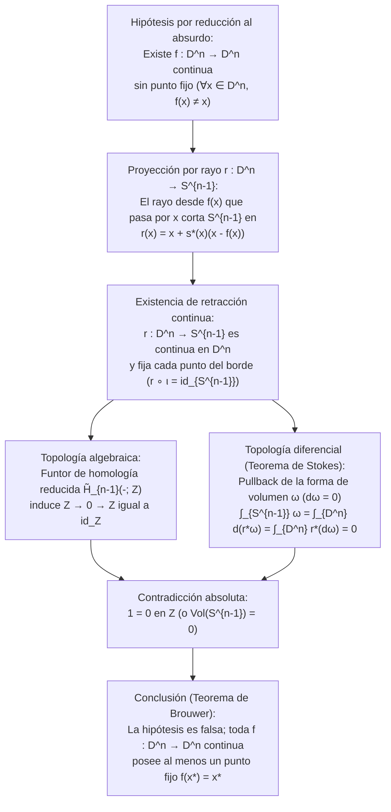
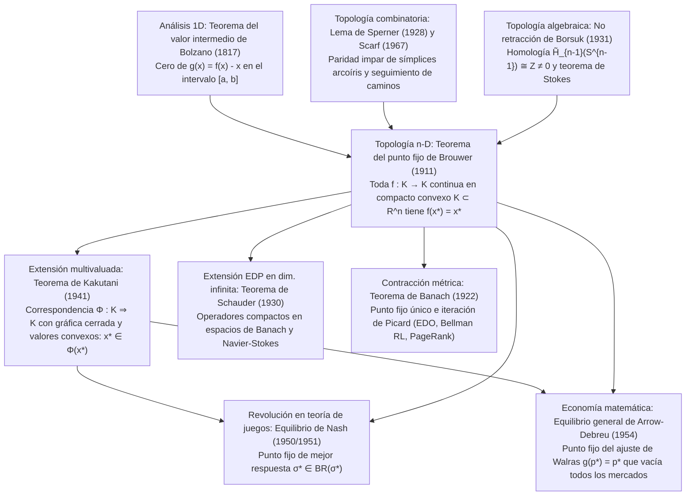

## Introducción: Tres milagros cotidianos de la inevitabilidad topológica

Imagina verter café caliente en una taza cilíndrica, añadir un chorrito de leche y remover vigorosamente con una cuchara. Remolinos caóticos y pliegues laminares agitan el líquido. Cuando el café vuelve al reposo, nuestra intuición nos dice que cada molécula se ha desplazado lejos de su posición original. Sin embargo, en 1911, el matemático neerlandés <strong>Luitzen Egbertus Jan Brouwer (1881–1966)</strong> demostró el <strong>teorema del punto fijo de Brouwer (Brouwer's Fixed-Point Theorem)</strong>, que garantiza con absoluta certeza matemática lo siguiente:

> [!IMPORTANT]
> <strong>Milagro 1: El punto inmóvil en una taza de café removida</strong>
> Por muy vigorosa o caóticamente que remuevas tu café —siempre que el líquido no se derrame fuera de la taza, no se abran burbujas de cavitación permanentes y el medio continuo no se desgarre—, cuando el líquido se detiene, <strong>existe garantizadamente al menos un punto (una molécula en el límite continuo) que ocupa exactamente las mismas coordenadas espaciales tridimensionales $(x^*, y^*, z^*)$ que ocupaba antes de introducir la cuchara</strong>.

> [!TIP]
> <strong>Milagro 2: El mapa arrugado lanzado sobre un mapa plano</strong>
> Toma dos mapas idénticos de una misma región (<strong>Mapa A</strong> y <strong>Mapa B</strong>). Extiende el Mapa A plano sobre tu escritorio, arruga el Mapa B formando una bola de papel (sin rasgarlo) y déjalo caer en cualquier lugar completamente dentro de los bordes del Mapa A. Entonces, <strong>al menos un punto geográfico $x^*$ del Mapa B arrugado queda situado exactamente en la vertical del mismo punto geográfico $x^*$ del Mapa A plano</strong>.

Del mismo modo, el <strong>teorema de la bola peluda (Hairy Ball Theorem)</strong> de Poincaré-Brouwer en la esfera $S^2$ explica por qué todo cuero cabelludo tiene al menos un <strong>remolino (coronilla)</strong> y por qué en todo instante existe sobre la Tierra al menos un punto donde la velocidad horizontal del viento es <strong>estrictamente cero (el ojo de un ciclón)</strong>.

### Enunciado formal del teorema del punto fijo de Brouwer (1911)

Sea $K \subset \mathbb{R}^n$ un subconjunto <strong>no vacío, compacto (cerrado y acotado) y convexo</strong> de $\mathbb{R}^n$ (o más generalmente, un espacio homeomorfo a la bola unidad cerrada $D^n = \{x \in \mathbb{R}^n : \|x\|_2 \le 1\}$). Para toda aplicación <strong>continua</strong> $f: K \to K$, existe al menos un <strong>punto fijo</strong> $x^* \in K$ tal que:

$$
f(x^*) = x^*
$$

---

## 1. Por qué cada hipótesis es indispensable: cuatro contraejemplos precisos

Por el teorema de Heine-Borel, en $\mathbb{R}^n$ la compacidad equivale a ser <strong>acotado</strong> y <strong>cerrado</strong>. Si eliminamos cualquiera de las cuatro condiciones (acotación, clausura, convexidad/ausencia de agujeros, continuidad), el teorema falla de inmediato:

1. <strong>Sin acotación</strong>: En $K = \mathbb{R}$ (cerrado y convexo), la traslación continua $f(x) = x + 1$ carece de punto fijo ($x^* + 1 = x^*$ es imposible) porque todos los puntos huyen hacia $+\infty$.
2. <strong>Sin clausura (no cerrado)</strong>: En el intervalo abierto $K = (0, 1)$ (acotado y convexo), $f(x) = \frac{x+1}{2}$ es continua pero su único punto fijo algebraico $x^* = 1$ cae en la frontera excluida $\partial K \setminus K$.
3. <strong>Sin convexidad / conexión simple (con agujero)</strong>: En la circunferencia unidad $S^1$ o el anillo cerrado (annulus) $A = \{x \in \mathbb{R}^2 : \frac{1}{2} \le \|x\|_2 \le 1\}$, una rotación $f(x) = R_\theta x$ de ángulo $\theta \in (0, 2\pi)$ no tiene puntos fijos porque el centro de rotación $(0, 0)$ cae dentro del agujero central ($(0, 0) \notin A$).
4. <strong>Sin continuidad</strong>: En $K = [0, 1]$, la función escalonada $f(x) = 1$ en $[0, \frac{1}{2}]$ y $f(x) = 0$ en $(\frac{1}{2}, 1]$ salta discontinuamente sobre la diagonal $y = x$ en $x = \frac{1}{2}$.

| Hipótesis eliminada | Condiciones mantenidas | Contraejemplo explícito ($K$ y $f: K \to K$) | Razón geométrica de la desaparición de $f(x^*) = x^*$ |
| :--- | :--- | :--- | :--- |
| <strong>1. Acotación</strong> | Cerrado, convexo, continua | $K = \mathbb{R}$, $f(x) = x + 1$ | Sin frontera exterior; huida infinita hacia $+\infty$ |
| <strong>2. Clausura (Cerrado)</strong> | Acotado, convexo, continua | $K = (0, 1)$, $f(x) = \frac{x+1}{2}$ | El punto fijo $x^* = 1$ escapa hacia el borde faltante |
| <strong>3. Convexidad (Sin agujeros)</strong> | Compacto (cerrado y acotado), continua | $K = S^1$ o anillo $A$, rotación $R_\theta$ | El centro de giro $(0, 0)$ cae en el agujero topológico |
| <strong>4. Continuidad</strong> | Compacto, convexo | $K = [0, 1]$, $1$ en $[0,\frac{1}{2}]$, $0$ en $(\frac{1}{2},1]$ | La gráfica $y = f(x)$ salta sobre la diagonal $y = x$ |

---

## 2. Primera demostración: el caso 1D ($n = 1$) mediante el teorema del valor intermedio (TVI)

En dimensión $n = 1$, todo compacto convexo no vacío es un intervalo cerrado $K = [a, b]$. Dada $f: [a, b] \to [a, b]$ continua, definimos $g(x) = f(x) - x$. Como $f(a) \ge a$ y $f(b) \le b$, en los extremos se cumple:

$$
g(a) = f(a) - a \ge 0, \qquad g(b) = f(b) - b \le 0
$$

Por el <strong>teorema del valor intermedio (TVI) de Bolzano</strong>, existe al menos un $x^* \in [a, b]$ donde $g(x^*) = 0 \iff f(x^*) = x^*$. En dimensión $n \ge 2$, $\mathbb{R}^n \setminus \{\mathbf{0}\}$ sigue siendo conexo por caminos, por lo que necesitamos topología algebraica o combinatoria.

---

## 3. Segunda demostración: Topología algebraica y el teorema de no retracción de Borsuk (1931)

En 1931, el matemático polaco <strong>Karol Borsuk</strong> demostró que el teorema de Brouwer equivale al <strong>teorema de no retracción</strong>: no existe ninguna retracción continua $r: D^n \to S^{n-1}$ de la bola unidad cerrada $D^n$ sobre su esfera frontera $S^{n-1} = \partial D^n$ tal que $r|_{S^{n-1}} = \text{id}_{S^{n-1}}$ (es imposible aplastar el parche de un tambor sobre su aro rígido sin perforarlo).

### Paso 1: Una aplicación sin puntos fijos construye una retracción continua $r: D^n \to S^{n-1}$

Supongamos por reducción al absurdo que existe $f: D^n \to D^n$ continua con $f(x) \ne x$ para todo $x \in D^n$. El vector desplazamiento $u(x) = x - f(x) \ne \mathbf{0}$ nunca se anula. El rayo que parte de $f(x)$ y pasa por $x$, dado por $\gamma_x(t) = x + s u(x)$ ($s = t - 1 \ge 0$), corta la esfera $S^{n-1}$ en el punto único:

$$
r(x) = x + s^*(x)\bigl(x - f(x)\bigr), \qquad s^*(x) = \frac{-\langle x, u(x)\rangle + \sqrt{\langle x, u(x)\rangle^2 + \|u(x)\|_2^2(1 - \|x\|_2^2)}}{\|u(x)\|_2^2}
$$

Como $\|u(x)\|_2^2 > 0$, $r: D^n \to S^{n-1}$ es continua en todo $D^n$, y si $x \in S^{n-1}$ ($\|x\|_2^2 = 1$), entonces $s^*(x) = 0$ y $r(x) = x$. ¡Por tanto, $r$ es una retracción continua!

### Paso 2: Contradicción mediante el funtor de homología $\tilde{H}_{n-1}$ y el teorema de Stokes

1. <strong>Demostración vía homología reducida $\tilde{H}_{n-1}$</strong>:
   Aplicando el funtor de homología singular reducida $\tilde{H}_{n-1}(-; \mathbb{Z})$ a $S^{n-1} \xrightarrow{\iota} D^n \xrightarrow{r} S^{n-1}$ ($r \circ \iota = \text{id}_{S^{n-1}}$), dado que $D^n$ es contráctil ($\tilde{H}_{n-1}(D^n) \cong 0$) y $\tilde{H}_{n-1}(S^{n-1}) \cong \mathbb{Z}$, obtenemos:
   $$
   \mathbb{Z} \xrightarrow{\;\iota_*\;} 0 \xrightarrow{\;r_*\;} \mathbb{Z}
   $$
   Todo homomorfismo que factoriza a través del grupo trivial $0$ es nulo ($1 \mapsto 0$), pero $(r \circ \iota)_* = \text{id}_{\mathbb{Z}}$ envía $1 \mapsto 1$, lo que produce la contradicción $1 = 0$ en $\mathbb{Z}$.
2. <strong>Demostración analítica mediante el teorema de Stokes</strong>:
   Aproximando por una retracción suave $r: D^n \to S^{n-1}$ y tomando la $(n-1)$-forma de volumen $\omega$ en $S^{n-1}$ ($\int_{S^{n-1}} \omega = \text{Vol}(S^{n-1}) > 0$ y $d\omega = 0$), el teorema de Stokes arroja:
   $$
   0 < \int_{S^{n-1}} \omega = \int_{\partial D^n} r^*\omega = \int_{D^n} d(r^*\omega) = \int_{D^n} r^*(d\omega) = 0
   $$

---

## 4. Tercera demostración: Combinatoria constructiva mediante el lema de Sperner (1928)

Como fundador del <strong>intuicionismo matemático</strong>, Brouwer rechazó posteriormente su propia prueba por contradicción al no proporcionar un algoritmo constructivo para hallar $x^*$.

En 1928, <strong>Emanuel Sperner</strong> probó el <strong>lema de Sperner</strong>: en cualquier triangulación de un símplex $\Delta^n = \text{conv}\{v_0, \dots, v_n\}$ con una coloración de Sperner $\ell: V(\mathcal{T}) \to \{0, 1, \dots, n\}$ ($\ell(v_i) = i$ y cada cara $\text{conv}\{v_{i_0}, \dots, v_{i_k}\}$ usa solo colores en $\{i_0, \dots, i_k\}$), <strong>el número de sub-símplices «arcoíris» (con los $n+1$ colores distintos) es siempre impar, y por tanto existe al menos uno</strong>.

Coloreando cada vértice $w$ con un índice $i$ tal que $\lambda_i(w) > 0$ y $\lambda_i(f(w)) \le \lambda_i(w)$ en coordenadas baricéntricas, al hacer tender el tamaño de malla a $0$, la compacidad (Bolzano-Weierstrass) y la continuidad garantizan que los símplices arcoíris convergen a un punto $x^*$ donde $\lambda_i(f(x^*)) \le \lambda_i(x^*)$ para todo $i$, lo que implica $f(x^*) = x^*$. En 1967, <strong>Herbert Scarf</strong> transformó este recorrido de puertas en el <strong>algoritmo simplicial de Scarf</strong> para calcular puntos fijos por ordenador.

---

## 5. La gran jerarquía de los teoremas de punto fijo: Banach, Brouwer, Schauder y Kakutani

1. <strong>Teorema de contracción de Banach (1922)</strong>: En cualquier <strong>espacio métrico completo</strong> no vacío $(X, d)$, una contracción estricta $d(Tx, Ty) \le L d(x, y)$ ($0 \le L < 1$) tiene un punto fijo <strong>único</strong> $x^*$, y la iteración de Picard $x_{k+1} = T(x_k)$ converge geométricamente (base de Picard-Lindelöf en EDO, la <strong>iteración de valor de Bellman</strong> en aprendizaje por refuerzo y <strong>Google PageRank</strong>).
2. <strong>Trampa de dimensión infinita y teorema de Schauder (1930)</strong>: En la bola unidad cerrada $B_{\ell^2}$ del espacio de Hilbert $\ell^2$, la aplicación continua $f(x_1, x_2, \dots) = (\sqrt{1 - \|x\|_2^2}, x_1, x_2, \dots)$ <strong>no tiene punto fijo</strong> porque $B_{\ell^2}$ no es compacta. <strong>Schauder (1930)</strong> restableció el teorema en espacios de Banach para <strong>operadores compactos</strong> $T: K \to K$ (clave en EDP no lineales como Navier-Stokes).
3. <strong>Teorema del punto fijo de Shizuo Kakutani (1941)</strong>: Generaliza Brouwer a <strong>correspondencias multivaluadas</strong> $\Phi: K \rightrightarrows K$ en un compacto convexo $K \subset \mathbb{R}^n$. Si $\Phi(x)$ es no vacío y convexo para todo $x$ y $\Phi$ tiene <strong>gráfica cerrada (semicontinuidad superior)</strong>, existe $x^* \in K$ tal que $x^* \in \Phi(x^*)$.

| Teorema y Año | Espacio y Dominio $K$ | Hipótesis sobre $f$ o $\Phi$ | Unicidad y Computabilidad | Aplicaciones clave |
| :--- | :--- | :--- | :--- | :--- |
| <strong>Banach (1922)</strong> | Espacio métrico completo $(X, d)$ (dim. finita o $\infty$) | Contracción: $d(Tx, Ty) \le L d(x, y)$ ($L < 1$) | <strong>Único</strong>; iteración $x_{k+1}=T(x_k)$ geométrica | EDO (Picard-Lindelöf), Bellman RL, PageRank |
| <strong>Brouwer (1911)</strong> | Compacto convexo $K \subset \mathbb{R}^n$ (dim. finita) | Aplicación continua univaluada $f: K \to K$ | <strong>Al menos uno</strong>; computable vía algoritmo de Scarf | Ecuaciones no lineales, Nash (1951), Walras |
| <strong>Schauder (1930)</strong> | Cerrado acotado convexo $K$ en espacio de Banach | <strong>Operador compacto</strong> continuo $T: K \to K$ | <strong>Al menos uno</strong> | EDP no lineales (ecuaciones de Navier-Stokes) |
| <strong>Kakutani (1941)</strong> | Compacto convexo $K \subset \mathbb{R}^n$ | Correspondencia $\Phi: K \rightrightarrows K$ (valores convexos, gráfica cerrada) | <strong>Al menos uno</strong> ($x^* \in \Phi(x^*)$) | Equilibrio de Nash (1950), Arrow-Debreu (1954) |

---

## 6. Cómo la topología revolucionó la economía y la teoría de juegos: Nash (1950) y Arrow-Debreu (1954)

### 6.1 John Nash (1950, 1951): Existencia del equilibrio de Nash

En un juego finito de $N$ jugadores, el espacio de perfiles de estrategias mixtas $K = \Delta_1 \times \dots \times \Delta_N$ es compacto y convexo.
- <strong>Demostración vía Kakutani (1950)</strong>: La <strong>correspondencia de mejor respuesta</strong> $BR_i(\sigma_{-i}) = \arg\max_{\tau_i \in \Delta_i} U_i(\tau_i, \sigma_{-i})$ tiene valores no vacíos y convexos (por la linealidad del pago esperado $U_i$ en $\tau_i$) y gráfica cerrada. Por el <strong>teorema de Kakutani</strong>, existe $\sigma^* \in BR(\sigma^*)$, que es un <strong>equilibrio de Nash</strong>.
- <strong>Demostración directa vía Brouwer (1951)</strong>: Definiendo la ganancia excedente $\varphi_{ij}(\sigma) = \max\{0, U_i(s_{ij}, \sigma_{-i}) - U_i(\sigma_i, \sigma_{-i})\}$, la aplicación continua
  $$
  f_{ij}(\sigma) = \frac{\sigma_{ij} + \varphi_{ij}(\sigma)}{1 + \sum_{k=1}^{m_i} \varphi_{ik}(\sigma)}
  $$
  posee un punto fijo $f(\sigma^*) = \sigma^*$ por <strong>Brouwer</strong>, lo que obliga a que $\varphi_{ij}(\sigma^*) = 0$ para todo $i, j$.

### 6.2 Arrow y Debreu (1954): Equilibrio general competitivo de Walras

En el símplex de precios $\Delta^{L-1} = \{p \in \mathbb{R}_+^L : \sum_{\ell=1}^L p_\ell = 1\}$, el exceso de demanda agregada $z(p)$ satisface la <strong>ley de Walras</strong> $\sum_{\ell=1}^L p_\ell z_\ell(p) = 0$. La aplicación de ajuste de precios $g_\ell(p) = \frac{p_\ell + \max\{0, z_\ell(p)\}}{1 + \sum_{k=1}^L \max\{0, z_k(p)\}}$ tiene un punto fijo $g(p^*) = p^*$ por <strong>Brouwer</strong>. Multiplicando por $z_\ell(p^*)$ y sumando sobre $\ell$ con la ley de Walras se obtiene:

$$
\sum_{\ell=1}^L \bigl(\max\{0, z_\ell(p^*)\}\bigr)^2 = 0 \implies z_\ell(p^*) \le 0 \quad (\forall \ell = 1, \dots, L)
$$

¡Todos los mercados se vacían simultáneamente en equilibrio!

