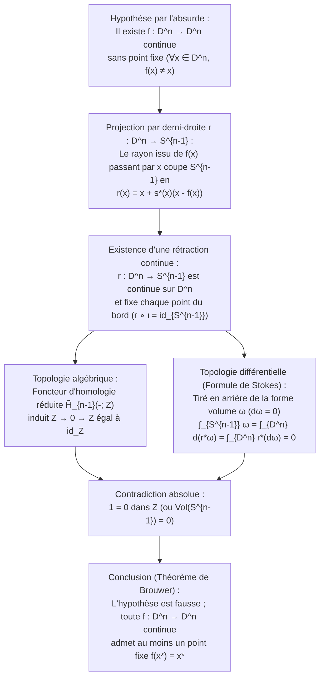
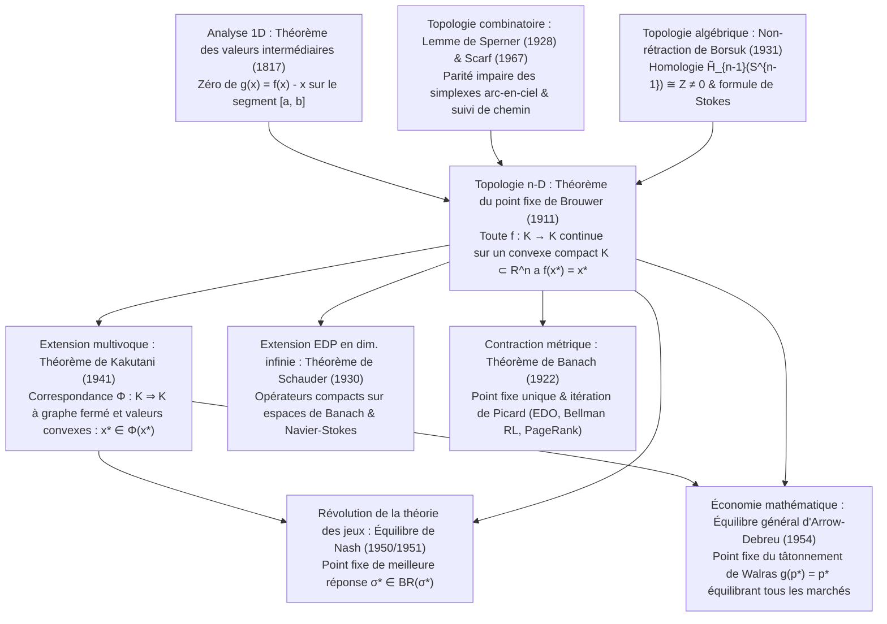

## Introduction : Trois miracles quotidiens de l'inévitabilité topologique

Imaginez que vous versiez du café chaud dans une tasse cylindrique, que vous y ajoutiez un nuage de lait et que vous remuiez vigoureusement avec une cuillère. Des tourbillons complexes et des replis laminaires agitent le liquide. Lorsque le café revient au repos, notre intuition nous dit que chaque goutte a quitté sa place initiale. Pourtant, en 1911, le mathématicien néerlandais <strong>Luitzen Egbertus Jan Brouwer (1881–1966)</strong> a démontré le <strong>théorème du point fixe de Brouwer (Brouwer's Fixed-Point Theorem)</strong>, qui garantit avec une certitude mathématique absolue le résultat suivant :

> [!IMPORTANT]
> <strong>Miracle 1 : Le point immobile dans une tasse de café remuée</strong>
> Peu importe la vigueur ou la complexité avec laquelle vous remuez votre café — tant qu'aucune goutte ne déborde, qu'aucune bulle de cavitation ne crée de trou permanent et que le fluide continu n'est pas déchiré —, lorsque le liquide s'immobilise, <strong>il existe au moins un point (une molécule dans la limite continue) qui occupe exactement les mêmes coordonnées spatiales tridimensionnelles $(x^*, y^*, z^*)$ qu'avant le coup de cuillère</strong> !

> [!TIP]
> <strong>Miracle 2 : La carte froissée posée sur une carte dépliée</strong>
> Prenez deux cartes identiques d'un même pays (<strong>Carte A</strong> et <strong>Carte B</strong>). Étalez la Carte A à plat sur votre bureau, froissez la Carte B en une boule quelconque (sans jamais la déchirer) et posez-la n'importe où à l'intérieur des bords de la Carte A. Alors <strong>il existe au moins un point géographique $x^*$ sur la Carte B froissée qui se trouve exactement à la verticale du même point géographique $x^*$ sur la Carte A plane</strong> !

De même, le <strong>théorème de la boule chevelue (Hairy Ball Theorem)</strong> de Poincaré-Brouwer sur la sphère $S^2$ explique pourquoi toute chevelure possède nécessairement un <strong>épi (tourbillon)</strong> au sommet du crâne et pourquoi il existe à chaque instant sur Terre au moins un point où le vent horizontal est <strong>strictement nul (l'œil d'un cyclone)</strong>.

### Énoncé formel du théorème du point fixe de Brouwer (1911)

Soit $K \subset \mathbb{R}^n$ un sous-ensemble <strong>non vide, compact (fermé et borné) et convexe</strong> de $\mathbb{R}^n$ (ou plus généralement un espace homéomorphe à la boule unité fermée $D^n = \{x \in \mathbb{R}^n : \|x\|_2 \le 1\}$). Pour toute application <strong>continue</strong> $f: K \to K$, il existe au moins un <strong>point fixe</strong> $x^* \in K$ tel que :

$$
f(x^*) = x^*
$$

---

## 1. Pourquoi chaque hypothèse est indispensable : quatre contre-exemples précis

Par le théorème de Heine-Borel, un sous-ensemble de $\mathbb{R}^n$ est compact si et seulement s'il est <strong>borné</strong> et <strong>fermé</strong>. Si l'on retire une seule des quatre hypothèses (caractère borné, fermeture, convexité/absence de trou, continuité), le point fixe disparaît :

1. <strong>Sans le caractère borné</strong> : Sur $K = \mathbb{R}$ (fermé et convexe), la translation continue $f(x) = x + 1$ n'a aucun point fixe ($x^* + 1 = x^*$ est impossible) car tous les points fuient vers $+\infty$.
2. <strong>Sans la fermeture</strong> : Sur l'intervalle ouvert $K = (0, 1)$ (borné et convexe), $f(x) = \frac{x+1}{2}$ est continue mais son unique point fixe algébrique $x^* = 1$ se situe sur le bord manquant $\partial K \setminus K$.
3. <strong>Sans la convexité / simple connexité (espace troué)</strong> : Sur le cercle unité $S^1$ ou la couronne fermée (annulus) $A = \{x \in \mathbb{R}^2 : \frac{1}{2} \le \|x\|_2 \le 1\}$, une rotation $f(x) = R_\theta x$ d'angle $\theta \in (0, 2\pi)$ n'a aucun point fixe car le centre de rotation $(0, 0)$ tombe dans le trou central ($(0, 0) \notin A$).
4. <strong>Sans la continuité</strong> : Sur $K = [0, 1]$, la fonction en escalier $f(x) = 1$ sur $[0, \frac{1}{2}]$ et $f(x) = 0$ sur $(\frac{1}{2}, 1]$ saute par-dessus la diagonale $y = x$ en $x = \frac{1}{2}$ sans jamais la couper.

| Hypothèse retirée | Conditions conservées | Contre-exemple explicite ($K$ et $f: K \to K$) | Raison géométrique de la disparition de $f(x^*) = x^*$ |
| :--- | :--- | :--- | :--- |
| <strong>1. Caractère borné</strong> | Fermé, convexe, continue | $K = \mathbb{R}$, $f(x) = x + 1$ | Pas de mur extérieur ; fuite infinie vers $+\infty$ |
| <strong>2. Fermeture</strong> | Borné, convexe, continue | $K = (0, 1)$, $f(x) = \frac{x+1}{2}$ | Le point fixe $x^* = 1$ s'échappe sur la frontière exclue |
| <strong>3. Convexité (sans trou)</strong> | Compact (fermé borné), continue | $K = S^1$ ou couronne $A$, rotation $R_\theta$ | Le centre de rotation $(0, 0)$ tombe dans le trou topologique |
| <strong>4. Continuité</strong> | Compact, convexe | $K = [0, 1]$, $1$ sur $[0,\frac{1}{2}]$, $0$ sur $(\frac{1}{2},1]$ | Le graphe $y = f(x)$ saute par-dessus la diagonale $y = x$ |

---

## 2. Première preuve : le cas 1D ($n = 1$) via le théorème des valeurs intermédiaires (TVI)

En dimension $n = 1$, tout convexe compact non vide est un segment $K = [a, b]$. Pour $f: [a, b] \to [a, b]$ continue, posons $g(x) = f(x) - x$. Comme $f(a) \ge a$ et $f(b) \le b$, nous avons aux bornes :

$$
g(a) = f(a) - a \ge 0, \qquad g(b) = f(b) - b \le 0
$$

Par le <strong>théorème des valeurs intermédiaires (TVI) de Bolzano</strong>, $g$ s'annule en au moins un point $x^* \in [a, b]$, d'où $g(x^*) = 0 \iff f(x^*) = x^*$. En dimension $n \ge 2$, l'espace épointé $\mathbb{R}^n \setminus \{\mathbf{0}\}$ reste connexe par arcs, ce qui oblige à recourir à la topologie algébrique ou combinatoire.

---

## 3. Deuxième preuve : Topologie algébrique et théorème de non-rétraction de Borsuk (1931)

En 1931, le mathématicien polonais <strong>Karol Borsuk</strong> a prouvé que le théorème de Brouwer équivaut au <strong>théorème de non-rétraction</strong> : il n'existe aucune rétraction continue $r: D^n \to S^{n-1}$ de la boule unité fermée $D^n$ sur sa sphère bord $S^{n-1} = \partial D^n$ vérifiant $r|_{S^{n-1}} = \text{id}_{S^{n-1}}$ (on ne peut pas écraser une peau de tambour sur son cadre circulaire fixe sans la percer).

### Étape 1 : Une application sans point fixe construit une rétraction continue $r: D^n \to S^{n-1}$

Supposons par l'absurde qu'il existe $f: D^n \to D^n$ continue telle que $f(x) \ne x$ partout sur $D^n$. Le vecteur déplacement $u(x) = x - f(x) \ne \mathbf{0}$ ne s'annule jamais. La demi-droite issue de $f(x)$ passant par $x$, paramétrée par $\gamma_x(t) = x + s u(x)$ ($s = t - 1 \ge 0$), coupe la sphère $S^{n-1}$ en un unique point :

$$
r(x) = x + s^*(x)\bigl(x - f(x)\bigr), \qquad s^*(x) = \frac{-\langle x, u(x)\rangle + \sqrt{\langle x, u(x)\rangle^2 + \|u(x)\|_2^2(1 - \|x\|_2^2)}}{\|u(x)\|_2^2}
$$

Comme $\|u(x)\|_2^2 > 0$, $r: D^n \to S^{n-1}$ est continue sur $D^n$, et pour $x \in S^{n-1}$ ($\|x\|_2^2 = 1$), on a $s^*(x) = 0$, soit $r(x) = x$. Ainsi $r$ est une rétraction continue !

### Étape 2 : Contradiction via le foncteur d'homologie $\tilde{H}_{n-1}$ et la formule de Stokes

1. <strong>Preuve par l'homologie réduite $\tilde{H}_{n-1}$</strong> :
   En appliquant le foncteur d'homologie singulière réduite $\tilde{H}_{n-1}(-; \mathbb{Z})$ à $S^{n-1} \xrightarrow{\iota} D^n \xrightarrow{r} S^{n-1}$ ($r \circ \iota = \text{id}_{S^{n-1}}$), puisque la boule pleine $D^n$ est contractile ($\tilde{H}_{n-1}(D^n) \cong 0$) tandis que $\tilde{H}_{n-1}(S^{n-1}) \cong \mathbb{Z}$, on obtient :
   $$
   \mathbb{Z} \xrightarrow{\;\iota_*\;} 0 \xrightarrow{\;r_*\;} \mathbb{Z}
   $$
   Tout morphisme se factorisant par $0$ est nul ($1 \mapsto 0$), alors que $(r \circ \iota)_* = \text{id}_{\mathbb{Z}}$ envoie $1 \mapsto 1$, d'où la contradiction $1 = 0$ dans $\mathbb{Z}$ !
2. <strong>Preuve analytique par la formule de Stokes</strong> :
   Pour une rétraction lisse $r: D^n \to S^{n-1}$ et la $(n-1)$-forme volume $\omega$ sur $S^{n-1}$ ($\int_{S^{n-1}} \omega = \text{Vol}(S^{n-1}) > 0$ et $d\omega = 0$), la formule de Stokes donne :
   $$
   0 < \int_{S^{n-1}} \omega = \int_{\partial D^n} r^*\omega = \int_{D^n} d(r^*\omega) = \int_{D^n} r^*(d\omega) = 0
   $$

---

## 4. Troisième preuve : Combinatoire constructive via le lemme de Sperner (1928)

Fondateur de l'<strong>intuitionnisme mathématique</strong>, Brouwer a rejeté plus tard sa propre preuve par l'absurde car elle ne fournissait aucun algorithme pour calculer $x^*$.

En 1928, <strong>Emanuel Sperner</strong> a démontré le <strong>lemme de Sperner</strong> : pour toute triangulation d'un simplexe $\Delta^n = \text{conv}\{v_0, \dots, v_n\}$ munie d'un coloriage de Sperner $\ell: V(\mathcal{T}) \to \{0, 1, \dots, n\}$ ($\ell(v_i) = i$ et chaque face $\text{conv}\{v_{i_0}, \dots, v_{i_k}\}$ n'utilise que les couleurs $\{i_0, \dots, i_k\}$), <strong>le nombre de sous-simplexes « arc-en-ciel » (portant toutes les $n+1$ couleurs) est toujours impair, donc au moins égal à un</strong> !

En coloriant chaque sommet $w$ par un indice $i$ tel que $\lambda_i(w) > 0$ et $\lambda_i(f(w)) \le \lambda_i(w)$ en coordonnées barycentriques, et en faisant tendre le pas du maillage vers $0$, la compacité (Bolzano-Weierstrass) et la continuité assurent que les simplexes arc-en-ciel convergent vers un point $x^*$ vérifiant $\lambda_i(f(x^*)) \le \lambda_i(x^*)$ pour tout $i$, d'où $f(x^*) = x^*$. En 1967, <strong>Herbert Scarf</strong> en a tiré l'<strong>algorithme simplicial de Scarf</strong> pour calculer numériquement les points fixes.

---

## 5. La grande hiérarchie des théorèmes de point fixe : Banach, Brouwer, Schauder et Kakutani

1. <strong>Théorème du point fixe de Banach (1922)</strong> : Sur tout <strong>espace métrique complet</strong> non vide $(X, d)$, une contraction stricte $d(Tx, Ty) \le L d(x, y)$ ($0 \le L < 1$) possède un point fixe <strong>unique</strong> $x^*$, atteint géométriquement par l'itération de Picard $x_{k+1} = T(x_k)$ (fondamental pour Cauchy-Lipschitz/Picard-Lindelöf en EDO, l'<strong>itération sur la valeur de Bellman</strong> en apprentissage par renforcement et <strong>Google PageRank</strong>).
2. <strong>Piège de la dimension infinie et théorème de Schauder (1930)</strong> : Sur la boule unité fermée $B_{\ell^2}$ de l'espace de Hilbert $\ell^2$, l'application continue $f(x_1, x_2, \dots) = (\sqrt{1 - \|x\|_2^2}, x_1, x_2, \dots)$ n'a <strong>aucun point fixe</strong> car $B_{\ell^2}$ n'est pas compacte ! <strong>Schauder (1930)</strong> rétablit l'existence dans les espaces de Banach lorsque $T: K \to K$ est un <strong>opérateur compact</strong> (crucial pour les EDP non linéaires comme Navier-Stokes).
3. <strong>Théorème du point fixe de Shizuo Kakutani (1941)</strong> : Étend Brouwer aux <strong>correspondances multivoques</strong> $\Phi: K \rightrightarrows K$ sur un convexe compact $K \subset \mathbb{R}^n$. Si $\Phi(x)$ est non vide et convexe pour tout $x$ et si $\Phi$ est à <strong>graphe fermé (semi-continue supérieurement)</strong>, il existe $x^* \in K$ tel que $x^* \in \Phi(x^*)$.

| Théorème & Année | Espace & Domaine $K$ | Hypothèses sur $f$ ou $\Phi$ | Unicité & Calculabilité | Applications majeures |
| :--- | :--- | :--- | :--- | :--- |
| <strong>Banach (1922)</strong> | Espace métrique complet $(X, d)$ (dim. finie ou $\infty$) | Contraction : $d(Tx, Ty) \le L d(x, y)$ ($L < 1$) | <strong>Unique</strong> ; itération $x_{k+1}=T(x_k)$ géométrique | EDO (Picard-Lindelöf), Bellman RL, PageRank |
| <strong>Brouwer (1911)</strong> | Convexe compact $K \subset \mathbb{R}^n$ (dim. finie) | Application continue univoque $f: K \to K$ | <strong>Au moins un</strong> ; calculable via l'algorithme de Scarf | Équations non linéaires, Nash (1951), Walras |
| <strong>Schauder (1930)</strong> | Convexe fermé borné $K$ dans un espace de Banach | <strong>Opérateur compact</strong> continu $T: K \to K$ | <strong>Au moins un</strong> | EDP non linéaires (équations de Navier-Stokes) |
| <strong>Kakutani (1941)</strong> | Convexe compact $K \subset \mathbb{R}^n$ | Correspondance $\Phi: K \rightrightarrows K$ (valeurs convexes, graphe fermé) | <strong>Au moins un</strong> ($x^* \in \Phi(x^*)$) | Équilibre de Nash (1950), Arrow-Debreu (1954) |

---

## 6. Comment la topologie a révolutionné l'économie et la théorie des jeux : Nash (1950) et Arrow-Debreu (1954)

### 6.1 John Nash (1950, 1951) : Existence de l'équilibre de Nash

Dans un jeu fini à $N$ joueurs, l'espace des profils de stratégies mixtes $K = \Delta_1 \times \dots \times \Delta_N$ est compact et convexe.
- <strong>Preuve via Kakutani (1950)</strong> : La <strong>correspondance de meilleure réponse</strong> $BR_i(\sigma_{-i}) = \arg\max_{\tau_i \in \Delta_i} U_i(\tau_i, \sigma_{-i})$ est à valeurs non vides convexes (par linéarité de l'espérance $U_i$ en $\tau_i$) et à graphe fermé. Le <strong>théorème de Kakutani</strong> garantit l'existence de $\sigma^* \in BR(\sigma^*)$, qui est un <strong>équilibre de Nash</strong> !
- <strong>Preuve directe via Brouwer (1951)</strong> : En posant le gain excédentaire $\varphi_{ij}(\sigma) = \max\{0, U_i(s_{ij}, \sigma_{-i}) - U_i(\sigma_i, \sigma_{-i})\}$, l'application continue
  $$
  f_{ij}(\sigma) = \frac{\sigma_{ij} + \varphi_{ij}(\sigma)}{1 + \sum_{k=1}^{m_i} \varphi_{ik}(\sigma)}
  $$
  admet un point fixe $f(\sigma^*) = \sigma^*$ par <strong>Brouwer</strong>, ce qui implique $\varphi_{ij}(\sigma^*) = 0$ pour tout $i, j$.

### 6.2 Arrow et Debreu (1954) : Équilibre général concurrentiel de Walras

Sur le simplexe des prix $\Delta^{L-1} = \{p \in \mathbb{R}_+^L : \sum_{\ell=1}^L p_\ell = 1\}$, la demande nette globale $z(p)$ vérifie la <strong>loi de Walras</strong> $\sum_{\ell=1}^L p_\ell z_\ell(p) = 0$. L'application de tâtonnement $g_\ell(p) = \frac{p_\ell + \max\{0, z_\ell(p)\}}{1 + \sum_{k=1}^L \max\{0, z_k(p)\}}$ possède un point fixe $g(p^*) = p^*$ par <strong>Brouwer</strong>. En multipliant par $z_\ell(p^*)$ et en sommant sur $\ell$ avec la loi de Walras, on obtient :

$$
\sum_{\ell=1}^L \bigl(\max\{0, z_\ell(p^*)\}\bigr)^2 = 0 \implies z_\ell(p^*) \le 0 \quad (\forall \ell = 1, \dots, L)
$$

Tous les marchés s'équilibrent simultanément !

