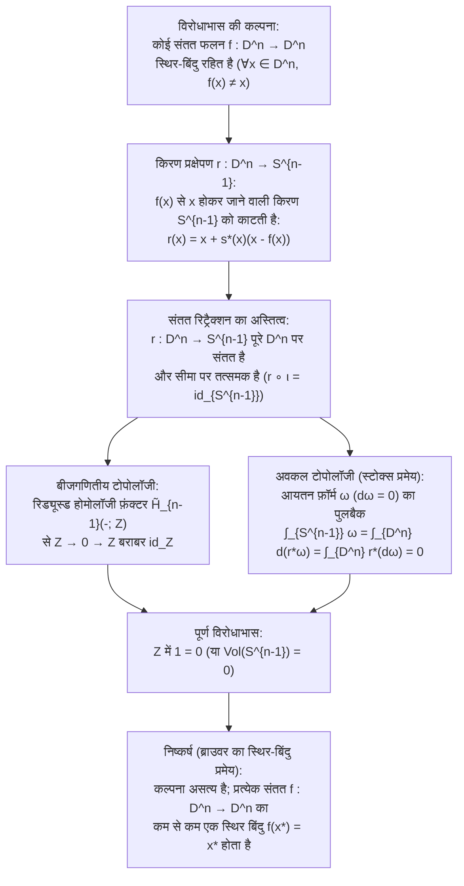
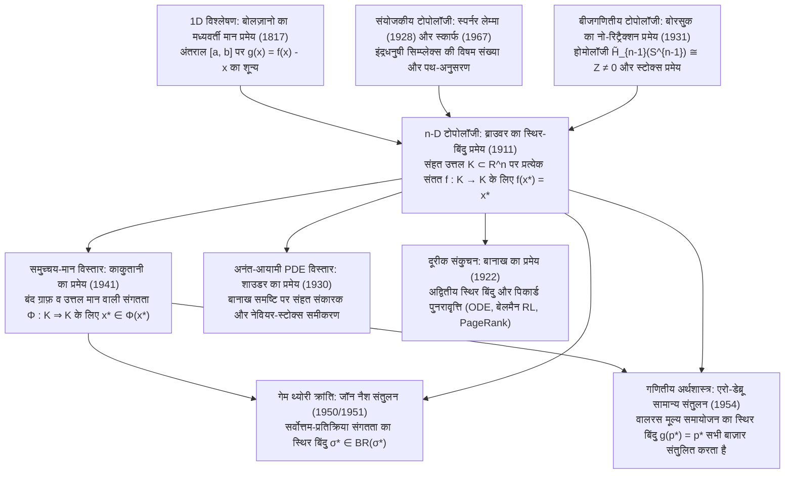

## परिचय: टोपोलॉजिकल अनिवार्यता के तीन दैनिक चमत्कार

कल्पना कीजिए कि आप एक बेलनाकार कप में गर्म कॉफ़ी डालते हैं, थोड़ा दूध मिलाते हैं और चम्मच से ज़ोर-ज़ोर से हिलाते हैं। तरल के भीतर जटिल भँवर (vortices) और परतदार मोड़ बनते हैं। जब कॉफ़ी अंततः शांत होकर रुकती है, तो हमारा सहज ज्ञान कहता है कि कॉफ़ी की हर बूँद अपने प्रारंभिक स्थान से हट चुकी है। किंतु 1911 में डच गणितज्ञ <strong>लुइट्ज़ेन एगबर्टस जान ब्राउवर (L.E.J. Brouwer, 1881–1966)</strong> ने <strong>ब्राउवर का स्थिर-बिंदु प्रमेय (Brouwer's Fixed-Point Theorem)</strong> सिद्ध किया, जो पूर्ण गणितीय निश्चितता के साथ यह गारंटी देता है:

> [!IMPORTANT]
> <strong>चमत्कार 1: हिलाए गए कॉफ़ी कप में अचल बिंदु (Fixed Point)</strong>
> आप कॉफ़ी को चाहे कितनी ही तेज़ी या जटिलता से क्यों न हिलाएँ—बशर्ते तरल कप से बाहर न छलके, भीतर कोई स्थायी बुलबुला (छेद) न बने और द्रव सातत्य (continuum) न फटे—जब तरल शांत होता है, तो <strong>कप में कम से कम एक बिंदु (सातत्य सीमा में कॉफ़ी अणु) अवश्य होता है जो ठीक उसी त्रि-आयामी निर्देशांक $(x^*, y^*, z^*)$ पर स्थित होता है जहाँ वह चम्मच छूने से पहले था</strong>!

> [!TIP]
> <strong>चमत्कार 2: समतल नक़्शे के ऊपर फेंका गया सिकुड़ा हुआ नक़्शा</strong>
> एक ही क्षेत्र के दो बिल्कुल एक जैसे नक़्शे (<strong>नक़्शा A</strong> और <strong>नक़्शा B</strong>) लें। नक़्शा A को मेज़ पर समतल बिछा दें, नक़्शा B को (बिना फाड़े) मरोड़कर कागज़ की गेंद बना लें और उसे समतल नक़्शा A की सीमाओं के भीतर कहीं भी रख दें। तब <strong>सिकुड़े हुए नक़्शे B पर कम से कम एक भौगोलिक बिंदु $x^*$ नीचे बिछे समतल नक़्शे A के ठीक उसी भौगोलिक बिंदु $x^*$ के ठीक ऊपर (लंबवत रेखा पर) स्थित होगा</strong>!

इसी प्रकार, गोले $S^2$ पर पॉइंकेरे-ब्राउवर का <strong>हेयरी बॉल प्रमेय (Hairy Ball Theorem)</strong> बताता है कि हर इंसान के सिर के बालों में कम से कम एक <strong>भँवर (Crown Whorl)</strong> क्यों होता है और पृथ्वी की सतह पर हर क्षण कम से कम एक स्थान ऐसा क्यों होता है जहाँ क्षैतिज पवन वेग <strong>बिल्कुल शून्य (चक्रवात की आँख)</strong> होता है।

### ब्राउवर के स्थिर-बिंदु प्रमेय का औपचारिक कथन (1911)

मान लीजिए $K \subset \mathbb{R}^n$ यूक्लिडियन समष्टि $\mathbb{R}^n$ का एक <strong>अरिक्त, संहत (compact: परिबद्ध और संवृत/बंद) तथा उत्तल (convex)</strong> उपसमुच्चय है (या बंद इकाई गेंद $D^n = \{x \in \mathbb{R}^n : \|x\|_2 \le 1\}$ के होमियोमॉर्फिक समष्टि है)। तब प्रत्येक <strong>संतत फलन (continuous map)</strong> $f: K \to K$ के लिए कम से कम एक <strong>स्थिर बिंदु (fixed point)</strong> $x^* \in K$ का अस्तित्व होता है, ताकि:

$$
f(x^*) = x^*
$$

---

## 1. प्रत्येक परिकल्पना अनिवार्य क्यों है: चार सटीक प्रति-उदाहरण

हाइने-बोरेल प्रमेय के अनुसार $\mathbb{R}^n$ में संहतता (compactness) का अर्थ है <strong>परिबद्ध (bounded)</strong> और <strong>संवृत/बंद (closed)</strong> होना। यदि हम चार शर्तों (परिबद्धता, संवृतता, उत्तलता/छेद-रहित होना, सातत्य) में से किसी एक को भी हटा दें, तो स्थिर बिंदु समाप्त हो जाता है:

1. <strong>परिबद्धता हटाने पर (Unbounded)</strong>: $K = \mathbb{R}$ (बंद और उत्तल) पर संतत स्थानांतरण $f(x) = x + 1$ का कोई स्थिर बिंदु नहीं है ($x^* + 1 = x^*$ असंभव है) क्योंकि सभी बिंदु $+\infty$ की ओर भाग जाते हैं।
2. <strong>संवृतता हटाने पर (Not Closed)</strong>: खुले अंतराल $K = (0, 1)$ (परिबद्ध और उत्तल) पर $f(x) = \frac{x+1}{2}$ संतत है, किंतु इसका एकमात्र बीजगणितीय स्थिर बिंदु $x^* = 1$ हटाई गई सीमा $\partial K \setminus K$ पर स्थित है।
3. <strong>उत्तलता / सरल संबद्धता हटाने पर (छेद वाला क्षेत्र)</strong>: इकाई वृत्त $S^1$ या बंद वलय (Annulus) $A = \{x \in \mathbb{R}^2 : \frac{1}{2} \le \|x\|_2 \le 1\}$ पर कोण $\theta \in (0, 2\pi)$ से घूर्णन $f(x) = R_\theta x$ का कोई स्थिर बिंदु नहीं है क्योंकि घूर्णन केंद्र $(0, 0)$ बीच के छेद में गिरता है ($(0, 0) \notin A$)।
4. <strong>सातत्य हटाने पर (Discontinuous)</strong>: $K = [0, 1]$ पर सोपान फलन $f(x) = 1$ जब $x \in [0, \frac{1}{2}]$ और $f(x) = 0$ जब $x \in (\frac{1}{2}, 1]$, बिंदु $x = \frac{1}{2}$ पर विकर्ण $y = x$ को बिना छुए छलाँग लगा जाता है।

| हटाई गई परिकल्पना | शेष शर्तें | स्पष्ट प्रति-उदाहरण ($K$ और $f: K \to K$) | स्थिर बिंदु $f(x^*) = x^*$ गायब होने का ज्यामितीय कारण |
| :--- | :--- | :--- | :--- |
| <strong>1. परिबद्धता</strong> | संवृत, उत्तल, संतत | $K = \mathbb{R}$, $f(x) = x + 1$ | बाहरी सीमा नहीं; सभी बिंदु $+\infty$ की ओर पलायन करते हैं |
| <strong>2. संवृतता (बंद होना)</strong> | परिबद्ध, उत्तल, संतत | $K = (0, 1)$, $f(x) = \frac{x+1}{2}$ | स्थिर बिंदु $x^* = 1$ गायब सीमा बिंदु पर स्थित है |
| <strong>3. उत्तलता (छेद-रहित)</strong> | संहत (बंद व परिबद्ध), संतत | $K = S^1$ या वलय $A$, घूर्णन $R_\theta$ | घूर्णन केंद्र $(0, 0)$ टोपोलॉजिकल छेद के भीतर पड़ता है |
| <strong>4. सातत्य (Continuity)</strong> | संहत, उत्तल | $K = [0, 1]$, $[0,\frac{1}{2}]$ पर $1$, $(\frac{1}{2},1]$ पर $0$ | ग्राफ़ $y = f(x)$ विकर्ण रेखा $y = x$ को फाँद जाता है |

---

## 2. प्रथम प्रमाण: मध्यवर्ती मान प्रमेय (IVT) द्वारा 1D ($n = 1$) की स्थिति

आयाम $n = 1$ में प्रत्येक अरिक्त संहत उत्तल समुच्चय एक बंद अंतराल $K = [a, b]$ होता है। किसी संतत फलन $f: [a, b] \to [a, b]$ के लिए विस्थापन फलन $g(x) = f(x) - x$ परिभाषित करें। चूँकि $f(a) \ge a$ और $f(b) \le b$, अतः सिरों पर:

$$
g(a) = f(a) - a \ge 0, \qquad g(b) = f(b) - b \le 0
$$

बोलज़ानो के <strong>मध्यवर्ती मान प्रमेय (Intermediate Value Theorem, IVT)</strong> के अनुसार अंतराल $[a, b]$ में कम से कम एक बिंदु $x^*$ ऐसा होगा जहाँ $g(x^*) = 0 \iff f(x^*) = x^*$। किंतु $n \ge 2$ आयामों में $\mathbb{R}^n \setminus \{\mathbf{0}\}$ पथ-संबद्ध (path-connected) रहता है, इसलिए हमें बीजगणितीय या संयोजकीय टोपोलॉजी की आवश्यकता होती है।

---

## 3. द्वितीय प्रमाण: बीजगणितीय टोपोलॉजी और बोरसुक का नो-रिट्रैक्शन प्रमेय (1931)

1931 में पोलिश गणितज्ञ <strong>कारोल बोरसुक (Karol Borsuk)</strong> ने सिद्ध किया कि ब्राउवर का प्रमेय <strong>नो-रिट्रैक्शन प्रमेय (No-Retraction Theorem)</strong> के समतुल्य है: बंद इकाई गेंद $D^n$ से उसकी सीमा गोले $S^{n-1} = \partial D^n$ पर कोई भी संतत रिट्रैक्शन $r: D^n \to S^{n-1}$ (जो सीमा के प्रत्येक बिंदु को स्थिर रखे, $r|_{S^{n-1}} = \text{id}_{S^{n-1}}$) संभव नहीं है।

### चरण 1: स्थिर-बिंदु-रहित फलन से संतत रिट्रैक्शन $r: D^n \to S^{n-1}$ का निर्माण

विरोधाभास के लिए मान लें कि कोई संतत फलन $f: D^n \to D^n$ ऐसा है कि सभी $x \in D^n$ के लिए $f(x) \ne x$। तब विस्थापन सदिश $u(x) = x - f(x) \ne \mathbf{0}$ कहीं भी शून्य नहीं होता। $f(x)$ से $x$ की ओर जाने वाली किरण $\gamma_x(t) = x + s u(x)$ ($s = t - 1 \ge 0$) सीमा गोले $S^{n-1}$ को एक अद्वितीय बिंदु पर काटती है:

$$
r(x) = x + s^*(x)\bigl(x - f(x)\bigr), \qquad s^*(x) = \frac{-\langle x, u(x)\rangle + \sqrt{\langle x, u(x)\rangle^2 + \|u(x)\|_2^2(1 - \|x\|_2^2)}}{\|u(x)\|_2^2}
$$

चूँकि $\|u(x)\|_2^2 > 0$, अतः $r: D^n \to S^{n-1}$ पूरे $D^n$ पर संतत है, और यदि $x \in S^{n-1}$ ($\|x\|_2^2 = 1$), तो $s^*(x) = 0$ अर्थात $r(x) = x$। अतः $r$ एक संतत रिट्रैक्शन है!

### चरण 2: होमोलॉजी फ़ंक्टर $\tilde{H}_{n-1}$ और स्टोक्स प्रमेय से विरोधाभास

1. <strong>रिड्यूस्ड होमोलॉजी $\tilde{H}_{n-1}$ द्वारा प्रमाण</strong>:
   $S^{n-1} \xrightarrow{\iota} D^n \xrightarrow{r} S^{n-1}$ ($r \circ \iota = \text{id}_{S^{n-1}}$) पर $(n-1)$-वाँ रिड्यूस्ड होमोलॉजी फ़ंक्टर $\tilde{H}_{n-1}(-; \mathbb{Z})$ लगाने पर, चूँकि ठोस गेंद $D^n$ संकुचनशील है ($\tilde{H}_{n-1}(D^n) \cong 0$) और $\tilde{H}_{n-1}(S^{n-1}) \cong \mathbb{Z}$, हमें प्राप्त होता है:
   $$
   \mathbb{Z} \xrightarrow{\;\iota_*\;} 0 \xrightarrow{\;r_*\;} \mathbb{Z}
   $$
   शून्य समूह $0$ से होकर जाने वाला प्रत्येक समकारिता शून्य प्रतिचित्रण ($1 \mapsto 0$) होता है, जबकि $(r \circ \iota)_* = \text{id}_{\mathbb{Z}}$ जनक $1 \mapsto 1$ भेजता है, जिससे $\mathbb{Z}$ में $1 = 0$ का विरोधाभास उत्पन्न होता है!
2. <strong>स्टोक्स प्रमेय (Stokes's Theorem) द्वारा वैश्लेषिक प्रमाण</strong>:
   चिकने रिट्रैक्शन $r: D^n \to S^{n-1}$ और $S^{n-1}$ पर आयतन $(n-1)$-फ़ॉर्म $\omega$ ($\int_{S^{n-1}} \omega = \text{Vol}(S^{n-1}) > 0$ तथा $d\omega = 0$) के लिए स्टोक्स प्रमेय से:
   $$
   0 < \int_{S^{n-1}} \omega = \int_{\partial D^n} r^*\omega = \int_{D^n} d(r^*\omega) = \int_{D^n} r^*(d\omega) = 0
   $$

---

## 4. तृतीय प्रमाण: स्पर्नर लेम्मा (1928) द्वारा रचनात्मक संयोजिकी

<strong>गणितीय अंतर्ज्ञानवाद (Intuitionism)</strong> के संस्थापक के रूप में ब्राउवर ने बाद में अपने ही गैर-रचनात्मक प्रमाण को अस्वीकार कर दिया क्योंकि वह $x^*$ को खोजने का एल्गोरिदम नहीं देता था।

1928 में <strong>इमैनुएल स्पर्नर (Emanuel Sperner)</strong> ने <strong>स्पर्नर लेम्मा</strong> सिद्ध किया: किसी सिम्प्लेक्स $\Delta^n = \text{conv}\{v_0, \dots, v_n\}$ के किसी भी त्रिभुजन में स्पर्नर रंगाई $\ell: V(\mathcal{T}) \to \{0, 1, \dots, n\}$ ($\ell(v_i) = i$ और प्रत्येक फलक $\text{conv}\{v_{i_0}, \dots, v_{i_k}\}$ केवल $\{i_0, \dots, i_k\}$ के रंगों का उपयोग करता है) के अंतर्गत, <strong>सभी $n+1$ भिन्न रंगों वाले «इंद्रधनुषी उप-सिम्प्लेक्स» की संख्या सदैव विषम होती है, अतः कम से कम एक अवश्य होता है</strong>!

बैरीसेंट्रिक निर्देशांकों में $\lambda_i(w) > 0$ तथा $\lambda_i(f(w)) \le \lambda_i(w)$ को संतुष्ट करने वाले सूचकांक $i$ से शीर्षों को रंगने पर, जब जाल का आकार $0$ की ओर जाता है, तो संहतता (बोलज़ानो-वायस्ट्रॉस) और सातत्य से इंद्रधनुषी सिम्प्लेक्स एक बिंदु $x^*$ पर अभिसरित होते हैं जहाँ सभी $i$ के लिए $\lambda_i(f(x^*)) \le \lambda_i(x^*)$, जिससे $f(x^*) = x^*$ सिद्ध होता है। 1967 में <strong>हर्बर्ट स्कार्फ (Herbert Scarf)</strong> ने इसे <strong>स्कार्फ सिम्प्लिशियल एल्गोरिदम</strong> में बदल दिया।

---

## 5. स्थिर-बिंदु प्रमेयों का महान पदानुक्रम: बानाख, ब्राउवर, शाउडर और काकुतानी

1. <strong>बानाख संकुचन प्रतिचित्रण प्रमेय (1922)</strong>: किसी भी अरिक्त <strong>पूर्ण दूरीक समष्टि (complete metric space)</strong> $(X, d)$ पर संकुचन $d(Tx, Ty) \le L d(x, y)$ ($0 \le L < 1$) का एक <strong>अद्वितीय</strong> स्थिर बिंदु $x^*$ होता है, और पिकार्ड पुनरावृत्ति $x_{k+1} = T(x_k)$ ज्यामितीय रूप से अभिसरित होती है (साधारण अवकल समीकरणों के पिकार्ड-लिंडेलोफ प्रमेय, सुदृढीकरण सीखने में <strong>बेलमैन मूल्य पुनरावृत्ति</strong> और <strong>Google PageRank</strong> का आधार)।
2. <strong>अनंत-आयामी जाल और शाउडर प्रमेय (1930)</strong>: हिल्बर्ट समष्टि $\ell^2$ की बंद इकाई गेंद $B_{\ell^2}$ पर संतत फलन $f(x_1, x_2, \dots) = (\sqrt{1 - \|x\|_2^2}, x_1, x_2, \dots)$ का <strong>कोई स्थिर बिंदु नहीं है</strong> क्योंकि $B_{\ell^2}$ संहत नहीं है! <strong>शाउडर (1930)</strong> ने बानाख समष्टियों में <strong>संहत संकारकों (Compact Operators)</strong> $T: K \to K$ के लिए प्रमेय को पुनः स्थापित किया (नेवियर-स्टोक्स जैसे आंशिक अवकल समीकरणों के लिए निर्णायक)।
3. <strong>शिज़ुओ काकुतानी का स्थिर-बिंदु प्रमेय (1941)</strong>: संहत उत्तल समुच्चय $K \subset \mathbb{R}^n$ पर <strong>समुच्चय-मान संगतताओं (Set-Valued Correspondences)</strong> $\Phi: K \rightrightarrows K$ के लिए विस्तार। यदि प्रत्येक $x$ के लिए $\Phi(x)$ अरिक्त और उत्तल हो तथा $\Phi$ का <strong>ग्राफ़ बंद (ऊपरी अर्ध-सातत्य)</strong> हो, तो $x^* \in \Phi(x^*)$ अस्तित्व में होता है।

| प्रमेय और वर्ष | समष्टि और डोमेन $K$ | $f$ या $\Phi$ पर शर्तें | अद्वितीयता और गणना | प्रमुख अनुप्रयोग |
| :--- | :--- | :--- | :--- | :--- |
| <strong>बानाख (1922)</strong> | पूर्ण दूरीक समष्टि $(X, d)$ (परिमित या $\infty$-आयामी) | संकुचन: $d(Tx, Ty) \le L d(x, y)$ ($L < 1$) | <strong>अद्वितीय</strong>; पुनरावृत्ति $x_{k+1}=T(x_k)$ | ODE (पिकार्ड-लिंडेलोफ), बेलमैन RL, PageRank |
| <strong>ब्राउवर (1911)</strong> | संहत उत्तल $K \subset \mathbb{R}^n$ (परिमित-आयामी) | कोई भी संतत एकल-मान फलन $f: K \to K$ | <strong>कम से कम एक</strong>; स्कार्फ एल्गोरिदम से गणना | अरैखिक समीकरण, नैश (1951), वालरस संतुलन |
| <strong>शाउडर (1930)</strong> | बानाख समष्टि में बंद परिबद्ध उत्तल $K$ | संतत <strong>संहत संकारक</strong> $T: K \to K$ | <strong>कम से कम एक</strong> | अरैखिक PDE (नेवियर-स्टोक्स समीकरण) |
| <strong>काकुतानी (1941)</strong> | संहत उत्तल $K \subset \mathbb{R}^n$ | संगतता $\Phi: K \rightrightarrows K$ (उत्तल मान, बंद ग्राफ़) | <strong>कम से कम एक</strong> ($x^* \in \Phi(x^*)$) | नैश संतुलन (1950), एरो-डेब्रू (1954) |

---

## 6. टोपोलॉजी ने अर्थशास्त्र और गेम थ्योरी में कैसे क्रांति की: नैश (1950) और एरो-डेब्रू (1954)

### 6.1 जॉन नैश (1950, 1951): नैश संतुलन के अस्तित्व का प्रमाण

$N$ खिलाड़ियों के परिमित खेल में मिश्रित रणनीतियों का संयुक्त समष्टि $K = \Delta_1 \times \dots \times \Delta_N$ संहत और उत्तल होता है।
- <strong>काकुतानी प्रमेय द्वारा प्रमाण (1950)</strong>: <strong>सर्वोत्तम-प्रतिक्रिया संगतता (Best-Response Correspondence)</strong> $BR_i(\sigma_{-i}) = \arg\max_{\tau_i \in \Delta_i} U_i(\tau_i, \sigma_{-i})$ के मान अरिक्त और उत्तल होते हैं (क्योंकि प्रत्याशित भुगतान $U_i$, $\tau_i$ में रैखिक है) और इसका ग्राफ़ बंद होता है। <strong>काकुतानी के प्रमेय</strong> से $\sigma^* \in BR(\sigma^*)$ का अस्तित्व है, जो <strong>नैश संतुलन</strong> है!
- <strong>ब्राउवर प्रमेय द्वारा प्रत्यक्ष प्रमाण (1951)</strong>: अतिरिक्त लाभ $\varphi_{ij}(\sigma) = \max\{0, U_i(s_{ij}, \sigma_{-i}) - U_i(\sigma_i, \sigma_{-i})\}$ परिभाषित करने पर संतत फलन
  $$
  f_{ij}(\sigma) = \frac{\sigma_{ij} + \varphi_{ij}(\sigma)}{1 + \sum_{k=1}^{m_i} \varphi_{ik}(\sigma)}
  $$
  का <strong>ब्राउवर प्रमेय</strong> से एक स्थिर बिंदु $f(\sigma^*) = \sigma^*$ होता है, जिससे सभी $i, j$ के लिए $\varphi_{ij}(\sigma^*) = 0$ सिद्ध होता है।

### 6.2 एरो और डेब्रू (1954): वालरस का सामान्य प्रतिस्पर्धी संतुलन

मूल्य सिम्प्लेक्स $\Delta^{L-1} = \{p \in \mathbb{R}_+^L : \sum_{\ell=1}^L p_\ell = 1\}$ पर कुल अतिरिक्त माँग फलन $z(p)$ <strong>वालरस के नियम (Walras's Law)</strong> $\sum_{\ell=1}^L p_\ell z_\ell(p) = 0$ को संतुष्ट करता है। मूल्य समायोजन फलन $g_\ell(p) = \frac{p_\ell + \max\{0, z_\ell(p)\}}{1 + \sum_{k=1}^L \max\{0, z_k(p)\}}$ का <strong>ब्राउवर प्रमेय</strong> से एक स्थिर बिंदु $g(p^*) = p^*$ होता है। दोनों पक्षों को $z_\ell(p^*)$ से गुणा करके $\ell$ पर योग करने और वालरस का नियम लगाने पर:

$$
\sum_{\ell=1}^L \bigl(\max\{0, z_\ell(p^*)\}\bigr)^2 = 0 \implies z_\ell(p^*) \le 0 \quad (\forall \ell = 1, \dots, L)
$$

सभी बाज़ार एक साथ संतुलन में आ जाते हैं!

