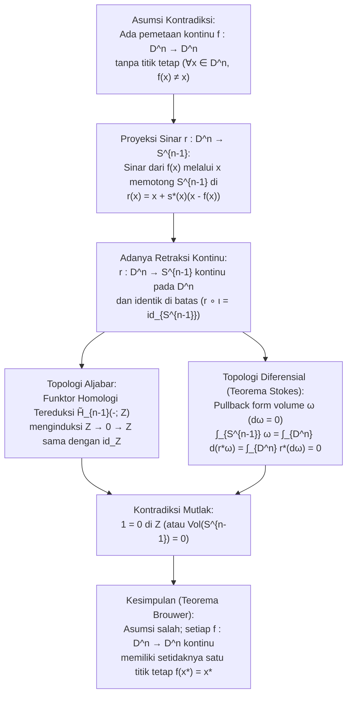
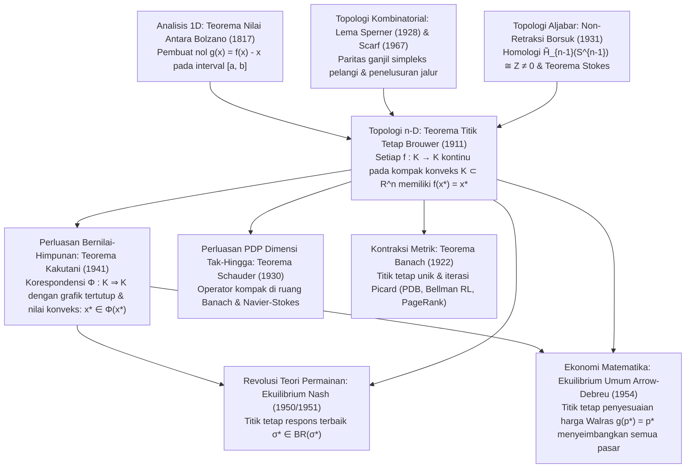

## Pendahuluan: Tiga Keajaiban Sehari-hari dari Keniscayaan Topologi

Bayangkan menuangkan kopi panas ke dalam cangkir silinder, menambahkan sedikit krim, lalu mengaduknya kuat-kuat dengan sendok. Pusaran air (vorteks) yang kacau dan lipatan laminar mengocok cairan tersebut. Ketika cairan kopi akhirnya berhenti bergerak, intuisi kita mengatakan bahwa setiap tetes kopi telah berpindah jauh dari posisi awalnya. Namun pada tahun 1911, matematikawan Belanda <strong>Luitzen Egbertus Jan Brouwer (1881–1966)</strong> membuktikan <strong>Teorema Titik Tetap Brouwer (Brouwer's Fixed-Point Theorem)</strong> yang menjamin dengan kepastian matematis mutlak hal berikut:

> [!IMPORTANT]
> <strong>Keajaiban 1: Titik yang Tidak Bergerak di Dalam Cangkir Kopi yang Diaduk</strong>
> Seberapa kuat atau rumit pun Anda mengaduk kopi—asalkan tidak ada cairan yang tumpah keluar cangkir, tidak ada gelembung kavitasi yang membuka lubang permanen, dan kontinum fluida tidak robek—ketika cairan kembali diam, <strong>dijamin ada setidaknya satu titik (molekul kopi dalam batas kontinum) yang menempati koordinat ruang tiga dimensi $(x^*, y^*, z^*)$ yang sama persis seperti sebelum Anda menyentuh sendok</strong>!

> [!TIP]
> <strong>Keajaiban 2: Peta Kusut yang Dijatuhkan di Atas Peta Datar</strong>
> Ambil dua peta identik dari wilayah yang sama (<strong>Peta A</strong> dan <strong>Peta B</strong>). Bentangkan Peta A secara datar di atas meja, remas Peta B menjadi bola kertas kusut (tanpa merobeknya), lalu jatuhkan di mana saja sepenuhnya di dalam batas Peta A. Maka, <strong>setidaknya ada satu titik geografis $x^*$ pada Peta B yang kusut yang berada tepat vertikal di atas titik geografis $x^*$ yang sama persis pada Peta A yang datar di bawahnya</strong>!

Demikian pula, <strong>Teorema Bola Berbulu (Hairy Ball Theorem)</strong> dari Poincaré-Brouwer pada permukaan bola $S^2$ menjelaskan mengapa setiap kepala manusia pasti memiliki setidaknya satu <strong>pusar rambut (uyeng-uyeng)</strong> dan mengapa pada setiap saat di permukaan Bumi selalu ada setidaknya satu titik di mana kecepatan angin horizontal <strong>tepat nol (mata siklon/topan)</strong>.

### Pernyataan Formal Teorema Titik Tetap Brouwer (1911)

Misalkan $K \subset \mathbb{R}^n$ adalah himpunan bagian yang <strong>tak-kosong, kompak (tertutup dan terbatas), dan konveks (cembung)</strong> di $\mathbb{R}^n$ (atau ruang topologi yang homeomorfik dengan bola satuan tertutup $D^n = \{x \in \mathbb{R}^n : \|x\|_2 \le 1\}$). Untuk setiap pemetaan <strong>kontinu</strong> $f: K \to K$, terdapat setidaknya satu <strong>titik tetap (fixed point)</strong> $x^* \in K$ sedemikian sehingga:

$$
f(x^*) = x^*
$$

---

## 1. Mengapa Setiap Hipotesis Tak Tergantikan: Empat Contoh Penyangkal

Berdasarkan Teorema Heine-Borel, kekompakan di $\mathbb{R}^n$ setara dengan sifat <strong>terbatas</strong> dan <strong>tertutup</strong>. Jika kita menghapus salah satu saja dari empat syarat (terbatas, tertutup, konveks/tanpa lubang, kontinu), titik tetap langsung lenyap:

1. <strong>Tanpa Keterbatasan (Unbounded)</strong>: Pada $K = \mathbb{R}$ (tertutup dan konveks), translasi kontinu $f(x) = x + 1$ tidak memiliki titik tetap ($x^* + 1 = x^*$ mustahil) karena semua titik lari menuju $+\infty$.
2. <strong>Tanpa Ketertutupan (Not Closed)</strong>: Pada interval terbuka $K = (0, 1)$ (terbatas dan konveks), $f(x) = \frac{x+1}{2}$ kontinu tetapi satu-satunya titik tetap aljabar $x^* = 1$ berada pada batas yang hilang $\partial K \setminus K$.
3. <strong>Tanpa Kekonveksan / Keterhubungan Sederhana (Berlubang)</strong>: Pada lingkaran satuan $S^1$ atau cincin tertutup (annulus) $A = \{x \in \mathbb{R}^2 : \frac{1}{2} \le \|x\|_2 \le 1\}$, rotasi $f(x) = R_\theta x$ sebesar sudut $\theta \in (0, 2\pi)$ tidak memiliki titik tetap karena pusat rotasi $(0, 0)$ jatuh di dalam lubang tengah ($(0, 0) \notin A$).
4. <strong>Tanpa Kekontinuan (Discontinuous)</strong>: Pada $K = [0, 1]$, fungsi tangga $f(x) = 1$ pada $[0, \frac{1}{2}]$ dan $f(x) = 0$ pada $(\frac{1}{2}, 1]$ melompati garis diagonal $y = x$ secara diskontinu di $x = \frac{1}{2}$.

| Hipotesis yang Dihapus | Syarat yang Dipertahankan | Contoh Penyangkal Eksplisit ($K$ dan $f: K \to K$) | Alasan Geometris Hilangnya $f(x^*) = x^*$ |
| :--- | :--- | :--- | :--- |
| <strong>1. Terbatas</strong> | Tertutup, konveks, kontinu | $K = \mathbb{R}$, $f(x) = x + 1$ | Tanpa dinding batas luar; semua titik lari ke $+\infty$ |
| <strong>2. Tertutup</strong> | Terbatas, konveks, kontinu | $K = (0, 1)$, $f(x) = \frac{x+1}{2}$ | Titik tetap $x^* = 1$ berada di batas yang dikecualikan |
| <strong>3. Konveks (Tanpa Lubang)</strong> | Kompak (tertutup & terbatas), kontinu | $K = S^1$ atau cincin $A$, rotasi $R_\theta$ | Pusat rotasi $(0, 0)$ jatuh ke dalam lubang topologi |
| <strong>4. Kontinu</strong> | Kompak, konveks | $K = [0, 1]$, $1$ di $[0,\frac{1}{2}]$, $0$ di $(\frac{1}{2},1]$ | Grafik $y = f(x)$ melompati diagonal $y = x$ |

---

## 2. Bukti Pertama: Kasus 1D ($n = 1$) melalui Teorema Nilai Antara (IVT)

Dalam dimensi $n = 1$, setiap himpunan kompak konveks tak-kosong adalah interval tertutup $K = [a, b]$. Untuk fungsi kontinu $f: [a, b] \to [a, b]$, definisikan fungsi perpindahan $g(x) = f(x) - x$. Karena $f(a) \ge a$ dan $f(b) \le b$, pada kedua ujung berlaku:

$$
g(a) = f(a) - a \ge 0, \qquad g(b) = f(b) - b \le 0
$$

Menurut <strong>Teorema Nilai Antara (Intermediate Value Theorem, IVT) Bolzano</strong>, terdapat setidaknya satu $x^* \in [a, b]$ di mana $g(x^*) = 0 \iff f(x^*) = x^*$. Pada dimensi $n \ge 2$, ruang $\mathbb{R}^n \setminus \{\mathbf{0}\}$ masih terhubung-lintasan sehingga medan vektor dapat memutari titik nol; oleh karena itu diperlukan topologi aljabar atau kombinatorial.

---

## 3. Bukti Kedua: Topologi Aljabar dan Teorema Non-Retraksi Borsuk (1931)

Pada tahun 1931, matematikawan Polandia <strong>Karol Borsuk</strong> membuktikan bahwa Teorema Brouwer setara dengan <strong>Teorema Non-Retraksi</strong>: tidak ada retraksi kontinu $r: D^n \to S^{n-1}$ dari bola satuan tertutup $D^n$ ke bola batasnya $S^{n-1} = \partial D^n$ yang mempertahankan setiap titik batas tetap diam ($r|_{S^{n-1}} = \text{id}_{S^{n-1}}$).

### Langkah 1: Pemetaan Tanpa Titik Tetap Membangun Retraksi Kontinu $r: D^n \to S^{n-1}$

Andaikan demi kontradiksi ada pemetaan kontinu $f: D^n \to D^n$ dengan $f(x) \ne x$ untuk semua $x \in D^n$. Maka vektor $u(x) = x - f(x) \ne \mathbf{0}$ tidak pernah nol. Sinar yang ditembakkan dari $f(x)$ melewati $x$, yaitu $\gamma_x(t) = x + s u(x)$ ($s = t - 1 \ge 0$), memotong bola batas $S^{n-1}$ di titik tunggal:

$$
r(x) = x + s^*(x)\bigl(x - f(x)\bigr), \qquad s^*(x) = \frac{-\langle x, u(x)\rangle + \sqrt{\langle x, u(x)\rangle^2 + \|u(x)\|_2^2(1 - \|x\|_2^2)}}{\|u(x)\|_2^2}
$$

Karena $\|u(x)\|_2^2 > 0$, $r: D^n \to S^{n-1}$ kontinu di seluruh $D^n$, dan untuk $x \in S^{n-1}$ ($\|x\|_2^2 = 1$), $s^*(x) = 0$ sehingga $r(x) = x$. Jadi $r$ adalah retraksi kontinu!

### Langkah 2: Kontradiksi melalui Funktor Homologi $\tilde{H}_{n-1}$ dan Teorema Stokes

1. <strong>Bukti melalui Homologi Tereduksi $\tilde{H}_{n-1}$</strong>:
   Terapkan funktor homologi singular tereduksi $\tilde{H}_{n-1}(-; \mathbb{Z})$ pada $S^{n-1} \xrightarrow{\iota} D^n \xrightarrow{r} S^{n-1}$ ($r \circ \iota = \text{id}_{S^{n-1}}$). Karena bola padat $D^n$ dapat dikontraksi ($\tilde{H}_{n-1}(D^n) \cong 0$) sedangkan $\tilde{H}_{n-1}(S^{n-1}) \cong \mathbb{Z}$, kita peroleh:
   $$
   \mathbb{Z} \xrightarrow{\;\iota_*\;} 0 \xrightarrow{\;r_*\;} \mathbb{Z}
   $$
   Setiap homomorfisma yang melewati grup trivial $0$ adalah pemetaan nol ($1 \mapsto 0$), tetapi $(r \circ \iota)_* = \text{id}_{\mathbb{Z}}$ memetakan $1 \mapsto 1$, menghasilkan kontradiksi mutlak $1 = 0$ di $\mathbb{Z}$!
2. <strong>Bukti Analitik melalui Teorema Stokes</strong>:
   Untuk retraksi mulus $r: D^n \to S^{n-1}$ dan $(n-1)$-form volume $\omega$ pada $S^{n-1}$ ($\int_{S^{n-1}} \omega = \text{Vol}(S^{n-1}) > 0$ dan $d\omega = 0$), Teorema Stokes memberikan:
   $$
   0 < \int_{S^{n-1}} \omega = \int_{\partial D^n} r^*\omega = \int_{D^n} d(r^*\omega) = \int_{D^n} r^*(d\omega) = 0
   $$

---

## 4. Bukti Ketiga: Kombinatorika Konstruktif melalui Lema Sperner (1928)

Sebagai pendiri <strong>intuisionisme matematika</strong>, Brouwer menolak buktinya sendiri yang non-konstruktif karena tidak memberikan algoritma untuk menghitung koordinat $x^*$.

Pada tahun 1928, <strong>Emanuel Sperner</strong> membuktikan <strong>Lema Sperner</strong>: untuk setiap triangulasi simpleks $\Delta^n = \text{conv}\{v_0, \dots, v_n\}$ dengan pewarnaan Sperner $\ell: V(\mathcal{T}) \to \{0, 1, \dots, n\}$ ($\ell(v_i) = i$ dan setiap sisi batas $\text{conv}\{v_{i_0}, \dots, v_{i_k}\}$ hanya memakai warna dari $\{i_0, \dots, i_k\}$), <strong>jumlah sub-simpleks «pelangi» (yang memuat semua $n+1$ warna berbeda) selalu ganjil, sehingga setidaknya ada satu</strong>!

Dengan mewarnai setiap titik sudut $w$ dengan indeks $i$ yang memenuhi $\lambda_i(w) > 0$ dan $\lambda_i(f(w)) \le \lambda_i(w)$ dalam koordinat barisentrik, ketika ukuran jaring menuju $0$, kekompakan (Bolzano-Weierstrass) dan kekontinuan menjamin barisan simpleks pelangi konvergen ke titik $x^*$ dengan $\lambda_i(f(x^*)) \le \lambda_i(x^*)$ untuk semua $i$, yang berarti $f(x^*) = x^*$. Pada tahun 1967, <strong>Herbert Scarf</strong> mengubah penelusuran jalur ini menjadi <strong>Algoritma Simplisial Scarf</strong>.

---

## 5. Hierarki Agung Teorema Titik Tetap: Banach, Brouwer, Schauder, dan Kakutani

1. <strong>Teorema Pemetaan Kontraksi Banach (1922)</strong>: Pada <strong>ruang metrik lengkap</strong> tak-kosong $(X, d)$, kontraksi tegas $d(Tx, Ty) \le L d(x, y)$ ($0 \le L < 1$) memiliki titik tetap <strong>tunggal (unik)</strong> $x^*$, dan iterasi Picard $x_{k+1} = T(x_k)$ konvergen secara geometris (fondasi Teorema Picard-Lindelöf untuk PDB, <strong>Iterasi Nilai Bellman</strong> dalam Reinforcement Learning, dan <strong>Google PageRank</strong>).
2. <strong>Jebakan Dimensi Tak-Hingga & Teorema Schauder (1930)</strong>: Pada bola satuan tertutup $B_{\ell^2}$ di ruang Hilbert $\ell^2$, pemetaan kontinu $f(x_1, x_2, \dots) = (\sqrt{1 - \|x\|_2^2}, x_1, x_2, \dots)$ <strong>tidak memiliki titik tetap</strong> karena $B_{\ell^2}$ tidak kompak! <strong>Schauder (1930)</strong> memulihkan teorema di ruang Banach untuk <strong>operator kompak</strong> $T: K \to K$ (kunci bagi PDP nonlinier seperti Navier-Stokes).
3. <strong>Teorema Titik Tetap Shizuo Kakutani (1941)</strong>: Menggeneralisasi Brouwer ke <strong>korespondensi bernilai-himpunan</strong> $\Phi: K \rightrightarrows K$ pada himpunan kompak konveks $K \subset \mathbb{R}^n$. Jika $\Phi(x)$ tak-kosong dan konveks untuk setiap $x$ dan $\Phi$ memiliki <strong>grafik tertutup (semikontinuitas atas)</strong>, maka terdapat $x^* \in K$ sehingga $x^* \in \Phi(x^*)$.

| Teorema & Tahun | Ruang & Domain $K$ | Syarat pada $f$ atau $\Phi$ | Keunikan & Komputabilitas | Aplikasi Utama |
| :--- | :--- | :--- | :--- | :--- |
| <strong>Banach (1922)</strong> | Ruang metrik lengkap $(X, d)$ (dim. hingga/$\infty$) | Kontraksi: $d(Tx, Ty) \le L d(x, y)$ ($L < 1$) | <strong>Unik</strong>; iterasi $x_{k+1}=T(x_k)$ geometris | PDB (Picard-Lindelöf), Bellman RL, PageRank |
| <strong>Brouwer (1911)</strong> | Kompak konveks $K \subset \mathbb{R}^n$ (dim. hingga) | Pemetaan kontinu bernilai-tunggal $f: K \to K$ | <strong>Setidaknya satu</strong>; dihitung via algoritma Scarf | Persamaan nonlinier, Nash (1951), Walras |
| <strong>Schauder (1930)</strong> | Tertutup terbatas konveks $K$ di ruang Banach | <strong>Operator kompak</strong> kontinu $T: K \to K$ | <strong>Setidaknya satu</strong> | PDP nonlinier (persamaan Navier-Stokes) |
| <strong>Kakutani (1941)</strong> | Kompak konveks $K \subset \mathbb{R}^n$ | Korespondensi $\Phi: K \rightrightarrows K$ (nilai konveks, grafik tertutup) | <strong>Setidaknya satu</strong> ($x^* \in \Phi(x^*)$) | Ekuilibrium Nash (1950), Arrow-Debreu (1954) |

---

## 6. Bagaimana Topologi Merevolusi Ekonomi dan Teori Permainan: Nash (1950) dan Arrow-Debreu (1954)

### 6.1 John Nash (1950, 1951): Eksistensi Ekuilibrium Nash

Dalam permainan berhingga $N$ pemain, ruang profil strategi campuran $K = \Delta_1 \times \dots \times \Delta_N$ bersifat kompak dan konveks.
- <strong>Bukti via Kakutani (1950)</strong>: <strong>Korespondensi Respons Terbaik (Best-Response Correspondence)</strong> $BR_i(\sigma_{-i}) = \arg\max_{\tau_i \in \Delta_i} U_i(\tau_i, \sigma_{-i})$ memiliki nilai tak-kosong dan konveks (karena linearitas ekspektasi imbalan $U_i$ terhadap $\tau_i$) serta grafik tertutup. Berdasarkan <strong>Teorema Kakutani</strong>, terdapat $\sigma^* \in BR(\sigma^*)$, yang merupakan <strong>Ekuilibrium Nash</strong>!
- <strong>Bukti Langsung via Brouwer (1951)</strong>: Dengan mendefinisikan keuntungan berlebih $\varphi_{ij}(\sigma) = \max\{0, U_i(s_{ij}, \sigma_{-i}) - U_i(\sigma_i, \sigma_{-i})\}$, pemetaan kontinu
  $$
  f_{ij}(\sigma) = \frac{\sigma_{ij} + \varphi_{ij}(\sigma)}{1 + \sum_{k=1}^{m_i} \varphi_{ik}(\sigma)}
  $$
  memiliki titik tetap $f(\sigma^*) = \sigma^*$ menurut <strong>Brouwer</strong>, yang memaksa $\varphi_{ij}(\sigma^*) = 0$ untuk semua $i, j$.

### 6.2 Arrow dan Debreu (1954): Ekuilibrium Umum Kompetitif Walras

Pada simpleks harga $\Delta^{L-1} = \{p \in \mathbb{R}_+^L : \sum_{\ell=1}^L p_\ell = 1\}$, fungsi kelebihan permintaan agregat $z(p)$ memenuhi <strong>Hukum Walras</strong> $\sum_{\ell=1}^L p_\ell z_\ell(p) = 0$. Pemetaan penyesuaian harga $g_\ell(p) = \frac{p_\ell + \max\{0, z_\ell(p)\}}{1 + \sum_{k=1}^L \max\{0, z_k(p)\}}$ memiliki titik tetap $g(p^*) = p^*$ menurut <strong>Brouwer</strong>. Mengalikan dengan $z_\ell(p^*)$ dan menjumlahkan terhadap $\ell$ bersama Hukum Walras menghasilkan:

$$
\sum_{\ell=1}^L \bigl(\max\{0, z_\ell(p^*)\}\bigr)^2 = 0 \implies z_\ell(p^*) \le 0 \quad (\forall \ell = 1, \dots, L)
$$

Seluruh pasar mencapai keseimbangan secara bersamaan!

