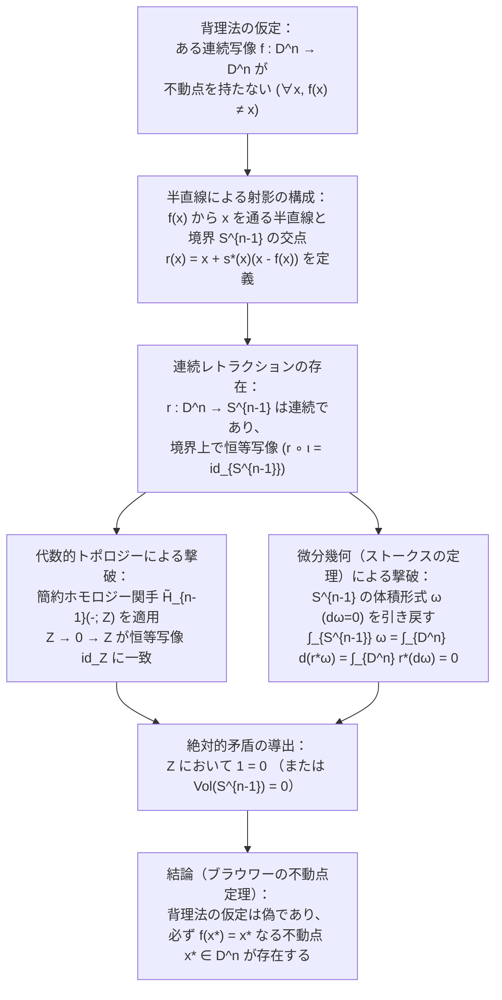
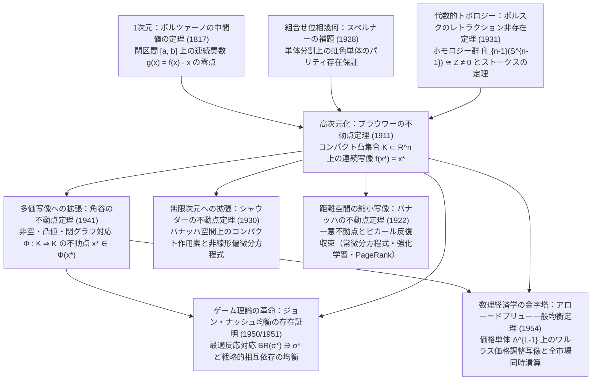

## はじめに：日常に潜むトポロジーの3つの奇跡

朝、お気に入りのマグカップに熱いコーヒーを注ぎ、ミルクを垂らしてスプーンでぐるぐるとかき混ぜる場面を想像してほしい。カップの中では大小さまざまな渦（ヴォルテックス）が巻き起こり、複雑な乱流と層流の折り畳みが生じる。やがてスプーンを抜き、液面が静かに静止したとき、カップの中のコーヒー分子は最初の位置から跡形もなくシャッフルされてしまったように見える。

ところが1911年、オランダの数学者<strong>ライツェン・エグベルトゥス・ヤン・ブラウワー（Luitzen Egbertus Jan Brouwer, 1881–1966）</strong>が証明した<strong>ブラウワーの不動点定理（Brouwer's Fixed-Point Theorem）</strong>は、私たちの直感を根底から覆す驚くべき事実を告げる。

> [!IMPORTANT]
> <strong>奇跡1：かき混ぜたコーヒーカップの不動点</strong>
> コーヒーをどれほど激しく、どれほど複雑にかき混ぜたとしても——液体がカップの外へこぼれ落ちたり、内部に気泡（穴）が生じたり、連続体として引き裂かれたりしない限り——液面が静止した瞬間、<strong>かき混ぜる前と寸分違わぬまったく同じ3次元座標 $(x^*, y^*, z^*)$ に戻っているコーヒーの点（粒子）が、カップの中に必ず少なくとも1つは存在する</strong>。

「そんなはずはない、カップ全体を同じ方向に回転させればすべての点が動くではないか」と思うかもしれない。しかし、カップの底や側面に触れている境界層、あるいは渦の中心軸をよく考えてみてほしい。さらに驚くべきことに、ただの単純な回転ではなく、上下左右に複雑にうねる3次元の攪拌（かくはん）であっても、決して場所を変えない「不動点（Fixed Point）」の存在は数学的に100%保証されるのである。

もう1つ、今すぐ机の上で実験できるさらに鮮やかな例を挙げよう。

> [!TIP]
> <strong>奇跡2：丸めた地図を広げて置いた地図の上に落とす</strong>
> まったく同じ縮尺で印刷された2枚の日本地図（あるいは東京の地図、世界地図でもよい）を用意する。<strong>地図A</strong>は机の上に平らに広げておく。もう一方の<strong>地図B</strong>は、くしゃくしゃに丸めてボール状にする（ただし、紙を破いたりちぎったりしてはいけない）。この丸めた地図Bを、平らな地図Aの枠内からはみ出さないようにポンと上に置く。
> すると、丸め方や置いた場所がどれほどランダムであっても、<strong>丸めた地図Bの上の少なくとも1つの地点 $x^*$ は、平らな地図Aの上の「まったく同じ地理的地点 $x^*$」の真上（鉛直線上）に寸分の狂いもなく重なっている</strong>！

さらに、この定理の親戚である<strong>ポアンカレ＝ブラウワーの毛玉の定理（Hairy Ball Theorem）</strong>に目を向ければ、3つ目の日常の奇跡に出会う。

> [!NOTE]
> <strong>奇跡3：人間の頭の「つむじ」と地球上の「無風地点（台風の目）」</strong>
> 球面 $S^2$ の上に生えた髪の毛を、逆立つ毛や分け目を作らずにすべて連続的にペタッと撫でつけることはトポロジー的に不可能であり、必ずどこかに毛が渦を巻くか直立する特異点——すなわち<strong>「つむじ（Crown Whorl）」</strong>——が少なくとも1つ（オイラー標数 $\chi(S^2) = 2$ の制約により重複度を込めて2つ分）生じる。同じ理由で、地球表面 $S^2$ 上の大気の水平風速ベクトル場を考えると、地球上のあらゆる瞬間において、<strong>風が完全にゼロになる地点（台風の目や高気圧・低気圧の中心）が必ず地球上のどこかに存在している</strong>。

これら3つの現象は、物理法則（流体力学や気象学）の偶然の産物ではない。空間の「つながり方（連続性）」と「穴のなさ（単連結性・凸性）」、そして「果ての閉じた有限性（コンパクト性）」という純粋な幾何学的・位相的構造だけから論理的必然として導かれる<strong>不動点定理（Fixed-Point Theorem）</strong>の現れなのである。

### ブラウワーの不動点定理の厳密な主張

$n$ 次元ユークリッド空間 $\mathbb{R}^n$ におけるブラウワーの不動点定理を、現代数学の言葉で厳密に定式化しよう。

$$
\text{Let } K \subset \mathbb{R}^n \text{ be non-empty, compact, and convex. For any continuous map } f: K \to K, \quad \exists x^* \in K \text{ s.t. } f(x^*) = x^*.
$$

すなわち、$\mathbb{R}^n$ の<strong>空でないコンパクト（有界かつ閉）な凸集合 $K$</strong> からそれ自身への任意の<strong>連続写像 $f: K \to K$</strong> に対して、

$$
f(x^*) = x^*
$$

を満たす点 $x^* \in K$（写像 $f$ の<strong>不動点</strong>）が少なくとも1つ存在する。さらに一般に、位相空間 $X$ がコンパクト凸集合 $K$（あるいは $n$ 次元閉単位球体 $D^n = \{x \in \mathbb{R}^n : \|x\|_2 \le 1\}$）と<strong>同相（Homeomorphic）</strong>であれば、同相写像 $h: D^n \to X$ を介して合成写像 $h^{-1} \circ f \circ h : D^n \to D^n$ に定理を適用できるため、$X$ 上のあらゆる連続自己写像も必ず不動点を持つ。

本稿では、この一見すると単純な方程式 $f(x^*) = x^*$ が、なぜ微分積分学の「中間値の定理」から代数的トポロジーの「ホモロジー群」「ストークスの定理」、組合せ論の「スペルナーの補題」、さらには20世紀のゲーム理論（ジョン・ナッシュの均衡存在証明）と数理経済学（アロー＝ドブリューの一般均衡理論）の根幹を貫く大統一原理となっているのかを、一歩ずつ徹底的に解き明かしていく。

---

## 第1章：なぜ3つの仮定は1つも欠けてはならないのか？——反例による徹底検証

優れた数学の定理は、精密な機械式時計のような構造をしている。定理の仮定（前提条件）から歯車をたった1つ取り外しただけで、結論は無残にも崩壊する。

ユークリッド空間 $\mathbb{R}^n$ において、集合 $K$ が<strong>コンパクト（Compact）</strong>であることは、<strong>ハイネ＝ボレルの被覆定理（Heine-Borel Theorem）</strong>によって<strong>「有界（Bounded）」かつ「閉集合（Closed）」</strong>であることと同値である。したがって、ブラウワーの不動点定理は以下の<strong>4つの柱</strong>の上に立っている。

1. $K$ が<strong>有界（Bounded）</strong>であること（無限遠まで広がっていないこと）。
2. $K$ が<strong>閉集合（Closed）</strong>であること（境界線 $\partial K$ のすべての点が $K$ 自身に含まれていること）。
3. $K$ が<strong>凸集合（Convex）</strong>（または位相的に穴のない $D^n$ と同相な空間）であること。
4. 写像 $f: K \to K$ が<strong>連続（Continuous）</strong>であること（途中でちぎれたりジャンプしたりしないこと）。

これら4つの条件を1つずつ外したとき、どのようにして不動点 $x^*$ が消滅してしまうのか、具体的な反例（Counterexamples）を通して確認しよう。

### 1.1 「有界性」を外した反例：無限の彼方への逃走

集合 $K$ が閉集合かつ凸集合であり、写像 $f$ が連続であっても、$K$ が<strong>非有界（Unbounded）</strong>である場合を考えよう。もっとも単純な例として、実数直線全体 $K = \mathbb{R}$（あるいは半無限閉区間 $K = [0, \infty)$）の上で、すべての点を右へ $1$ だけ平行移動させる連続写像を定義する。

$$
f(x) = x + 1 \quad (x \in \mathbb{R})
$$

もし不動点 $x^* \in \mathbb{R}$ が存在するならば、$f(x^*) = x^*$ より $x^* + 1 = x^*$、すなわち $1 = 0$ という矛盾が生じる。したがって不動点は1つも存在しない。空間に「行き止まりの壁（有界性）」がないため、すべての点が $+ \infty$ の彼方へと永遠に行進し続けることができるのである。

### 1.2 「閉集合性」を外した反例：消えた境界へのすり抜け

次に、集合 $K$ が有界かつ凸であり、$f$ が連続であっても、$K$ が<strong>閉集合ではない（境界が欠けている）</strong>場合を考えよう。開区間 $K = (0, 1) = \{x \in \mathbb{R} : 0 < x < 1\}$ の上で、次の連続写像を考える。

$$
f(x) = \frac{x + 1}{2} \quad \text{あるいは} \quad f(x) = x^2 \quad (x \in (0, 1))
$$

1つ目の写像 $f(x) = \frac{x+1}{2}$ は、任意の $x \in (0, 1)$ に対して $0 < \frac{1}{2} < \frac{x+1}{2} < 1$ を満たすため、確かに $(0, 1)$ から $(0, 1)$ 自身への連続写像である。この写像は点 $x$ と右端 $1$ の中点へと点を引き寄せる操作であり、反復合成すると $f^{(k)}(x) \to 1$ へと収束していく。しかし、不動点方程式 $\frac{x^* + 1}{2} = x^*$ を解くと $x^* = 1$ となり、肝心の $1$ は開区間 $(0, 1)$ から<strong>除外されている</strong>（$1 \notin (0, 1)$）！

同様に $f(x) = x^2$ でも、本来の不動点であるはずの $x = 0$ と $x = 1$ が両方とも定義域 $(0, 1)$ の外にあるため、$(0, 1)$ の内部では常に $x^2 < x$ となって不動点は存在しない。閉集合性（境界点を含むこと）が欠けると、不動点は「穴の開いた境界」の隙間から定義域の外へとすり抜けてしまうのである。

### 1.3 「凸性（穴のなさ）」を外した反例：ドーナツ型カップの永久回転

では、$K$ が有界かつ閉（すなわちコンパクト）であり、$f$ が連続であるが、$K$ に<strong>「穴（Hole）」が開いている（凸でない、かつ $D^n$ と同相でない）</strong>場合はどうなるだろうか。

平面 $\mathbb{R}^2$ における単位円周 $S^1 = \{(x, y) \in \mathbb{R}^2 : x^2 + y^2 = 1\}$、あるいは中心に柱が立ったドーナツ型の円環領域（アニュラス, Annulus）

$$
A = \left\{(x, y) \in \mathbb{R}^2 : \frac{1}{2} \le \sqrt{x^2 + y^2} \le 1\right\}
$$

を考えよう。$S^1$ も $A$ も有界かつ閉集合であり、完全にコンパクトである。ここで、原点を中心とする角度 $\theta \in (0, 2\pi)$ の回転写像 $f: A \to A$ を定義する。

$$
f\begin{pmatrix} x \\ y \end{pmatrix} = \begin{pmatrix} \cos\theta & -\sin\theta \\ \sin\theta & \cos\theta \end{pmatrix} \begin{pmatrix} x \\ y \end{pmatrix}
$$

この回転写像は滑らかな連続写像であり、$A$ の点を $A$ の中へ移す。しかし、平面全体の回転で唯一動かないはずの点——すなわち渦の中心である<strong>原点 $(0, 0)$</strong>——は、円環 $A$ の真ん中に開いた「穴」の中にあり、$A$ の要素ではない（$(0, 0) \notin A$）。その結果、ドーナツ型カップに入ったコーヒーを一定方向に回転させると、すべてのコーヒー分子は中央の柱の周りをぐるぐると回り続け、元の場所にとどまる分子は1つも存在しない！

> [!NOTE]
> <strong>凸性（Convexity）と位相同相（Homeomorphism）の正確な関係</strong>
> 厳密な幾何学的凸性（任意の2点を結ぶ線分が集合内に含まれること）は十分条件であり、例えば三日月型や星型の領域のように幾何学的には凹んでいても、穴さえ開いていなければ（閉単位球体 $D^n$ と位相同相 $h: K \xrightarrow{\sim} D^n$ であれば）、不動点定理はそのまま成立する。本質的に禁止されているのは、空間を貫通する「位相的な穴（非自明なホモロジー群）」の存在である。

### 1.4 「連続性」を外した反例：対角線を飛び越えるテレポーテーション

最後に、定義域 $K = [0, 1]$ がコンパクトかつ凸であっても、写像 $f: [0, 1] \to [0, 1]$ が<strong>不連続（Discontinuous）</strong>である場合を見よう。次の区分的定数関数を定義する。

$$
f(x) = \begin{cases} 1 & \left(0 \le x \le \dfrac{1}{2}\right) \\[6pt] 0 & \left(\dfrac{1}{2} < x \le 1\right) \end{cases}
$$

$0 \le x \le \frac{1}{2}$ の範囲では $f(x) = 1 \ne x$ であり、$\frac{1}{2} < x \le 1$ の範囲では $f(x) = 0 \ne x$ である。グラフ $y = f(x)$ を描くと、曲線は $x = \frac{1}{2}$ において $y = 1$ から $y = 0$ へと不連続にジャンプし、不動点を表す45度線（対角線 $y = x$）に触れることなく飛び越えてしまう。コーヒーの例で言えば、液体をスプーンでかき混ぜるのではなく、上半分の液体と下半分の液体を空間的にワープさせて入れ替える（あるいは連続体を引き裂く）ような操作に相当するため、不動点は消滅する。

| 外した仮定 | 残された条件 | 具体的な定義域 $K$ と写像 $f: K \to K$ | 不動点 $f(x^*)=x^*$ が消滅する幾何学的理由 |
| :--- | :--- | :--- | :--- |
| <strong>1. 有界性（Boundedness）</strong> | 閉集合・凸・連続 | $K = \mathbb{R}$, $f(x) = x + 1$ | 境界の壁がないため、すべての点が $+\infty$ へ無限に逃走する |
| <strong>2. 閉集合性（Closedness）</strong> | 有界・凸・連続 | $K = (0, 1)$, $f(x) = \frac{x+1}{2}$ | 本来の不動点 $x^* = 1$ が定義域から除外された境界上にある |
| <strong>3. 凸性 / 単連結性（No Holes）</strong> | 有界・閉（コンパクト）・連続 | $K = S^1$ または円環 $A$, $f = R_\theta$（回転） | 回転の中心（唯一の不動点 $(0,0)$）が集合の「穴」の内部に落ちる |
| <strong>4. 連続性（Continuity）</strong> | 有界・閉（コンパクト）・凸 | $K = [0, 1]$, $x \le \frac{1}{2}$ で $1$, $x > \frac{1}{2}$ で $0$ | グラフ $y=f(x)$ が $x=\frac{1}{2}$ でジャンプし、対角線 $y=x$ を飛び越える |

---

## 第2章：第1の証明 —— 1次元における「中間値の定理」と高次元への壁

ブラウワーの不動点定理がなぜ成り立つのか、まずはもっとも直感的な<strong>1次元（$n = 1$）</strong>の世界から証明してみよう。

$\mathbb{R}^1$ における空でないコンパクト凸集合 $K$ は、必ず有界閉区間 $K = [a, b]$（$a \le b$）の形をしている（$a = b$ のときは1点集合であり自明なので $a < b$ とする）。連続関数 $f: [a, b] \to [a, b]$ が与えられたとき、なぜ $f(x^*) = x^*$ となる点 $x^* \in [a, b]$ が必ず存在するのだろうか？

### 2.1 45度線との交差とボルツァーノの中間値の定理

座標平面 $[a, b] \times [a, b]$ の中に、関数 $y = f(x)$ のグラフと、左下 $(a, a)$ から右上 $(b, b)$ へと伸びる対角線 $y = x$ を描いてみよう。関数 $f$ の値域は $[a, b]$ の中に収まっているため、左端 $x = a$ における関数の値 $f(a)$ は必ず $a$ 以上（$f(a) \ge a$）であり、右端 $x = b$ における関数の値 $f(b)$ は必ず $b$ 以下（$f(b) \le b$）である。

ここで、「点 $x$ が写像 $f$ によってどれだけ移動したか（変位）」を表す補助関数 $g: [a, b] \to \mathbb{R}$ を次のように定義する。

$$
g(x) = f(x) - x
$$

関数 $f(x)$ と $x$ はともに連続であるから、その差である $g(x)$ も閉区間 $[a, b]$ 上の連続関数である。区間の両端 $x = a$ と $x = b$ における $g(x)$ の符号を調べると、

$$
g(a) = f(a) - a \ge 0, \qquad g(b) = f(b) - b \le 0
$$

となる。もし $g(a) = 0$ または $g(b) = 0$ であれば、$x^* = a$ または $x^* = b$ がすでに不動点である。もし $g(a) > 0$ かつ $g(b) < 0$ であれば、$g(x)$ は左端で正、右端で負の値をとる連続関数であるから、微分積分学の基礎である<strong>ボルツァーノの中間値の定理（Intermediate Value Theorem, IVT）</strong>により、$g(a)$ と $g(b)$ の中間にある値 $0$ をとる点 $x^* \in (a, b)$ が必ず存在する。

$$
g(x^*) = 0 \iff f(x^*) - x^* = 0 \iff f(x^*) = x^*
$$

これで1次元のブラウワーの不動点定理が完全に証明された！

### 2.2 なぜ2次元以上（$n \ge 2$）では単純な中間値の定理が使えないのか？

「1次元がこれほど簡単なら、$n$ 次元でも各成分 $f_i(x) - x_i = 0$ （$i = 1, \dots, n$）に中間値の定理を適用すればよいのではないか？」と思うかもしれない。しかし、ここに<strong>1次元と高次元の決定的なトポロジー的断絶</strong>がある。

1次元の閉区間 $[a, b]$ では、内部の1点 $x^*$ を取り除くと、空間は $[a, x^*)$ と $(x^*, b]$ という<strong>2つの連結成分に完全に分断される</strong>。そのため、左端（$g \ge 0$）から右端（$g \le 0$）へ連続的に移動するには、どうしても原点 $0$ を通過せざるを得ない。

ところが2次元以上の空間 $\mathbb{R}^n$（$n \ge 2$）では、原点 $\mathbf{0} \in \mathbb{R}^n$ を1点だけ取り除いた空間 $\mathbb{R}^n \setminus \{\mathbf{0}\}$ は<strong>依然として連結（道連結）</strong>である！つまり、変位ベクトル場 $v(x) = f(x) - x$ が境界のある場所で正、反対側で負を向いていたとしても、ベクトル $v(x)$ は零ベクトル $\mathbf{0}$ を「ぐるりと迂回して」向きを変えることができる。実際、第1章で見た円環 $A$ 上の回転写像では、外周でも内周でもベクトル場 $v(x) = f(x) - x$ はあらゆる方向を向いているにもかかわらず、定義域 $A$ の内部で $v(x) = \mathbf{0}$ となる点は1つもなかった。

したがって、2次元以上の閉球体 $D^n$ において「境界 $\partial D^n = S^{n-1}$ 上でベクトル場 $v(x) = f(x) - x$ がすべて内向き（あるいは非ゼロ）であるならば、内部 $D^n$ のどこかで必ず $v(x^*) = \mathbf{0}$ にならなければならない（零点を迂回できない）」ことを証明するには、空間の「回り込み（回転数・写像度）」や「穴の次元」を捉える高次元の道具——すなわち<strong>代数的トポロジー（Algebraic Topology）</strong>または<strong>組合せ位相幾何学（Combinatorial Topology）</strong>——が不可欠となるのである。

---

## 第3章：第2の証明 —— 代数的トポロジーとボルスクの「レトラクション非存在定理」

高次元におけるブラウワーの不動点定理のもっとも美しく、もっとも現代数学らしい証明は、1931年にポーランドの数学者<strong>カロル・ボルスク（Karol Borsuk, 1905–1982）</strong>が定式化した<strong>レトラクション非存在定理（No-Retraction Theorem）</strong>を経由する背理法である。

### 3.1 レトラクション（Retraction：変位レトラクト）とは何か？

位相空間 $X$ とその部分空間 $A \subset X$ を考えよう。空間全体 $X$ から部分空間 $A$ への連続写像 $r: X \to A$ が、次の条件を満たすとき、$r$ を $X$ から $A$ の上への<strong>レトラクション（Retraction）</strong>と呼び、$A$ を $X$ の<strong>レトラクト（Retract）</strong>と呼ぶ。

$$
r(a) = a \quad (\forall a \in A) \qquad \text{すなわち} \quad r\big|_A = \text{id}_A
$$

部分空間の包含写像を $\iota: A \hookrightarrow X$（$\iota(a) = a$）と書けば、レトラクションの条件は合成写像が $A$ 上の恒等写像になること、すなわち

$$
r \circ \iota = \text{id}_A : A \to A
$$

と簡潔に表される。

物理的なイメージで捉えよう。2次元の閉円板 $D^2$ を「太鼓のゴム膜」、その境界である単位円周 $S^1 = \partial D^2$ を「太鼓の硬い木枠（リム）」だと思ってほしい。閉円板 $D^2$ から境界円周 $S^1$ への連続レトラクション $r: D^2 \to S^1$ が存在するとは、<strong>「太鼓の木枠 $S^1$ に張り付いているゴム膜の縁を1ミリも動かさずに固定したまま、太鼓のゴム膜全体 $D^2$ を、どこも破いたり穴を開けたりせずに（連続的に）木枠 $S^1$ の上へと押し潰すこと」</strong>を意味する。

直感的に明らかなように、縁を固定したままゴム膜を枠の上へ引っ張り込むには、ゴム膜の真ん中のどこかに針で穴を突き刺し、その穴を枠に向かって広げるしかない——つまり、連続性を壊さずにレトラクションを作ることは絶対に不可能である！この直感を $n$ 次元で厳密に表現したものが次の定理である。

> [!IMPORTANT]
> <strong>ボルスクのレトラクション非存在定理（No-Retraction Theorem, 1931）</strong>
> 任意の次元 $n \ge 1$ において、$n$ 次元閉単位球体 $D^n = \{x \in \mathbb{R}^n : \|x\|_2 \le 1\}$ からその境界球面 $S^{n-1} = \partial D^n = \{x \in \mathbb{R}^n : \|x\|_2 = 1\}$ の上への連続なレトラクション $r: D^n \to S^{n-1}$ は存在しない。

### 3.2 ステップ1：不動点が存在しないと仮定すると、連続レトラクション $r: D^n \to S^{n-1}$ が作れてしまう！

まず、もしブラウワーの不動点定理が偽であったと仮定しよう。すなわち、ある連続写像 $f: D^n \to D^n$ が存在して、すべての点 $x \in D^n$ において<strong>不動点を持たない（$f(x) \ne x$）</strong>と仮定する（背理法の仮定）。

任意の点 $x \in D^n$ に対して、2点 $f(x)$ と $x$ は決して一致しない（$x - f(x) \ne \mathbf{0}$）。したがって、始点 $f(x)$ から点 $x$ を通ってまっすぐ外側へ伸びる一意な<strong>半直線（Ray）</strong>を引くことができる。パラメータ $t \ge 1$ を用いてこの半直線を

$$
\gamma_x(t) = f(x) + t\bigl(x - f(x)\bigr) = x + (t - 1)\bigl(x - f(x)\bigr) \quad (t \ge 1)
$$

と表そう。$t = 1$ のとき $\gamma_x(1) = x \in D^n$ であり、$t \to \infty$ のとき $\|\gamma_x(t)\|_2 \to \infty$ となるから、この半直線は必ず境界球面 $S^{n-1} = \{y \in \mathbb{R}^n : \|y\|_2 = 1\}$ とただ1点で交わる。その交点を $r(x) \in S^{n-1}$ と定義しよう！

数式で具体的に書き下すと、$s = t - 1 \ge 0$、非ゼロベクトル $u(x) = x - f(x) \ne \mathbf{0}$ と置いたとき、交点条件 $\|x + s u(x)\|_2^2 = 1$ は $s$ に関する2次方程式

$$
\|u(x)\|_2^2 s^2 + 2\langle x, u(x)\rangle s + \bigl(\|x\|_2^2 - 1\bigr) = 0
$$

となる。$x \in D^n$ より $1 - \|x\|_2^2 \ge 0$ であり、$\|u(x)\|_2^2 > 0$ であるから、非負の解 $s^*(x) \ge 0$ は2次方程式の解の公式によってただ1つに定まる。

$$
s^*(x) = \frac{-\langle x, u(x)\rangle + \sqrt{\langle x, u(x)\rangle^2 + \|u(x)\|_2^2\bigl(1 - \|x\|_2^2\bigr)}}{\|u(x)\|_2^2}
$$

これを用いて定義された写像

$$
r(x) = x + s^*(x)\bigl(x - f(x)\bigr) : D^n \to S^{n-1}
$$

は次の2つの決定的な性質を持つ。

1. <strong>全域での連続性</strong>：$D^n$ 上のすべての点で $f(x) \ne x$ と仮定したため、分母 $\|u(x)\|_2^2 = \|x - f(x)\|_2^2$ は $D^n$ 上で決して $0$ にならない。したがって、四則演算と平方根・連続写像 $f$ の合成である $r: D^n \to S^{n-1}$ は $D^n$ 全体で<strong>完全に連続</strong>である。
2. <strong>境界 $S^{n-1}$ 上での恒等性</strong>：もし点 $x$ が最初から境界球面 $S^{n-1}$ 上にある（$\|x\|_2^2 = 1$）ならば、$f(x) \in D^n$（$\|f(x)\|_2 \le 1$）かつ $f(x) \ne x$ より、シュワルツの不等式から $\langle x, f(x)\rangle < 1$、すなわち内積 $\langle x, u(x)\rangle = \|x\|_2^2 - \langle x, f(x)\rangle = 1 - \langle x, f(x)\rangle > 0$ となる。これを上の $s^*(x)$ の式に代入すると、$1 - \|x\|_2^2 = 0$ より分子は $-\langle x, u(x)\rangle + |\langle x, u(x)\rangle| = 0$ となり、$s^*(x) = 0$ が得られる。ゆえに、すべての境界点 $x \in S^{n-1}$ に対して
   $$
   r(x) = x + 0 \cdot (x - f(x)) = x
   $$
   が成り立つ！

すなわち、<strong>不動点を持たない連続写像 $f: D^n \to D^n$ がもし1つでも存在すれば、それから直ちに連続レトラクション $r: D^n \to S^{n-1}$ が構成できてしまう</strong>のである。

### 3.3 ステップ2：なぜ連続レトラクション $r: D^n \to S^{n-1}$ は存在し得ないのか？（ホモロジー関手とストークスの定理）

では、なぜ連続レトラクション $r: D^n \to S^{n-1}$ の存在が数学的矛盾を引き起こすのだろうか？ここでは、代数的トポロジーによる証明と、微分形式（ストークスの定理）による解析的証明の2通りを示そう。

#### (A) 代数的トポロジー（簡約ホモロジー群 $\tilde{H}_{n-1}$ または基本群 $\pi_1$）による証明

もし連続レトラクション $r: D^n \to S^{n-1}$ が存在するならば、包含写像 $\iota: S^{n-1} \hookrightarrow D^n$ との合成について次の可換図式が成り立つ。

$$
S^{n-1} \xrightarrow{\quad \iota \quad} D^n \xrightarrow{\quad r \quad} S^{n-1}, \qquad r \circ \iota = \text{id}_{S^{n-1}}
$$

ここに代数的トポロジーの<strong>$(n-1)$ 次簡約特異ホモロジー関手 $\tilde{H}_{n-1}(-; \mathbb{Z})$</strong>（$n = 2$ の場合は<strong>基本群 $\pi_1(-)$</strong> でもまったく同じ）を適用する。ホモロジー関手は位相空間 $X$ にアーベル群 $\tilde{H}_{n-1}(X)$ を対応させ、連続写像 $g: X \to Y$ に群準同型写像 $g_*: \tilde{H}_{n-1}(X) \to \tilde{H}_{n-1}(Y)$ を対応させる<strong>共変関手（Covariant Functor）</strong>であり、次の2つの関手性を満たす。

$$
(r \circ \iota)_* = r_* \circ \iota_*, \qquad (\text{id}_{S^{n-1}})_* = \text{id}_{\tilde{H}_{n-1}(S^{n-1})}
$$

ところが、中身の詰まった閉球体 $D^n$ は原点へと連続的に縮められる<strong>可縮空間（Contractible Space）</strong>であり、内部に一切の「穴」を持たないため、その簡約ホモロジー群は自明なゼロ群 $\tilde{H}_{n-1}(D^n; \mathbb{Z}) \cong 0$ である。一方、中空の $(n-1)$ 次元球面 $S^{n-1}$ は内部に $(n-1)$ 次元の空洞を囲んでいるため、$\tilde{H}_{n-1}(S^{n-1}; \mathbb{Z}) \cong \mathbb{Z}$（整数加群）である。

したがって、上の空間の列にホモロジー関手を適用すると、アーベル群と群準同型の列として

$$
\underbrace{\tilde{H}_{n-1}(S^{n-1})}_{\cong\,\mathbb{Z}} \xrightarrow{\quad \iota_* \quad} \underbrace{\tilde{H}_{n-1}(D^n)}_{\cong\,0} \xrightarrow{\quad r_* \quad} \underbrace{\tilde{H}_{n-1}(S^{n-1})}_{\cong\,\mathbb{Z}}
$$

が得られる。真ん中の群がゼロ群 $0 = \{0\}$ であるため、いかなる群準同型 $\iota_*: \mathbb{Z} \to 0$ もすべての整数 $m \in \mathbb{Z}$ を $0$ に潰すしかなく、続く $r_*: 0 \to \mathbb{Z}$ も $0$ を $0 \in \mathbb{Z}$ に移すしかない。ゆえに合成準同型 $r_* \circ \iota_*: \mathbb{Z} \to \mathbb{Z}$ は<strong>恒等的にゼロ写像（$1 \mapsto 0$）</strong>でなければならない。

しかし一方で、$r \circ \iota = \text{id}_{S^{n-1}}$ の関手性から、$(r \circ \iota)_* = \text{id}_{\mathbb{Z}}$ は $\mathbb{Z}$ 上の恒等写像であり、生成元 $1 \in \mathbb{Z}$ を<strong>$1 \mapsto 1$</strong> へと移さなければならない！したがって整数群 $\mathbb{Z}$ の中で

$$
1 = \text{id}_{\mathbb{Z}}(1) = (r_* \circ \iota_*)(1) = r_*(0) = 0 \implies 1 = 0
$$

という絶対的な矛盾が導かれる。ゆえに連続レトラクション $r: D^n \to S^{n-1}$ は存在せず、したがってすべての連続写像 $f: D^n \to D^n$ は必ず不動点 $f(x^*) = x^*$ を持つ！（証明終）

#### (B) 微分形式とストークスの定理（Stokes's Theorem）による解析的証明

ホモロジー群を使わずに、大学教養〜専門課程のベクトル解析・多様体論（<strong>ストークスの定理</strong>）だけでレトラクションの非存在を証明することもできる。

まず、もし不動点を持たない連続写像 $f: D^n \to D^n$ が存在するならば、コンパクト集合 $D^n$ 上で移動距離の下限 $\delta = \min_{x \in D^n} \|f(x) - x\|_2 > 0$ は正の定数である。<strong>ワイエルシュトラスの多項式近似定理（Weierstrass Approximation Theorem）</strong>により、$f$ との誤差が $\min(\delta/3, \epsilon)$ 未満となるような無限回微分可能な多項式写像（$C^\infty$ 級滑らかな写像）$\tilde{f}: D^n \to D^n$ を構成できる（必要なら $(1-\epsilon)$ 倍して $D^n$ 内に収める）。すると $\tilde{f}$ も不動点を持たないため、ステップ1とまったく同じ構成によって<strong>$C^\infty$ 級の滑らかなレトラクション $r: D^n \to S^{n-1}$</strong> が得られる。

ここで、$(n-1)$ 次元球面 $S^{n-1}$ 上の標準的な面積（体積）要素を表す $(n-1)$ 次微分形式 $\omega \in \Omega^{n-1}(S^{n-1})$ を考えよう。球面全体の体積は正であるから、

$$
\int_{S^{n-1}} \omega = \text{Vol}(S^{n-1}) > 0
$$

である。一方で、$S^{n-1}$ は $(n-1)$ 次元多様体であるから、その上の $n$ 次微分形式はすべて恒等的に $0$ であり、特に $\omega$ の外微分は $d\omega = 0 \in \Omega^n(S^{n-1})$ となる。

さて、滑らかなレトラクション $r: D^n \to S^{n-1}$ によって微分形式 $\omega$ を $D^n$ 上へ引き戻した形式 $r^*\omega \in \Omega^{n-1}(D^n)$ に、多様体上の<strong>ストークスの定理（$\int_{D^n} d\eta = \int_{\partial D^n} \eta$）</strong>を適用しよう。境界 $S^{n-1} = \partial D^n$ 上では $r\big|_{S^{n-1}} = \text{id}_{S^{n-1}}$ であるから、

$$
0 < \text{Vol}(S^{n-1}) = \int_{S^{n-1}} \omega = \int_{\partial D^n} r^*\omega \stackrel{\text{Stokes}}{=} \int_{D^n} d(r^*\omega) = \int_{D^n} r^*(d\omega) = \int_{D^n} r^*(0) = 0
$$

となり、$0 < 0$ という鮮やかな矛盾が得られる！（外微分 $d$ と引き戻し $r^*$ の可換性 $d(r^*\omega) = r^*(d\omega)$ が、ホモロジー関手の関手性とまったく同じ役割を果たしていることに注目してほしい。これこそが<strong>ド・ラーム・コホモロジー（de Rham Cohomology）</strong>の核心である。）

---

## 第4章：第3の証明 —— スペルナーの補題（1928）による組合せ論的構成とブラウワー自身の哲学的苦悩

### 4.1 「直観主義」の創始者ブラウワーが自らの不動点定理を拒絶した理由

ここで数学史上もっとも劇的なパラドックス（皮肉）を紹介しなければならない。

1909年から1912年にかけて、若きブラウワーは「次元の不変性」「写像度（Brouwer Degree）」「不動点定理」を次々と証明し、現代トポロジーの創始者として不滅の名声を確立した。ところがその直後、ブラウワーは自らが打ち立てた数学の哲学的基礎に深い疑念を抱き、<strong>数学的直観主義（Mathematical Intuitionism）</strong>と呼ばれる急進的な思想運動の指導者となったのである。

ダフィット・ヒルベルト（David Hilbert）に代表される形式主義数学では、<strong>排中律（Law of the Excluded Middle: $P \lor \neg P$）</strong>と<strong>背理法（Reductio ad Absurdum: $\neg\neg P \implies P$）</strong>を無制限に認める。第3章の証明はまさにその典型であった。「不動点が存在しない（$\neg P$）と仮定すると $1 = 0$ の矛盾が出る。ゆえに不動点は存在する（$P$）」。

しかしブラウワーはこう問いかけた。
<strong>「『不動点が存在しないことは矛盾である』と論破したところで、カップの中のいったいどこにその不動点 $x^*$ があるのか、その座標を1桁たりとも計算するアルゴリズム（構成法）が与えられていないではないか！」</strong>

ブラウワーにとって、無限集合において具体的な構成アルゴリズムを伴わない背理法による存在証明は「中身のない言葉の遊戯」に過ぎなかった。その結果、ブラウワーは後年、<strong>自分自身の名を冠した最大の業績である「ブラウワーの不動点定理」を、非構成的であるがゆえに直観主義数学の定理としては認めない</strong>という驚くべき立場をとったのである。

### 4.2 エマヌエル・スペルナーの補題（Sperner's Lemma, 1928）

では、背理法に頼らずに、有限回の組合せ論的ステップによって不動点 $x^*$ の位置を任意の精度 $\epsilon > 0$ で具体的に絞り込む（近似計算する）ことはできないのだろうか？

その鍵を与えたのが、1928年に当時22歳のハンブルク大学の学生だった<strong>エマヌエル・スペルナー（Emanuel Sperner, 1905–1980）</strong>が発見した<strong>スペルナーの補題（Sperner's Lemma）</strong>である。スペルナーの補題は、連続的なトポロジーの性質を、有限グラフの「偶奇性（パリティ / 握手補題）」へと翻訳する魔法の架け橋である。

わかりやすい2次元（$n = 2$）の三角形 $\Delta^2 = \text{conv}\{v_0, v_1, v_2\}$ で説明しよう（一般の $n$ 次元単体 $\Delta^n = \text{conv}\{v_0, v_1, \dots, v_n\}$ でもまったく同様に成り立つ）。

1. 大きな三角形 $\Delta^2 = v_0 v_1 v_2$ を、多数の小さな三角形（単体）へと細かく<strong>単体分割（Triangulation）</strong>する（隣り合う小三角形どうしは頂点または辺全体を共有するものとする）。
2. 分割によって生じたすべての頂点 $w \in V(\mathcal{T})$ に対して、3つの色（ラベル）$\{0, 1, 2\}$ のいずれか1つを割り当てる写像 $\ell: V(\mathcal{T}) \to \{0, 1, 2\}$ を考える。この色塗りが次の2つのルールを満たすとき、それを<strong>スペルナー彩色（Sperner Labeling / Coloring）</strong>と呼ぶ。
   - <strong>ルール1（頂点の固有色）</strong>：大三角形の3つの角の頂点 $v_0, v_1, v_2$ には、それぞれ異なる色 $\ell(v_0) = 0,\; \ell(v_1) = 1,\; \ell(v_2) = 2$ を塗る。
   - <strong>ルール2（境界辺の制限色）</strong>：大三角形の外周の辺 $v_i v_j$ 上に乗っている頂点 $w$ には、その辺の両端の色 $\{i, j\}$ のどちらかしか塗ってはならない（例えば、底辺 $v_0 v_1$ 上の頂点には色 $0$ または色 $1$ しか使えず、色 $2$ は禁止される）。内部の頂点には $\{0, 1, 2\}$ のどの色を塗っても自由である。

> [!IMPORTANT]
> <strong>スペルナーの補題（Sperner's Lemma, 1928）</strong>
> 単体分割された $n$ 次元単体 $\Delta^n$ の頂点に任意のスペルナー彩色 $\ell: V(\mathcal{T}) \to \{0, 1, \dots, n\}$ を施したとき、3つの頂点（一般には $n+1$ 個の頂点）が<strong>すべての色 $\{0, 1, \dots, n\}$ を1つずつ持つ「完全彩色小単体（Rainbow Simplex / 虹色の小三角形）」は必ず奇数個存在し、したがって少なくとも1つは必ず存在する</strong>！

### 4.3 「扉と部屋の散策（双対グラフの握手補題）」によるスペルナーの補題のエレガントな証明

なぜどのような塗り方をしても、虹色の小三角形（頂点の色が $\{0, 1, 2\}$ と揃った小三角形）が必ず奇数個生まれるのか？その証明は小学生でも納得できるほど鮮やかである。

各々の小三角形を1つの「部屋」と見なし、両端の頂点が<strong>色 $\{0, 1\}$ のペアになっている辺だけを「通り抜けられる扉（ドア）」</strong>と見なそう（色が $\{0, 0\}$, $\{1, 2\}$, $\{2, 2\}$ などの辺はすべて通り抜けできない「壁」である）。

1つの小三角形（部屋）の3つの頂点の色に応じて、その部屋にいくつの「$\{0, 1\}$-扉」があるかを数えてみよう。
- <strong>ケースA（虹色の部屋 $\{0, 1, 2\}$）</strong>：3辺の色は $\{0, 1\}$, $\{1, 2\}$, $\{2, 0\}$ なので、<strong>扉はちょうど1つだけ</strong>ある。つまり、この部屋に入ったら最後、別の扉から外へ出ることはできない<strong>「行き止まりの部屋」</strong>である！
- <strong>ケースB（色 $2$ を含まず $0$ と $1$ の両方を含む部屋：$\{0, 0, 1\}$ または $\{0, 1, 1\}$）</strong>：<strong>扉はちょうど2つ</strong>ある。つまり、片方の扉から部屋に入れば、必ずもう片方の扉から外へ抜けられる<strong>「通過用の廊下部屋」</strong>である。
- <strong>ケースC（その他の部屋：$\{0, 0, 0\}$, $\{0, 2, 2\}$, $\{1, 1, 2\}$ など）</strong>：$\{0, 1\}$ の辺を持たないため、<strong>扉は0個</strong>である（そもそも入れない）。

さて、大三角形 $\Delta^2$ の外周境界にある扉を探そう。スペルナー彩色のルール2により、辺 $v_1 v_2$ 上には色 $0$ がなく、辺 $v_2 v_0$ 上には色 $1$ がないため、外周の扉は<strong>底辺 $v_0 v_1$ の上にしか存在しない</strong>。しかも、底辺 $v_0 v_1$ の左端は色 $0$（$\ell(v_0)=0$）、右端は色 $1$（$\ell(v_1)=1$）であり、その間の頂点には $0$ か $1$ しか塗られていない。左端の $0$ から右端の $1$ へ到達するまでに、色が $0 \leftrightarrow 1$ と切り替わる辺（外周の扉）の総数は、1次元のパリティにより<strong>必ず奇数個</strong>である！

ここで、外の世界から底辺 $v_0 v_1$ 上の「外周の扉」を1つ選んで大三角形の中へ足を踏み入れ、次々と扉を通って部屋から部屋へと歩いていこう。同じ扉を2度通らないルールで歩くと、2つ扉のある部屋（ケースB）では「入った扉とは別の扉から出る」ため決して立ち往生せず、また途中で道が合流・分岐することもない。したがって、あなたの散歩道は次の2通りの結末しかあり得ない。

1. しばらく歩き回った末に、底辺 $v_0 v_1$ 上の<strong>別の外周の扉から再び外の世界へ脱出する</strong>（この場合、外周の扉が<strong>2個ペア</strong>で消費される）。
2. 扉が1つしかない<strong>「虹色の小三角形 $\{0, 1, 2\}$（ケースA）」に飛び込み、行き止まりになって散策が終了する</strong>！

外周の扉は全部で<strong>奇数個</strong>あった。外へ脱出する経路は外周の扉を2個ずつペアにして消費するため、必ず少なくとも1つの外周の扉はペアを作れずに余り、そこから始まった散歩道は<strong>100%確実に内部の「虹色の小三角形」の行き止まりで終わる</strong>！（さらに内部だけで完結するループや虹色の部屋どうしを結ぶ道は、虹色の部屋を2個ずつペアにするため、虹色の小三角形の総数は必ず奇数個になる。）

### 4.4 スペルナーの補題からブラウワーの不動点、そしてスカーフの単体アルゴリズム（1967）へ

スペルナーの補題を使えば、単体 $\Delta^n = \text{conv}\{v_0, v_1, \dots, v_n\}$ 上の連続写像 $f: \Delta^n \to \Delta^n$ の不動点を次のように構成できる。

単体 $\Delta^n$ 内の任意の点 $x$ は、一意な<strong>重心座標（Barycentric Coordinates）</strong> $(\lambda_0(x), \lambda_1(x), \dots, \lambda_n(x))$ を用いて

$$
x = \sum_{i=0}^n \lambda_i(x) v_i \qquad \left(\lambda_i(x) \ge 0, \quad \sum_{i=0}^n \lambda_i(x) = 1\right)
$$

と表される。写像による像 $f(x) \in \Delta^n$ の重心座標を $\lambda_i(f(x))$ と書こう。重心座標の総和は常に $\sum_{i=0}^n \lambda_i(f(x)) = 1 = \sum_{i=0}^n \lambda_i(x)$ であるから、もしある点 $x$ においてすべての番号 $i$ で $\lambda_i(f(x)) > \lambda_i(x)$ となることはあり得ない。すなわち、任意の点 $w \in \Delta^n$ に対して、

$$
\lambda_i(w) > 0 \quad \text{かつ} \quad \lambda_i(f(w)) \le \lambda_i(w)
$$

を満たす番号 $i \in \{0, 1, \dots, n\}$ が少なくとも1つ存在する。そこで、各頂点 $w$ にそのような番号 $i$ を色 $\ell(w) = i$ として割り当てる！

すると、$\lambda_i(w) > 0$ という条件から、頂点 $v_i$（$\lambda_i(v_i) = 1$、他は $0$）には必ず色 $i$ が塗られ、部分面 $\text{conv}\{v_{i_0}, \dots, v_{i_k}\}$ 上の点 $w$（そこでは $j \notin \{i_0, \dots, i_k\}$ に対して $\lambda_j(w) = 0$）には必ず $\{i_0, \dots, i_k\}$ の中の色が塗られる。つまり、<strong>この色塗りは自動的にスペルナー彩色のルールを完全に満たしている</strong>！

したがって、スペルナーの補題により、メッシュ幅 $\delta_k = \frac{1}{k} \to 0$ の各単体分割 $\mathcal{T}_k$ の中に、頂点 $w_0^{(k)}, w_1^{(k)}, \dots, w_n^{(k)}$ がすべての色 $\{0, 1, \dots, n\}$ を持つ<strong>虹色の小単体 $\sigma^{(k)}$</strong> が必ず存在する。各頂点 $w_i^{(k)}$ は色 $i$ を持つから、

$$
\lambda_i\bigl(f(w_i^{(k)})\bigr) \le \lambda_i\bigl(w_i^{(k)}\bigr) \quad (\forall i = 0, 1, \dots, n)
$$

を満たしている。単体 $\Delta^n$ は<strong>コンパクト</strong>であるから、<strong>ボルツァーノ＝ワイエルシュトラスの定理（Bolzano-Weierstrass Theorem）</strong>により、$k \to \infty$（小単体の直径 $\delta_k \to 0$）としたとき、虹色の小単体 $\sigma^{(k)}$ の中心はある極限点 $x^* \in \Delta^n$ に収束する部分列を持ち、同じ小単体のすべての頂点 $w_0^{(k_m)}, \dots, w_n^{(k_m)}$ も一斉に同じ極限点 $x^*$ へと収束する（$\lim_{m \to \infty} w_i^{(k_m)} = x^*$）。

写像 $f$ の<strong>連続性</strong>により、上の不等式で $m \to \infty$ の極限をとると、すべての番号 $i = 0, 1, \dots, n$ に対して同時に

$$
\lambda_i\bigl(f(x^*)\bigr) \le \lambda_i(x^*) \quad (i = 0, 1, \dots, n)
$$

が成立する！しかし、両辺を $i = 0$ から $n$ まで足し合わせると $\sum_{i=0}^n \lambda_i(f(x^*)) = 1 = \sum_{i=0}^n \lambda_i(x^*)$ で等しいため、ただの1つでも厳密な不等号 $<$ が混じることは不可能である。ゆえにすべての $i$ について

$$
\lambda_i\bigl(f(x^*)\bigr) = \lambda_i(x^*) \quad (\forall i = 0, \dots, n) \implies f(x^*) = x^*
$$

が成り立ち、極限点 $x^*$ が不動点であることが証明された！

さらに1967年、イェール大学の経済学者<strong>ハーバート・スカーフ（Herbert Scarf, 1930–2015）</strong>は、先ほどの「外周の扉から虹色の部屋へと至る1本道」をコンピュータ上で実際に追跡する<strong>スカーフの単体アルゴリズム（Scarf's Simplicial Algorithm）</strong>を発明した。これにより、ブラウワーが嘆いた「非構成的な存在定理」は、経済均衡やゲーム理論の不動点を数値計算できる実践的なアルゴリズムへと生まれ変わったのである。

---

## 第5章：不動点定理の壮大な階層構造 —— バナッハ・ブラウワー・シャウダー・角谷

数学には「不動点定理」と名のつく大定理がいくつも存在する。なぜ1つの定理だけでは不十分で、用途に応じて異なる不動点定理を使い分ける必要があるのだろうか？その理由は、<strong>「空間の次元（有限次元か無限次元か）」「写像の性質（距離を縮める縮小写像か、単なる連続写像か、集合を返す多価写像か）」「解の一意性と計算可能性」</strong>の間に深いトレードオフが存在するからである。

ここでは、現代数学を支える<strong>4大不動点定理（バナッハ、ブラウワー、シャウダー、角谷）</strong>を比較し、その階層構造を俯瞰しよう。

### 5.1 バナッハの縮小写像の原理（Banach Contraction Mapping Principle, 1922）

ポーランドの数学者<strong>ステファン・バナッハ（Stefan Banach, 1892–1945）</strong>が1922年の博士論文で証明したこの定理は、解析学と計算機科学においてもっとも実用的で強力な不動点定理である。

> [!TIP]
> <strong>バナッハの不動点定理（縮小写像の原理, 1922）</strong>
> $(X, d)$ を空でない<strong>完備距離空間（Complete Metric Space）</strong>とし、写像 $T: X \to X$ が定数 $L \in [0, 1)$（縮小率 / リプシッツ定数）に対して
> $$
> d\bigl(T(x), T(y)\bigr) \le L \cdot d(x, y) \quad (\forall x, y \in X)
> $$
> を満たす<strong>縮小写像（Contraction Mapping）</strong>であるとする。このとき：
> 1. <strong>存在と一意性</strong>：$T(x^*) = x^*$ を満たす不動点 $x^* \in X$ が<strong>ただ1つ（一意に）</strong>存在する。
> 2. <strong>大域的ピカール反復収束</strong>：任意の初期点 $x_0 \in X$ から出発して反復列 $x_{k+1} = T(x_k)$ を計算すると、$\lim_{k \to \infty} x_k = x^*$ へと指数関数的（幾何級数的）な速さで収束し、次の事前・事後誤差評価が成り立つ。
> $$
> d(x_k, x^*) \le \frac{L^k}{1 - L} d(x_1, x_0), \qquad d(x_k, x^*) \le \frac{L}{1 - L} d(x_k, x_{k-1})
> $$

<strong>丸めた地図のたとえ（縮小写像版）</strong>：もし机の上の日本地図Aの上に、<strong>縮尺を小さくコピーした（$L < 1$）</strong>日本地図Bを置いたなら、地図Bを丸めようが平らに置こうが、重なる不動点 $x^*$ は<strong>ただ1つだけ</strong>になり、しかも「地図A全体の中での地図Bの位置」→「地図Bの中でのさらに縮小された地図の位置」…とズームイン（反復合成 $T^{(k)}$）していけば、誰でも確実にその1点 $x^*$ を特定できる！

バナッハの定理の驚異的な点は、定義域 $X$ が<strong>コンパクトである必要も、有限次元である必要もない</strong>（無限次元の関数空間 $C([a, b])$ やヒルベルト空間 $L^2$ でも完備でありさえすれば成り立つ）ことである。この性質により、以下の決定的な応用が生まれる。
- <strong>常微分方程式の解の存在と一意性（ピカール＝リンデレーフの定理）</strong>：初期値問題 $\dot{y}(t) = F(t, y(t)),\; y(t_0) = y_0$ を積分方程式 $T(y)(t) = y_0 + \int_{t_0}^t F(s, y(s))\,ds$ に書き換え、連続関数空間 $C([t_0-\delta, t_0+\delta])$ 上の縮小写像 $T$ の唯一の不動点として解を構成する。
- <strong>強化学習・動的計画法のベルマン価値反復（Bellman Value Iteration）</strong>：割引率 $\gamma \in [0, 1)$ を持つマルコフ決定過程（MDP）において、ベルマン最適作用素 $(\mathcal{T}^* V)(s) = \max_a \bigl[R(s, a) + \gamma \sum_{s'} P(s'|s, a) V(s')\bigr]$ は上限ノルム $\|\cdot\|_\infty$ に関して縮小率 $L = \gamma < 1$ の縮小写像となるため、最適な価値関数 $V^*$ が一意に存在し、反復計算で必ず収束する。
- <strong>GoogleのPageRankアルゴリズム</strong>：ダンピング係数 $\alpha \approx 0.85 < 1$ によってウェブグラフの遷移行列が縮小写像となり、何十億ページの重要度ベクトルが一意な不動点として高速に収束する。

しかし、バナッハの定理には弱点がある。「すべての2点間の距離を一律に $L < 1$ 倍以下に縮める」という条件があまりにも厳しすぎるのである。コーヒーをかき混ぜる流体運動（体積保存写像）や、ゲーム理論の反応関数は、ある方向には距離を縮めても別の方向には距離を引き伸ばすため、縮小写像にはならない。そこで「縮小性」を捨てて「単なる連続性」だけで不動点を保証する<strong>ブラウワーの不動点定理</strong>が必要になる。

### 5.2 無限次元の罠とシャウダーの不動点定理（Schauder Fixed-Point Theorem, 1930）

では、ブラウワーの不動点定理をそのまま無限次元のバナッハ空間やヒルベルト空間の閉単位球体へと拡張できるだろうか？

答えは<strong>「否（No）」</strong>である！1943年、角谷静夫は無限次元ヒルベルト空間 $\ell^2(\mathbb{N}) = \{(x_1, x_2, \dots) : \sum_{k=1}^\infty |x_k|^2 < \infty\}$ の閉単位球体 $B_{\ell^2} = \{x \in \ell^2 : \|x\|_2 \le 1\}$ において、<strong>不動点を1つも持たない連続写像</strong>と、<strong>閉単位球体 $B_{\ell^2}$ から単位球面 $S^\infty = \partial B_{\ell^2}$ への連続レトラクション</strong>が実際に存在することを構成してみせた！

$$
f(x_1, x_2, x_3, \dots) = \left(\sqrt{1 - \|x\|_2^2},\; x_1,\; x_2,\; x_3,\; \dots\right) \quad (x \in B_{\ell^2})
$$

この写像 $f: B_{\ell^2} \to B_{\ell^2}$ はノルム位相に関して完全に連続であり、すべての点 $x \in B_{\ell^2}$ に対して

$$
\|f(x)\|_2^2 = \left(1 - \|x\|_2^2\right) + \sum_{k=1}^\infty |x_k|^2 = 1
$$

を満たすため、値域は単位球面 $S^\infty$ に含まれる。もし不動点 $f(x^*) = x^*$ が存在するならば、$\|x^*\|_2 = \|f(x^*)\|_2 = 1$ でなければならず、このとき第1成分の比較から $x_1^* = \sqrt{1 - 1} = 0$、第2成分から $x_2^* = x_1^* = 0$、帰納的にすべての成分が $x_k^* = 0$（すなわち $x^* = \mathbf{0}$）となるが、これは $\|x^*\|_2 = 1$ に矛盾する！

なぜ無限次元ではブラウワーの定理が崩壊したのか？それは<strong>「無限次元ノルム空間における閉単位球体 $B_{\ell^2}$ は、有界かつ閉集合であるにもかかわらず、コンパクトではない（リースの補題：無限個の直交方向 $e_1, e_2, \dots$ へ逃げ続けられる）」</strong>からである。

この危機を救ったのが、1930年にポーランドの数学者<strong>ユリウシュ・シャウダー（Juliusz Schauder, 1899–1943）</strong>が証明した<strong>シャウダーの不動点定理</strong>である。

> [!NOTE]
> <strong>シャウダーの不動点定理（Schauder's Fixed-Point Theorem, 1930）</strong>
> バナッハ空間 $X$ の空でない有界・閉・凸部分集合 $K \subset X$ 上の連続写像 $T: K \to K$ において、$K$ 自身がノルム位相でコンパクトであるか、あるいは $T$ が<strong>コンパクト作用素（Compact Operator：有界集合の像 $T(K)$ の閉包 $\overline{T(K)}$ がコンパクトになる作用素）</strong>であるならば、$T(x^*) = x^*$ を満たす不動点 $x^* \in K$ が少なくとも1つ存在する。

非線形偏微分方程式（ナビエ＝ストークス方程式や非線形楕円型方程式）の解の存在証明では、微分方程式の逆作用素（積分作用素）が<strong>アスコリ＝アルツェラの定理（Arzelà-Ascoli Theorem）</strong>や<strong>レリッヒ＝コンドラショフのソボレフ埋め込み定理（Rellich-Kondrachov Theorem）</strong>によって関数を滑らかにし、無限次元の有界集合をコンパクト集合へと圧縮する「コンパクト作用素」になることを利用して、シャウダーの不動点定理から解の存在を導き出すのである。

### 5.3 角谷の不動点定理（Kakutani Fixed-Point Theorem, 1941）

そして1941年、日本人数学者<strong>角谷静夫（Shizuo Kakutani, 1911–2004）</strong>は、ジョン・フォン・ノイマン（John von Neumann）のミニマックス定理の別証明を与えるために、ブラウワーの不動点定理を「1つの点 $f(x)$ を返す一価関数」から<strong>「部分集合 $\Phi(x) \subset K$ を返す多価写像（対応, Set-Valued Correspondence）$\Phi: K \rightrightarrows K$」</strong>へと拡張した歴史的論文を発表した。

なぜ「点」ではなく「集合」を返す写像が必要なのか？簡単な1次元の例を見てみよう。$K = [-1, 1]$ の上で、多価写像 $\Phi: [-1, 1] \rightrightarrows [-1, 1]$ を

$$
\Phi(x) = \begin{cases} \{1\} & (x < 0) \\ \{-1, 1\} & (x = 0) \\ \{-1\} & (x > 0) \end{cases}
$$

と定義しよう。このグラフは $x = 0$ において2点 $\{-1, 1\}$ をとるだけで、真ん中の隙間 $(-1, 1)$ が抜けているため、対角線 $y = x$ を飛び越えてしまい、$x^* \in \Phi(x^*)$ となる不動点を持たない。対角線 $y = x$ を確実に捕まえるには、各点 $x$ における像の集合 $\Phi(x)$ が穴のない<strong>凸集合（Convex Set）</strong>であること（上の例では $x = 0$ で2点 $\{-1, 1\}$ ではなく閉区間 $[-1, 1]$ 全体をとること）、そして写像のグラフが途中で途切れない<strong>閉グラフ性（Closed Graph Property / 上半連続性 Upper Hemicontinuity）</strong>を持つことが必要十分となる。

> [!IMPORTANT]
> <strong>角谷の不動点定理（Kakutani's Fixed-Point Theorem, 1941）</strong>
> $K \subset \mathbb{R}^n$ を空でないコンパクトな凸集合とし、$\Phi: K \rightrightarrows K$（すなわち各 $x \in K$ に対して部分集合 $\Phi(x) \subset K$ を対応させる多価写像）が次の2条件を満たすとする。
> 1. <strong>非空・凸値性（Non-empty Convex Values）</strong>：すべての $x \in K$ に対して、像 $\Phi(x)$ は空でない凸集合である。
> 2. <strong>閉グラフ性 / 上半連続性（Closed Graph / Upper Hemicontinuity）</strong>：$\Phi$ のグラフ $\text{Gr}(\Phi) = \{(x, y) \in K \times K : y \in \Phi(x)\}$ が $K \times K$ の閉部分集合である。すなわち、任意の点列 $x_m \to x$（$x_m \in K$）および $y_m \to y$（$y_m \in K$）がすべての $m$ で $y_m \in \Phi(x_m)$ を満たすならば、極限においても必ず $y \in \Phi(x)$ が成り立つ。
>
> このとき、
> $$
> x^* \in \Phi(x^*)
> $$
> を満たす<strong>角谷の不動点 $x^* \in K$</strong> が少なくとも1つ存在する。

| 定理の名称と発表年 | 定義域 $K$ の空間条件 | 写像 $f$ または $\Phi$ の条件 | 不動点の一意性と計算性 | 代表的な応用分野 |
| :--- | :--- | :--- | :--- | :--- |
| <strong>バナッハの縮小写像定理（1922）</strong> | 完備距離空間 $(X, d)$ （無限次元可・非コンパクト可） | 縮小写像：$d(Tx, Ty) \le L d(x, y)$ （縮小率 $0 \le L < 1$） | <strong>一意に存在</strong> 反復 $x_{k+1}=T(x_k)$ で高速収束 | 常微分方程式（ピカール＝リンデレーフ）、強化学習（ベルマン反復）、PageRank |
| <strong>ブラウワーの不動点定理（1911）</strong> | $\mathbb{R}^n$ の空でないコンパクト凸集合 $K$ （有限次元必須） | 任意の連続な一価写像 $f: K \to K$ | <strong>少なくとも1つ存在</strong>（一意とは限らない） スカーフ法等で近似計算可 | 非線形方程式の解の存在、ゲーム理論（ナッシュの1951年証明）、一般均衡理論 |
| <strong>シャウダーの不動点定理（1930）</strong> | 無限次元バナッハ空間 $X$ の 空でない有界・閉・凸部分集合 $K$ | 連続かつ<strong>コンパクト作用素</strong> （$\overline{T(K)}$ がコンパクト） | <strong>少なくとも1つ存在</strong>（一意とは限らない） | 非線形偏微分方程式（ナビエ＝ストークス方程式、楕円型PDE）の解の存在 |
| <strong>角谷の不動点定理（1941）</strong> | $\mathbb{R}^n$ の空でないコンパクト凸集合 $K$ （無限次元版はファグリック＝角谷定理） | 多価写像 $\Phi: K \rightrightarrows K$ （非空・凸値かつ閉グラフ/上半連続） | <strong>少なくとも1つ存在</strong>（$x^* \in \Phi(x^*)$） | ゲーム理論（ナッシュの1950年証明）、アロー＝ドブリューの市場一般均衡 |

---

## 第6章：トポロジーがいかに経済学とゲーム理論を革命したか —— ナッシュ均衡（1950）とアロー＝ドブリュー一般均衡（1954）

20世紀後半の社会科学（経済学・ゲーム理論・政治学）における最大の理論的ブレークスルーは、<strong>「互いに利己的に行動する多数の主体（プレイヤーや消費者・企業）が織りなす複雑な相互作用の中に、誰もそこから逸脱するインセンティブを持たない『均衡（Equilibrium）』が必ず存在するか？」</strong>という問いを、<strong>不動点定理</strong>によって完全に肯定的に解決したことであった。

なぜなら、<strong>「均衡状態 $\sigma^*$ とは、現在の状態 $\sigma^*$ に対する全員の最適反応（あるいは市場の価格調整反応）を適用しても、状態が $\sigma^*$ からまったく動かない点——すなわち不動点——にほかならない」</strong>からである！

### 6.1 ジョン・ナッシュ（1950, 1951）によるナッシュ均衡の存在証明

1950年、プリンストン大学の21歳の大学院生だった<strong>ジョン・フォーブス・ナッシュ・ジュニア（John Forbes Nash Jr., 1928–2015）</strong>は、『米国科学アカデミー紀要（PNAS）』にわずか1ページ（実質2段落！）の論文 *"Equilibrium Points in N-Person Games"* を発表し、すべての有限戦略型ゲームに<strong>ナッシュ均衡（Nash Equilibrium）</strong>が存在することを証明した。

この証明のステップを完全に追跡しよう。

1. <strong>混合戦略空間 $K$ のコンパクト性・凸性</strong>：
   $N$ 人のプレイヤー $\{1, 2, \dots, N\}$ がおり、各プレイヤー $i$ は有限個の純粋戦略の集合 $S_i = \{s_{i1}, s_{i2}, \dots, s_{im_i}\}$ を持つとする。プレイヤー $i$ が各純粋戦略を選ぶ確率分布（<strong>混合戦略, Mixed Strategy</strong>）の全体は、$(m_i - 1)$ 次元の標準単体
   $$
   \Delta_i = \left\{\sigma_i = (\sigma_{i1}, \dots, \sigma_{im_i}) \in \mathbb{R}_+^{m_i} : \sum_{j=1}^{m_i} \sigma_{ij} = 1\right\}
   $$
   をなす。これは空でないコンパクトな凸集合である。したがって、全プレイヤーの混合戦略の組（プロファイル）$\sigma = (\sigma_1, \dots, \sigma_N)$ の空間
   $$
   K = \Delta_1 \times \Delta_2 \times \dots \times \Delta_N \subset \mathbb{R}^{\sum_{i=1}^N m_i}
   $$
   もまた、ユークリッド空間内の<strong>空でないコンパクトな凸集合</strong>である。

2. <strong>期待利得関数の多重線形性と最適反応対応 $BR(\sigma)$</strong>：
   組 $\sigma = (\sigma_i, \sigma_{-i}) \in K$ が選ばれたときのプレイヤー $i$ の期待利得 $U_i(\sigma_i, \sigma_{-i})$ は、確率の定義から
   $$
   U_i(\sigma_i, \sigma_{-i}) = \sum_{j=1}^{m_i} \sigma_{ij} \, U_i(s_{ij}, \sigma_{-i})
   $$
   と表され、$\sigma$ 全体に関して連続（多重線形）であり、特に<strong>自分の混合戦略 $\sigma_i \in \Delta_i$ に関しては線形（アフィン）関数</strong>である。
   ここで、他者全員の戦略 $\sigma_{-i}$ が与えられたときのプレイヤー $i$ の<strong>最適反応対応（Best-Response Correspondence）</strong>を
   $$
   BR_i(\sigma_{-i}) = \arg\max_{\tau_i \in \Delta_i} U_i(\tau_i, \sigma_{-i}) \subset \Delta_i
   $$
   と定義し、全員の最適反応を束ねた多価写像 $BR: K \rightrightarrows K$ を $BR(\sigma) = BR_1(\sigma_{-1}) \times \dots \times BR_N(\sigma_{-N})$ と置く。

3. <strong>なぜ一価関数ではなく角谷の多価写像が必要なのか？</strong>
   例えば「じゃんけん」や「PK戦（マッチング・ペニーズ）」のように、混合戦略均衡においてプレイヤーが複数の純粋戦略の間で<strong>無差別（Indifferent：どちらを出しても期待利得が同じ最大値になる）</strong>になるとき、それら複数の純粋戦略をどのような確率比率で混ぜた混合戦略 $\tau_i$ もすべて同時に最大利得を達成する！そのため、他者の戦略 $\sigma_{-i}$ が無差別点を横切る瞬間、最適反応 $BR_i(\sigma_{-i})$ は「1つの頂点」から「単体の辺や面全体（無限個の点の集合）」へと不連続に膨張し、連続な一価関数として選ぶことができない。

4. <strong>角谷の不動点定理の適用（1950年証明）</strong>：
   多価写像 $BR: K \rightrightarrows K$ が角谷の不動点定理の仮定を満たすことを確認しよう。
   - <strong>非空性</strong>：コンパクト集合 $\Delta_i$ 上の連続関数 $\tau_i \mapsto U_i(\tau_i, \sigma_{-i})$ は、ワイエルシュトラスの最大値定理により必ず最大値を達成するため、$BR_i(\sigma_{-i}) \ne \emptyset$ である。
   - <strong>凸値性</strong>：もし $\tau_i, \tau_i' \in BR_i(\sigma_{-i})$ がともに最大期待利得 $M$ を達成するならば、$U_i(\cdot, \sigma_{-i})$ の線形性により、任意の $\lambda \in [0, 1]$ に対して
     $$
     U_i\bigl(\lambda \tau_i + (1-\lambda)\tau_i',\, \sigma_{-i}\bigr) = \lambda U_i(\tau_i, \sigma_{-i}) + (1-\lambda) U_i(\tau_i', \sigma_{-i}) = \lambda M + (1-\lambda) M = M
     $$
     となるため、凸結合 $\lambda \tau_i + (1-\lambda)\tau_i'$ もまた最適反応に含まれる。ゆえに $BR(\sigma)$ は<strong>凸集合</strong>である！
   - <strong>閉グラフ性</strong>：$\sigma^{(m)} \to \sigma$ かつ $\tau^{(m)} \to \tau$ で $\tau^{(m)} \in BR(\sigma^{(m)})$ とすると、任意の $\rho_i \in \Delta_i$ に対して $U_i(\tau_i^{(m)}, \sigma_{-i}^{(m)}) \ge U_i(\rho_i, \sigma_{-i}^{(m)})$ が成り立つ。$U_i$ の連続性から $m \to \infty$ の極限をとれば $U_i(\tau_i, \sigma_{-i}) \ge U_i(\rho_i, \sigma_{-i})$ となり、$\tau \in BR(\sigma)$ が従う。

   したがって、<strong>角谷の不動点定理（1941）</strong>により、
   $$
   \sigma^* \in BR(\sigma^*) \iff \sigma_i^* \in \arg\max_{\tau_i \in \Delta_i} U_i(\tau_i, \sigma_{-i}^*) \quad (\forall i = 1, \dots, N)
   $$
   を満たす不動点 $\sigma^* \in K$ が必ず存在する。これこそが、どのプレイヤーも単独で戦略を変更して利得を増やすことができない<strong>ナッシュ均衡</strong>である！

5. <strong>ブラウワーの不動点定理を直接使ったナッシュの別証明（1951年, *Annals of Mathematics*）</strong>：
   翌1951年、ナッシュは角谷の定理すら使わず、<strong>ブラウワーの不動点定理だけ</strong>からナッシュ均衡の存在を導くさらに巧妙な証明を発表した。
   各プレイヤー $i$ と純粋戦略 $s_{ij} \in S_i$ に対して、「現在の混合戦略 $\sigma_i$ から純粋戦略 $s_{ij}$ へ乗り換えたときに得られる正の超過利得（Excess Gain）」を
   $$
   \varphi_{ij}(\sigma) = \max\Bigl\{0,\; U_i(s_{ij}, \sigma_{-i}) - U_i(\sigma_i, \sigma_{-i})\Bigr\} \ge 0
   $$
   と定義する。$\varphi_{ij}(\sigma)$ は $\sigma$ の連続関数である。そして、より高い利得を生む純粋戦略の確率ウェイトを $\varphi_{ij}(\sigma)$ だけ増やし、再び確率の和が $1$ になるように正規化する連続な一価写像 $f = (f_1, \dots, f_N): K \to K$ を次式で定義する。
   $$
   f_{ij}(\sigma) = \frac{\sigma_{ij} + \varphi_{ij}(\sigma)}{1 + \sum_{k=1}^{m_i} \varphi_{ik}(\sigma)}
   $$
   分母は $1$ 以上なので決して $0$ にならず、$f: K \to K$ はコンパクト凸集合 $K$ 上の完全な<strong>連続一価写像</strong>である！ゆえに<strong>ブラウワーの不動点定理</strong>により、$f(\sigma^*) = \sigma^*$ となる不動点 $\sigma^* \in K$ が存在する。
   この不動点 $\sigma^*$ において、上の式の分母を払って整理すると、
   $$
   \varphi_{ij}(\sigma^*) = \sigma_{ij}^* \sum_{k=1}^{m_i} \varphi_{ik}(\sigma^*) \quad (\forall j = 1, \dots, m_i)
   $$
   となる。ここで、混合戦略 $\sigma_i^*$ の期待利得 $U_i(\sigma_i^*, \sigma_{-i}^*) = \sum_j \sigma_{ij}^* U_i(s_{ij}, \sigma_{-i}^*)$ は各純粋戦略の利得の重み付き平均であるから、正の確率 $\sigma_{ij}^* > 0$ で選ばれている純粋戦略のすべてが平均利得 $U_i(\sigma_i^*, \sigma_{-i}^*)$ を厳密に上回ることは絶対にあり得ない！したがって、ある番号 $j_0$ が存在して $\sigma_{ij_0}^* > 0$ かつ $U_i(s_{ij_0}, \sigma_{-i}^*) \le U_i(\sigma_i^*, \sigma_{-i}^*)$、すなわち $\varphi_{ij_0}(\sigma^*) = 0$ となる。これを上の不動点方程式に代入すると、
   $$
   0 = \varphi_{ij_0}(\sigma^*) = \underbrace{\sigma_{ij_0}^*}_{>\,0} \sum_{k=1}^{m_i} \varphi_{ik}(\sigma^*) \implies \sum_{k=1}^{m_i} \varphi_{ik}(\sigma^*) = 0 \implies \varphi_{ij}(\sigma^*) = 0 \quad (\forall i, j)
   $$
   が導かれる。これはすべての純粋戦略 $s_{ij}$ に対して $U_i(s_{ij}, \sigma_{-i}^*) \le U_i(\sigma_i^*, \sigma_{-i}^*)$ が成り立つこと、すなわち $\sigma^*$ が<strong>ナッシュ均衡</strong>であることを意味する！

### 6.2 アロー＝ドブリューの一般均衡理論（Arrow-Debreu General Equilibrium, 1954）：「神の見えざる手」のトポロジー的証明

1776年にアダム・スミス（Adam Smith）が『国富論』で提唱した「神の見えざる手（Invisible Hand）」——すなわち、何千・何万もの多様な財（商品・労働・資本）が存在する経済において、各消費者が予算制約のもとで自己の効用を最大化し、各企業が利潤を最大化したとき、すべての市場で需要と供給を同時に一致させる<strong>均衡価格体系 $p^* = (p_1^*, \dots, p_L^*)$</strong> が本当に存在するのか？

1874年、フランスの経済学者<strong>レオン・ワルラス（Léon Walras, 1834–1910）</strong>は、財の数 $L$ と市場均衡方程式の数 $L$ が一致すること（方程式と未知数の個数のカウント）をもって一般均衡の存在を主張したが、数学的には「連立非線形方程式の個数と未知数の個数が同じでも、非負の実数解 $p_\ell^* \ge 0$ が存在するとは限らない」ため、その後80年間にわたって経済学最大の未解決問題として残されていた。

この80年の宿題に最終決着をつけたのが、1954年の<strong>ケネス・アロー（Kenneth Arrow, 1921–2017）</strong>と<strong>ジェラール・ドブリュー（Gérard Debreu, 1921–2004）</strong>（および独立にライオネル・マッケンジー Lionel McKenzie）による<strong>アロー＝ドブリューの一般均衡定理</strong>であり、その心臓部こそが<strong>ブラウワー／角谷の不動点定理</strong>であった。

その美しい証明の骨格（連続な市場超過需要関数 $z(p)$ の場合）を見よう。

1. <strong>価格単体 $\Delta^{L-1}$ とワルラス法則（Walras's Law）</strong>：
   経済に $L$ 種類の財があるとし、各財の価格 $p_\ell \ge 0$ の総和が $1$ になるように正規化した<strong>価格単体（Price Simplex）</strong>
   $$
   \Delta^{L-1} = \left\{p = (p_1, \dots, p_L) \in \mathbb{R}_+^L : \sum_{\ell=1}^L p_\ell = 1\right\}
   $$
   を考える（各消費者の予算制約 $\sum_\ell p_\ell x_\ell \le \sum_\ell p_\ell \omega_\ell$ は価格ベクトルを正定数倍しても不変な0次同次性を持つため、価格の和を $1$ に正規化してよい）。
   価格 $p \in \Delta^{L-1}$ に対する経済全体の<strong>市場超過需要関数（Aggregate Excess Demand：総需要マイナス総供給）</strong>を $z(p) = (z_1(p), \dots, z_L(p)) \in \mathbb{R}^L$ とする。すべての消費者が予算を使い切るとき、その総和をとることで、任意の価格 $p \in \Delta^{L-1}$ に対して<strong>ワルラス法則（Walras's Law）</strong>と呼ばれる恒等式が常に成立する。
   $$
   \langle p, z(p)\rangle = \sum_{\ell=1}^L p_\ell z_\ell(p) = 0 \quad (\forall p \in \Delta^{L-1})
   $$

2. <strong>ワルラスの模索過程（Tâtonnement：価格調整写像）とブラウワーの不動点</strong>：
   需要が供給を上回っている（超過需要 $z_\ell(p) > 0$ である）財の価格を引き上げ、再び価格単体 $\Delta^{L-1}$ の上へ正規化する連続写像 $g = (g_1, \dots, g_L): \Delta^{L-1} \to \Delta^{L-1}$ を定義する。
   $$
   g_\ell(p) = \frac{p_\ell + \max\{0,\, z_\ell(p)\}}{1 + \sum_{k=1}^L \max\{0,\, z_k(p)\}} \quad (\ell = 1, \dots, L)
   $$
   $\Delta^{L-1}$ は空でないコンパクト凸集合であり、$z(p)$ が連続であれば $g: \Delta^{L-1} \to \Delta^{L-1}$ も連続である。したがって、<strong>ブラウワーの不動点定理</strong>により、
   $$
   g(p^*) = p^*
   $$
   を満たす<strong>均衡価格ベクトル $p^* \in \Delta^{L-1}$</strong> が必ず存在する！

3. <strong>不動点 $p^*$ においてすべての市場が清算されることの証明</strong>：
   不動点方程式 $g_\ell(p^*) = p_\ell^*$ の分母を払って整理すると、すべての財 $\ell = 1, \dots, L$ に対して
   $$
   p_\ell^* \left(\sum_{k=1}^L \max\{0,\, z_k(p^*)\}\right) = \max\{0,\, z_\ell(p^*)\}
   $$
   が成り立つ。この両辺に超過需要 $z_\ell(p^*)$ を掛けて、$\ell = 1$ から $L$ まで足し合わせよう！左辺には<strong>ワルラス法則 $\sum_{\ell=1}^L p_\ell^* z_\ell(p^*) = 0$</strong> が現れるため、
   $$
   0 = \left(\sum_{k=1}^L \max\{0,\, z_k(p^*)\}\right) \underbrace{\sum_{\ell=1}^L p_\ell^* z_\ell(p^*)}_{=\,0\text{ (Walras's Law)}} = \sum_{\ell=1}^L z_\ell(p^*) \max\{0,\, z_\ell(p^*)\}
   $$
   となる。ここで右辺の各項に注目すると、もし $z_\ell(p^*) > 0$ ならば $z_\ell(p^*)\max\{0, z_\ell(p^*)\} = (z_\ell(p^*))^2 > 0$ であり、もし $z_\ell(p^*) \le 0$ ならば $\max\{0, z_\ell(p^*)\} = 0$ なので積は $0$ である。すなわち、すべての $\ell$ について $z_\ell(p^*)\max\{0, z_\ell(p^*)\} = \bigl(\max\{0, z_\ell(p^*)\}\bigr)^2 \ge 0$ が成り立つ！
   2乗の和が $0$ であるから、すべての財 $\ell = 1, \dots, L$ について同時に
   $$
   \max\{0,\, z_\ell(p^*)\} = 0 \iff z_\ell(p^*) \le 0 \quad (\forall \ell = 1, \dots, L)
   $$
   が成立しなければならない（さらにワルラス法則 $\sum_\ell p_\ell^* z_\ell(p^*) = 0$ より、正の価格 $p_\ell^* > 0$ がつくすべての財では厳密に<strong>需要＝供給 $z_\ell(p^*) = 0$</strong> が成立し、需要より供給が余る $z_\ell(p^*) < 0$ の自由財は価格 $p_\ell^* = 0$ となる）！

---

## おわりに：コーヒーカップの渦から世界の均衡へ

私たちが何気なくスプーンでかき混ぜたコーヒーカップの底に、必ず1つだけ元の場所から動いていない分子 $x^*$ が潜んでいるという事実。くしゃくしゃに丸めた地図を広げた地図の上に落とすと、必ず1箇所だけ真上に重なる地点 $x^*$ があるという事実。

この素朴で不思議パズルのようなトポロジーの定理は、決して孤立した数学の奇術ではなかった。
- <strong>代数的トポロジー</strong>の視点から見れば、それは「中身の詰まった球体 $D^n$（ホモロジー群 $0$）は、中空の球面 $S^{n-1}$（ホモロジー群 $\mathbb{Z}$）へと連続的に押し潰すことができない」という空間の次元の剛性そのものであり、
- <strong>組合せ論と計算数学</strong>の視点から見れば、それは「外周に奇数個の扉がある迷路に足を踏み入れれば、必ず虹色の行き止まりの部屋にたどり着く」というスペルナーのパリティ不変量であり、
- そして<strong>経済学とゲーム理論</strong>の視点から見れば、それは「無数の人間がそれぞれの利益や効用を求めて行動し、価格や戦略が連続的に反応し合う閉じた世界には、必ず全員の行動と市場が静止し調和する『均衡点』が存在する」という社会秩序の存在証明そのものなのである。

次にカフェでコーヒーにミルクを注いでスプーンでかき混ぜるとき、ぜひその渦の奥を覗き込んでみてほしい。そこにはブラウワー、ボルスク、スペルナー、バナッハ、角谷静夫、ジョン・ナッシュ、そしてアローとドブリューが見出した、現代数学のもっとも深く美しい「不動点」が静かに佇んでいる。
