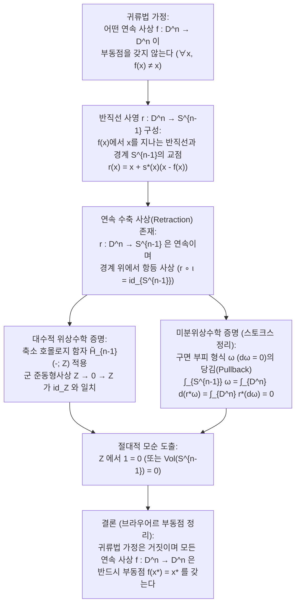
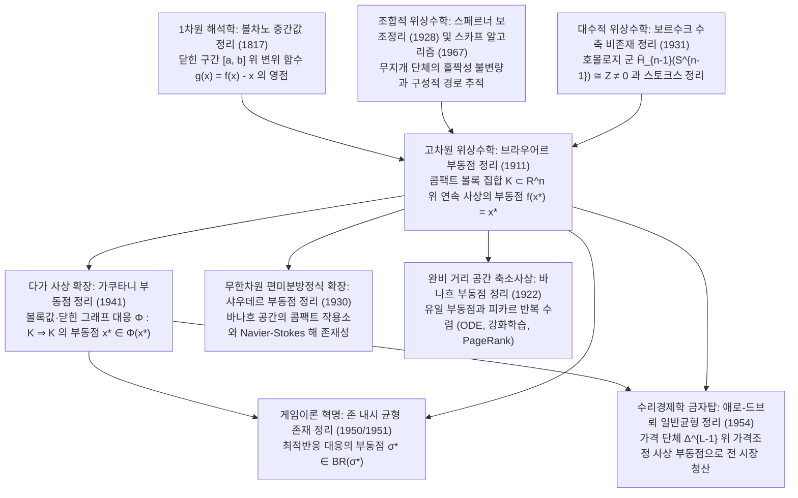

## 들어가며: 일상에 숨겨진 위상수학(Topology)의 3가지 기적

아침에 머그잔에 뜨거운 커피를 따르고 우유를 넣은 뒤 스푼으로 세차게 젓는 장면을 상상해 보자. 잔 속에서는 크고 작은 소용돌이(와류)와 층류의 접힘이 복잡하게 일어난다. 이윽고 스푼을 빼고 액체가 완전히 정지했을 때, 모든 커피 입자는 처음 위치에서 완전히 뒤섞여버린 것처럼 보인다. 그러나 1911년 네덜란드의 수학자 <strong>라위트전 에흐베르튀스 얀 브라우어르(L.E.J. Brouwer, 1881–1966)</strong>가 증명한 <strong>브라우어르 부동점 정리(Brouwer's Fixed-Point Theorem)</strong>는 직관을 뒤집는 놀라운 사실을 알려준다.

> [!IMPORTANT]
> <strong>기적 1: 휘저은 커피잔 속의 부동점(Fixed Point)</strong>
> 커피를 아무리 격렬하고 복잡하게 휘젓더라도 — 액체가 잔 밖으로 튀어나가거나 내부에 기포(구멍)가 생기거나 연속체가 찢어지지 않는 한 — 액체가 정지한 순간, <strong>젓기 전과 한 치의 오차도 없이 정확히 동일한 3차원 공간 좌표 $(x^*, y^*, z^*)$로 되돌아와 있는 커피 입자(점)가 잔 속에 반드시 적어도 하나 존재한다</strong>!

> [!TIP]
> <strong>기적 2: 구겨진 지도를 펼쳐진 지도 위에 떨어뜨리기</strong>
> 완전히 똑같은 축척의 지도 두 장(<strong>지도 A</strong>와 <strong>지도 B</strong>)을 준비하자. 지도 A는 책상 위에 평평하게 펼쳐 두고, 지도 B는 종이가 찢어지지 않게 공처럼 마구 구겨서 평평한 지도 A의 테두리 안쪽 아무 곳에나 올려놓는다. 그러면 <strong>구겨진 지도 B 위의 적어도 한 지점 $x^*$는 평평한 지도 A 위의 '정확히 똑같은 지리적 지점 $x^*$' 바로 위(수직선상)에 완벽히 겹쳐진다</strong>!

또한 짝수 차원 구면 위의 <strong>푸앵카레-브라우어르 털공 정리(Hairy Ball Theorem)</strong>를 떠올리면, 사람의 머리 정수리에 반드시 생기는 <strong>'가마(Crown Whorl)'</strong>와 지구 대기 표면 $S^2$ 위에 매 순간 반드시 적어도 한 곳 존재하는 <strong>'무풍 지점(태풍의 눈)'</strong> 역시 똑같은 위상수학적 필연성의 산물임을 알 수 있다.

### 브라우어르 부동점 정리의 엄밀한 정식화

$n$차원 유클리드 공간 $\mathbb{R}^n$의 <strong>공집합이 아닌 콤팩트(유계이고 닫힌) 볼록 집합 $K \subset \mathbb{R}^n$</strong>(또는 닫힌 단위공 $D^n = \{x \in \mathbb{R}^n : \|x\|_2 \le 1\}$과 위상동형인 공간)에서 자기 자신으로 가는 임의의 <strong>연속 사상 $f: K \to K$</strong>에 대하여,

$$
f(x^*) = x^*
$$

를 만족하는 점 $x^* \in K$(<strong>부동점, Fixed Point</strong>)가 적어도 하나 반드시 존재한다.

---

## 제1장: 왜 세 가지 가정은 단 하나도 빠져서는 안 되는가? — 4가지 반례

하이네-보렐 정리(Heine-Borel Theorem)에 의해 $\mathbb{R}^n$에서의 콤팩트성은 <strong>유계성(Boundedness)</strong>과 <strong>닫힘성(Closedness)</strong>의 결합과 동치이다. 따라서 유계성, 닫힘성, 볼록성(구멍 없음), 연속성 중 하나라도 제거하면 부동점은 즉시 사라진다.

1. <strong>유계성 제거 (Unbounded)</strong>: $K = \mathbb{R}$(닫힌 볼록 집합) 위에서 평행이동 $f(x) = x + 1$을 정의하면 $x^* + 1 = x^*$의 해는 존재하지 않는다. 막아서는 경계벽이 없으므로 모든 점이 $+\infty$로 도망친다.
2. <strong>닫힘성 제거 (Not Closed)</strong>: 열린 구간 $K = (0, 1)$(유계이고 볼록) 위에서 연속 사상 $f(x) = \frac{x+1}{2}$을 정의하면, 대수적 부동점인 $x^* = 1$이 정의역에서 제외된 경계 $\partial K \setminus K$ 위에 있으므로 $(0, 1)$ 내부에는 부동점이 없다.
3. <strong>볼록성 / 단일연결성 제거 (구멍이 뚫린 공간)</strong>: 단위원 $S^1$ 또는 도넛 모양의 닫힌 원환면(Annulus) $A = \{x \in \mathbb{R}^2 : \frac{1}{2} \le \|x\|_2 \le 1\}$ 위에서 각도 $\theta \in (0, 2\pi)$의 회전 변환 $f(x) = R_\theta x$를 정의하자. 유일한 회전 중심인 원점 $(0, 0)$이 가운데 뚫린 '구멍' 속($(0, 0) \notin A$)에 빠져 있으므로 모든 점이 영원히 돌기만 할 뿐 부동점은 없다.
4. <strong>연속성 제거 (Discontinuous)</strong>: $K = [0, 1]$ 위에서 $x \in [0, \frac{1}{2}]$일 때 $f(x) = 1$, $x \in (\frac{1}{2}, 1]$일 때 $f(x) = 0$으로 정의하면, 그래프 $y = f(x)$가 $x = \frac{1}{2}$에서 대각선 $y = x$를 불연속적으로 뛰어넘어 버린다.

| 제거된 가정 | 유지된 조건 | 구체적 반례 (정의역 $K$ 및 사상 $f: K \to K$) | 부동점 $f(x^*) = x^*$가 사라지는 기하학적 이유 |
| :--- | :--- | :--- | :--- |
| <strong>1. 유계성</strong> | 닫힌집합, 볼록, 연속 | $K = \mathbb{R}$, $f(x) = x + 1$ | 외곽 경계벽이 없어 모든 점이 $+\infty$로 끝없이 이동함 |
| <strong>2. 닫힘성</strong> | 유계, 볼록, 연속 | $K = (0, 1)$, $f(x) = \frac{x+1}{2}$ | 원래 부동점이어야 할 $x^* = 1$이 빠진 경계 위에 위치함 |
| <strong>3. 볼록성 (구멍 없음)</strong> | 유계, 닫힘(콤팩트), 연속 | $K = S^1$ 또는 원환 $A$, $f = R_\theta$ (회전) | 회전 중심 $(0, 0)$이 집합 내부의 위상적 구멍 속에 빠짐 |
| <strong>4. 연속성</strong> | 유계, 닫힘(콤팩트), 볼록 | $K = [0, 1]$, $x \le \frac{1}{2}$에서 $1$, $x > \frac{1}{2}$에서 $0$ | 그래프가 $x = \frac{1}{2}$에서 점프하여 대각선 $y = x$를 건너뜀 |

---

## 제2장: 첫 번째 증명 — 1차원에서의 중간값 정리(IVT)

1차원($n = 1$)에서 모든 공집합이 아닌 콤팩트 볼록 집합은 닫힌 구간 $K = [a, b]$이다. 연속 함수 $f: [a, b] \to [a, b]$에 대하여 변위 함수 $g(x) = f(x) - x$를 정의하면, 양 끝점에서 $f(a) \ge a$ 및 $f(b) \le b$이므로 다음이 성립한다.

$$
g(a) = f(a) - a \ge 0, \qquad g(b) = f(b) - b \le 0
$$

따라서 미적분학의 <strong>볼차노 중간값 정리(Intermediate Value Theorem, IVT)</strong>에 의해 $g(x^*) = 0 \iff f(x^*) = x^*$를 만족하는 $x^* \in [a, b]$가 반드시 존재한다! 하지만 $n \ge 2$ 차원에서는 원점 $\mathbf{0}$을 제거한 공간 $\mathbb{R}^n \setminus \{\mathbf{0}\}$이 여전히 경로 연결되어 있어 벡터장 $g(x) = f(x) - x$가 영벡터를 우회할 수 있으므로 대수적 위상수학이나 조합적 위상수학의 도구가 필요하다.

---

## 제3장: 두 번째 증명 — 대수적 위상수학과 보르수크의 '수축 비존재 정리'(1931)

폴란드 수학자 <strong>카롤 보르수크(Karol Borsuk, 1931)</strong>는 브라우어르 부동점 정리가 <strong>수축 비존재 정리(No-Retraction Theorem)</strong>와 동치임을 보였다. 즉, $n$차원 닫힌 공 $D^n$ 전체를 그 경계 구면 $S^{n-1} = \partial D^n$ 위로 연속적으로 찌부러뜨리면서 경계 위의 모든 점은 그대로 고정시키는($r|_{S^{n-1}} = \text{id}_{S^{n-1}}$) 연속 <strong>수축 사상(Retraction)</strong> $r: D^n \to S^{n-1}$은 존재할 수 없다(북가죽을 찢지 않고 북 테두리로 밀어 넣을 수 없는 것과 같다).

### 단계 1: 부동점이 없다면 연속 수축 사상 $r: D^n \to S^{n-1}$이 만들어진다!

만약 모든 $x \in D^n$에서 $f(x) \ne x$인 연속 사상 $f: D^n \to D^n$이 존재한다고 가정하자(귀류법). 그러면 비영 벡터 $u(x) = x - f(x) \ne \mathbf{0}$를 따라 $f(x)$에서 $x$를 지나 바깥쪽으로 반직선 $\gamma_x(t) = x + s u(x)$ ($s = t - 1 \ge 0$)을 쏘아 경계 구면 $S^{n-1}$과 만나는 유일한 교점 $r(x) \in S^{n-1}$을 정의할 수 있다. 이차방정식 $\|x + s u(x)\|_2^2 = 1$의 해는 다음과 같다.

$$
r(x) = x + s^*(x)\bigl(x - f(x)\bigr), \qquad s^*(x) = \frac{-\langle x, u(x)\rangle + \sqrt{\langle x, u(x)\rangle^2 + \|u(x)\|_2^2(1 - \|x\|_2^2)}}{\|u(x)\|_2^2}
$$

분모 $\|u(x)\|_2^2 > 0$이므로 $r: D^n \to S^{n-1}$은 $D^n$ 전체에서 연속이며, $x \in S^{n-1}$일 때는 $\|x\|_2^2 = 1$이므로 $s^*(x) = 0$이 되어 $r(x) = x$가 성립한다. 즉 $r$은 연속 수축 사상이다!

### 단계 2: 호몰로지 함자 $\tilde{H}_{n-1}$ 및 스토크스 정리를 통한 모순 도출

1. <strong>대수적 위상수학 증명 (축소 호몰로지 군 $\tilde{H}_{n-1}$)</strong>:
   합성 사상 $S^{n-1} \xrightarrow{\iota} D^n \xrightarrow{r} S^{n-1}$ ($r \circ \iota = \text{id}_{S^{n-1}}$)에 $(n-1)$차 축소 특이 호몰로지 함자 $\tilde{H}_{n-1}(-; \mathbb{Z})$를 적용하면, 구멍이 없는 공 $D^n$은 수축 가능하므로 $\tilde{H}_{n-1}(D^n) \cong 0$이고, 속이 빈 구면 $S^{n-1}$은 $\tilde{H}_{n-1}(S^{n-1}) \cong \mathbb{Z}$이다. 따라서 유도된 군 준동형사상 열은 다음과 같다.
   $$
   \mathbb{Z} \xrightarrow{\;\iota_*\;} 0 \xrightarrow{\;r_*\;} \mathbb{Z}
   $$
   자명군 $0$을 거치는 합성 사상은 반드시 영 사상($1 \mapsto 0$)이어야 하지만, 함자성에 의해 $(r \circ \iota)_* = \text{id}_{\mathbb{Z}}$($1 \mapsto 1$)이어야 하므로 $\mathbb{Z}$에서 $1 = 0$이라는 절대적 모순이 발생한다!
2. <strong>미분형식과 스토크스 정리(Stokes's Theorem) 증명</strong>:
   다항식 근사로 매끄러운 수축 $r: D^n \to S^{n-1}$을 얻은 뒤, $S^{n-1}$ 위의 표준 부피 $(n-1)$-형식 $\omega$ ($\int_{S^{n-1}} \omega = \text{Vol}(S^{n-1}) > 0$, $d\omega = 0$)를 당겨오면 스토크스 정리에 의해 다음 모순이 도출된다.
   $$
   0 < \int_{S^{n-1}} \omega = \int_{\partial D^n} r^*\omega = \int_{D^n} d(r^*\omega) = \int_{D^n} r^*(d\omega) = 0
   $$

---

## 제4장: 세 번째 증명 — 스페르너의 보조정리(1928)와 구성적 알고리즘

<strong>수학적 직관주의(Intuitionism)</strong>의 창시자였던 브라우어르는 배중률과 비구성적 귀류법을 배격했기에, 역설적이게도 후년에 자기 자신의 1911년 부동점 정리 증명을 스스로 부정했다.

이를 구성적으로 해결한 것이 1928년 <strong>에마누엘 스페르너(Emanuel Sperner)</strong>가 증명한 <strong>스페르너의 보조정리(Sperner's Lemma)</strong>이다. $n$차원 단체(Simplex) $\Delta^n = \text{conv}\{v_0, \dots, v_n\}$을 잘게 삼각분할한 뒤 각 꼭짓점에 색깔 $\{0, 1, \dots, n\}$을 칠할 때, 주 꼭짓점 $\ell(v_i) = i$이고 각 경계면 $\text{conv}\{v_{i_0}, \dots, v_{i_k}\}$ 위의 꼭짓점에는 $\{i_0, \dots, i_k\}$의 색만 허용하면(스페르너 색칠), <strong>모든 색깔 $\{0, 1, \dots, n\}$을 하나씩 다 가진 '무지개 소단체(완전 색칠 소삼각형)'는 반드시 홀수 개(따라서 적어도 1개 이상) 존재한다</strong>!

색깔이 $\{0, 1\}$인 변을 '문(Door)'으로, 소삼각형을 '방(Room)'으로 보면 외곽 밑변 $v_0 v_1$에 홀수 개의 문이 존재하므로, 외곽 문에서 출발해 복도 방(문 2개)을 통과하는 경로 중 적어도 하나는 반드시 문이 1개뿐인 '무지개 방 $\{0, 1, 2\}$' 내부에서 끝나게 된다. 무게중심 좌표 $\lambda_i(x)$에 대해 $\lambda_i(w) > 0$이고 $\lambda_i(f(w)) \le \lambda_i(w)$인 번호 $i$로 색칠하고 분할 크기를 $0$으로 보내면, 볼차노-바이어슈트라스 콤팩트성 정리와 $f$의 연속성에 의해 무지개 소단체의 극한점 $x^*$에서 모든 $i$에 대해 $\lambda_i(f(x^*)) \le \lambda_i(x^*)$가 성립하여 $f(x^*) = x^*$가 증명된다. 1967년 경제학자 <strong>허버트 스카프(Herbert Scarf)</strong>는 이 경로 추적을 <strong>스카프의 단체 알고리즘(Scarf's Algorithm)</strong>으로 구현하여 부동점의 컴퓨터 수치 계산을 실현했다.

---

## 제5장: 4대 부동점 정리의 계층 구조 — 바나흐, 브라우어르, 샤우데르, 가쿠타니

1. <strong>바나흐 축소사상 정리 (Banach Contraction Mapping Principle, 1922)</strong>: 임의의 완비 거리 공간 $(X, d)$에서 $d(Tx, Ty) \le L d(x, y)$ ($0 \le L < 1$)이면 <strong>유일한</strong> 부동점 $x^*$가 존재하며 반복열 $x_{k+1} = T(x_k)$가 기하급수적으로 수렴한다. 상미분방정식 해의 존재·유일성(피카르-린델뢰프 정리), 강화학습의 <strong>벨만 가치 반복(Bellman Value Iteration)</strong>, <strong>Google PageRank</strong>의 수학적 엔진이다.
2. <strong>무한차원의 함정과 샤우데르 부동점 정리 (Schauder, 1930)</strong>: 무한차원 힐베르트 공간 $\ell^2$의 닫힌 단위공 $B_{\ell^2}$에서는 연속 사상 $f(x_1, x_2, \dots) = (\sqrt{1 - \|x\|_2^2}, x_1, x_2, \dots)$가 <strong>부동점을 갖지 않는다</strong>(무한차원 닫힌 단위공은 콤팩트하지 않기 때문!). 샤우데르 정리는 바나흐 공간의 유계 닫힌 볼록 집합 위에서 연속 사상 $T$가 <strong>콤팩트 작용소(Compact Operator)</strong>이면 부동점이 존재함을 보여 비선형 편미분방정식(Navier-Stokes 등) 해의 존재성을 증명한다.
3. <strong>가쿠타니 시즈오의 부동점 정리 (Kakutani's Fixed-Point Theorem, 1941)</strong>: 점 하나가 아니라 부분집합을 대응시키는 <strong>집합치 대응(다가 사상, Set-Valued Correspondence)</strong> $\Phi: K \rightrightarrows K$로의 확장이다. 콤팩트 볼록 집합 $K \subset \mathbb{R}^n$ 위에서 모든 $x \in K$에 대해 $\Phi(x)$가 <strong>공집합이 아닌 볼록 집합</strong>이고 $\Phi$가 <strong>닫힌 그래프(Closed Graph / 상반연속성)</strong>를 가지면, 반드시 $x^* \in \Phi(x^*)$인 부동점이 존재한다.

| 부동점 정리 및 발표 연도 | 공간 및 정의역 $K$ 조건 | 사상 $f$ 또는 $\Phi$ 조건 | 부동점 유일성 및 계산성 | 대표적 응용 분야 |
| :--- | :--- | :--- | :--- | :--- |
| <strong>바나흐 축소사상 정리 (1922)</strong> | 완비 거리 공간 $(X, d)$ (무한차원 가능) | 축소사상: $d(Tx, Ty) \le L d(x, y)$ ($L < 1$) | <strong>유일하게 존재</strong>; $x_{k+1}=T(x_k)$ 지수 수렴 | 상미분방정식, 강화학습 벨만 반복, PageRank |
| <strong>브라우어르 정리 (1911)</strong> | $\mathbb{R}^n$의 콤팩트 볼록 집합 $K$ (유한차원) | 임의의 연속 단일치 사상 $f: K \to K$ | <strong>적어도 하나 존재</strong>; 스카프 알고리즘으로 근사 | 비선형 방정식, 내시(1951) 증명, 일반균형 |
| <strong>샤우데르 정리 (1930)</strong> | 무한차원 바나흐 공간의 유계 닫힌 볼록 집합 $K$ | 연속 <strong>콤팩트 작용소</strong> $T: K \to K$ | <strong>적어도 하나 존재</strong> | 비선형 편미분방정식 (Navier-Stokes 방정식 등) |
| <strong>가쿠타니 정리 (1941)</strong> | $\mathbb{R}^n$의 콤팩트 볼록 집합 $K$ | 다가 대응 $\Phi: K \rightrightarrows K$ (비공집합·볼록값·닫힌 그래프) | <strong>적어도 하나 존재</strong> ($x^* \in \Phi(x^*)$) | 내시(1950) 게임 균형 증명, 애로-드브뢰 일반균형 |

---

## 제6장: 위상수학이 이끈 경제학과 게임이론의 혁명 — 내시 균형(1950)과 애로-드브뢰 일반균형(1954)

### 6.1 존 내시(1950, 1951)의 내시 균형 존재 증명

$N$명 유한 게임에서 각 플레이어 $i$의 혼합전략 공간은 단체 $\Delta_i$이며, 결합 전략 공간 $K = \Delta_1 \times \dots \times \Delta_N$은 콤팩트 볼록 집합이다.
- <strong>1950년 가쿠타니 정리 증명</strong>: 기대보수 $U_i(\tau_i, \sigma_{-i})$를 최대화하는 <strong>최적반응 대응(Best-Response Correspondence)</strong> $BR_i(\sigma_{-i}) = \arg\max_{\tau_i \in \Delta_i} U_i(\tau_i, \sigma_{-i})$은 $U_i$의 선형성에 의해 공집합이 아닌 볼록 집합이며 닫힌 그래프를 갖는다. 따라서 <strong>가쿠타니 부동점 정리</strong>에 의해 $\sigma^* \in BR(\sigma^*)$인 <strong>내시 균형(Nash Equilibrium)</strong>이 반드시 존재한다!
- <strong>1951년 브라우어르 정리 직접 증명</strong>: 순수전략 $s_{ij}$로의 전환 초과이득 $\varphi_{ij}(\sigma) = \max\{0, U_i(s_{ij}, \sigma_{-i}) - U_i(\sigma_i, \sigma_{-i})\}$를 정의하고 연속 단일치 갱신 사상
  $$
  f_{ij}(\sigma) = \frac{\sigma_{ij} + \varphi_{ij}(\sigma)}{1 + \sum_{k=1}^{m_i} \varphi_{ik}(\sigma)}
  $$
  에 <strong>브라우어르 부동점 정리</strong>를 적용하면 $f(\sigma^*) = \sigma^*$가 존재하며, 양의 확률로 선택된 순수전략들이 모두 평균 보수보다 엄밀히 클 수는 없으므로 모든 $\varphi_{ij}(\sigma^*) = 0$이 되어 내시 균형이 증명된다.

### 6.2 애로-드브뢰 일반경쟁균형(1954): '보이지 않는 손'의 위상수학적 증명

$L$개의 재화가 존재하는 시장 경제에서 가격 단체 $\Delta^{L-1} = \{p \in \mathbb{R}_+^L : \sum_{\ell=1}^L p_\ell = 1\}$ 위의 시장 초과수요 함수 $z(p)$는 <strong>발라스 법칙(Walras's Law)</strong> $\sum_{\ell=1}^L p_\ell z_\ell(p) = 0$을 만족한다. 가격 조정 사상 $g_\ell(p) = \frac{p_\ell + \max\{0, z_\ell(p)\}}{1 + \sum_{k=1}^L \max\{0, z_k(p)\}}$에 <strong>브라우어르 부동점 정리</strong>를 적용하면 $g(p^*) = p^*$인 균형 가격 $p^*$가 존재한다. 분모를 정리하고 양변에 $z_\ell(p^*)$를 곱해 합산한 뒤 발라스 법칙을 적용하면

$$
\sum_{\ell=1}^L \bigl(\max\{0, z_\ell(p^*)\}\bigr)^2 = 0 \implies z_\ell(p^*) \le 0 \quad (\forall \ell = 1, \dots, L)
$$

이 도출되어 모든 시장이 동시에 청산된다! 커피잔 속의 작은 소용돌이에서 시작된 부동점 정리는 이처럼 인류의 경제와 전략적 상호작용의 균형을 보증하는 가장 위대한 수학적 기둥이다.

