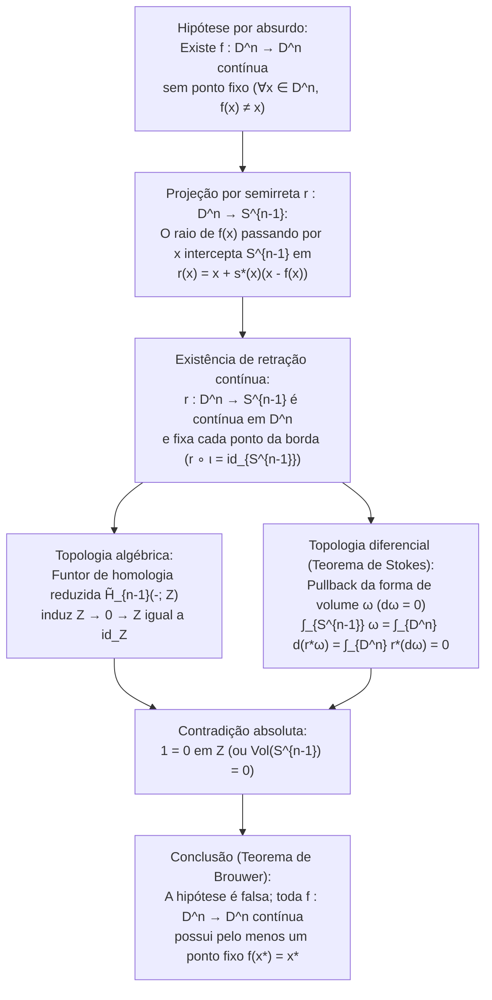
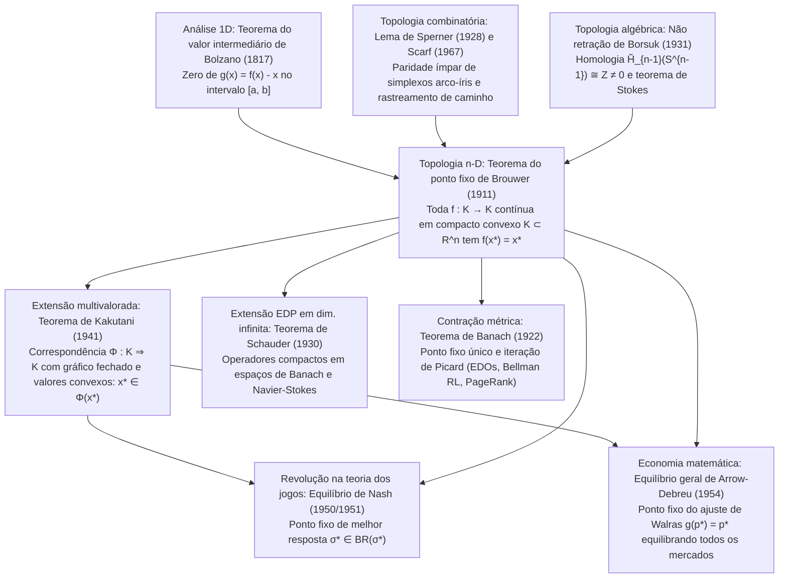

## Introdução: Três milagres cotidianos da inevitabilidade topológica

Imagine despejar café quente em uma xícara cilíndrica, adicionar um pouco de leite e mexer vigorosamente com uma colher. Redemoinhos caóticos e dobras laminares agitam o líquido. Quando o café finalmente volta ao repouso, nossa intuição diz que cada gota se moveu para longe de sua posição inicial. No entanto, em 1911, o matemático holandês <strong>Luitzen Egbertus Jan Brouwer (1881–1966)</strong> provou o <strong>teorema do ponto fixo de Brouwer (Brouwer's Fixed-Point Theorem)</strong>, que garante com absoluta certeza matemática o seguinte:

> [!IMPORTANT]
> <strong>Milagre 1: O ponto imóvel em uma xícara de café mexida</strong>
> Não importa quão vigorosa ou caoticamente você mexa seu café — desde que nenhum líquido transborde para fora da xícara, nenhuma bolha de cavitação abra buracos permanentes e o meio contínuo não seja rasgado —, quando o líquido parar, <strong>há garantidamente pelo menos um ponto (uma molécula no limite contínuo) ocupando exatamente as mesmas coordenadas espaciais tridimensionais $(x^*, y^*, z^*)$ que ocupava antes de você tocar na colher</strong>!

> [!TIP]
> <strong>Milagre 2: O mapa amassado jogado sobre um mapa aberto</strong>
> Pegue dois mapas idênticos de uma mesma região (<strong>Mapa A</strong> e <strong>Mapa B</strong>). Estenda o Mapa A plano sobre sua mesa, amasse o Mapa B formando uma bola de papel (sem rasgá-lo) e solte-o em qualquer lugar totalmente dentro das bordas do Mapa A. Então, <strong>pelo menos um ponto geográfico $x^*$ do Mapa B amassado estará exatamente na vertical acima do mesmo ponto geográfico $x^*$ do Mapa A plano</strong>!

Da mesma forma, o <strong>teorema da bola cabeluda (Hairy Ball Theorem)</strong> de Poincaré-Brouwer na esfera $S^2$ explica por que todo couro cabeludo possui pelo menos um <strong>redemoinho de cabelo</strong> e por que, a cada instante na Terra, existe pelo menos um local onde a velocidade horizontal do vento é <strong>estritamente zero (o olho de um ciclone)</strong>.

### Enunciado formal do teorema do ponto fixo de Brouwer (1911)

Seja $K \subset \mathbb{R}^n$ um subconjunto <strong>não vazio, compacto (fechado e limitado) e convexo</strong> de $\mathbb{R}^n$ (ou mais geralmente, um espaço homeomorfo à bola unitária fechada $D^n = \{x \in \mathbb{R}^n : \|x\|_2 \le 1\}$). Para toda aplicação <strong>contínua</strong> $f: K \to K$, existe pelo menos um <strong>ponto fixo</strong> $x^* \in K$ tal que:

$$
f(x^*) = x^*
$$

---

## 1. Por que cada hipótese é indispensável: quatro contraexemplos precisos

Pelo teorema de Heine-Borel, em $\mathbb{R}^n$ a compacidade equivale a ser <strong>limitado</strong> e <strong>fechado</strong>. Se removermos qualquer uma das quatro condições (limitação, fechamento, convexidade/ausência de buracos, continuidade), o teorema falha imediatamente:

1. <strong>Sem limitação</strong>: Em $K = \mathbb{R}$ (fechado e convexo), a translação contínua $f(x) = x + 1$ não tem ponto fixo ($x^* + 1 = x^*$ é impossível), pois todos os pontos fogem para $+\infty$.
2. <strong>Sem fechamento (não fechado)</strong>: No intervalo aberto $K = (0, 1)$ (limitado e convexo), $f(x) = \frac{x+1}{2}$ é contínua, mas seu único ponto fixo algébrico $x^* = 1$ cai na fronteira excluída $\partial K \setminus K$.
3. <strong>Sem convexidade / conectividade simples (com buraco)</strong>: No círculo unitário $S^1$ ou na coroa circular (annulus) $A = \{x \in \mathbb{R}^2 : \frac{1}{2} \le \|x\|_2 \le 1\}$, uma rotação $f(x) = R_\theta x$ por um ângulo $\theta \in (0, 2\pi)$ não possui pontos fixos porque o centro de rotação $(0, 0)$ cai dentro do buraco central ($(0, 0) \notin A$).
4. <strong>Sem continuidade</strong>: Em $K = [0, 1]$, a função degrau $f(x) = 1$ em $[0, \frac{1}{2}]$ e $f(x) = 0$ em $(\frac{1}{2}, 1]$ salta descontinuamente sobre a diagonal $y = x$ em $x = \frac{1}{2}$.

| Hipótese removida | Condições mantidas | Contraexemplo explícito ($K$ e $f: K \to K$) | Razão geométrica para o desaparecimento de $f(x^*) = x^*$ |
| :--- | :--- | :--- | :--- |
| <strong>1. Limitação</strong> | Fechado, convexo, contínua | $K = \mathbb{R}$, $f(x) = x + 1$ | Sem barreira externa; fuga infinita para $+\infty$ |
| <strong>2. Fechamento</strong> | Limitado, convexo, contínua | $K = (0, 1)$, $f(x) = \frac{x+1}{2}$ | O ponto fixo $x^* = 1$ escapa para a fronteira ausente |
| <strong>3. Convexidade (Sem buracos)</strong> | Compacto (fechado e limitado), contínua | $K = S^1$ ou anel $A$, rotação $R_\theta$ | O centro de rotação $(0, 0)$ cai no buraco topológico |
| <strong>4. Continuidade</strong> | Compacto, convexo | $K = [0, 1]$, $1$ em $[0,\frac{1}{2}]$, $0$ em $(\frac{1}{2},1]$ | O gráfico $y = f(x)$ salta sobre a diagonal $y = x$ |

---

## 2. Primeira demonstração: o caso 1D ($n = 1$) via teorema do valor intermediário (TVI)

Em dimensão $n = 1$, todo compacto convexo não vazio é um intervalo fechado $K = [a, b]$. Dada $f: [a, b] \to [a, b]$ contínua, definimos $g(x) = f(x) - x$. Como $f(a) \ge a$ e $f(b) \le b$, nas extremidades temos:

$$
g(a) = f(a) - a \ge 0, \qquad g(b) = f(b) - b \le 0
$$

Pelo <strong>teorema do valor intermediário (TVI) de Bolzano</strong>, existe pelo menos um $x^* \in [a, b]$ onde $g(x^*) = 0 \iff f(x^*) = x^*$. Em dimensão $n \ge 2$, $\mathbb{R}^n \setminus \{\mathbf{0}\}$ continua conexo por caminhos, exigindo topologia algébrica ou combinatória.

---

## 3. Segunda demonstração: Topologia algébrica e o teorema de não retração de Borsuk (1931)

Em 1931, o matemático polonês <strong>Karol Borsuk</strong> provou que o teorema de Brouwer equivale ao <strong>teorema de não retração</strong>: não existe nenhuma retração contínua $r: D^n \to S^{n-1}$ da bola unitária fechada $D^n$ sobre sua esfera fronteira $S^{n-1} = \partial D^n$ tal que $r|_{S^{n-1}} = \text{id}_{S^{n-1}}$ (é impossível achatar a membrana de um tambor sobre seu aro rígido sem furá-la).

### Passo 1: Uma aplicação sem pontos fixos constrói uma retração contínua $r: D^n \to S^{n-1}$

Suponha por absurdo que exista $f: D^n \to D^n$ contínua com $f(x) \ne x$ para todo $x \in D^n$. O vetor deslocamento $u(x) = x - f(x) \ne \mathbf{0}$ nunca se anula. A semirreta que parte de $f(x)$ e passa por $x$, dada por $\gamma_x(t) = x + s u(x)$ ($s = t - 1 \ge 0$), intercepta a esfera $S^{n-1}$ no ponto único:

$$
r(x) = x + s^*(x)\bigl(x - f(x)\bigr), \qquad s^*(x) = \frac{-\langle x, u(x)\rangle + \sqrt{\langle x, u(x)\rangle^2 + \|u(x)\|_2^2(1 - \|x\|_2^2)}}{\|u(x)\|_2^2}
$$

Como $\|u(x)\|_2^2 > 0$, $r: D^n \to S^{n-1}$ é contínua em todo $D^n$, e se $x \in S^{n-1}$ ($\|x\|_2^2 = 1$), então $s^*(x) = 0$ e $r(x) = x$. Portanto, $r$ é uma retração contínua!

### Passo 2: Contradição via funtor de homologia $\tilde{H}_{n-1}$ e teorema de Stokes

1. <strong>Prova via homologia reduzida $\tilde{H}_{n-1}$</strong>:
   Aplicando o funtor de homologia singular reduzida $\tilde{H}_{n-1}(-; \mathbb{Z})$ a $S^{n-1} \xrightarrow{\iota} D^n \xrightarrow{r} S^{n-1}$ ($r \circ \iota = \text{id}_{S^{n-1}}$), visto que $D^n$ é contrátil ($\tilde{H}_{n-1}(D^n) \cong 0$) e $\tilde{H}_{n-1}(S^{n-1}) \cong \mathbb{Z}$, obtemos:
   $$
   \mathbb{Z} \xrightarrow{\;\iota_*\;} 0 \xrightarrow{\;r_*\;} \mathbb{Z}
   $$
   Todo homomorfismo que fatora pelo grupo trivial $0$ é nulo ($1 \mapsto 0$), mas $(r \circ \iota)_* = \text{id}_{\mathbb{Z}}$ envia $1 \mapsto 1$, gerando a contradição $1 = 0$ em $\mathbb{Z}$!
2. <strong>Prova analítica via teorema de Stokes</strong>:
   Para uma retração suave $r: D^n \to S^{n-1}$ e a $(n-1)$-forma de volume $\omega$ em $S^{n-1}$ ($\int_{S^{n-1}} \omega = \text{Vol}(S^{n-1}) > 0$ e $d\omega = 0$), o teorema de Stokes resulta em:
   $$
   0 < \int_{S^{n-1}} \omega = \int_{\partial D^n} r^*\omega = \int_{D^n} d(r^*\omega) = \int_{D^n} r^*(d\omega) = 0
   $$

---

## 4. Terceira demonstração: Combinatória construtiva via lema de Sperner (1928)

Como fundador do <strong>intuicionismo matemático</strong>, Brouwer rejeitou mais tarde sua própria prova por contradição por não fornecer um algoritmo construtivo para calcular $x^*$.

Em 1928, <strong>Emanuel Sperner</strong> provou o <strong>lema de Sperner</strong>: em qualquer triangulação de um simplex $\Delta^n = \text{conv}\{v_0, \dots, v_n\}$ com uma coloração de Sperner $\ell: V(\mathcal{T}) \to \{0, 1, \dots, n\}$ ($\ell(v_i) = i$ e cada face $\text{conv}\{v_{i_0}, \dots, v_{i_k}\}$ usa apenas cores em $\{i_0, \dots, i_k\}$), <strong>o número de sub-simplexos «arco-íris» (com todas as $n+1$ cores distintas) é sempre ímpar, logo existe pelo menos um</strong>.

Colorindo cada vértice $w$ com um índice $i$ tal que $\lambda_i(w) > 0$ e $\lambda_i(f(w)) \le \lambda_i(w)$ em coordenadas baricêntricas, ao fazer a malha tender a $0$, a compacidade (Bolzano-Weierstrass) e a continuidade garantem que os simplexos arco-íris convergem para um ponto $x^*$ onde $\lambda_i(f(x^*)) \le \lambda_i(x^*)$ para todo $i$, implicando $f(x^*) = x^*$. Em 1967, <strong>Herbert Scarf</strong> transformou esse caminho no <strong>algoritmo simplicial de Scarf</strong>.

---

## 5. A grande hierarquia dos teoremas de ponto fixo: Banach, Brouwer, Schauder e Kakutani

1. <strong>Teorema da contração de Banach (1922)</strong>: Em qualquer <strong>espaço métrico completo</strong> não vazio $(X, d)$, uma contração estrita $d(Tx, Ty) \le L d(x, y)$ ($0 \le L < 1$) tem um ponto fixo <strong>único</strong> $x^*$, e a iteração de Picard $x_{k+1} = T(x_k)$ converge geometricamente (base de Picard-Lindelöf em EDOs, <strong>iteração de valor de Bellman</strong> em aprendizado por reforço e <strong>Google PageRank</strong>).
2. <strong>Armadilha de dimensão infinita e teorema de Schauder (1930)</strong>: Na bola unitária fechada $B_{\ell^2}$ do espaço de Hilbert $\ell^2$, a aplicação contínua $f(x_1, x_2, \dots) = (\sqrt{1 - \|x\|_2^2}, x_1, x_2, \dots)$ <strong>não tem ponto fixo</strong> porque $B_{\ell^2}$ não é compacta. <strong>Schauder (1930)</strong> restabeleceu o teorema em espaços de Banach para <strong>operadores compactos</strong> $T: K \to K$ (essencial para EDPs não lineares como Navier-Stokes).
3. <strong>Teorema do ponto fixo de Shizuo Kakutani (1941)</strong>: Generaliza Brouwer para <strong>correspondências multivaloradas</strong> $\Phi: K \rightrightarrows K$ em um compacto convexo $K \subset \mathbb{R}^n$. Se $\Phi(x)$ é não vazio e convexo para todo $x$ e $\Phi$ tem <strong>gráfico fechado (semicontinuidade superior)</strong>, existe $x^* \in K$ tal que $x^* \in \Phi(x^*)$.

| Teorema e Ano | Espaço e Domínio $K$ | Hipóteses sobre $f$ ou $\Phi$ | Unicidade e Computabilidade | Aplicações principais |
| :--- | :--- | :--- | :--- | :--- |
| <strong>Banach (1922)</strong> | Espaço métrico completo $(X, d)$ (dim. finita ou $\infty$) | Contração: $d(Tx, Ty) \le L d(x, y)$ ($L < 1$) | <strong>Único</strong>; iteração $x_{k+1}=T(x_k)$ geométrica | EDOs (Picard-Lindelöf), Bellman RL, PageRank |
| <strong>Brouwer (1911)</strong> | Compacto convexo $K \subset \mathbb{R}^n$ (dim. finita) | Aplicação contínua univalorada $f: K \to K$ | <strong>Pelo menos um</strong>; computável via algoritmo de Scarf | Equações não lineares, Nash (1951), Walras |
| <strong>Schauder (1930)</strong> | Fechado limitado convexo $K$ em espaço de Banach | <strong>Operador compacto</strong> contínuo $T: K \to K$ | <strong>Pelo menos um</strong> | EDPs não lineares (equações de Navier-Stokes) |
| <strong>Kakutani (1941)</strong> | Compacto convexo $K \subset \mathbb{R}^n$ | Correspondência $\Phi: K \rightrightarrows K$ (valores convexos, gráfico fechado) | <strong>Pelo menos um</strong> ($x^* \in \Phi(x^*)$) | Equilíbrio de Nash (1950), Arrow-Debreu (1954) |

---

## 6. Como a topologia revolucionou a economia e a teoria dos jogos: Nash (1950) e Arrow-Debreu (1954)

### 6.1 John Nash (1950, 1951): Existência do equilíbrio de Nash

Em um jogo finito de $N$ jogadores, o espaço de perfis de estratégias mistas $K = \Delta_1 \times \dots \times \Delta_N$ é compacto e convexo.
- <strong>Prova via Kakutani (1950)</strong>: A <strong>correspondência de melhor resposta</strong> $BR_i(\sigma_{-i}) = \arg\max_{\tau_i \in \Delta_i} U_i(\tau_i, \sigma_{-i})$ tem valores não vazios e convexos (pela linearidade do pagamento esperado $U_i$ em $\tau_i$) e gráfico fechado. Pelo <strong>teorema de Kakutani</strong>, existe $\sigma^* \in BR(\sigma^*)$, que é um <strong>equilíbrio de Nash</strong>.
- <strong>Prova direta via Brouwer (1951)</strong>: Definindo o ganho excedente $\varphi_{ij}(\sigma) = \max\{0, U_i(s_{ij}, \sigma_{-i}) - U_i(\sigma_i, \sigma_{-i})\}$, a aplicação contínua
  $$
  f_{ij}(\sigma) = \frac{\sigma_{ij} + \varphi_{ij}(\sigma)}{1 + \sum_{k=1}^{m_i} \varphi_{ik}(\sigma)}
  $$
  possui um ponto fixo $f(\sigma^*) = \sigma^*$ por <strong>Brouwer</strong>, o que implica $\varphi_{ij}(\sigma^*) = 0$ para todo $i, j$.

### 6.2 Arrow e Debreu (1954): Equilíbrio geral competitivo de Walras

No simplex de preços $\Delta^{L-1} = \{p \in \mathbb{R}_+^L : \sum_{\ell=1}^L p_\ell = 1\}$, o excesso de demanda agregada $z(p)$ satisfaz a <strong>lei de Walras</strong> $\sum_{\ell=1}^L p_\ell z_\ell(p) = 0$. A aplicação de ajuste de preços $g_\ell(p) = \frac{p_\ell + \max\{0, z_\ell(p)\}}{1 + \sum_{k=1}^L \max\{0, z_k(p)\}}$ tem um ponto fixo $g(p^*) = p^*$ por <strong>Brouwer</strong>. Multiplicando por $z_\ell(p^*)$ e somando sobre $\ell$ com a lei de Walras obtém-se:

$$
\sum_{\ell=1}^L \bigl(\max\{0, z_\ell(p^*)\}\bigr)^2 = 0 \implies z_\ell(p^*) \le 0 \quad (\forall \ell = 1, \dots, L)
$$

Todos os mercados se equilibram simultaneamente!

