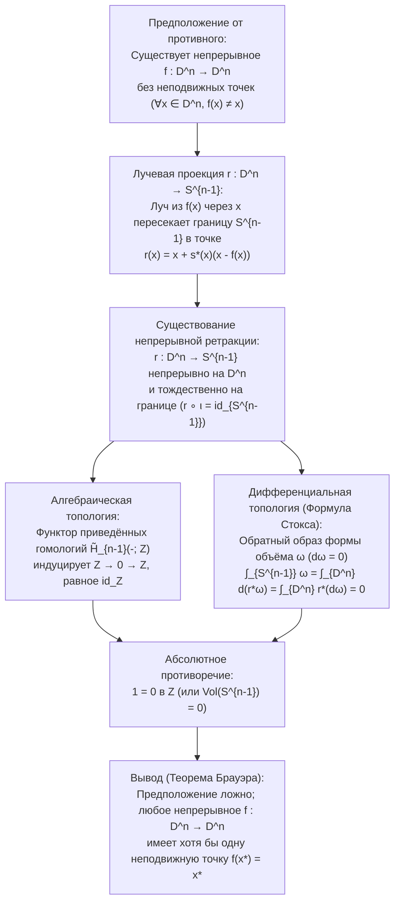
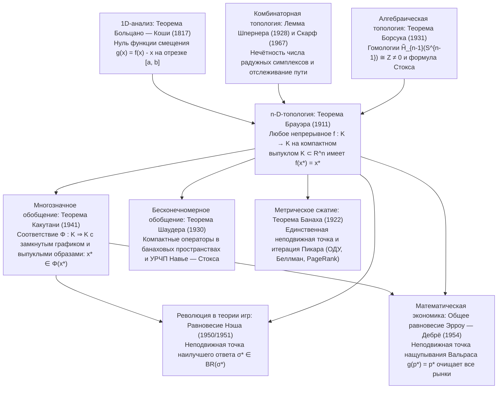

## Введение: Три повседневных чуда топологической неизбежности

Представьте, что вы наливаете горячий кофе в цилиндрическую кружку, добавляете сливки и энергично размешиваете напиток ложкой. В жидкости возникают сложные вихри и ламинарные складки. Когда кофе наконец останавливается, интуиция подсказывает, что каждая молекула сместилась далеко от своего исходного положения. Однако в 1911 году голландский математик <strong>Лёйтзен Эгбертус Ян Брауэр (L.E.J. Brouwer, 1881–1966)</strong> доказал <strong>теорему Брауэра о неподвижной точке (Brouwer's Fixed-Point Theorem)</strong>, которая со стопроцентной математической строгостью утверждает обратное:

> [!IMPORTANT]
> <strong>Чудо 1: Неподвижная точка в размешанной чашке кофе</strong>
> Как бы сильно и хаотично вы ни размешивали кофе — при условии, что жидкость не выплёскивается за края, внутри не образуются полости и сплошная среда не разрывается —, когда жидкость придёт в покой, <strong>в чашке гарантированно найдётся хотя бы одна точка (молекула в непрерывном пределе), которая окажется в точности в тех же трёхмерных координатах $(x^*, y^*, z^*)$, где она находилась до того, как вы взяли ложку</strong>!

> [!TIP]
> <strong>Чудо 2: Скомканная карта, брошенная на развёрнутую карту</strong>
> Возьмите две одинаковые географические карты (<strong>Карту A</strong> и <strong>Карту B</strong>). Разложите Карту A ровно на столе, а Карту B скомкайте в произвольный бумажный шар (не разрывая бумагу) и положите куда угодно внутрь границ Карты A. Тогда <strong>на скомканной Карте B обязательно найдётся хотя бы одна точка $x^*$, лежащая строго по вертикали над точно такой же географической точкой $x^*$ на плоской Карте A</strong>!

Родственная <strong>теорема о причёсывании ежа (Hairy Ball Theorem)</strong> Пуанкаре — Брауэра на сфере $S^2$ объясняет, почему на голове человека неизбежно есть <strong>макушка (вихрь волос)</strong> и почему в любой момент времени на поверхности Земли существует хотя бы одна точка <strong>полного штиля (глаз циклона)</strong>, где горизонтальная скорость ветра равна нулю.

### Строгая формулировка теоремы Брауэра о неподвижной точке (1911)

Пусть $K \subset \mathbb{R}^n$ — <strong>непустое, компактное (замкнутое и ограниченное) и выпуклое</strong> подмножество в $\mathbb{R}^n$ (или пространство, гомеоморфное замкнутому единичному шару $D^n = \{x \in \mathbb{R}^n : \|x\|_2 \le 1\}$). Тогда для любого <strong>непрерывного отображения</strong> $f: K \to K$ существует хотя бы одна <strong>неподвижная точка</strong> $x^* \in K$, такая что:

$$
f(x^*) = x^*
$$

---

## 1. Почему все условия необходимы: четыре точных контрпримера

По теореме Гейне — Бореля компактность в $\mathbb{R}^n$ равносильна <strong>ограниченности</strong> и <strong>замкнутости</strong>. Отбросим по очереди каждое из четырёх условий (ограниченность, замкнутость, выпуклость/отсутствие дыр, непрерывность):

1. <strong>Без ограниченности</strong>: На $K = \mathbb{R}$ (замкнутом и выпуклом) непрерывный сдвиг $f(x) = x + 1$ не имеет неподвижных точек ($x^* + 1 = x^*$ невозможно), так как все точки уходят на $+\infty$.
2. <strong>Без замкнутости</strong>: На открытом интервале $K = (0, 1)$ (ограниченном и выпуклом) отображение $f(x) = \frac{x+1}{2}$ непрерывно, но единственная алгебраическая неподвижная точка $x^* = 1$ лежит на удалённой границе $\partial K \setminus K$.
3. <strong>Без выпуклости / односвязности (пространство с дырой)</strong>: На окружности $S^1$ или замкнутом кольце (аннулусе) $A = \{x \in \mathbb{R}^2 : \frac{1}{2} \le \|x\|_2 \le 1\}$ поворот $f(x) = R_\theta x$ на угол $\theta \in (0, 2\pi)$ не имеет неподвижных точек, так как центр вращения $(0, 0)$ попадает в центральную дыру ($(0, 0) \notin A$).
4. <strong>Без непрерывности</strong>: На $K = [0, 1]$ ступенчатая функция $f(x) = 1$ при $x \in [0, \frac{1}{2}]$ и $f(x) = 0$ при $x \in (\frac{1}{2}, 1]$ перепрыгивает через диагональ $y = x$ в точке $x = \frac{1}{2}$.

| Отброшенное условие | Сохранённые условия | Контрпример ($K$ и $f: K \to K$) | Геометрическая причина исчезновения $f(x^*) = x^*$ |
| :--- | :--- | :--- | :--- |
| <strong>1. Ограниченность</strong> | Замкнутость, выпуклость, непрерывность | $K = \mathbb{R}$, $f(x) = x + 1$ | Нет внешней границы; бесконечный уход на $+\infty$ |
| <strong>2. Замкнутость</strong> | Ограниченность, выпуклость, непрерывность | $K = (0, 1)$, $f(x) = \frac{x+1}{2}$ | Неподвижная точка $x^* = 1$ ускользает на выколотую границу |
| <strong>3. Выпуклость (без дыр)</strong> | Компактность, непрерывность | $K = S^1$ или кольцо $A$, поворот $R_\theta$ | Центр вращения $(0, 0)$ лежит внутри топологической дыры |
| <strong>4. Непрерывность</strong> | Компактность, выпуклость | $K = [0, 1]$, $1$ на $[0,\frac{1}{2}]$, $0$ на $(\frac{1}{2},1]$ | График $y = f(x)$ перепрыгивает через диагональ $y = x$ |

---

## 2. Первое доказательство: одномерный случай ($n = 1$) через теорему Больцано — Коши

При $n = 1$ любое непустое компактное выпуклое множество — это отрезок $K = [a, b]$. Для непрерывной функции $f: [a, b] \to [a, b]$ введём функцию смещения $g(x) = f(x) - x$. Так как $f(a) \ge a$ и $f(b) \le b$, на концах отрезка имеем:

$$
g(a) = f(a) - a \ge 0, \qquad g(b) = f(b) - b \le 0
$$

По <strong>теореме Больцано — Коши о промежуточном значении (IVT)</strong> существует точка $x^* \in [a, b]$, где $g(x^*) = 0 \iff f(x^*) = x^*$. При $n \ge 2$ проколотое пространство $\mathbb{R}^n \setminus \{\mathbf{0}\}$ остаётся линейно связным, поэтому требуется алгебраическая или комбинаторная топология.

---

## 3. Второе доказательство: Алгебраическая топология и теорема Борсука об отсутствии ретракции (1931)

В 1931 году польский математик <strong>Кароль Борсук (Karol Borsuk)</strong> показал, что теорема Брауэра эквивалентна <strong>теореме об отсутствии ретракции</strong>: не существует непрерывной ретракции $r: D^n \to S^{n-1}$ замкнутого шара $D^n$ на его граничную сферу $S^{n-1} = \partial D^n$, оставляющей неподвижной каждую точку границы ($r|_{S^{n-1}} = \text{id}_{S^{n-1}}$).

### Шаг 1: Отображение без неподвижных точек порождает непрерывную ретракцию $r: D^n \to S^{n-1}$

Предположим от противного, что существует непрерывное отображение $f: D^n \to D^n$, для которого $f(x) \ne x$ всюду на $D^n$. Тогда вектор $u(x) = x - f(x) \ne \mathbf{0}$ нигде не обращается в нуль. Луч, выпущенный из $f(x)$ через $x$ по закону $\gamma_x(t) = x + s u(x)$ ($s = t - 1 \ge 0$), пересекает сферу $S^{n-1}$ в единственной точке:

$$
r(x) = x + s^*(x)\bigl(x - f(x)\bigr), \qquad s^*(x) = \frac{-\langle x, u(x)\rangle + \sqrt{\langle x, u(x)\rangle^2 + \|u(x)\|_2^2(1 - \|x\|_2^2)}}{\|u(x)\|_2^2}
$$

Так как $\|u(x)\|_2^2 > 0$, отображение $r: D^n \to S^{n-1}$ непрерывно на всём $D^n$, а при $x \in S^{n-1}$ ($\|x\|_2^2 = 1$) имеем $s^*(x) = 0$ и $r(x) = x$. Значит, $r$ — непрерывная ретракция!

### Шаг 2: Противоречие через функтор гомологий $\tilde{H}_{n-1}$ и формулу Стокса

1. <strong>Доказательство через приведённые гомологии $\tilde{H}_{n-1}$</strong>:
   Применяя функтор приведённых сингулярных гомологий $\tilde{H}_{n-1}(-; \mathbb{Z})$ к $S^{n-1} \xrightarrow{\iota} D^n \xrightarrow{r} S^{n-1}$ ($r \circ \iota = \text{id}_{S^{n-1}}$), ввиду стягиваемости шара $D^n$ ($\tilde{H}_{n-1}(D^n) \cong 0$) и $\tilde{H}_{n-1}(S^{n-1}) \cong \mathbb{Z}$ получаем:
   $$
   \mathbb{Z} \xrightarrow{\;\iota_*\;} 0 \xrightarrow{\;r_*\;} \mathbb{Z}
   $$
   Любой гомоморфизм, проходящий через нулевую группу $0$, равен нулю ($1 \mapsto 0$), тогда как $(r \circ \iota)_* = \text{id}_{\mathbb{Z}}$ переводит $1 \mapsto 1$, что даёт противоречие $1 = 0$ в $\mathbb{Z}$!
2. <strong>Аналитическое доказательство через формулу Стокса</strong>:
   Для гладкой ретракции $r: D^n \to S^{n-1}$ и $(n-1)$-формы объёма $\omega$ на $S^{n-1}$ ($\int_{S^{n-1}} \omega = \text{Vol}(S^{n-1}) > 0$ и $d\omega = 0$) формула Стокса даёт:
   $$
   0 < \int_{S^{n-1}} \omega = \int_{\partial D^n} r^*\omega = \int_{D^n} d(r^*\omega) = \int_{D^n} r^*(d\omega) = 0
   $$

---

## 4. Третье доказательство: Конструктивная комбинаторика и лемма Шпернера (1928)

Став основателем <strong>математического интуиционизма</strong>, Брауэр отверг собственное неконструктивное доказательство от противного, поскольку оно не давало алгоритма вычисления $x^*$.

В 1928 году <strong>Эмануэль Шпернер (Emanuel Sperner)</strong> доказал <strong>лемму Шпернера</strong>: при любой триангуляции симплекса $\Delta^n = \text{conv}\{v_0, \dots, v_n\}$ с раскраской Шпернера $\ell: V(\mathcal{T}) \to \{0, 1, \dots, n\}$ ($\ell(v_i) = i$, а на каждой грани $\text{conv}\{v_{i_0}, \dots, v_{i_k}\}$ используются только цвета из $\{i_0, \dots, i_k\}$) <strong>число «радужных» подсимплексов (содержащих все $n+1$ цветов) всегда нечётно, а значит, существует хотя бы один</strong>!

Окрашивая каждую вершину $w$ цветом $i$, для которого в барицентрических координатах $\lambda_i(w) > 0$ и $\lambda_i(f(w)) \le \lambda_i(w)$, при стремлении шага сетки к $0$ компактность (Больцано — Вейерштрасс) и непрерывность гарантируют сходимость радужных симплексов к точке $x^*$, где $\lambda_i(f(x^*)) \le \lambda_i(x^*)$ для всех $i$, откуда $f(x^*) = x^*$. В 1967 году <strong>Герберт Скарф (Herbert Scarf)</strong> создал на этой основе <strong>симплициальный алгоритм Скарфа</strong> для численного поиска неподвижных точек.

---

## 5. Великая иерархия теорем о неподвижной точке: Банах, Брауэр, Шаудер и Какутани

1. <strong>Теорема Банаха о сжимающем отображении (1922)</strong>: В любом непустом <strong>полном метрическом пространстве</strong> $(X, d)$ сжатие $d(Tx, Ty) \le L d(x, y)$ ($0 \le L < 1$) имеет <strong>единственную</strong> неподвижную точку $x^*$, к которой геометрически сходится итерация Пикара $x_{k+1} = T(x_k)$ (основа теоремы Пикара — Линделёфа для ОДУ, <strong>итерации по ценности Беллмана</strong> в обучении с подкреплением и <strong>Google PageRank</strong>).
2. <strong>Ловушка бесконечной размерности и теорема Шаудера (1930)</strong>: На замкнутом единичном шаре $B_{\ell^2}$ гильбертова пространства $\ell^2$ непрерывное отображение $f(x_1, x_2, \dots) = (\sqrt{1 - \|x\|_2^2}, x_1, x_2, \dots)$ <strong>не имеет неподвижных точек</strong>, так как шар $B_{\ell^2}$ не компактен! <strong>Шаудер (1930)</strong> восстановил теорему в банаховых пространствах для <strong>компактных операторов</strong> $T: K \to K$ (ключ к нелинейным УРЧП вроде уравнений Навье — Стокса).
3. <strong>Теорема Сидзуо Какутани (1941)</strong>: Обобщает теорему Брауэра на <strong>многозначные отображения (соответствия)</strong> $\Phi: K \rightrightarrows K$ на компактном выпуклом $K \subset \mathbb{R}^n$. Если $\Phi(x)$ непусто и выпукло для всех $x$, а график $\Phi$ <strong>замкнут (полунепрерывность сверху)</strong>, то существует точка $x^* \in K$, такая что $x^* \in \Phi(x^*)$.

| Теорема и Год | Пространство и область $K$ | Условия на $f$ или $\Phi$ | Единственность и вычисление | Ключевые применения |
| :--- | :--- | :--- | :--- | :--- |
| <strong>Банах (1922)</strong> | Полное метрическое пространство $(X, d)$ | Сжатие: $d(Tx, Ty) \le L d(x, y)$ ($L < 1$) | <strong>Единственна</strong>; итерация $x_{k+1}=T(x_k)$ | ОДУ (Пикар — Линделёф), Беллман RL, PageRank |
| <strong>Брауэр (1911)</strong> | Компактное выпуклое $K \subset \mathbb{R}^n$ ($\dim < \infty$) | Непрерывное однозначное $f: K \to K$ | <strong>Хотя бы одна</strong>; алгоритм Скарфа | Нелинейные системы, Нэш (1951), Вальрас |
| <strong>Шаудер (1930)</strong> | Замкнутое ограниченное выпуклое $K$ в банаховом $X$ | Непрерывный <strong>компактный оператор</strong> $T$ | <strong>Хотя бы одна</strong> | Нелинейные УРЧП (уравнения Навье — Стокса) |
| <strong>Какутани (1941)</strong> | Компактное выпуклое $K \subset \mathbb{R}^n$ | Многозначное $\Phi: K \rightrightarrows K$ (выпуклые образы, замкн. график) | <strong>Хотя бы одна</strong> ($x^* \in \Phi(x^*)$) | Равновесие Нэша (1950), Эрроу — Дебрё (1954) |

---

## 6. Как топология произвела революцию в экономике и теории игр: Нэш (1950) и Эрроу — Дебрё (1954)

### 6.1 Джон Нэш (1950, 1951): Существование равновесия Нэша

В конечной игре $N$ лиц пространство профилей смешанных стратегий $K = \Delta_1 \times \dots \times \Delta_N$ компактно и выпукло.
- <strong>Доказательство через теорему Какутани (1950)</strong>: <strong>Соответствие наилучшего ответа</strong> $BR_i(\sigma_{-i}) = \arg\max_{\tau_i \in \Delta_i} U_i(\tau_i, \sigma_{-i})$ имеет непустые выпуклые значения (в силу линейности математического ожидания выигрыша $U_i$ по $\tau_i$) и замкнутый график. По <strong>теореме Какутани</strong> существует $\sigma^* \in BR(\sigma^*)$ — <strong>равновесие Нэша</strong>!
- <strong>Прямое доказательство через теорему Брауэра (1951)</strong>: Определив избыточный выигрыш $\varphi_{ij}(\sigma) = \max\{0, U_i(s_{ij}, \sigma_{-i}) - U_i(\sigma_i, \sigma_{-i})\}$, непрерывное отображение
  $$
  f_{ij}(\sigma) = \frac{\sigma_{ij} + \varphi_{ij}(\sigma)}{1 + \sum_{k=1}^{m_i} \varphi_{ik}(\sigma)}
  $$
  по <strong>теореме Брауэра</strong> имеет неподвижную точку $f(\sigma^*) = \sigma^*$, откуда следует $\varphi_{ij}(\sigma^*) = 0$ для всех $i, j$.

### 6.2 Эрроу и Дебрё (1954): Общее конкурентное равновесие Вальраса

На симплексе цен $\Delta^{L-1} = \{p \in \mathbb{R}_+^L : \sum_{\ell=1}^L p_\ell = 1\}$ функция избыточного спроса $z(p)$ удовлетворяет <strong>закону Вальраса</strong> $\sum_{\ell=1}^L p_\ell z_\ell(p) = 0$. Отображение корректировки цен $g_\ell(p) = \frac{p_\ell + \max\{0, z_\ell(p)\}}{1 + \sum_{k=1}^L \max\{0, z_k(p)\}}$ имеет неподвижную точку $g(p^*) = p^*$ по <strong>теореме Брауэра</strong>. Умножая на $z_\ell(p^*)$ и суммируя по $\ell$ с учётом закона Вальраса, получаем:

$$
\sum_{\ell=1}^L \bigl(\max\{0, z_\ell(p^*)\}\bigr)^2 = 0 \implies z_\ell(p^*) \le 0 \quad (\forall \ell = 1, \dots, L)
$$

Все рынки одновременно приходят в равновесие!

