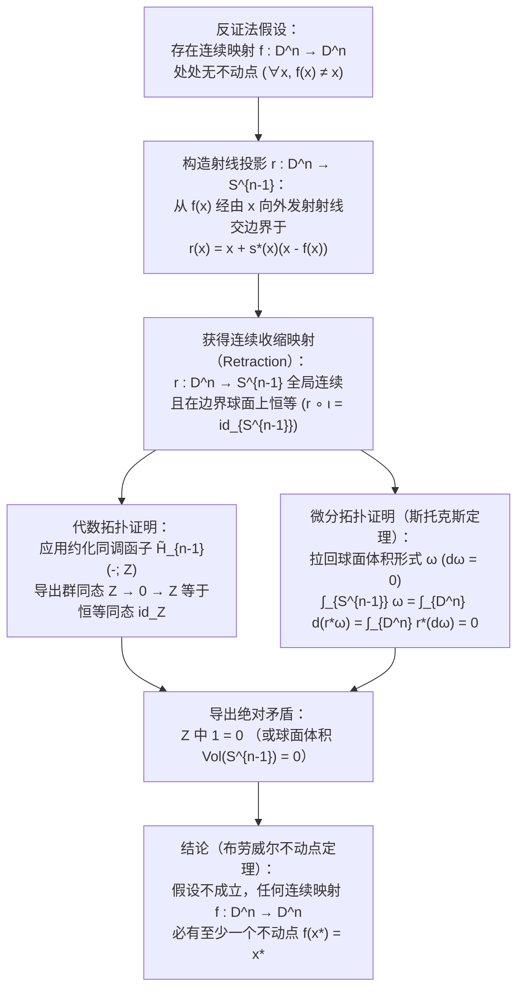
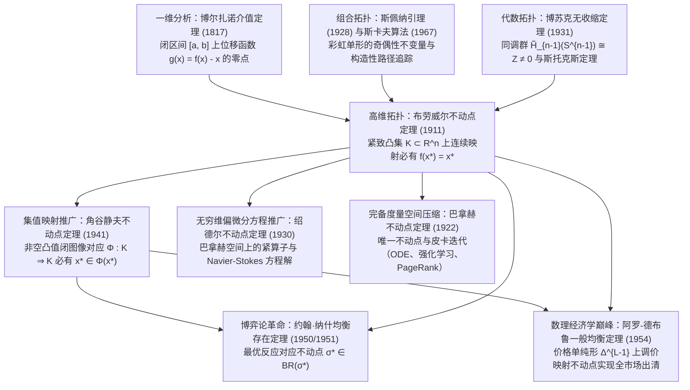

## 引言：隐藏在日常生活中的三大拓扑学奇迹

清晨，当你向杯中倒入热咖啡、加入牛奶并用勺子剧烈搅拌时，杯中会产生复杂的漩涡与湍流折叠。当液体重新静止下来时，直觉告诉我们每一颗咖啡分子都已经远离了它最初的位置。然而1911年，荷兰数学家<strong>鲁伊兹·埃格伯图斯·扬·布劳威尔（L.E.J. Brouwer, 1881–1966）</strong>证明的<strong>布劳威尔不动点定理（Brouwer's Fixed-Point Theorem）</strong>却揭示了一个颠覆直觉的绝对真理：

> [!IMPORTANT]
> <strong>奇迹1：搅拌咖啡杯中的不动分子</strong>
> 无论你多么剧烈、复杂地搅拌杯中的咖啡——只要液体没有溅出杯外、内部没有产生气泡空洞、流体作为连续介质没有被撕裂——当咖啡静止时，<strong>杯中必定至少存在一个点（连续极限下的咖啡分子），它所处的三维空间坐标 $(x^*, y^*, z^*)$ 与搅拌前分毫不差</strong>！

> [!TIP]
> <strong>奇迹2：揉成一团扔在桌上的地图</strong>
> 取两张完全相同的世界地图（或中国地图、东京地图）<strong>地图A</strong>与<strong>地图B</strong>。将地图A平铺在桌面上，把地图B任意揉成一团纸球（只要不撕破纸张），然后随手扔在平铺的地图A的边界内部。那么，<strong>揉皱的地图B上必定至少存在一个地理坐标点 $x^*$，它恰好位于平铺地图A上完全相同的地理坐标点 $x^*$ 的正上方（铅垂线上）</strong>！

再结合球面上的<strong>庞加莱-布劳威尔毛球定理（Hairy Ball Theorem）</strong>，我们还可以在头顶的<strong>“发旋（Crown Whorl）”</strong>以及地球大气层中任何时刻必定存在的<strong>“无风点（台风眼）”</strong>中看到同一拓扑定律的体现。

### 布劳威尔不动点定理的严格表述

设 $K \subset \mathbb{R}^n$ 是 $n$ 维欧几里得空间中<strong>非空、紧致（有界且闭合）且凸（Convex）</strong>的子集（或者更一般地，与 $n$ 维闭单位球 $D^n = \{x \in \mathbb{R}^n : \|x\|_2 \le 1\}$ 同胚的拓扑空间）。对于任意<strong>连续映射</strong> $f: K \to K$，必定存在至少一个点 $x^* \in K$（称为<strong>不动点 Fixed Point</strong>），使得：

$$
f(x^*) = x^*
$$

---

## 第一章：为什么三大假设缺一不可？——四个精准反例

根据海涅-博雷尔定理（Heine-Borel Theorem），$\mathbb{R}^n$ 中的紧致性等价于<strong>有界性（Boundedness）</strong>加<strong>闭性（Closedness）</strong>。若去掉<strong>有界、闭、凸（无洞）、连续</strong>中的任何一个条件，不动点定理都会立即失效：

1. <strong>去掉有界性（Unbounded）</strong>：取 $K = \mathbb{R}$（闭且凸），定义平移映射 $f(x) = x + 1$。方程 $x^* + 1 = x^*$ 无解，因为没有边界墙的阻挡，所有点都向 $+\infty$ 逃逸。
2. <strong>去掉闭性（Not Closed）</strong>：取开区间 $K = (0, 1)$（有界且凸），定义连续映射 $f(x) = \frac{x+1}{2}$。代数不动点 $x^* = 1$ 恰好落在被挖去的边界 $\partial K \setminus K$ 上，故 $(0, 1)$ 内无不动点。
3. <strong>去掉凸性 / 单连通性（带洞空间）</strong>：取单位圆周 $S^1$ 或闭圆环 $A = \{x \in \mathbb{R}^2 : \frac{1}{2} \le \|x\|_2 \le 1\}$（紧致但中心有洞），定义非零角度 $\theta \in (0, 2\pi)$ 的旋转映射 $f(x) = R_\theta x$。唯一的旋转中心 $(0, 0)$ 落在了圆环中间的“洞”里（$(0, 0) \notin A$），所有点永远绕洞旋转而无一留在原位。
4. <strong>去掉连续性（Discontinuous）</strong>：取 $K = [0, 1]$，定义分段跳跃函数：当 $x \in [0, \frac{1}{2}]$ 时 $f(x) = 1$；当 $x \in (\frac{1}{2}, 1]$ 时 $f(x) = 0$。图像 $y = f(x)$ 在 $x = \frac{1}{2}$ 处直接跳过对角线 $y = x$，不存在不动点。

| 被移除的假设 | 保留的条件 | 具体反例（定义域 $K$ 与映射 $f: K \to K$） | 不动点 $f(x^*) = x^*$ 消失的几何原因 |
| :--- | :--- | :--- | :--- |
| <strong>1. 有界性</strong> | 闭集、凸集、连续 | $K = \mathbb{R}$, $f(x) = x + 1$ | 缺乏外边界阻挡，所有点向 $+\infty$ 无限平移 |
| <strong>2. 闭性</strong> | 有界、凸集、连续 | $K = (0, 1)$, $f(x) = \frac{x+1}{2}$ | 唯一的不动点 $x^* = 1$ 逃逸到了缺失的边界点上 |
| <strong>3. 凸性（无洞性）</strong> | 有界、闭（紧致）、连续 | $K = S^1$ 或圆环 $A$, $f = R_\theta$（旋转） | 旋转中心 $(0, 0)$ 落在了集合内部的拓扑空洞中 |
| <strong>4. 连续性</strong> | 有界、闭（紧致）、凸集 | $K = [0, 1]$, $x \le \frac{1}{2}$ 取 $1$, $x > \frac{1}{2}$ 取 $0$ | 函数图像在 $x = \frac{1}{2}$ 处发生跳跃，跨过对角线 $y = x$ |

---

## 第二章：第一证明 —— 一维情形下的介值定理（IVT）

在一维空间 $n = 1$ 中，任何非空紧致凸集都是闭区间 $K = [a, b]$。设 $f: [a, b] \to [a, b]$ 是连续函数。构造辅助位移函数：

$$
g(x) = f(x) - x
$$

由于 $f(a) \in [a, b]$ 且 $f(b) \in [a, b]$，必有 $f(a) \ge a$ 且 $f(b) \le b$，从而在两端点处：

$$
g(a) = f(a) - a \ge 0, \qquad g(b) = f(b) - b \le 0
$$

由微积分中的<strong>博尔扎诺介值定理（Intermediate Value Theorem, IVT）</strong>，连续函数 $g(x)$ 在 $[a, b]$ 内必有一点 $x^*$ 使得 $g(x^*) = 0$，即 $f(x^*) = x^*$！然而在 $n \ge 2$ 维空间中，挖去原点 $\mathbf{0}$ 后的空间 $\mathbb{R}^n \setminus \{\mathbf{0}\}$ 依然是道路连通的，向量场 $g(x) = f(x) - x$ 可以绕过零点旋转，因此必须借助代数拓扑或组合拓扑。

---

## 第三章：第二证明 —— 代数拓扑与博苏克“无收缩定理”（1931）

波兰数学家<strong>卡罗尔·博苏克（Karol Borsuk, 1931）</strong>证明了布劳威尔不动点定理等价于<strong>无收缩定理（No-Retraction Theorem）</strong>：不存在从 $n$ 维闭单位球 $D^n$ 到其边界球面 $S^{n-1} = \partial D^n$ 的连续收缩映射（Retraction）$r: D^n \to S^{n-1}$（即满足在边界上恒等 $r|_{S^{n-1}} = \text{id}_{S^{n-1}}$ 的连续映射）。这就好比不可能在不刺破鼓面的前提下，将整个紧绷的橡胶鼓面 $D^2$ 连续地压扁到固定的圆形鼓框 $S^1$ 上。

### 步骤1：无不动点映射可构造出连续收缩映射 $r: D^n \to S^{n-1}$

假设存在连续映射 $f: D^n \to D^n$ 对所有 $x \in D^n$ 都满足 $f(x) \ne x$。那么位移向量 $u(x) = x - f(x) \ne \mathbf{0}$ 处处非零。从 $f(x)$ 出发经过 $x$ 向外发射一条射线 $\gamma_x(t) = x + s u(x)$（$s = t - 1 \ge 0$），它与单位球面 $S^{n-1}$ 的唯一交点由二次方程 $\|x + s u(x)\|_2^2 = 1$ 给出：

$$
r(x) = x + s^*(x)\bigl(x - f(x)\bigr), \qquad s^*(x) = \frac{-\langle x, u(x)\rangle + \sqrt{\langle x, u(x)\rangle^2 + \|u(x)\|_2^2(1 - \|x\|_2^2)}}{\|u(x)\|_2^2}
$$

由于 $\|u(x)\|_2^2 > 0$，映射 $r: D^n \to S^{n-1}$ 在整个 $D^n$ 上完全连续；且当 $x \in S^{n-1}$ 时 $\|x\|_2^2 = 1$，故 $s^*(x) = 0$，即 $r(x) = x$。因此 $r$ 是一个连续收缩映射！

### 步骤2：利用同调函子 $\tilde{H}_{n-1}$ 与斯托克斯定理导出矛盾

1. <strong>代数拓扑证法（约化同调群 $\tilde{H}_{n-1}$）</strong>：
   对复合映射 $S^{n-1} \xrightarrow{\iota} D^n \xrightarrow{r} S^{n-1}$（其中 $r \circ \iota = \text{id}_{S^{n-1}}$）应用 $(n-1)$ 阶约化奇异同调函子 $\tilde{H}_{n-1}(-; \mathbb{Z})$。由于实心球 $D^n$ 可缩（无洞），$\tilde{H}_{n-1}(D^n) \cong 0$；而空心球面 $S^{n-1}$ 包围着空腔，$\tilde{H}_{n-1}(S^{n-1}) \cong \mathbb{Z}$。于是诱导群同态序列为：
   $$
   \mathbb{Z} \xrightarrow{\;\iota_*\;} 0 \xrightarrow{\;r_*\;} \mathbb{Z}
   $$
   穿过零群 $0$ 的复合群同态必为零映射（$1 \mapsto 0$），但函子性要求 $(r \circ \iota)_* = \text{id}_{\mathbb{Z}}$（$1 \mapsto 1$），从而在 $\mathbb{Z}$ 中得出 $1 = 0$ 的荒谬矛盾！
2. <strong>微分形式证法（斯托克斯定理 Stokes's Theorem）</strong>：
   用光滑函数逼近得到光滑收缩 $r: D^n \to S^{n-1}$，取 $S^{n-1}$ 上的标准体积 $(n-1)$-形式 $\omega$（满足 $\int_{S^{n-1}} \omega = \text{Vol}(S^{n-1}) > 0$ 且 $d\omega = 0$）。由斯托克斯定理：
   $$
   0 < \int_{S^{n-1}} \omega = \int_{\partial D^n} r^*\omega = \int_{D^n} d(r^*\omega) = \int_{D^n} r^*(d\omega) = \int_{D^n} 0 = 0
   $$
   同样导出 $0 < 0$ 的矛盾！

---

## 第四章：第三证明 —— 斯佩纳引理（1928）与构造性算法

作为<strong>数学直觉主义（Intuitionism）</strong>的创始人，布劳威尔晚年竟然拒绝承认自己早年用非构造性反证法证明的不动点定理，因为反证法无法给出寻找不动点 $x^*$ 坐标的计算步骤。

1928年，年仅22岁的<strong>埃马纽埃尔·斯佩纳（Emanuel Sperner）</strong>发现了组合拓扑学中的<strong>斯佩纳引理（Sperner's Lemma）</strong>：将 $n$ 维单纯形 $\Delta^n = \text{conv}\{v_0, \dots, v_n\}$ 进行三角剖分 $\mathcal{T}$，若对顶点进行染色 $\ell: V(\mathcal{T}) \to \{0, 1, \dots, n\}$，使得主顶点 $\ell(v_i) = i$，且外边界任意低维面 $\text{conv}\{v_{i_0}, \dots, v_{i_k}\}$ 上的顶点只使用颜色 $\{i_0, \dots, i_k\}$，则<strong>包含全部 $n+1$ 种颜色的“彩虹小单纯形（完全染色单形）”必有奇数个（从而至少存在一个）</strong>！

通过将连接颜色 $\{0, 1\}$ 的边视为“门”、将小三角形视为“房间”，从底边 $v_0 v_1$ 上奇数扇边界门走入迷宫，走廊房间（2扇门）一进一出，最终必定有一条路径终止于只有1扇门的“彩虹房间 $\{0, 1, 2\}$”。利用重心坐标 $\lambda_i(x)$ 定义染色：取满足 $\lambda_i(w) > 0$ 且 $\lambda_i(f(w)) \le \lambda_i(w)$ 的指标 $i$ 作为颜色，当网格直径 $\delta_k \to 0$ 时，由紧致性（博尔扎诺-魏尔斯特拉斯定理）与连续性，彩虹小单纯形序列收敛到的极限点 $x^*$ 满足对所有 $i$ 有 $\lambda_i(f(x^*)) \le \lambda_i(x^*)$，结合 $\sum_i \lambda_i = 1$ 即证 $f(x^*) = x^*$！1967年，经济学家<strong>赫伯特·斯卡夫（Herbert Scarf）</strong>据此发明了<strong>斯卡夫单纯形算法（Scarf's Algorithm）</strong>，实现了不动点与经济均衡的计算机数值求解。

---

## 第五章：四大不动点定理的宏伟层级 —— 巴拿赫、布劳威尔、绍德尔与角谷

1. <strong>巴拿赫压缩映射定理（Banach Contraction Mapping Principle, 1922）</strong>：在任意非空<strong>完备度量空间</strong> $(X, d)$ 上，若 $d(Tx, Ty) \le L d(x, y)$（$0 \le L < 1$），则存在<strong>唯一</strong>不动点 $x^*$，且皮卡迭代 $x_{k+1} = T(x_k)$ 以几何速率收敛。它无需紧致性或有限维，支撑了常微分方程解的存在唯一性（皮卡-林德洛夫定理）、强化学习的<strong>贝尔曼价值迭代（Bellman Value Iteration）</strong>以及 <strong>Google PageRank 算法</strong>。
2. <strong>无穷维陷阱与绍德尔不动点定理（Schauder, 1930）</strong>：在无穷维希尔伯特空间 $\ell^2$ 的闭单位球 $B_{\ell^2}$ 上，映射 $f(x_1, x_2, \dots) = (\sqrt{1 - \|x\|_2^2}, x_1, x_2, \dots)$ 连续但<strong>没有不动点</strong>，因为无穷维闭单位球<strong>不是紧集</strong>！绍德尔定理指出：若无穷维巴拿赫空间有界闭凸集 $K$ 上的连续算子 $T: K \to K$ 是<strong>紧算子（Compact Operator）</strong>，则不动点依然存在，从而解决了纳维-斯托克斯等非线性偏微分方程（PDE）的解存在性。
3. <strong>角谷静夫不动点定理（Kakutani's Fixed-Point Theorem, 1941）</strong>：将布劳威尔定理推广到<strong>集值映射（对应, Set-Valued Correspondence）</strong> $\Phi: K \rightrightarrows K$。若 $K \subset \mathbb{R}^n$ 非空紧致且凸，对每个 $x \in K$，集合 $\Phi(x)$ <strong>非空且凸</strong>，且 $\Phi$ 具有<strong>闭图像（Closed Graph / 上半连续性）</strong>，则必存在 $x^* \in K$ 使得：
   $$
   x^* \in \Phi(x^*)
   $$

| 不动点定理与年份 | 空间与定义域 $K$ 的条件 | 映射 $f$ 或 $\Phi$ 的条件 | 不动点唯一性与计算性 | 核心科学与工程应用 |
| :--- | :--- | :--- | :--- | :--- |
| <strong>巴拿赫压缩定理 (1922)</strong> | 任意非空<strong>完备度量空间</strong> $(X, d)$（可无穷维） | 严格压缩：$d(Tx, Ty) \le L d(x, y)$ ($L < 1$) | <strong>严格唯一</strong>；迭代 $x_{k+1}=T(x_k)$ 指数收敛 | 常微分方程、强化学习贝尔曼迭代、PageRank |
| <strong>布劳威尔定理 (1911)</strong> | $\mathbb{R}^n$ 中非空<strong>紧致凸集</strong> $K$（有限维） | 任意连续单值映射 $f: K \to K$ | <strong>至少一个</strong>（未必唯一）；可用斯卡夫算法计算 | 非线性方程、纳什1951年证明、瓦尔拉斯市场出清 |
| <strong>绍德尔定理 (1930)</strong> | 无穷维<strong>巴拿赫空间</strong>中的有界闭凸集 $K$ | 连续<strong>紧算子</strong> $T: K \to K$（$\overline{T(K)}$ 紧致） | <strong>至少一个</strong>（未必唯一） | 非线性偏微分方程（Navier-Stokes 流体方程等） |
| <strong>角谷静夫定理 (1941)</strong> | $\mathbb{R}^n$ 中非空<strong>紧致凸集</strong> $K$ | 集值对应 $\Phi: K \rightrightarrows K$（非空凸值、闭图像） | <strong>至少一个</strong> $x^* \in \Phi(x^*)$ | 纳什1950年博弈均衡证明、阿罗-德布鲁一般均衡 |

---

## 第六章：拓扑学如何彻底变革经济学与博弈论 —— 纳什均衡（1950）与阿罗-德布鲁一般均衡（1954）

### 6.1 约翰·纳什（1950, 1951）：有限博弈纳什均衡的存在性证明

在 $N$ 人有限博弈中，每位玩家 $i$ 的混合策略空间是单纯形 $\Delta_i$，联合策略空间 $K = \Delta_1 \times \dots \times \Delta_N$ 是非空紧致凸集。
- <strong>1950年角谷定理证明</strong>：定义玩家 $i$ 的<strong>最优反应对应（Best-Response Correspondence）</strong> $BR_i(\sigma_{-i}) = \arg\max_{\tau_i \in \Delta_i} U_i(\tau_i, \sigma_{-i})$。由于期望收益 $U_i$ 对 $\tau_i$ 是线性的，$BR(\sigma) = \prod_i BR_i(\sigma_{-i}) : K \rightrightarrows K$ 非空、凸值且具有闭图像。由<strong>角谷不动点定理</strong>，必存在 $\sigma^* \in BR(\sigma^*)$，即<strong>纳什均衡（Nash Equilibrium）</strong>！
- <strong>1951年布劳威尔定理直接证明</strong>：定义纯策略 $s_{ij}$ 的超额收益 $\varphi_{ij}(\sigma) = \max\{0, U_i(s_{ij}, \sigma_{-i}) - U_i(\sigma_i, \sigma_{-i})\}$，构造连续单值更新映射：
  $$
  f_{ij}(\sigma) = \frac{\sigma_{ij} + \varphi_{ij}(\sigma)}{1 + \sum_{k=1}^{m_i} \varphi_{ik}(\sigma)}
  $$
  由<strong>布劳威尔不动点定理</strong>，存在 $f(\sigma^*) = \sigma^*$。由于正概率纯策略不可能全部严格高于加权平均收益，必存在 $\sigma_{ij_0}^* > 0$ 使得 $\varphi_{ij_0}(\sigma^*) = 0$，代入不动点方程即得所有 $\varphi_{ij}(\sigma^*) = 0$，从而 $\sigma^*$ 是纳什均衡！

### 6.2 阿罗-德布鲁一般竞争均衡（1954）：“看不见的手”的拓扑学证明

在包含 $L$ 种商品的市场经济中，价格向量归一化到价格单纯形 $\Delta^{L-1} = \{p \in \mathbb{R}_+^L : \sum_{\ell=1}^L p_\ell = 1\}$。市场超额需求函数 $z(p)$ 满足<strong>瓦尔拉斯定律（Walras's Law）</strong> $\sum_{\ell=1}^L p_\ell z_\ell(p) = 0$。构造调价映射 $g: \Delta^{L-1} \to \Delta^{L-1}$：

$$
g_\ell(p) = \frac{p_\ell + \max\{0, z_\ell(p)\}}{1 + \sum_{k=1}^L \max\{0, z_k(p)\}}
$$

由<strong>布劳威尔不动点定理</strong>，存在不动点 $g(p^*) = p^*$，即 $p_\ell^* \sum_k \max\{0, z_k(p^*)\} = \max\{0, z_\ell(p^*)\}$。两边同乘 $z_\ell(p^*)$ 并对 $\ell$ 求和，利用瓦尔拉斯定律 $\sum_\ell p_\ell^* z_\ell(p^*) = 0$ 可得：

$$
\sum_{\ell=1}^L \bigl(\max\{0, z_\ell(p^*)\}\bigr)^2 = 0 \implies z_\ell(p^*) \le 0 \quad (\forall \ell = 1, \dots, L)
$$

所有市场同时出清！从咖啡杯中的漩涡到全球市场的均衡价格，不动点定理展现了现代数学最深邃的统一之美。

