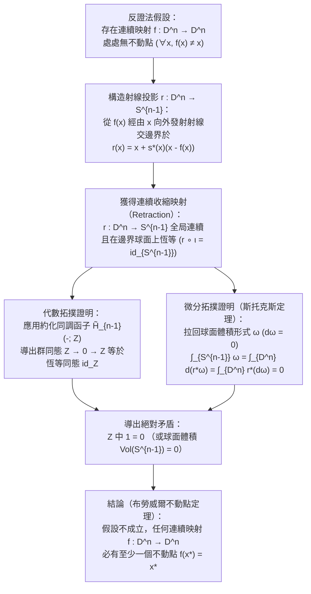
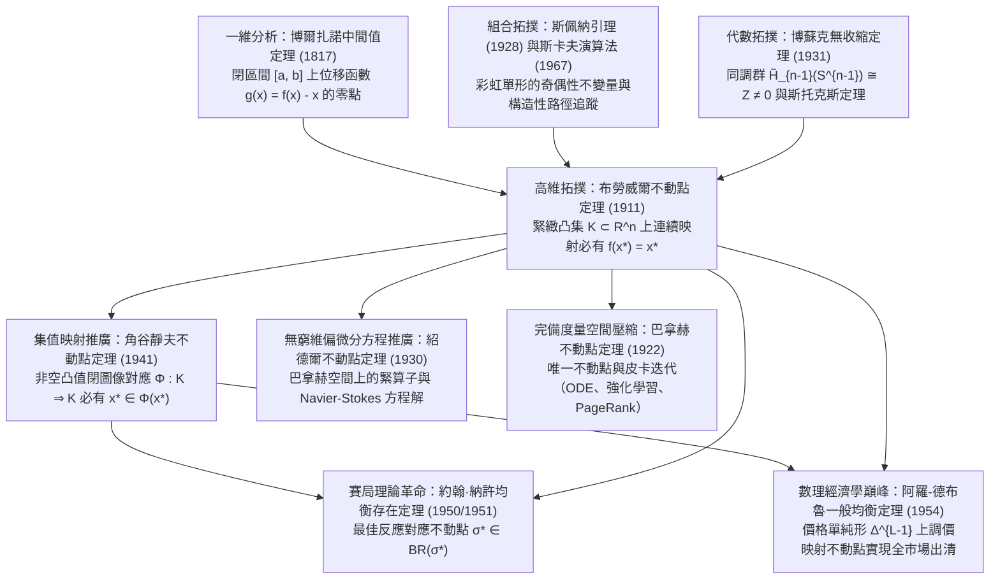

## 引言：隱藏在日常生活中的三大拓撲學奇蹟

清晨，當你向杯中倒入熱咖啡、加入牛奶並用湯匙劇烈攪拌時，杯中會產生複雜的漩渦與湍流折疊。當液體重新靜止下來時，直覺告訴我們每一顆咖啡分子都已經遠離了它最初的位置。然而1911年，荷蘭數學家<strong>魯伊茲·埃格伯圖斯·揚·布勞威爾（L.E.J. Brouwer, 1881–1966）</strong>證明的<strong>布勞威爾不動點定理（Brouwer's Fixed-Point Theorem）</strong>卻揭示了一個顛覆直覺的絕對真理：

> [!IMPORTANT]
> <strong>奇蹟1：攪拌咖啡杯中的不動分子</strong>
> 無論你多麼劇烈、複雜地攪拌杯中的咖啡——只要液體沒有濺出杯外、內部沒有產生氣泡空洞、流體作為連續介質沒有被撕裂——當咖啡靜止時，<strong>杯中必定至少存在一個點（連續極限下的咖啡分子），它所處的三維空間座標 $(x^*, y^*, z^*)$ 與攪拌前分毫不差</strong>！

> [!TIP]
> <strong>奇蹟2：揉成一團扔在桌上的地圖</strong>
> 取兩張完全相同的世界地圖（或台灣地圖、東京地圖）<strong>地圖A</strong>與<strong>地圖B</strong>。將地圖A平鋪在桌面上，把地圖B任意揉成一團紙球（只要不撕破紙張），然後隨手扔在平鋪的地圖A的邊界內部。那麼，<strong>揉皺的地圖B上必定至少存在一個地理座標點 $x^*$，它恰好位於平鋪地圖A上完全相同的地理座標點 $x^*$ 的正上方（鉛垂線上）</strong>！

再結合球面上的<strong>龐加萊-布勞威爾毛球定理（Hairy Ball Theorem）</strong>，我們還可以在頭頂的<strong>「髮旋（Crown Whorl）」</strong>以及地球大氣層中任何時刻必定存在的<strong>「無風點（颱風眼）」</strong>中看到同一拓撲定律的體現。

### 布勞威爾不動點定理的嚴格表述

設 $K \subset \mathbb{R}^n$ 是 $n$ 維歐幾里得空間中<strong>非空、緊緻（有界且閉合）且凸（Convex）</strong>的子集（或者更一般地，與 $n$ 維閉單位球 $D^n = \{x \in \mathbb{R}^n : \|x\|_2 \le 1\}$ 同胚的拓撲空間）。對於任意<strong>連續映射</strong> $f: K \to K$，必定存在至少一個點 $x^* \in K$（稱為<strong>不動點 Fixed Point</strong>），使得：

$$
f(x^*) = x^*
$$

---

## 第一章：為什麼三大假設缺一不可？——四個精準反例

根據海涅-博雷爾定理（Heine-Borel Theorem），$\mathbb{R}^n$ 中的緊緻性等價於<strong>有界性（Boundedness）</strong>加<strong>閉性（Closedness）</strong>。若去掉<strong>有界、閉、凸（無洞）、連續</strong>中的任何一個條件，不動點定理都會立即失效：

1. <strong>去掉有界性（Unbounded）</strong>：取 $K = \mathbb{R}$（閉且凸），定義平移映射 $f(x) = x + 1$。方程 $x^* + 1 = x^*$ 無解，因為沒有邊界牆的阻擋，所有點都向 $+\infty$ 逃逸。
2. <strong>去掉閉性（Not Closed）</strong>：取開區間 $K = (0, 1)$（有界且凸），定義連續映射 $f(x) = \frac{x+1}{2}$。代數不動點 $x^* = 1$ 恰好落在被挖去的邊界 $\partial K \setminus K$ 上，故 $(0, 1)$ 內無不動點。
3. <strong>去掉凸性 / 單連通性（帶洞空間）</strong>：取單位圓周 $S^1$ 或閉圓環 $A = \{x \in \mathbb{R}^2 : \frac{1}{2} \le \|x\|_2 \le 1\}$（緊緻但中心有洞），定義非零角度 $\theta \in (0, 2\pi)$ 的旋轉映射 $f(x) = R_\theta x$。唯一的旋轉中心 $(0, 0)$ 落在了圓環中間的「洞」裡（$(0, 0) \notin A$），所有點永遠繞洞旋轉而無一留在原位。
4. <strong>去掉連續性（Discontinuous）</strong>：取 $K = [0, 1]$，定義分段跳躍函數：當 $x \in [0, \frac{1}{2}]$ 時 $f(x) = 1$；當 $x \in (\frac{1}{2}, 1]$ 時 $f(x) = 0$。圖像 $y = f(x)$ 在 $x = \frac{1}{2}$ 處直接跳過對角線 $y = x$，不存在不動點。

| 被移除的假設 | 保留的條件 | 具體反例（定義域 $K$ 與映射 $f: K \to K$） | 不動點 $f(x^*) = x^*$ 消失的幾何原因 |
| :--- | :--- | :--- | :--- |
| <strong>1. 有界性</strong> | 閉集、凸集、連續 | $K = \mathbb{R}$, $f(x) = x + 1$ | 缺乏外邊界阻擋，所有點向 $+\infty$ 無限平移 |
| <strong>2. 閉性</strong> | 有界、凸集、連續 | $K = (0, 1)$, $f(x) = \frac{x+1}{2}$ | 唯一的不動點 $x^* = 1$ 逃逸到了缺失的邊界點上 |
| <strong>3. 凸性（無洞性）</strong> | 有界、閉（緊緻）、連續 | $K = S^1$ 或圓環 $A$, $f = R_\theta$（旋轉） | 旋轉中心 $(0, 0)$ 落在了集合內部的拓撲空洞中 |
| <strong>4. 連續性</strong> | 有界、閉（緊緻）、凸集 | $K = [0, 1]$, $x \le \frac{1}{2}$ 取 $1$, $x > \frac{1}{2}$ 取 $0$ | 函數圖像在 $x = \frac{1}{2}$ 處發生跳躍，跨過對角線 $y = x$ |

---

## 第二章：第一證明 —— 一維情形下的中間值定理（IVT）

在一維空間 $n = 1$ 中，任何非空緊緻凸集都是閉區間 $K = [a, b]$。設 $f: [a, b] \to [a, b]$ 是連續函數。構造輔助位移函數：

$$
g(x) = f(x) - x
$$

由於 $f(a) \in [a, b]$ 且 $f(b) \in [a, b]$，必有 $f(a) \ge a$ 且 $f(b) \le b$，從而在兩端點處：

$$
g(a) = f(a) - a \ge 0, \qquad g(b) = f(b) - b \le 0
$$

由微積分中的<strong>博爾扎諾中間值定理（Intermediate Value Theorem, IVT）</strong>，連續函數 $g(x)$ 在 $[a, b]$ 內必有一點 $x^*$ 使得 $g(x^*) = 0$，即 $f(x^*) = x^*$！然而在 $n \ge 2$ 維空間中，挖去原點 $\mathbf{0}$ 後的空間 $\mathbb{R}^n \setminus \{\mathbf{0}\}$ 依然是道路連通的，向量場 $g(x) = f(x) - x$ 可以繞過零點旋轉，因此必須藉助代數拓撲或組合拓撲。

---

## 第三章：第二證明 —— 代數拓撲與博蘇克「無收縮定理」（1931）

波蘭數學家<strong>卡羅爾·博蘇克（Karol Borsuk, 1931）</strong>證明了布勞威爾不動點定理等價於<strong>無收縮定理（No-Retraction Theorem）</strong>：不存在從 $n$ 維閉單位球 $D^n$ 到其邊界球面 $S^{n-1} = \partial D^n$ 的連續收縮映射（Retraction）$r: D^n \to S^{n-1}$（即滿足在邊界上恆等 $r|_{S^{n-1}} = \text{id}_{S^{n-1}}$ 的連續映射）。這就好比不可能在不刺破鼓面的前提下，將整個緊繃的橡膠鼓面 $D^2$ 連續地壓扁到固定的圓形鼓框 $S^1$ 上。

### 步驟1：無不動點映射可構造出連續收縮映射 $r: D^n \to S^{n-1}$

假設存在連續映射 $f: D^n \to D^n$ 對所有 $x \in D^n$ 都滿足 $f(x) \ne x$。那麼位移向量 $u(x) = x - f(x) \ne \mathbf{0}$ 處處非零。從 $f(x)$ 出發經過 $x$ 向外發射一條射線 $\gamma_x(t) = x + s u(x)$（$s = t - 1 \ge 0$），它與單位球面 $S^{n-1}$ 的唯一交點由二次方程 $\|x + s u(x)\|_2^2 = 1$ 給出：

$$
r(x) = x + s^*(x)\bigl(x - f(x)\bigr), \qquad s^*(x) = \frac{-\langle x, u(x)\rangle + \sqrt{\langle x, u(x)\rangle^2 + \|u(x)\|_2^2(1 - \|x\|_2^2)}}{\|u(x)\|_2^2}
$$

由於 $\|u(x)\|_2^2 > 0$，映射 $r: D^n \to S^{n-1}$ 在整個 $D^n$ 上完全連續；且當 $x \in S^{n-1}$ 時 $\|x\|_2^2 = 1$，故 $s^*(x) = 0$，即 $r(x) = x$。因此 $r$ 是一個連續收縮映射！

### 步驟2：利用同調函子 $\tilde{H}_{n-1}$ 與斯托克斯定理導出矛盾

1. <strong>代數拓撲證法（約化同調群 $\tilde{H}_{n-1}$）</strong>：
   對複合映射 $S^{n-1} \xrightarrow{\iota} D^n \xrightarrow{r} S^{n-1}$（其中 $r \circ \iota = \text{id}_{S^{n-1}}$）應用 $(n-1)$ 階約化奇異同調函子 $\tilde{H}_{n-1}(-; \mathbb{Z})$。由於實心球 $D^n$ 可縮（無洞），$\tilde{H}_{n-1}(D^n) \cong 0$；而空心球面 $S^{n-1}$ 包圍著空腔，$\tilde{H}_{n-1}(S^{n-1}) \cong \mathbb{Z}$。於是誘導群同態序列為：
   $$
   \mathbb{Z} \xrightarrow{\;\iota_*\;} 0 \xrightarrow{\;r_*\;} \mathbb{Z}
   $$
   穿過零群 $0$ 的複合群同態必為零映射（$1 \mapsto 0$），但函子性要求 $(r \circ \iota)_* = \text{id}_{\mathbb{Z}}$（$1 \mapsto 1$），從而在 $\mathbb{Z}$ 中得出 $1 = 0$ 的荒謬矛盾！
2. <strong>微分形式證法（斯托克斯定理 Stokes's Theorem）</strong>：
   用光滑函數逼近得到光滑收縮 $r: D^n \to S^{n-1}$，取 $S^{n-1}$ 上的標準體積 $(n-1)$-形式 $\omega$（滿足 $\int_{S^{n-1}} \omega = \text{Vol}(S^{n-1}) > 0$ 且 $d\omega = 0$）。由斯托克斯定理：
   $$
   0 < \int_{S^{n-1}} \omega = \int_{\partial D^n} r^*\omega = \int_{D^n} d(r^*\omega) = \int_{D^n} r^*(d\omega) = \int_{D^n} 0 = 0
   $$
   同樣導出 $0 < 0$ 的矛盾！

---

## 第四章：第三證明 —— 斯佩納引理（1928）與構造性演算法

作為<strong>數學直覺主義（Intuitionism）</strong>的創始人，布勞威爾晚年竟然拒絕承認自己早年用非構造性反證法證明的不動點定理，因為反證法無法給出尋找不動點 $x^*$ 座標的計算步驟。

1928年，年僅22歲的<strong>埃馬紐埃爾·斯佩納（Emanuel Sperner）</strong>發現了組合拓撲學中的<strong>斯佩納引理（Sperner's Lemma）</strong>：將 $n$ 維單純形 $\Delta^n = \text{conv}\{v_0, \dots, v_n\}$ 進行三角剖分 $\mathcal{T}$，若對頂點進行染色 $\ell: V(\mathcal{T}) \to \{0, 1, \dots, n\}$，使得主頂點 $\ell(v_i) = i$，且外邊界任意低維面 $\text{conv}\{v_{i_0}, \dots, v_{i_k}\}$ 上的頂點只使用顏色 $\{i_0, \dots, i_k\}$，則<strong>包含全部 $n+1$ 種顏色的「彩虹小單純形（完全染色單形）」必有奇數個（從而至少存在一個）</strong>！

通過將連接顏色 $\{0, 1\}$ 的邊視為「門」、將小三角形視為「房間」，從底邊 $v_0 v_1$ 上奇數扇邊界門走入迷宮，走廊房間（2扇門）一進一出，最終必定有一條路徑終止於只有1扇門的「彩虹房間 $\{0, 1, 2\}$」。利用重心座標 $\lambda_i(x)$ 定義染色：取滿足 $\lambda_i(w) > 0$ 且 $\lambda_i(f(w)) \le \lambda_i(w)$ 的指標 $i$ 作為顏色，當網格直徑 $\delta_k \to 0$ 時，由緊緻性（博爾扎諾-魏爾斯特拉斯定理）與連續性，彩虹小單純形序列收斂到的極限點 $x^*$ 滿足對所有 $i$ 有 $\lambda_i(f(x^*)) \le \lambda_i(x^*)$，結合 $\sum_i \lambda_i = 1$ 即證 $f(x^*) = x^*$！1967年，經濟學家<strong>赫伯特·斯卡夫（Herbert Scarf）</strong>據此發明了<strong>斯卡夫單純形演算法（Scarf's Algorithm）</strong>，實現了不動點與經濟均衡的電腦數值求解。

---

## 第五章：四大不動點定理的宏偉層級 —— 巴拿赫、布勞威爾、紹德爾與角谷

1. <strong>巴拿赫壓縮映射定理（Banach Contraction Mapping Principle, 1922）</strong>：在任意非空<strong>完備度量空間</strong> $(X, d)$ 上，若 $d(Tx, Ty) \le L d(x, y)$（$0 \le L < 1$），則存在<strong>唯一</strong>不動點 $x^*$，且皮卡迭代 $x_{k+1} = T(x_k)$ 以幾何速率收斂。它無需緊緻性或有限維，支撐了常微分方程解的存在唯一性（皮卡-林德洛夫定理）、強化學習的<strong>貝爾曼價值迭代（Bellman Value Iteration）</strong>以及 <strong>Google PageRank 演算法</strong>。
2. <strong>無窮維陷阱與紹德爾不動點定理（Schauder, 1930）</strong>：在無窮維希爾伯特空間 $\ell^2$ 的閉單位球 $B_{\ell^2}$ 上，映射 $f(x_1, x_2, \dots) = (\sqrt{1 - \|x\|_2^2}, x_1, x_2, \dots)$ 連續但<strong>沒有不動點</strong>，因為無窮維閉單位球<strong>不是緊集</strong>！紹德爾定理指出：若無窮維巴拿赫空間有界閉凸集 $K$ 上的連續算子 $T: K \to K$ 是<strong>緊算子（Compact Operator）</strong>，則不動點依然存在，從而解決了納維-斯托克斯等非線性偏微分方程（PDE）的解存在性。
3. <strong>角谷靜夫不動點定理（Kakutani's Fixed-Point Theorem, 1941）</strong>：將布勞威爾定理推廣到<strong>集值映射（對應, Set-Valued Correspondence）</strong> $\Phi: K \rightrightarrows K$。若 $K \subset \mathbb{R}^n$ 非空緊緻且凸，對每個 $x \in K$，集合 $\Phi(x)$ <strong>非空且凸</strong>，且 $\Phi$ 具有<strong>閉圖像（Closed Graph / 上半連續性）</strong>，則必存在 $x^* \in K$ 使得：
   $$
   x^* \in \Phi(x^*)
   $$

| 不動點定理與年份 | 空間與定義域 $K$ 的條件 | 映射 $f$ 或 $\Phi$ 的條件 | 不動點唯一性與計算性 | 核心科學與工程應用 |
| :--- | :--- | :--- | :--- | :--- |
| <strong>巴拿赫壓縮定理 (1922)</strong> | 任意非空<strong>完備度量空間</strong> $(X, d)$（可無窮維） | 嚴格壓縮：$d(Tx, Ty) \le L d(x, y)$ ($L < 1$) | <strong>嚴格唯一</strong>；迭代 $x_{k+1}=T(x_k)$ 指數收斂 | 常微分方程、強化學習貝爾曼迭代、PageRank |
| <strong>布勞威爾定理 (1911)</strong> | $\mathbb{R}^n$ 中非空<strong>緊緻凸集</strong> $K$（有限維） | 任意連續單值映射 $f: K \to K$ | <strong>至少一個</strong>（未必唯一）；可用斯卡夫演算法計算 | 非線性方程、納許1951年證明、瓦爾拉斯市場出清 |
| <strong>紹德爾定理 (1930)</strong> | 無窮維<strong>巴拿赫空間</strong>中的有界閉凸集 $K$ | 連續<strong>緊算子</strong> $T: K \to K$（$\overline{T(K)}$ 緊緻） | <strong>至少一個</strong>（未必唯一） | 非線性偏微分方程（Navier-Stokes 流體方程等） |
| <strong>角谷靜夫定理 (1941)</strong> | $\mathbb{R}^n$ 中非空<strong>緊緻凸集</strong> $K$ | 集值對應 $\Phi: K \rightrightarrows K$（非空凸值、閉圖像） | <strong>至少一個</strong> $x^* \in \Phi(x^*)$ | 納許1950年賽局均衡證明、阿羅-德布魯一般均衡 |

---

## 第六章：拓撲學如何徹底變革經濟學與賽局理論 —— 納許均衡（1950）與阿羅-德布魯一般均衡（1954）

### 6.1 約翰·納許（1950, 1951）：有限賽局納許均衡的存在性證明

在 $N$ 人有限賽局中，每位玩家 $i$ 的混合策略空間是單純形 $\Delta_i$，聯合策略空間 $K = \Delta_1 \times \dots \times \Delta_N$ 是非空緊緻凸集。
- <strong>1950年角谷定理證明</strong>：定義玩家 $i$ 的<strong>最佳反應對應（Best-Response Correspondence）</strong> $BR_i(\sigma_{-i}) = \arg\max_{\tau_i \in \Delta_i} U_i(\tau_i, \sigma_{-i})$。由於期望報酬 $U_i$ 對 $\tau_i$ 是線性的，$BR(\sigma) = \prod_i BR_i(\sigma_{-i}) : K \rightrightarrows K$ 非空、凸值且具有閉圖像。由<strong>角谷不動點定理</strong>，必存在 $\sigma^* \in BR(\sigma^*)$，即<strong>納許均衡（Nash Equilibrium）</strong>！
- <strong>1951年布勞威爾定理直接證明</strong>：定義純策略 $s_{ij}$ 的超額報酬 $\varphi_{ij}(\sigma) = \max\{0, U_i(s_{ij}, \sigma_{-i}) - U_i(\sigma_i, \sigma_{-i})\}$，構造連續單值更新映射：
  $$
  f_{ij}(\sigma) = \frac{\sigma_{ij} + \varphi_{ij}(\sigma)}{1 + \sum_{k=1}^{m_i} \varphi_{ik}(\sigma)}
  $$
  由<strong>布勞威爾不動點定理</strong>，存在 $f(\sigma^*) = \sigma^*$。由於正機率純策略不可能全部嚴格高於加權平均報酬，必存在 $\sigma_{ij_0}^* > 0$ 使得 $\varphi_{ij_0}(\sigma^*) = 0$，代入不動點方程即得所有 $\varphi_{ij}(\sigma^*) = 0$，從而 $\sigma^*$ 是納許均衡！

### 6.2 阿羅-德布魯一般競爭均衡（1954）：「看不見的手」的拓撲學證明

在包含 $L$ 種商品的市場經濟中，價格向量歸一化到價格單純形 $\Delta^{L-1} = \{p \in \mathbb{R}_+^L : \sum_{\ell=1}^L p_\ell = 1\}$。市場超額需求函數 $z(p)$ 滿足<strong>瓦爾拉斯定律（Walras's Law）</strong> $\sum_{\ell=1}^L p_\ell z_\ell(p) = 0$。構造調價映射 $g: \Delta^{L-1} \to \Delta^{L-1}$：

$$
g_\ell(p) = \frac{p_\ell + \max\{0, z_\ell(p)\}}{1 + \sum_{k=1}^L \max\{0, z_k(p)\}}
$$

由<strong>布勞威爾不動點定理</strong>，存在不動點 $g(p^*) = p^*$，即 $p_\ell^* \sum_k \max\{0, z_k(p^*)\} = \max\{0, z_\ell(p^*)\}$。兩邊同乘 $z_\ell(p^*)$ 並對 $\ell$ 求和，利用瓦爾拉斯定律 $\sum_\ell p_\ell^* z_\ell(p^*) = 0$ 可得：

$$
\sum_{\ell=1}^L \bigl(\max\{0, z_\ell(p^*)\}\bigr)^2 = 0 \implies z_\ell(p^*) \le 0 \quad (\forall \ell = 1, \dots, L)
$$

所有市場同時出清！從咖啡杯中的漩渦到全球市場的均衡價格，不動點定理展現了現代數學最深邃的統一之美。

