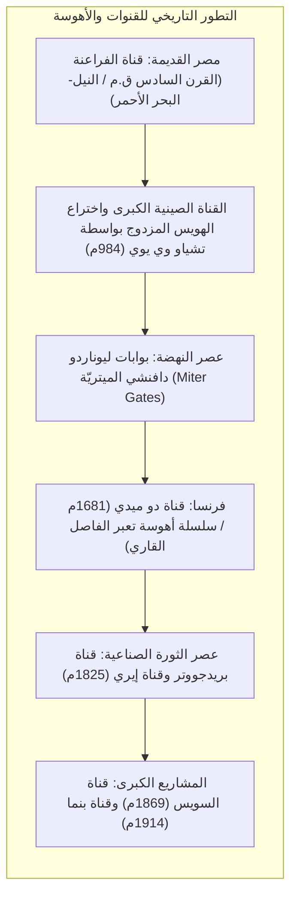
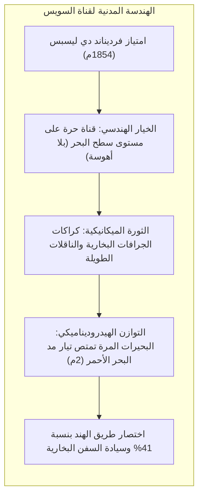
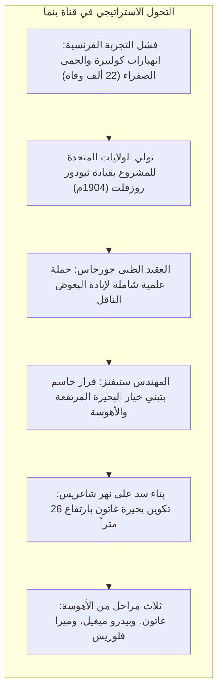

تغطي المحيطات أكثر من 70% من سطح كوكب الأرض، وظلت عبر التاريخ البشري شريان النقل الأقل استهلاكاً للطاقة. إلا أن الجغرافيا فرضت حواجز برية قاسية: فكان برزخ السويس وبرزخ بنما يجبران السفن على الدوران حول رأس الرجاء الصالح برياحه العاتية وحول رأس هورن بجنوب القارة الأمريكية.

ولكسر هذه القيود الجغرافية، حققت الهندسة المدنية إنجازين تاريخيين: حفر <strong>القنوات المائية العابرة للمحيطات</strong> وابتكار <strong>أهوسة الملاحة الهيدروليكية (Pound Locks)</strong>.

أدى افتتاح <strong>قناة السويس</strong> (1869) إلى تقليص المسار البحري بين أوروبا وآسيا بنحو 9000 كيلومتر. كما رفعت <strong>قناة بنما</strong> (1914) السفن الضخمة عبر مصاعد هيدروليكية عملاقة إلى بحيرة غاتون على ارتفاع 26 متراً فوق سطح البحر. غير أن هذه الممرات تحولت في القرن الحادي والعشرين إلى <strong>نقاط اختناق جيوسياسية واقتصادية بالغة الحساسية</strong>. ويعد جنوح سفينة *إيفر غيفن* عام 2021، وجفاف بحيرة غاتون في بنما، والتوترات العسكرية في البحر الأحمر دليلاً ساطعاً على هشاشة حركة الملاحة والتجارة العالمية.

---

## 1. التطور الهندسي: من السدود المنزلقة إلى بوابات دافنشي

تطلب نقل السفن عبر التضاريس الجبلية المرتفعة السيطرة الكاملة على الضغط الهيدروستاتيكي للمياه دون تعريض هياكل السفن للكسر.

في المراحل الأولى، استُخدمت <strong>المنزلقات المائلة (Slipways)</strong> حيث كانت السفن تُسحب بالحبال والثيران وسط مخاطر جسيمة. وفي عام 984م، ابتكر المهندس الصيني <strong>تشياو وي يوي</strong> أول <strong>هويس ملاحة ذي غرفة مستقلة (Pound Lock)</strong> في القناة الكبرى، محققاً التوازن المائي الآمن.

وفي أواخر القرن الخامس عشر، صمم العبقري <strong>ليوناردو دافنشي</strong> في ميلانو <strong>البوابات الميتريّة (Miter Gates)</strong>: درفتان تلتقيان في زاوية حادة موجهة نحو المنبع. يعمل ضغط الماء الطبيعي على إحكام إغلاق الفواصل، وعند تعادل المنسوبين تُفتح البوابات بأقل قدر من الجهد الميكانيكي.

---

## 2. قناة السويس: شق مائي على منسوب البحر

بعد تصحيح أخطاء القياس الطبوغرافي لمهندسي نابليون التي زعمت وجود فارق منسوب يبلغ 10 أمتار بين البحرين، أصر <strong>فرديناند دي ليسبس</strong> على شق قناة مفتوحة مباشرة دون أهوسة عبر الرمال.

لعبت <strong>البحيرات المرة الكبرى</strong> دوراً هيدروديناميكياً حاسماً: فمع وجود فارق مد وجزر يصل إلى مترين في البحر الأحمر مقابل نصف متر في البحر المتوسط، عملت هذه المسطحات الشاسعة كخزان لتشتيت طاقة التيارات العاتية، مانعة حدوث فيضانات جارفة في المجرى الضيق.

---

## 3. قناة بنما: قهر خط تقسيم المياه القاري

انتهت محاولة فرنسا لشق قناة على مستوى البحر بكارثة مالية وبشرية جراء انهيارات الطمي في ممر كوليبرا وفتك الملاريا والحمى الصفراء بنحو 22 ألف عامل.

قاد الطبيب العسكري الأمريكي <strong>وليام جورجاس</strong> حملة صحية تاريخية استأصلت البعوض تماماً. ثم حسم كبير المهندسين <strong>جون ستيفنز</strong> الموقف: «رفع السفن إلى البحيرة بدلاً من خفض الجبل إلى البحر». وقام سلاح المهندسين بقيادة <strong>جورج غوثالز</strong> ببناء سد غاتون وأهوسة الرفع الثلاثية التي تسير فيها السفن مقطوعة بقاطرات كهربائية مسننة («البغال»).

---

## 4. هيدروديناميكا الممرات الضيقة ومعادلات الأهوسة

تتم عملية ملء وتفريغ حجرة الهويس بالجاذبية وفقاً لمعادلتي برنولي وتوريتشيلي:

$$T_{	ext{fill}} = rac{2 A_{	ext{lock}} \sqrt{\Delta H_0}}{C_d A_c \sqrt{2g}}$$

وفي الممرات الضيقة، تتعرض السفن العملاقة لقوى هيدروديناميكية خطيرة:
- <strong>ظاهرة الغاطس الديناميكي (Squat Effect)</strong>: يؤدي تسارع تدفق الماء أسفل القاع إلى هبوط منسوب الضغط الهيدروستاتيكي، مما يؤدي لغوص السفينة رأسياً نحو القاع.
- <strong>تأثير الضفة (Bank Effect)</strong>: تدفع وسادة الضغط العالي مقدمة السفينة نحو منتصف القناة بينما يجذب تخلخل الضغط مؤخرتها بقوة نحو الجرف الترابي، مسبباً انحرافاً دورانياً لا يمكن السيطرة عليه، وهو السبب الفيزيائي المباشر لجنوح سفينة *إيفر غيفن*.

---

## 5. المقاييس الملاحية ومستقبل المضائق

فرضت أبعاد القنوات تصنيفات قياسية للسفن: <strong>باناماكس (Panamax)</strong>، و<strong>نيوباناماكس (Neopanamax)</strong>، و<strong>سويزماكس (Suezmax)</strong>.

أما بيئياً، فقد تسببت قناة السويس في <strong>الهجرة الليسبسية</strong> لأكثر من 350 كائناً بحرياً غازياً إلى البحر المتوسط. وفي بنما، تستهلك كل رحلة عبور <strong>200 مليون لتر من مياه بحيرة غاتون العذبة</strong> تُلقى في المحيط، مما يعرض القناة لأزمات خانقة في فترات الجفاف. ويتطلب المستقبل الاعتماد على المحاكاة الرقمية التوأمية وأنظمة تدوير المياه المغلقة.