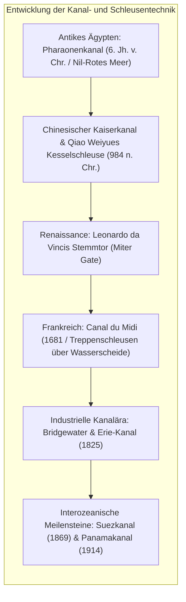
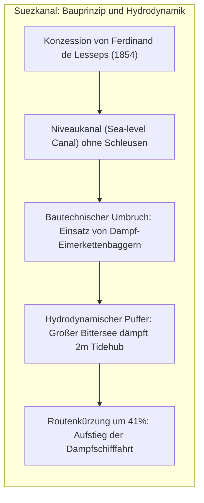
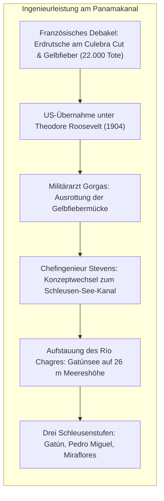

Die Weltmeere bilden seit jeher die wirtschaftlichste Verkehrsader der Menschheit. Doch tektonische Landbrücken trennten Ozeane voneinander ab: Der Isthmus von Suez und der Isthmus von Panama zwangen Schiffe jahrhundertelang zu gefährlichen Umrundungen des Kaps der Guten Hoffnung und des berüchtigten Kap Hoorn.

Um diese Barrieren zu bezwingen, schufen Ingenieure zwei monumentale Megaprojekte: die <strong>künstlichen Seekanäle</strong> und die Erfindung der <strong>hydraulischen Schiffsschleuse (Pound Lock)</strong>.

Die Eröffnung des <strong>Suezkanals</strong> (1869) verkürzte die Route zwischen Europa und Asien um rund 9.000 Kilometer. Der <strong>Panamakanal</strong> (1914) hob Schiffe wie in einem hydraulischen Fahrstuhl auf das Niveau des 26 Meter hoch gelegenen Gatúnsees. Heute jedoch offenbaren diese Verkehrsströme ihre extreme Anfälligkeit als globale <strong>geopolitische Chokepoints (strategische Nadelöhre)</strong>. Die Havarie der *Ever Given* 2021 im Suezkanal, die anhaltende Dürre im Gatúnsee und die Angriffe im Roten Meer verdeutlichen die Verwundbarkeit weltweiter Lieferketten.

---

## 1. Technische Evolution der Schleusenbaukunst

Die Überwindung von Geländestufen ohne Rumpfbeschädigung verlangte die Beherrschung der Hydrostatik.

Frühe Kanäle nutzten primitive <strong>Rollüberzüge (Slipways)</strong>, die Schiffe und Holzrümpfe stark beschädigten. Im Jahr 984 n. Chr. erfand der chinesische Beamte <strong>Qiao Weiyue</strong> am Kaiserkanal die erste echte <strong>Kesselschleuse (Pound Lock)</strong> mit zwei regulierbaren Toren, zwischen denen Schiffe schwimmend gehoben wurden.

Um 1497 revolutionierte <strong>Leonardo da Vinci</strong> in Mailand die Schleusentechnik mit dem <strong>Stemmtor (Miter Gate)</strong>. Zwei Torflügel schließen sich im spitzen Winkel gegen das Oberwasser. Der Wasserdruck presst die Torfugen wasserdicht zusammen; bei Druckausgleich lassen sich die Tore mühelos öffnen.

---

## 2. Der Suezkanal: Niveaukanal ohne Schleusen

Nachdem Bourdaloues Präzisionsmessungen 1847 Napoleons Irrtum eines angeblichen Höhenunterschieds von 10 Metern widerlegt hatten, setzte <strong>Ferdinand de Lesseps</strong> einen schleusenlosen <strong>Niveaukanal</strong> durch.

Entscheidend für die hydrodynamische Beherrschung war der <strong>Große Bittersee (Great Bitter Lake)</strong>. Da der Golf von Suez einen Tidenhub von bis zu 2 Metern aufweist (im Mittelmeer nur 0,5 m), dient der See als gigantisches Ausgleichsbecken, das zerstörerische Strömungen im engen Kanalprofil absorbiert.

---

## 3. Der Panamakanal: Schleusen über die Kontinentalscheide

Lesseps' Versuch, in Panama blind das Niveaukanal-Konzept von Suez zu wiederholen, endete im Fiasko: Erdrutsche im Culebra Cut und Gelbfieber/Malaria forderten über 22.000 Menschenleben und führten zum Bankrott.

Die USA unter Präsident Roosevelt übernahmen das Projekt. Militärarzt <strong>William Gorgas</strong> vernichtete die Überträger der Tropenkrankheiten. Chefingenieur <strong>John F. Stevens</strong> setzte den genialen Konzeptwechsel durch: Statt das Gebirge bis auf Meeresniveau abzutragen, wurde der Río Chagres zum <strong>Gatúnsee</strong> aufgestaut und die Schiffe mittels riesiger Schleusenkammern über den Berg gehoben.

---

## 4. Hydrodynamik in beengten Gewässern

Die Füllung einer Schleusenkammer erfolgt rein gravitativ über Bernoulli- und Torricelli-Gesetze:

$$T_{	ext{fill}} = rac{2 A_{	ext{lock}} \sqrt{\Delta H_0}}{C_d A_c \sqrt{2g}}$$

In beengten Kanalprofilen treten bei Großschiffen lebensgefährliche Strömungseffekte auf:
- <strong>Squat-Effekt</strong>: Die beschleunigte Strömung unter dem Schiffsrumpf erzeugt Unterdruck, wodurch das Schiff absinkt und vertrimmt.
- <strong>Bank-Effekt</strong>: Asymmetrische Druckfelder an den Kanalböschungen drücken den Bug zur Kanalmitte (Bank Cushion) und saugen das Heck an die Uferwand (Bank Suction), was unkontrollierbare Drehmomente erzeugt – die Hauptursache der *Ever-Given*-Havarie.

---

## 5. Chokepoints und ökologische Herausforderungen

Kanalmaße definieren Schiffsgrößenklassen: <strong>Panamax</strong>, <strong>Neopanamax</strong> (seit 2016 mit Wassersparbecken für Schiffe bis 15.000 TEU) und <strong>Suezmax</strong>.

Ökologisch führte der Suezkanal zur <strong>Lesseps'schen Migration</strong> von über 350 invasiven Arten ins Mittelmeer. Am Panamakanal spült jede Schleusung <strong>200 Millionen Liter kostbares Süßwasser</strong> ins Meer, was bei Dürren zu dramatischen Tiefgangsbeschränkungen führt. Die Zukunft der globalen Chokepoints erfordert geschlossene Kreislaufsysteme und digitale Navigation.