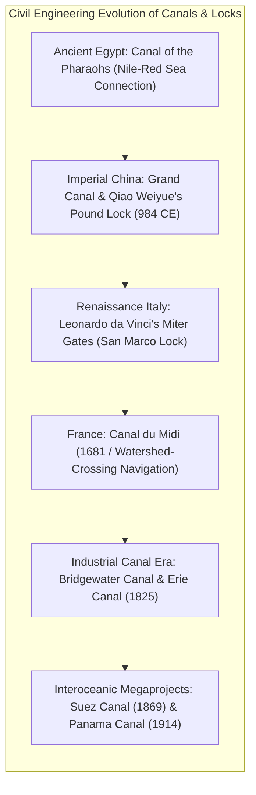
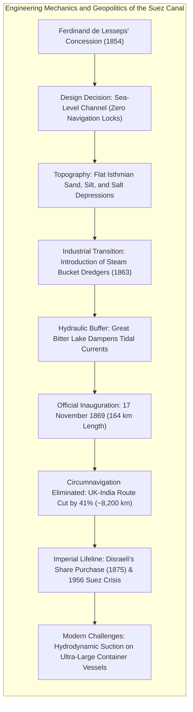
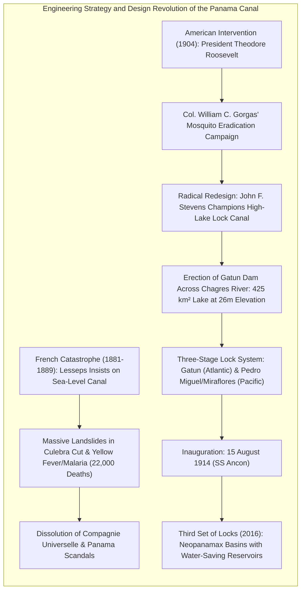
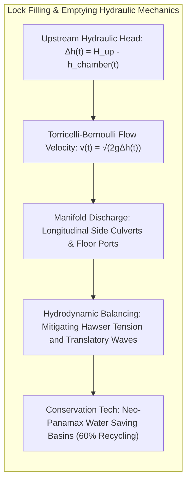
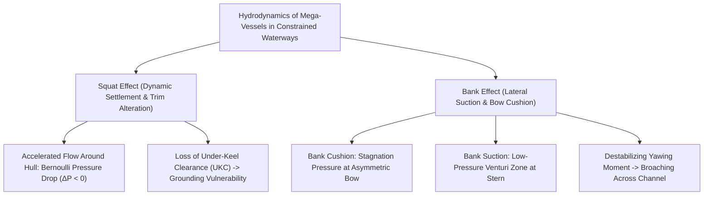
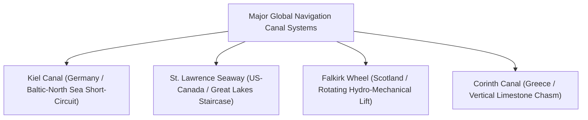
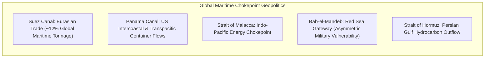

Covering over seventy percent of the planetary surface, the global ocean has served as humanity's most energy-efficient transit medium since the dawn of organized civilization. Yet planetary plate tectonics imposed formidable geographic barricades upon maritime commerce. Two narrow strips of continental topography—the Isthmus of Suez connecting Africa and Eurasia, and the Isthmus of Panama bridging North and South America—long bisected the Atlantic, Pacific, Mediterranean, and Indian Oceans. For centuries, these slender continental land-bridges coerced merchant shipping and naval armadas into hazardous, multi-thousand-mile circumnavigations around the tempestuous waters of the Cape of Good Hope and the brutal gales of Cape Horn in the "Roaring Forties" and "Screaming Sixties."

To shatter these physical constraints and short-circuit oceanic distances, civil engineers undertook the most daring megaprojects in history: the excavation of <strong>artificial maritime canals</strong> and the perfection of <strong>hydraulic navigation locks (flash and pound locks)</strong>.

The inauguration of the <strong>Suez Canal</strong> in 1869 eliminated the African circumnavigation, truncating the maritime distance between Western Europe and South Asia by 8,000 to 9,000 kilometers and restructuring Victorian globalization. Forty-five years later, in 1914, the completion of the <strong>Panama Canal</strong>—achieved amidst catastrophic landslides, tropical disease, and unprecedented hydraulic design—lifted ocean-going vessels eighty-five feet (26 meters) above sea level over the continental divide into Gatun Lake, linking the Atlantic and Pacific oceans through a three-tiered stairwell of concrete chambers.

In the 21st century, however, these civil engineering monuments have transformed into acute <strong>geopolitical and economic chokepoints</strong>. The March 2021 grounding of the 20,000 TEU ultra-large container ship *Ever Given* in the Suez Canal halted roughly twelve percent of global trade for six days, exposing the severe hydrodynamic instability of modern mega-vessels in restricted channels. Concurrently, severe multi-year droughts and intense El Niño anomalies in Central America have depleted freshwater levels in Gatun Lake, forcing the Panama Canal Authority (ACP) to impose unprecedented transit quotas and draft restrictions. Coupled with naval missile and drone strikes around the Bab-el-Mandeb strait forcing commercial shipping back around the Cape of Good Hope, the fragile reliance of contemporary supply chains on these artificial conduits has never been more conspicuous.

This academic treatise provides an exhaustive, multidisciplinary analysis of canal engineering, fluid mechanics, naval architecture, maritime economics, and international geopolitics.

---

## 1. Technical Evolution: From Ancient Waterways to Leonardo's Miter Gates

The physical challenge of conveying vessels across uneven terrain required mastering the hydrostatic behavior of water and mitigating gravitational forces without subjecting wooden or steel hulls to structural deformation.

### 1.1 Ancient Origins: Slipways, the Grand Canal, and the Invention of the Pound Lock

The earliest recorded attempts at canal construction addressed regional irrigation and inland troop movements. In the 6th century BCE, Pharaoh Necho II and Achaemenid King Darius I excavated the <strong>Canal of the Pharaohs</strong>, linking the eastern branches of the Nile River delta through the Wadi Tumilat to the Red Sea. Although functioning as a seasonal freshwater bypass rather than a direct sea-to-sea channel, it demonstrated the strategic viability of artificial maritime connections.

In East Asia, imperial China engineered the largest and longest inland waterway network in human antiquity. Consolidated under Emperor Yang of the Sui Dynasty (r. 604–618 CE), the <strong>Grand Canal (Da Yunhe)</strong> eventually spanned 1,800 kilometers from Hangzhou to Beijing. It linked five major river systems—the Hai, Yellow, Huai, Yangtze, and Qiantang—allowing grain and taxation commodities from the fertile southern valleys to sustain northern administrative capitals.

Initially, elevation differentials along the Grand Canal were negotiated via <strong>flash locks and slipways (haul-overs / *guochuanyan*)</strong>. A slipway consisted of an inclined stone or clay ramp lubricated with water and mud, over which barges were hauled using manual winches, capstans, and draft oxen. This brute-force technique caused catastrophic hull stress, frequent cargo loss, and exorbitant wear on water supplies.

To eliminate these structural hazards, the Chinese canal commissioner <strong>Qiao Weiyue (喬維岳)</strong> invented the world's first true <strong>pound lock (double lock / *fuzha*)</strong> in 984 CE along the Huai'an sector of the Grand Canal. Qiao constructed two solid timber drop-gates set 250 feet (approx. 76 meters) apart, enclosing an intermediate water basin (chamber) lined with ashlar masonry. By impounding water between the gates and alternately opening submerged sluices, vessels were raised or lowered smoothly while afloat, establishing the foundational principle of all subsequent navigation lock engineering.

### 1.2 European Renaissance Innovations: Leonardo da Vinci's Miter Gate

While pound locks diffused into Western Europe via Flanders and Northern Italy during the 14th century, early European lock designs relied on vertical guillotine-style portcullis gates. These gates were subject to tremendous frictional resistance from hydrostatic pressure, requiring massive counterweights, heavy timber superstructures, and intense physical effort to raise.

Around 1497, <strong>Leonardo da Vinci</strong>, serving as military and civil engineer to Ludovico Sforza in Milan, resolved this mechanical limitation by inventing the <strong>miter gate (mitred lock gate / *porte a battenti*)</strong> for the San Marco Canal.

Leonardo's design deployed two swing leaves hinged at the masonry lock walls that met at an acute angle pointing upstream (pointing against the direction of higher water elevation):
- When closed, the hydrostatic pressure differential forces the two leaves firmly together along their beveled miter posts, forming an arch-like compression seal that becomes tighter as water pressure increases.
- When water levels equalize across the chamber via small internal butterfly valves, the hydrostatic load vanishes, enabling the gates to swing open with negligible mechanical torque.

Leonardo's miter gate remains the ubiquitous worldwide standard for lock chambers, utilized across waterways from the English canals to the historic locks of the Panama Canal.

### 1.3 Watershed Navigation: The Canal du Midi and the Industrial Boom

The crowning achievement of early modern civil engineering was Pierre-Paul Riquet's <strong>Canal du Midi (1681)</strong> in southern France. Linking the Garonne River (Atlantic) to the Mediterranean across 240 kilometers, Riquet surmounted the 189-meter continental divide at the Seuil de Naurouze. To sustain operations across dry summer seasons, Riquet designed the Bassin de St. Ferréol, the first major artificial feeder reservoir in Europe, harnessing gravity-fed aqueducts to replenish the summit reach and feeding 63 locks, including the famous eight-chamber staircase at Fonserannes.

The commercial success of the Canal du Midi served as the direct technological prototype for the British "Canal Mania" (such as the Bridgewater Canal in 1761) and the construction of the <strong>Erie Canal (1825)</strong> in New York, which traversed the Appalachian barrier, cut inland freight rates by ninety percent, and propelled New York City into the financial capital of North America.

---

## 2. The Suez Canal: Sea-Level Excavation and the Eurasian Maritime Revolution

The industrial explosion of steam power in the mid-19th century created intense commercial demand for direct oceanic conduits. The premier interoceanic undertaking was the <strong>Suez Canal</strong>, linking the Mediterranean and Red Seas.

### 2.1 The Hydrodynamic Fallacy and Ferdinand de Lesseps

During the French invasion of Egypt in 1798, Napoleon Bonaparte personally surveyed the Suez Isthmus. However, his chief surveyor, Jacques-Marie Le Père, committed an egregious leveling calculation error, asserting that the Red Sea at high tide was 9.9 meters (32.5 feet) higher than the Mediterranean. Le Père warned that digging a sea-level cut would trigger catastrophic flooding across Lower Egypt, causing the project to be shelved for half a century.

In 1847, the International Commission of the Isthmus of Suez, guided by Paul-Adrien Bourdaloue's precision leveling, conclusively proved that mean sea levels were virtually identical, with differences confined to localized tidal oscillations. Armed with this hydrographic proof, the charismatic French former diplomat <strong>Ferdinand de Lesseps</strong> obtained an excavation concession from the Viceroy of Egypt, Muhammad Sa'id Pasha, incorporating the *Compagnie Universelle du Canal Maritime de Suez* in 1858.

The definitive structural feature of Suez was its design as a <strong>sea-level canal without locks</strong>. The isthmus was remarkably flat, devoid of mountain ranges or bedrock escarpments. Excavators cut a continuous, open trench through soft sand, clay, and gypsum deposits across 164 kilometers (102 miles) from Port Said on the Mediterranean to Port Tewfik at Suez.

Crucial to the hydrodynamic stability of the sea-level cut was the integration of the <strong>Great Bitter Lake</strong> and Little Bitter Lake. While the Mediterranean terminus experiences minimal tidal fluctuation (approximately 0.5 meters), the Gulf of Suez experiences semi-diurnal tides up to 2.0 meters. Without a hydraulic buffer, the head differential would generate torrential currents exceeding four to five knots, rendering steerage impossible. Acting as a vast <strong>tidal attenuation basin</strong> spanning 250 square kilometers, the Great Bitter Lake absorbs and dissipates the incoming tidal prism from the Red Sea, moderating current velocities throughout the central cut.

### 2.2 From Corvée Labor to Industrial Steam Dredging

Excavation began in April 1859 utilizing archaic *corvée* (forced labor), with tens of thousands of Egyptian peasant laborers digging trenches with pickaxes, wooden hoes, and baskets under blistering desert heat. The human toll was appalling, exacerbated by cholera epidemics and dysentery.

In 1863, under mounting British diplomatic pressure, Ismail Pasha banned the corvée system, depriving the canal company of four-fifths of its workforce. Facing financial bankruptcy and technical collapse, de Lesseps and chief contractor engineers Paul Borel and Alexandre Lavalley executed a historic technological leap: <strong>the comprehensive mechanization of civil earthmoving through steam power</strong>.

Borel and Lavalley designed and deployed an armada of <strong>steam-driven continuous-bucket dredgers</strong> mounted on iron hulls, alongside <strong>long-chute elevators (*élévateurs à déblais*)</strong>. These conveyor gantries hoisted dredged mud and silt from barge holds, propelling material through chutes projecting 50 to 60 meters over the embankment to construct canal dikes. Mechanization quadrupled excavation rates from 200,000 cubic meters monthly to over two million cubic meters, completing the maritime waterway by November 1869.

### 2.3 Global Economic Realignment and Chokepoint Crises

The opening of the Suez Canal profoundly altered global geography:
- <strong>Maritime Route Contraction</strong>: The nautical distance between London and Bombay plummeted from 19,800 kilometers via the Cape to 11,600 kilometers via Suez—a <strong>41 percent reduction</strong>. Sailing ships, incapable of tacking within the narrow desert canal and windless Red Sea, were rapidly made obsolete, precipitating the universal adoption of coal-fired steamships across world fleets.
- <strong>British Geopolitical Hegemony</strong>: Recognizing Suez as the indispensable "Jugular Vein of the British Empire," Prime Minister Benjamin Disraeli in 1875 leveraged emergency financing from the Rothschild banking house to purchase the bankrupt Khedive's 44 percent stake in the canal company for £4 million. Following the 1882 Anglo-Egyptian War, Britain established military occupation over Egypt, securing operational dominance until mid-century.
- <strong>The 1956 Suez Crisis</strong>: Egyptian President Gamal Abdel Nasser's nationalization of the canal on 26 July 1956 provoked a tripartite invasion by Britain, France, and Israel. However, forceful diplomatic and economic pressure from the Eisenhower administration forced an ignominious allied retreat, signaling the definitive geopolitical sunset of Anglo-French imperial primacy and solidifying Egypt's national stewardship of the waterway.

---

## 3. The Panama Canal: Overcoming the Continental Divide

If Suez was a triumph of planar excavation through sand, the <strong>Panama Canal</strong> was an epic battle against mountain orography, torrential tropical hydrology, and lethal biological pathogens.

### 3.1 The French Calamity: The Mirage of the Sea-Level Cut

Intoxicated by his diplomatic and commercial triumph at Suez, Ferdinand de Lesseps formed the *Compagnie Universelle du Canal Interocéanique de Panama* in 1879, adamantly mandating a <strong>sea-level canal</strong> across the Isthmus of Panama. Ignoring the strenuous warnings of veteran engineers such as Gustave Eiffel and Adolphe Godin de Lépinay, de Lesseps insisted on carving a sea-level canyon through the continental divide at the Culebra Cut.

The project rapidly disintegrated into catastrophic ruin:
1. <strong>The Geology of Culebra Cut</strong>: Unlike stable desert sand, the Panamanian divide consisted of highly fractured, water-saturated cucaracha shales and clays. When steam shovels excavated deep cuts, the structural toe of the slope was removed, precipitating massive continuous landslides. Millions of cubic yards of rock and mud sheared downward overnight, obliterating rail tracks, burying steam engines, and filling excavations faster than steam shovels could dig.
2. <strong>The Rage of the Chagres River</strong>: The Chagres River basin, prone to torrential rainfall exceeding 3,000 mm annually, experienced flash floods that saw river levels surge by 30 to 40 feet in a few hours, inundating workshops and dredging flumes.
3. <strong>The Scourge of Vector-Borne Pathogens</strong>: Unbeknownst to 19th-century medical science, the humid jungles harbored endemic populations of <strong>yellow fever (*Aedes aegypti*)</strong> and <strong>falciparum malaria (*Anopheles*)</strong>. Over the course of the French effort (1881–1889), an estimated <strong>22,000 workers, engineers, and physicians perished</strong>, destroying morale and depleting capital reserves.

In 1889, the enterprise collapsed into insolvency, wiping out the life savings of hundreds of thousands of French middle-class bondholders and precipitating the historic "Panama Scandals" that shook the Third Republic.

### 3.2 The American Resumption and Gorgas' Epidemiological Revolution

Driven by Alfred Thayer Mahan's doctrine of naval sea power and the Spanish-American War experience—where the battleship *USS Oregon* required 66 days to steam 14,000 nautical miles around Cape Horn from San Francisco to Cuba—President Theodore Roosevelt orchestrated the independence of Panama from Colombia in November 1903, signing the Hay–Bunau-Varilla Treaty granting the United States sovereign control over the 10-mile-wide <strong>Panama Canal Zone</strong>.

Roosevelt made two foundational appointments that transformed engineering destiny:
First, he supported Army Medical Corps Colonel <strong>William C. Gorgas</strong> in launching an uncompromising, scientific vector-eradication campaign based on Carlos Finlay and Walter Reed's mosquito transmission discoveries:
- Fumigating every building and residential quarter across the isthmus.
- Screening all doors and windows with brass wire mesh.
- Covering every open cistern, drain, and swamp with kerosene and larvicidal oils to choke mosquito pupae.
- Paving streets and installing comprehensive municipal sewer and drainage systems in Panama City and Colón.

Within twenty-four months, yellow fever was permanently eradicated from the isthmus, and malaria mortality plummeted by over ninety percent, securing an operational work environment.

### 3.3 John F. Stevens and George W. Goethals: The High-Lake Lock Paradigm

The decisive civil engineering turning point occurred in 1905 when Chief Engineer <strong>John F. Stevens</strong>, a legendary transcontinental railroad builder, convinced President Roosevelt to abandon the sea-level fallacy:

> *"The Chagres River is a monster that cannot be tamed by digging a trench through it. We must not bring the canal down to the sea; we must bring the sea up to the lake."*

Stevens proposed damming the Chagres River near its Atlantic mouth to create a massive artificial reservoir at 85 feet (26 meters) above sea level, utilizing navigation locks at both ends to lift and lower vessels.

Following Stevens' resignation in 1907, Roosevelt assigned the task to Colonel <strong>George Washington Goethals</strong> of the U.S. Army Corps of Engineers, who executed the project with martial discipline:
- <strong>Gatun Dam</strong>: A colossal 2.4-kilometer-long earthen embankment dam impounding the Chagres River to form <strong>Gatun Lake</strong>—at the time the largest man-made lake on Earth (425 square kilometers).
- <strong>Three Flight Lock Architecture</strong>:
  - *Atlantic Sector*: The three-tier <strong>Gatun Locks</strong>, raising vessels 26 meters in consecutive lifts.
  - *Pacific Sector*: The single-tier <strong>Pedro Miguel Lock</strong>, stepping down 9.5 meters into Miraflores Lake, followed by the two-tier <strong>Miraflores Locks</strong>, lowering vessels to the Pacific Ocean.
- <strong>Electric Towing Locomotives ("Mules")</strong>: To eliminate hydrodynamic collisions within the restricted 33.5-meter-wide chambers, ships were prohibited from using their main propulsion, instead guided and braked by rack-and-pinion electric locomotives operating on cogged rails flanking the lock walls.

On 15 August 1914, the cement carrier *SS Ancon* made the historic maiden transit, officially opening the Panama Canal. Maritime transit from New York to San Francisco dropped from 13,000 miles via Cape Horn to 5,200 miles—a monumental saving of 7,800 nautical miles that permanently rewired global shipping routes.

---

## 4. Lock Hydraulic Engineering and Fluid Dynamics Mathematical Formulations

A navigation lock represents one of the most elegant applications of fluid mechanics in civil engineering: <strong>hoisting vessels weighing hundreds of thousands of tons through gravitational potential energy alone, without operational pumping</strong>.

### 4.1 Transient Hydraulic Chamber Filling: Bernoulli-Torricelli Equations

Consider a lock chamber of width $W$, length $L$, and horizontal surface area $A_{\text{lock}} = W \cdot L$. The chamber connects to an upstream reservoir of constant surface elevation $H_1$ through culvert conduits of aggregate cross-sectional area $A_c$ with an effective discharge coefficient $C_d$.

Let $h(t)$ denote the instantaneous water level within the chamber at time $t$. The instantaneous effective hydraulic head is:

$$\Delta h(t) = H_1 - h(t)$$

Applying Bernoulli's theorem along a streamline from the reservoir surface to the culvert exit orifices inside the chamber:

$$\frac{p_1}{\rho g} + \frac{v_1^2}{2g} + z_1 = \frac{p_2}{\rho g} + \frac{v_2^2}{2g} + z_2 + h_L$$

Accounting for friction and contraction head losses $h_L$, the mean efflux velocity through the culverts is governed by Torricelli's Law modified by $C_d$:

$$v_c(t) = C_d \sqrt{2g (H_1 - h(t))}$$

The volumetric filling rate $Q(t) = \frac{dV}{dt} = A_{\text{lock}} \frac{dh}{dt}$ equals the culvert discharge:

$$A_{\text{lock}} \frac{dh}{dt} = C_d A_c \sqrt{2g (H_1 - h(t))}$$

Separating variables over the filling interval from $t = 0$ (initial water level $h(0) = H_0$) to $t = T_{\text{fill}}$ (final equalized level $h(T_{\text{fill}}) = H_1$):

$$\int_{H_0}^{H_1} \frac{dh}{\sqrt{H_1 - h}} = \frac{C_d A_c \sqrt{2g}}{A_{\text{lock}}} \int_0^{T_{\text{fill}}} dt$$

Evaluating the definite integral yields the fundamental <strong>Lock Filling Time Equation</strong>:

$$\left[ -2 \sqrt{H_1 - h} \right]_{H_0}^{H_1} = 2 \sqrt{H_1 - H_0} = \frac{C_d A_c \sqrt{2g}}{A_{\text{lock}}} T_{\text{fill}}$$

$$T_{\text{fill}} = \frac{2 A_{\text{lock}} \sqrt{\Delta H_0}}{C_d A_c \sqrt{2g}}$$

Where $\Delta H_0 = H_1 - H_0$ is the total initial lift. 

This analytical formulation proves that <strong>chamber filling velocity decelerates parabolically as water levels converge</strong>. Consequently, modern culvert control systems employ non-linear valve-stroking profiles to prevent initial surging while sustaining flow rates as head differential diminishes.

### 4.2 Hydrodynamic Confinement in Restricted Channels: Squat and Bank Effects

When modern ultra-large container ships navigate restricted canals, severe hydrodynamic forces emerge due to boundary layer proximity and spatial blockage.

#### ① The Squat Effect
As a vessel moves through shallow, restricted water, water displaced by the hull must accelerate aft through the constrained cross-section beneath the keel and along the flanks. By the continuity equation ($A_1 v_1 = A_2 v_2$), this accelerated flow induces a localized pressure drop according to Bernoulli's principle. The vessel experiences an downward suction force, causing <strong>dynamic bodily settlement</strong> and a <strong>change in longitudinal trim</strong> (squat).

The maximum squat $h_s$ in a restricted canal can be formulated via Dr. C.B. Barrass's empirical hydrodynamics:

$$h_s = C_s \frac{C_b V^2}{100} \cdot \frac{S_b}{1 - S_b}$$

Where:
- $C_b$: Block coefficient of the hull (ratio of displaced volume to $L \cdot B \cdot T$).
- $V$: Vessel speed through the water in knots.
- $S_b$: Channel blockage factor ($S_b = \frac{A_{\text{midship}}}{A_{\text{canal}}}$).
- $C_s$: Channel confinement factor ($C_s \approx 2.0$ for narrow dredged canals).

Because squat scales with the <strong>square of vessel velocity ($V^2$)</strong>, a speed increase from 6 to 10 knots more than doubles dynamic draft, precipitating under-keel contact with the channel bed.

#### ② The Bank Effect
When a vessel navigates eccentrically off the canal centerline toward one bank, severe asymmetric flow fields manifest:
- <strong>Bank Cushion</strong>: The restricted gap between the forward shoulder of the hull and the canal bank restricts fluid displacement, elevating water levels and creating high hydrostatic pressure that pushes the bow toward the channel center.
- <strong>Bank Suction</strong>: Near the midbody and stern, flow velocities between the hull and bank accelerate dramatically, creating a Venturi pressure deficit that violently pulls the stern toward the bank.

These forces synthesize into an uncontrollable <strong>yawing moment</strong> ($M_{\text{yaw}}$):

$$M_{\text{yaw}} = \frac{1}{2} \rho C_{my} L^2 B T V^2$$

If the helmsman attempts to counter stern suction by applying rudder toward the bank, the vessel may experience catastrophic yaw-rate runaway, broaching diagonally across the waterway—the exact physical mechanism that grounded the 400-meter *Ever Given* in the southern single-lane section of the Suez Canal in March 2021.

---

## 5. Global Survey of Critical Canal Infrastructure

Canal engineering has evolved specialized configurations across disparate continental geographies:

### 5.1 The Kiel Canal (Nord-Ostsee-Kanal, Germany)
Bisecting the Jutland Peninsula across 98 kilometers, the Kiel Canal links the North Sea at Brunsbüttel with the Baltic Sea at Kiel-Holtenau. Opened by Kaiser Wilhelm II in 1895, it bypasses the stormy Skagerrak Strait, saving 250 to 450 nautical miles. Because the North Sea and Baltic exhibit distinct tidal regimes, massive double-chamber locks at both terminals insulate the sea-level canal from erosive currents. It ranks among the most heavily trafficked artificial waterways in the world, with over 30,000 vessel passages annually.

### 5.2 The St. Lawrence Seaway and Welland Canal (USA & Canada)
A monumental inland navigation corridor spanning 3,700 kilometers from the Gulf of St. Lawrence into Lake Superior (elevation: 183 meters above sea level). Dedicated in 1959, the seaway utilizes seven massive locks along the St. Lawrence River and eight consecutive locks along the 43-kilometer <strong>Welland Canal</strong> to climb the Niagara Escarpment, bypassing Niagara Falls and allowing ocean-going "lakers" and "salties" to penetrate the industrial heart of North America.

### 5.3 The Falkirk Wheel (Scotland)
A masterwork of 21st-century kinetic engineering, the Falkirk Wheel (opened in 2002) connects the Forth and Clyde Canal with the Union Canal across a 24-meter vertical elevation drop. Rather than constructing a time-consuming flight of eleven locks, British engineers built a counterbalanced <strong>rotational boat lift</strong>. Operating under Archimedes' Principle, the water displaced by an entering vessel precisely equals the vessel's weight, keeping both gondolas in perfect mass balance. Consequently, rotating the colossal 600-ton steel structure 180 degrees consumes merely 1.5 kWh of electrical energy—equivalent to boiling eight domestic kettles of water.

### 5.4 The Corinth Canal (Greece)
Carved directly through the Isthmus of Corinth in 1893, this 6.4-kilometer channel connects the Gulf of Corinth with the Saronic Gulf. Featuring vertical limestone walls soaring 63 meters above the water surface, its narrow 21.4-meter navigational width restricts traffic to small coasters and cruise ships. Its seismic vulnerability requires periodic closures due to massive rockfalls.

---

## 6. Chokepoint Geopolitics and Ship Dimensional Standards

The structural geometries of canal locks and dredged channels serve as the absolute boundary constraints of international naval architecture and shipping logistics.

### 6.1 Standard Vessel Classes and Naval Architecture Economics

Canal lock dimensions determine the economic categorization of global commercial fleets:

| Ship Classification | Max LOA (Length) | Max Beam (Width) | Max Draft | Cargo Capacity | Governing Constraint |
| :--- | :--- | :--- | :--- | :--- | :--- |
| <strong>Panamax</strong> | 294.1 m (965 ft) | 32.31 m (106 ft) | 12.04 m (39.5 ft) | ~4,500–5,000 TEU | Historic Panama Canal Locks (33.5m width) |
| <strong>Neopanamax</strong> | 366 m (1,201 ft) | 51.25 m (168 ft) | 15.2 m (50 ft) | ~12,000–15,000 TEU | 2016 Third Set of Locks Expansion |
| <strong>Suezmax</strong> | Unlimited (~400m) | 77.5 m (254 ft) | 20.1 m (66 ft) | 150,000–200,000 DWT | Suez Dredged Cross-Sectional Area |
| <strong>Capesize</strong> | Exceeds Canals | Exceeds Canals | > 20 m | 150,000–400,000 DWT | Forced via Cape of Good Hope / Cape Horn |
| <strong>Ultra-Large Container (ULCV)</strong> | 400 m (1,312 ft) | 61.5 m (202 ft) | 16.5 m (54 ft) | 20,000–24,000+ TEU | Transits Suez / Exceeds Neopanamax |

The $5.25 billion <strong>Panama Canal Expansion (Third Set of Locks)</strong>, inaugurated in June 2016, constructed massive new rolling-gate lock chambers (Cocoli on the Pacific, Agua Clara on the Atlantic). This shifted global container economics, permitting 14,000 TEU vessels to bypass West Coast intermodal rail links and transit directly to US East Coast and Gulf ports.

### 6.2 The Geopolitics of Vulnerability: Cascading Supply Chain Shocks

The extreme concentration of global commerce through narrow canal bottlenecks creates acute systemic vulnerability:
- <strong>The Red Sea Security Crisis (2023–2024)</strong>: Anti-ship ballistic missile and drone attacks by Houthi militants in the Bab-el-Mandeb strait prompted major container carriers (Maersk, MSC, CMA CGM, Hapag-Lloyd) to divert hundreds of container ships around the Cape of Good Hope. This detour added 10 to 14 days of transit time, consumed millions of barrels of bunker fuel, and absorbed an estimated 1.5 to 2 million TEU of global vessel capacity, escalating container spot freight rates.
- <strong>The Arctic Alternative (Northern Sea Route / NSR)</strong>: Climate change-induced polar ice retreat has opened seasonal navigation along Russia's Siberian coastline. The NSR truncates the Shanghai-to-Rotterdam voyage from 10,500 nautical miles via Suez to approximately 7,000 nautical miles—a 33 percent distance reduction. However, severe navigational hazards, mandatory nuclear icebreaker escort fees, and geopolitical sanctions currently restrict its transition to a true commercial competitor.

---

## 7. Environmental Transformations and Climate Vulnerability

Canal megaprojects permanently alter biosphere dynamics, bridging ecosystems separated for millions of years while exposing global trade to environmental feedback loops.

### 7.1 Lessepsian Migration: Biological Invasions in the Mediterranean

The piercing of the Suez Isthmus in 1869 initiated the most profound marine biological invasion in modern ecological history: <strong>Lessepsian Migration</strong>.

Because the Red Sea is an older, hyper-saline, and nutrient-poor tropical environment, its marine organisms are evolutionary super-competitors compared to indigenous Mediterranean species. Over 350 Indo-Pacific marine species—including the venomous silver-cheeked toadfish (*Lagocephalus sceleratus*), nomad jellyfish (*Rhopilema nomadica*), and rabbitfish (*Siganus luridus*)—have colonized the Levantine Sea, outcompeting native fishes and devastating Mediterranean coastal fisheries.

### 7.2 Freshwater Scarcity and the Climate Crisis in Panama

Unlike the sea-level Suez Canal, the Panama Canal operates on <strong>freshwater hydrology</strong>. Every single vessel transit flushes approximately <strong>200 million liters (52 million gallons)</strong> of pristine freshwater from Gatun Lake into the ocean through gravity lock cycling.

In 2023 and 2024, an intense El Niño combined with historic meteorological droughts dropped water levels in Gatun Lake to near-record lows. Because Gatun Lake also supplies drinking water to half of Panama's domestic population, the Panama Canal Authority (ACP) was forced to implement drastic emergency protocols:
- Slashing daily vessel transits from 38 ships to as low as 22 ships per day.
- Lowering maximum vessel draft from 50 feet to 44 feet, forcing Neopanamax container ships to offload containers via trans-isthmian rail.
- Auctions for priority transit slots reached astronomical bids exceeding $4 million per passage.

To insulate future operations, the ACP is engineering massive $2 billion water infrastructure programs, including the construction of a new reservoir on the Indio River, advanced water recycling pumping stations, and deep-bed desalination injection.

---

## 8. Civilizational Epilogue: The Future of Global Marine Connectivity

From the stone slipways of the Pharaohs to the automated rolling gates of Neopanamax chambers, canals embody humanity's relentless ambition to reshape planetary geography to serve global commerce.

Yet the crises of the 21st century—hydrodynamic groundings, weaponized choke points, and climate-induced freshwater droughts—demonstrate that our planetary logistics architecture operates on knife-edge margins. Future maritime resilience demands:
- <strong>Digital Twin Hydrodynamic Navigation</strong>: Integrating real-time AI hydrodynamic sensors that predict squat and bank suction transients to prevent grounding incidents.
- <strong>Closed-Loop Water Recycling</strong>: Upgrading locks with mechanical pumpback systems to achieve zero net freshwater loss during dry seasons.
- <strong>Supply Chain Multi-Modality</strong>: Re-balancing terrestrial intermodal rail bridges, nearshoring, and deep-sea routes to prevent single-point failures from paralyzing civilization.

Canals remain far more than concrete trenches filled with water; they are the pulsating hydrodynamic valves of modern human civilization.

---

## Academic References and Historiography

1. McCullough, David. *The Path Between the Seas: The Creation of the Panama Canal, 1870–1914*. New York: Simon & Schuster, 1977.
2. Karabell, Zachary. *Parting the Desert: The Creation of the Suez Canal*. New York: Alfred A. Knopf, 2003.
3. Panama Canal Authority (ACP). *Proposal for the Expansion of the Panama Canal: Third Set of Locks Project*. ACP Official Documentation, 2006.
4. Barrass, C. B., and D. R. Derrett. *Ship Stability for Masters and Mates*. 7th ed. Oxford: Butterworth-Heinemann, 2012.
5. Lewis, M. J. T. *Survey of Inland Waterways in Classical Antiquity*. London: British Archaeological Reports, 2001.
6. International Maritime Organization (IMO). *Guidelines for Navigation in Shallow and Confined Waters*. London: IMO Publishing, 2020.
7. Veenstra, Albert W., and H. E. Haralambides. *Maritime Logistics and the Geopolitics of Chokepoints*. Journal of Transport Geography 84 (2020): 102–115.
8. Galil, Bella S. *The Passage of the Sea: Biological Invasions through the Suez Canal*. Marine Pollution Bulletin 55 (2007): 314–322.