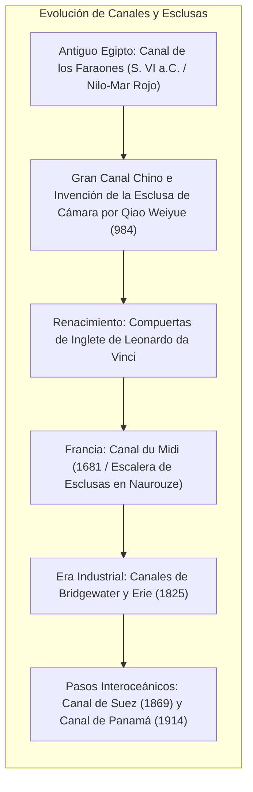
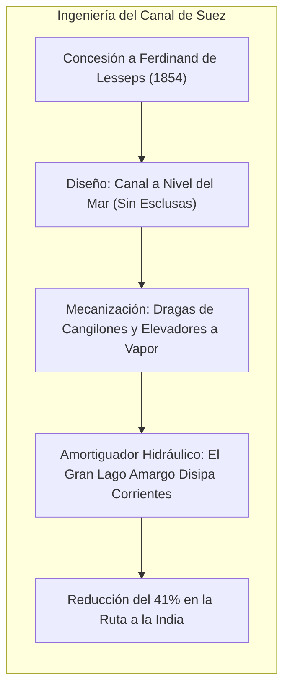
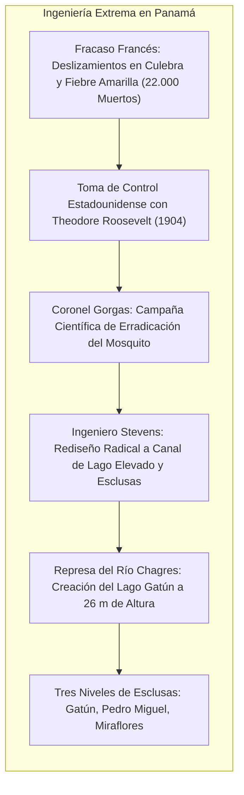

Los océanos cubren más del 70 % de la superficie terrestre y representan la vía de transporte más eficiente del planeta. Sin embargo, la geología continental impuso barreras infranqueables: el istmo de Suez y el istmo de Panamá obligaron durante siglos al comercio mundial a circunnavegar el cabo de Buena Esperanza y el tormentoso cabo de Hornos.

Para derribar estos obstáculos, los ingenieros concibieron dos grandes hitos: los <strong>canales marítimos interoceánicos</strong> y las <strong>esclusas de navegación hidráulica</strong>.

La apertura del <strong>Canal de Suez</strong> (1869) recortó la ruta Europa-Asia en unos 9.000 kilómetros. El <strong>Canal de Panamá</strong> (1914) elevó buques como en un ascensor hidráulico hasta los 26 metros de altitud del lago Gatún. Sin embargo, en el siglo XXI, estas arterias han revelado su extrema fragilidad como <strong>puntos de estrangulamiento geopolítico (chokepoints)</strong>. El bloqueo del Ever Given en 2021, la sequía provocada por El Niño en Panamá y las tensiones en el mar Rojo evidencian la vulnerabilidad del comercio global.

---

## 1. Evolución Técnica: De las Rampas a las Compuertas de Inglete

Superar desniveles topográficos sin dañar el casco exigió controlar la energía hidrostática.

Las primeras vías usaban <strong>rampas de arrastre (slipways)</strong> con bueyes y cabrestantes, que arruinaban los cascos. En 984, el funcionario chino <strong>Qiao Weiyue</strong> inventó en el Gran Canal la <strong>esclusa de cámara (Pound Lock)</strong> con dos compuertas regulables, base de la ingeniería moderna.

Hacia 1497, <strong>Leonardo da Vinci</strong> diseñó en Milán las <strong>compuertas de inglete (Miter Gates)</strong>: dos hojas que cierran en ángulo agudo contra la corriente. La presión del agua sella la junta herméticamente y, al igualarse los niveles, se abren con mínimo esfuerzo.

---

## 2. El Canal de Suez: Vía a Nivel sin Esclusas

Tras corregir los errores de cálculo napoleónicos sobre el desnivel entre mares, <strong>Ferdinand de Lesseps</strong> apostó por una zanja directa sin esclusas.

El <strong>Gran Lago Amargo</strong> cumplió un papel vital: amortiguar el desnivel de marea de 2 metros del mar Rojo respecto al Mediterráneo, disipando corrientes que habrían impedido el gobierno de los buques. Las dragas de vapor inauguraron la mecanización de la obra pública.

---

## 3. El Canal de Panamá: Domando la Cordillera Continental

La insistencia francesa en repetir el esquema a nivel de Suez causó la bancarrota por los aludes en el corte Culebra y la muerte de 22.000 trabajadores por enfermedades tropicales.

El coronel médico <strong>William Gorgas</strong> saneó el istmo erradicando los mosquitos. El ingeniero <strong>John Stevens</strong> replanteó la obra: «elevar los barcos al lago en vez de bajar la montaña al mar». El coronel <strong>George Goethals</strong> levantó la gran presa de Gatún y las esclusas triples operadas por locomotoras eléctricas («mulas»).

---

## 4. Hidrodinámica en Canales Angostos: Ecuaciones y Riesgos

El llenado de esclusas opera por gravedad según los principios de Bernoulli y Torricelli:

$$T_{	ext{fill}} = rac{2 A_{	ext{lock}} \sqrt{\Delta H_0}}{C_d A_c \sqrt{2g}}$$

En aguas confinadas, los megabuques sufren peligrosos fenómenos:
- <strong>Efecto Squat (Asiento dinámico)</strong>: La aceleración del flujo bajo el casco genera succión bernoulliana, hundiendo el barco y variando el trimado.
- <strong>Efecto Bank (Efecto ribera)</strong>: El colchón de proa empuja la proa hacia el centro del canal mientras la succión de popa la atrae violentamente hacia la orilla, provocando guiñadas incontrolables como la del *Ever Given*.

---

## 5. Geopolítica de los Chokepoints y Sostenibilidad

Las dimensiones de las esclusas rigen los tipos de buques: <strong>Panamax</strong>, <strong>Neopanamax</strong> (con tinas de reutilización de agua) y <strong>Suezmax</strong>.

En el plano ambiental, Suez originó la <strong>migración lessepsiana</strong> de especies invasoras al Mediterráneo. En Panamá, cada tránsito descarga <strong>200 millones de litros de agua dulce</strong> al mar, provocando graves restricciones en épocas de sequía. El futuro exige gemelos digitales de navegación y sistemas de bombeo en circuito cerrado.