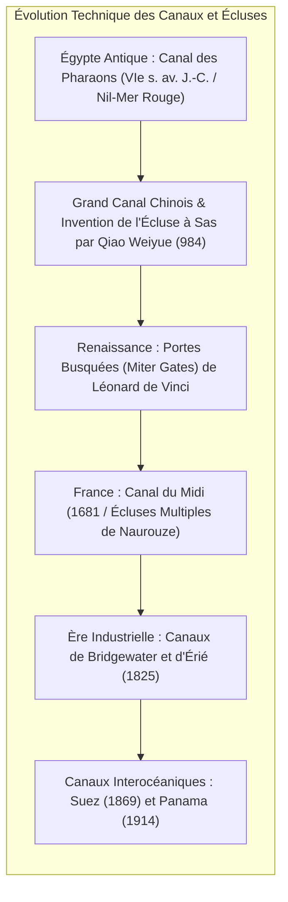
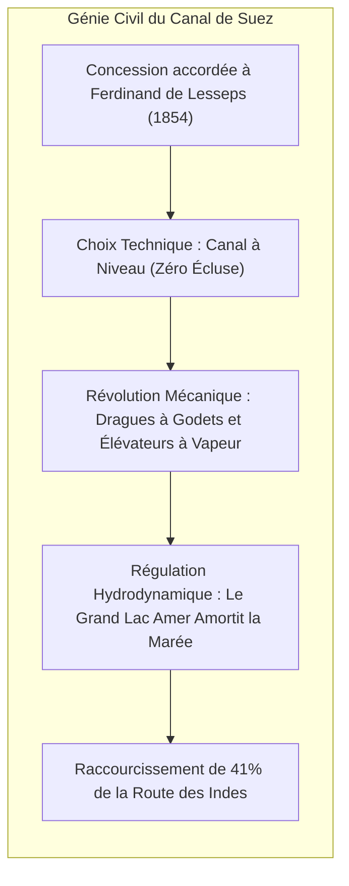
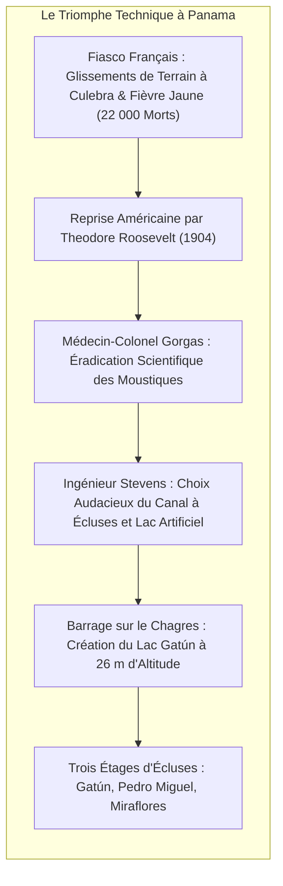

Les océans couvrent plus de 70 % de la planète et constituent l'artère de transport la plus sobre en énergie. Toutefois, la dérive des continents a érigé de formidables barrières terrestres : l'isthme de Suez et l'isthme de Panama ont contraint pendant des siècles les navires marchands à contourner le cap de Bonne-Espérance et les redoutables tempêtes du cap Horn.

Pour abolir ces détours de milliers de milles marins, les ingénieurs ont accompli deux prouesses historiques : le creusement des <strong>canaux maritimes interocéaniques</strong> et la maîtrise des <strong>écluses à sas (pound locks)</strong>.

L'ouverture du <strong>canal de Suez</strong> (1869) a raccourci les trajets Europe-Asie d'environ 9 000 kilomètres. Le <strong>canal de Panama</strong> (1914) a permis d'élever les navires comme dans un ascenseur hydraulique jusqu'au lac Gatún (26 mètres d'altitude). Cependant, au XXIe siècle, ces voies magistrales révèlent une extrême vulnérabilité en tant que <strong>goulets d'étranglement stratégiques (chokepoints)</strong>. Le blocage de l'Ever Given en 2021, la sécheresse hydrologique au Panama et les crises militaires en mer Rouge démontrent la fragilité systémique du commerce mondialisé.

---

## 1. Histoire des Techniques : De l'Écluse Rustique à la Porte Busquée

La navigation intérieure à travers le relief exigeait de dompter la poussée de l'eau.

Les premiers ouvrages utilisaient des <strong>plans inclinés ou pertuis (slipways)</strong> où les bateaux étaient hissés à la corde, au prix d'avaries sévères. En 984, l'ingénieur chinois <strong>Qiao Weiyue</strong> inventa sur le Grand Canal la première <strong>écluse à sas</strong>, emprisonnant l'eau entre deux portes levantes pour hisser les barques en douceur.

Vers 1497, <strong>Léonard de Vinci</strong> conçut pour le canal San Marco de Milan les <strong>portes busquées</strong>. Deux vantaux s'articulent en pointe vers l'amont : la pression hydrostatique comprime le joint d'étanchéité, et dès l'équilibre des niveaux, les portes s'ouvrent sans effort.

---

## 2. Le Canal de Suez : Tranchée Maritime à Niveau

Après la rectification des erreurs de nivellement de l'expédition napoléonienne, <strong>Ferdinand de Lesseps</strong> imposa un <strong>canal à niveau</strong> à travers le sable du désert.

Le passage par le <strong>Grand Lac Amer</strong> fut la clé de voûte hydrodynamique : avec un marnage de 2 mètres côté mer Rouge contre 0,5 mètre côté Méditerranée, ce vaste bassin agit comme un dissipateur d'énergie, évitant des courants torrentiels destructeurs. L'emploi massif de dragues à godets à vapeur inaugura l'ère des grands chantiers mécanisés.

---

## 3. Le Canal de Panama : Dompter la Ligne de Partage des Eaux

L'obstination de Lesseps à vouloir forcer un canal à niveau provoqua la faillite française sous les glissements de terrain de la coupe Culebra et l'hécatombe de la fièvre jaune et du paludisme.

Sous l'impulsion américaine, le médecin-colonel <strong>William Gorgas</strong> assainit l'isthme en éradiquant les moustiques vecteurs. L'ingénieur en chef <strong>John Stevens</strong> comprit qu'il fallait « élever les navires jusqu'au lac plutôt que d'abaisser la montagne à la mer ». Le corps du génie militaire érigea le barrage de Gatún et installa les écluses à triple niveau manœuvrées par des locomotives électriques de guidage (« mules »).

---

## 4. Hydrodynamique en Chenal Restreint : Équations et Risques

Le remplissage d'un sas obéit aux lois de Bernoulli et de Torricelli :

$$T_{	ext{fill}} = rac{2 A_{	ext{lock}} \sqrt{\Delta H_0}}{C_d A_c \sqrt{2g}}$$

En milieu confiné, les navires géants subissent de violentes forces hydrodynamiques :
- <strong>L'Effet de Squat (Accroupissement)</strong> : L'accélération de l'eau sous la quille génère une dépression qui fait s'enfoncer le navire, réduisant dangereusement le pied de pilote.
- <strong>L'Effet de Berge (Bank Effect)</strong> : La surpression à l'étrave (Bank Cushion) repousse la proue vers l'axe tandis que l'aspiration venturi à la poupe (Bank Suction) plaque l'arrière contre le talus, déclenchant un moment de lacet incontrôlable – mécanisme direct de l'échouement de l'*Ever Given*.

---

## 5. Défis Écologiques et Géopolitiques des Chokepoints

Les dimensions des canaux imposent les standards de la construction navale : <strong>Panamax</strong>, <strong>Neopanamax</strong> (avec bassins d'économie d'eau de 2016 pour navires de 15 000 EVP) et <strong>Suezmax</strong>.

Sur le plan écologique, Suez a provoqué la <strong>migration lessepsienne</strong> de centaines d'espèces invasives en Méditerranée. À Panama, chaque passage draine <strong>200 millions de litres d'eau douce</strong> du lac Gatún dans l'océan, rendant l'exploitation tributaire des sécheresses climatiques. L'avenir des chokepoints mondiaux passera par la modélisation hydrodynamique temps réel et le recyclage intégral des eaux de sas.