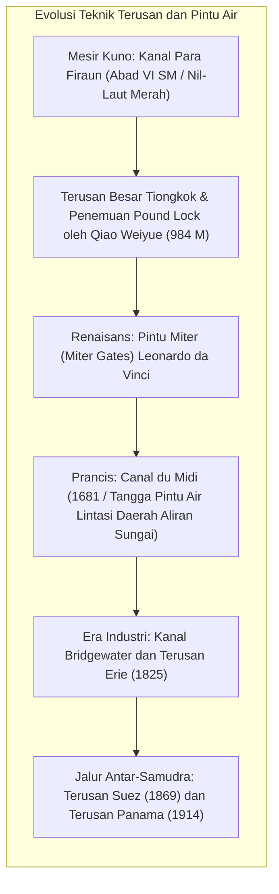
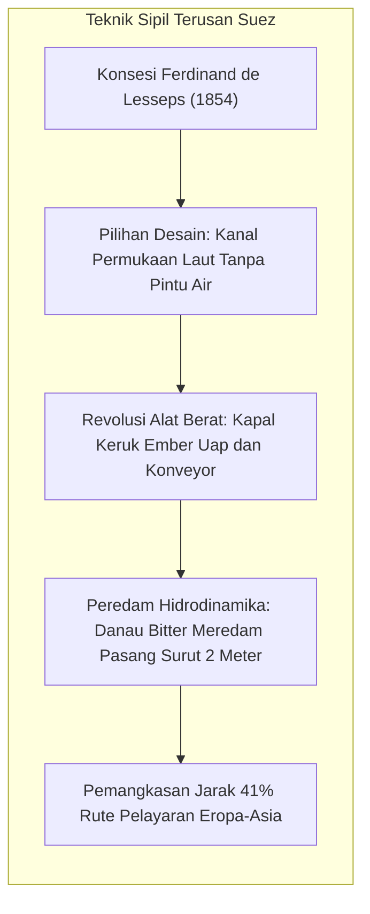
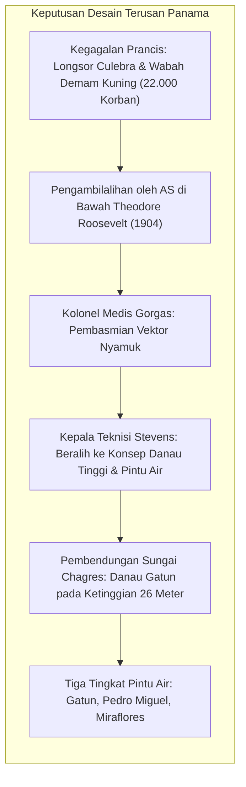

Mencakup lebih dari 70% permukaan bumi, samudra merupakan urat nadi transportasi massal yang paling hemat energi. Namun, lempeng benua menciptakan pembatas daratan yang memaksa kapal-kapal selama berabad-abad mengitari Tanjung Harapan di Afrika dan Tanjung Horn di ujung Amerika Selatan yang terkenal dengan badai ganasnya.

Untuk memangkas jarak ribuan mil laut tersebut, para insinyur menciptakan dua maha karya teknik sipil: <strong>terusan maritim antar-samudra</strong> dan <strong>pintu air navigasi hidrolik (pound lock)</strong>.

Pembukaan <strong>Terusan Suez</strong> (1869) memotong rute pelayaran Eropa-Asia sekitar 9.000 kilometer. <strong>Terusan Panama</strong> (1914) mengangkat kapal-kapal besar setinggi 26 meter di atas permukaan laut menuju Danau Gatun seperti lift air raksasa. Namun di abad ke-21, terusan-terusan ini menjelma menjadi <strong>titik hambatan geopolitik (chokepoints)</strong> yang sangat rentan. Insiden kandasnya kapal Ever Given pada 2021, kekeringan Danau Gatun akibat anomali iklim, dan krisis keamanan di Laut Merah membuktikan kerapuhan sistem logistik global.

---

## 1. Sejarah Rekayasa: Dari Tanjakan Kering ke Pintu Miter

Menavigasi kapal melintasi dataran tinggi tanpa merusak lambung kapal memerlukan penguasaan hukum hidrostatika.

Kanal kuno mengandalkan <strong>jalur luncur miring (slipway)</strong> yang ditarik lembu dan derek kayu, yang sering merusak struktur kapal. Pada tahun 984 M, pejabat Tiongkok <strong>Qiao Weiyue</strong> merancang <strong>pintu air berpintu ganda (pound lock)</strong> pertama di Terusan Besar, memungkinkan kapal naik dan turun secara tenang saat air dialirkan.

Pada akhir abad ke-15, <strong>Leonardo da Vinci</strong> menyempurnakan <strong>pintu miter (miter gate)</strong> di Milan: dua daun pintu bertemu membentuk sudut lancip menghadap hulu. Tekanan air hulu mengunci sambungan pintu dengan rapat kedap air, dan saat ketinggian air seimbang, pintu dapat dibuka dengan tenaga minimal.

---

## 2. Terusan Suez: Penggalian Sejajar Permukaan Laut

Setelah koreksi pengukuran presisi Bourdaloue pada 1847 membantah mitos perbedaan tinggi air 10 meter, <strong>Ferdinand de Lesseps</strong> memimpin penggalian terusan langsung tanpa pintu air melintasi tanah berpasir datar.

Peran <strong>Danau Bitter (Great Bitter Lake)</strong> sangat krusial: danau ini berfungsi sebagai waduk peredam pasang surut setinggi 2 meter dari Laut Merah, mencegah timbulnya arus deras berbahaya di alur sempit terusan. Penggunaan kapal keruk bertenaga uap menandai dimulainya era mekanisasi teknik sipil modern.

---

## 3. Terusan Panama: Menaklukkan Pembagi Benua

Kegagalan Prancis akibat ngotot menerapkan pola permukaan laut di Panama berujung pada kebangkrutan tragis akibat tanah longsor di Culebra Cut dan kematian 22.000 pekerja akibat demam kuning dan malaria.

Pemerintah AS melalui <strong>Kolonel Medis William Gorgas</strong> menumpas nyamuk penular penyakit secara ilmiah. Kepala teknisi <strong>John Stevens</strong> mencetuskan gagasan brilian: "mengangkat kapal ke danau daripada menggali gunung hingga sejajar laut". Korps Zeni Angkatan Darat di bawah <strong>George Goethals</strong> membendung Sungai Chagres untuk menciptakan Danau Gatun dan membangun tiga pasang pintu air berdaya dorong gravitasi yang dipandu lokomotif listrik ("mules").

---

## 4. Hidrodinamika Alur Sempit: Rumus dan Bahaya

Pengisian air di ruang pintu air berlangsung murni secara gravitasi berdasarkan hukum Bernoulli dan Torricelli:

$$T_{	ext{fill}} = rac{2 A_{	ext{lock}} \sqrt{\Delta H_0}}{C_d A_c \sqrt{2g}}$$

Di perairan sempit, kapal raksasa menghadapi gaya hidrodinamika berbahaya:
- <strong>Efek Squat (Penurunan Lambung Dinamis)</strong>: Aliran air yang terakselerasi di bawah lunas kapal menurunkan tekanan hidrostatik, menyebabkan kapal amblas lebih dalam.
- <strong>Efek Dinding (Bank Effect)</strong>: Bantalan air di haluan mendorong haluan ke tengah alur sementara hisapan venturi di buritan menarik buritan membentur tebing, memicu momen oleng tak terkendali seperti kasus *Ever Given*.

---

## 5. Dimensi Kapal dan Geopolitik Maritim

Dimensi pintu air menentukan klasifikasi kapal niaga global: <strong>Panamax</strong>, <strong>Neopanamax</strong> (dengan kolam daur ulang air), dan <strong>Suezmax</strong>.

Tantangan lingkungan meliputi <strong>migrasi Lessepsian</strong> spesies Laut Merah ke Laut Tengah. Sementara di Panama, setiap pelayaran mengalirkan <strong>200 juta liter air tawar</strong> Danau Gatun ke laut, menciptakan krisis operasional saat kemarau panjang. Masa depan titik hambatan dunia bergantung pada simulasi kembaran digital (digital twin) dan sistem sirkulasi air tertutup.