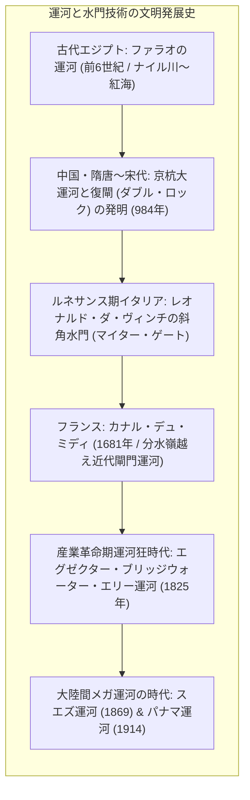
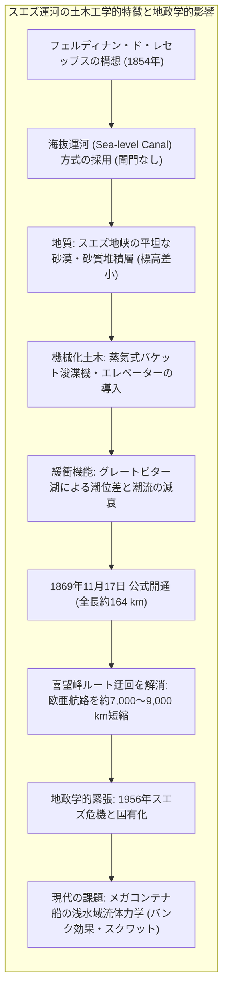
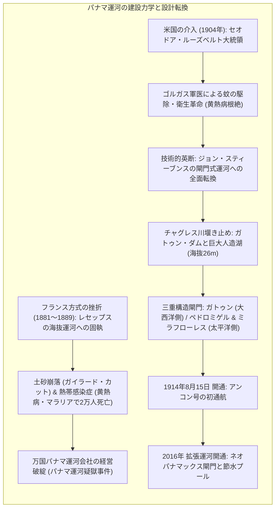
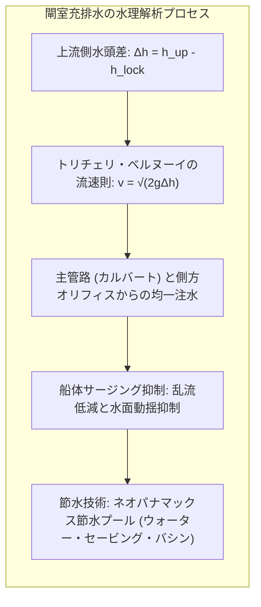
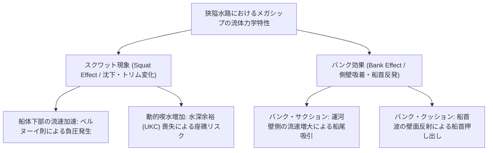
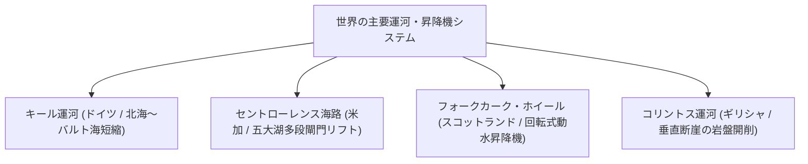

地球表面の約7割を覆う広大な海洋は、有史以来、人類にとって最もエネルギー効率が高く、かつ大量の物資を長距離輸送できる天然の通商ハイウェイであり続けてきました。しかし、地球規模のプレートテクトニクスが形成した大陸配置は、人類の自由な航行に対して冷酷な障壁を突きつけてきました。ユーラシア大陸とアフリカ大陸を連結するわずか160キロメートルほどのスエズ地峡、そして北米大陸と南米大陸を架橋する幅数十キロメートルの細長いパナマ地峡——この二つの細い地峡が、大西洋、太平洋、地中海、インド洋を決定的に分断し、人類に対して南アフリカの嵐狂う喜望峰や、南米最南端の「絶叫する60度」ホーン岬を迂回する数千海里（数万キロメートル）もの危険かつ非効率な遠回りを何世紀にもわたって強いてきたのです。

この自然の軛（くびき）を打ち破り、大海と大海を人為的に短絡するために人類が挑み続けてきた極限の巨大土木プロジェクトこそが<strong>「人工運河（Canal）」</strong>であり、高低差のある内陸地形を船舶が階段を昇り降りするように克服することを可能にした水理工学的発明が<strong>「閘門（こうもん / Lock）」</strong>です。

1869年の<strong>スエズ運河</strong>の開通は、ヨーロッパとアジアの航路を一挙に約8,000〜9,000キロメートル短縮し、大英帝国の植民地支配体制と産業革命期のグローバル通商網を劇的に再編しました。さらに1914年、熱帯雨林の黄熱病・マラリアと未曾有の地滑りの猛威を克服して完成した<strong>パナマ運河</strong>は、海抜26メートルに位置する巨大人造湖ガトゥン湖へと超大型船を水のエレベーターによって持ち上げる閘門システムによって、大西洋と太平洋の海上交通を根本から直結させました。

しかし21世紀の現代において、これらの運河は単なる技術的記念碑にとどまらず、全球的サプライチェーンの死命を制する戦略的隘路、すなわち<strong>「チョークポイント（Chokepoint）」</strong>としての脆さをかつてないほど露呈しています。2021年3月に発生した超大型コンテナ船「エバーギブン（Ever Given）」号のスエズ運河座礁事故は、わずか6日間の水路閉鎖で数千億円規模の貿易停滞と世界的な物流麻痺を引き起こしました。さらに近年のエルニーニョ現象と深刻な地球規模の気候変動に伴う降雨パターンの激変は、パナマ運河の運用水源であるガトゥン湖の水位低下をもたらし、通航隻数と最大喫水の厳しい制限を余儀なくさせています。加えて、紅海からバブ・エル・マンデブ海峡を巡る地政学的武力衝突は、船舶に再び喜望峰ルートへの大規模な回航を余儀なくさせ、近代海運が細い人工水路にいかに深く依存しているかを白日の下に晒しました。

本稿では、古代エジプトの掘削構想から京杭大運河、ルネサンスのダ・ヴィンチによる水門革命、スエズ運河の水平海抜開削とパナマ運河の極限閘門構造、水理流体力学の数理モデル（トリチェリ・ベルヌーイ則、過渡充排水応答、浅水域におけるスクワット現象やバンク効果の流体力学的解明）、船型標準規格（パナマックス、スエズマックス等）の経済構造、そしてチョークポイント地政学の最前線に至るまで、土木工学、流体力学、海運経済学、国際政治学の知見を総動員して徹底的に解剖します。

---

## 1. 運河と閘門の技術文明史：水位差の克服と舟運革命

船舶が内陸の丘陵地帯や異なる水系を越えて安全に物資を輸送するためには、重力流動に支配される水を制御し、船体を損傷することなく昇降させる高度な土木技術が必要でした。

### 1.1 古代の運河開削：ファラオの運河と中国・京杭大運河の土木技術

運河開削の歴史は、古代四大文明の黎明とともに始まりました。紀元前6世紀、アケメネス朝ペルシャのダレイオス1世や古代エジプト第26王朝のファラオ・ネコ2世は、ナイル川東部デルタからワディ・トゥミラットを経て紅海へと抜ける<strong>「ファラオの運河（Canal of the Pharaohs）」</strong>を築造しました。これはナイル川の淡水を利用した内陸舟運路であり、地中海と紅海を直結するものではありませんでしたが、大陸内陸部と外洋を結ぶ輸送インフラの原点となりました。

一方、東アジアにおいて世界最大の運河ネットワークを構築したのが中国歴代王朝でした。隋の煬帝が数百万の民衆を動員して大業6年（610年）頃に完成させた<strong>京杭大運河（けいこうだいうんが）</strong>は、北京から杭州に至る全長約1,800キロメートルを連結し、長江・淮河・黄河・海河という異なる大水系を横断して、江南の豊かな穀物や生糸を北方の政治・軍事拠点へと輸送する帝国存亡の動脈となりました。

しかし、異なる水系を連結する際、地形的高低差が最大の工学的障壁となりました。初期の運河では、高低差のある堤防部分に斜面を築き、そこに泥や水を流して人力や水牛、巨大な巻き揚げ木製ウインチによって船を力任せに滑り引き上げる<strong>「過船堰（スリップウェイ / フラッシュ・ロック）」</strong>が使用されていました。しかし、この方式は船底の破損や浸水が頻発し、貨物の積載重量が厳しく制限されるばかりでなく、大量の運河水を下流へ浪費するという致命的な水理学的欠陥を抱えていました。

この限界を根本から打破したのが、北宋時代の西暦984年、淮安の運河監督官であった<strong>喬維岳（きょういがく）</strong>による世界初の<strong>「復閘（複閘門 / Pound Lock）」</strong>の発明でした。喬維岳は水路の中に約75メートル（250フィート）の間隔を空けて二重の昇降式水門を設置し、その間を石積みの壁で囲んで「閘室（チャンバー）」を形成しました。上流と下流の水門を交互に開閉して水量を調節することにより、船を水平に浮かせたまま静かに水位を昇降させるという、現代のあらゆる閘門の基本原理がここに完成したのです。

### 1.2 近世ヨーロッパの閘門革命：ダ・ヴィンチの斜角水門とミディ運河

ヨーロッパにおける閘門技術の飛躍的発展は、ルネサンス期の北イタリアにおいて開花しました。15世紀末、ミラノ公国に仕えていた万能の天才<strong>レオナルド・ダ・ヴィンチ（Leonardo da Vinci）</strong>は、ミラノ市内の水運ネットワークであるサン・マルコ運河の閘門設計に携わり、歴史的な<strong>「斜角水門（マイター・ゲート / Miter Gate）」</strong>を発明・実用化しました。

従来のギロチン式スライドゲートでは、扉の背面に直接作用する巨大な静水圧のために扉が溝に押し付けられ、開閉に膨大な動力が必要でした。ダ・ヴィンチは、二枚の扉が上流側に向かって鋭角の「V字型（くの字型）」に閉じ合わさる構造を考案しました。上流側の水圧が加われば加わるほど、水圧自身が二枚の扉の接合部を強く押し付け合って完全な止水シールを実現し、下流水位と均等になった瞬間にわずかな力で軽々と開放できるという極めて合理的な力学構造です。このマイター・ゲートは、現在に至るまでパナマ運河をはじめとする世界中の大型閘門で採用される標準設計となっています。

17世紀後半、フランス国王ルイ14世の治世下にピエール＝ポール・リケの執念によって建設された<strong>ミディ運河（Canal du Midi, 1681年完成）</strong>は、大西洋と地中海をピレネー山脈北麓の分水嶺（標高189メートル）を越えて結ぶ全長240キロメートルの近代運河の最高峰でした。リケは、山上の水源から分水嶺の頂上部（ナルーズ分水嶺）へと導水する壮大な給水水路網を構築し、63箇所の閘門（フォンセランヌの8連段式閘門群など）を配備して船を階段状に昇降させました。ミディ運河の成功は、後のイギリス産業革命期の運河網（ブリッジウォーター運河など）や、米国のアパラチア山脈を迂回して五大湖とハドソン川・ニューヨーク港を直結させた<strong>エリー運河（1825年開通）</strong>の誕生へと直結していきました。

---

## 2. スエズ運河：水平掘削（海抜運河）の金字塔とユーラシア海運革命

19世紀半ば、蒸気機関と近代工業の爆発的発展に伴い、大陸間を結ぶ二大運河計画が本格的に始動しました。その先陣を切ったのが、地中海と紅海を結ぶ<strong>スエズ運河（Suez Canal）</strong>でした。

### 2.1 レセップスの執念と海抜運河の構造力学

スエズ地峡を掘削して地中海と紅海を直結する構想は、ナポレオン・ボナパルトのエジプト遠征（1798年）の際にもフランス技師団によって真剣に検討されました。しかし、当時の主任測量技師ジャック＝マリ・ル・ペールが「紅海の潮位は地中海より約10メートル（33フィート）高い」という致命的な計算誤差を犯したため、海抜運河を掘削すれば地中海沿岸諸都市が壊滅的な大洪水に見舞われると誤認され、計画は凍結されました。

この数理的誤謬を正したのが、1847年に結成されたスエズ地峡調査国際委員会（ポール＝アドリアン・ブルダルーらの精密水準測量）でした。調査団は両海の水位差が極めて微小（季節と潮汐により数十センチメートル程度変動するのみ）であることを科学的に証明しました。これに確信を得た元外交官<strong>フェルディナン・ド・レセップス（Ferdinand de Lesseps）</strong>は、エジプト総督ムハンマド・サイード・パシャから独占特許状を獲得し、1858年に「スエズ万国海洋運河会社」を設立しました。

スエズ運河の土木工学上の決定的な特徴は、<strong>閘門を一切持たない「海抜運河（Sea-level Canal）」</strong>である点です。スエズ地峡は標高差が最大でも数十メートル程度と小さく、大部分が砂質および石灰質粘土の堆積層であったため、地中海側のポートサイドから紅海側のスエズ（ポート・テウフィク）に至る全長約164キロメートル（開通当時）を、海面下まで一直線にオープンカット（開削掘削）する手法が採用されました。

この海抜構造において極めて重要な物理的水理機能を果たしたのが、水路の中間部に位置する<strong>グレートビター湖（Great Bitter Lake）</strong>およびリトルビター湖でした。地中海側の潮位差は約0.5メートル程度と微小ですが、紅海側（スエズ湾）の潮位差は最大約2メートルに達します。もし一本の細長い水路で直結されていれば、水頭差によって最大流速が秒速数メートルに達する激しい潮流が発生し、帆船や初期蒸気船の操舵は不能に陥ったはずでした。しかし、表面積約250平方キロメートルに及ぶグレートビター湖が巨大な「潮汐緩衝池（Tidal Buffer Basin）」として機能することで、紅海側から押し寄せる潮流エネルギーを広大な湖面で拡散・減衰させ、航行の安全性を確保することに成功したのです。

### 2.2 蒸気動力浚渫機と近代建設機械の夜明け

1859年4月に開始された掘削工事は、当初、数万人規模のエジプト人農民による強制労働（コルヴェ / 賦役）に依存していました。つるはし、シャベル、藁籠を用いた人力掘削は極めて効率が悪く、コレラなどの悪性伝染病の蔓延や劣悪な衛生環境によって数千人から数万人の労働者が命を落としました。

1863年、国際的な人道批判とイギリスの外交的圧力により新総督イスマーイール・パシャが強制労働を廃止すると、運河建設は労働力不足により存亡の危機に直面しました。レセップスとフランスの技術者集団は、この危機を脱するために<strong>近代的な蒸気動力建設機械の全面的導入</strong>を決断しました。

技術者ポール・ボレルやアレクサンドル・ラヴァレによって開発された<strong>蒸気式バケット浚渫機（Steam Bucket Dredgers）</strong>や、土砂を運河堤防の外側数十メートル先まで自動排出する<strong>長樋（ロングシュート）付きエレベーター船</strong>が数百台投入されました。これにより、月間の土砂掘削量は数十万立方メートルから一挙に数百万立方メートルへと跳ね上がりました。スエズ運河の建設現場は、人類史において「人力土木」から「機械化土木工学」へと完全に転換した記念碑的現場となったのです。

1869年11月17日、フランス皇后ウジェニーを乗せた皇室ヨット「レーグル号」を先頭に、各国の艦船がポートサイドからスエズ運河へと進入し、盛大な開通式典が挙行されました。

### 2.3 世界経済への衝撃とスエズ危機の地政学

スエズ運河の開通は、ユーラシア・アフリカの地政学と世界経済の空間構造を劇的に塗り替えました：
- <strong>航路の劇的短縮</strong>: ロンドンからインド・ムンバイ（ボンベイ）までの航海距離は、喜望峰回りの約19,800キロメートルから約11,600キロメートルへと<strong>約41%（約8,200 km）短縮</strong>されました。航海日数は数カ月から数週間へと激減し、石炭補給地（コアラリング・ステーション）の配置を激変させ、蒸気船の世界的普及を決定づけました。
- <strong>大英帝国の覇権と国有化</strong>: インドを「王冠の宝石」としていた大英帝国は、当初運河建設に強く反対していましたが、開通後はその死活的重要性を認識。1875年、首相ディズレーリは財政破綻に瀕したエジプト総督から運河株の約44%を電撃的に買収し、運河の実質的支配権を掌握しました。1882年にはエジプトを事実上の保護領とし、スエズ運河は「帝国の生命線（Imperial Lifeline）」と位置付けられました。
- <strong>1956年スエズ危機（第2次中東戦争）</strong>: エジプト大統領ナセルによる運河国有化宣言（1956年7月26日）を契機に、イギリス、フランス、イスラエルが軍事侵攻を行いました。しかし米ソ両国の強い圧力によって英仏は撤退を余儀なくされ、大英帝国のグローバル覇権の終焉（パクス・ブリタニカの退場）を象徴する歴史的転換点となりました。
- <strong>2015年新スエズ運河の開通</strong>: 複線航行区間を約72キロメートル拡張し、通航待ち時間を大幅に削減する国家メガプロジェクトが完了しました。

---

## 3. パナマ運河：分水嶺を越える閘門式運河の極限土木工学

スエズ運河の栄光に酔いしれたフェルディナン・ド・レセップスが次に狙いを定めたのが、アメリカ大陸を南北に分断するパナマ地峡でした。しかし、そこにはスエズの砂漠地候とは全く異質な、熱帯雨林の極限環境と険峻な山脈が待ち構えていました。

### 3.1 フランス方式の悲劇的挫折：海抜運河の罠

1881年、レセップス率いる「万国パナマ運河会社」はパナマ地峡での掘削工事を開始しました。レセップスはスエズの成功体験に囚われ、<strong>「閘門を用いない海抜運河」</strong>に狂信的に固執しました。しかし、パナマ地峡の地理的・地質的条件はスエズとは根本的に異なっていました：
1. <strong>地峡中央の険峻な山岳地帯</strong>: 大陸分水嶺を貫く<strong>クレブラ（ガイラード）・カット</strong>では、最大海抜100メートルを超える山を海面下まで垂直に掘り下げなければなりませんでした。パナマの地層は熱帯の豪雨によって極めて不安定化しやすい粘土・頁岩層であり、掘削したそばから地滑り（ランドスライド）が発生して作業現場を呑み込みました。
2. <strong>チャグレス川の激しい鉄砲水</strong>: 雨季になるとチャグレス川の水位は一晩で十数メートルも跳ね上がり、掘削現場を巨大な濁流で水没させました。
3. <strong>熱帯感染症の地獄</strong>: 最も致命的だったのは、熱帯雨林に蔓延する<strong>黄熱病（Yellow Fever）</strong>と<strong>マラリア（Malaria）</strong>でした。当時はまだ病原体が蚊によって媒介されることが知られておらず、現場の医師や技師たちは次々と罹患し、フランス工事期間中だけで<strong>2万人以上</strong>の労働者が病死しました。

1889年、莫大な資金を底をつかせた運河会社は破産。フランス国内で多くの小口投資家が財産を失い、政界の贈収賄を巻き込む「パナマ運河疑獄事件」へと発展し、フランスによるパナマ開削事業は惨憺たる壊滅的結末を迎えました。

### 3.2 アメリカの介入と衛生革命：ゴルガス軍医の戦い

1904年、米西戦争を経て大西洋と太平洋の両洋艦隊の迅速な機動（マハン海軍戦略）を渇望していたアメリカ合衆国・セオドア・ルーズベルト大統領は、コロンビアからパナマの独立を後押しして運河地帯（Canal Zone）の永久租借権を獲得し、事業を継承しました。

工事再開に先立ち、最大の功績を挙げたのが米軍軍医監<strong>ウィリアム・クロフォード・ゴルガス（William C. Gorgas）</strong>でした。ゴルガスはキューバでウォルター・リードらが解明した「黄熱病はネッタイシマカ（*Aedes aegypti*）が、マラリアはハマダラカ（*Anopheles*）が媒介する」という最新の疫学知見をパナマ全土で徹底適用しました：
- すべての宿舎に細網の網戸（スクリーン）を設置。
- 蚊の幼虫（ボウフラ）が繁殖するあらゆる水たまり、雨水樽、側溝に灯油や殺虫油を散布。
- 周辺の密林や草むらを徹底的に刈り払い、排水路を敷設。

この大規模な公衆衛生作戦により、わずか2年でパナマ運河地帯から黄熱病が完全に根絶され、マラリアの感染率も激減しました。人間の生命が維持できる環境を整えたことこそが、工学的奇跡を可能にした絶対的前衛条件だったのです。

### 3.3 スティーブンスとゲーソルズの決断：閘門式運河とガトゥン湖

工学面での決定打となったのは、鉄道建設の巨匠であった主任技師<strong>ジョン・スティーブンス（John F. Stevens）</strong>による設計の根本的転換でした。スティーブンスは現場の山崩れとチャグレス川の暴威を視察し、「山を海面まで掘り下げるのではなく、<strong>山の上に巨大な人造湖を造り、船を水のエレベーター（閘門）で持ち上げて山を越えさせるべきだ</strong>」とルーズベルト大統領に進言しました。

この設計構想を引き継いだ陸軍工兵隊の<strong>ジョージ・ワシントン・ゲーソルズ（George W. Goethals）</strong>中佐の指揮のもと、人類史上最大の閘門式運河が具現化しました：
1. <strong>ガトゥン・ダムの建設</strong>: チャグレス川の河口近くに当時世界最大の土質アースダム（ガトゥン・ダム）を築き、チャグレス川の洪水を完全にせき止めて、面積約425平方キロメートルにおよぶ巨大人造湖<strong>「ガトゥン湖（Gatun Lake）」</strong>を創出しました（湖面の標高は海抜26メートル）。
2. <strong>三重構造の閘門システム</strong>:
   - <strong>大西洋側（ガトゥン閘門）</strong>: 連続する3段の閘室によって、船を一気に海抜0メートルから海抜26メートルのガトゥン湖へと持ち上げる。
   - <strong>太平洋側（ペドロミゲル閘門・ミラフローレス閘門）</strong>: ガトゥン湖からクレブラ・カットを通過した船を、ペドロミゲル閘門（1段）で標高16.5メートルのミラフローレス湖へ下降させ、さらにミラフローレス閘門（2段）で太平洋の海面へと下降させる。
3. <strong>電気機関車（ミュール / Mules）牽引方式</strong>: 狭小な閘室内で船舶自体のスクリューを回転させると強力な水流が発生して閘壁に激突する危険があるため、閘門の両側に敷設されたラック式レール上を走る専用の電気機関車（ミュール）から鋼製ワイヤーを張り、船首・船尾を正確に中央に保持しながら低速牽引するシステムを採用しました。

1914年8月15日、アメリカの貨客船「アンコン（SS Ancon）号」がパナマ運河を初通航し、公式開通を果たしました。ニューヨークとサンフランシスコ間の航路は、マゼラン海峡回り・ホーン岬回りの約21,000キロメートルから約8,400キロメートルへと<strong>約60%（約12,600 km）短縮</strong>され、世界の東西通商に計り知れない地殻変動をもたらしました。

---

## 4. 閘門（ロック）の水理工学と流体力学の数理モデル

閘門システムの核心は、外部からのポンプ動力を原則として一切使用せず、<strong>「重力ポテンシャルエネルギーのみを利用して巨大船舶を浮上・降下させる」</strong>という優美な水理物理学にあります。

### 4.1 ベルヌーイの定理とトリチェリの流出則

閘室（幅 $W$、長さ $L$）に上流の貯水池（水位 $H_1$）から重力で水を注入する際の水理現象をモデル化します。

管路（カルバート）の断面積を $A_c$、流量係数を $C_d$ と置くと、瞬間的な流速 $v(t)$ はトリチェリの定理およびベルヌーイの定理より導かれます：

$$v(t) = \sqrt{2g \Delta h(t)}$$

ここで $\Delta h(t) = H_1 - h(t)$ は上流側と閘室内の瞬間的水位差、$g$ は重力加速度（$9.81 \, \text{m/s}^2$）です。

カルバートを通過する瞬間体積流量 $Q(t)$ は以下のように表されます：

$$Q(t) = C_d A_c \sqrt{2g (H_1 - h(t))}$$

閘室内の水位上昇速度は、連続の式より $\frac{dh}{dt} = \frac{Q(t)}{A_{\text{lock}}}$（ただし $A_{\text{lock}} = W \times L$ は閘室の水平断面積）であるため、以下の微分方程式が成立します：

$$A_{\text{lock}} \frac{dh}{dt} = C_d A_c \sqrt{2g (H_1 - h(t))}$$

初期条件 $t = 0$ において $h(0) = H_0$（初期水位差 $\Delta H_0 = H_1 - H_0$）としてこれを解くと、水位差がゼロ（充水完了）になるまでの所要時間 $T_{\text{fill}}$ は厳密に求まります：

$$T_{\text{fill}} = \frac{2 A_{\text{lock}} \sqrt{\Delta H_0}}{C_d A_c \sqrt{2g}}$$

この数理モデルが示す決定的な事実は、<strong>「水位差が縮小するにつれて充水速度は非線形に急激に減衰する」</strong>ということです。したがって、通航時間を最短化するためには、カルバートの断面積 $A_c$ を極力大きく設計するとともに、バルブの開度プロファイルを精密に制御して初期の過大水圧（水撃作用 / ウォーターハンマー）を回避しなければなりません。

### 4.2 浅水域における流体力学的影響：バンク効果とスクワット現象

運河のような閉鎖・狭隘水路を大型船が通航する際、自由海面（外洋）では無視できる極めて強力な流体力学的相互作用が発生します。

#### ① スクワット現象（Squat Effect）
船体が浅い水路を進むとき、船底と水底の間の断面積が狭まるため、排除された水が船底の下を後方へ高速で通り抜けます。ベルヌーイの定理（流速が増加すると静圧が低下する）により、船底直下に強力な負圧（吸引圧）が発生します。
その結果、船体全体が静止時よりも深く水中に沈み込み（沈下）、同時に船首または船尾のトリムが変化します。この動的沈下量を「スクワット」と呼びます。水深余裕（Under Keel Clearance, UKC）が極めて小さい運河内では、船速をわずか数ノット上げるだけでスクワット量が増大し、船底が運河底に接触・座礁する危険性が跳ね上がります。

スクワット量 $h_s$ の簡易推定式（Barrassの式）は以下のように表されます：

$$h_s = C_s \frac{C_b V^2}{100} \cdot \frac{S_b}{1 - S_b}$$

ここで $C_b$ は船の方形肥痩係数（Block Coefficient）、$V$ は船速（ノット）、$S_b$ は閉塞率（Blockage Factor: 船体水中中央横断面積 / 運河横断面積）、$C_s$ は水路形状係数です。閉塞率 $S_b$ が高くなるほど、スクワット量は爆発的に増大します。

#### ② バンク効果（Bank Effect）
船が運河の中央から片側の側壁（バンク）に近づいたときに発生する非対称な圧力場です：
- <strong>バンク・クッション（Bank Cushion）</strong>: 船首前方で押し出された水が狭い側壁との間でせき止められ、高い動圧が発生して船首を側壁から遠ざける方向（運河中央側）へと力強く押し出す。
- <strong>バンク・サクション（Bank Suction）</strong>: 船体中央から船尾にかけての狭い間隙を水が高速で後方へ流れるため、局所的な負圧が生じ、船尾を側壁へと強力に吸い寄せる。

この二つの力が連動すると、船首が急激に回頭して対岸へ突っ込む予測困難なヨーイングモーメントが発生します。2021年にスエズ運河で発生した超大型コンテナ船「エバーギブン」号の座礁事故の主因の一つも、強風下での過剰な船速によるスクワットと猛烈なバンク効果の連鎖反応であったと分析されています。

---

## 5. 世界の重要運河・閘門システム各論

運河工学はスエズやパナマにとどまらず、地球上の主要な水系において独自の進化を遂げてきました。

### 5.1 キール運河（Kiel Canal, ドイツ）
ユトランド半島（デンマーク）の根元を横断し、北海とバルト海を結ぶ全長98キロメートルの運河。1895年、ドイツ皇帝ヴィルヘルム2世の命により建設されました。スカゲラク海峡を回る危険な航路を約460キロメートル短縮します。北海とバルト海には顕著な潮位差があるため、両端に閘門（ブルンスビュッテルおよびキール＝ホルテナウ）が設置されています。年間数万隻が通航する「世界で最も交通量の多い人工水路」の一つです。

### 5.2 セントローレンス海路（St. Lawrence Seaway, 米国・カナダ）
大西洋からモントリオールを経て五大湖（オンタリオ湖、エリー湖、ヒューロン湖、ミシガン湖、スペリオル湖）へと至る全長約3,700キロメートルの壮大な内陸水路網。五大湖の最上流（スペリオル湖）は海抜約183メートルに位置するため、セントローレンス川沿いの7箇所の閘門と、ナイアガラの滝の水位差（約100メートル）を迂回するウェランド運河（8箇所の閘門）によって、外洋大型貨物船（シーウェイマックス）を段階的に持ち上げます。

### 5.3 フォークカーク・ホイール（Falkirk Wheel, スコットランド）
近代土木機械工学の最高峰として知られる回転式舟昇降機。高低差24メートルのフォース・アンド・クライド運河とユニオン運河を接続するために2002年に完成しました。アルキメデスの原理（浮体の重量は排除した水の重量に等しい）を利用し、船の積載重量にかかわらず両端のゴンドラの総重量が常に完全に等しくなるよう設計されています。そのため、重量数百トンのゴンドラを180度回転させて船を昇降させるのに必要なエネルギーは、わずか1.5 kWh（家庭用ケトル数回分の電気量）という驚異的なエネルギー効率を達成しています。

---

## 6. 海上交通のチョークポイント地政学と船型規格

運河の物理的寸法（幅、水深、閘室長、橋梁下空頭高）は、世界中の造船工学と海運経済を規定する厳格な「制約条件（コンストレイント）」として君臨してきました。

### 6.1 船型標準規格（Standard Vessel Classes）の経済学

海運界では、運河の寸法に合わせて船型が国際標準化されてきました：

| 船型規格 | 最大全長 (LOA) | 最大全幅 (Beam) | 最大喫水 (Draft) | 最大積載量目安 | 主な制約要因 |
| :--- | :--- | :--- | :--- | :--- | :--- |
| <strong>パナマックス (Panamax)</strong> | 294.1 m | 32.31 m | 12.04 m | 4,500〜5,000 TEU | 旧パナマ閘門寸法（幅33.5m） |
| <strong>ネオパナマックス (Neopanamax)</strong> | 366 m | 51.25 m | 15.2 m | 12,000〜15,000 TEU | 2016年新パナマ閘門寸法 |
| <strong>スエズマックス (Suezmax)</strong> | 制限なし (約400m) | 77.5 m | 20.1 m | 150,000〜200,000 DWT | スエズ水深・通航断面積（湿周） |
| <strong>ケープサイズ (Capesize)</strong> | 運河通航不可 | 運河通航不可 | > 20 m | 150,000〜400,000 DWT | 喜望峰・ホーン岬回航専用 |
| <strong>メガコンテナ船 (ULCV)</strong> | 400 m | 61.5 m | 16.5 m | 20,000〜24,000+ TEU | スエズ通航可能・パナマ通航不可 |

パナマ運河が2016年に第3閘門を開通させて「ネオパナマックス」へ対応したことは、北米東海岸港湾の浚渫投資や造船業界の設計思想に世界規模の波及効果をもたらしました。

---

## 7. 環境・生態系への影響と気候変動の脅威

運河の開削は、何百万年もの間孤立していた異なる生態系を人為的に連結し、不可逆的な環境変化をもたらしました。

### 7.1 レセップス移動（Lessepsian Migration）
スエズ運河の開通により、紅海から地中海へと海洋生物の大規模な移入が発生しました。紅海は地中海よりも水温が高く栄養塩が少ない過酷な環境であるため、紅海の種（毒魚アイゴ、ミノカサゴ、クラゲ類）は地中海において強力な侵略的外来種となり、在来の生態系や沿岸漁業を根底から変貌させました。この現象は提唱者のレセップスにちなんで<strong>「レセップス移動」</strong>と呼ばれています。

### 7.2 気候変動とパナマ運河の淡水危機
パナマ運河の最大のアキレス腱は、閘門の作動に<strong>膨大な淡水（ガトゥン湖の水）を消費する</strong>点です。船が1隻通航するごとに、約2億リットル（5,200万ガロン）の淡水が閘門から海洋へと排出されます。
2023年から2024年にかけて発生したエルニーニョ現象と記録的干ばつにより、ガトゥン湖の水位が危険水準まで低下。パナマ運河庁（ACP）は1日の通航隻数を従来の36〜38隻から一時24隻以下に制限し、最大喫水も引き下げました。数十隻の大型船が運河沖で何週間も滞船する事態となり、運河の機能が気候システムの安定性に完全に依存しているという冷厳な事実が浮き彫りになりました。

---

## 8. 結論：地球的チョークポイントの未来と持続可能な海洋交通

スエズとパナマという二大運河の歴史を振り返るとき、そこに見出されるのは自然の障壁に挑み続けた人類の不屈の土木的意志です。

しかし、21世紀の地政学的危機（紅海での商船攻撃に伴う喜望峰回航へのシフト）や地球規模の気候変動は、私たちが依存するチョークポイントがいかに脆弱であるかを証明しています。

今や運河の管理には、単なる浚渫や閘門保守を超えて、<strong>水資源の高度再循環（節水プールの更なる高度化）</strong>、<strong>AIとリアルタイム流体力学シミュレーションを活用した通航支援</strong>、そして<strong>北極海航路（NSR）の台頭を見据えた全球輸送ポートフォリオの再編</strong>が求められています。海と海を繋ぐインフラは、これからも国際社会の繁栄と平和を決定づける最重要の舞台であり続けるのです。

---

## 参考文献・推薦図書

1. デビッド・マカルー 『海と海の間に：パナマ運河建設史』 (Simon & Schuster, 1977)
2. ザカリー・カラベル 『砂漠の分割：スエズ運河建設のドラマ』 (Knopf, 2003)
3. パナマ運河庁 (ACP) 『パナマ運河拡張計画公式報告書』 (2016)
4. 国際海事機関 (IMO) 『浅水域および制限水路における操船ガイドライン』
5. 日本造船学会 『船舶流体力学と操縦運動論』 (海文堂出版)
6. 水理学会編 『新編水理学ハンドブック』 (丸善出版)
7. ピーター・フランコパン 『シルクロードと海洋航路の世界史』 (2018)