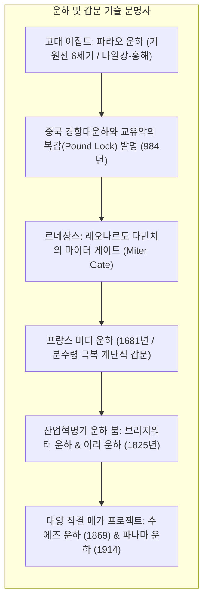
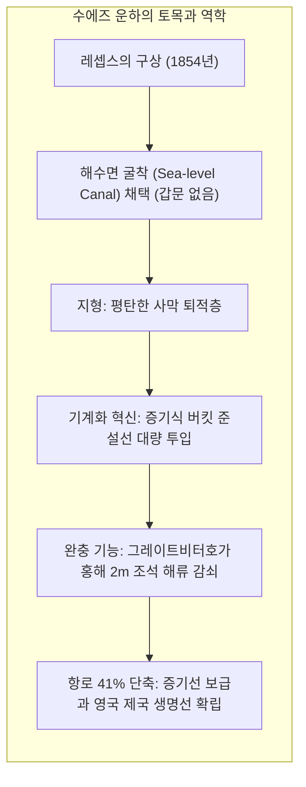
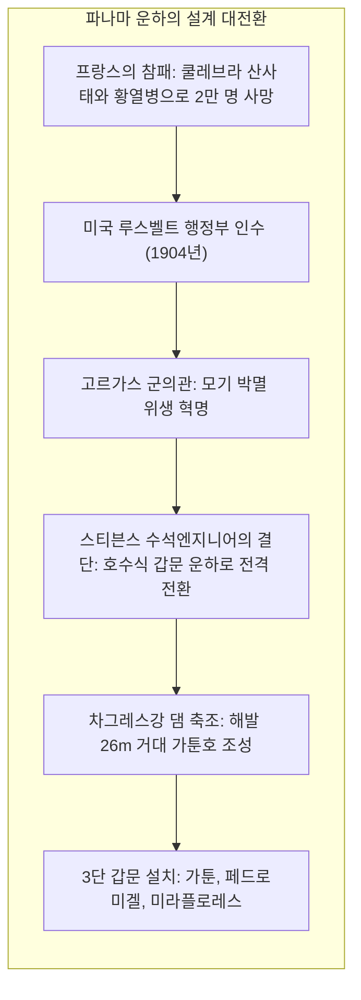
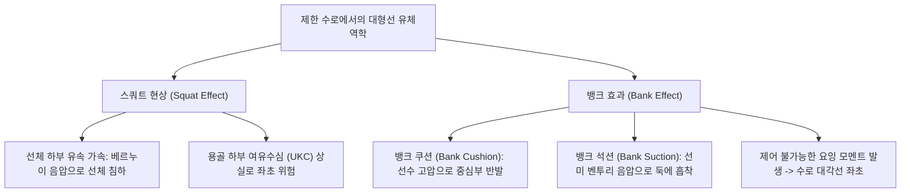

지구 표면의 70% 이상을 덮고 있는 바다는 인류 역사상 가장 에너지 효율적이고 저렴한 대량 운송로였습니다. 그러나 판구조론이 형성한 대륙의 지형적 배치는 해상 항로에 가혹한 장벽을 세웠습니다. 유라시아와 아프리카를 잇는 수에즈 지협, 북미와 남미를 잇는 파나마 지협은 수세기 동안 상선과 군함에게 아프리카 희망봉과 남미 최남단 혼곶의 폭풍우 치는 바다를 수천 해리씩 우회하도록 강요했습니다.

이 자연의 장벽을 허물고 대양과 대양을 잇기 위해 인류가 도전한 거대 토목 프로젝트가 바로 <strong>인공 운하(Canal)</strong>이며, 고저차가 있는 내륙 지형을 배가 계단을 오르내리듯 통과할 수 있게 만든 수리 시스템이 <strong>갑문(Lock)</strong>입니다.

1869년 <strong>수에즈 운하</strong>의 개통은 유럽과 아시아 간 항로를 약 8,000~9,000km 단축시켰고, 1914년 완공된 <strong>파나마 운하</strong>는 해발 26미터의 거대 인공호수 가툰호로 선박을 엘리베이터처럼 들어 올려 대서양과 태평양을 직결시켰습니다. 그러나 21세기 오늘날, 이 운하들은 세계 공급망의 가장 취약한 <strong>"초크포인트(Chokepoint / 전략적 해상 요충지)"</strong>로 부각되었습니다. 2021년 에버기븐호의 수에즈 운하 좌초, 기후변화에 따른 가툰호 가뭄과 파나마 운하 통항 제한, 홍해 무력 충돌은 현대 문명이 좁은 인공 수로에 얼마나 위태롭게 의존하고 있는지를 보여줍니다.

본 논고에서는 두 운하의 건설 역사, 갑문 충배수의 수리역학 방정식, 제한 수로에서의 스쿼트 현상과 뱅크 효과, 선형 경제학 및 해상 지정학을 총체적으로 규명합니다.

---

## 1. 운하·갑문 기술 발전사: 수위차 극복의 공학 혁신

선박이 내륙 구릉지대를 안전하게 통과하기 위해서는 중력 수류를 통제하는 토목 기술이 필수적이었습니다.

초기 운하에서는 경사면에 물을 흘려보내며 배를 억지로 끌어올리는 <strong>과선언(Slipway)</strong>을 사용했으나, 선체 파손과 극심한 물 낭비라는 결함이 있었습니다. 984년 북송의 관리 <strong>교유악(喬維岳)</strong>은 회안 운하에 두 개의 수문을 둔 세계 최초의 <strong>복갑(Pound Lock)</strong>을 창안하여 현대 갑문의 원형을 확립했습니다.

15세기 말 <strong>레오나르도 다빈치</strong>는 상류 쪽을 향해 V자 형태로 닫히는 <strong>마이터 게이트(Miter Gate)</strong>를 발명했습니다. 상류 수압이 가해질수록 문이 더욱 단단히 밀착되어 완벽한 지수를 이루고 수위가 같아지면 적은 힘으로 열리는 이 구조는 지금까지도 전 세계 대형 갑문의 표준으로 쓰이고 있습니다.

---

## 2. 수에즈 운하: 갑문 없는 해수면 수평 굴착

나폴레옹 원정 당시 르페르 기사의 "홍해가 지중해보다 10m 높다"는 측량 오류로 좌초되었던 계획은 1847년 부르달루의 정밀 측량으로 오차가 바로잡혔습니다. <strong>페르디낭 드 레셉스</strong>는 갑문이 전혀 없는 <strong>해수면 운하(Sea-level Canal)</strong> 방식을 채택했습니다.

전장 164km의 수로 중간에 위치한 <strong>그레이트비터호(Great Bitter Lake)</strong>는 홍해의 2m에 달하는 조석 에너지와 급류를 흡수·감쇠시키는 거대한 수리 완충지 역할을 수행했습니다. 강제 노역 폐지 후 도입된 근대식 증기 버킷 준설선은 토목공학의 기계화 혁명을 이끌었습니다.

---

## 3. 파나마 운하: 분수령을 넘는 인공호수 갑문 공학

레셉스는 파나마에서도 무모하게 해수면 방식을 고집하다 쿨레브라 산사태와 황열병·말라리아로 2만여 명의 노동자를 잃고 파산했습니다.

미국 인수 후 <strong>고르가스 군의관</strong>의 과학적 모기 박멸 작전으로 황열병을 완전 퇴치했습니다. 수석엔지니어 <strong>존 스티븐스</strong>는 "산을 바다까지 파내는 대신 산 위에 거대한 호수를 만들고 배를 엘리베이터로 들어 올린다"는 혁신적 설계를 채택했습니다. 육군 공병대 <strong>조지 괴탈스</strong>는 차그레스강을 막아 당시 세계 최대의 가툰 댐과 가툰호를 완공하고 3단 갑문 시스템을 성공시켰습니다.

---

## 4. 갑문 충배수 방정식과 제한 수로 유체역학

갑문은 외부 펌프 동력 없이 <strong>중력 위치에너지만으로 충배수</strong>가 이뤄집니다. 베르누이와 토리첼리 법칙에서 유도된 갑실 충수 시간 공식은 다음과 같습니다:

$$T_{	ext{fill}} = rac{2 A_{	ext{lock}} \sqrt{\Delta H_0}}{C_d A_c \sqrt{2g}}$$

수로 폭이 좁은 운하에서 거대 선박이 항행할 때 발생하는 유체역학적 위험은 다음과 같습니다:

바라스(Barrass) 공식에 따르면 선박 침하량은 속도의 제곱에 비례하며, 선체가 수로 벽에 접근할 때 발생하는 뱅크 효과는 에버기븐호 좌초의 핵심 물리적 원인이었습니다.

---

## 5. 선형 표준 규격과 초크포인트 지정학

운하의 치수는 글로벌 조선 공학과 해운 경제의 절대적 표준 규격을 결정했습니다:
- <strong>파나맥스(Panamax)</strong>: 폭 32.31m (기존 파나마 갑문 폭 한계, 약 5,000 TEU).
- <strong>네오파나맥스(Neopanamax)</strong>: 폭 51.25m, 2016년 확장 갑문 완공으로 14,000 TEU급 수용.
- <strong>수에즈맥스(Suezmax)</strong>: 수에즈 운하 수심 한계에 맞춘 원유 운반선.

수에즈 운하를 통한 홍해 해양 생물의 지중해 유입(<strong>레셉스 이동</strong>)과 같은 생태적 문제, 그리고 1회 통항 시 <strong>2억 리터의 가툰호 담수가 소모</strong>되는 파나마 운하의 기후 가뭄 위기는 글로벌 해운의 지속 가능성에 중대한 과제를 던지고 있습니다.