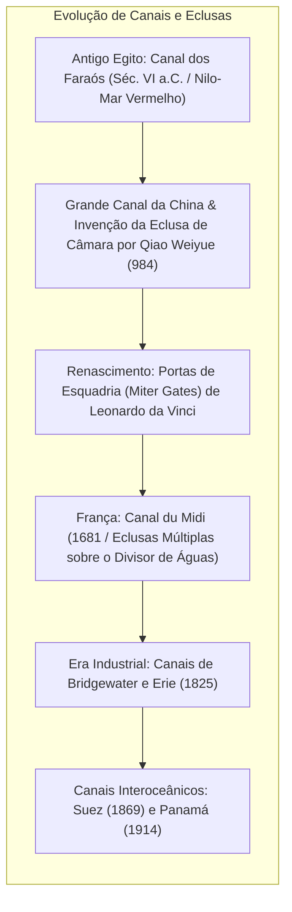
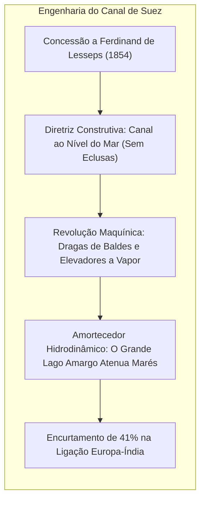
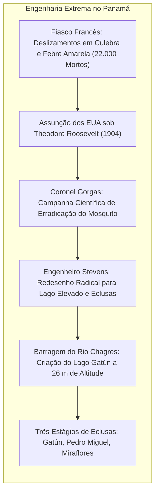

Os oceanos cobrem mais de 70% da superfície terrestre e representam o canal de transporte mais eficiente do planeta. No entanto, a configuração das placas tectônicas impôs entraves continentais severos: o istmo de Suez e o istmo do Panamá forçaram durante séculos frotas mundiais a contornar o Cabo da Boa Esperança e os temíveis mares do Cabo Horn.

Para eliminar esses desvios de milhares de milhas, a engenharia realizou dois prodígios sem precedentes: a abertura dos <strong>canais marítimos interoceânicos</strong> e o aperfeiçoamento das <strong>eclusas de navegação hidráulica</strong>.

A inauguração do <strong>Canal de Suez</strong> (1869) encurtou a rota Europa-Ásia em cerca de 9.000 quilômetros. O <strong>Canal do Panamá</strong> (1914) passou a elevar embarcações a 26 metros de altitude até as águas do lago Gatún por meio de um engenhoso elevador hidráulico. Contudo, no século XXI, essas vias marítimas revelam sua extrema fragilidade como <strong>gargalos estratégicos (chokepoints)</strong>. O bloqueio do Ever Given em 2021, a estiagem histórica no lago Gatún e a crise militar no Mar Vermelho demonstram a vulnerabilidade do comércio global.

---

## 1. Evolução Técnica: Dos Planos Inclinados às Portas de Esquadria

Transpor desníveis topográficos sem deformar os cascos das embarcações exigiu dominar as leis da hidrostática.

Os canais primitivos utilizavam <strong>planos inclinados (slipways)</strong>, que provocavam sérias avarias estruturais nos navios. Em 984 d.C., o engenheiro chinês <strong>Qiao Weiyue</strong> concebeu no Grande Canal a <strong>eclusa de câmara (Pound Lock)</strong> com duas comportas reguláveis, criando a matriz da engenharia hidráulica moderna.

Por volta de 1497, <strong>Leonardo da Vinci</strong> projetou para o canal San Marco em Milão as <strong>portas de esquadria (Miter Gates)</strong>: duas folhas que se unem em cunha apontada contra a correnteza. A própria pressão hidrostática veda a junta; quando os níveis se equalizam, as portas se abrem com mínimo esforço.

---

## 2. O Canal de Suez: Trincheira ao Nível do Mar

Após a correção dos erros de cálculo napoleônicos que alegavam um desnível de 10 metros entre mares, <strong>Ferdinand de Lesseps</strong> executou uma trincheira direta sem eclusas.

O <strong>Grande Lago Amargo</strong> desempenhou um papel hidrodinâmico vital: ao acomodar a variação de maré de 2 metros do Mar Vermelho, funcionou como um imenso reservatório dissipador de energia, evitando correntes destrutivas no leito estreito. O emprego pioneiro de dragas a vapor consolidou a mecanização da engenharia civil.

---

## 3. O Canal do Panamá: Conquistando a Linha Divisória de Águas

A insistência francesa em escavar um canal ao nível do mar levou à falência perante os constantes deslizamentos no corte Culebra e a morte de mais de 22.000 operários por febre amarela e malária.

Sob administração norte-americana, o médico militar <strong>William Gorgas</strong> saneou o istmo erradicando os mosquitos transmissores. O engenheiro <strong>John Stevens</strong> alterou radicalmente o projeto: "elevar os navios até o lago em vez de rebaixar a montanha até o oceano". O coronel <strong>George Goethals</strong> ergueu a monumental represa de Gatún e o sistema de três níveis de eclusas manobradas por locomotivas elétricas de tração ("mulas").

---

## 4. Hidrodinâmica em Canais Restritos: Fórmulas e Fenômenos

O enchimento gravitacional de uma câmara de eclusa obedece às formulações de Bernoulli e Torricelli:

$$T_{	ext{fill}} = rac{2 A_{	ext{lock}} \sqrt{\Delta H_0}}{C_d A_c \sqrt{2g}}$$

Em canais estreitos, navios porta-contêineres de grande porte sofrem forças hidrodinâmicas extremas:
- <strong>Efeito Squat (Rebaixamento dinâmico)</strong>: O aumento da velocidade da água sob o casco gera uma depressão bernoulliana, fazendo o navio afundar e alterar seu compasso.
- <strong>Efeito de Margem (Bank Effect)</strong>: O colchão de proa empurra a proa para o centro do canal enquanto a sucção de popa atrai a popa violentamente contra a margem, gerando momentos incontroláveis de guinada — o mecanismo central que encalhou o *Ever Given*.

---

## 5. Padrões Navais e Gargalos Estratégicos

As dimensões das eclusas ditaram as classes mundiais de navios: <strong>Panamax</strong>, <strong>Neopanamax</strong> (com tanques de economia de água inaugurados em 2016) e <strong>Suezmax</strong>.

Do ponto de vista ecológico, Suez propiciou a <strong>migração lessepsiana</strong> de centenas de espécies invasoras para o Mediterrâneo. No Panamá, cada travessia descarta <strong>200 milhões de litros de água doce</strong> no oceano, gerando graves restrições em períodos de seca. O futuro da navegação exigirá gêmeos digitais hidrodinâmicos e circuitos fechados de recirculação hídrica.