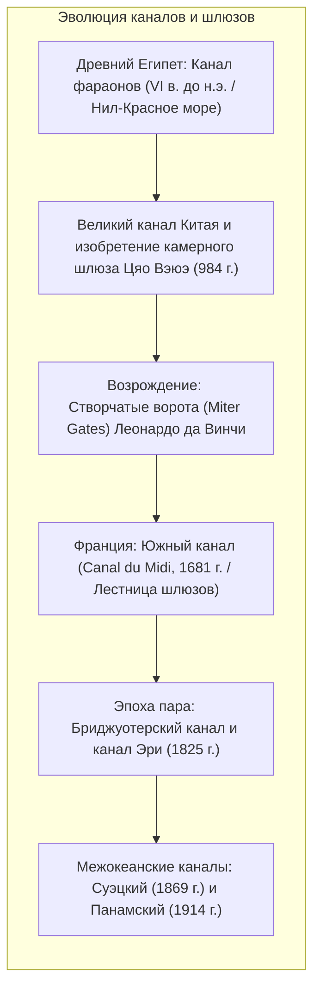
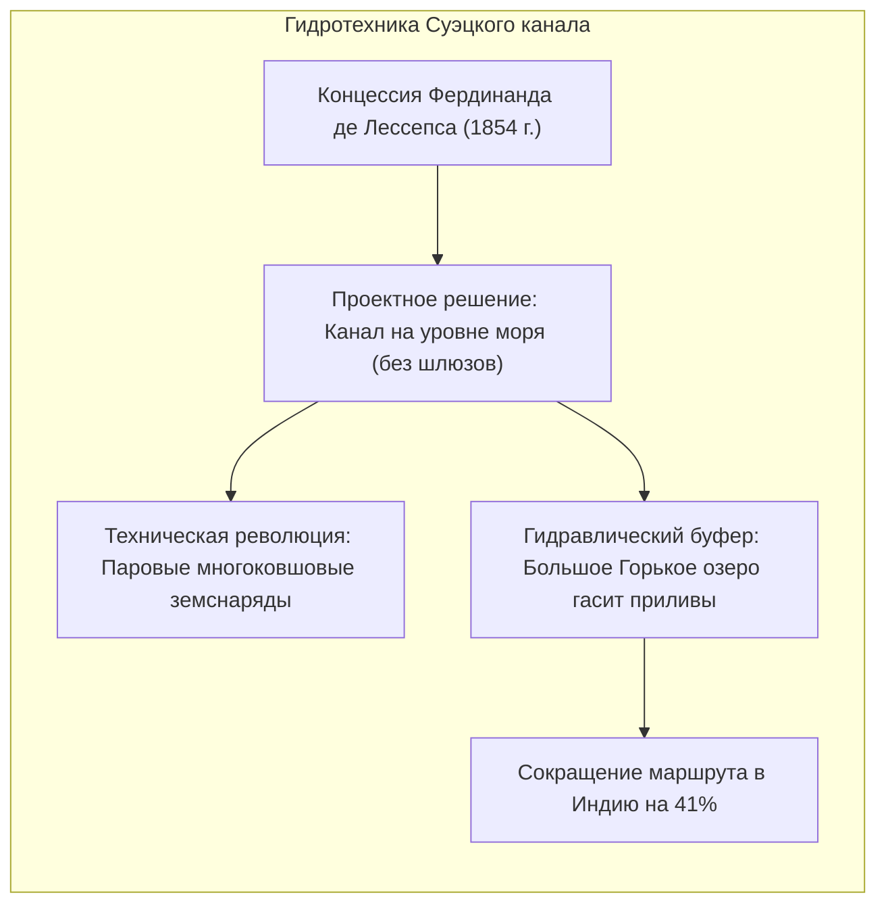
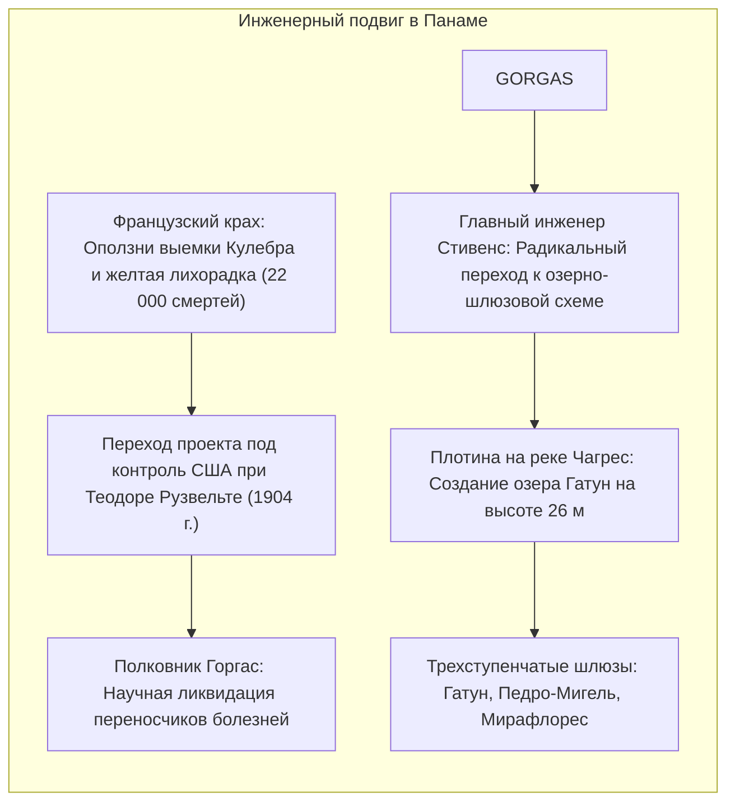

Мировой океан покрывает свыше 70% поверхности Земли, оставаясь главной транспортной артерией человечества. Однако континентальные перешейки веками преграждали путь морским судам: Суэцкий и Панамский перешейки заставляли торговые флоты огибать мыс Доброй Надежды и бурлящие штормами воды мыса Горн.

Чтобы преодолеть эти барьеры, гидротехники осуществили два грандиозных прорыва: прорыли <strong>межокеанские каналы</strong> и создали <strong>камерные судоходные шлюзы</strong>.

Открытие <strong>Суэцкого канала</strong> (1869) сократило путь из Европы в Азию примерно на 9 000 километров. <strong>Панамский канал</strong> (1914) поднял океанские корабли на высоту 26 метров над уровнем моря в озеро Гатун с помощью гидравлических шлюзов-лифтов. Однако в XXI веке эти каналы превратились в критические <strong>геополитические узкие места (chokepoints)</strong>. Авария контейнеровоза Ever Given в 2021 году, катастрофическая засуха в бассейне озера Гатун и кризис в Красном море обнажили уязвимость глобальных цепочек поставок.

---

## 1. Техническая эволюция: От волоков до ворот Леонардо

Преодоление перепадов высот требовало обуздания гидростатических сил.

Ранние каналы использовали примитивные <strong>наклонные волоки (slipways)</strong>, где суда перетаскивали канатами, разрушая обшивку корпусов. В 984 году китайский чиновник <strong>Цяо Вэюэ</strong> построил на Великом канале первый в мире <strong>камерный шлюз (Pound Lock)</strong> с двумя регулируемыми створами.

Около 1497 года <strong>Леонардо да Винчи</strong> разработал в Милане <strong>створчатые двустворчатые ворота (Miter Gates)</strong>, смыкающиеся под углом навстречу течению. Гидростатическое давление верхнего бьефа надежно герметизирует стыки, а при выравнивании уровней ворота распахиваются с минимальным усилием.

---

## 2. Суэцкий канал: Прорезка на уровне моря

После исправления ошибок геодезистов Наполеона, утверждавших о 10-метровом перепаде уровней морей, <strong>Фердинанд де Лессепс</strong> настоял на прокладке канала без единого шлюза.

Ключевую роль сыграло <strong>Большое Горькое озеро</strong>: приливные колебания в Красном море достигают 2 метров, тогда как в Средиземном — всего 0,5 метра. Озеро стало колоссальным гидродинамическим амортизатором, гасящим скорость течений. Массовое внедрение паровых многоковшовых земснарядов ознаменовало переход к индустриальному гидростроительству.

---

## 3. Панамский канал: Преодоление континентального водораздела

Попытка Лессепса повторить в Панаме суэцкий опыт прорезки на уровне моря закончилась банкротством из-за непрерывных оползней в выемке Кулебра и гибели более 22 000 рабочих от малярии и желтой лихорадки.

Военный врач <strong>Уильям Горгас</strong> уничтожил комаров-переносчиков. Главный инженер <strong>Джон Стивенс</strong> предложил гениальное решение: перекрыть реку Чагрес дамбой, создать высокогорное <strong>озеро Гатун</strong> и поднимать корабли шлюзами. Инженерные войска под командованием полковника <strong>Джорджа Гетхалса</strong> воплотили эту схему в жизнь, внедрив электровозы-«мулы» для проводки судов в камерах.

---

## 4. Гидродинамика стесненных фарватеров: Уравнения и риски

Наполнение шлюзовой камеры самотеком описывается законами Бернулли и Торричелли:

$$T_{	ext{fill}} = rac{2 A_{	ext{lock}} \sqrt{\Delta H_0}}{C_d A_c \sqrt{2g}}$$

При движении гигантских судов в узких каналах возникают опасные гидродинамические явления:
- <strong>Эффект Squat (Проседание корпуса)</strong>: Ускорение потока под днищем вызывает перепад давлений, приводящий к динамическому погружению судна и изменению дифферента.
- <strong>Эффект берега (Bank Effect)</strong>: Давление у носа отталкивает судно от откоса (Bank Cushion), а разрежение у кормы затягивает ее к бровке (Bank Suction), порождая неуправляемый рыскающий момент — главную причину посадки на мель контейнеровоза *Ever Given*.

---

## 5. Стандарты судов и геополитика узких мест

Габариты шлюзов определили глобальные судостроительные классы: <strong>Panamax</strong>, <strong>Neopanamax</strong> (с бассейнами рециркуляции воды) и <strong>Suezmax</strong>.

С экологической точки зрения Суэцкий канал породил <strong>лессепсову миграцию</strong> сотен инвазивных видов в Средиземноморье. В Панаме каждый шлюзовой цикл сбрасывает в океан <strong>200 миллионов литров пресной воды</strong> озера Гатун, ставя работу канала в зависимость от засух. Будущее транспортных артерий требует цифровых двойников фарватеров и систем рециркуляции воды.