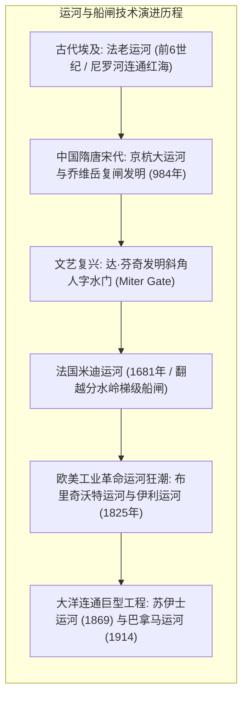
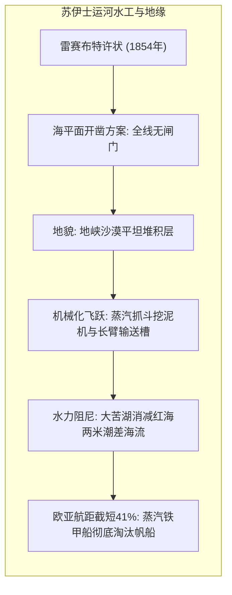
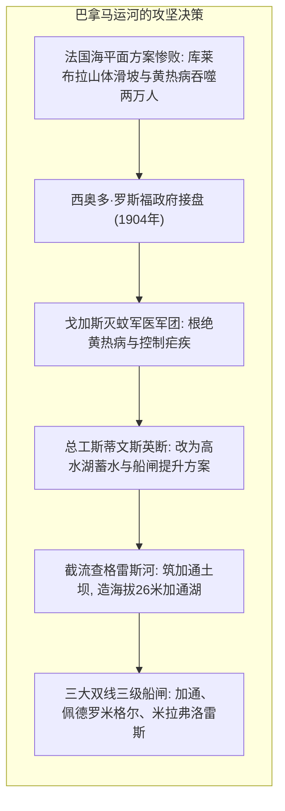
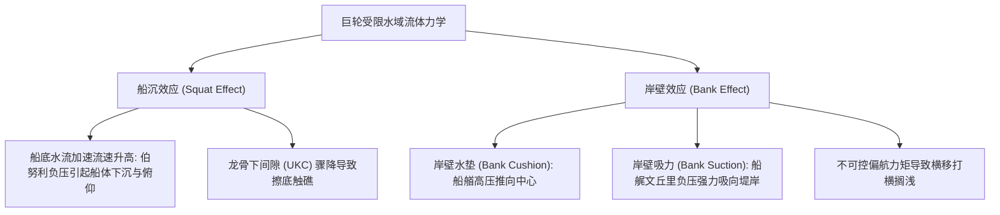

覆盖地球表面逾七成的大洋，自古便是人类最高效、最廉价的长途货运动脉。然而，大陆板块的地质构架对大洋航行筑起了不可逾越的陆桥藩篱。连接欧亚与非洲大陆的苏伊士地峡，以及衔接南北美洲的巴拿马地峡，长期将大西洋、太平洋、印度洋与地中海割裂。数个世纪以来，商船与舰队不得不冒险绕行风暴肆虐的非洲好望角与南美洲合恩角“狂暴五十度”险海，承受长达数千海里的致命航程。

为了打破大自然的地理桎梏，人类实施了近代史上最壮丽的跨洋工程奇迹——<strong>人工运河（Canal）</strong>的开凿，以及通过重力水利将巨轮如乘电梯般举升降落的<strong>船闸（Lock）</strong>系统。

1869年<strong>苏伊士运河</strong>通航，缩短欧亚航程达8,000至9,000公里，重组了全球贸易航线；1914年<strong>巴拿马运河</strong>横空出世，将万吨巨轮举升至海拔26米的加通湖飞越美洲大陆分水岭。但在21世纪的今天，这些运河化身全球供应链最脆弱的<strong>“咽喉要道（Chokepoints）”</strong>。2021年长赐号（Ever Given）搁浅苏伊士造成全球贸易每小时数十亿美元损失；厄尔尼诺干旱引发加通湖蓄水危机重创巴拿马通航配额；红海武装冲突迫使集装箱船重走好望角。

本文全方位解构两大运河的工程史、船闸水力充排水数理方程、浅水航行流体力学（船沉效应与岸壁效应）、船级经济学及现代咽喉地缘政治。

---

## 1. 运河工程技术史：从堰坝滑道到人字闸门革命

内陆越岭通航的核心在于克服水流重力坡降，使船舶在无损状态下平稳升降。

### 1.1 从翻坝过船堰到乔维岳复闸

早期运河在落差处普遍采用<strong>过船堰（斜坡滑道 / Slipway）</strong>，以水牛、卷扬机拖拉船底翻坝。这种方式磨损严重、运量有限且极度浪费水源。

北宋雍熙元年（984年），淮南转运使<strong>乔维岳</strong>在淮安运河首创<strong>“复闸（Pound Lock）”</strong>：设置相隔五十步的两道挂闸形成独立闸室，交替启闭，船随水涨船高，创立了全球船闸的通用基石。

### 1.2 达·芬奇与斜角人字闸门

15世纪末，<strong>达·芬奇</strong>在米兰圣马可运河设计中发明了<strong>“斜角人字门（Miter Gate）”</strong>。两扇门叶在上游呈V形相接，上游巨大静水压反向紧密压实门缝封水，水位持平即可轻盈开启，至今仍是世界绝大多数船闸的标配。

---

## 2. 苏伊士运河：海平面运河的水平开凿

1798年拿破仑远征埃及时，勒佩尔测勘出现“红海高于地中海10米”的严重误差导致项目搁置。1847年布达鲁精确水准测量纠正了误判。<strong>斐迪南·德·雷赛布</strong>坚持采用全线无闸门的<strong>海平面运河（Sea-level Canal）</strong>方案。

全长164公里的水道中，<strong>大苦湖（Great Bitter Lake）</strong>构成了关键水力阻尼区。由于红海潮差达2米而地中海仅0.5米，大苦湖巨大的容积缓冲了汹涌的潮汐棱体，防止了狭窄航道内产生破坏性激流。工程从早期劳役向近代蒸汽链斗挖泥机全面转型，实现了土木机械化革命。

---

## 3. 巴拿马运河：战胜大陆分水岭的极限制衡

雷赛布在巴拿马盲目复制苏伊士经验遭遇惨烈失败：库莱布拉切口的脆弱页岩滑坡泥石流不断，黄热病与疟疾夺去两万余人生命导致工程破产。

美国接盘后，<strong>戈加斯军医</strong>实施全面防蚊消杀根绝黄热病。总工程师<strong>约翰·斯蒂文斯</strong>力排众议决定“放弃深挖海平面，筑坝蓄湖抬高船舶”。陆军工兵<strong>戈索尔斯</strong>最终建成加通大坝与三级提升船闸，由两舷齿轨电力牵引车（电骡）引导船舶安全通行。

---

## 4. 船闸水力充排水与狭窄航道流体力学

船闸无需外部动力泵，全凭<strong>重力势能充排水</strong>。由伯努利与托里拆利定律推导的闸室充水时间公式为：

$$T_{	ext{fill}} = rac{2 A_{	ext{lock}} \sqrt{\Delta H_0}}{C_d A_c \sqrt{2g}}$$

在狭窄运河中，超大型巨轮面临两大极端水动力威胁：

Barrass经验公式定量揭示船沉量与航速平方成正比，航速微升即可引发触底；而岸壁效应产生的偏航力矩则是导致长赐号打横瘫痪苏伊士的关键推手。

---

## 5. 世界主要运河系统与船级标准

- <strong>基尔运河（德国）</strong>：沟通北海与波罗的海，避开斯卡格拉克海峡险滩，年通过三万艘次。
- <strong>圣劳伦斯海道（美加）</strong>：梯级船闸克服尼亚加拉瀑布100米落差，万吨轮直抵五大湖五大淡水腹地。
- <strong>福尔柯克轮（苏格兰）</strong>：利用阿基米德浮力平衡原理的旋转船舶升降机，能耗仅相当于数把电水壶。

现代造船界受运河尺度严格制约，确立了<strong>巴拿马型（Panamax）</strong>、<strong>新巴拿马型（Neopanamax）</strong>、<strong>苏伊士型（Suezmax）</strong>等标准船级。

---

## 6. 生态冲击、气候危机与咽喉地缘前瞻

苏伊士运河引发了350余种红海生物入侵地中海的<strong>“雷赛布迁移（Lessepsian Migration）”</strong>。巴拿马运河每次过闸需消耗<strong>2亿升加通湖珍贵淡水</strong>排放入海，近年厄尔尼诺干旱引发严重吃水限制。红海安全危机更揭示了咽喉单一路径的系统性脆弱。

未来航运咽喉的维系，必须依托<strong>数字孪生水动力避碰</strong>、<strong>节水池与淡水回流泵闭环系统</strong>以及多式联运走廊的弹性重构。