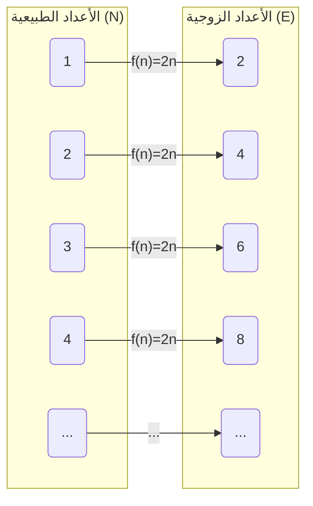
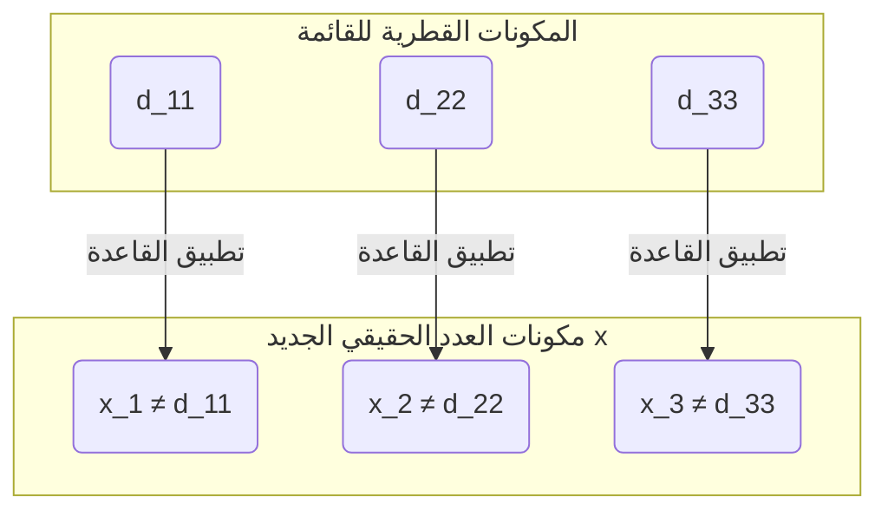

## مقدمة: هل لـ "اللانهاية" أحجام مختلفة؟

مفهوم "اللانهاية" الذي نفكر فيه يوميًا يعني حرفيًا "لا نهاية له". نظرًا لأنه يمكننا الاستمرار في عد الأعداد الطبيعية ($1, 2, 3, \dots$) إلى الأبد، فإن عددها لا نهائي. من ناحية أخرى، الأعداد الحقيقية (جميع النقاط على خط الأعداد) موجودة أيضًا بشكل لا نهائي.

بديهيًا، نميل إلى الاعتقاد بأن اللانهايات كلها متساوية، لكن عالم الرياضيات في القرن التاسع عشر [جورج كانتور](/ar/p/cantor/) أثبت أن أحجام المجموعات اللانهائية قد تختلف.

نوضح هنا كيف تثبت حجة كانتور القطرية أن حجم مجموعة الأعداد الحقيقية أكبر من حجم مجموعة الأعداد الطبيعية.

---

## نظرية المجموعات وحجم المجموعة

يعبّر حجم المجموعة (cardinality) عن عدد عناصرها. وفي المجموعات المنتهية، يكون هذا ببساطة عدد العناصر. فكيف نقارن بين أحجام المجموعات اللانهائية؟

استخدم كانتور مفهوم <strong>التقابل</strong>. إذا وُجد تقابل واحد لواحد بين مجموعتين $A$ و$B$، فلهما <strong>الحجم نفسه</strong>.

### هل للأعداد الطبيعية والأعداد الزوجية الحجم نفسه؟

على سبيل المثال، دعونا نفكر في مجموعة الأعداد الطبيعية $\mathbb{N}$ ومجموعة الأعداد الزوجية الموجبة $E$.

$$
\mathbb{N} = \{1, 2, 3, 4, \dots\}
$$
$$
E = \{2, 4, 6, 8, \dots\}
$$

بديهيًا، يبدو أن الأعداد الزوجية تمثل نصف الأعداد الطبيعية فقط. ومع ذلك، باستخدام الدالة $f(n) = 2n$، يمكننا إنشاء توافق تام واحد لواحد بين العدد الطبيعي $n$ والعدد الزوجي $2n$.

بهذه الطريقة، تتمتع المجموعات اللانهائية بخصيصة غريبة حيث "يمتلك الجزء نفس حجم الكل". تسمى المجموعة اللانهائية التي يمكن إقامة تقابل واحد لواحد بينها وبين الأعداد الطبيعية <strong>قابلة للعد لانهائيًا</strong>، ويقال إن لها حجم <strong>أليف صفر ($\aleph_0$)</strong>.

الأعداد النسبية ($\mathbb{Q}$) قابلة للعد أيضًا. يمكن ترتيب الكسور الموجبة بحسب مجموع البسط والمقام الموجبين، مع تجاوز الكسور التي سبق إدراجها. يظهر كل كسر بعد عدد منتهٍ من الخطوات. وبإضافة الصفر ثم التناوب بين الكسور الموجبة والسالبة، نحصل على قائمة بكل الأعداد النسبية، ومن ثم تقابل واحد لواحد بينها وبين الأعداد الطبيعية.

---

## الأعداد الحقيقية غير قابلة للعد: حجة كانتور القطرية

الأعداد الطبيعية، الأعداد الزوجية، والأعداد الكسرية يمكن جميعها "عدها بالترتيب". إذن، هل يمكن <strong>للأعداد الحقيقية ($\mathbb{R}$)</strong>، التي تمثل جميع النقاط على خط الأعداد، أن تشكل توافقًا واحدًا لواحد مع الأعداد الطبيعية؟

كانت إجابة كانتور <strong>"لا"</strong>. فقد أثبت أن حجم الأعداد الحقيقية أكبر من حجم الأعداد الطبيعية، ولذلك فهي <strong>غير قابلة للعد</strong>.

ما استخدم في هذا الإثبات يُطلق عليه أحد أجمل الإثباتات في تاريخ الرياضيات، وهو <strong>الحجة القطرية</strong> .

---

## الإثبات بالحجة القطرية

هنا، سنقتصر على التفكير في الأعداد الحقيقية بين 0 و 1 (الفترة $(0, 1)$)، وليس جميع الأعداد الحقيقية. إذا كانت الأعداد الحقيقية في هذه الفترة وحدها أكثر من الأعداد الطبيعية، فمن الطبيعي أن تكون جميع الأعداد الحقيقية أكثر من الأعداد الطبيعية.

### افتراض البرهان بالتناقض

يستخدم الإثبات <strong>البرهان بالتناقض</strong>. تعني القائمة هنا أي متتالية رياضية مفهرسة بالأعداد الطبيعية؛ ولا نفترض وجود خوارزمية لحساب حدودها. تنفي الحجة وجود أي متتالية تشمل جميع هذه الأعداد، لا المتتاليات القابلة للحساب فقط.

لتجنب غموض التمثيل العشري، نختار دائمًا التمثيل الذي لا ينتهي بتتابع لا نهائي من التسعات. لذلك نختار التمثيل الأول للعدد نفسه $0.5000\dots=0.4999\dots$. ولنفترض أن جميع أعداد الفترة يمكن إدراجها هكذا:

$$
r_1 = 0 . \mathbf{d_{11}} d_{12} d_{13} d_{14} \dots
$$
$$
r_2 = 0 . d_{21} \mathbf{d_{22}} d_{23} d_{24} \dots
$$
$$
r_3 = 0 . d_{31} d_{32} \mathbf{d_{33}} d_{34} \dots
$$
$$
\vdots
$$

هنا، يرمز $d_{ij}$ إلى الرقم العشري رقم $j$ (من 0 إلى 9) في العدد الحقيقي رقم $i$ من القائمة.

### بناء عدد حقيقي جديد

أظهر كانتور طريقة لإنشاء <strong>عدد حقيقي جديد $x$ لا يظهر مطلقًا في القائمة</strong> ، انطلاقًا من هذه "القائمة التي يفترض أنها شملت جميع الأعداد الحقيقية".

نبني العدد الحقيقي الجديد $x$ على النحو التالي:

$$
x = 0 . x_1 x_2 x_3 x_4 \dots
$$

يتم تحديد كل رقم $x_n$ بناءً على الرقم $d_{nn}$ في المكان العشري $n$ (الرقم القطري) للعدد ذي الترتيب $n$ في القائمة. القاعدة بسيطة للغاية.

$$
x_n = \begin{cases}
1 & \text{إذا كان } d_{nn} \neq 1 \\
2 & \text{إذا كان } d_{nn} = 1
\end{cases}
$$

أي إذا لم يكن الرقم القطري $d_{nn}$ هو 1، نختار $x_n=1$؛ وإذا كان 1، نختار $x_n=2$. يختلف الرقم المختار دائمًا عن $d_{nn}$. وبما أن أرقام $x$ لا تتجاوز 1 و2، فإن تمثيله لا ينتهي بتسعات متتالية، وهو فريد وفقًا لاصطلاحنا.

### استنتاج التناقض

العدد الحقيقي الجديد المكون $x$ هو عدد حقيقي بين 0 و 1. وفقًا للافتراض، يجب أن تتضمن القائمة "جميع الأعداد الحقيقية بين 0 و 1"، لذلك يجب أن يكون $x$ موجودًا في مكان ما في القائمة، على سبيل المثال في الترتيب $k$ ($r_k$).

إذا كان $x = r_k$، فإن الرقم في المكان العشري $k$ من $x$ وهو $x_k$ يجب أن يكون مساويًا للرقم في المكان العشري $k$ من $r_k$ وهو $d_{kk}$ ($x_k = d_{kk}$).

ومع ذلك، وفقًا لتعريف $x$، <strong>تم صنع $x_k$ عمدًا ليكون رقمًا مختلفًا عن $d_{kk}$ ($x_k \neq d_{kk}$)</strong> .

هذا تناقض. لذلك، فإن افتراض إدراج جميع أعداد الفترة كان خاطئًا، ومن ثم فمجموعة الأعداد في $(0,1)$ غير قابلة للعد. وبما أن هذه المجموعة جزء من مجموعة الأعداد الحقيقية، فمجموعة الأعداد الحقيقية كلها غير قابلة للعد أيضًا.

إذن <strong>لا يوجد تقابل واحد لواحد</strong> بين الأعداد الحقيقية والأعداد الطبيعية. والاحتواء من الطبيعية في الحقيقية يعطي دالة متباينة؛ لذلك حجم الأعداد الحقيقية أكبر فعلًا. ولا تتعلق هذه المقارنة بطول خط الأعداد أو بكثافته.

---

## نحو فرضية الاستمرارية

تُظهر حجة كانتور القطرية وجود تدرج في أحجام المجموعات اللانهائية. نرمز إلى حجم الأعداد الطبيعية بـ $\aleph_0$ وإلى حجم الأعداد الحقيقية بـ $\mathfrak{c}=2^{\aleph_0}$. وهذا أيضًا حجم مجموعة الأجزاء للأعداد الطبيعية. أما مساواة $\mathfrak{c}$ بأصغر عدد كاردينالي غير قابل للعد $\aleph_1$ فهي مسألة أخرى لا تحسمها الحجة القطرية. والعلاقة هي:

$$
\aleph_0 < 2^{\aleph_0}
$$

واجه كانتور سؤالًا كبيرًا: <strong>"هل توجد مجموعة لانهائية يقع حجمها بين $\aleph_0$ و$2^{\aleph_0}$؟"</strong>

تُسمى فرضية عدم وجود حجم وسيط <strong>[فرضية الاستمرارية](/ar/p/continuum-hypothesis/) (CH)</strong>. وفي ZFC، تكافئ هذه الفرضية $2^{\aleph_0}=\aleph_1$.

أظهر [كورت غودل](/ar/p/godel/) وبول كوهين لاحقًا أن <strong>فرضية الاستمرارية مستقلة عن ZFC، بشرط أن يكون ZFC متسقًا</strong>. أثبت غودل الاتساق النسبي لإضافة CH إلى ZFC، وأثبت كوهين الاتساق النسبي لإضافة نفيها. ولا تثبت هذه النتائج اتساق ZFC نفسه، كما أنها لا تعني أن CH صحيحة وخاطئة في الوقت نفسه.

---

## الخلاصة

قد تبدو حجة كانتور القطرية للوهلة الأولى لغزًا بسيطًا، لكنها تقوم على استدلال قوي حول اللانهاية.

1. يثبت التقابل تساوي الحجم، وتتيح الدوال المتباينة مقارنة أحجام المجموعات.
2. حتى الأعداد الكسرية، تمتلك نفس الحجم (لانهائية قابلة للعد) مثل الأعداد الطبيعية.
3. بتغيير كل رقم قطري لبناء عدد حقيقي جديد، تثبت الحجة أن حجم الأعداد الحقيقية أكبر من حجم الأعداد الطبيعية.

هذا الاستدلال الذي يتحدى الحدس من الأفكار الجميلة في الرياضيات. وتظهر الحجج القطرية أيضًا في نتائج أساسية لعلوم الحاسوب والمنطق الرياضي، مثل [مسألة التوقف لآلان تورينغ](/ar/p/halting-problem/) و[مبرهنات غودل لعدم الاكتمال](/ar/p/godels-incompleteness-theorems/).

## المراجع

- [MIT OpenCourseWare: حجة كانتور القطرية](https://ocw.mit.edu/courses/res-6-012-introduction-to-probability-spring-2018/14b6f97b86d7978a595e402cc54d08d8_YIZd23zGV3M.pdf)
- [Jindřich Zapletal: Elements of Set Theory](https://people.clas.ufl.edu/zapletal/files/notesset.pdf)
- [CMU: 21-602 Introduction to Set Theory I](https://www.math.cmu.edu/~bwsulliv/21602lecturenotes.pdf)
