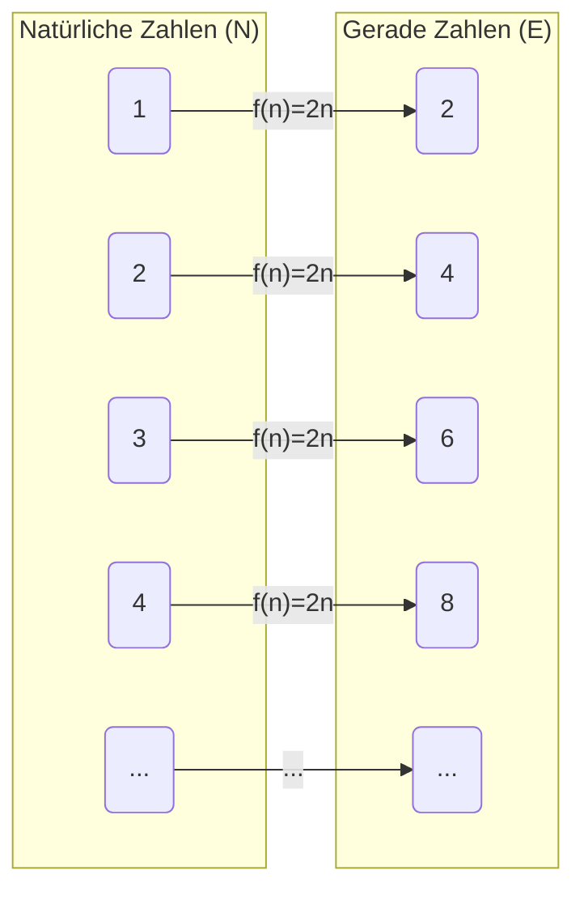
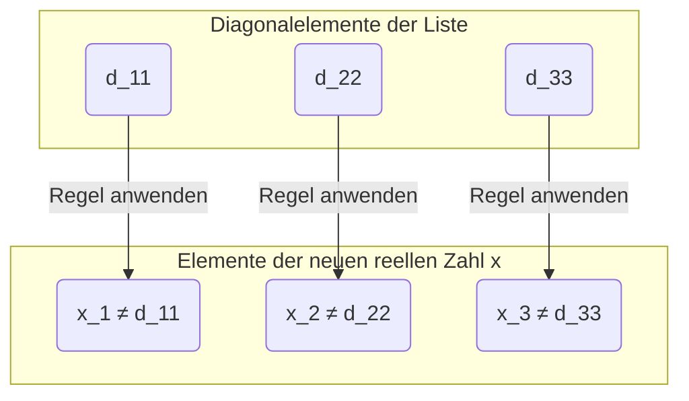

## Einführung: Gibt es auch bei der Unendlichkeit eine „Größe“?

Das Konzept der „Unendlichkeit“, wie wir es uns im Alltag vorstellen, bedeutet wörtlich, dass es „kein Ende gibt“. Da natürliche Zahlen ($1, 2, 3, \dots$) immer weitergezählt werden können, ist ihre Anzahl unendlich. Andererseits existieren reelle Zahlen (alle Punkte auf der Zahlengeraden) ebenfalls in unendlicher Anzahl.

Intuitiv neigen wir zu der Annahme: „Unendlich ist unendlich, beides ist gleichermaßen endlos“, aber der Mathematiker des 19. Jahrhunderts, [Georg Cantor](/de/p/cantor/), zeigte, dass unendliche Mengen unterschiedliche Mächtigkeiten haben können.

In diesem Artikel zeigen wir mit Cantors Diagonalargument, warum die reellen Zahlen eine echt größere Mächtigkeit als die natürlichen Zahlen haben.

---

## Cantors Mengenlehre und „Mächtigkeit (Cardinality)“

Cantor führte den Begriff der <strong>Mächtigkeit</strong> ein, um Mengen anhand ihrer Elemente zu vergleichen. Bei einer endlichen Menge ist die Mächtigkeit einfach ihre Anzahl an Elementen. Doch wie vergleicht man unendliche Mengen?

Cantor nutzte den Begriff der <strong>Bijektion</strong>. Gibt es zwischen zwei Mengen $A$ und $B$ eine Bijektion, so haben sie <strong>dieselbe Mächtigkeit</strong>.

### Haben natürliche und gerade Zahlen dieselbe Mächtigkeit?

Betrachten wir zum Beispiel die Menge der natürlichen Zahlen $\mathbb{N}$ und die Menge der positiven geraden Zahlen $E$.

$$
\mathbb{N} = \{1, 2, 3, 4, \dots\}
$$
$$
E = \{2, 4, 6, 8, \dots\}
$$

Intuitiv scheint es, als gäbe es nur halb so viele gerade Zahlen wie natürliche Zahlen. Unter Verwendung der Funktion $f(n) = 2n$ kann man jedoch eine perfekte Eins-zu-eins-Zuordnung zwischen der natürlichen Zahl $n$ und der geraden Zahl $2n$ herstellen.

Auf diese Weise gibt es bei unendlichen Mengen die seltsame Eigenschaft, dass „ein Teil dieselbe Größe wie das Ganze hat“. Eine Menge heißt <strong>abzählbar unendlich</strong>, wenn es eine Bijektion zwischen ihr und den natürlichen Zahlen gibt; dann hat sie die Mächtigkeit <strong>$\aleph_0$</strong>.

Auch die rationalen Zahlen ($\mathbb{Q}$) sind abzählbar. Wir ordnen die positiven Brüche nach der Summe aus positivem Zähler und positivem Nenner und überspringen bereits aufgeführte Werte. Jeder Bruch erscheint nach endlich vielen Schritten. Ergänzt man 0 und verschachtelt anschließend die positiven und negativen Brüche, erhält man eine Aufzählung aller rationalen Zahlen und damit eine Bijektion zu den natürlichen Zahlen.

---

## Reelle Zahlen sind überabzählbar: Cantors Diagonalargument

Natürliche Zahlen, gerade Zahlen und rationale Zahlen können alle „nacheinander aufgezählt“ werden. Aber lassen sich auch die <strong>reellen Zahlen ($\mathbb{R}$)</strong> , die alle Punkte auf der Zahlengeraden darstellen, in eine Eins-zu-eins-Zuordnung zu den natürlichen Zahlen bringen?

Cantors Antwort war <strong>„Nein“</strong>. Er zeigte, dass die reellen Zahlen eine echt größere Mächtigkeit als die natürlichen Zahlen haben: Sie sind <strong>überabzählbar</strong>.

Für diesen Beweis wurde das <strong>Diagonalargument</strong> verwendet, das als einer der schönsten Beweise in der Geschichte der Mathematik gilt.

---

## Beweis durch das Diagonalargument

Hier betrachten wir nicht alle reellen Zahlen, sondern beschränken uns auf die reellen Zahlen zwischen 0 und 1 (das Intervall $(0, 1)$). Wenn es allein in diesem Intervall mehr reelle als natürliche Zahlen gibt, dann gibt es logischerweise auch insgesamt mehr reelle als natürliche Zahlen.

### Annahme durch Widerspruchsbeweis

Der Beweis erfolgt durch <strong>Widerspruch</strong>. Eine Liste ist hier eine mathematische Folge mit Indizes aus den natürlichen Zahlen; wir setzen keinen Algorithmus voraus, der ihre Glieder berechnet. Das Argument schließt jede vollständige Aufzählung aus, nicht nur berechenbare Folgen.

Um mehrdeutige Dezimaldarstellungen zu vermeiden, wählen wir stets die Darstellung, die nicht ab einer Stelle nur noch aus Neunen besteht. Für dieselbe reelle Zahl $0{,}5000\dots=0{,}4999\dots$ wählen wir also die erste Darstellung. Nehmen wir an, alle Zahlen des Intervalls ließen sich so auflisten:

$$
r_1 = 0 . \mathbf{d_{11}} d_{12} d_{13} d_{14} \dots
$$
$$
r_2 = 0 . d_{21} \mathbf{d_{22}} d_{23} d_{24} \dots
$$
$$
r_3 = 0 . d_{31} d_{32} \mathbf{d_{33}} d_{34} \dots
$$
$$
\vdots
$$

Hier bezeichnet $d_{ij}$ die $j$-te Nachkommastelle (eine Ziffer von 0 bis 9) der $i$-ten reellen Zahl in der Liste.

### Konstruktion einer neuen reellen Zahl

Aus dieser „Liste, die alle reellen Zahlen enthalten soll“, konstruierte Cantor eine <strong>neue reelle Zahl $x$, die nicht auf der Liste steht</strong>.

Wir konstruieren die neue reelle Zahl $x$ wie folgt:

$$
x = 0 . x_1 x_2 x_3 x_4 \dots
$$

Die Ziffer $x_n$ an jeder Stelle wird basierend auf der Ziffer $d_{nn}$ an der $n$-ten Dezimalstelle (der Ziffer auf der Diagonale) der $n$-ten Zahl in der Liste bestimmt. Die Regel ist sehr einfach.

$$
x_n = \begin{cases}
1 & \text{wenn } d_{nn} \neq 1 \\
2 & \text{wenn } d_{nn} = 1
\end{cases}
$$

Das heißt: Ist die Diagonalziffer $d_{nn}$ nicht 1, wählen wir $x_n=1$; ist sie 1, wählen wir $x_n=2$. Damit unterscheidet sich die gewählte Ziffer immer von $d_{nn}$. Da die Dezimalstellen von $x$ nur 1 oder 2 sind, endet seine Darstellung nicht mit unendlich vielen Neunen und ist nach unserer Konvention eindeutig.

### Ableitung eines Widerspruchs

Die neu konstruierte reelle Zahl $x$ ist eine reelle Zahl zwischen 0 und 1. Laut Annahme sollte die Liste „alle reellen Zahlen zwischen 0 und 1“ umfassen, daher muss $x$ irgendwo in der Liste existieren, zum Beispiel an der $k$-ten Stelle ($r_k$).

Wenn $x = r_k$ ist, müsste die Ziffer $x_k$ an der $k$-ten Dezimalstelle von $x$ gleich der Ziffer $d_{kk}$ an der $k$-ten Dezimalstelle von $r_k$ sein ($x_k = d_{kk}$).

Aber durch die Definition von $x$ wurde <strong>$x_k$ absichtlich so gewählt, dass es eine von $d_{kk}$ verschiedene Ziffer ist ($x_k \neq d_{kk}$)</strong> .

Dies ist ein Widerspruch. Folglich war die anfängliche Annahme, dass „alle reellen Zahlen aufgelistet werden können“, falsch.

Folglich gibt es <strong>keine Bijektion</strong> zwischen den reellen und den natürlichen Zahlen. Die Inklusion der natürlichen Zahlen in die reellen Zahlen ist eine Injektion; daher ist die Mächtigkeit der reellen Zahlen echt größer. Dieser Vergleich betrifft weder die Länge noch die Dichte auf der Zahlengeraden.

---

## Der Weg zur Kontinuumshypothese

Cantors Diagonalargument zeigt, dass es in der Unendlichkeit verschiedene „Hierarchien“ gibt. Bezeichnen wir die Mächtigkeit der natürlichen Zahlen mit $\aleph_0$ und die der reellen Zahlen mit $\mathfrak{c}=2^{\aleph_0}$. Letztere ist auch die Mächtigkeit der Potenzmenge der natürlichen Zahlen. Ob $\mathfrak{c}$ dem kleinsten überabzählbaren Kardinal $\aleph_1$ entspricht, ist eine eigene Frage, die das Diagonalargument nicht beantwortet. Es gilt:

$$
\aleph_0 < 2^{\aleph_0}
$$

Damit stellte sich Cantor eine große Frage: <strong>„Gibt es eine unendliche Menge, deren Mächtigkeit zwischen $\aleph_0$ und $2^{\aleph_0}$ liegt?“</strong>

Die Annahme, dass keine Zwischenmächtigkeit existiert, heißt <strong>[Kontinuumshypothese](/de/p/continuum-hypothesis/) (CH)</strong>. In ZFC ist sie gleichbedeutend mit $2^{\aleph_0}=\aleph_1$.

Später zeigten [Kurt Gödel](/de/p/godel/) und Paul Cohen, dass die Kontinuumshypothese <strong>von ZFC unabhängig ist, sofern ZFC widerspruchsfrei ist</strong>. Gödel wies die relative Widerspruchsfreiheit von ZFC zusammen mit CH nach, Cohen diejenige von ZFC zusammen mit der Negation von CH. Diese Ergebnisse beweisen nicht die Widerspruchsfreiheit von ZFC selbst und bedeuten nicht, dass CH zugleich wahr und falsch ist.

---

## Zusammenfassung

Cantors Diagonalargument wirkt auf den ersten Blick wie ein einfaches Rätsel, beruht aber auf einer wirkungsvollen Schlussweise über das Unendliche.

1. Bijektionen zeigen gleiche Mächtigkeit; Injektionen ermöglichen den Vergleich von Mächtigkeiten.
2. Bis hin zu den rationalen Zahlen haben sie dieselbe Größe wie natürliche Zahlen (abzählbar unendlich).
3. Indem man jede Diagonalziffer ändert und so eine neue reelle Zahl konstruiert, beweist das Argument, dass die reellen Zahlen eine echt größere Mächtigkeit als die natürlichen Zahlen haben.

Diese der Intuition widersprechende Schlussweise gehört zu den faszinierenden Seiten der Mathematik. Diagonalargumente finden sich auch in grundlegenden Ergebnissen der Informatik und mathematischen Logik, etwa im [Halteproblem von Alan Turing](/de/p/halting-problem/) und in den [Unvollständigkeitssätzen von Gödel](/de/p/godels-incompleteness-theorems/).

## Literatur

- [MIT OpenCourseWare: Cantors Diagonalargument](https://ocw.mit.edu/courses/res-6-012-introduction-to-probability-spring-2018/14b6f97b86d7978a595e402cc54d08d8_YIZd23zGV3M.pdf)
- [Jindřich Zapletal: Elements of Set Theory](https://people.clas.ufl.edu/zapletal/files/notesset.pdf)
- [CMU: 21-602 Introduction to Set Theory I](https://www.math.cmu.edu/~bwsulliv/21602lecturenotes.pdf)
