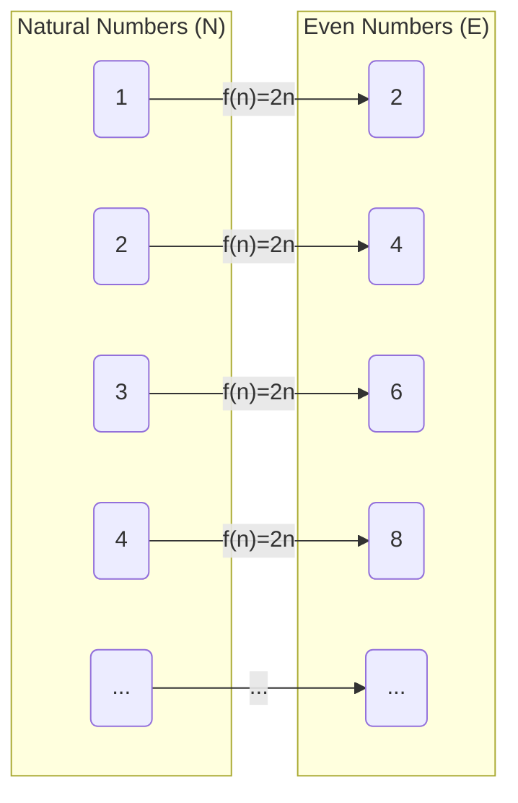
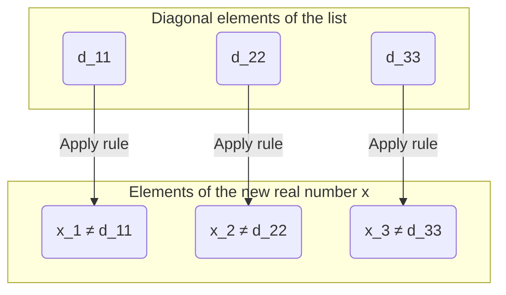

## Introduction: Are There "Sizes" to Infinity?

The concept of "infinity" that we normally think of literally means "having no end." Natural numbers ($1, 2, 3, \dots$) can be counted forever, so their number is infinite. On the other hand, real numbers (all points on a number line) also exist infinitely in the same way.

Intuitively, we tend to think that "infinity is infinity, and both are equally endless," but the 19th-century mathematician [Georg Cantor](/en/p/cantor/) proved the astonishing fact that <strong>"there are differences in size (cardinality) among infinities."</strong>

In this article, we will explain in detail why the set of real numbers has strictly greater cardinality than the set of natural numbers, using the <strong>Diagonal Argument</strong>, a groundbreaking proof method devised by Cantor.

---

## Cantor's Set Theory and "Cardinality"

Cantor introduced the concept of <strong>Cardinality</strong> to compare the "amount" of elements in a set. In the case of a finite set, the cardinality is simply the number of elements. But how can we compare the sizes of infinite sets?

Cantor used the idea of a <strong>Bijection</strong> (one-to-one correspondence). If a one-to-one correspondence (bijection) can be made between two sets $A$ and $B$, he defined those two sets as <strong>"having the same cardinality."</strong>

### Do Natural Numbers and Even Numbers Have the Same Cardinality?

Here we use the convention that natural numbers start at 1. Consider the set of natural numbers $\mathbb{N}$ and the set of positive even numbers $E$.

$$
\mathbb{N} = \{1, 2, 3, 4, \dots\}
$$

$$
E = \{2, 4, 6, 8, \dots\}
$$

Intuitively, it seems like there are only half as many even numbers as natural numbers. However, by using the function $f(n) = 2n$, we can create a perfect one-to-one correspondence between a natural number $n$ and an even number $2n$.

In this way, infinite sets have the strange property that "a part has the same size as the whole." An infinite set that can be put into a one-to-one correspondence with the natural numbers like this is called <strong>Countably infinite</strong> or is said to have the cardinality of <strong>Aleph-null ($\aleph_0$)</strong>.

The rational numbers ($\mathbb{Q}$) are also countably infinite. List positive fractions in order of increasing sum of their positive integer numerator and denominator, skipping values already listed. Every fraction appears at a finite stage. Adding 0 and interleaving the positive and negative values gives an enumeration of all rational numbers and hence a bijection with the natural numbers.

---

## Real Numbers Are "Uncountable": Cantor's Theorem

Natural numbers, even numbers, and rational numbers can all be "counted in order." Then, can the <strong>real numbers ($\mathbb{R}$)</strong>, which represent all points on a number line, also form a one-to-one correspondence with the natural numbers?

Cantor's answer was <strong>"No."</strong> He showed that real numbers have a strictly greater cardinality than natural numbers, meaning they are <strong>Uncountably infinite</strong>.

The proof used for this is the <strong>Diagonal Argument</strong>, known as one of the most beautiful proofs in the history of mathematics.

---

## Proof by the Diagonal Argument

Here, we will consider not all real numbers, but restrict ourselves to real numbers between 0 and 1 (the interval $(0, 1)$). If just the real numbers in this interval are more than the natural numbers, then naturally the entire set of real numbers will also be more than the natural numbers.

### Assumption for Proof by Contradiction

The proof uses <strong>Proof by contradiction</strong>.
First, we assume that "all real numbers between 0 and 1 can be put into a one-to-one correspondence with the natural numbers (i.e., they can be enumerated as a list)."

A list here means a mathematical sequence indexed by the natural numbers. We do not assume an algorithm for computing its terms. The argument rules out every exhaustive sequence, not merely computable ones.

To avoid duplicate decimal representations, we never use expansions that eventually consist entirely of 9s. For example, for $0.5000\dots=0.4999\dots$, we choose the former. With this convention, suppose that we can list every real number between 0 and 1 as follows:

$$
r_1 = 0 . \mathbf{d_{11}} d_{12} d_{13} d_{14} \dots
$$

$$
r_2 = 0 . d_{21} \mathbf{d_{22}} d_{23} d_{24} \dots
$$

$$
r_3 = 0 . d_{31} d_{32} \mathbf{d_{33}} d_{34} \dots
$$

$$
\vdots
$$

Here, $d_{ij}$ represents the $j$-th decimal digit (0 to 9) of the $i$-th real number.

### Construction of a New Real Number x

Cantor showed a method to create a <strong>new real number $x$ that is definitely not on the list</strong> from this "list that supposedly covered all real numbers."

Construct the new real number $x$ as follows:

$$
x = 0 . x_1 x_2 x_3 x_4 \dots
$$

Each digit $x_n$ is determined based on the $n$-th decimal digit (the number on the diagonal) $d_{nn}$ of the $n$-th number on the list. The rule is very simple.

$$
x_n = \begin{cases}
1 & \text{if } d_{nn} \neq 1 \\
2 & \text{if } d_{nn} = 1
\end{cases}
$$

In other words, if the digit on the diagonal $d_{nn}$ is not 1, we set $x_n$ to 1; if it is 1, we set it to 2. The new expansion uses only 1 and 2, so it ends in neither an infinite tail of 0s nor an infinite tail of 9s. Its decimal representation is therefore unique, and a difference in digits implies a difference in real numbers.

### Derivation of a Contradiction

The newly constructed real number $x$ is a real number between 0 and 1. According to our assumption, since the list supposedly covers "all real numbers between 0 and 1," $x$ must also exist somewhere on the list, for example as the $k$-th number ($r_k$).

If $x = r_k$, then the $k$-th decimal digit of $x$, $x_k$, must be equal to the $k$-th decimal digit of $r_k$, $d_{kk}$ ($x_k = d_{kk}$).

However, by the definition of $x$, <strong>$x_k$ is intentionally created to be a different digit from $d_{kk}$ ($x_k \neq d_{kk}$)</strong>.

This is a contradiction. Therefore, the initial assumption that "all real numbers can be listed" was incorrect.

In conclusion, it has been proven that <strong>there is no bijection between the natural numbers and the real numbers</strong>. Since inclusion gives an injection from the natural numbers into the real numbers, the real numbers have strictly greater cardinality. This comparison concerns neither length nor density on the number line.

---

## The Path to the Continuum Hypothesis

Cantor's diagonal argument showed that a "hierarchy" exists within infinity.
Write the cardinality of the natural numbers as $\aleph_0$ and that of the real numbers as $\mathfrak{c}=2^{\aleph_0}$. The latter is also the cardinality of the power set of the natural numbers. Whether it equals the least uncountable cardinal $\aleph_1$ is a separate question, not settled by diagonalization. We have:

$$
\aleph_0 < 2^{\aleph_0}
$$

Here, Cantor faced one massive question: <strong>"Does there exist an infinite set with a cardinality intermediate between $\aleph_0$ and $2^{\aleph_0}$?"</strong>

The hypothesis that "no intermediate cardinality exists" is called the <strong>[Continuum Hypothesis](/en/p/continuum-hypothesis/) (CH)</strong>. In ZFC, this is equivalent to the assertion $2^{\aleph_0}=\aleph_1$.

Later, [Kurt Gödel](/en/p/godel/) and Paul Cohen proved that the [continuum hypothesis](/en/p/continuum-hypothesis/) is <strong>independent of ZFC, provided ZFC is consistent</strong>. Gödel established the relative consistency of adding CH, and Cohen established the relative consistency of adding its negation. These results neither prove the consistency of ZFC itself nor say that CH is simultaneously true and false.

---

## Summary

Cantor's diagonal argument looks like a simple puzzle at first glance, but behind it lies a powerful logic approaching the "truth of infinity."

1. Bijections express equal cardinality; injections compare cardinalities.
2. Both the natural numbers and the rational numbers are countably infinite.
3. By changing each diagonal digit to create a new number, it is proved that there are more real numbers than natural numbers (uncountably infinite).

The absolute beauty of logic, which contradicts this intuition, can be said to be the greatest charm of the discipline of mathematics. The diagonal argument was later applied to theories fundamental to computer science and mathematical logic, such as [Alan Turing](/en/p/turing/)'s [halting problem](/en/p/halting-problem/) and the proof of [Gödel's incompleteness theorems](/en/p/godels-incompleteness-theorems/).

## References

- [MIT OCW: Cantor’s diagonalization argument](https://ocw.mit.edu/courses/res-6-012-introduction-to-probability-spring-2018/14b6f97b86d7978a595e402cc54d08d8_YIZd23zGV3M.pdf)
- [Jindřich Zapletal: Elements of Set Theory](https://people.clas.ufl.edu/zapletal/files/notesset.pdf)
- [CMU: 21-602 Intro to Set Theory I](https://www.math.cmu.edu/~bwsulliv/21602lecturenotes.pdf)
