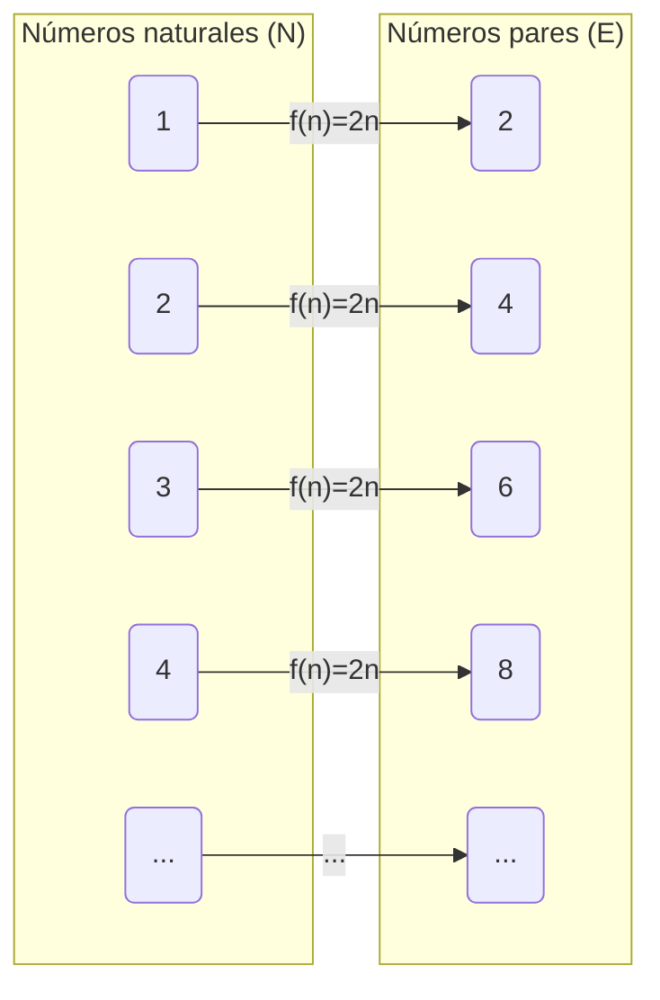
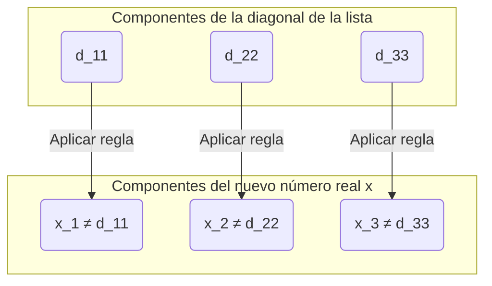

## Introducción: ¿El infinito también tiene «tamaños»?

El concepto de «infinito» que pensamos cotidianamente significa literalmente «que no tiene fin». Los números naturales ($1, 2, 3, \dots$) se pueden seguir contando infinitamente, por lo que su cantidad es infinita. Por otro lado, los números reales (todos los puntos en la recta numérica) también existen de manera infinita.

Intuitivamente, solemos pensar que «el infinito es infinito, y ambos no tienen fin de la misma manera», pero el matemático del siglo XIX [Georg Cantor](/es/p/cantor/) demostró un hecho asombroso: <strong>«el infinito tiene diferencias de tamaño (cardinalidad)»</strong> .

En este artículo, explicaremos en detalle que el conjunto de los números reales tiene cardinalidad estrictamente mayor que el conjunto de los números naturales, utilizando el <strong>argumento diagonal (Diagonal Argument)</strong> , un método de demostración revolucionario ideado por Cantor.

---

## La teoría de conjuntos de Cantor y la «cardinalidad (Cardinality)»

Cantor introdujo el concepto de <strong>cardinalidad (Cardinality)</strong> para comparar la «cantidad» de elementos de los conjuntos. En el caso de los conjuntos finitos, la cardinalidad es simplemente el número de elementos. Sin embargo, ¿cómo podemos comparar el tamaño de los conjuntos infinitos?

Cantor utilizó la idea de la <strong>biyección (Bijection)</strong> . Definió que si se puede crear una correspondencia uno a uno (biyección) entre dos conjuntos $A$ y $B$, entonces esos dos conjuntos <strong>«tienen la misma cardinalidad»</strong> .

### ¿Los números naturales y los números pares tienen la misma cardinalidad?

Aquí adoptamos la convención de que los números naturales empiezan en 1. Consideremos el conjunto $\mathbb{N}$ de los números naturales y el conjunto $E$ de los números pares positivos.

$$
\mathbb{N} = \{1, 2, 3, 4, \dots\}
$$

$$
E = \{2, 4, 6, 8, \dots\}
$$

Intuitivamente, parece que hay solo la mitad de números pares que de números naturales. Sin embargo, si utilizamos la función $f(n) = 2n$, podemos crear una perfecta correspondencia uno a uno entre el número natural $n$ y el número par $2n$.

De esta manera, en los conjuntos infinitos existe la extraña propiedad de que «la parte tiene el mismo tamaño que el todo». A los conjuntos infinitos que tienen esta correspondencia uno a uno con los números naturales se les llama <strong>infinitos numerables (Countably infinite)</strong> o se dice que tienen la cardinalidad de <strong>Alef-sub-cero ($\aleph_0$)</strong> .

Los números racionales ($\mathbb{Q}$) también son numerables. Ordenemos las fracciones positivas según la suma de su numerador y denominador enteros positivos, de menor a mayor, y omitamos los valores que ya hayan aparecido. Toda fracción aparece en un paso finito. Al añadir el cero e intercalar los valores positivos y negativos obtenemos una enumeración de todos los racionales y, por tanto, una biyección con los naturales.

---

## Los números reales son «incontables»: El teorema de Cantor

Los números naturales, los pares y los racionales pueden ser todos «contados en orden». Entonces, ¿es posible crear una correspondencia uno a uno con los números naturales para los <strong>números reales ($\mathbb{R}$)</strong> , que representan todos los puntos de la recta numérica?

La respuesta de Cantor fue un <strong>«No»</strong> . Demostró que los números reales tienen cardinalidad estrictamente mayor que los números naturales, es decir, son <strong>infinitos no numerables (Uncountably infinite)</strong> .

Para esta demostración se utilizó el <strong>argumento diagonal</strong> , a menudo llamado una de las demostraciones más bellas en la historia de las matemáticas.

---

## Demostración mediante el argumento diagonal

Aquí, limitaremos nuestra consideración a los números reales entre 0 y 1 (el intervalo $(0, 1)$), en lugar de todos los números reales. Si hay más números reales tan solo en este intervalo que números naturales, entonces naturalmente el conjunto total de los números reales también es mayor que los números naturales.

### La suposición de la reducción al absurdo

La demostración utiliza la <strong>reducción al absurdo (Proof by contradiction)</strong> .
Primero, asumimos que «todos los números reales entre 0 y 1 pueden tener una correspondencia uno a uno con los números naturales (= pueden ser enumerados como una lista)».

Aquí, una lista es una sucesión matemática indexada por los números naturales; no suponemos que exista un algoritmo para calcular sus términos. El argumento descarta cualquier sucesión exhaustiva, no solo las computables.

Para evitar representaciones decimales duplicadas, no usaremos expansiones que a partir de cierta posición solo contengan nueves. Por ejemplo, para $0.5000\dots=0.4999\dots$, elegimos la primera. Con esta convención, supongamos que podemos enumerar todos los reales entre 0 y 1 así:

$$
r_1 = 0 . \mathbf{d_{11}} d_{12} d_{13} d_{14} \dots
$$

$$
r_2 = 0 . d_{21} \mathbf{d_{22}} d_{23} d_{24} \dots
$$

$$
r_3 = 0 . d_{31} d_{32} \mathbf{d_{33}} d_{34} \dots
$$

$$
\vdots
$$

Aquí, $d_{ij}$ representa el dígito (de 0 a 9) en la posición decimal $j$ del $i$-ésimo número real.

### Construcción de un nuevo número real x

Cantor mostró cómo crear un <strong>nuevo número real $x$ que definitivamente no está en la lista</strong> a partir de esta «lista que se suponía cubría todos los números reales».

Construimos el nuevo número real $x$ de la siguiente manera:

$$
x = 0 . x_1 x_2 x_3 x_4 \dots
$$

Cada dígito $x_n$ se determina en base al dígito en la $n$-ésima posición decimal del $n$-ésimo número en la lista (el dígito en la diagonal) $d_{nn}$. La regla es muy simple:

$$
x_n = \begin{cases}
1 & \text{si } d_{nn} \neq 1 \\
2 & \text{si } d_{nn} = 1
\end{cases}
$$

Es decir, si el dígito en la diagonal $d_{nn}$ no es 1, entonces hacemos $x_n$ igual a 1; y si es 1, lo hacemos igual a 2. La nueva expansión usa únicamente 1 y 2, así que no termina ni en una cola infinita de ceros ni en una de nueves. Su representación decimal es única; por ello, diferir en una cifra implica representar números reales distintos.

### Derivación de la contradicción

El nuevo número real construido $x$ es un número real entre 0 y 1. Según nuestra suposición, la lista debería cubrir «todos los números reales entre 0 y 1», por lo que $x$ también debe existir en algún lugar de la lista, por ejemplo, en la $k$-ésima posición ($r_k$).

Si $x = r_k$, entonces el dígito en la $k$-ésima posición decimal de $x$, $x_k$, debería ser igual al dígito en la $k$-ésima posición decimal de $r_k$, $d_{kk}$ ($x_k = d_{kk}$).

Sin embargo, por la definición de $x$, <strong>$x_k$ está creado intencionalmente para ser un dígito diferente a $d_{kk}$ ($x_k \neq d_{kk}$)</strong> .

Esto es una contradicción. Por lo tanto, la suposición inicial de que «se pueden listar todos los números reales» era incorrecta.

En conclusión, <strong>no existe una biyección entre los números reales y los naturales</strong>. La inclusión de los naturales en los reales es una inyección; por tanto, la cardinalidad de los reales es estrictamente mayor. Esta comparación no se refiere a la longitud ni a la densidad en la recta numérica.

---

## El camino hacia la hipótesis del continuo (Continuum Hypothesis)

El argumento diagonal de Cantor demostró que existen «jerarquías» en el infinito.
Escribamos la cardinalidad de los naturales como $\aleph_0$ y la de los reales como $\mathfrak{c}=2^{\aleph_0}$. Esta última también es la cardinalidad del conjunto potencia de los naturales. Si coincide con el menor cardinal no numerable $\aleph_1$ es una cuestión distinta, que el argumento diagonal no resuelve. Tenemos:

$$
\aleph_0 < 2^{\aleph_0}
$$

Aquí, Cantor se enfrentó a una enorme pregunta: <strong>«¿Existe un conjunto infinito que tenga una cardinalidad intermedia entre $\aleph_0$ y $2^{\aleph_0}$?»</strong>

A la hipótesis de que «no existe una cardinalidad intermedia» se le llama la <strong>[hipótesis del continuo](/es/p/continuum-hypothesis/) ([Continuum Hypothesis](/es/p/continuum-hypothesis/), CH)</strong> . En ZFC, esto equivale a afirmar que $2^{\aleph_0}=\aleph_1$.

Más tarde, [Kurt Gödel](/es/p/godel/) y Paul Cohen mostraron que la hipótesis del continuo es <strong>independiente de ZFC, suponiendo que ZFC es consistente</strong>. Gödel estableció la consistencia relativa de añadir CH, y Cohen la de añadir su negación. Esto no demuestra la consistencia de ZFC ni significa que CH sea verdadera y falsa a la vez.

---

## Resumen

El argumento diagonal de Cantor, a primera vista, parece un rompecabezas simple, pero detrás de él se esconde una poderosa lógica que se acerca a la «verdad del infinito».

1. Las biyecciones expresan igualdad de cardinalidad; las inyecciones permiten comparar cardinalidades.
2. Tanto los números naturales como los racionales son numerables.
3. Al cambiar cada cifra diagonal y construir un real nuevo, se demuestra que la cardinalidad de los reales es estrictamente mayor que la de los naturales.

Esta belleza lógica absoluta, aunque contraintuitiva, se puede decir que es el mayor atractivo de la disciplina matemática. El argumento diagonal se aplicaría más tarde a teorías fundamentales en ciencias de la computación y lógica matemática, como [el problema de la parada](/es/p/halting-problem/) de [Alan Turing](/es/p/turing/) y la demostración de los teoremas de incompletitud de Gödel.

## Referencias

- [MIT OCW: Cantor’s diagonalization argument](https://ocw.mit.edu/courses/res-6-012-introduction-to-probability-spring-2018/14b6f97b86d7978a595e402cc54d08d8_YIZd23zGV3M.pdf)
- [Jindřich Zapletal: Elements of Set Theory](https://people.clas.ufl.edu/zapletal/files/notesset.pdf)
- [CMU: 21-602 Intro to Set Theory I](https://www.math.cmu.edu/~bwsulliv/21602lecturenotes.pdf)
