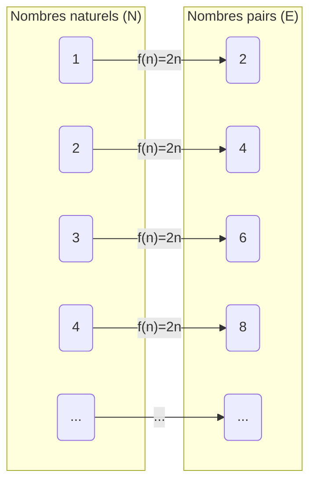
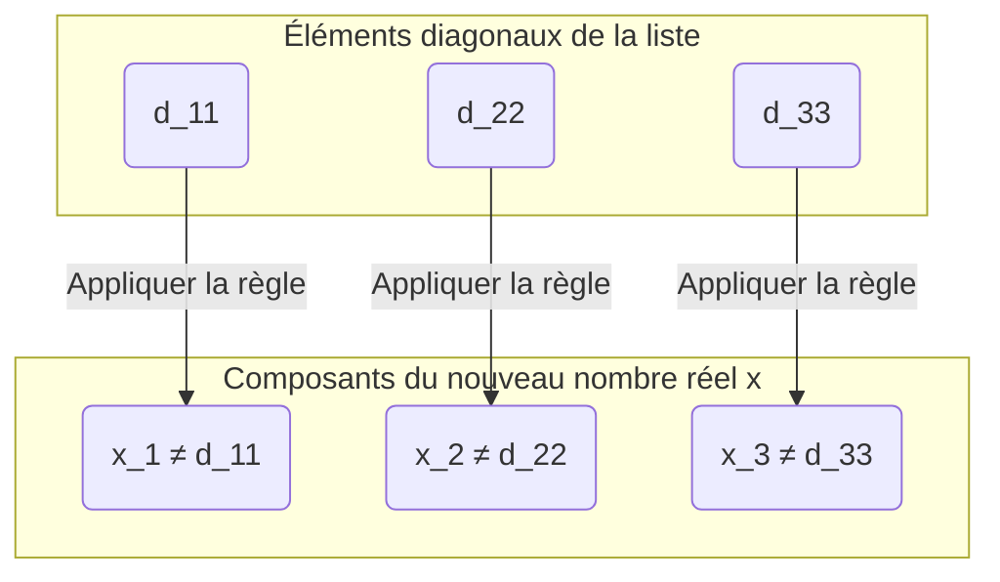

## Introduction : Y a-t-il des « tailles » dans l'infini ?

Le concept d'« infini » auquel nous pensons au quotidien signifie littéralement « sans fin ». Puisque l'on peut continuer à compter les entiers naturels ($1, 2, 3, \dots$) sans limite, leur nombre est infini. D'autre part, les nombres réels (tous les points sur la droite des réels) existent aussi en nombre infini.

Intuitivement, on a tendance à penser que « l'infini est l'infini, et les deux sont également sans fin », mais le mathématicien du XIXe siècle [Georg Cantor](/fr/p/cantor/) a établi un fait étonnant : il existe des différences de cardinalité parmi les ensembles infinis.

Dans cet article, nous expliquons pourquoi l'ensemble des nombres réels a une cardinalité strictement supérieure à celle des entiers naturels, au moyen de l'argument diagonal de Cantor.

---

## La théorie des ensembles de Cantor et la « cardinalité » (Cardinality)

Cantor a introduit le concept de <strong>cardinalité</strong> (Cardinality) pour comparer la « quantité » d'éléments dans des ensembles. Dans le cas d'un ensemble fini, la cardinalité est simplement le nombre d'éléments. Mais comment comparer la taille d'ensembles infinis ?

Cantor a utilisé l'idée de <strong>bijection</strong> (Bijection) . S'il est possible de créer une correspondance biunivoque (bijection) entre deux ensembles $A$ et $B$, il a défini que ces deux ensembles <strong>« ont la même cardinalité »</strong> .

### La cardinalité des entiers naturels et des nombres pairs est-elle la même ?

Par exemple, considérons l'ensemble des entiers naturels $\mathbb{N}$ et l'ensemble des nombres pairs positifs $E$.

$$
\mathbb{N} = \{1, 2, 3, 4, \dots\}
$$
$$
E = \{2, 4, 6, 8, \dots\}
$$

Intuitivement, il semble qu'il n'y ait que la moitié de nombres pairs par rapport aux entiers naturels. Cependant, en utilisant la fonction $f(n) = 2n$, nous pouvons créer une correspondance biunivoque parfaite entre un entier naturel $n$ et un nombre pair $2n$.

Ainsi, dans les ensembles infinis, il existe cette propriété étrange où « une partie a la même taille que le tout ». Un ensemble infini qui peut être mis en correspondance biunivoque avec les entiers naturels de cette manière est dit <strong>infini dénombrable</strong> (Countably infinite) ou ayant la cardinalité de <strong>aleph-zéro</strong> ($\aleph_0$) .

Les nombres rationnels ($\mathbb{Q}$) sont eux aussi dénombrables. On peut énumérer les fractions positives en les classant selon la somme de leur numérateur et de leur dénominateur positifs, en sautant celles déjà rencontrées. Chaque fraction apparaît à une étape finie. En ajoutant 0, puis en alternant les valeurs positives et négatives, on obtient une énumération de tous les rationnels et donc une bijection avec les entiers naturels.

---

## Les nombres réels sont « indénombrables » : le théorème de Cantor

Les entiers naturels, les nombres pairs et les nombres rationnels peuvent tous être « énumérés dans l'ordre ». Alors, est-il également possible de créer une correspondance biunivoque entre les entiers naturels et les <strong>nombres réels</strong> ($\mathbb{R}$) , qui représentent tous les points sur la droite des réels ?

La réponse de Cantor fut <strong>« non »</strong>. Il a montré que les réels ont une cardinalité strictement supérieure à celle des entiers naturels : ils sont <strong>non dénombrables</strong>.

Ce qui a été utilisé pour cette preuve est <strong>l'argument de la diagonale</strong> , souvent considéré comme l'une des plus belles preuves de l'histoire des mathématiques.

---

## Preuve par l'argument de la diagonale

Ici, au lieu de considérer l'ensemble de tous les nombres réels, nous nous limiterons aux nombres réels compris entre 0 et 1 (l'intervalle $(0, 1)$). Si même les nombres réels de cet intervalle sont plus nombreux que les entiers naturels, alors l'ensemble de tous les nombres réels le sera évidemment aussi.

### Hypothèse de la preuve par l'absurde

La preuve utilise un <strong>raisonnement par l'absurde</strong>. Une liste signifie ici une suite mathématique indexée par les entiers naturels : nous ne supposons pas qu'un algorithme en calcule les termes. L'argument exclut toute suite exhaustive, pas seulement celles qui sont calculables.

Pour éviter les écritures décimales ambiguës, nous choisissons toujours une écriture qui ne se termine pas par une suite infinie de 9. Ainsi, pour le même réel $0.5000\dots=0.4999\dots$, nous retenons la première écriture. Supposons que tous les réels de l'intervalle puissent être énumérés ainsi :

$$
r_1 = 0 . \mathbf{d_{11}} d_{12} d_{13} d_{14} \dots
$$
$$
r_2 = 0 . d_{21} \mathbf{d_{22}} d_{23} d_{24} \dots
$$
$$
r_3 = 0 . d_{31} d_{32} \mathbf{d_{33}} d_{34} \dots
$$
$$
\vdots
$$

Ici, $d_{ij}$ représente le $j$-ème chiffre après la virgule (de 0 à 9) du $i$-ème nombre réel de la liste.

### Construction d'un nouveau nombre réel

À partir de cette « liste censée inclure tous les nombres réels », Cantor a montré comment créer un <strong>nouveau nombre réel $x$ qui ne figure absolument pas dans la liste</strong> .

Nous construisons le nouveau nombre réel $x$ comme suit :

$$
x = 0 . x_1 x_2 x_3 x_4 \dots
$$

Chaque chiffre $x_n$ est déterminé en fonction du $n$-ème chiffre décimal (le chiffre sur la diagonale) $d_{nn}$ du $n$-ème nombre de la liste. La règle est très simple.

$$
x_n = \begin{cases}
1 & \text{si } d_{nn} \neq 1 \\
2 & \text{si } d_{nn} = 1
\end{cases}
$$

En d'autres termes, si le chiffre diagonal $d_{nn}$ n'est pas 1, nous choisissons $x_n=1$ ; s'il vaut 1, nous choisissons $x_n=2$. Ainsi, le chiffre obtenu est toujours différent de $d_{nn}$. Comme tous les chiffres de $x$ sont 1 ou 2, son écriture ne se termine pas par une suite de 9 et est unique selon notre convention.

### Déduction d'une contradiction

Le nouveau nombre réel construit $x$ est un nombre réel compris entre 0 et 1. Selon notre hypothèse, la liste est censée contenir « tous les nombres réels entre 0 et 1 », donc $x$ doit également exister quelque part dans la liste, par exemple à la $k$-ème position ($r_k$).

Si $x = r_k$, alors le $k$-ème chiffre décimal de $x$, qui est $x_k$, devrait être égal au $k$-ème chiffre décimal de $r_k$, qui est $d_{kk}$ ($x_k = d_{kk}$).

Cependant, par la définition de $x$ , <strong>$x_k$ a été intentionnellement conçu pour être un chiffre différent de $d_{kk}$ ($x_k \neq d_{kk}$)</strong> .

Ceci est une contradiction. Par conséquent, l'hypothèse initiale selon laquelle « tous les nombres réels peuvent être listés » était fausse.

En conclusion, il n'existe <strong>aucune bijection</strong> entre les réels et les entiers naturels. Comme l'inclusion des entiers naturels dans les réels fournit une injection, les réels ont une cardinalité strictement supérieure. Cette comparaison ne porte ni sur la longueur ni sur la densité sur la droite numérique.

---

## Vers l'hypothèse du continu

L'argument de la diagonale de Cantor a montré qu'il existe des « hiérarchies » au sein de l'infini.
Notons $\aleph_0$ la cardinalité des entiers naturels et $\mathfrak{c}=2^{\aleph_0}$ celle des réels. C'est également la cardinalité de l'ensemble des parties des entiers naturels. La question de savoir si $\mathfrak{c}$ est égal au plus petit cardinal non dénombrable $\aleph_1$ est distincte et n'est pas résolue par l'argument diagonal. On a :

$$
\aleph_0 < 2^{\aleph_0}
$$

Cantor a alors été confronté à une grande question : <strong>« Existe-t-il un ensemble infini dont la cardinalité se situe entre $\aleph_0$ et $2^{\aleph_0}$ ? »</strong>

L'hypothèse selon laquelle il n'existe aucun cardinal intermédiaire est appelée <strong>[hypothèse du continu](/fr/p/continuum-hypothesis/) (CH)</strong>. Dans ZFC, elle équivaut à $2^{\aleph_0}=\aleph_1$.

Plus tard, [Kurt Gödel](/fr/p/godel/) et Paul Cohen ont montré que l'hypothèse du continu est <strong>indépendante de ZFC, à condition que ZFC soit cohérent</strong>. Gödel a établi la cohérence relative de ZFC augmenté de CH, et Cohen celle de ZFC augmenté de sa négation. Ces résultats ne prouvent pas la cohérence de ZFC lui-même et ne signifient pas que CH soit à la fois vraie et fausse.

---

## Conclusion

L'argument de la diagonale de Cantor ressemble à première vue à un simple puzzle, mais il cache en réalité une logique puissante qui s'approche de la « vérité de l'infini ».

1. Une bijection établit l'égalité des cardinalités ; les injections permettent de les comparer.
2. Jusqu'aux nombres rationnels, la taille est la même que celle des entiers naturels (infini dénombrable).
3. En modifiant chaque chiffre diagonal pour construire un nouveau réel, l'argument prouve que la cardinalité des réels est strictement supérieure à celle des entiers naturels.

Cette beauté de la logique, qui défie l'intuition, est l'un des grands attraits des mathématiques. L'argument diagonal sera ensuite appliqué à des théories fondamentales de l'informatique et de la logique mathématique, telles que le [problème de l'arrêt d'Alan Turing](/fr/p/halting-problem/) et les [théorèmes d'incomplétude de Gödel](/fr/p/godels-incompleteness-theorems/).

## Références

- [MIT OpenCourseWare : argument diagonal de Cantor](https://ocw.mit.edu/courses/res-6-012-introduction-to-probability-spring-2018/14b6f97b86d7978a595e402cc54d08d8_YIZd23zGV3M.pdf)
- [Jindřich Zapletal : Elements of Set Theory](https://people.clas.ufl.edu/zapletal/files/notesset.pdf)
- [CMU : 21-602 Introduction to Set Theory I](https://www.math.cmu.edu/~bwsulliv/21602lecturenotes.pdf)
