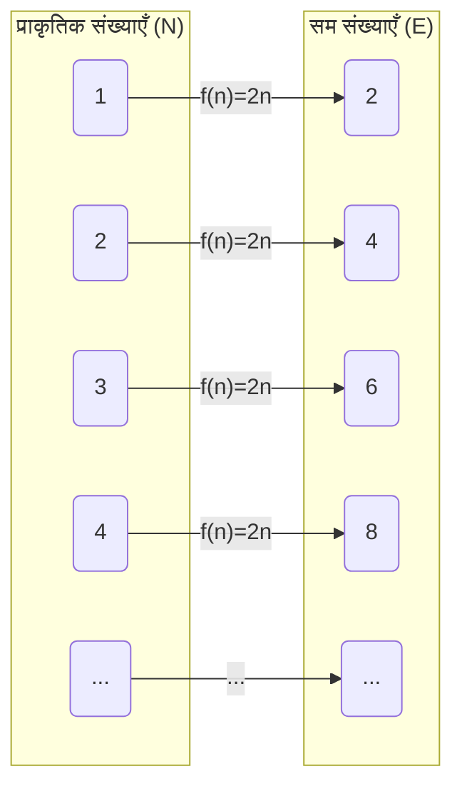
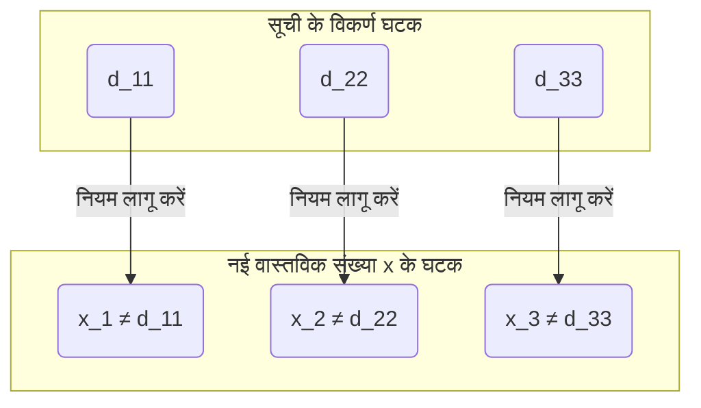

## परिचय: क्या अनंत में भी "छोटा-बड़ा" होता है?

हम अपने दैनिक जीवन में जिस "अनंत" की अवधारणा के बारे में सोचते हैं, उसका शाब्दिक अर्थ है "जिसका कोई अंत न हो"। प्राकृतिक संख्याओं ($1, 2, 3, \dots$) को हम कितना भी गिनते रह सकते हैं, इसलिए उनकी संख्या अनंत है। दूसरी ओर, वास्तविक संख्याएँ (संख्या रेखा पर सभी बिंदु) भी उसी प्रकार अनंत रूप से मौजूद हैं।

सहज रूप से हम यह मानने लगते हैं कि "अनंत तो अनंत है, और दोनों का समान रूप से कोई अंत नहीं है", लेकिन 19वीं सदी के गणितज्ञ [जॉर्ज कैंटर](/hi/p/cantor/) ने दिखाया कि अनंत समुच्चयों के आकार अलग-अलग हो सकते हैं।

इस लेख में हम कैंटर के विकर्ण तर्क से समझाते हैं कि वास्तविक संख्याओं के समुच्चय का आकार प्राकृतिक संख्याओं के समुच्चय से वास्तव में बड़ा क्यों है।

---

## कैंटर का समुच्चय सिद्धांत और समुच्चय का आकार

समुच्चय का आकार (cardinality) उसके अवयवों की संख्या बताता है। किसी परिमित समुच्चय के लिए यह बस उसके अवयवों की गिनती है। लेकिन अनंत समुच्चयों के आकार की तुलना कैसे करें?

दो समुच्चयों $A$ और $B$ के बीच यदि एकैकी आच्छादन (bijection) हो, तो उन दोनों का आकार समान होता है।

### क्या प्राकृतिक संख्याओं और सम संख्याओं का आकार समान है?

उदाहरण के लिए, मान लीजिए प्राकृतिक संख्याओं का समुच्चय $\mathbb{N}$ और धनात्मक सम संख्याओं का समुच्चय $E$ है।

$$
\mathbb{N} = \{1, 2, 3, 4, \dots\}
$$
$$
E = \{2, 4, 6, 8, \dots\}
$$

सहज रूप से, ऐसा लगता है कि सम संख्याएँ प्राकृतिक संख्याओं की केवल आधी ही मौजूद हैं। हालाँकि, फलन (function) $f(n) = 2n$ का उपयोग करके, हम प्राकृतिक संख्या $n$ और सम संख्या $2n$ के बीच पूर्ण एक-से-एक पत्राचार बना सकते हैं।

इस प्रकार, अनंत समुच्चयों में यह एक अजीबोगरीब गुण होता है कि "भाग का आकार संपूर्ण के आकार के समान होता है"। जिस अनंत समुच्चय और प्राकृतिक संख्याओं के बीच एकैकी आच्छादन हो, उसे <strong>गणनीय अनंत</strong> कहते हैं; उसकी गणन संख्या <strong>$\aleph_0$</strong> होती है।

परिमेय संख्याएँ ($\mathbb{Q}$) भी गणनीय अनंत हैं। धनात्मक भिन्नों को उनके अंश और हर के योग के बढ़ते क्रम में रखकर, पहले से आ चुकी भिन्नों को छोड़ते हुए सूचीबद्ध किया जा सकता है। हर भिन्न किसी सीमित चरण पर आ जाती है। 0 को जोड़कर तथा धनात्मक और ऋणात्मक भिन्नों को बारी-बारी रखने से सभी परिमेय संख्याओं की सूची मिलती है, यानी प्राकृतिक संख्याओं के साथ एकैकी आच्छादन।

---

## वास्तविक संख्याएँ अगणनीय हैं: कैंटर का विकर्ण तर्क

प्राकृतिक संख्याओं, सम संख्याओं और परिमेय संख्याओं को, इन सभी को "क्रमशः गिना" जा सकता है। तो, क्या संख्या रेखा के सभी बिंदुओं को दर्शाने वाली <strong>वास्तविक संख्याओं ($\mathbb{R}$)</strong> और प्राकृतिक संख्याओं के बीच एकैकी आच्छादन हो सकता है?

कैंटर का उत्तर <strong>"नहीं"</strong> था। उन्होंने दिखाया कि वास्तविक संख्याओं का आकार प्राकृतिक संख्याओं से वास्तव में बड़ा है; इसलिए वे <strong>अगणनीय</strong> हैं।

इसके प्रमाण में उपयोग की जाने वाली विधि को गणित के इतिहास में सबसे सुंदर प्रमाणों में से एक कहा जाता है, जो <strong>विकर्ण तर्क</strong> है।

---

## विकर्ण तर्क द्वारा प्रमाण

यहाँ सभी वास्तविक संख्याओं के बजाय हम 0 और 1 के बीच की संख्याओं (अंतराल $(0,1)$) पर विचार करेंगे। यदि इस अंतराल की वास्तविक संख्याओं का समुच्चय प्राकृतिक संख्याओं से बड़ा है, तो पूरा वास्तविक संख्या समुच्चय भी उनसे बड़ा होगा।

### विरोधाभास द्वारा प्रमाण

इस प्रमाण में <strong>विरोधाभास की विधि</strong> अपनाई जाती है। यहाँ सूची का अर्थ प्राकृतिक संख्याओं से अनुक्रमित कोई भी गणितीय अनुक्रम है; हम यह नहीं मानते कि उसके पदों की गणना करने वाला कोई एल्गोरिदम मौजूद है। यह तर्क हर पूर्ण सूची को असंभव ठहराता है, केवल उन सूचियों को नहीं जिनके पद एल्गोरिदम से गणना किए जा सकते हैं।

दशमलव निरूपण की अस्पष्टता से बचने के लिए हम ऐसा निरूपण चुनते हैं जो किसी बिंदु के बाद केवल 9 अंकों से बना न हो। इसलिए एक ही संख्या $0.5000\dots=0.4999\dots$ के लिए हम पहला निरूपण लेते हैं। मान लें कि अंतराल की सभी संख्याओं को इस तरह सूचीबद्ध किया जा सकता है:

$$
r_1 = 0 . \mathbf{d_{11}} d_{12} d_{13} d_{14} \dots
$$
$$
r_2 = 0 . d_{21} \mathbf{d_{22}} d_{23} d_{24} \dots
$$
$$
r_3 = 0 . d_{31} d_{32} \mathbf{d_{33}} d_{34} \dots
$$
$$
\vdots
$$

यहाँ $d_{ij}$ सूची की $i$-वीं वास्तविक संख्या के दशमलव बिंदु के बाद का $j$-वाँ अंक (0 से 9 तक) है।

### नई वास्तविक संख्या का निर्माण

कैंटर ने दिखाया कि इस "सभी वास्तविक संख्याओं को शामिल करने वाली सूची" से <strong>एक ऐसी नई वास्तविक संख्या $x$ बनाई जा सकती है जो सूची में नहीं है</strong>.

नई वास्तविक संख्या $x$ इस प्रकार बनाई जाती है:

$$
x = 0 . x_1 x_2 x_3 x_4 \dots
$$

प्रत्येक अंक $x_n$ सूची की $n$-वीं संख्या के दशमलव के बाद $n$-वें स्थान के अंक (विकर्ण पर स्थित अंक) $d_{nn}$ के आधार पर निर्धारित किया जाता है। नियम बहुत सरल है।

$$
x_n = \begin{cases}
1 & \text{यदि } d_{nn} \neq 1 \\
2 & \text{यदि } d_{nn} = 1
\end{cases}
$$

अर्थात, यदि विकर्ण का अंक $d_{nn}$ 1 नहीं है, तो $x_n=1$ चुनें; यदि वह 1 है, तो $x_n=2$ चुनें। इस तरह चुना गया अंक हमेशा $d_{nn}$ से अलग होता है। $x$ के सभी अंक 1 या 2 हैं, इसलिए उसका दशमलव निरूपण अंततः केवल 9 अंकों वाला नहीं होता और हमारी परंपरा के अनुसार अद्वितीय है।

### विरोधाभास का निष्कर्ष

निर्मित नई वास्तविक संख्या $x$, 0 और 1 के बीच की एक वास्तविक संख्या है। धारणा के अनुसार, सूची में "0 और 1 के बीच की सभी वास्तविक संख्याएँ" शामिल होनी चाहिए, इसलिए $x$ भी सूची में कहीं न कहीं, उदाहरण के लिए $k$-वें स्थान ($r_k$) पर, मौजूद होनी चाहिए।

यदि $x = r_k$ है, तो $x$ के दशमलव के बाद $k$-वें स्थान का अंक $x_k$, $r_k$ के दशमलव के बाद $k$-वें स्थान के अंक $d_{kk}$ के बराबर होना चाहिए ($x_k = d_{kk}$)।

हालाँकि, $x$ की परिभाषा के अनुसार, <strong>$x_k$ जानबूझकर इस तरह बनाया गया है कि यह $d_{kk}$ से भिन्न अंक हो ($x_k \neq d_{kk}$)</strong> ।

यह एक विरोधाभास है। इसलिए अंतराल की सभी वास्तविक संख्याओं को सूचीबद्ध करने की प्रारंभिक धारणा गलत थी। अतः अंतराल $(0,1)$ में स्थित वास्तविक संख्याओं का समुच्चय अगणनीय है। चूँकि यह पूरे वास्तविक संख्या समुच्चय का उपसमुच्चय है, पूरा समुच्चय भी अगणनीय है।

अतः <strong>वास्तविक संख्याओं और प्राकृतिक संख्याओं के बीच कोई एकैकी आच्छादन नहीं है</strong>। प्राकृतिक संख्याओं का वास्तविक संख्याओं में समावेशन एक-एक फलन देता है, इसलिए वास्तविक संख्याओं का आकार वास्तव में बड़ा है। यह तुलना संख्या रेखा की लंबाई या घनत्व के बारे में नहीं है।

---

## सातत्य परिकल्पना की ओर

कैंटर के विकर्ण तर्क ने दिखाया कि अनंत के भीतर एक पदानुक्रम मौजूद है।
प्राकृतिक संख्याओं का आकार $\aleph_0$ और वास्तविक संख्याओं का आकार $\mathfrak{c}=2^{\aleph_0}$ लिखें। यह प्राकृतिक संख्याओं के घात समुच्चय का आकार भी है। क्या $\mathfrak{c}$ सबसे छोटी अगणनीय गणन संख्या $\aleph_1$ के बराबर है, यह अलग प्रश्न है; विकर्ण तर्क इसका उत्तर नहीं देता। हम जानते हैं कि:

$$
\aleph_0 < 2^{\aleph_0}
$$

तब कैंटर के सामने एक बड़ा प्रश्न था: <strong>"क्या $\aleph_0$ और $2^{\aleph_0}$ के बीच के आकार वाला कोई अनंत समुच्चय मौजूद है?"</strong>

"बीच की कोई गणन संख्या नहीं है"—इस परिकल्पना को <strong>[सातत्य परिकल्पना](/hi/p/continuum-hypothesis/) (CH)</strong> कहते हैं। ZFC में यह $2^{\aleph_0}=\aleph_1$ के समतुल्य है।

बाद में, [कुर्त गोडेल](/hi/p/godel/) और पॉल कोहेन ने दिखाया कि <strong>यदि ZFC सुसंगत है, तो सातत्य परिकल्पना ZFC से स्वतंत्र है</strong>। गोडेल ने CH जोड़ने पर सापेक्ष सुसंगतता दिखाई और कोहेन ने CH का निषेध जोड़ने पर सापेक्ष सुसंगतता दिखाई। ये परिणाम स्वयं ZFC की सुसंगतता सिद्ध नहीं करते और न ही इसका अर्थ है कि CH एक साथ सत्य और असत्य है।

---

## निष्कर्ष

कैंटर का विकर्ण तर्क, पहली नज़र में एक साधारण पहेली की तरह लग सकता है, लेकिन इसके पीछे अनंत के बारे में एक सशक्त तर्क है।

1. एकैकी आच्छादन समान आकार दिखाता है; एक-एक फलन आकारों की तुलना करने में मदद करता है।
2. प्राकृतिक और परिमेय संख्याओं का आकार समान है; दोनों गणनीय अनंत हैं।
3. विकर्ण के प्रत्येक अंक को बदलकर नई संख्या बनाने से सिद्ध होता है कि वास्तविक संख्याओं का आकार प्राकृतिक संख्याओं से वास्तव में बड़ा है।

यह सहज बोध को चुनौती देने वाला तर्क गणित के आकर्षक विचारों में से एक है। विकर्ण तर्क कंप्यूटर विज्ञान और गणितीय तर्कशास्त्र के महत्वपूर्ण परिणामों में भी दिखाई देता है, जैसे [एलन ट्यूरिंग की हाल्टिंग समस्या](/hi/p/halting-problem/) और [गोडेल के अपूर्णता प्रमेय](/hi/p/godels-incompleteness-theorems/).

## संदर्भ

- [MIT OpenCourseWare: कैंटर का विकर्ण तर्क](https://ocw.mit.edu/courses/res-6-012-introduction-to-probability-spring-2018/14b6f97b86d7978a595e402cc54d08d8_YIZd23zGV3M.pdf)
- [Jindřich Zapletal: Elements of Set Theory](https://people.clas.ufl.edu/zapletal/files/notesset.pdf)
- [CMU: 21-602 Introduction to Set Theory I](https://www.math.cmu.edu/~bwsulliv/21602lecturenotes.pdf)
