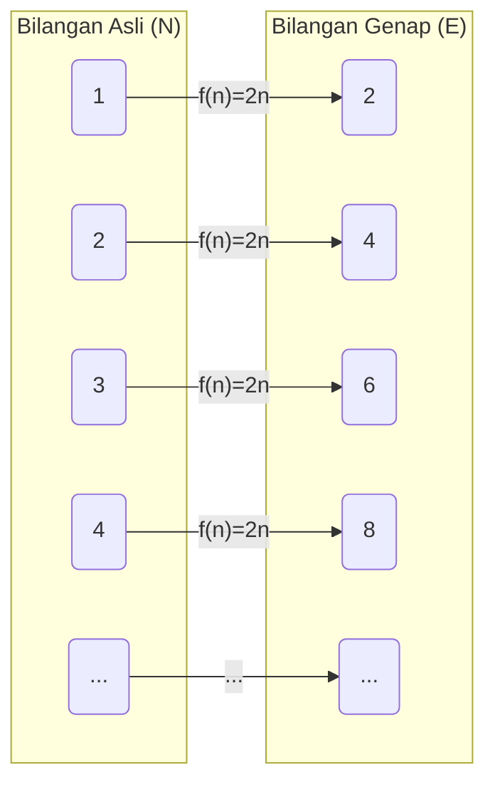
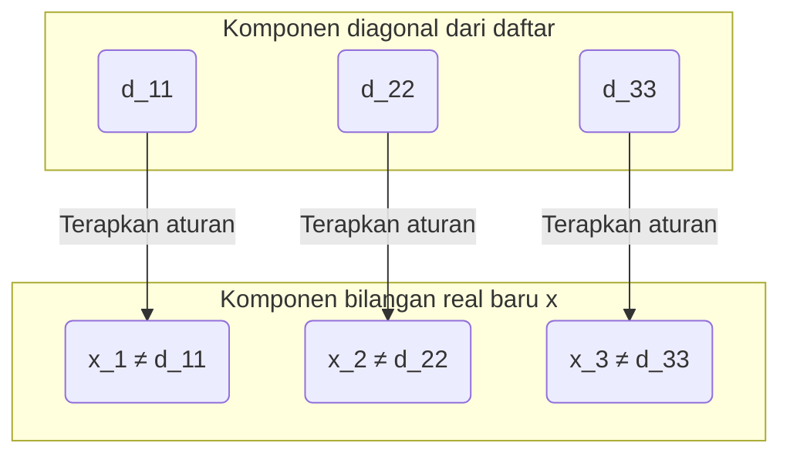

## Pengantar: Apakah Ketakterhinggaan Memiliki "Besaran"?

Konsep "ketakterhinggaan" yang kita pikirkan sehari-hari secara harfiah berarti "tidak memiliki ujung". Karena bilangan asli ($1, 2, 3, \dots$) dapat terus dihitung tanpa batas, jumlahnya adalah tak terhingga. Di sisi lain, bilangan real (semua titik pada garis bilangan) juga ada secara tak terhingga.

Secara intuitif, kita cenderung berpikir bahwa "tak terhingga adalah tak terhingga, dan keduanya sama-sama tidak memiliki ujung", tetapi matematikawan abad ke-19 [Georg Cantor](/id/p/cantor/) menunjukkan bahwa himpunan tak terhingga dapat memiliki kardinalitas yang berbeda.

Dalam artikel ini, kami menjelaskan mengapa kardinalitas himpunan bilangan real lebih besar daripada kardinalitas bilangan asli dengan menggunakan argumen diagonal Cantor.

---

## Teori Himpunan Cantor dan "Kardinalitas (Cardinality)"

Cantor memperkenalkan konsep <strong>Kardinalitas (Cardinality)</strong> untuk membandingkan "jumlah" elemen dalam sebuah himpunan. Dalam kasus himpunan berhingga, kardinalitas hanyalah jumlah elemennya. Namun, bagaimana cara kita membandingkan besaran himpunan tak terhingga?

Cantor menggunakan gagasan <strong>bijeksi</strong>. Jika ada korespondensi satu-satu antara dua himpunan $A$ dan $B$, keduanya dikatakan <strong>memiliki kardinalitas yang sama</strong>.

### Apakah Kardinalitas Bilangan Asli dan Bilangan Genap Sama?

Sebagai contoh, mari kita pertimbangkan himpunan bilangan asli $\mathbb{N}$ dan himpunan bilangan genap positif $E$.

$$
\mathbb{N} = \{1, 2, 3, 4, \dots\}
$$
$$
E = \{2, 4, 6, 8, \dots\}
$$

Secara intuitif, bilangan genap tampaknya hanya berjumlah setengah dari bilangan asli. Namun, dengan menggunakan fungsi $f(n) = 2n$, kita dapat membuat korespondensi satu-satu yang sempurna antara bilangan asli $n$ dan bilangan genap $2n$.

Dengan demikian, himpunan tak terhingga memiliki sifat aneh di mana "bagian memiliki besaran yang sama dengan keseluruhan". Himpunan tak terhingga yang dapat dipasangkan satu-satu dengan bilangan asli dengan cara ini disebut <strong>terhitung tak terhingga</strong> atau memiliki kardinalitas <strong>Aleph-nol ($\aleph_0$)</strong> .

Bilangan rasional ($\mathbb{Q}$) juga terhitung. Kita dapat mengurutkan pecahan positif berdasarkan jumlah pembilang dan penyebut positifnya, sambil melewati pecahan yang sudah tercantum. Setiap pecahan akan muncul setelah sejumlah langkah yang terbatas. Dengan menambahkan 0 lalu menyelang-selingkan pecahan positif dan negatif, kita memperoleh daftar semua bilangan rasional, sehingga ada bijeksi dengan bilangan asli.

---

## Bilangan Real Tidak Terhitung: Argumen Diagonal Cantor

Bilangan asli, bilangan genap, maupun bilangan rasional, semuanya dapat "dihitung secara berurutan". Lalu, apakah <strong>bilangan real ($\mathbb{R}$)</strong> yang merepresentasikan semua titik pada garis bilangan, juga dapat membentuk korespondensi satu-satu dengan bilangan asli?

Jawaban Cantor adalah <strong>"Tidak"</strong>. Ia menunjukkan bahwa bilangan real memiliki kardinalitas yang lebih besar daripada bilangan asli, sehingga bilangan real <strong>tidak terhitung</strong>.

Metode yang digunakan dalam pembuktian tersebut disebut <strong>Argumen Diagonal</strong> , yang dikenal sebagai salah satu pembuktian paling indah dalam sejarah matematika.

---

## Pembuktian Menggunakan Argumen Diagonal

Di sini, kita tidak akan mempertimbangkan seluruh bilangan real, melainkan hanya bilangan real antara 0 dan 1 (interval $(0, 1)$). Jika jumlah bilangan real dalam interval ini saja sudah lebih banyak daripada bilangan asli, maka tentu saja jumlah keseluruhan bilangan real juga lebih banyak daripada bilangan asli.

### Asumsi Kontradiksi

Pembuktian ini menggunakan <strong>kontradiksi</strong>. Daftar di sini berarti barisan matematika apa pun yang indeksnya bilangan asli; kita tidak mengandaikan adanya algoritma untuk menghitung suku-sukunya. Argumen ini menolak setiap barisan yang memuat semua bilangan tersebut, bukan hanya barisan yang dapat dihitung secara komputasional.

Untuk menghindari representasi desimal yang ambigu, kita memilih representasi yang tidak berakhir dengan deretan angka 9 tanpa akhir. Jadi, untuk bilangan yang sama $0.5000\dots=0.4999\dots$, kita memilih representasi pertama. Andaikan semua bilangan di dalam interval dapat didaftarkan seperti ini:

$$
r_1 = 0 . \mathbf{d_{11}} d_{12} d_{13} d_{14} \dots
$$
$$
r_2 = 0 . d_{21} \mathbf{d_{22}} d_{23} d_{24} \dots
$$
$$
r_3 = 0 . d_{31} d_{32} \mathbf{d_{33}} d_{34} \dots
$$
$$
\vdots
$$

Di sini, $d_{ij}$ adalah digit ke-$j$ setelah tanda desimal (0 sampai 9) dari bilangan real ke-$i$ dalam daftar.

### Membangun Bilangan Real Baru

Cantor menunjukkan cara untuk membuat <strong>bilangan real baru $x$ yang pasti tidak ada dalam daftar</strong> dari "daftar yang seharusnya mencakup semua bilangan real" ini.

Kita membangun bilangan real baru $x$ sebagai berikut:

$$
x = 0 . x_1 x_2 x_3 x_4 \dots
$$

Digit setiap posisinya, $x_n$, ditentukan berdasarkan digit ke-$n$ di belakang koma dari bilangan ke-$n$ dalam daftar (digit pada garis diagonal) yaitu $d_{nn}$. Aturannya sangat sederhana.

$$
x_n = \begin{cases}
1 & \text{jika } d_{nn} \neq 1 \\
2 & \text{jika } d_{nn} = 1
\end{cases}
$$

Artinya, jika digit diagonal $d_{nn}$ bukan 1, pilih $x_n=1$; jika digit itu 1, pilih $x_n=2$. Digit yang dipilih selalu berbeda dari $d_{nn}$. Karena digit $x$ hanya 1 atau 2, representasinya tidak berakhir dengan deretan angka 9 dan unik menurut konvensi kita.

### Mendapatkan Kontradiksi

Bilangan real baru $x$ yang dibangun adalah bilangan real antara 0 dan 1. Menurut asumsi, daftar tersebut seharusnya mencakup "semua bilangan real antara 0 dan 1", jadi $x$ juga harus ada di suatu tempat dalam daftar, misalnya pada urutan ke-$k$ ($r_k$).

Jika $x = r_k$, maka digit ke-$k$ di belakang koma dari $x$, yaitu $x_k$, seharusnya sama dengan digit ke-$k$ di belakang koma dari $r_k$, yaitu $d_{kk}$ ($x_k = d_{kk}$).

Namun, berdasarkan definisi $x$, <strong>$x_k$ sengaja dibuat agar menjadi angka yang berbeda dari $d_{kk}$ ($x_k \neq d_{kk}$)</strong> .

Ini adalah sebuah kontradiksi. Oleh karena itu, asumsi awal bahwa "semua bilangan real dapat didaftarkan" adalah salah.

Kesimpulannya, <strong>tidak ada bijeksi</strong> antara bilangan real dan bilangan asli. Inklusi bilangan asli ke dalam bilangan real merupakan injeksi, sehingga kardinalitas bilangan real benar-benar lebih besar. Perbandingan ini bukan tentang panjang atau kepadatan pada garis bilangan.

---

## Menuju Hipotesis Kontinum

Argumen diagonal Cantor menunjukkan bahwa ada hierarki di antara ukuran himpunan tak terhingga. Nyatakan kardinalitas bilangan asli sebagai $\aleph_0$ dan kardinalitas bilangan real sebagai $\mathfrak{c}=2^{\aleph_0}$. Kardinalitas ini juga sama dengan kardinalitas himpunan kuasa bilangan asli. Apakah $\mathfrak{c}$ sama dengan kardinal tak terhitung terkecil $\aleph_1$ adalah pertanyaan tersendiri yang tidak dijawab oleh argumen diagonal. Hubungannya adalah:

$$
\aleph_0 < 2^{\aleph_0}
$$

Cantor kemudian menghadapi pertanyaan besar: <strong>"Apakah ada himpunan tak terhingga yang kardinalitasnya berada di antara $\aleph_0$ dan $2^{\aleph_0}$?"</strong>

Hipotesis bahwa tidak ada kardinalitas perantara disebut <strong>[Hipotesis Kontinum](/id/p/continuum-hypothesis/) (CH)</strong>. Dalam ZFC, pernyataan ini ekuivalen dengan $2^{\aleph_0}=\aleph_1$.

Belakangan, [Kurt Gödel](/id/p/godel/) dan Paul Cohen menunjukkan bahwa <strong>Hipotesis Kontinum independen dari ZFC, dengan syarat ZFC konsisten</strong>. Gödel membuktikan konsistensi relatif ZFC yang ditambah CH, sedangkan Cohen membuktikan konsistensi relatif ZFC yang ditambah negasi CH. Hasil ini tidak membuktikan konsistensi ZFC itu sendiri dan tidak berarti bahwa CH sekaligus benar dan salah.

---

## Kesimpulan

Argumen diagonal Cantor sekilas tampak seperti teka-teki sederhana, tetapi mengandung penalaran yang kuat tentang ketakterhinggaan.

1. Bijeksi menunjukkan kardinalitas yang sama; injeksi memungkinkan perbandingan kardinalitas.
2. Hingga pada bilangan rasional, besarannya sama dengan bilangan asli (tak terhingga terhitung).
3. Dengan mengubah setiap digit diagonal untuk membentuk bilangan baru, argumen ini membuktikan bahwa kardinalitas bilangan real lebih besar daripada kardinalitas bilangan asli.

Penalaran yang menantang intuisi ini merupakan salah satu hal menarik dalam matematika. Argumen diagonal juga muncul dalam hasil-hasil mendasar ilmu komputer dan logika matematika, seperti [masalah penghentian Alan Turing](/id/p/halting-problem/) dan [teorema ketaklengkapan Gödel](/id/p/godels-incompleteness-theorems/).

## Referensi

- [MIT OpenCourseWare: argumen diagonal Cantor](https://ocw.mit.edu/courses/res-6-012-introduction-to-probability-spring-2018/14b6f97b86d7978a595e402cc54d08d8_YIZd23zGV3M.pdf)
- [Jindřich Zapletal: Elements of Set Theory](https://people.clas.ufl.edu/zapletal/files/notesset.pdf)
- [CMU: 21-602 Introduction to Set Theory I](https://www.math.cmu.edu/~bwsulliv/21602lecturenotes.pdf)
