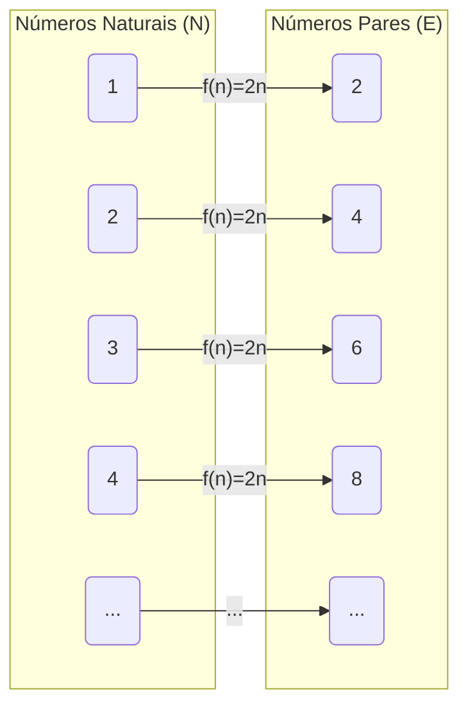
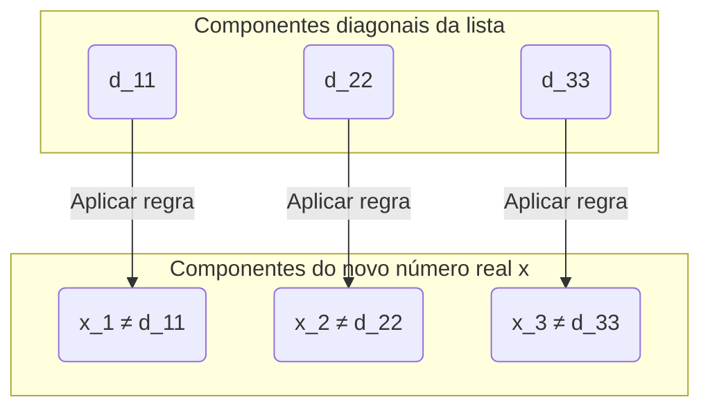

## Introdução: Existem "tamanhos" diferentes para o infinito?

O conceito de "infinito" que pensamos no dia a dia significa literalmente que "não tem fim". Os números naturais ($1, 2, 3, \dots$) podem continuar a ser contados para sempre, portanto o seu número é infinito. Por outro lado, os números reais (todos os pontos numa reta numérica) também existem infinitamente.

Intuitivamente, tendemos a pensar que "o infinito é o infinito, e ambos não têm fim da mesma forma", mas o matemático do século XIX [Georg Cantor](/pt/p/cantor/) provou o fato surpreendente de que "existem diferenças de tamanho (cardinalidade) no infinito" .

Neste artigo, explicaremos por que a cardinalidade dos reais é estritamente maior que a dos naturais, usando o argumento diagonal (Diagonal Argument) , um método de prova inovador criado por Cantor.

---

## Teoria dos Conjuntos de Cantor e "Cardinalidade (Cardinality)"

Cantor introduziu o conceito de Cardinalidade (Cardinality) para comparar a "quantidade" de elementos nos conjuntos. No caso de um conjunto finito, a cardinalidade é simplesmente o número de elementos. No entanto, como podemos comparar os tamanhos de conjuntos infinitos?

Cantor usou a ideia de Bijeção (Bijection) . Se uma correspondência um-para-um (bijeção) puder ser criada entre dois conjuntos $A$ e $B$, ele definiu que esses dois conjuntos "têm a mesma cardinalidade" .

### A cardinalidade dos números naturais e dos números pares é a mesma?

Adotamos aqui a convenção de que os naturais começam em 1. Consideremos o conjunto $\mathbb{N}$ dos naturais e o conjunto $E$ dos pares positivos.

$$
\mathbb{N} = \{1, 2, 3, 4, \dots\}
$$
$$
E = \{2, 4, 6, 8, \dots\}
$$

Intuitivamente, parece que existem apenas metade dos números pares em comparação aos números naturais. No entanto, usando a função $f(n) = 2n$, podemos criar uma correspondência um-para-um perfeita entre um número natural $n$ e um número par $2n$.

Dessa forma, os conjuntos infinitos têm a propriedade estranha de que "a parte tem o mesmo tamanho que o todo". Um conjunto infinito que pode ser colocado em correspondência um-para-um com os números naturais dessa maneira é chamado de infinito enumerável (Countably infinite) ou diz-se que tem a cardinalidade de Aleph-nulo ($\aleph_0$) .

Os racionais ($\mathbb{Q}$) também são enumeráveis. Ordene as frações positivas pela soma do numerador e do denominador positivos e descarte valores que já apareceram. Toda fração aparece em um número finito de etapas. Acrescente o zero e intercale valores positivos e negativos para enumerar todos os racionais e obter uma bijeção com os naturais.

---

## Os números reais são "inumeráveis": O Teorema de Cantor

Números naturais, números pares e números racionais podem todos ser "contados em ordem". Então, será que os números reais ($\mathbb{R}$) , que representam todos os pontos na reta numérica, também podem formar uma correspondência um-para-um com os números naturais?

A resposta de Cantor foi "não" . Ele mostrou que a cardinalidade dos reais é estritamente maior que a dos naturais, ou seja, são infinitos não enumeráveis (Uncountably infinite) .

O Argumento de [Diagonalização](/pt/p/diagonalization-and-jordan-normal-form/) , chamado de uma das provas mais belas da história da matemática, foi usado para provar isso.

---

## Prova usando o Argumento de Diagonalização

Aqui, não vamos considerar todos os números reais, mas nos limitar aos números reais entre 0 e 1 (intervalo $(0, 1)$). Se houver mais números reais apenas neste intervalo do que números naturais, todos os números reais naturalmente serão mais numerosos do que os números naturais.

### A suposição da Prova por Contradição

A prova usa Prova por contradição (Proof by contradiction) .
Uma lista aqui é uma sequência matemática indexada pelos naturais; não supomos que exista um algoritmo para calcular seus termos. O argumento exclui toda sequência exaustiva, não apenas as computáveis.

Para evitar representações decimais duplicadas, não usaremos expansões que a partir de certa posição contenham apenas noves. Por exemplo, para $0.5000\dots=0.4999\dots$, escolhemos a primeira. Com essa convenção, suponhamos que todos os reais entre 0 e 1 possam ser listados assim:

Uma lista aqui é uma sequência matemática indexada pelos naturais; não supomos que exista um algoritmo para calcular seus termos. O argumento exclui qualquer sequência exaustiva, não apenas as computáveis.

Para evitar representações decimais duplicadas, não usaremos expansões que a partir de certa posição contenham apenas noves. Por exemplo, para $0.5000\dots=0.4999\dots$, escolhemos a primeira. Com essa convenção, suponhamos que todos os reais entre 0 e 1 possam ser listados assim.

$$
r_1 = 0 . \mathbf{d_{11}} d_{12} d_{13} d_{14} \dots
$$
$$
r_2 = 0 . d_{21} \mathbf{d_{22}} d_{23} d_{24} \dots
$$
$$
r_3 = 0 . d_{31} d_{32} \mathbf{d_{33}} d_{34} \dots
$$
$$
\vdots
$$

Aqui, $d_{ij}$ representa o dígito na $j$-ésima casa decimal do $i$-ésimo número real (0 a 9).

### A construção de um novo número real x

A partir desta "lista que deveria abranger todos os números reais", Cantor mostrou como criar um novo número real $x$ que absolutamente não está na lista .

Construímos o novo número real $x$ da seguinte maneira:

$$
x = 0 . x_1 x_2 x_3 x_4 \dots
$$

Cada dígito $x_n$ é determinado com base no dígito $d_{nn}$ na $n$-ésima casa decimal do $n$-ésimo número da lista (o número na diagonal). A regra é muito simples.

$$
x_n = \begin{cases}
1 & \text{se } d_{nn} \neq 1 \\
2 & \text{se } d_{nn} = 1
\end{cases}
$$

Em outras palavras, se o dígito diagonal $d_{nn}$ não for 1, fazemos $x_n$ ser 1, e se for 1, fazemos ser 2. A nova expansão usa apenas 1 e 2 e, portanto, não termina em uma cauda infinita de zeros nem de noves. Sua representação decimal é única; assim, diferir em um algarismo implica representar reais diferentes.

### Derivando a contradição

O novo número real $x$ que construímos é um número real entre 0 e 1. De acordo com a suposição, a lista deve cobrir "todos os números reais entre 0 e 1", então $x$ também deve existir em algum lugar da lista, por exemplo, como o $k$-ésimo número ($r_k$).

Se $x = r_k$, o dígito $x_k$ na $k$-ésima casa decimal de $x$ deve ser igual ao dígito $d_{kk}$ na $k$-ésima casa decimal de $r_k$ ($x_k = d_{kk}$).

No entanto, pela definição de $x$, $x_k$ é intencionalmente feito para ser um número diferente de $d_{kk}$ ($x_k \neq d_{kk}$) .

Isso é uma contradição. Portanto, a suposição inicial de que "todos os números reais podem ser listados" estava incorreta.

Em conclusão, foi provado que não existe uma bijeção entre os reais e os naturais. A inclusão dos naturais nos reais é uma injeção; portanto, a cardinalidade dos reais é estritamente maior. Essa comparação não se refere ao comprimento nem à densidade na reta numérica.

---

## O caminho para a hipótese do contínuo (Continuum Hypothesis)

O argumento de diagonalização de Cantor mostrou que existem "hierarquias" no infinito.
Escrevamos a cardinalidade dos naturais como $\aleph_0$ e a dos reais como $\mathfrak{c}=2^{\aleph_0}$. Esta também é a cardinalidade do conjunto das partes dos naturais. Se ela é igual ao menor cardinal não enumerável $\aleph_1$ é outra questão, que o argumento diagonal não resolve. Temos:

$$
\aleph_0 < 2^{\aleph_0}
$$

Aqui, Cantor enfrentou uma enorme questão. "Existe um conjunto infinito com uma cardinalidade intermediária entre $\aleph_0$ e $2^{\aleph_0}$?"

A hipótese de que "não existe cardinalidade intermediária" é chamada de [Hipótese do Contínuo](/pt/p/continuum-hypothesis/) ([Continuum Hypothesis](/pt/p/continuum-hypothesis/), CH) . Em ZFC, isso equivale a afirmar que $2^{\aleph_0}=\aleph_1$.

Mais tarde, [Kurt Gödel](/pt/p/godel/) e Paul Cohen mostraram que a hipótese do contínuo é independente de ZFC, supondo que ZFC é consistente. Gödel estabeleceu a consistência relativa de acrescentar CH, e Cohen a de acrescentar sua negação. Isso não prova a consistência de ZFC nem significa que CH seja verdadeira e falsa ao mesmo tempo.

---

## Resumo

O argumento de diagonalização de Cantor parece um quebra-cabeça simples à primeira vista, mas por trás dele esconde-se uma lógica poderosa que se aproxima da "verdade do infinito".

1. Bijeções expressam cardinalidades iguais; injeções permitem comparar cardinalidades.
2. Os naturais e os racionais são enumeráveis.
3. Ao alterar cada algarismo diagonal para construir um real novo, prova-se que a cardinalidade dos reais é estritamente maior que a dos naturais.

A beleza desta lógica contraintuitiva, porém absoluta, pode ser considerada o maior encanto da disciplina da matemática. O argumento de diagonalização seria posteriormente aplicado a teorias que formam o núcleo da ciência da computação e da lógica matemática, como o problema da parada de [Alan Turing](/pt/p/turing/) e a prova do teorema da incompletude de Gödel.

## Referências

- [MIT OCW: Cantor’s diagonalization argument](https://ocw.mit.edu/courses/res-6-012-introduction-to-probability-spring-2018/14b6f97b86d7978a595e402cc54d08d8_YIZd23zGV3M.pdf)
- [Jindřich Zapletal: Elements of Set Theory](https://people.clas.ufl.edu/zapletal/files/notesset.pdf)
- [CMU: 21-602 Intro to Set Theory I](https://www.math.cmu.edu/~bwsulliv/21602lecturenotes.pdf)
