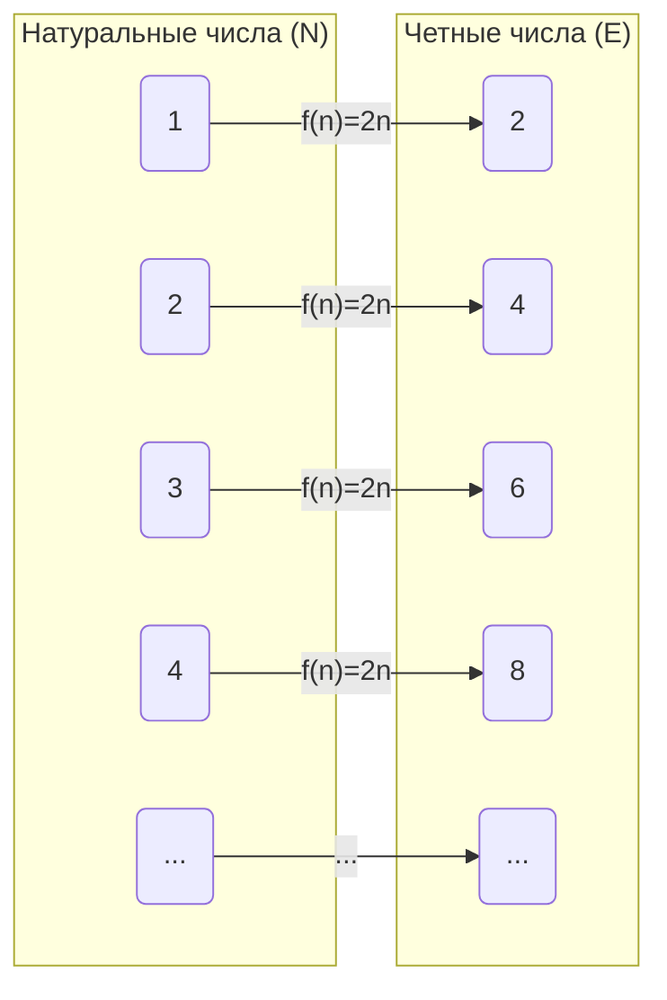
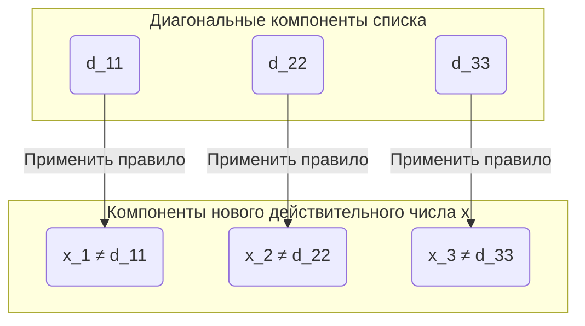

## Введение: Бывают ли у бесконечности разные «размеры»?

Концепция «бесконечности», о которой мы думаем в повседневной жизни, в буквальном смысле означает «отсутствие конца». Натуральные числа ($1, 2, 3, \dots$) можно считать бесконечно долго, поэтому их количество бесконечно. С другой стороны, действительные числа (все точки на числовой прямой) также существуют в бесконечном количестве.

Интуитивно мы склонны думать, что «бесконечность есть бесконечность, и обе они одинаково безграничны», но математик XIX века [Георг Кантор](/ru/p/cantor/) показал, что бесконечные множества могут иметь разные мощности.

В этой статье мы объясним с помощью диагонального аргумента Кантора, почему мощность множества действительных чисел строго больше мощности множества натуральных чисел.

---

## Теория множеств Кантора и «Мощность» (Cardinality)

Кантор ввел концепцию <strong>мощности (Cardinality)</strong> для сравнения «количества» элементов в множествах. Для конечных множеств мощность — это просто количество элементов. Но как сравнить размеры бесконечных множеств?

Кантор использовал понятие <strong>биекции</strong>. Если между множествами $A$ и $B$ есть взаимно-однозначное соответствие, они <strong>имеют одинаковую мощность</strong>.

### Одинакова ли мощность натуральных и чётных чисел?

Например, давайте рассмотрим множество натуральных чисел $\mathbb{N}$ и множество положительных четных чисел $E$.

$$
\mathbb{N} = \{1, 2, 3, 4, \dots\}
$$
$$
E = \{2, 4, 6, 8, \dots\}
$$

Интуитивно кажется, что чётных чисел вдвое меньше, чем натуральных. Однако, используя функцию $f(n) = 2n$, мы можем создать идеальное взаимно-однозначное соответствие между натуральным числом $n$ и четным числом $2n$.

Таким образом, бесконечные множества обладают странным свойством: «часть имеет тот же размер, что и целое». Бесконечное множество, которое можно поставить во взаимно-однозначное соответствие с натуральными числами, называется <strong>счётно-бесконечным</strong>; его мощность равна <strong>алеф-нуль ($\aleph_0$)</strong>.

Рациональные числа ($\mathbb{Q}$) тоже счётны. Положительные дроби можно упорядочить по сумме положительных числителя и знаменателя, пропуская уже встречавшиеся дроби. Каждая дробь появится на каком-то конечном шаге. Добавив 0 и чередуя положительные и отрицательные дроби, получим список всех рациональных чисел и биекцию с натуральными.

---

## Действительные числа несчётны: диагональный аргумент Кантора

Натуральные числа, четные числа и рациональные числа — все их можно «пересчитать по порядку». Но можно ли установить взаимно-однозначное соответствие с натуральными числами для <strong>действительных чисел ($\mathbb{R}$)</strong> , которые представляют все точки на числовой прямой?

Ответ Кантора был <strong>«Нет»</strong>. Он показал, что мощность действительных чисел строго больше мощности натуральных чисел, то есть они <strong>несчётны</strong>.

В этом доказательстве использовался <strong>диагональный аргумент</strong> , который называют одним из самых красивых доказательств в истории математики.

---

## Доказательство с помощью диагонального аргумента

Здесь мы рассмотрим не все действительные числа, а ограничимся только действительными числами от 0 до 1 (интервал $(0, 1)$). Если действительных чисел даже в этом интервале больше, чем натуральных чисел, то, разумеется, всех действительных чисел тоже больше, чем натуральных чисел.

### Предположение для доказательства от противного

Доказательство проводится <strong>от противного</strong>. Под списком мы понимаем любую математическую последовательность, индексированную натуральными числами; мы не предполагаем, что существует алгоритм для вычисления её членов. Аргумент исключает любую последовательность, содержащую все числа интервала, а не только вычислимые последовательности.

Чтобы избежать неоднозначности десятичной записи, будем выбирать запись, которая не оканчивается бесконечной последовательностью девяток. Поэтому для одного и того же числа $0{,}5000\dots=0{,}4999\dots$ выберем первую запись. Предположим, что все числа интервала можно перечислить так:

$$
r_1 = 0 . \mathbf{d_{11}} d_{12} d_{13} d_{14} \dots
$$
$$
r_2 = 0 . d_{21} \mathbf{d_{22}} d_{23} d_{24} \dots
$$
$$
r_3 = 0 . d_{31} d_{32} \mathbf{d_{33}} d_{34} \dots
$$
$$
\vdots
$$

Здесь $d_{ij}$ — цифра (от 0 до 9) в $j$-м десятичном разряде $i$-го числа в списке.

### Построение нового действительного числа

Кантор показал способ создания <strong>нового действительного числа $x$, которого абсолютно точно нет в списке</strong> , из этого «списка, который, как предполагалось, охватывает все действительные числа».

Мы строим новое действительное число $x$ следующим образом:

$$
x = 0 . x_1 x_2 x_3 x_4 \dots
$$

Цифра $x_n$ в каждом разряде определяется на основе $d_{nn}$ — цифры в $n$-м десятичном разряде $n$-го числа в списке (цифры на диагонали). Правило очень простое.

$$
x_n = \begin{cases}
1 & \text{если } d_{nn} \neq 1 \\
2 & \text{если } d_{nn} = 1
\end{cases}
$$

Иными словами, если диагональная цифра $d_{nn}$ не равна 1, выберем $x_n=1$, а если равна 1 — $x_n=2$. Выбранная цифра всегда отличается от $d_{nn}$. Поскольку цифры числа $x$ равны только 1 или 2, его десятичная запись не оканчивается бесконечными девятками и единственна согласно нашему соглашению.

### Вывод противоречия

Построенное новое действительное число $x$ является действительным числом от 0 до 1. Согласно нашему предположению, в списке должны быть представлены «все действительные числа от 0 до 1», поэтому $x$ также должно находиться где-то в списке, например, на $k$-м месте ($r_k$).

Если $x = r_k$, то цифра $k$-го десятичного разряда $x_k$ числа $x$ должна быть равна цифре $k$-го десятичного разряда $d_{kk}$ числа $r_k$ ($x_k = d_{kk}$).

Однако, согласно определению $x$, <strong>$x_k$ намеренно создано так, чтобы оно было цифрой, отличной от $d_{kk}$ ($x_k \neq d_{kk}$)</strong> .

Это противоречие. Следовательно, первоначальное предположение о том, что все числа интервала можно внести в список, было неверным. Следовательно, действительные числа интервала $(0,1)$ несчётны. Так как этот интервал является подмножеством множества действительных чисел, всё множество действительных чисел также несчётно.

Итак, <strong>между действительными и натуральными числами нет биекции</strong>. Вложение натуральных чисел в действительные задаёт инъекцию, поэтому мощность действительных чисел строго больше. Это сравнение не касается длины или плотности на числовой прямой.

---

## Континуум-гипотеза

Диагональный аргумент Кантора показал, что бесконечные множества образуют иерархию по мощности. Обозначим мощность натуральных чисел через $\aleph_0$, а мощность действительных чисел через $\mathfrak{c}=2^{\aleph_0}$. Она также равна мощности множества всех подмножеств натуральных чисел. Равна ли $\mathfrak{c}$ наименьшей несчётной мощности $\aleph_1$ — отдельный вопрос, на который диагональный аргумент не отвечает. Имеем:

$$
\aleph_0 < 2^{\aleph_0}
$$

Перед Кантором встал важный вопрос: <strong>«Существует ли бесконечное множество, мощность которого лежит между $\aleph_0$ и $2^{\aleph_0}$?»</strong>

Предположение об отсутствии промежуточной мощности называется <strong>[континуум-гипотезой](/ru/p/continuum-hypothesis/) (CH)</strong>. В ZFC оно равносильно утверждению $2^{\aleph_0}=\aleph_1$.

Позже [Курт Гёдель](/ru/p/godel/) и Пол Коэн показали, что <strong>континуум-гипотеза независима от ZFC при условии, что ZFC непротиворечива</strong>. Гёдель установил относительную непротиворечивость добавления CH, а Коэн — добавления её отрицания. Эти результаты не доказывают непротиворечивость самой ZFC и не означают, что CH одновременно истинна и ложна.

---

## Заключение

На первый взгляд диагональный аргумент Кантора может показаться простой головоломкой, но он основан на сильном рассуждении о бесконечности.

1. Биекция устанавливает равенство мощностей; инъекции позволяют сравнивать мощности.
2. Рациональные числа имеют тот же размер, что и натуральные числа (счётная бесконечность).
3. Изменяя каждую диагональную цифру и строя новое действительное число, мы доказываем, что мощность действительных чисел строго больше мощности натуральных.

Это противоречащее интуиции рассуждение — одна из красивых идей математики. Диагональные аргументы встречаются и в основополагающих результатах информатики и математической логики, например в [проблеме остановки Алана Тьюринга](/ru/p/halting-problem/) и [теоремах Гёделя о неполноте](/ru/p/godels-incompleteness-theorems/).

## Источники

- [MIT OpenCourseWare: диагональный аргумент Кантора](https://ocw.mit.edu/courses/res-6-012-introduction-to-probability-spring-2018/14b6f97b86d7978a595e402cc54d08d8_YIZd23zGV3M.pdf)
- [Jindřich Zapletal: Elements of Set Theory](https://people.clas.ufl.edu/zapletal/files/notesset.pdf)
- [CMU: 21-602 Introduction to Set Theory I](https://www.math.cmu.edu/~bwsulliv/21602lecturenotes.pdf)
