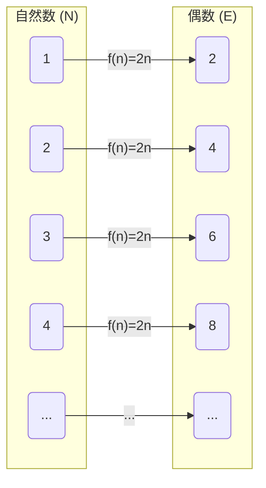
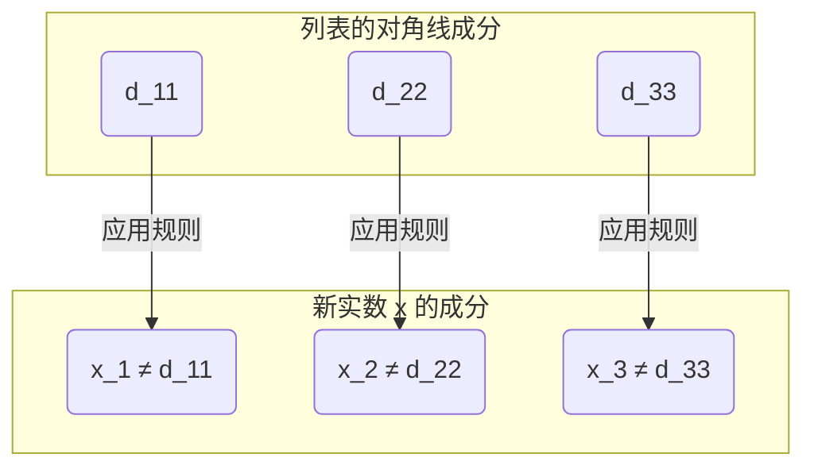

## 引言：无限也有“大小”之分吗？

我们日常思考的“无限”这个概念，字面意思就是“没有尽头”。自然数（$1, 2, 3, \dots$）可以无限地数下去，因此其数量是无限的。另一方面，实数（数轴上的所有点）也同样是无限存在的。

直观上我们很容易认为“无限就是无限，两者同样没有尽头”，但是19世纪的数学家[格奥尔格·康托尔](/zh-cn/p/cantor/)（Georg Cantor）证明了一个令人惊讶的事实： <strong>“无限是有大小（势）之分的”</strong> 。

本文将使用康托尔发明的划时代的证明方法 <strong>对角线论证（Diagonal Argument）</strong> ，详细讲解为什么实数集合的势严格大于自然数集合的势。

---

## 康托尔的集合论与“势（Cardinality）”

康托尔为了比较集合中元素的“多少”，引入了 <strong>势（Cardinality）</strong> 这个概念。对于有限集合，势就是元素的数量。但是，如何比较无限集合的大小呢？

康托尔使用了 <strong>双射（Bijection）</strong> 的概念。如果在两个集合 $A$ 和 $B$ 之间能够建立一一对应（双射），那么他就将这两个集合定义为 <strong>“具有相同的势”</strong> 。

### 自然数和偶数的势相同吗？

本文约定自然数从1开始。考虑自然数集合 $\mathbb{N}$ 和正偶数集合 $E$。

$$
\mathbb{N} = \{1, 2, 3, 4, \dots\}
$$

$$
E = \{2, 4, 6, 8, \dots\}
$$

直观上，偶数似乎只有自然数的一半。然而，通过使用函数 $f(n) = 2n$，我们可以在自然数 $n$ 和偶数 $2n$ 之间建立完全的一一对应关系。

像这样，无限集合具有“部分与整体大小相同”这种奇妙的性质。这种能与自然数建立一一对应的无限集合被称为 <strong>可数无限（Countably infinite）</strong> ，或者称其具有 <strong>阿列夫零（$\aleph_0$）</strong> 的势。

有理数（$\mathbb{Q}$）也是可数无限的。将正分数按其正整数分子与分母之和从小到大排列，并跳过已经出现过的值，就能枚举所有正有理数。每个分数都会在有限步骤后出现。加上0，再交替排列正值与负值，就能枚举所有有理数，得到与自然数的双射。

---

## 实数是“数不清的”：康托尔定理

自然数、偶数、有理数，都可以“按顺序数出来”。那么，表示数轴上所有点的 <strong>实数（$\mathbb{R}$）</strong> ，也能与自然数建立一一对应吗？

康托尔给出的答案是 <strong>“否”</strong> 。他证明了实数具有比自然数真正更大的势，即它们是 <strong>不可数无限（Uncountably infinite）</strong> 的。

用于证明这一点的，就是被称为数学史上最优美的证明之一的 <strong>对角线论证</strong> 。

---

## 基于对角线论证的证明

这里我们不考虑全体实数，而是限定在 0 到 1 之间的实数（区间 $(0, 1)$）。如果仅这个区间内的实数都比自然数多，那么全体实数自然也比自然数多。

### 反证法的假设

证明使用了 <strong>反证法（Proof by contradiction）</strong> 。
首先，我们假设“0 到 1 之间的所有实数，都可以与自然数建立一一对应（＝可以作为列表枚举出来）”。

这里的列表指以自然数为下标的数学序列，并不假设存在计算各项的算法。我们要排除的是任何能够列出全部实数的序列，而不仅仅是可计算的序列。

为避免小数表示重复，约定不使用从某一位起全为9的表示。例如，对于 $0.5000\dots=0.4999\dots$，我们选用前者。在这一约定下，假设可以把0到1之间的所有实数列成如下序列。

$$
r_1 = 0 . \mathbf{d_{11}} d_{12} d_{13} d_{14} \dots
$$

$$
r_2 = 0 . d_{21} \mathbf{d_{22}} d_{23} d_{24} \dots
$$

$$
r_3 = 0 . d_{31} d_{32} \mathbf{d_{33}} d_{34} \dots
$$

$$
\vdots
$$

这里，$d_{ij}$ 表示第 $i$ 个实数的小数点后第 $j$ 位的数字（0〜9）。

### 构造新的实数 x

康托尔指出了一种方法，从这个“本应包含所有实数的列表”中，构造出一个 <strong>绝对不在列表中的新实数 $x$</strong> 。

按照如下方式构造新的实数 $x$：

$$
x = 0 . x_1 x_2 x_3 x_4 \dots
$$

每一位的数字 $x_n$ 都是根据列表中第 $n$ 个数的小数点后第 $n$ 位的数字（对角线上的数字） $d_{nn}$ 来决定的。规则非常简单。

$$
x_n = \begin{cases}
1 & \text{if } d_{nn} \neq 1 \\
2 & \text{if } d_{nn} = 1
\end{cases}
$$

也就是说，如果对角线上的数字 $d_{nn}$ 不是 1，那么 $x_n$ 就是 1；如果是 1，就是 2。新表示只使用1和2，因此不会从某一位起全为0或全为9。它的小数表示是唯一的，所以某一位数字不同就意味着所表示的实数不同。

### 导出矛盾

构造出的新实数 $x$ 是 0 到 1 之间的实数。根据假设，列表应该涵盖了“0 到 1 之间的所有实数”，因此 $x$ 也必须存在于列表中的某个位置，比如第 $k$ 个（$r_k$）。

如果 $x = r_k$，那么 $x$ 的小数点后第 $k$ 位的数字 $x_k$ 应该等于 $r_k$ 的小数点后第 $k$ 位的数字 $d_{kk}$（$x_k = d_{kk}$）。

但是，根据 $x$ 的定义， <strong>$x_k$ 被故意构造成与 $d_{kk}$ 不同的数字（$x_k \neq d_{kk}$）</strong> 。

这就产生了矛盾。因此，“可以把所有实数列成一个序列”的最初假设是错误的。

结论是， <strong>实数集合与自然数集合之间不存在双射</strong>。自然数嵌入实数的包含映射是单射，因此实数集合的势严格更大。这里比较的不是数轴上的长度或密度。

---

## 通向连续统假设（Continuum Hypothesis）之路

康托尔的对角线论证表明，无限之中存在“层级”。
将自然数的势记为 $\aleph_0$，实数的势记为 $\mathfrak{c}=2^{\aleph_0}$。$2^{\aleph_0}$ 也是自然数集合的幂集的势。实数的势是否等于最小的不可数基数 $\aleph_1$，是另一个问题，不能仅靠对角线论证决定。我们有以下关系。

$$
\aleph_0 < 2^{\aleph_0}
$$

此时康托尔面临一个巨大的疑问。 <strong>“是否存在势介于 $\aleph_0$ 和 $2^{\aleph_0}$ 之间的无限集合？”</strong>

“不存在中间势”的假设被称为 <strong>[连续统假设](/zh-cn/p/continuum-hypothesis/)（Continuum Hypothesis, CH）</strong> 。在ZFC中，这等价于断言 $2^{\aleph_0}=\aleph_1$。

后来，[库尔特·哥德尔](/zh-cn/p/godel/)（Kurt Gödel）和保罗·科恩（Paul Cohen）关于[连续统假设](/zh-cn/p/continuum-hypothesis/)的结果表明：<strong>如果ZFC是相容的，那么连续统假设在ZFC中既不能被证明，也不能被否定，即独立于ZFC</strong>。哥德尔证明了加入CH的相对相容性，科恩证明了加入CH的否定的相对相容性。这既不是证明ZFC本身相容，也不是说CH同时为真和为假。

---

## 总结

康托尔的对角线论证乍一看像是一个简单的谜题，但其背后隐藏着逼近“无限真理”的强大逻辑。

1. 双射表示势相等；单射用于比较势的大小。
2. 自然数和有理数都是可数无限的。
3. 通过改变对角线上的每一位数字来构造新实数，证明实数的势严格大于自然数的势，即实数不可数。

这种违反直觉，却又具有绝对逻辑美的特征，可以说是数学这门学科最大的魅力所在。对角线论证后来也被应用于[艾伦·图灵](/zh-cn/p/turing/)（Alan Turing）的[停机问题](/zh-cn/p/halting-problem/)和[哥德尔不完备定理](/zh-cn/p/godels-incompleteness-theorems/)的证明等，成为了计算机科学和数理逻辑根基理论的重要组成部分。

## 参考文献

- [MIT OCW: Cantor’s diagonalization argument](https://ocw.mit.edu/courses/res-6-012-introduction-to-probability-spring-2018/14b6f97b86d7978a595e402cc54d08d8_YIZd23zGV3M.pdf)
- [Jindřich Zapletal: Elements of Set Theory](https://people.clas.ufl.edu/zapletal/files/notesset.pdf)
- [CMU: 21-602 Intro to Set Theory I](https://www.math.cmu.edu/~bwsulliv/21602lecturenotes.pdf)
