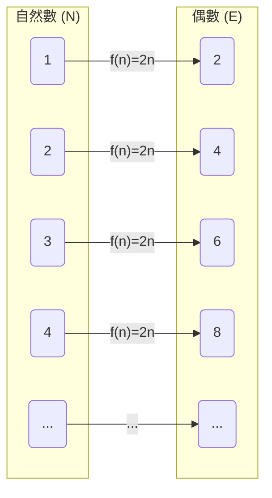
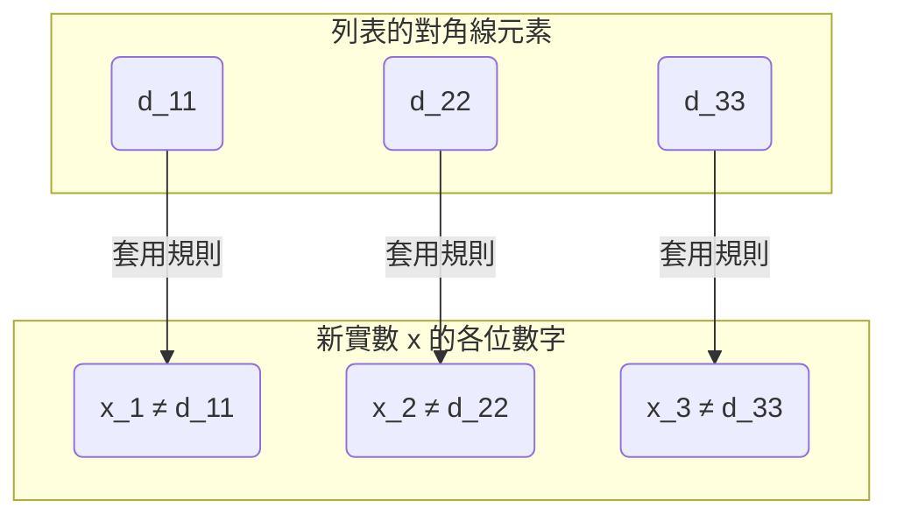

## 前言：無限也有「大小」之分？

我們在日常中所思考的「無限」概念，字面上意味著「沒有盡頭」。因為自然數（$1, 2, 3, \dots$）可以不斷地數下去，所以其數量是無限的。另一方面，實數（數線上的所有點）也同樣無限地存在。

直覺上我們往往會認為「無限就是無限，兩者都同樣沒有盡頭」，但 19 世紀的數學家[格奧爾格·康托爾](/zh-tw/p/cantor/)（Georg Cantor）證明了一個令人驚訝的事實： <strong>「無限有大小（勢）的差異」</strong> 。

在本文中，我們將使用康托爾構思的劃時代證明手法 <strong>對角線論證（Diagonal Argument）</strong> ，來詳細解說為何實數集合的勢嚴格大於自然數集合的勢。

---

## 康托爾的集合論與「勢（Cardinality）」

康托爾為了比較集合元素的「多寡」，引入了 <strong>勢（Cardinality）</strong> 的概念。在有限集合的情況下，勢單純就是元素的數量。然而，要如何比較無限集合的大小呢？

康托爾使用了 <strong>雙射（Bijection）</strong> 的概念。如果在兩個集合 $A$ 與 $B$ 之間能夠建立一一對應（雙射），他就將這兩個集合定義為 <strong>「具有相同的勢」</strong> 。

### 自然數與偶數的勢相同？

本文約定自然數從1開始。考慮自然數集合 $\mathbb{N}$ 與正偶數集合 $E$。

$$
\mathbb{N} = \{1, 2, 3, 4, \dots\}
$$

$$
E = \{2, 4, 6, 8, \dots\}
$$

直覺上，偶數似乎只有自然數的一半。但是，如果使用函數 $f(n) = 2n$ ，就可以在自然數 $n$ 與偶數 $2n$ 之間建立完美的一一對應。

像這樣，無限集合具有「部分與整體大小相同」的奇妙性質。能與自然數建立一一對應的無限集合，稱為 <strong>可數無限（Countably infinite）</strong> 集合，其勢為 <strong>阿列夫零（$\aleph_0$）</strong>。

有理數（$\mathbb{Q}$）也是可數無限的。將正分數依其正整數分子與分母之和由小到大排列，並略過已出現的值，就能列舉所有正有理數。每個分數都會在有限步驟後出現。加入0，再交替排列正值與負值，就能列舉所有有理數，得到與自然數的雙射。

---

## 實數是「數不完的」：康托爾定理

自然數、偶數、有理數，都可以「依序數出來」。那麼，表示數線上所有點的 <strong>實數（$\mathbb{R}$）</strong> ，也能夠與自然數建立一一對應嗎？

康托爾的答案是 <strong>「否」</strong> 。他證明了實數集合的勢嚴格大於自然數集合的勢，也就是說，實數是 <strong>不可數無限（Uncountably infinite）</strong> 的。

在那個證明中使用的，就是被稱為數學史上最優美證明之一的 <strong>對角線論證</strong> 。

---

## 透過對角線論證的證明

在這裡，我們不考慮所有實數，而是限定在 0 到 1 之間的實數（區間 $(0, 1)$）。如果光是這個區間內的實數就比自然數多，那麼全體實數當然也比自然數多。

### 反證法的假設

這個證明使用了 <strong>反證法（Proof by contradiction）</strong> 。
首先，我們假設「0 到 1 之間的所有實數，能夠與自然數建立一一對應（＝能夠作為列表被一一數出）」。

這裡的列表是以自然數為索引的數學序列，並不假設存在計算各項的演算法。我們要排除的是任何能列出全部實數的序列，而不僅是可計算的序列。

為避免小數表示重複，約定不使用從某一位起全為9的表示。例如，對於 $0.5000\dots=0.4999\dots$，我們選用前者。在此約定下，假設可以把0到1之間的所有實數列成以下序列。

$$
r_1 = 0 . \mathbf{d_{11}} d_{12} d_{13} d_{14} \dots
$$

$$
r_2 = 0 . d_{21} \mathbf{d_{22}} d_{23} d_{24} \dots
$$

$$
r_3 = 0 . d_{31} d_{32} \mathbf{d_{33}} d_{34} \dots
$$

$$
\vdots
$$

在此，$d_{ij}$ 代表第 $i$ 個實數的小數點後第 $j$ 位的數字（0～9）。

### 建立新的實數 x

康托爾展示了一種方法，可以從這個「理應網羅了所有實數的列表」中，構造出一個 <strong>絕對沒有出現在列表上的新實數 $x$</strong> 。

我們將新實數 $x$ 構造如下：

$$
x = 0 . x_1 x_2 x_3 x_4 \dots
$$

小數點後第 $n$ 位的數字 $x_n$，由列表中第 $n$ 個實數的小數點後第 $n$ 位數字（對角線上的數字）$d_{nn}$ 決定。規則非常簡單。

$$
x_n = \begin{cases}
1 & \text{if } d_{nn} \neq 1 \\
2 & \text{if } d_{nn} = 1
\end{cases}
$$

也就是說，若對角線上的數字 $d_{nn}$ 不是 1，就讓 $x_n$ 為 1；若是 1，就讓它為 2。新表示只使用1和2，因此不會從某一位起全為0或全為9。它的小數表示是唯一的，所以某一位數字不同就意味著所表示的實數不同。

### 導出矛盾

構造出的新實數 $x$ 是介於 0 到 1 之間的實數。根據假設，列表理應網羅了「0 到 1 之間的所有實數」，所以 $x$ 也必須存在於列表的某處，例如第 $k$ 個（$r_k$）。

如果 $x = r_k$ ，那麼 $x$ 的小數點後第 $k$ 位的數字 $x_k$ ，理應等於 $r_k$ 的小數點後第 $k$ 位的數字 $d_{kk}$ （$x_k = d_{kk}$）。

然而，根據 $x$ 的定義， <strong>$x_k$ 是被刻意創造成與 $d_{kk}$ 不同的數字（$x_k \neq d_{kk}$）</strong> 。

這是一個矛盾。因此，最初「能夠列出所有實數」的假設是錯誤的。

結論是， <strong>實數集合與自然數集合之間不存在雙射</strong>。自然數嵌入實數的包含映射是單射，因此實數集合的勢嚴格更大。這裡比較的不是數線上的長度或密度。

---

## 通往連續統假設（Continuum Hypothesis）之路

康托爾的對角線論證表明了無限之中存在著「階層」。
將自然數的勢記為 $\aleph_0$，實數的勢記為 $\mathfrak{c}=2^{\aleph_0}$。$2^{\aleph_0}$ 也是自然數集合的冪集的勢。實數的勢是否等於最小的不可數基數 $\aleph_1$，是另一個問題，不能只靠對角線論證決定。以下關係成立：

$$
\aleph_0 < 2^{\aleph_0}
$$

在這裡，康托爾面臨了一個巨大的疑問： <strong>「是否存在具有介於 $\aleph_0$ 與 $2^{\aleph_0}$ 之間勢的無限集合？」</strong>

主張「不存在中間的勢」的假設，被稱為 <strong>[連續統假設](/zh-tw/p/continuum-hypothesis/)（Continuum Hypothesis, CH）</strong> 。在ZFC中，這等價於斷言 $2^{\aleph_0}=\aleph_1$。

後來，[庫爾特·哥德爾](/zh-tw/p/godel/)（Kurt Gödel）與保羅·寇恩（Paul Cohen）關於[連續統假設](/zh-tw/p/continuum-hypothesis/)的結果表明：<strong>如果ZFC無矛盾，連續統假設在ZFC中既不能被證明，也不能被否定，即獨立於ZFC</strong>。哥德爾證明了加入CH的相對無矛盾性，寇恩證明了加入CH的否定的相對無矛盾性。這既不是證明ZFC本身無矛盾，也不是說CH同時為真和為假。

---

## 總結

康托爾的對角線論證乍看之下像個簡單的謎題，但其背後隱藏著逼近「無限真理」的強大邏輯。

1. 雙射表示勢相等；單射用於比較勢的大小。
2. 自然數與有理數都是可數無限的。
3. 透過改變對角線上的每一位數字來構造新實數，證明實數的勢嚴格大於自然數的勢，即實數不可數。

這種違反直覺卻絕對正確的邏輯之美，可以說是數學這門學問最大的魅力所在。對角線論證後來也被應用於[艾倫·圖靈](/zh-tw/p/turing/)（Alan Turing）的[停機問題](/zh-tw/p/halting-problem/)以及[哥德爾不完備定理](/zh-tw/p/godels-incompleteness-theorems/)的證明等，構成了計算機科學與數理邏輯學根基的理論。

## 參考文獻

- [MIT OCW: Cantor’s diagonalization argument](https://ocw.mit.edu/courses/res-6-012-introduction-to-probability-spring-2018/14b6f97b86d7978a595e402cc54d08d8_YIZd23zGV3M.pdf)
- [Jindřich Zapletal: Elements of Set Theory](https://people.clas.ufl.edu/zapletal/files/notesset.pdf)
- [CMU: 21-602 Intro to Set Theory I](https://www.math.cmu.edu/~bwsulliv/21602lecturenotes.pdf)
