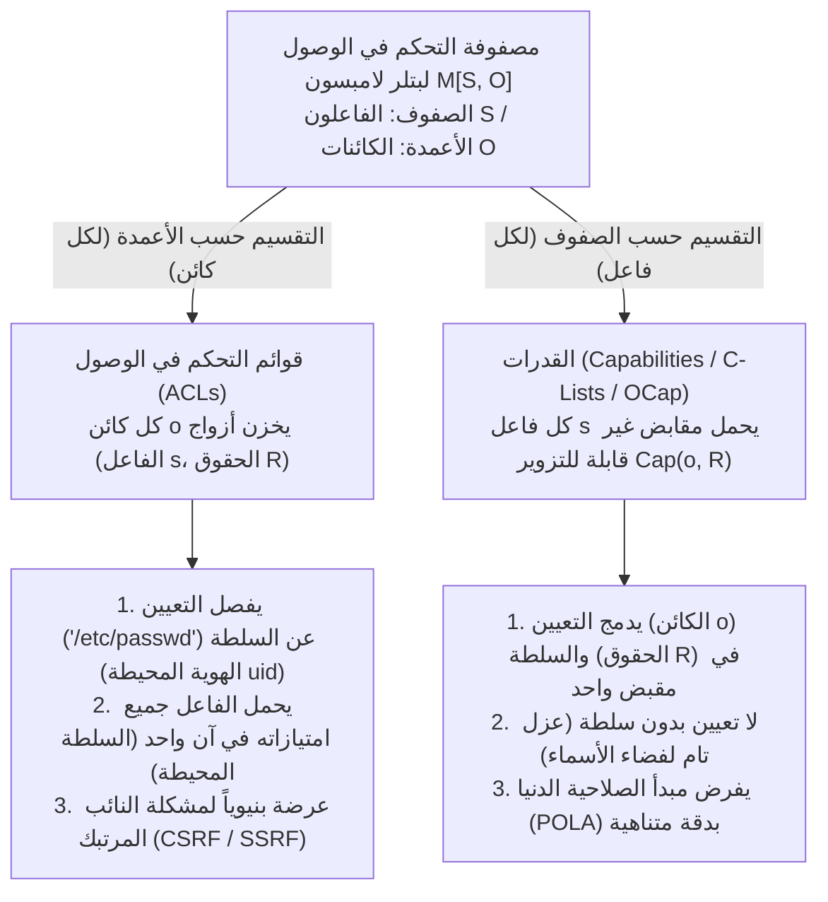

عبر أنظمة التشغيل الحديثة والبنى التحتية السحابية وتطبيقات الويب، تتبع الاختراقات الأمنية الكارثية نمطاً متكرراً بشكل مذهل. تبدو هجمات تزوير الطلبات عبر المواقع (CSRF)، وتزوير الطلبات من جانب الخادم (SSRF)، وحقن SQL والأوامر، والهروب من الحاويات، وهجمات سلاسل إمداد البرمجيات في بيئات مثل `npm` أو `PyPI` وكأنها تنتمي إلى طبقات مختلفة تماماً من البرمجيات. غير أن تحت تفاصيلها السطحية يكمن خلل معماري واحد مشترك.

هذا الخلل هو اعتمادنا طوال نصف قرن على <strong>قوائم التحكم في الوصول (Access Control Lists - ACLs)</strong> المقترنة بـ <strong>السلطة المحيطة (Ambient Authority)</strong> — وهو النموذج التصميمي الذي تعتمد فيه قرارات الوصول على <strong>من أنت (هوية الفاعل Subject Identity)</strong> بدلاً من <strong>ما تحمله (What You Hold)</strong>، والذي ينفصل فيه <strong>التعيين (Designation)</strong> (تسمية المورد عبر مسار نصي أو رابط قابل للتزوير) عن <strong>السلطة (Authority)</strong> (الصلاحية المحيطة التي يحملها المستدعي).

في هذا المقال، نفحص بشكل منهجي النموذج البديل الذي يقضي على هذه الثغرة البنيوية من جذورها: <strong>الأمان القائم على القدرات (Capability-Based Security)</strong>. انطلاقاً من التفكيك الرياضي لمصفوفة التحكم في الوصول $M[S, O]$ التي قدمها بتلر لامبسون عام 1971، نتتبع *مشكلة النائب المرتبك (Confused Deputy Problem)* الكلاسيكية لنورم هاردي عام 1988، ونصوغ نموذج قدرات الكائنات (OCap) لمارك ميلر ومبدأ الصلاحية الدنيا (POLA)، ونبني أنماطاً برمجية لتقليص الصلاحيات (Facets) والإلغاء الفوري أو المتعدي (Caretaker والأغشية)، ونستعرض التطبيقات الصناعية الحديثة في النواة المصغرة المثبتة رياضياً <strong>seL4</strong>، ونظام <strong>FreeBSD Capsicum</strong>، ومؤشرات العتاد <strong>CHERI / ARM Morello</strong>، وواجهة <strong>WebAssembly WASI</strong>.

---

## 1. نموذجان للسلطة: بطاقات الهوية مقابل مفتاح صaff السيارات (Valet Key)

قبل الغوص في النظرية الرسمية لأنظمة التشغيل، لنقارن بين طريقتين متضادتين لفرض الأمان المادي في العالم اليومي.

### النموذج أ: بطاقات الهوية وسجلات الأبواب (نموذج ACL)
تخيل مبنى شركة عالي الحراسة يقف عند كل باب فيه حارس يحمل سجلاً بأسماء الموظفين المصرح لهم بدخول الغرفة 302 (<strong>قائمة تحكم في الوصول ACL</strong>). عندما تطلب الدخول، يفحص الحارس بطاقة هويتك الوظيفية (<strong>Identity / `uid`</strong>) ويتحقق من وجود اسمك في سجل الغرفة 302.

افترض الآن أنك تريد من متدرب (برنامج مساعد أو مكتبة خارجية) إحضار ملف واحد فقط هو `Q3_Budget.pdf` من خزانة داخل الغرفة 302. وبما أن المتدرب غير مدرج في القائمة، تضطر إلى إعارته بطاقة هويتك الخاصة (تماماً مثل `setuid` في UNIX أو تشغيل الكود تحت هويتك). في اللحظة التي يدخل فيها المتدرب الغرفة 302 مرتدياً بطاقتك، فإنه يكتسب تلقائياً <strong>سلطة محيطة (Ambient Authority)</strong> على كل ما في الغرفة، بما في ذلك قاعدة بيانات الرواتب `Payroll_Master.db`. والأدهى من ذلك أنه إذا قام مهاجم خارجي بتبديل الملاحظة الورقية لخداع المتدرب وجعله يحضر `Payroll_Master.db`، فسيسمح له الحارس بذلك لأن المتدرب يحمل بطاقتك!

### النموذج ب: مفتاح صف السيارات / Valet Key (نموذج القدرات Capability)
قارن ذلك بلحظة وصولك إلى فندق وتسليم سيارتك لموظف صف السيارات. أنت لا تتصل بإدارة المرور لتسجيل رخصة الموظف في قائمة وصول مرتبطة بسيارتك، ولا تسلمه بطاقة هويتك الشخصية؛ بل تعطيه <strong>مفتاح الخدمة (Valet Key)</strong>، الذي يجسد ثلاث خصائص معمارية عميقة:
1. <strong>توحيد التعيين والسلطة (Unification of Designation and Authority)</strong>: المفتاح *يعيّن* المركبة المحددة المطلوب تشغيلها و*يفوّض* حامله بتشغيل المحرك في آن واحد. لا تهتم السيارة *بمن* يحمل المفتاح؛ فحيازة الرمز غير القابل للتزوير دليل كافٍ وضروري على السلطة.
2. <strong>تقليص الصلاحية (Attenuation / Least Privilege)</strong>: خلافاً للمفتاح الرئيسي، لا يستطيع مفتاح الخدمة فتح صندوق الأمتعة أو درج القفازات، وقد يقيّد السرعة القصوى، مانحاً الحد الأدنى فقط من الصلاحية اللازمة لركن السيارة.
3. <strong>التفويض اللامركزي</strong>: إذا احتاج الموظف الأول إلى تسليم المهمة لزميله، فإنهيناوله المفتاح مباشرة دون تعديل أي قاعدة بيانات مركزية.

في علوم الحاسوب، يمثل النموذج (أ) نموذج <strong>ACL</strong>، بينما يمثل النموذج (ب) نموذج <strong>الأمان القائم على القدرات (Capabilities)</strong>.

---

## 2. مصفوفة التحكم في الوصول لبتلر لامبسون $M[S, O]$ وتفكيكاها المتعامدان

في عام 1971، نشر الحائز على جائزة تورينغ بتلر لامبسون ورقته البحثية *"Protection"*، مقدماً <strong>مصفوفة التحكم في الوصول</strong> بوصفها تجريداً رياضياً شاملاً لآليات الحماية. تُعرَّف حالة الحماية في النظام بالثلاثية $(S, O, M)$:
- <strong>مجموعة الفاعلين (Subjects) $S = \{s_1, s_2, \dots, s_m\}$</strong>: الكيانات النشطة القادرة على بدء العمليات (المستخدمون، العمليات، الخيوط، الوحدات البرمجية).
- <strong>مجموعة الكائنات (Objects) $O = \{o_1, o_2, \dots, o_n\}$</strong>: الموارد المحمية (الملفات، مقاطع الذاكرة، مآخذ IPC، الأجهزة)، وعادةً $S \subseteq O$.
- <strong>مجموعة الحقوق الشاملة $\mathcal{R} = \{\mathsf{read}, \mathsf{write}, \mathsf{execute}, \mathsf{append}, \mathsf{grant}, \mathsf{own}\}$</strong>: العمليات المنفصلة المسموح بها على الكائن.
- <strong>مصفوفة التحكم في الوصول $M : S \times O \to 2^{\mathcal{R}}$</strong>: يحدد كل مدخل $M[s, o] \subseteq \mathcal{R}$ مجموعة العمليات الدقيقة المصرح للفاعل $s \in S$ بتنفيذها على الكائن $o \in O$.

لنأخذ نظاماً يضم ثلاثة فاعلين $S = \{\text{Alice}, \text{Compiler}, \text{Logger}\}$ وثلاثة ملفات $O = \{\texttt{src.f}, \texttt{/SYSX/STAT}, \texttt{/SYSX/BILL}\}$:

$$
M[S, O] = \begin{array}{c|ccc}
 & \texttt{src.f} & \texttt{/SYSX/STAT} & \texttt{/SYSX/BILL} \\
\hline
\text{Alice} & \{\mathsf{read}, \mathsf{write}\} & \emptyset & \emptyset \\
\text{Compiler} & \{\mathsf{read}\} & \{\mathsf{append}\} & \{\mathsf{read}, \mathsf{write}\} \\
\text{Logger} & \emptyset & \{\mathsf{read}, \mathsf{write}\} & \emptyset
\end{array}
$$

ولأن المصفوفة $M[S, O]$ متناثرة للغاية في الأنظمة الواقعية، يتعين على كل مهندس معماري تفكيكها على طول أحد محوريها: <strong>التقسيم حسب الأعمدة (إرفاق قوائم بالكائنات)</strong>، أو <strong>التقسيم حسب الصفوف (منح رموز قدرات للفاعلين)</strong>.



### 2.1 التقسيم حسب الأعمدة: قوائم التحكم في الوصول (ACLs)
عندما نقسم المصفوفة $M[S, O]$ عمودياً <strong>حسب الأعمدة</strong>، نربط بكل كائن $o \in O$ قائمة بالمدخلات غير الفارغة في عموده:

$$
\text{ACL}(o) = \bigl\{ (s, M[s, o]) \;\big|\; s \in S,\; M[s, o] \neq \emptyset \bigr\}
$$

تتبع أذونات UNIX/POSIX وقوائم DACL في Windows NTFS وسياسات IAM السحابية هذا النموذج، مما يفرض <strong>فصل التعيين عن السلطة</strong>: يعيّن البرنامج الكائن عبر سلسلة نصية عامة مثل `"/SYSX/BILL"`، بينما يفحص مراقب المرجع في النواة الهوية المحيطة (`uid`) للعملية المستدعية. وهكذا تمارس العملية في كل استدعاء للنظام اتحاد جميع صلاحيات صفها بالكامل $\bigcup_{o \in O} M[s, o]$، وهو ما يُعرف بـ <strong>السلطة المحيطة (Ambient Authority)</strong>.

### 2.2 التقسيم حسب الصفوف: القدرات (Dennis & Van Horn 1966)
في عام 1966، قدم جاك دينيس وإيرل فان هورن التفكيك المقابل: تقسيم $M[S, O]$ أفقياً <strong>حسب الصفوف</strong>، حيث نربط بكل فاعل $s \in S$ <strong>فضاء قدرات (CSpace أو C-List)</strong>:

$$
\text{CSpace}(s) = \bigl\{ \text{Cap}(o, R) \;\big|\; o \in O,\; R = M[s, o] \neq \emptyset \bigr\}
$$

كل عنصر $c = \text{Cap}(o, R)$ هو <strong>قدرة (Capability)</strong> — <strong>رمز سلطة غير قابل للتزوير</strong> يدمج <strong>التعيين</strong> (مؤشر أو مقبض مباشر للكائن $o$) و<strong>السلطة</strong> (المجموعة الجزئية المسموحة من الحقوق $R \subseteq \mathcal{R}$) في مرجع واحد غير قابل للتجزئة. فإذا لم يمتلك الفاعل $s$ قدرة للكائن $o$، فلن يتمكن حتى من تسميته أو عنونته: <strong>لا تعيين بدون سلطة؛ ولا سلطة بدون تعيين</strong>.

| البعد المعماري | قوائم التحكم في الوصول (ACLs — تقسيم الأعمدة) | القدرات (OCap / C-Lists — تقسيم الصفوف) |
| :--- | :--- | :--- |
| <strong>تفكيك المصفوفة $M[S, O]$</strong> | تُخزَّن لكل عمود على كل كائن $o \in O$ | تُخزَّن لكل صف يحمله كل فاعل $s \in S$ |
| <strong>فلسفة التفويض الأساسية</strong> | <strong>من أنت (Who You Are)</strong>: هوية المستدعي / `uid` | <strong>ما تحمله (What You Hold)</strong>: رمز القدرة المقدم |
| <strong>التعيين مقابل السلطة</strong> | <strong>منفصلان</strong> (مسار نصي قابل للتزوير + هوية محيطة) | <strong>موحدان</strong> (مقبض غير قابل للتزوير يسمي $o$ ويمنح $R$) |
| <strong>نموذج السلطة</strong> | <strong>سلطة محيطة</strong>: جميع حقوق `uid` نشطة في كل استدعاء | <strong>سلطة انتقائية</strong>: المقبض الممرر صراحةً فقط هو النشط |
| <strong>التعرض للنائب المرتبك</strong> | <strong>معرض بنيوياً</strong> (CSRF، SSRF، تصعيد `setuid`) | <strong>محصن بنيوياً</strong> (يجب على العميل تمرير مقبض مفوض مسبقاً) |
| <strong>أنظمة تمثيلية</strong> | UNIX/POSIX ACLs, Windows NTFS DACL, AWS IAM | KeyKOS, seL4, FreeBSD Capsicum, Fuchsia Zircon, CHERI, WASI |

---

## 3. مشكلة النائب المرتبك (Confused Deputy): كلاسيكية نورم هاردي (1988)

لماذا يُعد فصل التعيين عن السلطة خطيراً إلى هذا الحد؟ قدم مهندس الحاسوب نورم هاردي التفسير الحاسم في أكتوبر 1988 في مجلة *ACM SIGOPS Operating Systems Review* تحت عنوان <strong>*"The Confused Deputy (or why capabilities might have been invented)"</strong>*، مستعرضاً كارثة أمنية حقيقية وقعت في منتصف السبعينيات على نظام التشغيل التجاري Tymshare.

### 3.1 تشريح كارثة مترجم الفورتران `/SYSX/FORT`
في نظام Tymshare، كان مترجم لغة فورتران موجوداً في `/SYSX/FORT`:
1. <strong>متطلبات إحصاءات الفوترة</strong>: أراد مديرو النظام جمع إحصاءات الاستخدام عبر جعل `/SYSX/FORT` يضيف سجلاً إحصائياً إلى الملف `/SYSX/STAT` عند كل عملية ترجمة.
2. <strong>منح السلطة المحيطة</strong>: مُنح الملف التنفيذي `/SYSX/FORT` <strong>سلطة كتابة محيطة على دليل `/SYSX` بالكامل</strong> (بما يشبه `setuid` في UNIX).
3. <strong>اسم ملف المخرجات المقدم من المستخدم</strong>: كان المترجم يقبل وسيطاً نصياً من المستخدم يحدد مسار الملف المطلوب كتابة مخرجات التصحيح فيه (مثل `FORT(SRC="prog.f", OUT="listing.txt")`).
4. <strong>جوهرة التاج في `/SYSX/BILL`</strong>: داخل الدليل `/SYSX` نفسه كانت توجد قاعدة البيانات الرئيسية لفواتير العملاء <strong>`/SYSX/BILL`</strong>.

في أحد الأيام، استدعى مستخدم ذكي المترجم `/SYSX/FORT` ومرر السلسلة النصية <strong>`"/SYSX/BILL"`</strong> كاسم لملف مخرجات التصحيح. عندما نفذ المترجم `open("/SYSX/BILL", WRITE)`، سأل مراقب المرجع في نظام التشغيل: *«هل تملك العملية النشطة (`/SYSX/FORT`) إذن الكتابة في `/SYSX`؟»* وكانت الإجابة <strong>نعم</strong> — فقام <strong>المترجم بطاعة تامة بالكتابة فوق قاعدة بيانات الفوترة الرئيسية للشركة `/SYSX/BILL` وإتلافها برسائل تشخيص فورتران!</strong>



```mermaid
flowchart TD
    subgraph ACL_WORLD["نموذج ACL + السلطة المحيطة (النائب المرتبك)"]
        U1["مستخدم خبيث<br/>(لا يملك وصولاً إلى /SYSX/BILL)"] -->|"1. يمرر المسار النصي OUT='/SYSX/BILL'"| D1["النائب: المترجم /SYSX/FORT<br/>(سلطة محيطة: الكتابة في /SYSX/*)"]
        D1 -->|"2. open('/SYSX/BILL', WRITE)<br/>يستخدم ضمنياً سلطته المحيطة الخاصة"| OS1["مراقب المرجع في النظام (فحص ACL)"]
        OS1 -->|"3. المترجم يملك إذن كتابة في /SYSX -> مسموح!"| BILL1["قاعدة بيانات الفوترة /SYSX/BILL<br/>[تدمرت / كُتب فوقها!]"]
    end

    subgraph CAP_WORLD["نموذج القدرات (توحيد التعيين والسلطة)"]
        U2["المستخدم<br/>(يمتلك قدرات لملفاته فقط)"] -->|"1. يمرر قدرة المخرجات cap_out<br/>(لا يمكنه تمرير قدرة لـ /SYSX/BILL لأنه لا يملكها!)"| D2["النائب: المترجم /SYSX/FORT<br/>(مزود فقط بالقدرة cap_stat)"]
        D2 -->|"2a. write(cap_out, debug_output)<br/>يستخدم السلطة المقدمة صراحةً من المستخدم"| OUT2["ملف مخرجات المستخدم listing.txt"]
        D2 -->|"2b. append(cap_stat, usage_stats)<br/>يستخدم القدرة الخاصة الممنوحة عند التثبيت"| STAT2["ملف الإحصاءات /SYSX/STAT"]
    end
```

### 3.2 لماذا كان المترجم «مرتبكاً»؟ وكيف تنحدر منه الثغرات الحديثة
أطلق هاردي على `/SYSX/FORT` اسم <strong>النائب المرتبك (Confused Deputy)</strong> لأنه كان يعمل وكيلاً يخدم أصيلين مختلفين (مدير النظام والمستخدم المستدعي) في وقت واحد دون وسيلة لفصل سلطتيهما عند فتح مسار نصي. أما في معمارية القدرات، فيُزوَّد المترجم فقط بالقدرة الخاصة $c_{\text{stat}} = \text{Cap}(\texttt{/SYSX/STAT}, \{\mathsf{append}\})$، ويجب على المستخدم تمرير مقبض قدرة كتابة مفتوح مسبقاً $c_{\text{out}} = \text{Cap}(f_{\text{out}}, \{\mathsf{write}\})$، مما يستحيل معه حدوث الثغرة.

إن أخطر فئات الثغرات في الأمن السيبراني الحديث هي تطبيقات مباشرة للنائب المرتبك:
- <strong>تزوير الطلبات عبر المواقع (CSRF)</strong>: متصفح الويب نائب مرتبك يرفق تلقائياً سلطتك المحيطة (ملف تعريف الارتباط للجلسة في `bank.example`) بطلب أطلقه موقع خبيث `evil.example`. وتعالج رموز CSRF ذلك بإلزام النموذج بتقديم رمز قدرة غير قابل للتزوير.
- <strong>تزوير الطلبات من جانب الخادم (SSRF)</strong>: يجلب خادم الويب السحابي رابطاً نصياً قدمه المستخدم (`"http://169.254.169.254/latest/meta-data/"`) مستخدماً سلطته الشبكية المحيطة داخل الشبكة السحابية الخاصة لسرقة مفاتيح IAM.
- <strong>هجمات سلاسل الإمداد (`npm` / `PyPI`)</strong>: تستطيع مكتبة خارجية صغيرة قراءة `~/.ssh/id_rsa` لأن كل دالة تعمل داخل عمليتك في ظل POSIX ACL ترث كامل السلطة المحيطة لمعرف المستخدم `uid`.

---

## 4. نموذج قدرات الكائنات (OCap) وتقليص الصلاحيات والإلغاء

في أطروحته للدكتوراه عام 2006 في جامعة جونز هوبكنز (*"Robust Composition"*)، أثبت مارك ميلر أن <strong>لغات البرمجة كائنية التوجه الآمنة للذاكرة تمتلك بالفعل الآلية الدقيقة اللازمة لفرض مبدأ الصلاحية الدنيا (POLA) حتى مستوى الكائنات الفردية: مرجع الكائن نفسه</strong>.

### 4.1 ثوابت OCap الثلاثة وقوانين اكتساب القدرات الثلاثة
لكي تصبح لغة آمنة للذاكرة (مثل Hardened JavaScript / SES أو لغة E أو مكونات Wasm) نظام <strong>قدرات كائنات (OCap)</strong> حقيقياً، يجب أن تفرض بيئة التشغيل ثلاثة ثوابت:
1. <strong>عدم تزوير المراجع</strong>: لا يمكن تصنيع مرجع كائن عبر تحويل عدد صحيح إلى مؤشر أو تجاوز حدود المصفوفات.
2. <strong>انعدام الحالة العامة القابلة للتغيير (صفر سلطة محيطة)</strong>: يجب ألا يحتوي النطاق العام على متغيرات قابلة للتعديل أو وحدات إدخال/إخراج محيطة (`fs`، `net`)، ويجب تجميد النماذج الأولية (`Object.prototype`) بعمق (`Object.freeze`).
3. <strong>التغليف المطلق</strong>: لا يمكن فحص الحالة المعجمية الخاصة داخل الإغلاقات (Closures) أو الحقول `#private` من الخارج.

في بيان المراجع $G = (V, E)$، لا يمكن لحافة جديدة $(A \to C)$ أن تنشأ إلا بثلاث طرق: <strong>1. الأبوة (الإنشاء `new C()`)</strong>، <strong>2. الهبة الأولية (Endowment عند إنشاء الإغلاق)</strong>، أو <strong>3. التعارف (Introduction، حيث يمرر الوسيط $B$ الذي يملك $(B \to A)$ و$(B \to C)$ المرجع $C$ كوسيط رسالة إلى $A$)</strong>:

$$
\text{قانون التعارف (Law of Introduction)}: \quad (B \to A) \;\land\; (B \to C) \;\;\Longrightarrow\;\; \text{يمكن لـ } B \text{ إنشاء } (A \to C)
$$

### 4.2 تقليص الصلاحيات عبر الأوجه (Facets) والإلغاء عبر Caretaker والأغشية
خلافاً للأسطورة الشائعة، تتيح القدرات تقليص الصلاحيات وإلغاءها فوراً، كما حلّها <strong>ديفيد ريدل</strong> عام 1974 بنمط <strong>الحارس (Caretaker)</strong> وعممها مارك ميلر عبر <strong>الأغشية القابلة للإلغاء (Revocable Membranes)</strong>:

```javascript
// 1. وجه تقليص الصلاحية (Attenuating Facet): قراءة فقط لمفاتيح تبدأ ببادئة محددة
function makeScopedReadFacet(fullStorageCap, allowedPrefix) {
  return Object.freeze({
    read(key) {
      if (typeof key !== "string" || !key.startsWith(allowedPrefix)) {
        throw new Error(`تم رفض الوصول: يجب أن يبدأ المفتاح بـ '${allowedPrefix}'`);
      }
      return fullStorageCap.read(key);
    }
    // تم حذف write() و deleteAll() بالكامل من الوجه!
  });
}

// 2. نمط الحارس (Caretaker) لريدل (1974) للإلغاء الفوري للقدرات في زمن O(1)
function makeCaretaker(targetCap) {
  let currentTarget = targetCap; // مؤشر خاص قابل للتغيير داخل الإغلاق
  const caretaker = Object.freeze({
    read(...args) {
      if (currentTarget === null) throw new Error("RevokedCapabilityError: تم إلغاء الوصول");
      return currentTarget.read(...args);
    },
    write(...args) {
      if (currentTarget === null) throw new Error("RevokedCapabilityError: تم إلغاء الوصول");
      return currentTarget.write(...args);
    }
  });
  const revoker = Object.freeze({
    revoke() { currentTarget = null; } // يقطع الرابط ويسمح بجمع القمامة (GC)
  });
  return Object.freeze({ caretaker, revoker });
}
```

وإذا كانت القدرة تعيد بدورها قدرات فرعية (مثل مقبض دليل يعيد أدلة فرعية)، فإن <strong>الغشاء القابل للإلغاء (Revocable Membrane)</strong> يستخدم `Proxy` و`WeakMap` لتغليف جميع القيم المُعادة والوسائط العابرة للحدود بشكل متعدٍّ، مما يعطل الرسم البياني الفرعي بالكامل فور استدعاء `revoke()`.

---

## 5. التطبيقات الصناعية: seL4 وFreeBSD Capsicum وCHERI وWebAssembly WASI

لنوضح أولاً التباساً شائعاً في المصطلحات: إن `capabilities(7)` في نواة لينكس (`CAP_NET_ADMIN` وغيرها) <strong>ليست قدرات كائنات</strong>! فهي مجرد تقسيم للامتياز المحيط للمستخدم الجذر `root` إلى نحو 41 راية على مستوى الخيط دون تعيين أي كائن محدد. وتتجسد معماريات القدرات الصناعية الحقيقية في أربعة أنظمة:

1. <strong>النواة المصغرة المثبتة رياضياً seL4</strong>: أول نواة نظام تشغيل في العالم ببرهان رياضي كامل مدقق آلياً (في Isabelle/HOL). تنعدم في seL4 السلطة المحيطة تماماً؛ إذ يتم الوصول إلى جميع الموارد (الخيوط، فضاءات العناوين، نقاط نهاية IPC، إطارات الذاكرة) حصرياً عبر قدرات مخزنة في <strong>CSpace (جداول CNode)</strong> الخاصة بالخيط، مع تقليص الحقوق عبر `seL4_CNode_Mint` والإلغاء المتعدي عبر شجرة الاشتقاق <strong>CDT (`seL4_CNode_Revoke`)</strong>.
2. <strong>نظام FreeBSD Capsicum</strong>: طُوّر في جامعة كامبريدج وجوجل، ويرفع واصفات الملفات في يونكس (`fd`) إلى قدرات حقيقية. بمجرد استدعاء العملية للدالة <strong>`cap_enter()`</strong>، تحظر النواة بشكل لا رجعة فيه جميع استدعاءات النظام التي تصل إلى فضاءات الأسماء العامة (`open()` و`connect()` و`bind()` تعيد الخطأ `ECAPMODE`). ولا تستطيع العملية العمل إلا على الواصفات التي تحوزها مسبقاً (والمسارات النسبية تحتها عبر `openat(dir_fd, ...)` مع منع الهروب عبر `".."`), مع تقييد أكثر من 60 حقاً دقيقاً بواسطة `cap_rights_limit(fd, &rights)`.
3. <strong>القدرات في السيليكون: CHERI وARM Morello</strong>: مشروع مشترك بين معهد SRI وجامعة كامبريدج طبقته ARM فعلياً في معالج <strong>Morello</strong> وفي <strong>CHERIoT-RISC-V</strong>، حيث يستبدل المؤشرات ذات 64 بت بـ <strong>قدرات عتادية بحجم 128 بت مضافاً إليها بت صلاحية خارج النطاق (Tag Bit) بحجم 1 بت</strong>:

$$
\underbrace{\text{Tag (1 bit)}}_{\text{بت المصدر العتادي}} \;\Big|\; \underbrace{\text{Permissions (18 bits)}}_{\text{Load, Store, Exec, Cap-RW}} \;\Big|\; \underbrace{\text{Object Type (18 bits)}}_{\text{الختم العتادي}} \;\Big|\; \underbrace{\text{Compressed Bounds (28 bits)}}_{\text{الحدود المضغوطة [Base, Top)}} \;\Big|\; \underbrace{\text{Address Cursor (64 bits)}}_{\text{العنوان الافتراضي 64 بت}}
$$

عند كل وصول للذاكرة، يتحقق المعالج في دورة ساعة واحدة من وقوع العنوان ضمن `[Base, Top)` ومطابقته للأذونات. وإذا قامت أي تعليمة عدد صحيح بالكتابة فوق بايت واحد من قدرة في الذاكرة، يمسح متحكم الذاكرة تلقائياً بت Tag إلى `0`، مما يمنع استخدام المؤشر المزور ويقضي على طفح المخزن المؤقت وهجمات ROP في السيليكون ذاته.
4. <strong>واجهة WebAssembly (WASI) ورموز Macaroons</strong>: تعمل وحدات WASI بدون سلطة محيطة ولا تصل إلا إلى واصفات الأدلة المفتوحة مسبقاً والمحقونة صراحةً من المضيف. وفي السحابة الموزعة، تستخدم رموز <strong>Macaroons</strong> من جوجل سلاسل توقيعات HMAC المتداخلة لتمكين حامل الرمز من تقليص صلاحياته ذاتياً بإضافة شروط سياقية (Caveats) دون الرجوع إلى قاعدة بيانات مركزية.
