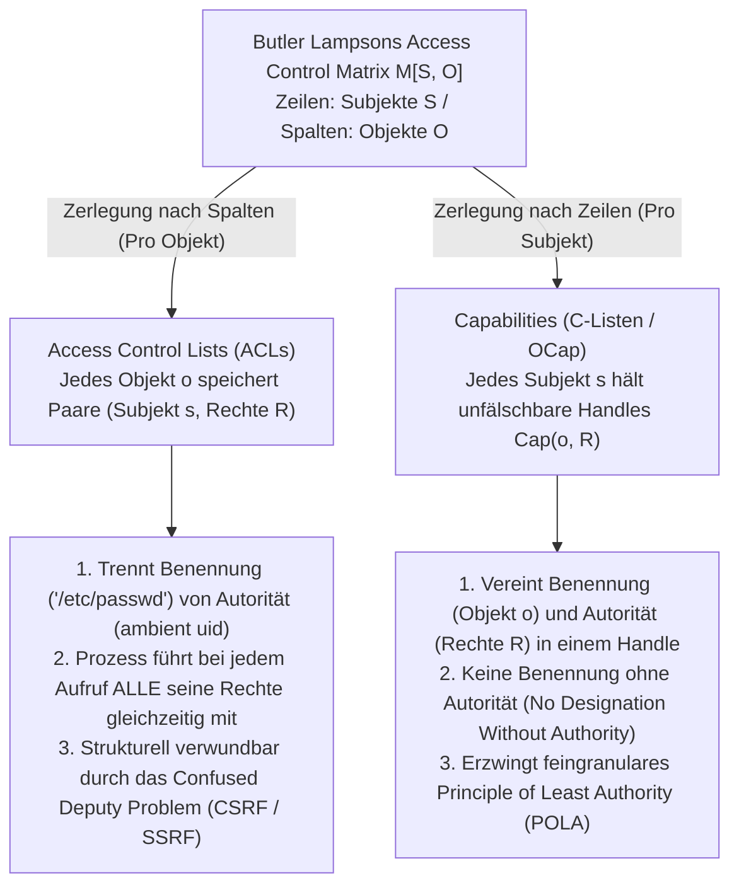

In modernen Betriebssystemen, Cloud-Infrastrukturen und Webanwendungen folgen katastrophale Sicherheitsvorfälle einem erstaunlich repetitiven Muster. Cross-Site Request Forgery (CSRF), Server-Side Request Forgery (SSRF), SQL- und Command-Injections, Container-Ausbrüche sowie Supply-Chain-Angriffe in den Ökosystemen von `npm` oder `PyPI` scheinen auf den ersten Blick völlig unterschiedlichen Schichten des Software-Stacks anzugehören. Doch unter der Oberfläche teilen sie alle denselben fundamentalen Architekturfehler.

Dieser Fehler ist unsere seit einem halben Jahrhundert bestehende Abhängigkeit von <strong>Zugriffssteuerungslisten (Access Control Lists, ACLs)</strong> in Kombination mit <strong>umgebender Autorität (Ambient Authority)</strong> – jenem Paradigma, bei dem Zugriffsentscheidungen davon abhängen, <strong>wer man ist (Subject Identity)</strong>, statt davon, <strong>was man besitzt (What You Hold)</strong>, und bei dem die <strong>Benennung einer Ressource (Designation)</strong> über fälschbare Zeichenkettenpfade oder URLs strikt von der <strong>Berechtigung (Authority)</strong> getrennt ist.

In diesem Artikel untersuchen wir systematisch das alternative Paradigma, das diese strukturelle Verwundbarkeit an der Wurzel beseitigt: <strong>Capability-Based Security (fähigkeitsbasierte Sicherheit)</strong>. Ausgehend von der mathematischen Zerlegung von Butler Lampsons Access Control Matrix $M[S, O]$ aus dem Jahr 1971 analysieren wir Norm Hardys klassisches *Confused Deputy Problem* (1988), formulieren Mark S. Millers Object-Capability-Modell (OCap) und das Prinzip der geringsten Autorität (POLA), konstruieren konkrete Entwurfsmuster für Rechteabschwächung (Facets) und sofortigen bzw. transitiven Widerruf (Redells Caretaker und Membranes) und betrachten moderne industrielle Implementierungen wie den formal verifizierten Mikrokern <strong>seL4</strong>, <strong>FreeBSD Capsicum</strong>, <strong>CHERI / ARM Morello</strong> Hardware-Capability-Pointer sowie das <strong>WebAssembly System Interface (WASI)</strong>.

---

## 1. Zwei Paradigmen der Autorität: Dienstausweise vs. Parkservice-Schlüssel (Valet Key)

Bevor wir in die formale Betriebssystemtheorie einsteigen, betrachten wir zwei gegensätzliche Sicherheitsmechanismen aus der physischen Welt.

### Paradigma A: Dienstausweise und Türlisten (Das ACL-Modell)
Stellen Sie sich ein Hochsicherheitsgebäude vor, in dem jede Tür von einem Wachmann mit einem Klemmbrett bewacht wird. Auf dem Klemmbrett steht eine Liste der Mitarbeiter, die Raum 302 betreten dürfen (eine <strong>Access Control List</strong>). Wenn Sie Einlass verlangen, prüft der Wachmann Ihren Dienstausweis (<strong>Identität / `uid`</strong>) und gleicht Ihren Namen mit der Liste ab.

Nehmen wir nun an, Sie möchten einen Praktikanten (ein Hilfsprogramm oder eine Drittanbieter-Bibliothek) bitten, eine einzige Datei `Q3_Budget.pdf` aus einem Aktenschrank in Raum 302 zu holen. Da der Praktikant nicht auf der Liste steht, müssen Sie ihm Ihren eigenen Dienstausweis leihen (analog zu `setuid` oder dem Ausführen von Code unter Ihrer eigenen Benutzerkennung). Sobald der Praktikant mit Ihrem Ausweis Raum 302 betritt, verfügt er automatisch über <strong>Ambient Authority</strong> über sämtliche Dokumente in diesem Raum – einschließlich `Payroll_Master.db`. Schlimmer noch: Wenn ein Angreifer den Notizzettel des Praktikanten vertauscht und ihn anweist, `Payroll_Master.db` zu holen, lässt der Wachmann dies problemlos zu, weil der Praktikant Ihren Ausweis trägt!

### Paradigma B: Der Parkservice-Schlüssel / Valet Key (Das Capability-Modell)
Vergleichen Sie dies mit der Übergabe Ihres Autos an einen Hotel-Parkservice. Sie tragen den Parkwächter nicht bei der Zulassungsstelle in eine Zugriffsliste Ihres Fahrzeugs ein und übergeben ihm auch nicht Ihren Personalausweis. Stattdessen überreichen Sie ihm einen <strong>Valet Key (Werkstatt- oder Parkschlüssel)</strong>. Dieser verkörpert drei tiefgreifende architektonische Eigenschaften:
1. <strong>Vereinigung von Benennung und Berechtigung (Unification of Designation and Authority)</strong>: Der Schlüssel bestimmt gleichzeitig, *welches* Fahrzeug gemeint ist, und *autorisiert* den Inhaber, den Motor zu starten. Dem Fahrzeug ist es völlig gleichgültig, *wer* den Schlüssel hält; der Besitz des unfälschbaren Tokens ist notwendiger und hinreichender Autoritätsnachweis.
2. <strong>Rechteabschwächung (Attenuation / Least Privilege)</strong>: Im Gegensatz zum Hauptschlüssel kann der Valet Key weder das Handschuhfach noch den Kofferraum öffnen und begrenzt oft die Höchstgeschwindigkeit. Er gewährt exakt das erforderliche Minimum an Rechten.
3. <strong>Dezentrale Delegation</strong>: Bei einem Schichtwechsel übergibt der erste Parkwächter den Schlüssel einfach an seinen Kollegen, ohne eine zentrale Identitätsdatenbank ändern zu müssen.

In der Informatik entspricht Paradigma A dem <strong>ACL-Modell</strong>, während Paradigma B das <strong>Capability-Modell</strong> darstellt.

---

## 2. Butler Lampsons Access Control Matrix $M[S, O]$ und ihre zwei Zerlegungen

1971 veröffentlichte Turing-Preisträger Butler Lampson seine Arbeit *"Protection"* und führte die <strong>Access Control Matrix</strong> als universelle mathematische Abstraktion für Schutzmechanismen in Betriebssystemen ein. Der Schutzzustand eines Systems zu jedem Zeitpunkt wird durch ein Tripel $(S, O, M)$ definiert:
- <strong>Subjektmenge $S = \{s_1, s_2, \dots, s_m\}$</strong>: Aktive Entitäten, die Operationen auslösen (Benutzer, Prozesse, Threads, Softwaremodule).
- <strong>Objektmenge $O = \{o_1, o_2, \dots, o_n\}$</strong>: Geschützte Ressourcen (Dateien, Speichersegmente, IPC-Sockets, Geräte), wobei meist $S \subseteq O$ gilt.
- <strong>Rechteuniversum $\mathcal{R} = \{\mathsf{read}, \mathsf{write}, \mathsf{execute}, \mathsf{append}, \mathsf{grant}, \mathsf{own}\}$</strong>: Die diskreten Operationen, die auf einem Objekt autorisiert werden können.
- <strong>Zugriffssteuerungsmatrix $M : S \times O \to 2^{\mathcal{R}}$</strong>: Jeder Eintrag $M[s, o] \subseteq \mathcal{R}$ definiert die exakte Menge an Operationen, die Subjekt $s \in S$ auf Objekt $o \in O$ ausführen darf.

Betrachten wir ein System mit drei Subjekten $S = \{\text{Alice}, \text{Compiler}, \text{Logger}\}$ und drei Dateiobjekten $O = \{\texttt{src.f}, \texttt{/SYSX/STAT}, \texttt{/SYSX/BILL}\}$:

$$
M[S, O] = \begin{array}{c|ccc}
 & \texttt{src.f} & \texttt{/SYSX/STAT} & \texttt{/SYSX/BILL} \\
\hline
\text{Alice} & \{\mathsf{read}, \mathsf{write}\} & \emptyset & \emptyset \\
\text{Compiler} & \{\mathsf{read}\} & \{\mathsf{append}\} & \{\mathsf{read}, \mathsf{write}\} \\
\text{Logger} & \emptyset & \{\mathsf{read}, \mathsf{write}\} & \emptyset
\end{array}
$$

Da $M[S, O]$ in realen Systemen extrem dünn besetzt (sparse) ist, muss jeder Systemarchitekt die Matrix entlang einer ihrer beiden Achsen zerlegen: <strong>spaltenweise (Listen an Objekten)</strong> oder <strong>zeilenweise (Tokens bei Subjekten)</strong>.



### 2.1 Spaltenweise Zerlegung: Access Control Lists (ACLs)
Schneiden wir die Matrix $M[S, O]$ vertikal <strong>nach Spalten</strong>, ordnen wir jedem Objekt $o \in O$ die Liste seiner nicht-leeren Spalteneinträge zu:

$$
\text{ACL}(o) = \bigl\{ (s, M[s, o]) \;\big|\; s \in S,\; M[s, o] \neq \emptyset \bigr\}
$$

UNIX/POSIX-Rechte, Windows NTFS DACLs und Cloud-IAM-Richtlinien folgen diesem Modell. Es erzwingt die <strong>Trennung von Benennung (Designation) und Autorität (Authority)</strong>: Ein Programm benennt ein Objekt über einen globalen, frei konstruierbaren String-Pfad wie `"/SYSX/BILL"`, während der Kernel-Referenzmonitor die <strong>umgebende Identität (`uid`)</strong> des Prozesses prüft. Dadurch übt ein Prozess bei jedem Systemaufruf automatisch die Vereinigung *aller* Rechte seiner gesamten Matrixzeile $\bigcup_{o \in O} M[s, o]$ aus – die sogenannte <strong>Ambient Authority</strong>.

### 2.2 Zeilenweise Zerlegung: Capabilities (Dennis & Van Horn 1966)
Jack B. Dennis und Earl C. Van Horn führten 1966 die duale Zerlegung ein: das horizontale Schneiden von $M[S, O]$ <strong>nach Zeilen</strong>. Jedem Subjekt $s \in S$ wird ein <strong>Capability Space (CSpace oder C-Liste)</strong> zugeordnet:

$$
\text{CSpace}(s) = \bigl\{ \text{Cap}(o, R) \;\big|\; o \in O,\; R = M[s, o] \neq \emptyset \bigr\}
$$

Jedes Element $c = \text{Cap}(o, R)$ ist eine <strong>Capability</strong> – ein <strong>unfälschbares Autoritätstoken</strong>, das <strong>Benennung</strong> (eine direkte Referenz auf das Objekt $o$) und <strong>Autorität</strong> (die erlaubte Rechteteilmenge $R \subseteq \mathcal{R}$) untrennbar verschmilzt. In einem reinen Capability-System gibt es keinen globalen Dateipfad-Namensraum und keine Überprüfung einer Benutzer-ID zur Zugriffszeit. Besitzt Subjekt $s$ keine Capability auf Objekt $o$, kann es $o$ nicht einmal adressieren: <strong>Keine Benennung ohne Autorität (No Designation Without Authority)</strong>.

| Architektonische Dimension | Access Control Lists (ACLs — Spaltenschnitt) | Capabilities (OCap / C-Listen — Zeilenschnitt) |
| :--- | :--- | :--- |
| <strong>Zerlegung von $M[S, O]$</strong> | Pro Spalte an jedem Objekt $o \in O$ gespeichert | Pro Zeile im Besitz jedes Subjekts $s \in S$ gespeichert |
| <strong>Autorisierungsphilosophie</strong> | <strong>Wer du bist (Who You Are)</strong>: Identität / `uid` des Aufrufers | <strong>Was du hältst (What You Hold)</strong>: Das vorgelegte Capability-Token |
| <strong>Benennung vs. Autorität</strong> | <strong>Getrennt</strong> (Fälschbarer String-Pfad + Ambient Identity) | <strong>Vereint</strong> (Unfälschbares Handle benennt $o$ und gewährt $R$) |
| <strong>Autoritätsmodell</strong> | <strong>Ambient Authority</strong>: Alle Rechte der `uid` sind ständig aktiv | <strong>Selective Authority</strong>: Nur das explizit übergebene Handle wirkt |
| <strong>Confused-Deputy-Anfälligkeit</strong> | <strong>Strukturell verwundbar</strong> (CSRF, SSRF, `setuid`-Eskalation) | <strong>Strukturell immun</strong> (Client muss autorisiertes Handle übergeben) |
| <strong>Repräsentative Systeme</strong> | UNIX/POSIX ACLs, Windows NTFS DACL, AWS IAM | KeyKOS, seL4, FreeBSD Capsicum, Fuchsia Zircon, CHERI, WASI |

---

## 3. Das Confused Deputy Problem: Norm Hardys Klassiker (1988) und moderne Varianten

Warum ist die Trennung von Benennung und Autorität so gefährlich? Computerarchitekt Norm Hardy beschrieb dies im Oktober 1988 in *ACM SIGOPS Operating Systems Review* unter dem Titel <strong>*"The Confused Deputy (or why capabilities might have been invented)"</strong>* anhand einer realen Sicherheitskatastrophe auf einem kommerziellen Tymshare-Betriebssystem Mitte der 1970er-Jahre.

### 3.1 Die Anatomie der `/SYSX/FORT`-Compiler-Katastrophe
Auf dem Tymshare-System befand sich der Fortran-Compiler unter `/SYSX/FORT`:
1. <strong>Statistikanforderung</strong>: Um Nutzungsstatistiken zu sammeln, sollte `/SYSX/FORT` bei jedem Kompiliervorgang einen Datensatz an die Datei `/SYSX/STAT` anhängen.
2. <strong>Vergabe von Ambient Authority</strong>: Dazu erhielt das Programm `/SYSX/FORT` weitreichende <strong>umgebende Schreibrechte für das gesamte Verzeichnis `/SYSX`</strong> (die sogenannte *home files license*, analog zu UNIX `setuid`).
3. <strong>Vom Benutzer übergebener Ausgabepfad</strong>: Der Compiler akzeptierte vom aufrufenden Benutzer einen Dateinamen als String-Parameter für Debugging-Ausgaben (z. B. `FORT(SRC="prog.f", OUT="listing.txt")`).
4. <strong>Das Kronjuwel `/SYSX/BILL`</strong>: Im selben Verzeichnis `/SYSX` lag die zentrale Abrechnungsdatenbank <strong>`/SYSX/BILL`</strong>, in der sämtliche Kundenforderungen gespeichert waren.

Eines Tages übergab ein Benutzer beim Aufruf von `/SYSX/FORT` den String <strong>`"/SYSX/BILL"`</strong> als Ausgabedatei. Als der Compiler `open("/SYSX/BILL", WRITE)` aufrief, prüfte der ACL-Referenzmonitor des Betriebssystems lediglich: *„Besitzt der aktive Prozess (`/SYSX/FORT`) Schreibrechte in `/SYSX`?“* Die Antwort lautete <strong>Ja</strong> – und <strong>der Compiler überschrieb pflichtbewusst die zentrale Kundenabrechnungsdatenbank `/SYSX/BILL` des Unternehmens mit Fortran-Diagnosemeldungen!</strong>



```mermaid
flowchart TD
    subgraph ACL_WORLD["ACL + Ambient Authority Modell (Der Confused Deputy)"]
        U1["Böswilliger Benutzer<br/>(Kein Zugriff auf /SYSX/BILL)"] -->|"1. Übergibt String-Pfad OUT='/SYSX/BILL'"| D1["Deputy: Compiler /SYSX/FORT<br/>(Ambient Authority: Schreibrecht auf /SYSX/*)"]
        D1 -->|"2. open('/SYSX/BILL', WRITE)<br/>Nutzt implizit seine eigene Ambient Authority"| OS1["OS Referenzmonitor (ACL-Prüfung)"]
        OS1 -->|"3. Compiler hat /SYSX-Schreibrecht -> ERLAUBT!"| BILL1["Abrechnungs-DB /SYSX/BILL<br/>[ÜBERSCHRIEBEN / ZERSTÖRT!]"]
    end

    subgraph CAP_WORLD["Capability-Modell (Vereinte Benennung & Autorität)"]
        U2["Benutzer<br/>(Hält nur Capabilities für eigene Dateien)"] -->|"1. Übergibt Ausgabe-Capability cap_out<br/>(Kann keine Cap für /SYSX/BILL übergeben, da nicht im Besitz!)"| D2["Deputy: Compiler /SYSX/FORT<br/>(Besitzt intern NUR cap_stat)"]
        D2 -->|"2a. write(cap_out, debug_output)<br/>Nutzt exakt die vom Benutzer übergebene Autorität"| OUT2["Ausgabedatei listing.txt"]
        D2 -->|"2b. append(cap_stat, usage_stats)<br/>Nutzt private, bei Installation verliehene Capability"| STAT2["Statistikdatei /SYSX/STAT"]
    end
```

### 3.2 Warum war der Compiler „verwirrt“? Und die Isomorphie moderner Schwachstellen
Hardy nannte `/SYSX/FORT` einen <strong>Confused Deputy (verwirrten Stellvertreter)</strong>, weil das Programm gleichzeitig im Auftrag zweier Instanzen (Systemadministrator und Benutzer) handelte, das Betriebssystem aber Benennung (String-Pfad) und Autorität (Compiler-Privilegien) trennte. In einer Capability-Architektur ist dieser Fehler unmöglich auszudrücken: Der Compiler erhält bei der Installation ausschließlich die Capability $c_{\text{stat}} = \text{Cap}(\texttt{/SYSX/STAT}, \{\mathsf{append}\})$, und der Benutzer muss für die Ausgabedatei eine eigene Schreib-Capability $c_{\text{out}} = \text{Cap}(f_{\text{out}}, \{\mathsf{write}\})$ übergeben.

Die gefährlichsten modernen Sicherheitslücken sind direkte Instanzen des Confused Deputy:
- <strong>Cross-Site Request Forgery (CSRF)</strong>: Der Browser agiert als Confused Deputy. Wenn `evil.example` ein verstecktes Formular an `https://bank.example/transfer` absendet, sieht der Browser die Ziel-URL und hängt automatisch Ihre <strong>Ambient Authority (das Session-Cookie für `bank.example`)</strong> an. CSRF-Tokens lösen dies, indem sie ein explizites, unfälschbares Capability-Token im Request verlangen.
- <strong>Server-Side Request Forgery (SSRF)</strong>: Ein Cloud-Webserver nimmt eine vom Benutzer gelieferte URL (`"http://169.254.169.254/latest/meta-data/"`) entgegen und nutzt seine eigene <strong>umgebende Netzwerkautorität</strong> innerhalb der Cloud-VPC, um IAM-Zugangsdaten auszulesen.
- <strong>Software-Supply-Chain-Angriffe (`npm` / `PyPI`)</strong>: Eine winzige String-Formatierungsbibliothek kann `~/.ssh/id_rsa` auslesen, weil unter POSIX-ACLs jede Funktion innerhalb eines Prozesses die gesamte Ambient Authority der Benutzer-`uid` erbt.

---

## 4. Das Object-Capability (OCap) Modell, Attenuation und Widerrufsmuster

In seiner wegweisenden Dissertation <strong>*"Robust Composition"</strong>* (Johns Hopkins University, 2006) zeigte Mark S. Miller, dass <strong>speichersichere objektorientierte Programmiersprachen bereits den exakten Mechanismus besitzen, um das Principle of Least Authority (POLA) bis auf die Ebene einzelner Objekte und Methodenaufrufe durchzusetzen</strong>: die Objektreferenz selbst.

### 4.1 Drei Invarianten für OCap-Sprachen und die drei Gesetze des Referenzerwerbs
Damit eine objektorientierte Sprache (wie Hardened JavaScript / SES, E oder Wasm-Komponenten) ein echtes <strong>Object-Capability-System</strong> bildet, muss die Laufzeitumgebung drei Invarianten erzwingen:
1. <strong>Keine gefälschten Referenzen (No Forged References)</strong>: Zeigerarithmetik oder das Casten von Ganzzahlen in Objektreferenzen sind ausgeschlossen.
2. <strong>Kein veränderlicher globaler Zustand (Zero Ambient Authority)</strong>: Der globale Namensraum darf keine veränderlichen Variablen oder direkten I/O-Module (`fs`, `net`) enthalten; primordiale Prototypen (`Object.prototype`) müssen tief eingefroren (`Object.freeze`) sein.
3. <strong>Absolute Kapselung</strong>: Private Variablen in lexikalischen Closures oder `#private`-Felder können von außen nicht inspiziert werden.

Im Referenzgraphen $G = (V, E)$ kann eine neue Kante $(A \to C)$ nur auf drei Wegen entstehen: <strong>1. Elternschaft (Parenthood, `new C()`)</strong>, <strong>2. Ausstattung (Endowment bei der Closure-Erzeugung)</strong> oder <strong>3. Einführung (Introduction, bei der ein Vermittler $B$ mit $(B \to A)$ und $(B \to C)$ die Referenz $C$ als Nachrichtenargument an $A$ übergibt)</strong>:

$$
\text{Gesetz der Einführung (Law of Introduction)}: \quad (B \to A) \;\land\; (B \to C) \;\;\Longrightarrow\;\; B \text{ kann } (A \to C) \text{ herstellen}
$$

### 4.2 Rechteabschwächung (Facets) und Widerruf über Redells Caretaker & Membranes
Ein verbreiteter Mythos behauptet, Capabilities ließen sich nach der Weitergabe weder einschränken noch widerrufen. Tatsächlich löste <strong>David D. Redell</strong> den Capability-Widerruf bereits 1974 in seiner Dissertation an der UC Berkeley mit dem <strong>Caretaker-Muster</strong>, und Mark S. Miller erweiterte dies durch <strong>Revocable Membranes</strong> für ganze Objektgraphen:

```javascript
// 1. Rechteabschwächung (Attenuating Facet): Nur Lesezugriff auf bestimmten Präfix
function makeScopedReadFacet(fullStorageCap, allowedPrefix) {
  return Object.freeze({
    read(key) {
      if (typeof key !== "string" || !key.startsWith(allowedPrefix)) {
        throw new Error(`Zugriff verweigert: Schlüssel muss mit '${allowedPrefix}' beginnen`);
      }
      return fullStorageCap.read(key);
    }
    // write() und deleteAll() sind im Facet vollständig weggelassen!
  });
}

// 2. Redells (1974) Caretaker-Muster für sofortigen O(1)-Capability-Widerruf
function makeCaretaker(targetCap) {
  let currentTarget = targetCap; // Privater veränderlicher Zeiger im Closure
  const caretaker = Object.freeze({
    read(...args) {
      if (currentTarget === null) throw new Error("RevokedCapabilityError: Zugriff widerrufen");
      return currentTarget.read(...args);
    },
    write(...args) {
      if (currentTarget === null) throw new Error("RevokedCapabilityError: Zugriff widerrufen");
      return currentTarget.write(...args);
    }
  });
  const revoker = Object.freeze({
    revoke() { currentTarget = null; } // Trennt die Verbindung sofort
  });
  return Object.freeze({ caretaker, revoker });
}
```

Gibt eine Capability selbst weitere Capabilities zurück (z. B. ein Verzeichnis-Handle über `getSubDir()`), umhüllt eine <strong>Revocable Membrane</strong> mithilfe von `Proxy` und `WeakMap` transitiv alle ausgehenden Rückgabewerte und eingehenden Argumente mit demselben Widerrufsgatter, sodass ein einziger Aufruf von `revoke()` den gesamten Teilgraphen augenblicklich deaktiviert.

---

## 5. Industrielle Implementierungen: seL4, FreeBSD Capsicum, CHERI und WebAssembly WASI

Zunächst muss eine häufige Namensverwechslung ausgeräumt werden: Linux `capabilities(7)` (`CAP_NET_ADMIN` usw.) sind <strong>keine Objekt-Capabilities</strong>! Sie zerlegen lediglich die `root`-Privilegien in rund 41 grobe Thread-Bitflags ohne Objektbezug und bieten keinerlei Schutz gegen das Confused Deputy Problem. Echte industrielle Capability-Architekturen finden sich in vier Systemklassen:

1. <strong>Der formal verifizierte Mikrokern seL4</strong>: Als weltweit erster Kernel mit vollständigem maschinengeprüftem Korrektheitsbeweis (in Isabelle/HOL) besitzt seL4 null Ambient Authority. Alle Kernel-Objekte (Threads, Adressräume, IPC-Endpunkte, Speicher-Frames) werden ausschließlich über Capabilities im <strong>CSpace (CNode-Tabellen)</strong> eines Threads adressiert. Mittels `seL4_CNode_Mint` lassen sich Rechtebits abschwächen oder fälschungssichere Badges anheften, und `seL4_CNode_Revoke` widerruft abgeleitete Capabilities transitiv über den <strong>Capability Derivation Tree (CDT)</strong>.
2. <strong>FreeBSD Capsicum</strong>: Entwickelt an der University of Cambridge und bei Google, hebt Capsicum klassische UNIX-Dateideskriptoren (`fd`) in den Rang echter Capabilities. Ruft ein Prozess <strong>`cap_enter()`</strong> auf, blockiert der Kernel unwiderruflich sämtliche Systemaufrufe auf globale Namensräume (`open()`, `connect()`, `bind()` liefern `ECAPMODE`). Der Prozess kann nur noch auf bereits gehaltenen Deskriptoren (bzw. relativ darunter mittels `openat(dir_fd, ...)` ohne `".."`-Ausbruch) operieren und deren Rechte mit `cap_rights_limit(fd, &rights)` über mehr als 60 feingranulare Bitmasken einschränken.
3. <strong>Capabilities in Silizium: CHERI und ARM Morello</strong>: Das von SRI International und der University of Cambridge entwickelte und von ARM im <strong>Morello</strong>-Prozessor sowie <strong>CHERIoT-RISC-V</strong> in Hardware gegossene Projekt ersetzt 64-Bit-Zeiger durch <strong>128-Bit-Hardware-Capabilities plus ein 1-Bit-Out-of-Band-Validitäts-Tag</strong>:

$$
\underbrace{\text{Tag (1 bit)}}_{\text{Hardware-Herkunftsbit}} \;\Big|\; \underbrace{\text{Permissions (18 bits)}}_{\text{Load, Store, Exec, Cap-RW}} \;\Big|\; \underbrace{\text{Object Type (18 bits)}}_{\text{Hardware Seal / Unseal}} \;\Big|\; \underbrace{\text{Compressed Bounds (28 bits)}}_{\text{Gleitkomma-Grenzen [Base, Top)}} \;\Big|\; \underbrace{\text{Address Cursor (64 bits)}}_{\text{64-Bit Virtuelle Adresse}}
$$

Bei jedem Speicherzugriff prüft die CPU in einem einzigen Taktzyklus, ob die Adresse innerhalb von `[Base, Top)` liegt und die Berechtigungsmaske die Operation erlaubt. Überschreibt ein Programm auch nur ein einziges Byte einer Capability im RAM mit einer gewöhnlichen Integer-Store-Instruktion, löscht der Speichercontroller das 1-Bit-Tag automatisch auf `0` und macht den Zeiger unbrauchbar – Pufferüberläufe und ROP-Angriffe werden direkt im Silizium eliminiert.
4. <strong>WebAssembly (WASI) und kryptografische Macaroons</strong>: WASI-Module starten ohne Ambient Authority und können nur auf vorab vom Host geöffnete und injizierte Verzeichnis-Capabilities zugreifen. In verteilten Cloud-Systemen ermöglichen Googles <strong>Macaroons</strong> mittels verketteter HMAC-Signaturen eine dezentrale Rechteabschwächung durch bedingte Einschränkungen (Caveats), ohne dass ein zentraler Autorisierungsserver kontaktiert werden muss.
