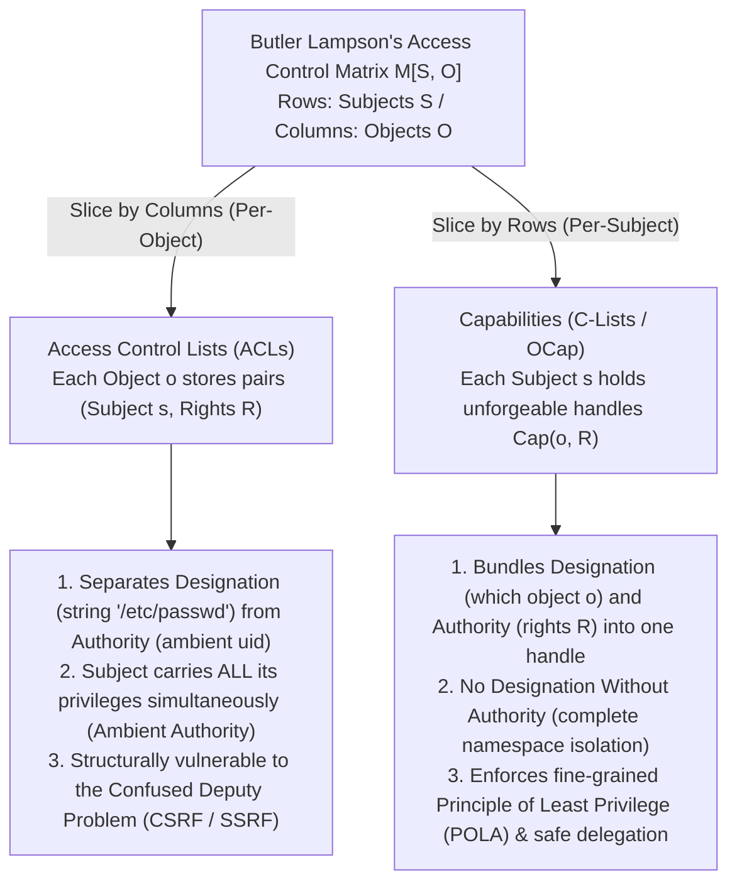

Across modern operating systems, cloud infrastructures, and web applications, catastrophic security breaches follow a strikingly repetitive pattern. Cross-Site Request Forgery (CSRF), Server-Side Request Forgery (SSRF), SQL and command injection, container escapes, and software supply-chain attacks in `npm` or `PyPI` ecosystems appear at first glance to belong to entirely different layers of the software stack. Yet beneath their surface details lies a single, shared architectural flaw.

That flaw is our half-century reliance on <strong>Access Control Lists (ACLs)</strong> coupled with <strong>Ambient Authority</strong>—the design paradigm in which access decisions depend on <strong>Who You Are (Subject Identity)</strong> rather than <strong>What You Hold</strong>, and in which <strong>Designation</strong> (naming a resource via a forgeable string path or URL) is severed from <strong>Authority</strong> (the ambient permission carried by the calling principal).

In this article, we systematically examine the alternative paradigm that eliminates this structural vulnerability at its root: <strong>Capability-Based Security</strong>. Starting from the mathematical decomposition of Butler Lampson's 1971 Access Control Matrix $M[S, O]$, we trace Norm Hardy's classic 1988 *Confused Deputy Problem*, formulate Mark S. Miller's Object-Capability (OCap) model and connectivity invariants, construct concrete code patterns for delegation, attenuation (facets), and immediate or transitive revocation (Redell's Caretaker and Membranes), and survey modern industrial deployments spanning the formally verified <strong>seL4</strong> microkernel, <strong>FreeBSD Capsicum</strong>, <strong>CHERI / ARM Morello</strong> hardware capability pointers, <strong>WebAssembly System Interface (WASI)</strong>, <strong>Hardened JavaScript (SES)</strong>, and cryptographic <strong>Macaroons</strong>.

---

## 1. Two Paradigms of Authority: Identity Badges vs. Valet Keys

Before diving into formal operating system theory, consider two contrasting ways of enforcing physical security in the everyday world.

### Paradigm A: Identity Badges and Door Ledgers (The ACL Model)
Imagine a high-security corporate building where every door is guarded by an officer holding a clipboard. On the clipboard is a list of employee names permitted to enter Room 302 (an <strong>Access Control List</strong>). When you walk up and say, *"Open Room 302,"* the guard inspects your government or corporate ID badge (<strong>Identity / `uid`</strong>), checks whether your name appears on the ledger for Room 302, and unlocks the door.

Now suppose you want an intern (a helper program or library) to fetch a single file, `Q3_Budget.pdf`, from a filing cabinet inside Room 302. Under the identity-ledger regime, the intern has no access to Room 302. To get the job done, you must either ask the building administrator to add the intern to Room 302's ledger, or hand your own ID badge to the intern (`setuid` / running code under your own user identity). The moment the intern enters Room 302 wearing your identity badge, the intern automatically gains <strong>Ambient Authority</strong> over everything in that room—not just `Q3_Budget.pdf`, but also `Executive_Layoffs.pdf` and `Payroll_Master.db`. Worse, if a malicious outsider tricks your intern into fetching `Payroll_Master.db` by swapping a sticky note, the guard at Room 302 happily allows it because the intern is wearing your badge!

### Paradigm B: The Car Valet Key (The Capability Model)
Contrast this with pulling up to a hotel and handing your car over to a parking attendant. You do not call the Department of Motor Vehicles to register the attendant's driver's license on an access control list attached to your vehicle, nor do you hand the attendant your personal identity documents. Instead, you hand the attendant a <strong>Valet Key</strong>.

A physical valet key embodies three profound architectural properties:
1. <strong>Unification of Designation and Authority</strong>: The key simultaneously *designates* which specific vehicle is to be operated (it fits only your car's ignition cylinder) and *authorizes* the holder to start the engine. The car does not care *who* holds the key; possession of the unforgeable token is both necessary and sufficient proof of authority.
2. <strong>Attenuation (Least Privilege)</strong>: Unlike your master key, the valet key is mechanically or electronically restricted so that it cannot unlock the glove compartment or the trunk, and it may limit the vehicle's top speed and driving radius. It grants the attendant the <strong>exact minimum authority</strong> required to park the car—nothing more.
3. <strong>Decentralized Delegation</strong>: If the first attendant needs a second attendant to retrieve your car when you check out, they do not need to edit a central identity database; they simply hand the valet key to the second attendant.

In computer science, Paradigm A is the <strong>Access Control List (ACL)</strong> model, whereas Paradigm B is the <strong>Capability-Based Security</strong> model.

---

## 2. Butler Lampson's Access Control Matrix $M[S, O]$ and Its Two Decompositions

In 1971, Turing Award laureate Butler Lampson published *"Protection"*, introducing the <strong>Access Control Matrix</strong> as a universal mathematical abstraction for protection mechanisms in operating systems (later formalized as the Harrison-Ruzzo-Ullman or HRU model).

The protection state of a system at any instant is defined by a triple $(S, O, M)$:
- <strong>A set of Subjects $S = \{s_1, s_2, \dots, s_m\}$</strong>: Active entities capable of initiating operations (users, processes, threads, software modules, or principals).
- <strong>A set of Objects $O = \{o_1, o_2, \dots, o_n\}$</strong>: Protected resources (files, memory segments, IPC sockets, hardware devices, database tables). Because subjects can also be acted upon (e.g., killing or debugging a process), we generally have $S \subseteq O$.
- <strong>A universal set of Access Rights $\mathcal{R} = \{\mathsf{read}, \mathsf{write}, \mathsf{execute}, \mathsf{append}, \mathsf{take}, \mathsf{grant}, \mathsf{own}\}$</strong>: The discrete operations that may be authorized on an object.
- <strong>An Access Control Matrix $M : S \times O \to 2^{\mathcal{R}}$</strong>: A two-dimensional function where each entry $M[s, o] \subseteq \mathcal{R}$ specifies the exact set of operations that subject $s \in S$ is authorized to perform on object $o \in O$.

For instance, consider a system with three subjects $S = \{\text{Alice}, \text{Compiler}, \text{Logger}\}$ and three file objects $O = \{\texttt{src.f}, \texttt{/SYSX/STAT}, \texttt{/SYSX/BILL}\}$:

$$
M[S, O] = \begin{array}{c|ccc}
 & \texttt{src.f} & \texttt{/SYSX/STAT} & \texttt{/SYSX/BILL} \\
\hline
\text{Alice} & \{\mathsf{read}, \mathsf{write}\} & \emptyset & \emptyset \\
\text{Compiler} & \{\mathsf{read}\} & \{\mathsf{append}\} & \{\mathsf{read}, \mathsf{write}\} \\
\text{Logger} & \emptyset & \{\mathsf{read}, \mathsf{write}\} & \emptyset
\end{array}
$$

In any real operating system or cloud environment, $|S|$ ranges in the thousands or millions and $|O|$ ranges in themillions or billions. Furthermore, $M[S, O]$ is overwhelmingly sparse ($M[s, o] = \emptyset$ for almost all pairs). Storing $M$ as a contiguous 2D array in kernel memory would require $\mathcal{O}(|S| \times |O|)$ space, which is completely infeasible.

Consequently, every system architect must decompose the sparse matrix $M[S, O]$ along one of its two axes: <strong>slice by columns (attaching lists to Objects)</strong>, or <strong>slice by rows (attaching tokens to Subjects)</strong>.



### 2.1 Slicing by Columns: Access Control Lists (ACLs)
When we slice the matrix $M[S, O]$ vertically <strong>by columns</strong>, we associate with each object $o \in O$ a list of the non-empty entries in its column:

$$
\text{ACL}(o) = \bigl\{ (s, M[s, o]) \;\big|\; s \in S,\; M[s, o] \neq \emptyset \bigr\}
$$

UNIX/POSIX permissions (`rwxr-xr-x` and POSIX.1e ACLs), Windows NTFS Discretionary Access Control Lists (DACLs), and Cloud IAM resource policies are all column-sliced implementations.

Slicing by columns forces a profound architectural split: <strong>the separation of Designation from Authority</strong>.
1. <strong>Designation via Public Namespaces</strong>: To operate on an object, a program designates it using a forgeable, globally meaningful identifier—a file path string such as `"/etc/shadow"`, a URL like `"http://169.254.169.254/latest/meta-data/"`, or a database table name. Anyone can construct or guess that string; the string itself carries zero authority.
2. <strong>Authorization via Ambient Authority</strong>: When the program invokes `open("/SYSX/BILL", O_WRONLY)`, the kernel's Reference Monitor inspects the <strong>ambient identity</strong> (`uid`, `euid`, `gid`, IAM role, or browser session cookie) attached to the calling process and checks whether $(\text{caller\_uid}, \mathsf{write}) \in \text{ACL}(\texttt{/SYSX/BILL})$.

Because the kernel checks the subject's identity against whatever object the subject names, a running process continuously wields the union of *all* permissions across its entire row of the matrix, $\bigcup_{o \in O} M[s, o]$, on every single system call. This ever-present aura of power is called <strong>Ambient Authority</strong>.

### 2.2 Slicing by Rows: Capabilities (Dennis & Van Horn 1966)
In their seminal 1966 paper *"Programming Semantics for Multiprogrammed Computations"*, Jack B. Dennis and Earl C. Van Horn introduced the dual decomposition: slicing $M[S, O]$ horizontally <strong>by rows</strong>. With each subject $s \in S$, we associate a <strong>Capability Space (CSpace or C-List)</strong> containing the non-empty entries of its row:

$$
\text{CSpace}(s) = \bigl\{ \text{Cap}(o, R) \;\big|\; o \in O,\; R = M[s, o] \neq \emptyset \bigr\}
$$

Each element $c = \text{Cap}(o, R)$ is a <strong>Capability</strong>—an <strong>unforgeable token of authority</strong> that binds <strong>Designation</strong> (a direct pointer or handle to the specific object $o$) and <strong>Authority</strong> (the permitted subset of rights $R \subseteq \mathcal{R}$) into a single indivisible reference.

In a pure capability system, there is no global file path namespace and no ambient user identity checked at access time. To write to a file, a subject must invoke an operation directly on a capability it holds: `c.write(data)` (or pass the capability descriptor `c` to the kernel). If subject $s$ does not hold a capability to object $o$, subject $s$ cannot even *name* or address $o$. This establishes the foundational axiom of capability security:

> <strong>No Designation Without Authority; No Authority Without Designation.</strong>

| Architectural Dimension | Access Control Lists (ACLs — Column Slicing) | Capabilities (OCap / C-Lists — Row Slicing) |
| :--- | :--- | :--- |
| <strong>Decomposition of $M[S, O]$</strong> | Stored per column on each Object $o \in O$ | Stored per row held by each Subject $s \in S$ |
| <strong>Core Authorization Philosophy</strong> | <strong>Who You Are</strong> (Caller's identity / `uid` / principal) | <strong>What You Hold</strong> (The specific capability token presented) |
| <strong>Designation vs. Authority</strong> | <strong>Separated</strong> (Forgeable string path + Ambient identity) | <strong>Unified</strong> (Unforgeable handle both names $o$ and grants $R$) |
| <strong>Authority Model</strong> | <strong>Ambient Authority</strong>: All rights of `uid` are active on every call | <strong>Selective Authority</strong>: Only the explicitly passed handle is active |
| <strong>Granularity of Least Privilege (POLA)</strong> | Coarse-grained (Per-user account or per-process) | Ultra-fine-grained (Per-object reference, per-method invocation) |
| <strong>Vulnerability to Confused Deputy</strong> | <strong>Structurally Vulnerable</strong> (CSRF, SSRF, `setuid` escalation) | <strong>Structurally Immune</strong> (Client must pass an already-authorized handle) |
| <strong>Delegation of Authority</strong> | Difficult (Requires central ACL mutation or privileged admin) | Trivial (Pass the capability reference as a message/function argument) |
| <strong>Attenuation (Shrinking Rights)</strong> | Difficult (Creating restricted sub-users on the fly requires `root`) | Trivial (Wrap in a 5-line facet or mask bits via `Mint`/`cap_rights_limit`) |
| <strong>Audit Query Efficiency</strong> | Fast at answering: *"Which subjects can access object $o$?"* | Fast at answering: *"Which objects can subject $s$ access?"* |
| <strong>Representative Systems</strong> | UNIX/POSIX ACLs, Windows NTFS DACL, AWS IAM | KeyKOS, seL4, FreeBSD Capsicum, Fuchsia Zircon, CHERI, WASI, SES |

---

## 3. The Confused Deputy Problem: Norm Hardy's 1988 Classic and Its Modern Descendants

Why is separating Designation from Authority so dangerous? The definitive explanation was published by computer architect Norm Hardy in the October 1988 issue of *ACM SIGOPS Operating Systems Review* under the title <strong>*"The Confused Deputy (or why capabilities might have been invented)"</strong>*. Hardy recounted a real-world security disaster that occurred in the mid-1970s on a commercial Tymshare operating system.

### 3.1 Anatomy of the `/SYSX/FORT` Compiler Disaster
On the Tymshare system, system utilities resided in a special directory called `/SYSX`. One of those utilities was the Fortran compiler, `/SYSX/FORT`.
1. <strong>The Billing Statistics Requirement</strong>: System administrators wanted to collect usage statistics whenever anyone compiled a Fortran program. To do so, `/SYSX/FORT` was programmed to append a statistical record to the file `/SYSX/STAT` at the end of every compilation run.
2. <strong>Granting Ambient Authority</strong>: Under Tymshare's ACL-like protection mechanism (known as the *home files license*, analogous to UNIX `setuid`/`setgid` permissions), the executable `/SYSX/FORT` was granted <strong>ambient write authority over the entire `/SYSX` directory</strong> so that it could open and update `/SYSX/STAT`.
3. <strong>User-Supplied Output Filename</strong>: Like any compiler, `/SYSX/FORT` accepted a string argument from the invoking user specifying the file path where debugging output or assembly listings should be written (e.g., `FORT(SRC="prog.f", OUT="listing.txt")`).
4. <strong>The Crown Jewels in `/SYSX/BILL`</strong>: Also stored inside `/SYSX` was the master customer billing database, <strong>`/SYSX/BILL`</strong>, which recorded how much money every customer owed Tymshare. Ordinary users obviously had zero write permission to `/SYSX/BILL`.

One day, a clever user invoked `/SYSX/FORT` and passed the string <strong>`"/SYSX/BILL"`</strong> as the filename for compiler debugging output. Consider the exact sequence of events that unfolded:

1. `/SYSX/FORT` began executing, carrying both the user's permissions and its own ambient *home files license* for `/SYSX`.
2. When it came time to write the debugging output, `/SYSX/FORT` took the user's string `"/SYSX/BILL"` and issued an OS system call: `open("/SYSX/BILL", WRITE)`.
3. The OS Reference Monitor intercepted the `open` call and asked its standard ACL question: *"Does the active process (`/SYSX/FORT`) have permission to write to files in `/SYSX`?"*

```mermaid
flowchart TD
    subgraph ACL_WORLD["ACL + Ambient Authority Model (The Confused Deputy)"]
        U1["Malicious User<br/>(No access to /SYSX/BILL)"] -->|"1. Passes string path OUT='/SYSX/BILL'"| D1["Deputy: Compiler /SYSX/FORT<br/>(Ambient Authority: Write to /SYSX/*)"]
        D1 -->|"2. open('/SYSX/BILL', WRITE)<br/>Implicitly wields its own ambient authority"| OS1["OS Reference Monitor (ACL Check)"]
        OS1 -->|"3. Compiler has /SYSX write permission -> ALLOWED!"| BILL1["Master Billing DB /SYSX/BILL<br/>[CORRUPTED / OVERWRITTEN!]"]
        D1 -.->|"Intended internal access"| STAT1["Stats File /SYSX/STAT"]
    end

    subgraph CAP_WORLD["Capability Model (Unified Designation & Authority)"]
        U2["User<br/>(Holds Caps only to own files)"] -->|"1. Passes output capability cap_out<br/>(Cannot pass Cap to /SYSX/BILL because User doesn't hold it!)"| D2["Deputy: Compiler /SYSX/FORT<br/>(Endowed ONLY with cap_stat)"]
        D2 -->|"2a. write(cap_out, debug_output)<br/>Uses authority explicitly supplied by User"| OUT2["User's Output File listing.txt"]
        D2 -->|"2b. append(cap_stat, usage_stats)<br/>Uses private capability endowed at install"| STAT2["Stats File /SYSX/STAT"]
    end
```

4. The answer was <strong>Yes</strong>—because `/SYSX/FORT` held the home files license for `/SYSX` so it could write to `/SYSX/STAT`!
5. The kernel allowed the `open` call, and <strong>the compiler dutifully overwrote the company's master customer billing database `/SYSX/BILL` with Fortran compiler diagnostics!</strong>



### 3.2 Why Was the Compiler "Confused"?
Hardy called `/SYSX/FORT` a <strong>Confused Deputy</strong> because it was acting as an agent (deputy) serving <strong>two distinct principals with two distinct authorities</strong> simultaneously:
- <strong>Principal 1 (The System Administrator)</strong>: Authorized `/SYSX/FORT` to update `/SYSX/STAT` on the system's behalf.
- <strong>Principal 2 (The Invoking User)</strong>: Asked `/SYSX/FORT` to write debugging output to a user-designated file on the user's behalf.

Because the operating system separated Designation (the string `"/SYSX/BILL"`) from Authority (the compiler's ambient privileges), `/SYSX/FORT` had no way to tell the kernel: *"When I open `/SYSX/STAT`, use my own authority; when I open the user's output path, use ONLY the user's authority."* When the compiler passed the user's string to `open()`, the OS automatically applied the compiler's own high ambient authority to the user's malicious designation.

### 3.3 Why ACL Workarounds Fail to Solve the Confused Deputy
Whenever the Confused Deputy is presented, defenders of ACL architectures propose several ad-hoc patches—every one of which breaks down under scrutiny:

1. <strong>"Just check the caller's permissions manually before calling `open()` (e.g., UNIX `access()`)"</strong>:
   - First, this shifts the burden of security enforcement from the operating system onto every application programmer. Forgetting a single check creates a privilege escalation vulnerability.
   - Second, calling `access(path)` followed by `open(path)` introduces the notorious <strong>TOCTOU (Time-of-Check to Time-of-Use)</strong> race condition. Between the microsecond `access("/tmp/out")` verifies that `/tmp/out` belongs to the user and the microsecond `open("/tmp/out")` executes, an attacker can atomically replace `/tmp/out` with a symbolic link pointing to `/SYSX/BILL`.
2. <strong>"Have the OS intersect the permissions of the User and the Deputy ($M[\text{User}, o] \cap M[\text{Deputy}, o]$), or temporarily drop privileges via `seteuid()`"</strong>:
   - Suppose you intersect the User's and Compiler's permissions for all file operations. Then `/SYSX/FORT` can no longer write to `/SYSX/STAT` because the User does not have permission to write to `/SYSX/STAT`!
   - And what if the Deputy is a multi-tenant microservice or database broker that receives two filenames—$f_A$ from Client $A$ and $f_B$ from Client $B$—to merge them while writing an audit log to its own internal file $f_D$? There is <strong>no single ambient identity or intersection of identities</strong> under which that process can execute! To operate safely, each resource access must carry its own specific authority token.

### 3.4 How Capabilities Eliminate the Confused Deputy at the Root
Under a capability architecture, the `/SYSX/FORT` bug is impossible to express:
1. When `/SYSX/FORT` is installed, it is not given ambient access to the `/SYSX` directory. Instead, it is endowed with a single private capability $c_{\text{stat}} = \text{Cap}(\texttt{/SYSX/STAT}, \{\mathsf{append}\})$.
2. When the user invokes `/SYSX/FORT`, the user does <strong>not</strong> pass a string filename. Instead, the user opens their desired output file within their own capability namespace and passes the resulting capability handle $c_{\text{out}} = \text{Cap}(f_{\text{out}}, \{\mathsf{write}\})$ as an argument to `/SYSX/FORT`.
3. Inside `/SYSX/FORT`, the compiler writes statistics via `c_stat.append(stats)` and writes debugging output via `c_out.write(listing)`.

Because the user does not possess a write capability to `/SYSX/BILL`, the user cannot pass one to the compiler. And because the compiler never opens raw string paths using ambient authority, it can never be tricked into misusing its private $c_{\text{stat}}$ capability. Designation and authority travel together inside $c_{\text{out}}$ and $c_{\text{stat}}$.

### 3.5 Modern Vulnerability Classes Are All Confused Deputies
Once you understand Norm Hardy's model, you realize that the most devastating vulnerability classes in modern cybersecurity are direct instances of the Confused Deputy:

- <strong>Cross-Site Request Forgery (CSRF)</strong>:
  The web browser is a Confused Deputy. When you log into `bank.example`, the browser stores your session cookie. Later, when you visit `evil.example` and its JavaScript submits a hidden POST request to `https://bank.example/transfer`, the browser sees the destination string `"bank.example"` and <strong>automatically attaches your ambient authority (the session cookie for `bank.example`)</strong> to a request initiated by `evil.example`! Synchronizer CSRF tokens and Capability URLs fix this precisely because they require the HTML form itself to present an unforgeable capability token rather than relying on ambient browser cookies.
- <strong>Server-Side Request Forgery (SSRF)</strong>:
  A cloud web application acts as a deputy that fetches a user-supplied webhook or avatar URL string. When an attacker passes `"http://169.254.169.254/latest/meta-data/iam/security-credentials/"`, the server uses its own <strong>ambient network authority</strong> inside the cloud VPC to fetch the cloud instance's root IAM credentials and hands them back to the attacker.
- <strong>Software Supply-Chain Attacks (`npm` / `PyPI` Malicious Packages)</strong>:
  Why can a tiny 20-line string-padding library imported into your Node.js or Python application read `~/.ssh/id_rsa`, `~/.aws/credentials`, and exfiltrate them over the internet? Because under UNIX/POSIX ACLs, every third-party function running inside your process inherits the <strong>entire ambient authority of your user ID (`uid`)</strong> and the entire global namespace (`fs`, `net`, `process.env`). The OS cannot distinguish between your core application opening a database connection and an untrusted dependency stealing your SSH keys.

---

## 4. The Object-Capability (OCap) Model and the Principle of Least Privilege (POLA)

In their landmark 1975 survey *"The Protection of Information in Computer Systems"*, Jerome H. Saltzer and Michael D. Schroeder formulated the <strong>Principle of Least Privilege</strong> (often called the <strong>Principle of Least Authority</strong>, or <strong>POLA</strong>, in the capability community to distinguish authority over objects from coarse user privileges):

> <strong>Principle of Least Authority (POLA)</strong>: Every program and every user of the system should operate using the least set of privileges necessary to complete the job.

In an ACL system, the finest granularity of protection is typically an entire user account or OS process. Creating a new OS user account and configuring ACLs just to invoke a single helper function `parseMarkdown(text)` is prohibitively slow and operationally impossible.

In his seminal 2006 PhD dissertation at Johns Hopkins University, <strong>*"Robust Composition: Towards a Unified Approach to Access Control and Concurrency Control"</strong>*, Mark S. Miller demonstrated that <strong>memory-safe object-oriented programming languages already possess the exact mechanism needed to enforce POLA down to the level of individual objects and function calls</strong>: the object reference itself.

### 4.1 When Is an Object Reference a Capability?
In languages like JavaScript, Java, Python, or safe Rust, an object reference $r$ pointing to an instance $o$ bundles designation (which object instance in memory) with access to its public methods. For an object-oriented language to become a true <strong>Object-Capability (OCap) System</strong> (as pioneered in the <strong>E</strong> programming language, <strong>Google Caja</strong>, and <strong>Hardened JavaScript / SES</strong>), the language runtime must enforce three invariants:

1. <strong>No Forged References</strong>: A program cannot manufacture an object reference by casting an integer address (`(Object*)0x7ff00010`) or performing out-of-bounds pointer arithmetic. References can only be obtained through legitimate language operations.
2. <strong>No Mutable Global State (Zero Ambient Authority)</strong>: The global scope must not contain mutable variables or ambient I/O powers (such as importing `fs`, `http`, or `os.environ` out of thin air). Shared primordial objects (`Object.prototype`, `Array.prototype`, `Math`) must be transitively immutable (deeply frozen) so that two isolated objects cannot use a shared prototype property as a covert communication or capability-smuggling channel.
3. <strong>Absolute Encapsulation</strong>: An object's private lexical state (variables captured inside a lexical closure or `#private` class fields) cannot be inspected or mutated from outside the object via reflection, stack inspection, or serializer hooks.

When these three rules hold, an object reference *is* an unforgeable capability $\text{Cap}(o, R)$, where $R$ is the set of public methods exposed by $o$.

### 4.2 The Three Laws of Capability Acquisition (Granovetter's Introduction Graph)
How can authorities propagate in an Object-Capability system? Representing the objects in a system as vertices $V$ and the references held by each object as directed edges $E$ in a reference graph $G = (V, E)$, Mark S. Miller showed that a new edge $(A \to C)$—meaning subject $A$ acquires a capability to object $C$—can come into existence in <strong>three and only three ways</strong>:

1. <strong>Parenthood (Creation)</strong>:
   Subject $A$ instantiates a brand-new object $C$ (e.g., `const c = new C()`). At the moment of creation, $A$ holds the sole initial capability to $C$, establishing $(A \to C)$.
2. <strong>Endowment (Initial Conditions)</strong>:
   Creator $B$ already holds a capability to $C$ ($B \to C$). When $B$ creates a new object or closure $A$, $B$ endows $A$ with a reference to $C$ inside $A$'s lexical scope or constructor arguments, establishing $(A \to C)$ at $A$'s birth.
3. <strong>Introduction (Delegation via Message Passing)</strong>:
   An introducer $B$ simultaneously holds a capability to $A$ ($B \to A$) and a capability to $C$ ($B \to C$). $B$ sends a message (invokes a method) on $A$, passing $C$ as an argument: `a.deliver(c)` (or $A$ invokes $B$ and receives $C$ as a return value).

$$
\text{Law of Introduction}: \quad (B \to A) \;\land\; (B \to C) \;\;\Longrightarrow\;\; B \text{ can establish } (A \to C)
$$

This topology—often illustrated via the <strong>Granovetter Diagram</strong> (named after sociologist Mark Granovetter's triadic closure)—yields a profound security theorem: <strong>Authority only flows along existing paths of connectivity.</strong> If two subgraphs $G_1$ and $G_2$ share no mutable reference bridge, or if the bridge between them refuses to pass capabilities, then $G_1$ and $G_2$ are provably isolated from one another even while executing inside the exact same OS process and address space!

---

## 5. Delegation, Attenuation, and Revocation: Refuting the Myths About Capabilities

A persistent myth in introductory security textbooks claims:
> *"Capabilities make delegation easy, but once you hand a capability to an untrusted party, you cannot restrict how they use it, you cannot stop them from delegating it further, and you cannot revoke it!"*

Every part of this claim is false. In fact, <strong>David D. Redell</strong> solved capability revocation in his 1974 UC Berkeley PhD dissertation (*"Naming and Protection in Extendible Operating Systems"*), and Mark S. Miller's OCap patterns show how attenuation and revocation are vastly simpler in capability systems than in ACL systems. Let us prove this with executable architectural patterns.

### 5.1 Attenuation via Facets (The Wrapper Pattern)
Suppose Alice holds a powerful capability `fullStorageCap` that supports `read(key)`, `write(key, val)`, and `deleteAll()`. Alice wants to invoke an untrusted third-party analytics module `runAnalytics(storageCap)`, which only needs to `read()` keys starting with `"metrics:"` and append up to 10 summary records.

In an ACL system, Alice cannot create a restricted sub-identity on the fly without administrator privileges. In an Object-Capability system, Alice constructs an <strong>Attenuating Facet</strong>—a lightweight forwarding wrapper that encapsulates `fullStorageCap` inside a private lexical closure and exposes only the attenuated interface:

```javascript
// 1. Prefix-Scoped Read-Only Attenuation Facet
function makeScopedReadFacet(fullStorageCap, allowedPrefix) {
  return Object.freeze({
    read(key) {
      if (typeof key !== "string" || !key.startsWith(allowedPrefix)) {
        throw new Error(`Access denied: key must start with '${allowedPrefix}'`);
      }
      return fullStorageCap.read(key);
    }
    // write() and deleteAll() are completely omitted from the facet!
  });
}

// 2. Rate- and Quota-Limited Write Attenuation Facet
function makeQuotaWriteFacet(fullStorageCap, maxWrites) {
  let writeCount = 0;
  return Object.freeze({
    writeSummary(reportId, payload) {
      if (writeCount >= maxWrites) {
        throw new Error(`Write quota of ${maxWrites} operations exhausted`);
      }
      writeCount += 1;
      return fullStorageCap.write(`summary:${reportId}`, payload);
    },
    remainingWrites() {
      return maxWrites - writeCount;
    }
  });
}
```

Notice what happens when Alice passes `makeScopedReadFacet(fullStorageCap, "metrics:")` to `runAnalytics()`. Because lexical closures in a memory-safe language are impenetrable, the analytics plugin cannot extract `fullStorageCap`, cannot call `deleteAll()`, and cannot read `"users:passwords"`. Attenuation requires zero kernel transitions, zero ACL edits, and executes in nanoseconds.

### 5.2 Immediate Revocation via Redell's 1974 Caretaker Pattern
Now suppose Alice wants to grant Bob temporary access to `fullStorageCap`, with the ability to <strong>revoke</strong> Bob's access at any instant. Following David Redell's <strong>Caretaker Pattern</strong>, Alice does not pass `fullStorageCap` directly to Bob. Instead, she passes `fullStorageCap` into `makeCaretaker()`, which returns a coupled pair of facets: `{ caretaker, revoker }`.

```javascript
// David Redell's (1974) Caretaker Pattern for Instantaneous Capability Revocation
function makeCaretaker(targetCap) {
  let currentTarget = targetCap; // Mutable private pointer inside the closure

  // The forwarding capability handed to Bob
  const caretaker = Object.freeze({
    read(...args) {
      if (currentTarget === null) {
        throw new Error("RevokedCapabilityError: Access has been revoked");
      }
      return currentTarget.read(...args);
    },
    write(...args) {
      if (currentTarget === null) {
        throw new Error("RevokedCapabilityError: Access has been revoked");
      }
      return currentTarget.write(...args);
    }
  });

  // The control facet retained exclusively by Alice
  const revoker = Object.freeze({
    revoke() {
      currentTarget = null; // Severs the link; also allows GC of targetCap!
    },
    isRevoked() {
      return currentTarget === null;
    }
  });

  return Object.freeze({ caretaker, revoker });
}

// --- Usage ---
const { caretaker: bobCap, revoker: aliceRevoker } = makeCaretaker(fullStorageCap);

// Alice delegates the caretaker to Bob (and Bob may even delegate bobCap to Carol)
bobModule.startWork(bobCap);

// Later, Alice revokes Bob's (and Carol's!) access in O(1) time:
aliceRevoker.revoke();
```

### 5.3 Transitive Revocation via Membranes
What if the capability Alice hands to Bob is an object graph—such as a file system directory `dirCap` whose method `dirCap.getSubDir("logs")` returns a *new* capability to a subdirectory? If Bob calls `const logsCap = bobDirCap.getSubDir("logs")` before Alice triggers revocation, a naive Caretaker on `dirCap` would only sever `bobDirCap`, leaving Bob holding a live, unwrapped reference `logsCap`!

To solve transitive revocation across an entire object graph, Mark S. Miller introduced the <strong>Membrane Pattern</strong>. A Membrane wraps an initial target capability inside a dynamic proxy gate. Whenever any method is called through the membrane, <strong>every outgoing return value (and every incoming callback argument) is automatically and recursively wrapped in the exact same revocation gate</strong>, preserving object identity via a `WeakMap`:

```javascript
// Mark S. Miller's Revocable Membrane for Transitive Subgraph Revocation
function makeRevocableMembrane(rootTarget) {
  let isSevered = false;
  const rawToProxy = new WeakMap();

  function wrap(value) {
    // Primitives pass through unchanged
    if (value === null || (typeof value !== "object" && typeof value !== "function")) {
      return value;
    }
    if (rawToProxy.has(value)) {
      return rawToProxy.get(value);
    }
    const proxy = new Proxy(value, {
      get(target, prop) {
        if (isSevered) throw new Error("MembraneRevokedError: Gate is closed");
        const field = Reflect.get(target, prop, target);
        return wrap(field); // Transitively wrap any property or method!
      },
      apply(target, thisArg, args) {
        if (isSevered) throw new Error("MembraneRevokedError: Gate is closed");
        // Transitively wrap the return value (e.g., child capabilities)
        const result = Reflect.apply(target, thisArg, args);
        return wrap(result);
      }
    });
    rawToProxy.set(value, proxy);
    return proxy;
  }

  return Object.freeze({
    wrapper: wrap(rootTarget),
    revoke() {
      isSevered = true;
    }
  });
}
```

When Alice calls `revoke()` on a Membrane, the entire boundary collapses at once: `bobDirCap`, `logsCap`, and any file handles opened ten levels deep inside `logsCap` are simultaneously rendered inert. Furthermore, Alice can create <strong>independent Caretakers or Membranes for each principal</strong> (one for Bob, one for Dave), allowing selective per-recipient revocation without maintaining central ACL tables.

### 5.4 Rights Amplification via Sealer/Unsealer Pairs (Morris 1973)
Sometimes security requires <strong>Rights Amplification</strong>—granting access only when two independent authorities are combined (analogous to dual-key nuclear launch locks or cryptographic envelopes). James H. Morris's 1973 <strong>Sealer/Unsealer</strong> primitive achieves this in pure software without encryption overhead:

```javascript
// Morris (1973) Sealer/Unsealer Pair using a shared WeakMap
function makeBrandPair(brandName = "Brand") {
  const boxes = new WeakMap();

  const sealer = Object.freeze({
    seal(payload) {
      const box = Object.freeze({ toString: () => `[SealedBox:${brandName}]` });
      boxes.set(box, payload);
      return box; // Completely opaque token with zero access methods
    }
  });

  const unsealer = Object.freeze({
    unseal(box) {
      if (!boxes.has(box)) {
        throw new Error(`UnsealError: Box does not belong to ${brandName}`);
      }
      return boxes.get(box);
    }
  });

  return Object.freeze({ sealer, unsealer });
}
```

A sealed `box` can be passed across untrusted intermediaries who have zero ability to inspect or invoke its contents; only a principal holding both the `box` capability and the matching `unsealer` capability can amplify their authority to recover the underlying `payload`.

---

## 6. Industrial Deployments: Kernels, Silicon Pointers, WebAssembly, and Cloud Tokens

Capability-Based Security is not merely an academic ideal. Building on the pioneering capability operating systems of the 1970s and 1980s—<strong>Hydra</strong> (CMU), <strong>CAP</strong> (Cambridge), <strong>KeyKOS</strong> (designed by Norm Hardy), and <strong>EROS</strong> (Jonathan Shapiro)—capabilities now form the security bedrock of high-assurance microkernels, modern UNIX sandboxes, next-generation CPU hardware, WebAssembly runtimes, and distributed cloud tokens.

### 6.1 Kernel Capabilities: seL4, FreeBSD Capsicum, and Fuchsia Zircon

#### Crucial Distinction: Why Linux `capabilities(7)` Are NOT Object Capabilities
First, we must clear up a notorious terminological collision. Linux implements a feature called "POSIX capabilities" (`capabilities(7)`), which splits the monolithic power of `root` (`uid = 0`) into roughly 41 coarse thread-level bitflags such as `CAP_NET_ADMIN`, `CAP_SYS_CHROOT`, and `CAP_DAC_OVERRIDE`. <strong>Linux `capabilities(7)` are NOT capabilities in the Lampson or Dennis & Van Horn sense!</strong> They do not designate any specific object; they are simply coarse <strong>ambient thread privileges</strong>. A process holding `CAP_DAC_READ_SEARCH` can still open *any* file path in the filesystem by string name, remaining completely vulnerable to the Confused Deputy problem.

True kernel-enforced object capabilities are exemplified by three modern operating systems:

#### 1. The seL4 Formally Verified Microkernel
Developed by NICTA (now Data61 / CSIRO) in Australia, <strong>seL4</strong> is the world's first operating system kernel with a complete, machine-checked mathematical proof (in the Isabelle/HOL theorem prover) of functional correctness, binary translation equivalence, integrity, and confidentiality.
- In seL4, the kernel provides <strong>zero ambient authority</strong>. Every kernel-managed resource—Thread Control Blocks (TCBs), virtual address spaces (VSpaces), Inter-Process Communication (IPC) Endpoints, physical memory frames, and interrupt handlers—is accessed exclusively by presenting a capability.
- Capabilities themselves reside in kernel-protected memory tables called <strong>CNodes</strong>, which form a directed graph called a thread's <strong>CSpace</strong>. User-space threads refer to capabilities using integer slot indices into their CSpace (analogous to file descriptors).
- Threads can delegate capabilities over IPC channels, attenuate them via `seL4_CNode_Mint` (which strips read/write/grant rights bits or attaches an unforgeable 64-bit <strong>Badge</strong> used to identify the sender without ambient `uid`s), and revoke all transitive descendants via `seL4_CNode_Revoke` using an in-kernel <strong>Capability Derivation Tree (CDT)</strong>.

#### 2. FreeBSD Capsicum: Elevating UNIX File Descriptors to True Capabilities
Created by Robert N. M. Watson, Jonathan Anderson, Ben Laurie, and Kris Kennaway at the University of Cambridge and Google (2010) and shipped in FreeBSD 9.0+, <strong>Capsicum</strong> bridges classic POSIX systems and capability security with remarkable elegance.
- Watson and Laurie observed that a UNIX <strong>file descriptor (`fd`)</strong> is already very close to a capability: it is an unforgeable per-process kernel index pointing to a specific open file, socket, or pipe, and it can be delegated to other processes over UNIX domain sockets (`SCM_RIGHTS`).
- What prevented standard UNIX from being a capability OS was that any process could bypass file descriptors at any time by calling `open("/etc/passwd")`, `connect()`, or `execve()` in the global namespace.
- Capsicum introduces a single system call: <strong>`cap_enter()`</strong>. Once a process calls `cap_enter()`, the kernel sets an irreversible flag on the process (and all its future children). In <strong>Capability Mode</strong>, <strong>every system call that accesses a global namespace—including `open()`, `connect()`, `bind()`, `rename()`, `chmod()`, and `sysctl()` by name—is unconditionally blocked by the kernel with `ECAPMODE`!</strong>
- A sandboxed process in Capability Mode can *only* operate on file descriptors it already holds (or receives over a socket). Relative path lookups are permitted solely beneath an explicitly held directory descriptor via `openat(dir_fd, "subdir/file", ...)` where upward `".."` traversal out of `dir_fd` is strictly forbidden by the kernel (`O_BENEATH`).
- Furthermore, <strong>`cap_rights_limit(fd, &rights)`</strong> allows a process to irreversibly attenuate a file descriptor's authority using a fine-grained bitmask of over 60 rights (`CAP_READ`, `CAP_WRITE`, `CAP_SEEK`, `CAP_MMAP_RX`, `CAP_FSTAT`, `CAP_IOCTL`), turning standard applications like `tcpdump`, `openssh`, `dhclient`, and `gzip` into least-privilege capability compartments with only a few lines of C code.

#### 3. Google Fuchsia OS (The Zircon Kernel)
Google's <strong>Fuchsia</strong> operating system abandons POSIX global namespaces entirely. Its <strong>Zircon</strong> microkernel manages resources—Virtual Memory Objects (VMOs), Channels, Sockets, Events, Jobs, and Processes—exclusively through unforgeable 32-bit <strong>Handles</strong> paired with explicit rights masks (`ZX_RIGHT_READ`, `ZX_RIGHT_WRITE`, `ZX_RIGHT_DUPLICATE`, `ZX_RIGHT_TRANSFER`). In Fuchsia, there is no global `/` root filesystem; when a component is launched, its parent explicitly endows it with directory handles mapped into a private, per-component namespace.

### 6.2 Capabilities in Silicon: CHERI and ARM Morello
What if we enforced capabilities not just at the OS system-call boundary or in a managed language VM, but <strong>inside the CPU's registers and memory controller on every single machine instruction</strong>?

That is the mission of <strong>CHERI (Capability Hardware Enhanced RISC Instructions)</strong>, a joint hardware architecture project by SRI International and the University of Cambridge, realized in physical silicon by ARM in the <strong>ARM Morello</strong> processor board (a 7nm quad-core Cortex-A76AE derivative) and in <strong>CHERIoT-RISC-V</strong>.

In conventional 64-bit architectures (x86-64, AArch64, RISC-V), a C/C++ pointer is just a 64-bit integer (`uintptr_t`). Any integer can be cast to a pointer, incrementing a pointer past the end of an array silently steps into adjacent memory (buffer overflow), and corrupting a return address on the stack hijacks control flow (ROP/JOP).

CHERI replaces architectural pointers with <strong>128-bit Hardware Capabilities plus a 1-bit Out-of-Band Validity Tag</strong>:

$$
\underbrace{\text{Tag (1 bit)}}_{\text{Hardware Provenance Bit}} \;\Big|\; \underbrace{\text{Permissions (18 bits)}}_{\text{Load, Store, Exec, Cap-RW}} \;\Big|\; \underbrace{\text{Object Type (18 bits)}}_{\text{Hardware Seal / Unseal}} \;\Big|\; \underbrace{\text{Compressed Bounds (28 bits)}}_{\text{Floating-Point Base & Top}} \;\Big|\; \underbrace{\text{Address Cursor (64 bits)}}_{\text{64-bit Virtual Address}}
$$

CHERI enforces three hardware invariants directly in silicon:
1. <strong>Single-Cycle Spatial Bounds & Permission Checking</strong>: Whenever a capability register (`c0`–`c31`) is dereferenced by a load, store, or instruction fetch, the CPU verifies in parallel that the 64-bit cursor lies strictly within `[Base, Top)` and that the Permissions mask allows the operation. Stepping even one byte out of bounds triggers an immediate hardware `SIGPROT` fault.
2. <strong>1-Bit Out-of-Band Tag Memory (No Forgery)</strong>: Every aligned 128-bit word in DRAM has an associated 1-bit <strong>Tag</strong> stored in dedicated tag memory (inaccessible to normal data instructions). The tag is `1` *if and only if* the 128-bit value was derived from a valid capability via a legitimate capability instruction. If a program overwrites even a single byte of a capability in memory using an integer `store` instruction, <strong>the memory controller hardware automatically clears the Tag bit to `0`</strong>, rendering the forged pointer un-dereferenceable!
3. <strong>Hardware Monotonicity</strong>: Instructions like `CSetBounds` and `CAndPerm` can only <strong>narrow</strong> the bounds `[Base, Top)` or <strong>remove</strong> permission bits; no unprivileged instruction can ever widen bounds or add permissions. When `malloc(128)` allocates a buffer from its heap capability, it executes `CSetBounds` to return a pointer physically locked to those exact 128 bytes. Even a buggy C library function cannot read or write a single byte outside the buffer passed to it!

### 6.3 WebAssembly (WASI), Hardened JavaScript (SES), and Macaroons

#### 1. WebAssembly System Interface (WASI)
<strong>WebAssembly (Wasm)</strong> and <strong>WASI</strong> represent the largest mainstream deployment of capability-based sandboxing in modern cloud and edge computing.
- A Wasm module executes inside an isolated linear memory and cannot make arbitrary raw OS system calls. By default, a Wasm module has <strong>zero ambient authority</strong>.
- If a C program compiled to WASI calls `fopen("/etc/passwd", "r")`, the WASI runtime rejects the call because WASI has no ambient root filesystem. To grant access to `/var/app/data`, the host runtime must explicitly open that directory beforehand and inject a <strong>pre-opened directory capability descriptor</strong> (`--dir /var/app/data`). All file operations inside Wasm are translated into capability-scoped `path_open(dir_fd, ...)` calls that forbid `".."` directory escape. In <strong>WASI Preview 2 (the Component Model)</strong>, every external resource—sockets, clocks, random number generators, HTTP clients—is typed in WIT (Wasm Interface Types) as an explicit, unforgeable capability handle.

#### 2. Hardened JavaScript (SES / Lockdown and Compartments)
Standardized through TC39 efforts led by Agoric and MetaMask, <strong>Hardened JavaScript (Secure EcmaScript / SES)</strong> brings pure Object-Capability security to standard JavaScript engines:
- Calling `lockdown()` freezes all shared JavaScript intrinsics (`Object.prototype`, `Array.prototype`, `Promise`, etc.) so no package can poison prototypes or smuggle authority through globals.
- Using `new Compartment(endowments, moduleMap)`, an application can instantiate isolated execution realms inside the same V8/SpiderMonkey heap. Each third-party `npm` package is loaded into its own `Compartment` with <strong>only the exact attenuated capabilities it requires</strong> (for example, handing a UI library a restricted DOM sub-tree facet while withholding `fetch` and `localStorage`).

#### 3. Distributed Cryptographic Capabilities: Google Macaroons and Biscuit Tokens
How do we implement capabilities across distributed microservices where objects live on different machines over an untrusted network? In 2014, Arnar Birgisson, Joe Gibbs Politz, Úlfar Erlingsson, Ankur Taly, Michael Vrable, and Mark Lentczner at Google published <strong>*"Macaroons: Cookies with Contextual Caveats for Decentralized Authorization in the Cloud"</strong>*.
- Traditional OAuth 2.0 Bearer tokens are opaque strings that grant a fixed set of scopes; a client holding a Bearer token cannot attenuate it before passing it to a downstream worker service without making a round-trip to the central authorization server.
- A <strong>Macaroon</strong> solves this using a <strong>nested chain of HMAC (Hash-based Message Authentication Code) tags</strong>:
  1. The target service holds a secret root key $K_{\text{root}}$ and mints an initial macaroon with identifier $\text{id}_0$ and signature $m_0 = \operatorname{HMAC}(K_{\text{root}}, \text{id}_0)$.
  2. Any holder of the macaroon can <strong>attenuate it offline</strong> by appending a contextual <strong>Caveat</strong> (a predicate restricting authority, such as `op = read`, `file_prefix = /public/reports/`, or `expires < 2026-10-15T00:00:00Z`), computing a new HMAC tag using the *previous* signature $m_{k-1}$ as the HMAC key, and discarding $m_{k-1}$:

$$
m_0 = \operatorname{HMAC}(K_{\text{root}}, \text{id}_0), \quad m_1 = \operatorname{HMAC}(m_0, \text{caveat}_1), \quad \dots, \quad m_k = \operatorname{HMAC}(m_{k-1}, \text{caveat}_k)
$$

- Because HMAC is cryptographically one-way, anyone holding $\langle \text{id}_0, [\text{caveat}_1, \dots, \text{caveat}_k], m_k \rangle$ can append a stricter $\text{caveat}_{k+1}$, <strong>but no one can strip off $\text{caveat}_k$ because recovering $m_{k-1}$ from $m_k$ is computationally infeasible!</strong> When the macaroon finally reaches the target service, the service recomputes the chain from $K_{\text{root}}$ in microseconds and verifies that every caveat predicate holds in the request context. Modern descendants like <strong>Biscuit</strong> (used in Fly.io and Pulsar) extend this design with public-key cryptography and Datalog policies.

| Technology / System | Architectural Layer | Capability Representation | Attenuation Mechanism | Revocation Mechanism |
| :--- | :--- | :--- | :--- | :--- |
| <strong>seL4 Microkernel</strong> | OS Kernel | Kernel-space `CNode` slot index in thread's `CSpace` | `seL4_CNode_Mint` (rights bitmask reduction & 64-bit Badges) | `seL4_CNode_Revoke` traversing the in-kernel Derivation Tree (CDT) |
| <strong>FreeBSD Capsicum</strong> | UNIX OS Kernel | File descriptor `fd` in `cap_enter()` Capability Mode | `cap_rights_limit(fd, &rights)` (60+ irreversible bitflags) | `close(fd)` or severing the proxying socket / descriptor |
| <strong>CHERI / ARM Morello</strong> | CPU ISA & Silicon | 128-bit bounded pointer + 1-bit hardware DRAM tag | `CSetBounds` and `CAndPerm` monotonic hardware instructions | Clearing the 1-bit hardware tag or sweeping memory revocation |
| <strong>WebAssembly (WASI)</strong> | VM / Sandbox Runtime | Host-injected index into component's Handle Table | WIT interface scoping and host-side attenuating wrapper functions | Dropping the entry from the host runtime's handle table |
| <strong>Hardened JS (SES)</strong> | Language Runtime | Lexical object reference inside `lockdown()` / `Compartment` | Attenuating Facets (frozen closure wrapper objects) | Redell's Caretaker & Miller's Membranes (`Proxy` + `WeakMap`) |
| <strong>Google Macaroons</strong> | Distributed / Cloud API | Chained HMAC token $\langle \text{id}_0, \{\text{caveat}_i\}, m_k \rangle$ | Offline HMAC chaining $m_k = \operatorname{HMAC}(m_{k-1}, \text{caveat}_k)$ | Contextual expiration caveats or third-party discharge tokens |

---

## 7. Conclusion: Applying Capability Thinking in Everyday Software Architecture

You do not need to wait for a CHERI processor or rewrite your stack on seL4 to reap the rewards of Capability-Based Security. Its core insights translate directly into three actionable architectural principles for everyday software engineering in TypeScript, Python, Rust, Go, or Java:

1. <strong>Never Separate Designation from Authority</strong>:
   Stop writing internal APIs that accept raw string file paths (`processInvoice(filePath: string)`), raw SQL table names, or unvalidated URLs and then open them using global ambient privileges. Instead, resolve and authorize resources at the outermost trust boundary, and pass <strong>narrowly typed capability handles</strong> (`processInvoice(source: ReadOnlyStreamCap)`) into your domain logic. If a function cannot open arbitrary strings, it cannot become a Confused Deputy.
2. <strong>Eliminate Ambient Authority via Explicit Endowment (True Dependency Injection)</strong>:
   Treat global singletons, static database connections, and direct reads of `process.env` or `os.environ` inside business logic as security anti-patterns. Use constructor/parameter Dependency Injection not merely for unit testing, but as <strong>Capability Endowment</strong>: hand each service or module *only* the attenuated facet it needs to do its job (e.g., an object exposing `appendAuditLog(entry)` rather than a full database client).
3. <strong>Wrap Untrusted Extensions and AI Tool Calls in Attenuating Caretakers</strong>:
   Whether you are invoking a third-party `npm` library, executing a user plugin, or granting an autonomous LLM agent access to MCP (Model Context Protocol) tools, never hand over master credentials or unrestricted filesystem/network access. Wrap every capability in a <strong>Facet</strong> (enforcing path prefixes, rate limits, and byte quotas) and a <strong>Caretaker</strong> (allowing instantaneous revocation the moment the task completes or behaves anomalously).

By shifting our foundational security question from *"Who is the caller, and what does the global ACL say?"* to *"What specific, attenuated capability token did the caller explicitly present?"*, we move from fragile, patch-driven perimeter defense to software systems that are secure and composable by construction.
