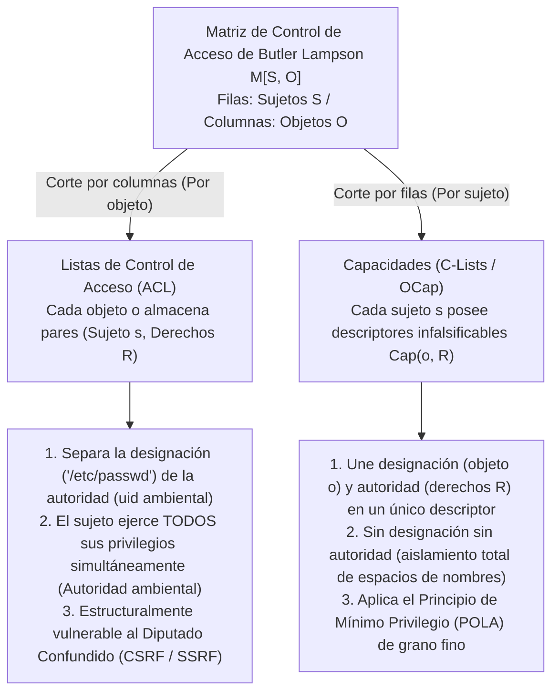

En los sistemas operativos modernos, las infraestructuras en la nube y las aplicaciones web, las brechas de seguridad catastróficas siguen un patrón sorprendentemente repetitivo. La falsificación de peticiones en sitios cruzados (CSRF), la falsificación de peticiones del lado del servidor (SSRF), la inyección SQL y de comandos, los escapes de contenedores y los ataques a la cadena de suministro de software en ecosistemas como `npm` o `PyPI` parecen pertenecer a capas muy distintas de la pila de software. Sin embargo, bajo sus detalles superficiales subyace un único defecto arquitectónico compartido.

Ese defecto es nuestra dependencia durante medio siglo de las <strong>listas de control de acceso (Access Control Lists, ACL)</strong> combinadas con la <strong>autoridad ambiental (Ambient Authority)</strong>: el paradigma de diseño en el que las decisiones de acceso dependen de <strong>quién eres (identidad del sujeto)</strong> en lugar de <strong>qué posees</strong>, y en el que la <strong>designación</strong> (nombrar un recurso mediante una ruta de texto o URL falsificable) está separada de la <strong>autoridad</strong> (el permiso ambiental que porta el proceso invocador).

En este artículo examinamos sistemáticamente el paradigma alternativo que elimina esta vulnerabilidad estructural de raíz: la <strong>seguridad basada en capacidades (Capability-Based Security)</strong>. Partiendo de la descomposición matemática de la Matriz de Control de Acceso $M[S, O]$ de Butler Lampson (1971), analizamos el clásico *Problema del Diputado Confundido (Confused Deputy Problem)* de Norm Hardy (1988), formulamos el modelo Object-Capability (OCap) de Mark S. Miller y el Principio de Mínimo Privilegio (POLA), construimos patrones de código concretos para la atenuación (facetas) y la revocación inmediata o transitiva (el Caretaker de Redell y las Membranas), y revisamos despliegues industriales modernos como el microkernel formalmente verificado <strong>seL4</strong>, <strong>FreeBSD Capsicum</strong>, los punteros de capacidad en hardware <strong>CHERI / ARM Morello</strong> y <strong>WebAssembly WASI</strong>.

---

## 1. Dos paradigmas de autoridad: credenciales de identidad frente a llaves de aparcacoches (Valet Key)

Antes de adentrarnos en la teoría formal de sistemas operativos, comparemos dos formas opuestas de aplicar la seguridad física en el mundo cotidiano.

### Paradigma A: Credenciales de identidad y listas en las puertas (El modelo ACL)
Imagine un edificio corporativo de alta seguridad donde cada puerta está custodiada por un guardia con una carpeta que contiene la lista de empleados autorizados a entrar en la Sala 302 (una <strong>lista de control de acceso</strong>). Cuando usted pide entrar, el guardia inspecciona su credencial corporativa (<strong>Identidad / `uid`</strong>) y comprueba si su nombre aparece en la lista.

Supongamos ahora que desea que un becario (un programa auxiliar o una biblioteca de terceros) recoja un único archivo, `Q3_Budget.pdf`, de un archivador dentro de la Sala 302. Como el becario no está en la lista, usted debe prestarle su propia credencial de identidad (equivalente a `setuid` en UNIX o a ejecutar código bajo su propio usuario). En el instante en que el becario entra en la Sala 302 llevando su credencial, adquiere automáticamente <strong>autoridad ambiental (Ambient Authority)</strong> sobre todo lo que hay en esa sala, incluido `Payroll_Master.db`. Peor aún: si un atacante externo cambia la nota adhesiva del becario para engañarlo y hacerle extraer `Payroll_Master.db`, el guardia lo permitirá encantado porque el becario lleva su credencial.

### Paradigma B: La llave de aparcacoches / Valet Key (El modelo de capacidades)
Compare esto con llegar a un hotel y entregar su automóvil al aparcacoches. Usted no llama a la Dirección de Tráfico para registrar el permiso de conducir del empleado en una lista vinculada a su vehículo, ni le entrega su documento nacional de identidad. En su lugar, le entrega una <strong>llave de aparcacoches (Valet Key)</strong>, que encarna tres profundas propiedades arquitectónicas:
1. <strong>Unificación de designación y autoridad</strong>: La llave designa simultáneamente *qué* vehículo específico debe operarse y *autoriza* al portador a arrancar el motor. Al coche no le importa *quién* sostiene la llave; la posesión del token infalsificable es prueba necesaria y suficiente de autoridad.
2. <strong>Atenuación (Mínimo privilegio)</strong>: A diferencia de su llave maestra, la llave de aparcacoches no puede abrir el maletero ni la guantera, y puede limitar la velocidad máxima. Otorga exactamente la autoridad mínima necesaria para aparcar el coche.
3. <strong>Delegación descentralizada</strong>: Si el primer empleado necesita que un segundo compañero recupere su coche al salir, simplemente le entrega la llave sin editar ninguna base de datos central.

En ciencias de la computación, el Paradigma A es el modelo <strong>ACL</strong>, mientras que el Paradigma B es el modelo de <strong>seguridad basada en capacidades (Capabilities)</strong>.

---

## 2. La Matriz de Control de Acceso $M[S, O]$ de Butler Lampson y sus dos descomposiciones

En 1971, el ganador del Premio Turing Butler Lampson publicó *"Protection"*, introduciendo la <strong>Matriz de Control de Acceso</strong> como abstracción matemática universal de los mecanismos de protección. El estado de protección de un sistema se define mediante una terna $(S, O, M)$:
- <strong>Un conjunto de sujetos $S = \{s_1, s_2, \dots, s_m\}$</strong>: Entidades activas capaces de iniciar operaciones (usuarios, procesos, hilos, módulos de software).
- <strong>Un conjunto de objetos $O = \{o_1, o_2, \dots, o_n\}$</strong>: Recursos protegidos (archivos, segmentos de memoria, sockets IPC, dispositivos), cumpliéndose generalmente $S \subseteq O$.
- <strong>Un conjunto universal de derechos $\mathcal{R} = \{\mathsf{read}, \mathsf{write}, \mathsf{execute}, \mathsf{append}, \mathsf{grant}, \mathsf{own}\}$</strong>: Las operaciones discretas que pueden autorizarse sobre un objeto.
- <strong>Una Matriz de Control de Acceso $M : S \times O \to 2^{\mathcal{R}}$</strong>: Cada entrada $M[s, o] \subseteq \mathcal{R}$ especifica el conjunto exacto de operaciones que el sujeto $s \in S$ está autorizado a realizar sobre el objeto $o \in O$.

Consideremos un sistema con tres sujetos $S = \{\text{Alice}, \text{Compiler}, \text{Logger}\}$ y tres objetos de archivo $O = \{\texttt{src.f}, \texttt{/SYSX/STAT}, \texttt{/SYSX/BILL}\}$:

$$
M[S, O] = \begin{array}{c|ccc}
 & \texttt{src.f} & \texttt{/SYSX/STAT} & \texttt{/SYSX/BILL} \\
\hline
\text{Alice} & \{\mathsf{read}, \mathsf{write}\} & \emptyset & \emptyset \\
\text{Compiler} & \{\mathsf{read}\} & \{\mathsf{append}\} & \{\mathsf{read}, \mathsf{write}\} \\
\text{Logger} & \emptyset & \{\mathsf{read}, \mathsf{write}\} & \emptyset
\end{array}
$$

Dado que $M[S, O]$ es extremadamente dispersa en cualquier sistema real, todo arquitecto debe descomponerla a lo largo de uno de sus dos ejes: <strong>cortar por columnas (adjuntando listas a los objetos)</strong>, o <strong>cortar por filas (entregando tokens a los sujetos)</strong>.



### 2.1 Corte por columnas: Listas de Control de Acceso (ACL)
Al cortar verticalmente la matriz $M[S, O]$ <strong>por columnas</strong>, asociamos a cada objeto $o \in O$ una lista con las entradas no vacías de su columna:

$$
\text{ACL}(o) = \bigl\{ (s, M[s, o]) \;\big|\; s \in S,\; M[s, o] \neq \emptyset \bigr\}
$$

Los permisos UNIX/POSIX, las DACL de Windows NTFS y las políticas IAM en la nube son implementaciones por columnas. Este corte fuerza la <strong>separación entre designación y autoridad</strong>: un programa designa un objeto mediante una cadena pública falsificable como `"/SYSX/BILL"`, mientras el monitor de referencia del kernel verifica la identidad ambiental (`uid`) del proceso invocador. Por ello, un proceso en ejecución blande continuamente la unión de todos los permisos de su fila entera $\bigcup_{o \in O} M[s, o]$ en cada llamada al sistema: la llamada <strong>autoridad ambiental (Ambient Authority)</strong>.

### 2.2 Corte por filas: Capacidades (Dennis y Van Horn 1966)
En 1966, Jack B. Dennis y Earl C. Van Horn introdujeron la descomposición dual: cortar horizontalmente $M[S, O]$ <strong>por filas</strong>. A cada sujeto $s \in S$ se le asocia un <strong>espacio de capacidades (CSpace o C-List)</strong>:

$$
\text{CSpace}(s) = \bigl\{ \text{Cap}(o, R) \;\big|\; o \in O,\; R = M[s, o] \neq \emptyset \bigr\}
$$

Cada elemento $c = \text{Cap}(o, R)$ es una <strong>capacidad (Capability)</strong>: un <strong>token de autoridad infalsificable</strong> que vincula la <strong>designación</strong> (un puntero o descriptor directo al objeto $o$) y la <strong>autoridad</strong> (el subconjunto permitido de derechos $R \subseteq \mathcal{R}$) en una única referencia indivisible. Si el sujeto $s$ no posee una capacidad para el objeto $o$, ni siquiera puede nombrar o direccionar $o$: <strong>No hay designación sin autoridad; no hay autoridad sin designación</strong>.

| Dimensión arquitectónica | Listas de Control de Acceso (ACL — Columnas) | Capacidades (OCap / C-Lists — Filas) |
| :--- | :--- | :--- |
| <strong>Descomposición de $M[S, O]$</strong> | Almacenada por columna en cada objeto $o \in O$ | Almacenada por fila en posesión de cada sujeto $s \in S$ |
| <strong>Filosofía de autorización</strong> | <strong>Quién eres (Who You Are)</strong>: Identidad / `uid` del invocador | <strong>Qué posees (What You Hold)</strong>: El token de capacidad presentado |
| <strong>Designación frente a Autoridad</strong> | <strong>Separadas</strong> (Ruta de texto falsificable + Identidad ambiental) | <strong>Unificadas</strong> (El descriptor infalsificable nombra a $o$ y otorga $R$) |
| <strong>Modelo de autoridad</strong> | <strong>Autoridad ambiental</strong>: Todos los derechos de `uid` activos siempre | <strong>Autoridad selectiva</strong>: Solo actúa el descriptor pasado explícitamente |
| <strong>Vulnerabilidad al Diputado Confundido</strong> | <strong>Estructuralmente vulnerable</strong> (CSRF, SSRF, escalada `setuid`) | <strong>Estructuralmente inmune</strong> (El cliente debe pasar un descriptor autorizado) |
| <strong>Sistemas representativos</strong> | ACL UNIX/POSIX, Windows NTFS DACL, AWS IAM | KeyKOS, seL4, FreeBSD Capsicum, Fuchsia Zircon, CHERI, WASI |

---

## 3. El Problema del Diputado Confundido (Confused Deputy): El clásico de Norm Hardy (1988)

¿Por qué es tan peligroso separar la designación de la autoridad? El arquitecto de computadores Norm Hardy publicó la explicación definitiva en octubre de 1988 en *ACM SIGOPS Operating Systems Review* bajo el título <strong>*"The Confused Deputy (or why capabilities might have been invented)"</strong>*, relatando un desastre de seguridad real ocurrido a mediados de los años setenta en el sistema operativo comercial Tymshare.

### 3.1 Anatomía del desastre del compilador `/SYSX/FORT`
En el sistema Tymshare, el compilador de Fortran residía en `/SYSX/FORT`:
1. <strong>Requisito de estadísticas</strong>: Los administradores querían recopilar estadísticas de uso haciendo que `/SYSX/FORT` añadiera un registro al archivo `/SYSX/STAT` tras cada compilación.
2. <strong>Concesión de autoridad ambiental</strong>: Al ejecutable `/SYSX/FORT` se le otorgó <strong>autoridad de escritura ambiental sobre todo el directorio `/SYSX`</strong> (similar a `setuid` en UNIX).
3. <strong>Nombre de archivo de salida proporcionado por el usuario</strong>: El compilador aceptaba un argumento de cadena del usuario indicando dónde escribir la salida de depuración (ej. `FORT(SRC="prog.f", OUT="listing.txt")`).
4. <strong>Las joyas de la corona en `/SYSX/BILL`</strong>: En el mismo directorio `/SYSX` se guardaba la base de datos maestra de facturación de clientes, <strong>`/SYSX/BILL`</strong>.

Un día, un usuario invocó `/SYSX/FORT` y pasó la cadena <strong>`"/SYSX/BILL"`</strong> como nombre del archivo de salida. Cuando el compilador llamó a `open("/SYSX/BILL", WRITE)`, el monitor de referencia ACL del sistema operativo preguntó: *«¿Tiene el proceso activo (`/SYSX/FORT`) permiso para escribir en `/SYSX`?»* La respuesta fue <strong>Sí</strong>, y <strong>el compilador sobrescribió obedientemente la base de datos maestra de facturación `/SYSX/BILL` de la empresa con diagnósticos de Fortran</strong>.



```mermaid
flowchart TD
    subgraph ACL_WORLD["Modelo ACL + Autoridad Ambiental (El Diputado Confundido)"]
        U1["Usuario malicioso<br/>(Sin acceso a /SYSX/BILL)"] -->|"1. Pasa ruta de texto OUT='/SYSX/BILL'"| D1["Diputado: Compilador /SYSX/FORT<br/>(Autoridad ambiental: Escritura en /SYSX/*)"]
        D1 -->|"2. open('/SYSX/BILL', WRITE)<br/>Usa implícitamente su propia autoridad ambiental"| OS1["Monitor de Referencia del SO (Chequeo ACL)"]
        OS1 -->|"3. El compilador tiene permiso en /SYSX -> ¡PERMITIDO!"| BILL1["Base de Facturación /SYSX/BILL<br/>[¡CORROMPIDA / SOBRESCRITA!]"]
    end

    subgraph CAP_WORLD["Modelo de Capacidades (Designación y Autoridad Unificadas)"]
        U2["Usuario<br/>(Solo posee capacidades de sus archivos)"] -->|"1. Pasa capacidad de salida cap_out<br/>(¡No puede pasar Cap a /SYSX/BILL porque no la posee!)"| D2["Diputado: Compilador /SYSX/FORT<br/>(Dotado ÚNICAMENTE de cap_stat)"]
        D2 -->|"2a. write(cap_out, debug_output)<br/>Usa la autoridad suministrada por el usuario"| OUT2["Archivo de salida listing.txt"]
        D2 -->|"2b. append(cap_stat, usage_stats)<br/>Usa capacidad privada dotada al instalarse"| STAT2["Archivo de estadísticas /SYSX/STAT"]
    end
```

### 3.2 ¿Por qué estaba "confundido" el compilador? Y sus descendientes modernos
Hardy llamó a `/SYSX/FORT` un <strong>Diputado Confundido (Confused Deputy)</strong> porque actuaba como agente al servicio de dos principales distintos (el administrador del sistema y el usuario invocador) simultáneamente, sin forma de separar sus autoridades al abrir una ruta de texto. En una arquitectura de capacidades, el compilador solo recibe la capacidad privada $c_{\text{stat}} = \text{Cap}(\texttt{/SYSX/STAT}, \{\mathsf{append}\})$, y el usuario debe pasar un descriptor de capacidad ya abierto $c_{\text{out}} = \text{Cap}(f_{\text{out}}, \{\mathsf{write}\})$, eliminando el problema de raíz.

Las clases de vulnerabilidades más devastadoras de la ciberseguridad moderna son instancias directas del Diputado Confundido:
- <strong>Cross-Site Request Forgery (CSRF)</strong>: El navegador web es un diputado confundido que adjunta automáticamente su autoridad ambiental (la cookie de sesión de `bank.example`) a una petición iniciada por `evil.example`. Los tokens CSRF solucionan esto exigiendo que el formulario presente un token de capacidad infalsificable.
- <strong>Server-Side Request Forgery (SSRF)</strong>: Un servidor web en la nube recibe una URL suministrada por el usuario (`"http://169.254.169.254/latest/meta-data/"`) y utiliza su propia autoridad ambiental de red dentro de la VPC para extraer credenciales IAM.
- <strong>Ataques a la cadena de suministro (`npm` / `PyPI`)</strong>: Una diminuta biblioteca de terceros puede leer `~/.ssh/id_rsa` porque bajo las ACL POSIX toda función que se ejecuta dentro de su proceso hereda toda la autoridad ambiental de su `uid`.

---

## 4. El modelo Object-Capability (OCap), atenuación y revocación

En su tesis doctoral de 2006 en la Universidad Johns Hopkins (*"Robust Composition"*), Mark S. Miller demostró que <strong>los lenguajes orientados a objetos con seguridad de memoria ya poseen el mecanismo exacto necesario para aplicar el Principio de Mínimo Privilegio (POLA) hasta el nivel de objetos individuales: la propia referencia a objeto</strong>.

### 4.1 Tres invariantes OCap y las tres leyes de adquisición de capacidades
Para que un lenguaje con seguridad de memoria (como Hardened JavaScript / SES, E o componentes Wasm) sea un verdadero sistema <strong>Object-Capability (OCap)</strong>, su entorno de ejecución debe garantizar tres invariantes:
1. <strong>Sin referencias falsificadas</strong>: No se puede fabricar una referencia convirtiendo un entero en puntero ni mediante aritmética de punteros fuera de límites.
2. <strong>Sin estado global mutable (Cero autoridad ambiental)</strong>: El ámbito global no debe contener variables mutables ni poderes de E/S ambientales (`fs`, `net`), y los prototipos primordiales (`Object.prototype`) deben estar profundamente congelados (`Object.freeze`).
3. <strong>Encapsulación absoluta</strong>: El estado léxico privado dentro de una clausura (closure) o los campos `#private` no pueden inspeccionarse desde el exterior.

En el grafo de referencias $G = (V, E)$, una nueva arista $(A \to C)$ solo puede surgir de tres maneras: <strong>1. Paternidad (Creación, `new C()`)</strong>, <strong>2. Dotación (Endowment al crear una clausura)</strong>, o <strong>3. Introducción (un introductor $B$ con $(B \to A)$ y $(B \to C)$ pasa $C$ como argumento en un mensaje a $A$)</strong>:

$$
\text{Ley de Introducción (Law of Introduction)}: \quad (B \to A) \;\land\; (B \to C) \;\;\Longrightarrow\;\; B \text{ puede establecer } (A \to C)
$$

### 4.2 Atenuación mediante facetas y revocación con el Caretaker de Redell y Membranas
En contra del mito popular, las capacidades permiten atenuar y revocar permisos de forma trivial, como demostró <strong>David D. Redell</strong> en 1974 con el patrón <strong>Caretaker (Cuidador)</strong> y Mark S. Miller con las <strong>Membranas revocables</strong>:

```javascript
// 1. Faceta de atenuación (Attenuating Facet): solo lectura restringida a un prefijo
function makeScopedReadFacet(fullStorageCap, allowedPrefix) {
  return Object.freeze({
    read(key) {
      if (typeof key !== "string" || !key.startsWith(allowedPrefix)) {
        throw new Error(`Acceso denegado: la clave debe comenzar con '${allowedPrefix}'`);
      }
      return fullStorageCap.read(key);
    }
    // ¡write() y deleteAll() se omiten por completo de la faceta!
  });
}

// 2. Patrón Caretaker de Redell (1974) para revocación instantánea en O(1)
function makeCaretaker(targetCap) {
  let currentTarget = targetCap; // Puntero privado mutable dentro de la clausura
  const caretaker = Object.freeze({
    read(...args) {
      if (currentTarget === null) throw new Error("RevokedCapabilityError: Acceso revocado");
      return currentTarget.read(...args);
    },
    write(...args) {
      if (currentTarget === null) throw new Error("RevokedCapabilityError: Acceso revocado");
      return currentTarget.write(...args);
    }
  });
  const revoker = Object.freeze({
    revoke() { currentTarget = null; } // Corta el enlace y permite la recolección de basura
  });
  return Object.freeze({ caretaker, revoker });
}
```

Si una capacidad devuelve a su vez nuevas capacidades (como un directorio al abrir subdirectorios), una <strong>Membrana revocable</strong> emplea `Proxy` y `WeakMap` para envolver transitivamente todos los valores devueltos y argumentos que cruzan la frontera, inutilizando todo el subgrafo al instante cuando se invoca `revoke()`.

---

## 5. Despliegues industriales: seL4, FreeBSD Capsicum, CHERI y WebAssembly WASI

Aclaremos primero una confusión terminológica frecuente: ¡las `capabilities(7)` de Linux (`CAP_NET_ADMIN`, etc.) <strong>NO son capacidades de objetos</strong>! Solo dividen el privilegio ambiental de `root` en unas 41 banderas por hilo sin designar ningún objeto específico. Las verdaderas arquitecturas de capacidades industriales se materializan en cuatro sistemas:

1. <strong>El microkernel formalmente verificado seL4</strong>: Primer kernel de sistema operativo con prueba matemática completa verificada por máquina (en Isabelle/HOL). En seL4 existe cero autoridad ambiental: todos los recursos (hilos, espacios de direcciones, endpoints IPC, marcos de memoria) se acceden exclusivamente mediante capacidades en el <strong>CSpace (tablas CNode)</strong> del hilo, permitiendo atenuación vía `seL4_CNode_Mint` y revocación transitiva mediante el árbol de derivación <strong>CDT (`seL4_CNode_Revoke`)</strong>.
2. <strong>FreeBSD Capsicum</strong>: Creado en la Universidad de Cambridge y Google, Capsicum eleva los descriptores de archivo UNIX (`fd`) a verdaderas capacidades. Cuando un proceso invoca <strong>`cap_enter()`</strong>, el kernel bloquea irreversiblemente toda llamada al sistema que acceda a espacios de nombres globales (`open()`, `connect()`, `bind()` devuelven `ECAPMODE`). El proceso solo puede operar sobre descriptores que ya posee (y subrutas relativas mediante `openat(dir_fd, ...)` sin escape `".."`), limitando más de 60 derechos granulares con `cap_rights_limit(fd, &rights)`.
3. <strong>Capacidades en silicio: CHERI y ARM Morello</strong>: Desarrollado por SRI International y la Universidad de Cambridge e implementado en silicio por ARM en el procesador <strong>Morello</strong> y en <strong>CHERIoT-RISC-V</strong>, CHERI reemplaza los punteros de 64 bits por <strong>capacidades de hardware de 128 bits más una etiqueta de validez fuera de banda de 1 bit (Tag Bit)</strong>:

$$
\underbrace{\text{Tag (1 bit)}}_{\text{Bit de procedencia HW}} \;\Big|\; \underbrace{\text{Permissions (18 bits)}}_{\text{Load, Store, Exec, Cap-RW}} \;\Big|\; \underbrace{\text{Object Type (18 bits)}}_{\text{Sellado en hardware}} \;\Big|\; \underbrace{\text{Compressed Bounds (28 bits)}}_{\text{Límites comprimidos [Base, Top)}} \;\Big|\; \underbrace{\text{Address Cursor (64 bits)}}_{\text{Dirección virtual de 64 bits}}
$$

En cada acceso a memoria, la CPU verifica en un solo ciclo que la dirección esté dentro de `[Base, Top)` y cumpla los permisos. Si una instrucción entera sobrescribe siquiera un byte de una capacidad en RAM, el controlador de memoria borra automáticamente el bit Tag a `0`, impidiendo desreferenciar punteros falsificados y erradicando los desbordamientos de búfer y ataques ROP en el propio silicio.
4. <strong>WebAssembly (WASI) y Macaroons</strong>: Los módulos WASI se ejecutan sin autoridad ambiental y solo acceden a descriptores de directorios preabiertos inyectados explícitamente por el host. En la nube distribuida, los <strong>Macaroons</strong> de Google utilizan cadenas de firmas HMAC anidadas que permiten al portador atenuar autónomamente sus tokens añadiendo restricciones contextuales (Caveats) sin consultar a una base de datos central.
