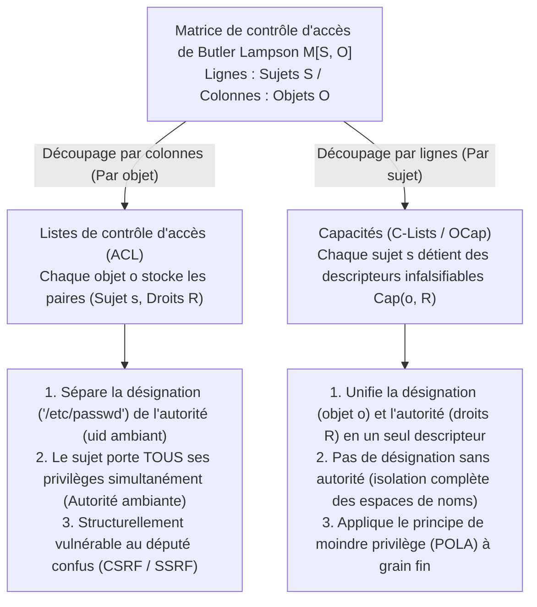

À travers les systèmes d'exploitation modernes, les infrastructures cloud et les applications web, les brèches de sécurité catastrophiques suivent un schéma étonnamment répétitif. La falsification de requêtes intersites (CSRF), la falsification de requêtes côté serveur (SSRF), les injections SQL et de commandes, les évasions de conteneurs et les attaques de la chaîne d'approvisionnement logicielle dans les écosystèmes `npm` ou `PyPI` semblent appartenir à des couches totalement différentes. Pourtant, sous leurs détails de surface se cache un seul et même défaut architectural.

Ce défaut est notre dépendance, vieille d'un demi-siècle, aux <strong>listes de contrôle d'accès (Access Control Lists, ACL)</strong> couplées à <strong>l'autorité ambiante (Ambient Authority)</strong> — le paradigme selon lequel les décisions d'accès dépendent de <strong>qui vous êtes (l'identité du sujet)</strong> plutôt que de <strong>ce que vous détenez</strong>, et dans lequel la <strong>désignation</strong> (nommer une ressource via un chemin de chaîne ou une URL falsifiable) est séparée de <strong>l'autorité</strong> (la permission ambiante portée par l'appelant).

Dans cet article, nous examinons systématiquement le paradigme alternatif qui élimine cette vulnérabilité structurelle à la racine : la <strong>sécurité basée sur les capacités (Capability-Based Security)</strong>. En partant de la décomposition mathématique de la matrice de contrôle d'accès $M[S, O]$ de Butler Lampson (1971), nous retraçons le classique *problème du député confus (Confused Deputy Problem)* de Norm Hardy (1988), formulons le modèle Object-Capability (OCap) de Mark S. Miller et le principe de moindre autorité (POLA), construisons des patrons de code concrets pour l'atténuation (facettes) et la révocation immédiate ou transitive (Caretaker de Redell et Membranes), et passons en revue les déploiements industriels modernes incluant le micronoyau formellement vérifié <strong>seL4</strong>, <strong>FreeBSD Capsicum</strong>, les pointeurs matériels <strong>CHERI / ARM Morello</strong> et <strong>WebAssembly WASI</strong>.

---

## 1. Deux paradigmes d'autorité : badges d'identité vs clés de voiturier (Valet Key)

Avant de plonger dans la théorie formelle des systèmes d'exploitation, comparons deux manières d'appliquer la sécurité physique dans le monde réel.

### Paradigme A : Badges d'identité et registres de portes (Le modèle ACL)
Imaginez un immeuble d'entreprise de haute sécurité où chaque porte est gardée par un agent tenant un registre contenant la liste des employés autorisés à entrer dans la salle 302 (une <strong>liste de contrôle d'accès</strong>). Lorsque vous demandez à entrer, le garde inspecte votre badge d'identité (<strong>Identité / `uid`</strong>) et vérifie si votre nom figure sur le registre.

Supposons maintenant que vous souhaitiez qu'un stagiaire (un programme utilitaire ou une bibliothèque tierce) récupère un seul fichier, `Q3_Budget.pdf`, dans la salle 302. Le stagiaire n'étant pas sur la liste, vous devez lui prêter votre propre badge d'identité (comme `setuid` sous UNIX ou l'exécution de code sous votre propre identité). Dès l'instant où le stagiaire entre dans la salle 302 avec votre badge, il acquiert automatiquement une <strong>autorité ambiante (Ambient Authority)</strong> sur absolument tout ce qui se trouve dans cette pièce, y compris `Payroll_Master.db`. Pire encore, si un attaquant externe échange la note du stagiaire pour lui faire récupérer `Payroll_Master.db`, le garde le laissera faire car le stagiaire porte votre badge !

### Paradigme B : La clé de voiturier / Valet Key (Le modèle de capacité)
Comparez cela au moment où vous confiez votre voiture à un voiturier d'hôtel. Vous n'appelez pas la préfecture pour inscrire le permis du voiturier sur une liste attachée à votre véhicule, et vous ne lui donnez pas vos papiers d'identité. Vous lui remettez une <strong>clé de voiturier (Valet Key)</strong>, qui incarne trois propriétés architecturales fondamentales :
1. <strong>Unification de la désignation et de l'autorité</strong> : La clé désigne simultanément quel véhicule spécifique doit être opéré et autorise le détenteur à démarrer le moteur. La voiture ignore *qui* tient la clé ; la possession du jeton infalsifiable est une preuve nécessaire et suffisante d'autorité.
2. <strong>Atténuation (Moindre privilège)</strong> : Contrairement à votre clé maîtresse, la clé de voiturier ne peut ouvrir ni le coffre ni la boîte à gants, et limite parfois la vitesse maximale. Elle n'accorde que l'autorité minimale exacte requise pour garer la voiture.
3. <strong>Délégation décentralisée</strong> : Si le premier voiturier passe le relais à un collègue, il lui remet simplement la clé sans modifier de base de données centrale.

En informatique, le paradigme A correspond au modèle <strong>ACL</strong>, tandis que le paradigme B est le modèle de <strong>sécurité basée sur les capacités (Capabilities)</strong>.

---

## 2. La matrice de contrôle d'accès $M[S, O]$ de Butler Lampson et ses deux décompositions

En 1971, le lauréat du prix Turing Butler Lampson a publié *"Protection"*, introduisant la <strong>matrice de contrôle d'accès</strong> comme abstraction mathématique universelle des mécanismes de protection. L'état de protection d'un système est défini par un triplet $(S, O, M)$ :
- <strong>Un ensemble de sujets $S = \{s_1, s_2, \dots, s_m\}$</strong> : Entités actives capables d'initier des opérations (utilisateurs, processus, threads, modules logiciels).
- <strong>Un ensemble d'objets $O = \{o_1, o_2, \dots, o_n\}$</strong> : Ressources protégées (fichiers, segments mémoire, sockets IPC, périphériques), avec généralement $S \subseteq O$.
- <strong>Un ensemble universel de droits $\mathcal{R} = \{\mathsf{read}, \mathsf{write}, \mathsf{execute}, \mathsf{append}, \mathsf{grant}, \mathsf{own}\}$</strong> : Les opérations discrètes pouvant être autorisées sur un objet.
- <strong>Une matrice de contrôle d'accès $M : S \times O \to 2^{\mathcal{R}}$</strong> : Chaque entrée $M[s, o] \subseteq \mathcal{R}$ spécifie l'ensemble exact des opérations que le sujet $s \in S$ est autorisé à effectuer sur l'objet $o \in O$.

Considérons par exemple trois sujets $S = \{\text{Alice}, \text{Compiler}, \text{Logger}\}$ et trois fichiers $O = \{\texttt{src.f}, \texttt{/SYSX/STAT}, \texttt{/SYSX/BILL}\}$ :

$$
M[S, O] = \begin{array}{c|ccc}
 & \texttt{src.f} & \texttt{/SYSX/STAT} & \texttt{/SYSX/BILL} \\
\hline
\text{Alice} & \{\mathsf{read}, \mathsf{write}\} & \emptyset & \emptyset \\
\text{Compiler} & \{\mathsf{read}\} & \{\mathsf{append}\} & \{\mathsf{read}, \mathsf{write}\} \\
\text{Logger} & \emptyset & \{\mathsf{read}, \mathsf{write}\} & \emptyset
\end{array}
$$

Comme $M[S, O]$ est extrêmement creuse dans tout système réel, chaque architecte doit la décomposer selon l'un de ses deux axes : <strong>découper par colonnes (listes attachées aux objets)</strong>, ou <strong>découper par lignes (jetons détenus par les sujets)</strong>.



### 2.1 Découpage par colonnes : Listes de contrôle d'accès (ACL)
En découpant verticalement la matrice $M[S, O]$ <strong>par colonnes</strong>, on associe à chaque objet $o \in O$ la liste des entrées non vides de sa colonne :

$$
\text{ACL}(o) = \bigl\{ (s, M[s, o]) \;\big|\; s \in S,\; M[s, o] \neq \emptyset \bigr\}
$$

Les permissions UNIX/POSIX, les DACL Windows NTFS et les politiques IAM cloud suivent ce modèle, ce qui impose la <strong>séparation entre la désignation et l'autorité</strong>. Un programme désigne un objet via une chaîne publique falsifiable comme `"/SYSX/BILL"`, et le moniteur de référence du noyau vérifie l'identité ambiante (`uid`) du processus appelant. Le processus exerce donc en permanence l'union de tous les droits de sa ligne $\bigcup_{o \in O} M[s, o]$ à chaque appel système : c'est <strong>l'autorité ambiante (Ambient Authority)</strong>.

### 2.2 Découpage par lignes : Capacités (Dennis & Van Horn 1966)
En 1966, Jack B. Dennis et Earl C. Van Horn ont introduit la décomposition duale : découper horizontalement $M[S, O]$ <strong>par lignes</strong>. À chaque sujet $s \in S$, on associe un <strong>espace de capacités (CSpace ou C-List)</strong> :

$$
\text{CSpace}(s) = \bigl\{ \text{Cap}(o, R) \;\big|\; o \in O,\; R = M[s, o] \neq \emptyset \bigr\}
$$

Chaque élément $c = \text{Cap}(o, R)$ est une <strong>capacité (Capability)</strong> — un <strong>jeton d'autorité infalsifiable</strong> qui lie la <strong>désignation</strong> (un pointeur ou descripteur direct vers l'objet $o$) et <strong>l'autorité</strong> (le sous-ensemble de droits permis $R \subseteq \mathcal{R}$) en une référence indivisible. Sans capacité sur $o$, un sujet $s$ ne peut même pas nommer ou adresser $o$ : <strong>Pas de désignation sans autorité ; pas d'autorité sans désignation</strong>.

| Dimension architecturale | Listes de contrôle d'accès (ACL — Colonnes) | Capacités (OCap / C-Lists — Lignes) |
| :--- | :--- | :--- |
| <strong>Décomposition de $M[S, O]$</strong> | Stockée par colonne sur chaque objet $o \in O$ | Stockée par ligne détenue par chaque sujet $s \in S$ |
| <strong>Philosophie d'autorisation</strong> | <strong>Qui vous êtes (Who You Are)</strong> : Identité / `uid` de l'appelant | <strong>Ce que vous détenez (What You Hold)</strong> : Le jeton de capacité présenté |
| <strong>Désignation vs Autorité</strong> | <strong>Séparées</strong> (Chemin de chaîne falsifiable + Identité ambiante) | <strong>Unifiées</strong> (Le descripteur infalsifiable nomme $o$ et accorde $R$) |
| <strong>Modèle d'autorité</strong> | <strong>Autorité ambiante</strong> : Tous les droits de `uid` sont actifs à chaque appel | <strong>Autorité sélective</strong> : Seul le descripteur explicitement passé est actif |
| <strong>Vulnérabilité au député confus</strong> | <strong>Structurellement vulnérable</strong> (CSRF, SSRF, escalade `setuid`) | <strong>Structurellement immunisé</strong> (Le client doit passer un descripteur autorisé) |
| <strong>Systèmes représentatifs</strong> | ACL UNIX/POSIX, Windows NTFS DACL, AWS IAM | KeyKOS, seL4, FreeBSD Capsicum, Fuchsia Zircon, CHERI, WASI |

---

## 3. Le problème du député confus (Confused Deputy) : le classique de Norm Hardy (1988)

Pourquoi séparer la désignation de l'autorité est-il si dangereux ? L'architecte informatique Norm Hardy en a donné l'explication définitive en octobre 1988 dans *ACM SIGOPS Operating Systems Review* sous le titre <strong>*"The Confused Deputy (or why capabilities might have been invented)"</strong>*, relatant un désastre réel survenu au milieu des années 1970 sur le système d'exploitation commercial Tymshare.

### 3.1 Anatomie de la catastrophe du compilateur `/SYSX/FORT`
Sur le système Tymshare, le compilateur Fortran résidait dans `/SYSX/FORT` :
1. <strong>Exigence de statistiques</strong> : Les administrateurs souhaitaient que `/SYSX/FORT` ajoute un enregistrement statistique au fichier `/SYSX/STAT` à chaque compilation.
2. <strong>Octroi d'une autorité ambiante</strong> : Pour cela, l'exécutable `/SYSX/FORT` s'est vu accorder une <strong>autorité d'écriture ambiante sur tout le répertoire `/SYSX`</strong> (analogue au `setuid` UNIX).
3. <strong>Nom de fichier de sortie fourni par l'utilisateur</strong> : Le compilateur acceptait en argument une chaîne de caractères indiquant où écrire la sortie de débogage (ex. `FORT(SRC="prog.f", OUT="listing.txt")`).
4. <strong>Les joyaux de la couronne dans `/SYSX/BILL`</strong> : Le même répertoire `/SYSX` abritait la base de données principale de facturation client, <strong>`/SYSX/BILL`</strong>.

Un jour, un utilisateur astucieux a invoqué `/SYSX/FORT` en passant la chaîne <strong>`"/SYSX/BILL"`</strong> comme fichier de sortie. Lorsque le compilateur a exécuté `open("/SYSX/BILL", WRITE)`, le moniteur de référence ACL de l'OS a demandé : *« Le processus actif (`/SYSX/FORT`) a-t-il la permission d'écrire dans `/SYSX` ? »* La réponse étant <strong>Oui</strong>, le noyau a autorisé l'ouverture, et <strong>le compilateur a consciencieusement écrasé la base de données de facturation `/SYSX/BILL` de l'entreprise avec des diagnostics de compilation Fortran !</strong>



```mermaid
flowchart TD
    subgraph ACL_WORLD["Modèle ACL + Autorité ambiante (Le député confus)"]
        U1["Utilisateur malveillant<br/>(Aucun accès à /SYSX/BILL)"] -->|"1. Passe la chaîne OUT='/SYSX/BILL'"| D1["Député : Compilateur /SYSX/FORT<br/>(Autorité ambiante : Écriture sur /SYSX/*)"]
        D1 -->|"2. open('/SYSX/BILL', WRITE)<br/>Exerce implicitement sa propre autorité ambiante"| OS1["Moniteur de référence OS (Vérification ACL)"]
        OS1 -->|"3. Le compilateur a le droit d'écriture sur /SYSX -> AUTORISÉ !"| BILL1["Base de facturation /SYSX/BILL<br/>[CORROMPUE / ÉCRASÉE !]"]
    end

    subgraph CAP_WORLD["Modèle de capacités (Désignation et autorité unifiées)"]
        U2["Utilisateur<br/>(Ne détient des capacités que sur ses fichiers)" ] -->|"1. Passe la capacité de sortie cap_out<br/>(Impossible de passer une capacité sur /SYSX/BILL !)"| D2["Député : Compilateur /SYSX/FORT<br/>(Doté UNIQUEMENT de cap_stat)"]
        D2 -->|"2a. write(cap_out, debug_output)<br/>Utilise l'autorité explicitement fournie par l'utilisateur"| OUT2["Fichier de sortie listing.txt"]
        D2 -->|"2b. append(cap_stat, usage_stats)<br/>Utilise la capacité privée confiée à l'installation"| STAT2["Fichier statistique /SYSX/STAT"]
    end
```

### 3.2 Pourquoi le compilateur était-il « confus » ? Et ses descendants modernes
Hardy a qualifié `/SYSX/FORT` de <strong>député confus (Confused Deputy)</strong> car il agissait au service de deux mandants distincts (l'administrateur système et l'utilisateur) sans pouvoir indiquer au noyau quelle autorité appliquer à quel chemin. Dans une architecture basée sur les capacités, le compilateur ne reçoit que la capacité privée $c_{\text{stat}} = \text{Cap}(\texttt{/SYSX/STAT}, \{\mathsf{append}\})$, et l'utilisateur doit lui transmettre directement une capacité d'écriture déjà ouverte $c_{\text{out}} = \text{Cap}(f_{\text{out}}, \{\mathsf{write}\})$, rendant l'attaque impossible.

Les classes de vulnérabilités modernes les plus dévastatrices sont toutes des députés confus :
- <strong>Cross-Site Request Forgery (CSRF)</strong> : Le navigateur web est un député confus qui attache automatiquement votre autorité ambiante (le cookie de session `bank.example`) à une requête forgée par `evil.example`. Les jetons CSRF corrigent cela en exigeant que le formulaire présente un jeton de capacité infalsifiable.
- <strong>Server-Side Request Forgery (SSRF)</strong> : Le serveur web récupère une URL fournie par l'utilisateur (`"http://169.254.169.254/latest/meta-data/"`) en utilisant sa propre autorité réseau ambiante au sein du VPC cloud.
- <strong>Attaques de la chaîne d'approvisionnement (`npm` / `PyPI`)</strong> : Une minuscule bibliothèque tierce peut lire `~/.ssh/id_rsa` parce que sous les ACL POSIX, chaque fonction exécutée dans votre processus hérite de toute l'autorité ambiante de votre `uid`.

---

## 4. Le modèle Object-Capability (OCap), l'atténuation et la révocation

Dans sa thèse de doctorat de 2006 à l'Université Johns Hopkins (*"Robust Composition"*), Mark S. Miller a démontré que <strong>les langages orientés objet à mémoire sûre possèdent déjà le mécanisme exact requis pour appliquer le principe de moindre privilège (POLA) jusqu'au niveau de chaque objet : la référence d'objet elle-même</strong>.

### 4.1 Trois invariants OCap et les trois lois d'acquisition des capacités
Pour qu'un langage à mémoire sûre (comme Hardened JavaScript / SES, E ou les composants Wasm) devienne un système <strong>Object-Capability (OCap)</strong>, l'environnement d'exécution doit garantir trois invariants :
1. <strong>Pas de références forgées</strong> : Impossible de convertir un entier en pointeur d'objet ou d'utiliser l'arithmétique des pointeurs hors limites.
2. <strong>Aucun état global mutable (Zéro autorité ambiante)</strong> : La portée globale ne doit contenir ni variables mutables ni modules d'E/S ambiants (`fs`, `net`), et les prototypes primordiaux (`Object.prototype`) doivent être gelés en profondeur (`Object.freeze`).
3. <strong>Encapsulation absolue</strong> : L'état lexical privé d'une fermeture (closure) ou les champs `#private` ne peuvent être inspectés de l'extérieur.

Dans le graphe de références $G = (V, E)$, une nouvelle arête $(A \to C)$ ne peut naître que de trois façons : <strong>1. Parentalité (Création, `new C()`)</strong>, <strong>2. Dotation (Endowment lors de la création d'une fermeture)</strong>, ou <strong>3. Introduction (un introducteur $B$ détenant $(B \to A)$ et $(B \to C)$ passe $C$ en argument à $A$)</strong> :

$$
\text{Loi d'introduction (Law of Introduction)} : \quad (B \to A) \;\land\; (B \to C) \;\;\Longrightarrow\;\; B \text{ peut établir } (A \to C)
$$

### 4.2 Atténuation par facettes et révocation via le Caretaker de Redell et les Membranes
Contrairement au mythe répandu, les capacités permettent une atténuation et une révocation instantanées, résolues dès 1974 par <strong>David D. Redell</strong> avec le patron <strong>Caretaker (Gardien)</strong> et généralisées par les <strong>Membranes révocables</strong> de Mark S. Miller :

```javascript
// 1. Facette d'atténuation (Attenuating Facet) : lecture seule limitée à un préfixe
function makeScopedReadFacet(fullStorageCap, allowedPrefix) {
  return Object.freeze({
    read(key) {
      if (typeof key !== "string" || !key.startsWith(allowedPrefix)) {
        throw new Error(`Accès refusé : la clé doit commencer par '${allowedPrefix}'`);
      }
      return fullStorageCap.read(key);
    }
    // write() et deleteAll() sont totalement absents de la facette !
  });
}

// 2. Patron Caretaker de Redell (1974) pour la révocation instantanée en O(1)
function makeCaretaker(targetCap) {
  let currentTarget = targetCap; // Pointeur privé mutable dans la fermeture
  const caretaker = Object.freeze({
    read(...args) {
      if (currentTarget === null) throw new Error("RevokedCapabilityError : Accès révoqué");
      return currentTarget.read(...args);
    },
    write(...args) {
      if (currentTarget === null) throw new Error("RevokedCapabilityError : Accès révoqué");
      return currentTarget.write(...args);
    }
  });
  const revoker = Object.freeze({
    revoke() { currentTarget = null; } // Coupe le lien et permet le ramasse-miettes (GC)
  });
  return Object.freeze({ caretaker, revoker });
}
```

Lorsqu'une capacité renvoie d'autres capacités (comme un répertoire renvoyant un sous-répertoire), une <strong>Membrane révocable</strong> utilise `Proxy` et `WeakMap` pour envelopper récursivement toutes les valeurs de retour et arguments traversant la frontière, désactivant instantanément tout le sous-graphe lors de l'appel à `revoke()`.

---

## 5. Déploiements industriels : seL4, FreeBSD Capsicum, CHERI et WebAssembly WASI

Évitons d'abord un piège terminologique : les `capabilities(7)` de Linux (`CAP_NET_ADMIN`, etc.) <strong>ne sont PAS des capacités d'objet</strong> ! Elles découpent simplement le privilège ambiant de `root` en une quarantaine de drapeaux par thread sans désigner d'objet précis. Les véritables architectures de capacités industrielles s'illustrent dans quatre systèmes :

1. <strong>Le micronoyau formellement vérifié seL4</strong> : Premier noyau d'OS doté d'une preuve mathématique complète vérifiée par machine (sous Isabelle/HOL), seL4 n'offre aucune autorité ambiante. Toutes les ressources du noyau (threads, espaces d'adressage, points de terminaison IPC, cadres mémoire) sont manipulées exclusivement via des capacités stockées dans le <strong>CSpace (tables CNode)</strong> d'un thread, avec atténuation par `seL4_CNode_Mint` et révocation transitive via l'arbre de dérivation <strong>CDT (`seL4_CNode_Revoke`)</strong>.
2. <strong>FreeBSD Capsicum</strong> : Créé à l'Université de Cambridge et chez Google, Capsicum transforme les descripteurs de fichiers UNIX (`fd`) en véritables capacités. Dès qu'un processus appelle <strong>`cap_enter()`</strong>, le noyau bloque irréversiblement tout appel système accédant à un espace de noms global (`open()`, `connect()`, `bind()` renvoient `ECAPMODE`). Le processus ne peut agir que sur les descripteurs qu'il détient déjà (et leurs sous-chemins relatifs via `openat(dir_fd, ...)` sans remontée `".."`), tout en restreignant finement plus de 60 bits de droits via `cap_rights_limit(fd, &rights)`.
3. <strong>Capacités dans le silicium : CHERI et ARM Morello</strong> : Développé par SRI International et l'Université de Cambridge et matérialisé par ARM dans le processeur <strong>Morello</strong> ainsi que dans <strong>CHERIoT-RISC-V</strong>, CHERI remplace les pointeurs 64 bits par des <strong>capacités matérielles de 128 bits accompagnées d'un bit de validité hors bande (Tag Bit)</strong> :

$$
\underbrace{\text{Tag (1 bit)}}_{\text{Bit de provenance matériel}} \;\Big|\; \underbrace{\text{Permissions (18 bits)}}_{\text{Load, Store, Exec, Cap-RW}} \;\Big|\; \underbrace{\text{Object Type (18 bits)}}_{\text{Scellement matériel}} \;\Big|\; \underbrace{\text{Compressed Bounds (28 bits)}}_{\text{Bornes compressées [Base, Top)}} \;\Big|\; \underbrace{\text{Address Cursor (64 bits)}}_{\text{Adresse virtuelle 64 bits}}
$$

À chaque accès mémoire, le processeur vérifie en un seul cycle que le curseur se situe dans `[Base, Top)` et respecte les permissions. Toute écriture d'entier écrasant un octet d'une capacité en RAM efface automatiquement le bit Tag à `0`, rendant le pointeur forgé non déréférençable et éliminant matériellement les dépassements de tampon et attaques ROP.
4. <strong>WebAssembly (WASI) et les Macaroons</strong> : Les modules WASI s'exécutent sans autorité ambiante et ne peuvent accéder qu'aux descripteurs de répertoires pré-ouverts injectés explicitement par l'hôte. Dans le cloud distribué, les <strong>Macaroons</strong> de Google utilisent des chaînes de signatures HMAC imbriquées permettant à tout détenteur d'atténuer localement un jeton en y ajoutant des restrictions contextuelles (Caveats) sans consulter de serveur central.
