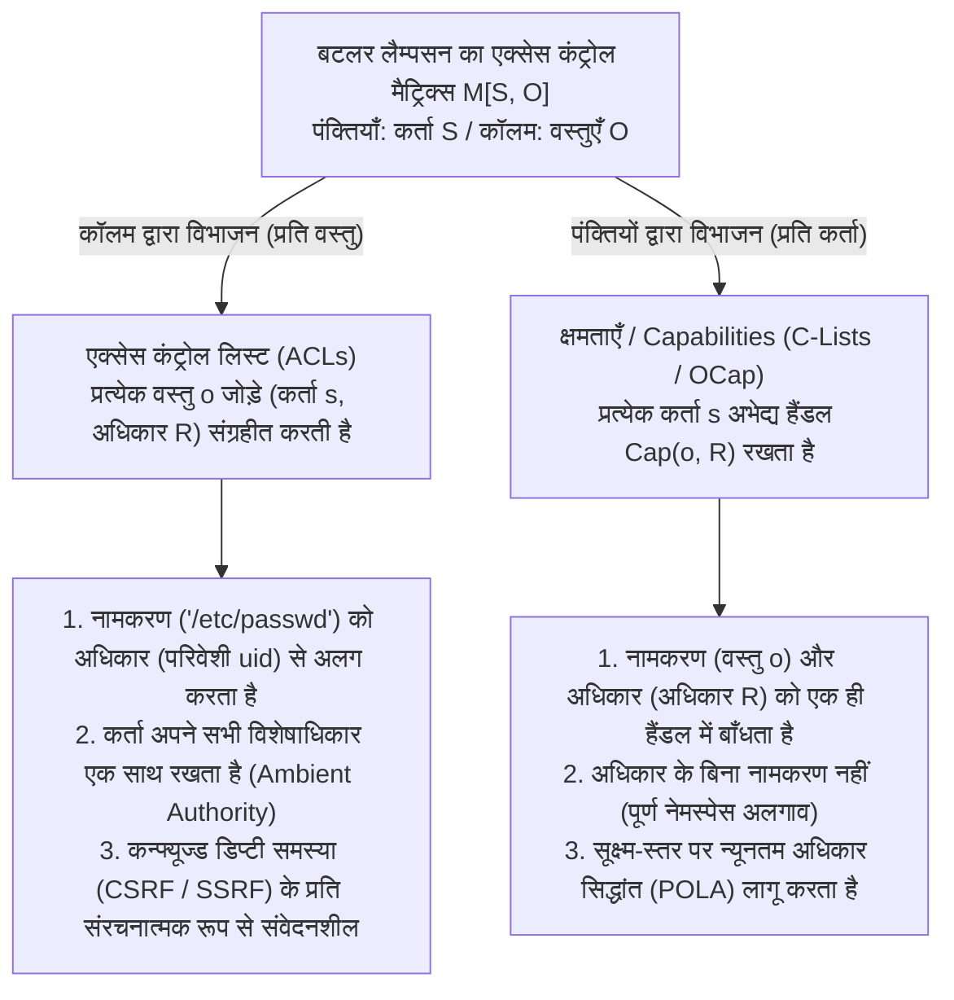

आधुनिक ऑपरेटिंग सिस्टम, क्लाउड इन्फ्रास्ट्रक्चर और वेब अनुप्रयोगों में विनाशकारी सुरक्षा उल्लंघन एक आश्चर्यजनक रूप से दोहराए जाने वाले पैटर्न का अनुसरण करते हैं। क्रॉस-साइट रिक्वेस्ट फोर्जरी (CSRF), सर्वर-साइड रिक्वेस्ट फोर्जरी (SSRF), SQL और कमांड इंजेक्शन, कंटेनर एस्केप, और `npm` या `PyPI` इकोसिस्टम में सॉफ्टवेयर सप्लाई-चेन हमले पहली नज़र में सॉफ्टवेयर स्टैक की बिल्कुल अलग परतों के लगते हैं। किंतु उनके सतही विवरणों के नीचे एक ही साझा आर्किटेक्चरल दोष छिपा है।

वह दोष है आधी सदी से <strong>एक्सेस कंट्रोल लिस्ट (Access Control Lists, ACLs)</strong> और <strong>परिवेशी अधिकार (Ambient Authority)</strong> पर हमारी निर्भरता—वह डिज़ाइन प्रतिमान जिसमें एक्सेस के निर्णय इस बात पर निर्भर करते हैं कि <strong>आप कौन हैं (Subject Identity)</strong> न कि इस पर कि <strong>आपके पास क्या है (What You Hold)</strong>, और जिसमें <strong>संसाधन का नामकरण (Designation)</strong> (किसी जालसाजी-योग्य स्ट्रिंग पथ या URL द्वारा) को <strong>अधिकार (Authority)</strong> (कॉल करने वाले के परिवेशी विशेषाधिकार) से अलग कर दिया जाता है।

इस लेख में, हम उस वैकल्पिक प्रतिमान का व्यवस्थित रूप से विश्लेषण करेंगे जो इस संरचनात्मक कमजोरी को जड़ से समाप्त करता है: <strong>क्षमता-आधारित सुरक्षा (Capability-Based Security)</strong>। बटलर लैम्पसन के 1971 के एक्सेस कंट्रोल मैट्रिक्स $M[S, O]$ के गणितीय अपघटन से शुरू करके, हम नॉर्म हार्डी की 1988 की क्लासिक *कन्फ्यूज्ड डिप्टी समस्या (Confused Deputy Problem)* का पता लगाएंगे, मार्क एस. मिलर के ऑब्जेक्ट-कैपेबिलिटी (OCap) मॉडल और न्यूनतम अधिकार सिद्धांत (POLA) को सूत्रबद्ध करेंगे, अधिकार न्यूनीकरण (Facets) और तत्काल या संक्रामक निरस्तीकरण (Redell के Caretaker और Membranes) के लिए ठोस कोड पैटर्न बनाएंगे, और औपचारिक रूप से सत्यापित माइक्रोकर्नेल <strong>seL4</strong>, <strong>FreeBSD Capsicum</strong>, <strong>CHERI / ARM Morello</strong> हार्डवेयर क्षमता पॉइंटर्स तथा <strong>WebAssembly WASI</strong> के आधुनिक औद्योगिक परिनियोजनों का सर्वेक्षण करेंगे।

---

## 1. अधिकार के दो प्रतिमान: पहचान पत्र (ID Badges) बनाम वैले की (Valet Key)

औपचारिक ऑपरेटिंग सिस्टम सिद्धांत में उतरने से पहले, भौतिक दुनिया में सुरक्षा लागू करने के दो विपरीत तरीकों पर विचार करें।

### प्रतिमान A: पहचान पत्र और दरवाजे के रजिस्टर (ACL मॉडल)
एक उच्च-सुरक्षा वाली कॉर्पोरेट इमारत की कल्पना करें जहाँ हर दरवाजे पर एक गार्ड क्लिपबोर्ड लेकर खड़ा है। क्लिपबोर्ड पर कमरा 302 में प्रवेश करने के लिए अनुमत कर्मचारियों के नामों की सूची है (एक <strong>एक्सेस कंट्रोल लिस्ट, ACL</strong>)। जब आप अंदर जाने के लिए कहते हैं, तो गार्ड आपके पहचान पत्र (<strong>Identity / `uid`</strong>) की जाँच करता है और देखता है कि आपका नाम सूची में है या नहीं।

अब मान लीजिए कि आप चाहते हैं कि एक इंटर्न (एक सहायक प्रोग्राम या थर्ड-पार्टी लाइब्रेरी) कमरा 302 के अंदर की अलमारी से केवल एक फ़ाइल `Q3_Budget.pdf` ले आए। चूंकि इंटर्न का नाम सूची में नहीं है, इसलिए आपको अपना पहचान पत्र इंटर्न को देना होगा (UNIX `setuid` या अपनी पहचान के तहत कोड चलाने के समान)। जिस क्षण इंटर्न आपका बैज पहनकर कमरा 302 में प्रवेश करता है, उसे उस कमरे की <strong>हर गोपनीय फ़ाइल</strong> पर स्वतः ही <strong>परिवेशी अधिकार (Ambient Authority)</strong> मिल जाता है—जिसमें `Payroll_Master.db` भी शामिल है। इससे भी बदतर, यदि कोई बाहरी हमलावर नोट बदलकर इंटर्न को धोखे से `Payroll_Master.db` लाने के लिए कहता है, तो गार्ड खुशी-खुशी इसकी अनुमति दे देगा क्योंकि इंटर्न ने आपका बैज पहना हुआ है!

### प्रतिमान B: कार की वैले की / Valet Key (Capability मॉडल)
इसकी तुलना किसी होटल में पहुँचने और पार्किंग परिचर को अपनी कार सौंपने से करें। आप परिचर के ड्राइविंग लाइसेंस को अपनी कार की एक्सेस सूची में दर्ज कराने के लिए परिवहन विभाग को फोन नहीं करते, न ही आप उसे अपना पहचान पत्र देते हैं। इसके बजाय, आप उसे एक <strong>वैले की (Valet Key)</strong> सौंपते हैं, जो तीन गहन आर्किटेक्चरल गुणों को दर्शाती है:
1. <strong>नामकरण और अधिकार का एकीकरण (Unification of Designation and Authority)</strong>: चाबी एक साथ यह *निर्दिष्ट* करती है कि किस विशिष्ट वाहन को चलाया जाना है और धारक को इंजन स्टार्ट करने के लिए *अधिकृत* भी करती है। कार को इस बात से कोई फर्क नहीं पड़ता कि चाबी *किसके* हाथ में है; इस अभेद्य टोकन का कब्जा ही अधिकार का आवश्यक और पर्याप्त प्रमाण है।
2. <strong>अधिकार न्यूनीकरण (Attenuation / Least Privilege)</strong>: आपकी मास्टर चाबी के विपरीत, वैले की डिक्की या ग्लव बॉक्स को नहीं खोल सकती और अधिकतम गति को सीमित कर सकती है। यह कार पार्क करने के लिए आवश्यक न्यूनतम अधिकार ही देती है।
3. <strong>विकेंद्रीकृत प्रत्यायोजन (Decentralized Delegation)</strong>: यदि पहले परिचर को चेक-आउट के समय दूसरे परिचर से कार मँगवानी हो, तो वह बिना किसी केंद्रीय डेटाबेस को बदले बस चाबी दूसरे परिचर को सौंप देता है।

कंप्यूटर विज्ञान में, प्रतिमान A <strong>ACL मॉडल</strong> है, जबकि प्रतिमान B <strong>क्षमता-आधारित सुरक्षा (Capability) मॉडल</strong> है।

---

## 2. बटलर लैम्पसन का एक्सेस कंट्रोल मैट्रिक्स $M[S, O]$ और इसके दो अपघटन

1971 में, ट्यूरिंग अवार्ड विजेता बटलर लैम्पसन ने *"Protection"* प्रकाशित किया, जिसमें सुरक्षा तंत्रों के सार्वभौमिक गणितीय अमूर्तन के रूप में <strong>एक्सेस कंट्रोल मैट्रिक्स</strong> प्रस्तुत किया गया। किसी सिस्टम की सुरक्षा स्थिति को एक त्रिक $(S, O, M)$ द्वारा परिभाषित किया जाता है:
- <strong>कर्ता समुच्चय (Subjects) $S = \{s_1, s_2, \dots, s_m\}$</strong>: सक्रिय संस्थाएँ जो संचालन शुरू करती हैं (उपयोगकर्ता, प्रोसेस, थ्रेड्स, सॉफ्टवेयर मॉड्यूल)।
- <strong>वस्तु समुच्चय (Objects) $O = \{o_1, o_2, \dots, o_n\}$</strong>: संरक्षित संसाधन (फ़ाइलें, मेमोरी सेगमेंट, IPC सॉकेट, हार्डवेयर डिवाइस), जहाँ सामान्यतः $S \subseteq O$।
- <strong>अधिकारों का सार्वभौमिक समुच्चय $\mathcal{R} = \{\mathsf{read}, \mathsf{write}, \mathsf{execute}, \mathsf{append}, \mathsf{grant}, \mathsf{own}\}$</strong>: वे असतत संचालन जिन्हें किसी वस्तु पर अधिकृत किया जा सकता है।
- <strong>एक्सेस कंट्रोल मैट्रिक्स $M : S \times O \to 2^{\mathcal{R}}$</strong>: प्रत्येक प्रविष्टि $M[s, o] \subseteq \mathcal{R}$ उन सटीक संचालनों को निर्दिष्ट करती है जिन्हें कर्ता $s \in S$ वस्तु $o \in O$ पर करने के लिए अधिकृत है।

उदाहरण के लिए, तीन कर्ताओं $S = \{\text{Alice}, \text{Compiler}, \text{Logger}\}$ और तीन फ़ाइल वस्तुओं $O = \{\texttt{src.f}, \texttt{/SYSX/STAT}, \texttt{/SYSX/BILL}\}$ के लिए मैट्रिक्स:

$$
M[S, O] = \begin{array}{c|ccc}
 & \texttt{src.f} & \texttt{/SYSX/STAT} & \texttt{/SYSX/BILL} \\
\hline
\text{Alice} & \{\mathsf{read}, \mathsf{write}\} & \emptyset & \emptyset \\
\text{Compiler} & \{\mathsf{read}\} & \{\mathsf{append}\} & \{\mathsf{read}, \mathsf{write}\} \\
\text{Logger} & \emptyset & \{\mathsf{read}, \mathsf{write}\} & \emptyset
\end{array}
$$

चूंकि वास्तविक सिस्टम में $M[S, O]$ अत्यंत विरल (sparse) होता है, इसलिए प्रत्येक सिस्टम आर्किटेक्ट को इसे दो अक्षों में से किसी एक के अनुदिश विभाजित करना पड़ता है: <strong>कॉलम द्वारा विभाजन (वस्तुओं से सूचियाँ जोड़ना)</strong>, या <strong>पंक्तियों द्वारा विभाजन (कर्ताओं को टोकन देना)</strong>।



### 2.1 कॉलम द्वारा विभाजन: एक्सेस कंट्रोल लिस्ट (ACLs)
जब हम मैट्रिक्स $M[S, O]$ को लंबवत रूप से <strong>कॉलम द्वारा</strong> काटते हैं, तो हम प्रत्येक वस्तु $o \in O$ के साथ उसके कॉलम की गैर-रिक्त प्रविष्टियों की एक सूची जोड़ते हैं:

$$
\text{ACL}(o) = \bigl\{ (s, M[s, o]) \;\big|\; s \in S,\; M[s, o] \neq \emptyset \bigr\}
$$

UNIX/POSIX अनुमतियाँ, Windows NTFS DACLs और क्लाउड IAM नीतियाँ कॉलम-विभाजित कार्यान्वयन हैं। यह <strong>नामकरण और अधिकार के पृथक्करण</strong> को बाध्य करता है: एक प्रोग्राम `"/SYSX/BILL"` जैसे सार्वजनिक स्ट्रिंग पथ द्वारा वस्तु को नामित करता है, जबकि कर्नेल का रेफरेंस मॉनिटर कॉल करने वाली प्रोसेस की परिवेशी पहचान (`uid`) की जाँच करता है। परिणामस्वरूप, एक चलती हुई प्रोसेस हर सिस्टम कॉल पर अपनी पूरी मैट्रिक्स पंक्ति के सभी अधिकारों के संघ $\bigcup_{o \in O} M[s, o]$ का उपयोग करती है, जिसे <strong>परिवेशी अधिकार (Ambient Authority)</strong> कहा जाता है।

### 2.2 पंक्तियों द्वारा विभाजन: क्षमताएँ / Capabilities (डेनिस और वान हॉर्न 1966)
1966 में, जैक बी. डेनिस और अर्ल सी. वान हॉर्न ने द्वैत अपघटन प्रस्तुत किया: $M[S, O]$ को क्षैतिज रूप से <strong>पंक्तियों द्वारा</strong> काटना। प्रत्येक कर्ता $s \in S$ के साथ हम एक <strong>क्षमता स्थान (CSpace या C-List)</strong> जोड़ते हैं:

$$
\text{CSpace}(s) = \bigl\{ \text{Cap}(o, R) \;\big|\; o \in O,\; R = M[s, o] \neq \emptyset \bigr\}
$$

प्रत्येक तत्व $c = \text{Cap}(o, R)$ एक <strong>क्षमता (Capability)</strong> है—अधिकार का एक <strong>अभेद्य टोकन</strong> जो <strong>नामकरण</strong> (विशिष्ट वस्तु $o$ के लिए सीधा पॉइंटर या हैंडल) और <strong>अधिकार</strong> (अधिकारों का अनुमत उपसमुच्चय $R \subseteq \mathcal{R}$) को एक अविभाज्य संदर्भ में बाँधता है। यदि कर्ता $s$ के पास वस्तु $o$ की क्षमता नहीं है, तो वह $o$ का नाम या पता भी नहीं बता सकता: <strong>अधिकार के बिना नामकरण नहीं; नामकरण के बिना अधिकार नहीं</strong>।

| आर्किटेक्चरल आयाम | एक्सेस कंट्रोल लिस्ट (ACLs — कॉलम विभाजन) | क्षमताएँ (OCap / C-Lists — पंक्ति विभाजन) |
| :--- | :--- | :--- |
| <strong>$M[S, O]$ का अपघटन</strong> | प्रत्येक वस्तु $o \in O$ पर कॉलम के अनुसार संग्रहीत | प्रत्येक कर्ता $s \in S$ के पास पंक्ति के अनुसार संग्रहीत |
| <strong>मूल प्राधिकरण दर्शन</strong> | <strong>आप कौन हैं (Who You Are)</strong>: कॉलर की पहचान / `uid` | <strong>आपके पास क्या है (What You Hold)</strong>: प्रस्तुत क्षमता टोकन |
| <strong>नामकरण बनाम अधिकार</strong> | <strong>पृथक</strong> (जालसाजी-योग्य स्ट्रिंग पथ + परिवेशी पहचान) | <strong>एकीकृत</strong> (अभेद्य हैंडल $o$ को नामित करता है और $R$ देता है) |
| <strong>अधिकार मॉडल</strong> | <strong>परिवेशी अधिकार</strong>: `uid` के सभी अधिकार हर कॉल पर सक्रिय | <strong>चयनात्मक अधिकार</strong>: केवल स्पष्ट रूप से पास किया गया हैंडल सक्रिय |
| <strong>कन्फ्यूज्ड डिप्टी संवेदनशीलता</strong> | <strong>संरचनात्मक रूप से संवेदनशील</strong> (CSRF, SSRF, `setuid` वृद्धि) | <strong>संरचनात्मक रूप से सुरक्षित</strong> (क्लाइंट को अधिकृत हैंडल देना होगा) |
| <strong>प्रतिनिधि प्रणालियाँ</strong> | UNIX/POSIX ACLs, Windows NTFS DACL, AWS IAM | KeyKOS, seL4, FreeBSD Capsicum, Fuchsia Zircon, CHERI, WASI |

---

## 3. कन्फ्यूज्ड डिप्टी समस्या (Confused Deputy): नॉर्म हार्डी का 1988 का क्लासिक और इसके आधुनिक रूप

नामकरण को अधिकार से अलग करना इतना खतरनाक क्यों है? कंप्यूटर आर्किटेक्ट नॉर्म हार्डी ने अक्टूबर 1988 में *ACM SIGOPS Operating Systems Review* में <strong>*"The Confused Deputy (or why capabilities might have been invented)"</strong>* शीर्षक से इसका सटीक स्पष्टीकरण प्रकाशित किया, जिसमें 1970 के दशक के मध्य में एक व्यावसायिक Tymshare ऑपरेटिंग सिस्टम पर हुई वास्तविक सुरक्षा दुर्घटना का वर्णन था।

### 3.1 `/SYSX/FORT` कंपाइलर दुर्घटना का विश्लेषण
Tymshare सिस्टम पर Fortran कंपाइलर `/SYSX/FORT` में स्थित था:
1. <strong>बिलिंग आँकड़ों की आवश्यकता</strong>: सिस्टम प्रशासक चाहते थे कि जब भी कोई प्रोग्राम कंपाइल हो, `/SYSX/FORT` फ़ाइल `/SYSX/STAT` में एक सांख्यिकीय रिकॉर्ड जोड़े।
2. <strong>परिवेशी अधिकार प्रदान करना</strong>: इसके लिए `/SYSX/FORT` निष्पादन-योग्य फ़ाइल को <strong>पूरी `/SYSX` डायरेक्टरी पर परिवेशी लेखन अधिकार</strong> (UNIX `setuid` के समान) दिया गया।
3. <strong>उपयोगकर्ता द्वारा प्रदत्त आउटपुट फ़ाइल नाम</strong>: कंपाइलर उपयोगकर्ता से एक स्ट्रिंग तर्क लेता था कि डीबगिंग आउटपुट कहाँ लिखा जाए (जैसे `FORT(SRC="prog.f", OUT="listing.txt")`)।
4. <strong>`/SYSX/BILL` में मुख्य खजाना</strong>: उसी `/SYSX` डायरेक्टरी में ग्राहकों का मुख्य बिलिंग डेटाबेस <strong>`/SYSX/BILL`</strong> भी रखा था।

एक दिन, एक चतुर उपयोगकर्ता ने `/SYSX/FORT` को चलाया और आउटपुट फ़ाइल नाम के रूप में स्ट्रिंग <strong>`"/SYSX/BILL"`</strong> पास कर दी। जब कंपाइलर ने `open("/SYSX/BILL", WRITE)` कॉल किया, तो OS के ACL मॉनिटर ने पूछा: *“क्या सक्रिय प्रोसेस (`/SYSX/FORT`) को `/SYSX` में लिखने की अनुमति है?”* उत्तर <strong>हाँ</strong> था—और <strong>कंपाइलर ने आज्ञाकारी रूप से कंपनी के मुख्य ग्राहक बिलिंग डेटाबेस `/SYSX/BILL` को Fortran डायग्नोस्टिक्स से ओवरराइट कर नष्ट कर दिया!</strong>



```mermaid
flowchart TD
    subgraph ACL_WORLD["ACL + परिवेशी अधिकार मॉडल (कन्फ्यूज्ड डिप्टी)"]
        U1["दुर्भावनापूर्ण उपयोगकर्ता<br/>(/SYSX/BILL तक कोई पहुँच नहीं)"] -->|"1. स्ट्रिंग पथ OUT='/SYSX/BILL' पास करता है"| D1["डिप्टी: कंपाइलर /SYSX/FORT<br/>(परिवेशी अधिकार: /SYSX/* में लेखन)"]
        D1 -->|"2. open('/SYSX/BILL', WRITE)<br/>अंतर्निहित रूप से अपने परिवेशी अधिकार का उपयोग करता है"| OS1["OS रेफरेंस मॉनिटर (ACL जाँच)"]
        OS1 -->|"3. कंपाइलर के पास /SYSX लेखन अनुमति है -> अनुमत!"| BILL1["मुख्य बिलिंग DB /SYSX/BILL<br/>[नष्ट / ओवरराइट हो गया!]"]
    end

    subgraph CAP_WORLD["क्षमता मॉडल (एकीकृत नामकरण और अधिकार)"]
        U2["उपयोगकर्ता<br/>(केवल अपनी फ़ाइलों की क्षमता रखता है)"] -->|"1. आउटपुट क्षमता cap_out पास करता है<br/>(/SYSX/BILL की क्षमता पास नहीं कर सकता क्योंकि उसके पास नहीं है!)"| D2["डिप्टी: कंपाइलर /SYSX/FORT<br/>(केवल cap_stat से युक्त)"]
        D2 -->|"2a. write(cap_out, debug_output)<br/>उपयोगकर्ता द्वारा स्पष्ट रूप से दिए गए अधिकार का उपयोग"| OUT2["उपयोगकर्ता की आउटपुट फ़ाइल listing.txt"]
        D2 -->|"2b. append(cap_stat, usage_stats)<br/>इंस्टॉल के समय मिली निजी क्षमता का उपयोग"| STAT2["सांख्यिकी फ़ाइल /SYSX/STAT"]
    end
```

### 3.2 कंपाइलर "भ्रमित (Confused)" क्यों था? और आधुनिक कमजोरियाँ
हार्डी ने `/SYSX/FORT` को <strong>कन्फ्यूज्ड डिप्टी (भ्रमित प्रतिनिधि)</strong> कहा क्योंकि वह एक साथ दो अलग-अलग स्वामियों (सिस्टम प्रशासक और उपयोगकर्ता) की सेवा कर रहा था, लेकिन स्ट्रिंग पथ और अधिकार अलग होने के कारण OS ने उपयोगकर्ता के दुर्भावनापूर्ण पथ पर कंपाइलर के उच्च परिवेशी अधिकार को लागू कर दिया। क्षमता आर्किटेक्चर में यह बग असंभव है: कंपाइलर को केवल निजी क्षमता $c_{\text{stat}} = \text{Cap}(\texttt{/SYSX/STAT}, \{\mathsf{append}\})$ दी जाती है, और उपयोगकर्ता को स्वयं आउटपुट फ़ाइल खोलकर लेखन क्षमता हैंडल $c_{\text{out}} = \text{Cap}(f_{\text{out}}, \{\mathsf{write}\})$ पास करना होता है।

आधुनिक साइबर सुरक्षा की सबसे खतरनाक कमजोरियाँ कन्फ्यूज्ड डिप्टी के सीधे उदाहरण हैं:
- <strong>क्रॉस-साइट रिक्वेस्ट फोर्जरी (CSRF)</strong>: वेब ब्राउज़र एक कन्फ्यूज्ड डिप्टी है जो `evil.example` द्वारा शुरू किए गए अनुरोध में आपके परिवेशी अधिकार (`bank.example` की सेशन कुकी) को स्वतः जोड़ देता है। CSRF टोकन फॉर्म से अभेद्य क्षमता टोकन की माँग करके इसे ठीक करते हैं।
- <strong>सर्वर-साइड रिक्वेस्ट फोर्जरी (SSRF)</strong>: क्लाउड वेब सर्वर उपयोगकर्ता द्वारा दिए गए URL (`"http://169.254.169.254/latest/meta-data/"`) को लाने के लिए क्लाउड VPC के भीतर अपने स्वयं के परिवेशी नेटवर्क अधिकार का उपयोग करके IAM क्रेडेंशियल चुरा लेता है।
- <strong>सॉफ्टवेयर सप्लाई-चेन हमले (`npm` / `PyPI`)</strong>: 20 लाइनों की एक छोटी थर्ड-पार्टी लाइब्रेरी `~/.ssh/id_rsa` पढ़ सकती है क्योंकि POSIX ACL के तहत आपकी प्रोसेस में चलने वाला प्रत्येक फ़ंक्शन आपके `uid` के संपूर्ण परिवेशी अधिकार को प्राप्त करता है।

---

## 4. ऑब्जेक्ट-कैपेबिलिटी (OCap) मॉडल, अधिकार न्यूनीकरण और निरस्तीकरण

जॉन्स हॉपकिंस विश्वविद्यालय में अपने 2006 के पीएचडी शोधप्रबंध (*"Robust Composition"*) में, मार्क एस. मिलर ने प्रदर्शित किया कि <strong>मेमोरी-सुरक्षित ऑब्जेक्ट-ओरिएंटेड प्रोग्रामिंग भाषाओं में व्यक्तिगत ऑब्जेक्ट स्तर तक न्यूनतम अधिकार सिद्धांत (POLA) को लागू करने का सटीक तंत्र पहले से मौजूद है: स्वयं ऑब्जेक्ट रेफरेंस</strong>।

### 4.1 तीन OCap नियम और क्षमता प्राप्ति के तीन नियम
किसी मेमोरी-सुरक्षित भाषा (जैसे Hardened JavaScript / SES, E, या Wasm घटक) के वास्तविक <strong>ऑब्जेक्ट-कैपेबिलिटी (OCap)</strong> सिस्टम बनने के लिए रनटाइम को तीन नियम लागू करने होंगे:
1. <strong>कोई जाली रेफरेंस नहीं</strong>: किसी पूर्णांक को पॉइंटर में बदलकर या सीमा से बाहर पॉइंटर अंकगणित द्वारा रेफरेंस नहीं बनाया जा सकता।
2. <strong>कोई परिवर्तनशील ग्लोबल स्टेट नहीं (शून्य परिवेशी अधिकार)</strong>: ग्लोबल स्कोप में परिवर्तनशील वेरिएबल या परिवेशी I/O मॉड्यूल (`fs`, `net`) नहीं होने चाहिए, और मूल प्रोटोटाइप (`Object.prototype`) गहराई से फ्रीज (`Object.freeze`) होने चाहिए।
3. <strong>पूर्ण एनकैप्सुलेशन</strong>: लेक्सिकल क्लोजर या `#private` फ़ील्ड्स के भीतर की निजी स्थिति को बाहर से नहीं देखा जा सकता।

रेफरेंस ग्राफ $G = (V, E)$ में एक नया किनारा $(A \to C)$ केवल तीन तरीकों से बन सकता है: <strong>1. निर्माण (Parenthood, `new C()`)</strong>, <strong>2. प्रारंभिक प्रदान (Endowment क्लोजर बनाते समय)</strong>, या <strong>3. परिचय (Introduction, जहाँ $(B \to A)$ और $(B \to C)$ रखने वाला परिचयकर्ता $B$ संदेश के माध्यम से $C$ को $A$ को सौंपता है)</strong>:

$$
\text{परिचय का नियम (Law of Introduction)}: \quad (B \to A) \;\land\; (B \to C) \;\;\Longrightarrow\;\; B \text{ स्थापित कर सकता है } (A \to C)
$$

### 4.2 Facets द्वारा न्यूनीकरण और Redell के Caretaker व Membranes द्वारा निरस्तीकरण
प्रचलित मिथक के विपरीत, क्षमताओं को आसानी से सीमित और निरस्त किया जा सकता है, जैसा कि 1974 में <strong>डेविड डी. रेडेल</strong> ने <strong>Caretaker पैटर्न</strong> द्वारा और मार्क मिलर ने <strong>Revocable Membranes</strong> द्वारा सिद्ध किया:

```javascript
// 1. अधिकार न्यूनीकरण फलक (Attenuating Facet): केवल विशिष्ट प्रीफ़िक्स के लिए रीड-ओनली
function makeScopedReadFacet(fullStorageCap, allowedPrefix) {
  return Object.freeze({
    read(key) {
      if (typeof key !== "string" || !key.startsWith(allowedPrefix)) {
        throw new Error(`पहुँच अस्वीकृत: कुंजी '${allowedPrefix}' से शुरू होनी चाहिए`);
      }
      return fullStorageCap.read(key);
    }
    // write() और deleteAll() को पूरी तरह से हटा दिया गया है!
  });
}

// 2. O(1) समय में तत्काल क्षमता निरस्तीकरण के लिए रेडेल (1974) का Caretaker पैटर्न
function makeCaretaker(targetCap) {
  let currentTarget = targetCap; // क्लोजर के भीतर निजी परिवर्तनशील पॉइंटर
  const caretaker = Object.freeze({
    read(...args) {
      if (currentTarget === null) throw new Error("RevokedCapabilityError: अधिकार निरस्त कर दिया गया है");
      return currentTarget.read(...args);
    },
    write(...args) {
      if (currentTarget === null) throw new Error("RevokedCapabilityError: अधिकार निरस्त कर दिया गया है");
      return currentTarget.write(...args);
    }
  });
  const revoker = Object.freeze({
    revoke() { currentTarget = null; } // लिंक तोड़ता है और गार्बेज कलेक्शन (GC) की अनुमति देता है
  });
  return Object.freeze({ caretaker, revoker });
}
```

यदि कोई क्षमता स्वयं नई क्षमताएँ लौटाती है (जैसे डायरेक्टरी से सब-डायरेक्टरी मिलना), तो एक <strong>Revocable Membrane</strong> `Proxy` और `WeakMap` का उपयोग करके सीमा पार करने वाले सभी रिटर्न मानों और तर्कों को संक्रामक रूप से लपेटता है, जिससे `revoke()` कॉल होते ही पूरा सबग्राफ तुरंत निष्क्रिय हो जाता है।

---

## 5. औद्योगिक परिनियोजन: seL4, FreeBSD Capsicum, CHERI और WebAssembly WASI

सबसे पहले एक आम शब्दावली भ्रम को दूर करें: Linux `capabilities(7)` (`CAP_NET_ADMIN` आदि) <strong>ऑब्जेक्ट क्षमताएँ नहीं हैं</strong>! वे केवल `root` के परिवेशी विशेषाधिकार को बिना किसी विशिष्ट वस्तु को नामित किए लगभग 41 थ्रेड बिटफ़्लैग्स में बाँटते हैं। वास्तविक औद्योगिक क्षमता आर्किटेक्चर चार प्रणालियों में दिखाई देते हैं:

1. <strong>औपचारिक रूप से सत्यापित माइक्रोकर्नेल seL4</strong>: पूर्ण मशीन-जाँचे गए गणितीय प्रमाण (Isabelle/HOL में) वाला दुनिया का पहला OS कर्नेल। seL4 में शून्य परिवेशी अधिकार है: सभी संसाधनों (थ्रेड्स, एड्रेस स्पेस, IPC एंडपॉइंट्स, मेमोरी फ़्रेम) तक केवल थ्रेड के <strong>CSpace (CNode तालिकाओं)</strong> में मौजूद क्षमताओं के माध्यम से पहुँचा जाता है, जिसमें `seL4_CNode_Mint` द्वारा न्यूनीकरण और व्युत्पत्ति वृक्ष <strong>CDT (`seL4_CNode_Revoke`)</strong> द्वारा संक्रामक निरस्तीकरण होता है।
2. <strong>FreeBSD Capsicum</strong>: कैम्ब्रिज विश्वविद्यालय और Google में निर्मित, Capsicum मानक UNIX फ़ाइल डिस्क्रिप्टर (`fd`) को वास्तविक क्षमताओं में बदलता है। जब कोई प्रोसेस <strong>`cap_enter()`</strong> कॉल करती है, तो कर्नेल ग्लोबल नेमस्पेस तक पहुँचने वाले प्रत्येक सिस्टम कॉल (`open()`, `connect()`, `bind()` आदि `ECAPMODE` लौटाते हैं) को स्थायी रूप से ब्लॉक कर देता है। प्रोसेस केवल पहले से मौजूद डिस्क्रिप्टर्स (और `openat(dir_fd, ...)` द्वारा उनके भीतर सापेक्ष पथों, जहाँ `".."` प्रतिबंधित है) पर काम कर सकती है, और `cap_rights_limit(fd, &rights)` से 60 से अधिक सूक्ष्म अधिकारों को सीमित कर सकती है।
3. <strong>सिलिकॉन में क्षमताएँ: CHERI और ARM Morello</strong>: SRI International और कैम्ब्रिज विश्वविद्यालय द्वारा विकसित तथा ARM द्वारा <strong>Morello</strong> प्रोसेसर और <strong>CHERIoT-RISC-V</strong> में निर्मित, CHERI 64-बिट पॉइंटर्स को <strong>128-बिट हार्डवेयर क्षमताओं और 1-बिट आउट-ऑफ-बैंड वैधता टैग (Tag Bit)</strong> से बदल देता है:

$$
\underbrace{\text{Tag (1 bit)}}_{\text{हार्डवेयर प्रमाण बिट}} \;\Big|\; \underbrace{\text{Permissions (18 bits)}}_{\text{Load, Store, Exec, Cap-RW}} \;\Big|\; \underbrace{\text{Object Type (18 bits)}}_{\text{हार्डवेयर सील / अनसील}} \;\Big|\; \underbrace{\text{Compressed Bounds (28 bits)}}_{\text{संपीड़ित सीमाएँ [Base, Top)}} \;\Big|\; \underbrace{\text{Address Cursor (64 bits)}}_{\text{64-बिट वर्चुअल पता}}
$$

प्रत्येक मेमोरी एक्सेस पर, CPU एक ही साइकिल में जाँचता है कि पता `[Base, Top)` के भीतर है और अनुमतियों का पालन करता है। यदि कोई साधारण पूर्णांक निर्देश RAM में किसी क्षमता के एक बाइट को भी ओवरराइट करता है, तो मेमोरी कंट्रोलर स्वतः Tag बिट को `0` कर देता है, जिससे जाली पॉइंटर का उपयोग असंभव हो जाता है और बफ़र ओवरफ़्लो व ROP हमले सिलिकॉन स्तर पर ही समाप्त हो जाते हैं।
4. <strong>WebAssembly (WASI) और Macaroons</strong>: WASI मॉड्यूल बिना किसी परिवेशी अधिकार के चलते हैं और केवल होस्ट द्वारा स्पष्ट रूप से दिए गए पूर्व-खुले डायरेक्टरी क्षमता डिस्क्रिप्टर्स तक ही पहुँच सकते हैं। वितरित क्लाउड में, Google के <strong>Macaroons</strong> नेस्टेड HMAC हस्ताक्षर श्रृंखलाओं का उपयोग करते हैं जिससे टोकन धारक बिना किसी केंद्रीय डेटाबेस से पूछे स्वयं प्रासंगिक शर्तें (Caveats) जोड़कर अधिकारों को कम कर सकता है।
