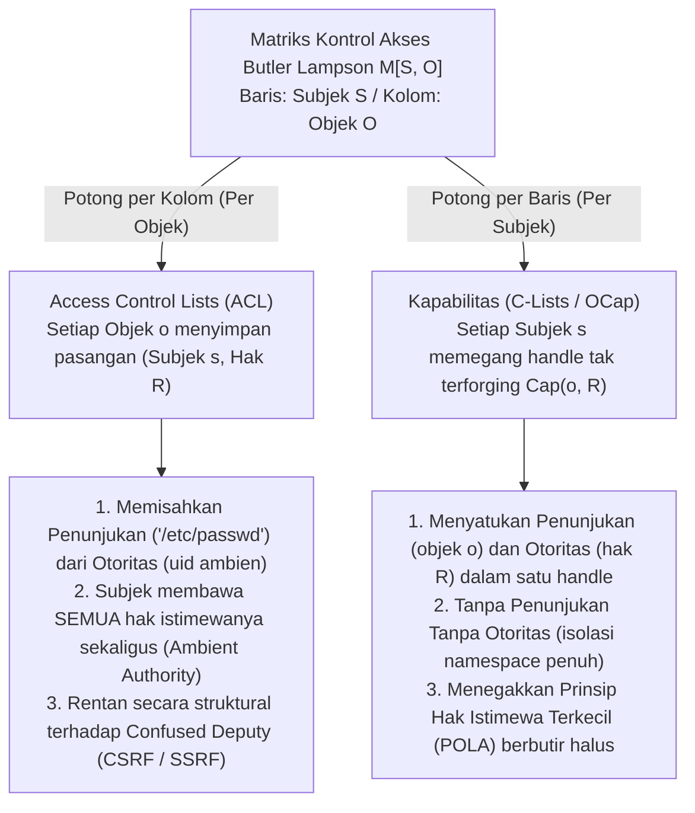

Di seluruh sistem operasi modern, infrastruktur cloud, dan aplikasi web, pelanggaran keamanan yang katastrofik mengikuti pola yang sangat berulang. Cross-Site Request Forgery (CSRF), Server-Side Request Forgery (SSRF), injeksi SQL dan perintah, pelarian kontainer (container escape), serta serangan rantai pasokan perangkat lunak di ekosistem `npm` atau `PyPI` sekilas tampak berada di lapisan perangkat lunak yang berbeda. Namun di balik detail permukaannya, terdapat satu cacat arsitektur yang sama.

Cacat tersebut adalah ketergantungan kita selama setengah abad pada <strong>Daftar Kontrol Akses (Access Control Lists, ACL)</strong> yang dipadukan dengan <strong>Otoritas Ambien (Ambient Authority)</strong>—paradigma desain di mana keputusan akses bergantung pada <strong>Siapa Anda (Identitas Subjek)</strong> alih-alih <strong>Apa yang Anda Pegang</strong>, dan di mana <strong>Penunjukan (Designation)</strong> (menamai sumber daya melalui jalur string atau URL yang dapat dipalsukan) dipisahkan dari <strong>Otoritas (Authority)</strong> (izin ambien yang dibawa oleh pemanggil).

Dalam artikel ini, kita membahas secara sistematis paradigma alternatif yang menghapus kerentanan struktural ini hingga ke akarnya: <strong>Keamanan Berbasis Kapabilitas (Capability-Based Security)</strong>. Dimulai dari dekomposisi matematis Matriks Kontrol Akses Butler Lampson $M[S, O]$ (1971), kita menelusuri *Masalah Deputi yang Bingung (Confused Deputy Problem)* klasik karya Norm Hardy (1988), merumuskan model Object-Capability (OCap) karya Mark S. Miller dan Prinsip Hak Istimewa Terkecil (POLA), membangun pola kode konkret untuk atenuasi (facet) serta pencabutan instan atau transitif (Caretaker Redell dan Membran), dan meninjau penerapan industri modern pada mikrokernel terverifikasi formal <strong>seL4</strong>, <strong>FreeBSD Capsicum</strong>, pointer kapabilitas perangkat keras <strong>CHERI / ARM Morello</strong>, dan <strong>WebAssembly WASI</strong>.

---

## 1. Dua Paradigma Otoritas: Lencana Identitas vs. Kunci Valet (Valet Key)

Sebelum menyelami teori sistem operasi formal, mari bandingkan dua cara berlawanan dalam menerapkan keamanan fisik di dunia nyata.

### Paradigma A: Lencana Identitas dan Buku Besar Pintu (Model ACL)
Bayangkan sebuah gedung perusahaan berkeamanan tinggi di mana setiap pintu dijaga oleh petugas yang memegang papan klip berisi daftar nama karyawan yang diizinkan masuk ke Ruang 302 (sebuah <strong>Access Control List</strong>). Ketika Anda meminta masuk, penjaga memeriksa lencana ID Anda (<strong>Identitas / `uid`</strong>) dan memeriksa apakah nama Anda ada di daftar Ruang 302.

Sekarang misalkan Anda ingin seorang anak magang (program pembantu atau pustaka pihak ketiga) mengambil satu file, `Q3_Budget.pdf`, dari lemari arsip di dalam Ruang 302. Karena anak magang tidak ada dalam daftar, Anda harus meminjamkan lencana ID Anda sendiri kepadanya (analog dengan `setuid` di UNIX atau menjalankan kode di bawah identitas pengguna Anda). Begitu anak magang masuk ke Ruang 302 mengenakan lencana Anda, ia secara otomatis memperoleh <strong>Otoritas Ambien (Ambient Authority)</strong> atas seluruh isi ruangan tersebut, termasuk `Payroll_Master.db`. Lebih buruk lagi, jika penyerang luar menukar catatan tempel anak magang untuk menipunya agar mengambil `Payroll_Master.db`, penjaga pintu akan mengizinkannya dengan senang hati karena anak magang tersebut mengenakan lencana Anda!

### Paradigma B: Kunci Valet Mobil / Valet Key (Model Kapabilitas)
Bandingkan hal ini dengan saat Anda tiba di hotel dan menyerahkan mobil Anda kepada petugas parkir valet. Anda tidak menelepon kantor samsat untuk mendaftarkan SIM petugas pada daftar akses mobil Anda, dan Anda juga tidak menyerahkan KTP Anda. Sebaliknya, Anda menyerahkan <strong>Kunci Valet (Valet Key)</strong>, yang mewujudkan tiga sifat arsitektur mendalam:
1. <strong>Penyatuan Penunjukan dan Otoritas</strong>: Kunci tersebut secara bersamaan *menunjuk* kendaraan spesifik mana yang akan dioperasikan dan *mengotorisasi* pemegangnya untuk menyalakan mesin. Mobil tidak peduli *siapa* yang memegang kunci; kepemilikan token yang tak dapat dipalsukan itu sudah menjadi bukti otoritas yang cukup.
2. <strong>Atenuasi (Hak Istimewa Terkecil)</strong>: Berbeda dengan kunci utama, kunci valet tidak dapat membuka bagasi atau laci dasbor dan dapat membatasi kecepatan maksimum. Ia hanya memberikan otoritas minimum yang diperlukan untuk memarkir mobil.
3. <strong>Delegasi Terdesentralisasi</strong>: Jika petugas pertama perlu menyerahkan tugas kepada petugas kedua untuk mengambil mobil Anda, ia cukup menyerahkan kunci valet tersebut tanpa mengedit basis data pusat mana pun.

Dalam ilmu komputer, Paradigma A adalah model <strong>ACL</strong>, sedangkan Paradigma B adalah model <strong>Keamanan Berbasis Kapabilitas (Capabilities)</strong>.

---

## 2. Matriks Kontrol Akses Butler Lampson $M[S, O]$ dan Dua Dekomposisinya

Pada tahun 1971, peraih Turing Award Butler Lampson menerbitkan *"Protection"*, memperkenalkan <strong>Matriks Kontrol Akses</strong> sebagai abstraksi matematis universal untuk mekanisme perlindungan. Status perlindungan sistem didefinisikan oleh tripel $(S, O, M)$:
- <strong>Himpunan Subjek $S = \{s_1, s_2, \dots, s_m\}$</strong>: Entitas aktif yang memulai operasi (pengguna, proses, thread, modul perangkat lunak).
- <strong>Himpunan Objek $O = \{o_1, o_2, \dots, o_n\}$</strong>: Sumber daya yang dilindungi (file, segmen memori, soket IPC, perangkat), umumnya dengan $S \subseteq O$.
- <strong>Himpunan Hak Akses Universal $\mathcal{R} = \{\mathsf{read}, \mathsf{write}, \mathsf{execute}, \mathsf{append}, \mathsf{grant}, \mathsf{own}\}$</strong>: Operasi diskrit yang dapat diotorisasi pada suatu objek.
- <strong>Matriks Kontrol Akses $M : S \times O \to 2^{\mathcal{R}}$</strong>: Setiap entri $M[s, o] \subseteq \mathcal{R}$ menentukan himpunan operasi tepat yang diizinkan bagi subjek $s \in S$ terhadap objek $o \in O$.

Misalnya, sistem dengan tiga subjek $S = \{\text{Alice}, \text{Compiler}, \text{Logger}\}$ dan tiga objek file $O = \{\texttt{src.f}, \texttt{/SYSX/STAT}, \texttt{/SYSX/BILL}\}$:

$$
M[S, O] = \begin{array}{c|ccc}
 & \texttt{src.f} & \texttt{/SYSX/STAT} & \texttt{/SYSX/BILL} \\
\hline
\text{Alice} & \{\mathsf{read}, \mathsf{write}\} & \emptyset & \emptyset \\
\text{Compiler} & \{\mathsf{read}\} & \{\mathsf{append}\} & \{\mathsf{read}, \mathsf{write}\} \\
\text{Logger} & \emptyset & \{\mathsf{read}, \mathsf{write}\} & \emptyset
\end{array}
$$

Karena $M[S, O]$ sangat jarang (sparse) di sistem nyata, setiap arsitek harus mendekomposisinya di sepanjang salah satu dari dua sumbunya: <strong>memotong berdasarkan kolom (melampirkan daftar ke Objek)</strong>, atau <strong>memotong berdasarkan baris (memberikan token ke Subjek)</strong>.



### 2.1 Pemotongan per Kolom: Access Control Lists (ACL)
Ketika kita memotong matriks $M[S, O]$ secara vertikal <strong>berdasarkan kolom</strong>, kita mengaitkan setiap objek $o \in O$ dengan daftar entri tak kosong pada kolomnya:

$$
\text{ACL}(o) = \bigl\{ (s, M[s, o]) \;\big|\; s \in S,\; M[s, o] \neq \emptyset \bigr\}
$$

Izin UNIX/POSIX, DACL Windows NTFS, dan kebijakan IAM cloud semuanya menggunakan pemotongan kolom. Hal ini memaksakan <strong>pemisahan antara Penunjukan dan Otoritas</strong>: program menunjuk objek menggunakan string publik seperti `"/SYSX/BILL"`, sementara monitor referensi kernel memeriksa identitas ambien (`uid`) proses pemanggil. Akibatnya, proses yang berjalan terus-menerus memegang gabungan seluruh izin di baris matriksnya $\bigcup_{o \in O} M[s, o]$ pada setiap panggilan sistem: <strong>Otoritas Ambien (Ambient Authority)</strong>.

### 2.2 Pemotongan per Baris: Kapabilitas (Dennis & Van Horn 1966)
Pada tahun 1966, Jack B. Dennis dan Earl C. Van Horn memperkenalkan dekomposisi dual: memotong $M[S, O]$ secara horizontal <strong>berdasarkan baris</strong>. Pada setiap subjek $s \in S$, kita kaitkan <strong>Ruang Kapabilitas (CSpace atau C-List)</strong>:

$$
\text{CSpace}(s) = \bigl\{ \text{Cap}(o, R) \;\big|\; o \in O,\; R = M[s, o] \neq \emptyset \bigr\}
$$

Setiap elemen $c = \text{Cap}(o, R)$ adalah sebuah <strong>Kapabilitas (Capability)</strong>—token otoritas yang tak dapat dipalsukan yang mengikat <strong>Penunjukan</strong> (pointer atau handle langsung ke objek $o$) dan <strong>Otoritas</strong> (himpunan bagian hak $R \subseteq \mathcal{R}$) menjadi satu referensi tak terpisahkan. Jika subjek $s$ tidak memegang kapabilitas ke objek $o$, subjek $s$ bahkan tidak dapat menamai atau mengalamatkan $o$: <strong>Tanpa Penunjukan Tanpa Otoritas; Tanpa Otoritas Tanpa Penunjukan</strong>.

| Dimensi Arsitektur | Access Control Lists (ACL — Potongan Kolom) | Kapabilitas (OCap / C-Lists — Potongan Baris) |
| :--- | :--- | :--- |
| <strong>Dekomposisi $M[S, O]$</strong> | Disimpan per kolom pada setiap Objek $o \in O$ | Disimpan per baris yang dipegang setiap Subjek $s \in S$ |
| <strong>Filosofi Otorisasi</strong> | <strong>Siapa Anda (Who You Are)</strong>: Identitas / `uid` pemanggil | <strong>Apa yang Anda Pegang (What You Hold)</strong>: Token kapabilitas yang ditunjukkan |
| <strong>Penunjukan vs. Otoritas</strong> | <strong>Terpisah</strong> (Jalur string yang bisa dipalsukan + Identitas ambien) | <strong>Menyatu</strong> (Handle tak terforging menamai $o$ sekaligus memberi $R$) |
| <strong>Model Otoritas</strong> | <strong>Otoritas Ambien</strong>: Semua hak `uid` aktif di setiap panggilan | <strong>Otoritas Selektif</strong>: Hanya handle yang diteruskan secara eksplisit yang aktif |
| <strong>Kerentanan Confused Deputy</strong> | <strong>Rentan Secara Struktural</strong> (CSRF, SSRF, eskalasi `setuid`) | <strong>Kebal Secara Struktural</strong> (Klien wajib meneruskan handle resmi) |
| <strong>Sistem Representatif</strong> | ACL UNIX/POSIX, Windows NTFS DACL, AWS IAM | KeyKOS, seL4, FreeBSD Capsicum, Fuchsia Zircon, CHERI, WASI |

---

## 3. Masalah Deputi yang Bingung (Confused Deputy): Klasik Norm Hardy (1988)

Mengapa memisahkan Penunjukan dari Otoritas begitu berbahaya? Arsitek komputer Norm Hardy menerbitkan penjelasan definitifnya pada Oktober 1988 di *ACM SIGOPS Operating Systems Review* berjudul <strong>*"The Confused Deputy (or why capabilities might have been invented)"</strong>*, menceritakan bencana keamanan nyata pada pertengahan 1970-an di sistem operasi komersial Tymshare.

### 3.1 Anatomi Bencana Kompiler `/SYSX/FORT`
Pada sistem Tymshare, kompiler Fortran berada di `/SYSX/FORT`:
1. <strong>Kebutuhan Statistik</strong>: Administrator ingin mengumpulkan statistik penggunaan dengan memprogram `/SYSX/FORT` agar menambahkan catatan ke file `/SYSX/STAT` setiap kali kompilasi selesai.
2. <strong>Pemberian Otoritas Ambien</strong>: Program `/SYSX/FORT` diberi <strong>otoritas tulis ambien ke seluruh direktori `/SYSX`</strong> (serupa dengan `setuid` di UNIX).
3. <strong>Nama File Output dari Pengguna</strong>: Kompiler menerima argumen string dari pengguna yang menentukan jalur file tempat output debugging harus ditulis (mis. `FORT(SRC="prog.f", OUT="listing.txt")`).
4. <strong>Permata Mahkota di `/SYSX/BILL`</strong>: Di dalam `/SYSX` juga tersimpan basis data utama penagihan pelanggan, <strong>`/SYSX/BILL`</strong>.

Suatu hari, seorang pengguna memanggil `/SYSX/FORT` dan memberikan string <strong>`"/SYSX/BILL"`</strong> sebagai nama file output debugging. Ketika kompiler memanggil `open("/SYSX/BILL", WRITE)`, monitor referensi ACL OS bertanya: *“Apakah proses aktif (`/SYSX/FORT`) memiliki izin menulis di `/SYSX`?”* Jawabannya adalah <strong>Ya</strong>—dan <strong>kompiler dengan patuh menimpa basis data utama penagihan pelanggan perusahaan `/SYSX/BILL` dengan pesan diagnostik Fortran!</strong>



```mermaid
flowchart TD
    subgraph ACL_WORLD["Model ACL + Otoritas Ambien (The Confused Deputy)"]
        U1["Pengguna Jahat<br/>(Tanpa akses ke /SYSX/BILL)"] -->|"1. Meneruskan string jalur OUT='/SYSX/BILL'"| D1["Deputi: Kompiler /SYSX/FORT<br/>(Otoritas Ambien: Tulis ke /SYSX/*)"]
        D1 -->|"2. open('/SYSX/BILL', WRITE)<br/>Secara implisit memakai otoritas ambien miliknya"| OS1["Monitor Referensi OS (Cek ACL)"]
        OS1 -->|"3. Kompiler punya izin tulis /SYSX -> DIIZINKAN!"| BILL1["DB Penagihan Utama /SYSX/BILL<br/>[RUSAK / TERTIMPA!]"]
    end

    subgraph CAP_WORLD["Model Kapabilitas (Penunjukan & Otoritas Menyatu)"]
        U2["Pengguna<br/>(Hanya memegang kapabilitas file miliknya)"] -->|"1. Meneruskan kapabilitas output cap_out<br/>(Tidak bisa meneruskan Cap ke /SYSX/BILL karena tidak punya!)"| D2["Deputi: Kompiler /SYSX/FORT<br/>(Hanya dibekali cap_stat)"]
        D2 -->|"2a. write(cap_out, debug_output)<br/>Memakai otoritas yang diberikan eksplisit oleh Pengguna"| OUT2["File Output Pengguna listing.txt"]
        D2 -->|"2b. append(cap_stat, usage_stats)<br/>Memakai kapabilitas privat saat instalasi"| STAT2["File Statistik /SYSX/STAT"]
    end
```

### 3.2 Mengapa Kompiler "Bingung"? Dan Keturunan Modernnya
Hardy menyebut `/SYSX/FORT` sebagai <strong>Deputi yang Bingung (Confused Deputy)</strong> karena ia bertindak sebagai agen yang melayani dua prinsipal berbeda (administrator sistem dan pengguna) secara bersamaan tanpa cara untuk memisahkan otoritas mereka saat membuka jalur string. Dalam arsitektur kapabilitas, kompiler hanya dibekali kapabilitas privat $c_{\text{stat}} = \text{Cap}(\texttt{/SYSX/STAT}, \{\mathsf{append}\})$, dan pengguna wajib meneruskan handle kapabilitas tulis $c_{\text{out}} = \text{Cap}(f_{\text{out}}, \{\mathsf{write}\})$, sehingga bug tersebut mustahil terjadi.

Kelas kerentanan paling merusak dalam keamanan siber modern adalah wujud langsung dari Confused Deputy:
- <strong>Cross-Site Request Forgery (CSRF)</strong>: Browser web adalah deputi yang bingung yang secara otomatis melampirkan otoritas ambien Anda (cookie sesi `bank.example`) pada permintaan yang dipicu oleh `evil.example`. Token CSRF memperbaiki ini dengan mewajibkan formulir menyertakan token kapabilitas yang tak dapat dipalsukan.
- <strong>Server-Side Request Forgery (SSRF)</strong>: Aplikasi web cloud mengambil URL yang diberikan pengguna (`"http://169.254.169.254/latest/meta-data/"`) menggunakan otoritas jaringan ambien miliknya di dalam VPC cloud untuk mencuri kredensial IAM.
- <strong>Serangan Rantai Pasokan (`npm` / `PyPI`)</strong>: Pustaka pihak ketiga berukuran 20 baris dapat membaca `~/.ssh/id_rsa` karena di bawah ACL POSIX, setiap fungsi di dalam proses Anda mewarisi seluruh otoritas ambien dari `uid` Anda.

---

## 4. Model Object-Capability (OCap), Atenuasi, dan Pencabutan

Dalam disertasi PhD tahun 2006 di Universitas Johns Hopkins (*"Robust Composition"*), Mark S. Miller membuktikan bahwa <strong>bahasa pemrograman berorientasi objek yang aman secara memori sudah memiliki mekanisme tepat untuk menegakkan Prinsip Hak Istimewa Terkecil (POLA) hingga ke tingkat objek individual: referensi objek itu sendiri</strong>.

### 4.1 Tiga Invarian OCap dan Tiga Hukum Perolehan Kapabilitas
Agar bahasa yang aman secara memori (seperti Hardened JavaScript / SES, E, atau komponen Wasm) menjadi sistem <strong>Object-Capability (OCap)</strong> sejati, runtime harus menegakkan tiga invarian:
1. <strong>Tanpa Referensi Palsu</strong>: Program tidak dapat membuat referensi objek dengan mengubah integer menjadi pointer atau aritmetika pointer di luar batas.
2. <strong>Tanpa Status Global Mutable (Nol Otoritas Ambien)</strong>: Lingkup global tidak boleh memiliki variabel mutable atau modul I/O ambien (`fs`, `net`), dan prototipe dasar (`Object.prototype`) harus dibekukan secara mendalam (`Object.freeze`).
3. <strong>Enkapsulasi Mutlak</strong>: Status leksikal privat di dalam closure atau field `#private` tidak dapat diakses dari luar melalui refleksi.

Dalam graf referensi $G = (V, E)$, sisi baru $(A \to C)$ hanya dapat muncul melalui tiga cara: <strong>1. Parenthood (Pembuatan, `new C()`)</strong>, <strong>2. Endowment (Pembekalan saat pembuatan closure)</strong>, atau <strong>3. Introduction (pengenal $B$ yang memegang $(B \to A)$ dan $(B \to C)$ meneruskan $C$ sebagai argumen pesan ke $A$)</strong>:

$$
\text{Hukum Pengenalan (Law of Introduction)}: \quad (B \to A) \;\land\; (B \to C) \;\;\Longrightarrow\;\; B \text{ dapat membentuk } (A \to C)
$$

### 4.2 Atenuasi via Facet dan Pencabutan via Caretaker Redell & Membran
Menepis mitos populer, kapabilitas mendukung atenuasi dan pencabutan instan, sebagaimana dipecahkan oleh <strong>David D. Redell</strong> pada tahun 1974 melalui pola <strong>Caretaker</strong> dan digeneralisasi oleh <strong>Membran yang Dapat Dicabut (Revocable Membranes)</strong> karya Mark S. Miller:

```javascript
// 1. Facet Atenuasi (Attenuating Facet): hanya baca untuk awalan kunci tertentu
function makeScopedReadFacet(fullStorageCap, allowedPrefix) {
  return Object.freeze({
    read(key) {
      if (typeof key !== "string" || !key.startsWith(allowedPrefix)) {
        throw new Error(`Akses ditolak: kunci harus diawali dengan '${allowedPrefix}'`);
      }
      return fullStorageCap.read(key);
    }
    // write() dan deleteAll() dihilangkan sepenuhnya dari facet!
  });
}

// 2. Pola Caretaker Redell (1974) untuk pencabutan kapabilitas instan dalam O(1)
function makeCaretaker(targetCap) {
  let currentTarget = targetCap; // Pointer privat mutable di dalam closure
  const caretaker = Object.freeze({
    read(...args) {
      if (currentTarget === null) throw new Error("RevokedCapabilityError: Akses telah dicabut");
      return currentTarget.read(...args);
    },
    write(...args) {
      if (currentTarget === null) throw new Error("RevokedCapabilityError: Akses telah dicabut");
      return currentTarget.write(...args);
    }
  });
  const revoker = Object.freeze({
    revoke() { currentTarget = null; } // Memutus tautan dan mengizinkan garbage collection
  });
  return Object.freeze({ caretaker, revoker });
}
```

Jika kapabilitas mengembalikan kapabilitas turunan (seperti direktori yang mengembalikan subdirektori), <strong>Membran yang Dapat Dicabut</strong> menggunakan `Proxy` dan `WeakMap` untuk membungkus secara transitif semua nilai kembalian dan argumen yang melewati batas membran, melumpuhkan seluruh subgraf seketika saat `revoke()` dipanggil.

---

## 5. Penerapan Industri: seL4, FreeBSD Capsicum, CHERI, dan WebAssembly WASI

Pertama-tama mari luruskan kesalahpahaman terminologi: `capabilities(7)` di Linux (`CAP_NET_ADMIN`, dll.) <strong>BUKANLAH kapabilitas objek</strong>! Fitur itu hanya memecah hak ambien `root` menjadi sekitar 41 flag per thread tanpa menunjuk objek spesifik apa pun. Arsitektur kapabilitas industri sejati diwujudkan dalam empat sistem:

1. <strong>Mikrokernel Terverifikasi Formal seL4</strong>: Kernel OS pertama di dunia dengan bukti matematis lengkap yang diperiksa mesin (di Isabelle/HOL). Di seL4 tidak ada otoritas ambien: semua sumber daya (thread, ruang alamat, endpoint IPC, frame memori) diakses secara eksklusif melalui kapabilitas di <strong>CSpace (tabel CNode)</strong> milik thread, dengan atenuasi via `seL4_CNode_Mint` dan pencabutan transitif melalui pohon derivasi <strong>CDT (`seL4_CNode_Revoke`)</strong>.
2. <strong>FreeBSD Capsicum</strong>: Dibuat di Universitas Cambridge dan Google, Capsicum mengangkat deskriptor file UNIX (`fd`) menjadi kapabilitas sejati. Saat proses memanggil <strong>`cap_enter()`</strong>, kernel memblokir secara permanen setiap panggilan sistem yang mengakses namespace global (`open()`, `connect()`, `bind()` menghasilkan `ECAPMODE`). Proses hanya dapat beroperasi pada deskriptor yang sudah dipegangnya (serta sub-jalur relatif melalui `openat(dir_fd, ...)` tanpa pelarian `".."`), sambil membatasi lebih dari 60 bit hak secara presisi dengan `cap_rights_limit(fd, &rights)`.
3. <strong>Kapabilitas dalam Silikon: CHERI dan ARM Morello</strong>: Dikembangkan oleh SRI International dan Universitas Cambridge serta diwujudkan dalam silikon oleh ARM pada prosesor <strong>Morello</strong> dan <strong>CHERIoT-RISC-V</strong>, CHERI menggantikan pointer 64-bit dengan <strong>kapabilitas perangkat keras 128-bit ditambah tag validitas out-of-band 1-bit (Tag Bit)</strong>:

$$
\underbrace{\text{Tag (1 bit)}}_{\text{Bit Provenans Perangkat Keras}} \;\Big|\; \underbrace{\text{Permissions (18 bits)}}_{\text{Load, Store, Exec, Cap-RW}} \;\Big|\; \underbrace{\text{Object Type (18 bits)}}_{\text{Penyegelan Perangkat Keras}} \;\Big|\; \underbrace{\text{Compressed Bounds (28 bits)}}_{\text{Batas Terkompresi [Base, Top)}} \;\Big|\; \underbrace{\text{Address Cursor (64 bits)}}_{\text{Alamat Virtual 64-bit}}
$$

Pada setiap akses memori, CPU memeriksa dalam satu siklus apakah alamat berada di dalam `[Base, Top)` dan memenuhi izin. Jika instruksi integer menimpa satu byte saja dari kapabilitas di RAM, pengontrol memori secara otomatis menghapus bit Tag menjadi `0`, mencegah dereferensi pointer palsu dan memberantas buffer overflow serta serangan ROP langsung di silikon.
4. <strong>WebAssembly (WASI) dan Macaroons</strong>: Modul WASI berjalan tanpa otoritas ambien dan hanya dapat mengakses deskriptor direktori pra-buka yang disuntikkan secara eksplisit oleh host. Di lingkungan cloud terdistribusi, <strong>Macaroons</strong> dari Google menggunakan rantai tanda tangan HMAC bersarang yang memungkinkan pemegang token melakukan atenuasi mandiri dengan menambahkan syarat kontekstual (Caveats) tanpa menghubungi basis data pusat.
