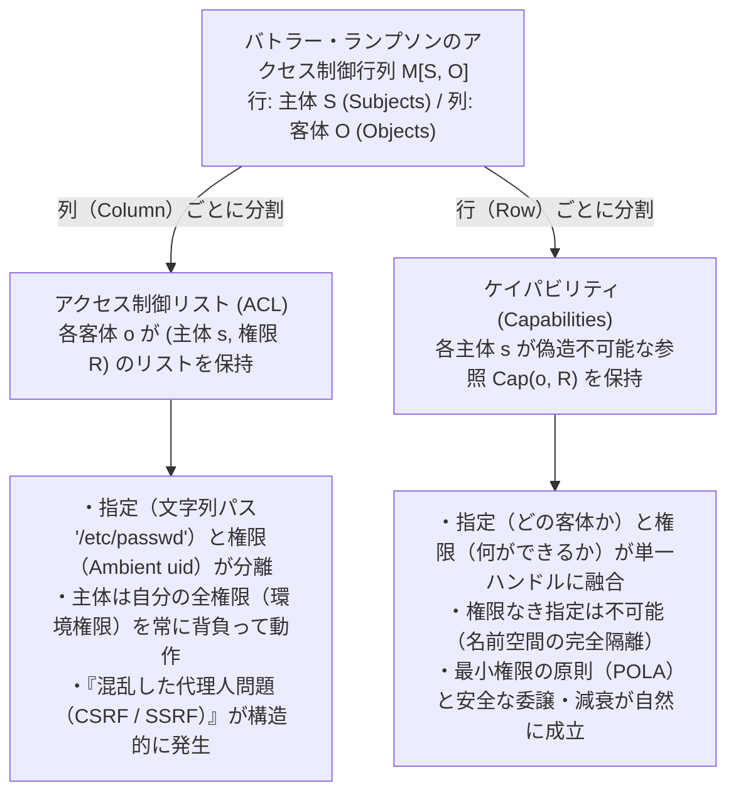
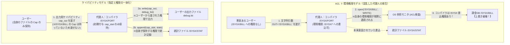

現代のオペレーティングシステムやクラウド基盤、Webアプリケーションにおいて、セキュリティ侵害のニュースが絶えることはない。クロスサイト・リクエスト・フォージェリ（CSRF）、サーバーサイド・リクエスト・フォージェリ（SSRF）、SQLインジェクションやコマンドインジェクション、さらには `npm` や `PyPI` におけるサプライチェーン攻撃——一見するとそれぞれ全く異なる層の脆弱性に見えるこれらの問題の背後には、実は共通するたった一つの構造的欠陥が潜んでいる。

それは、私たちが過去半世紀にわたって当たり前のように採用してきた<strong>「アクセス制御リスト（Access Control List: ACL）」と「環境権限（Ambient Authority）」に基づくセキュリティ設計</strong>そのものである。すなわち、「プログラムやユーザーが<strong>誰であるか（Who you are / Identity）</strong>」によって権限を判定し、対象となるリソースの「指定（Designation）」とそれを操作する「権限（Authority）」を切り離してしまったことにすべての根源がある。

本稿では、この構造的欠陥を根底から解消するもう一つのパラダイム——<strong>「何を持っているか（What you hold）」で権限を決定するケイパビリティ・ベース・セキュリティ（Capability-Based Security）</strong>の理論と実践を徹底的に掘り下げる。バトラー・ランプソンのアクセス制御行列の数理的定式化から、ノーム・ハーディが1988年に提示した古典的名作「混乱した代理人問題（The Confused Deputy Problem）」、マーク・ミラーらによるオブジェクト・ケイパビリティ（OCap）モデル、権限の委譲（Delegation）・減衰（Attenuation）・失効（Revocation）の設計パターン、そして形式検証カーネル seL4、FreeBSD Capsicum、ハードウェア拡張 CHERI / ARM Morello、WebAssembly（WASI）に至る現代の最前線までを体系的に解説する。

---

## 1. 権限の2つのパラダイム：身分証（ACL）とバレットキー（ケイパビリティ）

コンピュータシステムのアクセス制御を理解する上で、まず日常の物理世界における2つの対照的なセキュリティ方式を比較してみよう。

### 方式A：身分証と名簿による入退室管理（ACLモデル）
ある厳重なオフィスビルでは、すべての部屋のドアの前に警備員が立っている。警備員の手元には「この部屋に入ってよい人物の氏名リスト（アクセス制御リスト）」がある。あなたが「302号室の扉を開けてくれ」と要求すると、警備員はあなたの顔写真付き身分証（Identity / `uid`）を確認し、手元の名簿と照合して、名前が載っていれば鍵を開ける。

この方式は一見合理的に見えるが、あなたが部下（代理人プログラム）に「302号室にある『予算案.pdf』を取ってきてくれ」と頼む場面を想像してほしい。部下が302号室に入るには、部下自身にも302号室の入室権限を与えるか、あるいはあなたの身分証を部下に貸与（`setuid` やプロセス権限の継承）しなければならない。もし部下があなたの身分証を借りて302号室に入ったなら、部下は『予算案.pdf』だけでなく、同じ部屋にある『人事評価機密.pdf』や『M&A計画書.pdf』まで自由に閲覧・書き換えできてしまう。

### 方式B：バレットキーによる権限付与（ケイパビリティモデル）
高級ホテルの駐車場で、係員（バレット）に自分の自動車を預ける場面を考えよう。あなたは係員に対して、「ホテルの名簿に自分の車の運転許可者として係員の名前を登録する」といった手続きは行わない。代わりに、<strong>バレットキー（Valet Key）</strong>と呼ばれる特別な物理キーを手渡す。

このバレットキーには、極めて重要な3つの性質が備わっている。
1. <strong>指定と権限の一体化</strong>：そのキーは「どの車か（Designation）」を指し示すと同時に、「エンジンをかけて運転する権限（Authority）」そのものを体現している。警備員が運転手の身分証を確認する必要はない。キーを持っていること自体が正当な権限の証明である。
2. <strong>権限の減衰（Attenuation / 最小権限）</strong>：通常のマスターキーとは異なり、バレットキーではダッシュボードのグローブボックスやトランクを開けることができず、またエンジン制御によって最高速度や走行可能距離が制限されている。つまり、駐車に必要な<strong>最小限の権限（Least Privilege）</strong>だけを切り出して渡すことができる。
3. <strong>偽造不可能性と簡易な委譲（Delegation）</strong>：係員が別の係員に車の移動を引き継ぐときは、名簿を書き換える必要はなく、ただそのバレットキーを手渡すだけでよい。

コンピュータ科学において、方式Aを形式化したものが<strong>アクセス制御リスト（ACL）</strong>であり、方式Bを形式化したものが<strong>ケイパビリティ（Capability）</strong>である。

---

## 2. バトラー・ランプソンのアクセス制御行列 $M[S, O]$ と2つの分割法

1971年、チューリング賞受賞者であるバトラー・ランプソン（Butler Lampson）は、オペレーティングシステムにおけるあらゆる保護機構を統一的に記述する数学的モデルとして<strong>アクセス制御行列（Access Control Matrix）</strong>を提唱した（その後、Harrison, Ruzzo, Ullman による HRU モデルによって形式化された）。

システム内の瞬間的な保護状態は、次の3つ組 $(S, O, M)$ によって定義される。
- <strong>主体（Subjects）の集合 $S = \{s_1, s_2, \dots, s_m\}$</strong>：能動的に操作を行うエンティティ（ユーザー、プロセス、スレッド、ソフトウェアモジュールなど）。
- <strong>客体（Objects）の集合 $O = \{o_1, o_2, \dots, o_n\}$</strong>：保護の対象となるリソース（ファイル、メモリセグメント、ソケット、デバイス、データベーステーブルなど）。なお、プロセス間通信や制御を含めるため、通常 $S \subseteq O$ とみなす。
- <strong>権限（Access Rights）の普遍集合 $\mathcal{R} = \{\mathsf{read}, \mathsf{write}, \mathsf{execute}, \mathsf{append}, \mathsf{own}, \dots\}$</strong>：客体に対して実行可能な操作の集合。
- <strong>アクセス制御行列 $M : S \times O \to 2^{\mathcal{R}}$</strong>：主体 $s \in S$ が客体 $o \in O$ に対して保有する権限の部分集合 $M[s, o] \subseteq \mathcal{R}$ を格納する2次元行列。

例えば、3つの主体 $S = \{\text{Alice}, \text{Compiler}, \text{Logger}\}$ と3つの客体 $O = \{\texttt{src.f}, \texttt{/SYSX/STAT}, \texttt{/SYSX/BILL}\}$ があるとき、アクセス制御行列 $M[S, O]$ は次のように表される。

$$
M[S, O] = \begin{array}{c|ccc}
 & \texttt{src.f} & \texttt{/SYSX/STAT} & \texttt{/SYSX/BILL} \\
\hline
\text{Alice} & \{\mathsf{read}, \mathsf{write}\} & \emptyset & \emptyset \\
\text{Compiler} & \{\mathsf{read}\} & \{\mathsf{append}\} & \{\mathsf{read}, \mathsf{write}\} \\
\text{Logger} & \emptyset & \{\mathsf{read}, \mathsf{write}\} & \emptyset
\end{array}
$$

現実のコンピュータシステムでは、主体 $S$ の数は数千〜数万、客体 $O$（ファイルやメモリオブジェクト）の数は数百万〜数十億に達する。しかも、ほとんどの $(s, o)$ の組において $M[s, o] = \emptyset$ となる極端な疎行列（Sparse Matrix）であるため、この2次元行列 $M$ をそのままメモリ上に保持することは空間計算量 $\mathcal{O}(|S| \times |O|)$ の観点から不可能である。

したがって、システム設計者はこの行列 $M[S, O]$ を<strong>「列（Column）ごとにスライスして客体側に持たせるか」</strong>、それとも<strong>「行（Row）ごとにスライスして主体側に持たせるか」</strong>という根本的な二者択一を迫られる。



### 2.1 列（Column）によるスライス：アクセス制御リスト（ACL）
行列 $M$ を<strong>列方向（客体 $o$ ごと）</strong>に切り出すと、各客体 $o \in O$ に対して「どの主体がどの権限を持つか」のリストが付随する。

$$
\text{ACL}(o) = \bigl\{ (s, M[s, o]) \;\big|\; s \in S,\; M[s, o] \neq \emptyset \bigr\}
$$

UNIX / Linux のファイルパーミッション（`rwxr-xr-x` や POSIX ACL）、Windows NTFS の DACL（Discretionary Access Control List）、AWS IAM のリソースベースポリシーなどはすべてこの列スライス方式に基づいている。

ACL方式には、セキュリティ設計上の重大な特徴がある。それは<strong>「指定（Designation）と権限（Authority）の分離」</strong>である。
1. <strong>グローバル名前空間による指定</strong>：プログラムは `/etc/shadow` や `/SYSX/BILL`、`http://169.254.169.254/` といった<strong>誰でも推測・構築可能な文字列（パブリックな識別子）</strong>を使って対象リソースを指定する。文字列自体は単なるデータであり、何の権限も持たない。
2. <strong>環境権限（Ambient Authority）による認可</strong>：プログラムが `open("/SYSX/BILL", O_WRONLY)` を呼び出すと、カーネル（参照モニタ）は「このプロセスは誰の身分（`euid`）で動いているか？」という<strong>周囲の環境（Ambient）に漂う包括的権限</strong>を参照し、対象ファイルの ACL と照合する。

つまり、ACL システムにおいて主体 $s$ が動作するとき、主体 $s$ は行列 $M$ の行全体に相当するすべての権限 $\bigcup_{o \in O} M[s, o]$ を常に「環境権限（Ambient Authority）」として背負ったまま走っているのである。

### 2.2 行（Row）によるスライス：ケイパビリティ（Capability）
これに対し、ジャック・デニス（Jack B. Dennis）とアール・ヴァン・ホーン（Earl C. Van Horn）が1966年の歴史的論文 *"Programming Semantics for Multiprogrammed Computations"* で提唱したのが、行列 $M$ を<strong>行方向（主体 $s$ ごと）</strong>に切り出す方式である。

$$
\text{CSpace}(s) = \bigl\{ \text{Cap}(o, R) \;\big|\; o \in O,\; R = M[s, o] \neq \emptyset \bigr\}
$$

ここで各要素 $c = \text{Cap}(o, R)$ を<strong>ケイパビリティ（Capability）</strong>と呼ぶ。ケイパビリティとは、<strong>「対象客体 $o$ への参照（Designation）」と「許可された操作集合 $R \subseteq \mathcal{R}$（Authority）」を不可分な単一のトークンとして融合した、偽造不可能なハンドル</strong>である。

ケイパビリティ方式では、グローバルなファイルパス文字列でリソースを開くことはできない。プロセスは自分が保持しているケイパビリティ $c$ を提示して初めて客体 $o$ にアクセスできる（例：`write(c, data)`）。もし主体 $s$ が客体 $o$ へのケイパビリティを保持していなければ、主体 $s$ は客体 $o$ の権限がないだけでなく、<strong>客体 $o$ を指し示す（名前を呼ぶ）ことすらできない</strong>。

| 比較軸 | アクセス制御リスト（ACL：列スライス） | ケイパビリティ（Capability：行スライス） |
| :--- | :--- | :--- |
| <strong>アクセス制御行列 $M[S,O]$ の分割</strong> | 列（客体 $O$）ごとにリストを保持 | 行（主体 $S$）ごとにトークン集合を保持 |
| <strong>判定基準の哲学</strong> | <strong>Who you are</strong>（要求元の主体ID・身分は誰か） | <strong>What you hold</strong>（要求時にどのトークンを提示したか） |
| <strong>指定（Designation）と権限（Authority）</strong> | <strong>分離</strong>（パブリックな文字列パス ＋ 暗黙の環境権限） | <strong>一体化</strong>（参照ハンドル自体が権限を内包する） |
| <strong>権限の作用範囲</strong> | <strong>環境権限（Ambient Authority）</strong>：主体が持つ全権限が常に有効 | <strong>選択的権限（Selective Authority）</strong>：明示的に渡した1つの権限のみ有効 |
| <strong>最小権限の原則（POLA）の粒度</strong> | ユーザー単位・プロセス単位（粗粒度） | 関数呼び出し単位・オブジェクト参照単位（極細粒度） |
| <strong>混乱した代理人問題（CSRF / SSRF）</strong> | <strong>構造的に脆弱</strong>（代理人が自身の環境権限で悪意ある指定を実行） | <strong>構造的に免疫</strong>（依頼者が権限付きハンドルを渡すため偽装不能） |
| <strong>権限の委譲（Delegation）</strong> | 困難（ACLの書き換え権限や管理者の介入が必要） | 容易（ケイパビリティ参照を引数やメッセージで渡すだけ） |
| <strong>権限の減衰（Attenuation）</strong> | 困難（一時的な制限付きサブユーザーの作成はOS上重い） | 容易（ラッパー／ファセットやビットマスクで即座に縮小可能） |
| <strong>監査（Audit）の得意領域</strong> | 「この客体 $o$ にアクセスできる主体は誰か？」の列挙が容易 | 「この主体 $s$ がアクセスできる客体は何か？」の列挙が容易 |
| <strong>代表的な実装系</strong> | UNIX/POSIX 権限、Windows NTFS DACL、Cloud IAM | KeyKOS, EROS, seL4, FreeBSD Capsicum, CHERI, WASI, Hardened JS |

---

## 3. 「混乱した代理人問題（The Confused Deputy Problem）」の解剖

なぜ ACL と環境権限の組み合わせが致命的な脆弱性を生み出すのか。それを最も鮮やかに示したのが、ノーム・ハーディ（Norm Hardy）が1988年に *ACM SIGOPS Operating Systems Review* に発表した古典的論文 <strong>*"The Confused Deputy (or why capabilities might have been invented)"*</strong> である。これはハーディらが1970年代半ばにタイムシェアリングOS（Tymshare社システム）を運用していた際に実際に発生した事件の記録である。

### 3.1 `/SYSX/FORT` コンパイラ事件の経緯
Tymshare のシステムには、`/SYSX` というシステムディレクトリがあり、その中に Fortran コンパイラ `/SYSX/FORT` が配置されていた。
1. <strong>課金統計の記録要件</strong>：システム管理者は、コンパイラの利用統計（どのくらいCPU時間を使ったかなど）を収集するため、コンパイラ `/SYSX/FORT` が実行されるたびに統計記録ファイル `/SYSX/STAT` にデータを追記するように設計した。
2. <strong>環境権限の付与（Home Files License）</strong>：そのための権限として、OSの機能によりプログラムファイル `/SYSX/FORT` に対して「`/SYSX` ディレクトリ内のファイルに対する書き込み権限（Home files license — UNIX における `setuid` やディレクトリのグループ書き込み権限に相当）」が付与された。
3. <strong>ユーザー指定の出力先</strong>：一方、`/SYSX/FORT` コンパイラには、ユーザーがコンパイル時のデバッグ情報やアセンブリリストを出力するためのファイル名を文字列引数として指定できる機能があった（例：`FORT(SRC="myprog.f", OUT="debug.lst")`）。
4. <strong>最重要ファイルの存在</strong>：同じ `/SYSX` ディレクトリ内には、全顧客の課金請求データを管理する最重要ファイル <strong>`/SYSX/BILL`</strong> が存在していた。もちろん、一般ユーザーには `/SYSX/BILL` への書き込み権限は一切なかった。

ある日、悪意ある（あるいは好奇心旺盛な）ユーザーが、コンパイラの出力先ファイル名として <strong>`"/SYSX/BILL"`</strong> という文字列を渡して `/SYSX/FORT` を実行した。何が起きたか？

1. コンパイラ `/SYSX/FORT` は、統計ファイル `/SYSX/STAT` に追記するために `/SYSX` ディレクトリへの環境権限を保持していた。
2. コンパイラはユーザーから受け取った文字列 `"/SYSX/BILL"` を使って、OSに `open("/SYSX/BILL", WRITE)` を要求した。
3. OSのアクセス制御機構（ACL）は、「いま `open` を呼び出している主体（`/SYSX/FORT`）は `/SYSX/BILL` に書き込む権限を持っているか？」を検査した。
4. `/SYSX/FORT` は `/SYSX` ディレクトリへの正当な書き込み権限を持っていたため、OSは要求を<strong>許可</strong>し、結果として<strong>全顧客の課金データベース `/SYSX/BILL` がコンパイラのデバッグ出力によって上書き破壊された</strong>のである！



### 3.2 なぜコンパイラは「混乱した代理人（Confused Deputy）」になったのか？
ここでコンパイラ `/SYSX/FORT` は、<strong>2人の異なる主人（Principal）</strong>に同時に仕える<strong>代理人（Deputy）</strong>として動作していた。
- <strong>システム管理者からの委託</strong>：統計ファイル `/SYSX/STAT` を更新するために、システム側の権限を行使する。
- <strong>起動ユーザーからの委託</strong>：ユーザーが指定した出力ファイルにデバッグリストを書き出すために、ユーザーの代理人として動作する。

しかし、ACL と環境権限のシステムでは、プロセスが `open()` システムコールを発行した瞬間、<strong>「その `open()` がシステム管理者の意図（統計記録）で行われたのか、それともユーザーの意図（デバッグ出力）で行われたのか」を区別する手段が存在しない</strong>。プロセスが持つすべての権限が単一の「環境権限（Ambient Authority）」というバケツにごちゃ混ぜにされており、ユーザーが渡したただの文字列 `"/SYSX/BILL"` に対して、コンパイラ自身の特権が自動的に適用されてしまったのである。

### 3.3 ACLの枠内で「混乱した代理人」を解決しようとする試みの破綻
この問題に対し、ACL 擁護派はしばしば次のような対策を提案するが、それらはすべて構造的な限界に突き当たる。

1. <strong>「コンパイラが `open()` する前に、呼び出し元ユーザーの権限を手動でチェックすればよい（`access()` システムコール）」</strong>
   - 第一に、すべてのアプリケーション開発者がすべてのファイル操作箇所で漏れなく権限検査コードを書くことを前提にしており、1箇所でも忘れると脆弱性になる。
   - 第二に、UNIX の `access()` と `open()` の間には古典的な <strong>TOCTOU（Time-of-Check to Time-of-Use）競合状態</strong>が存在する。`access("/tmp/out")` で検査した直後、`open("/tmp/out")` が実行されるまでの数マイクロ秒の間に、攻撃者が `/tmp/out` を `/SYSX/BILL` へのシンボリックリンクに差し替えれば検査は突破される。
2. <strong>「ファイルを開くときだけ一時的に実効ユーザーID（`seteuid`）を呼び出し元ユーザーに降格させればよい」</strong>
   - では、代理人プロセス $D$ がネットワークデーモンやデータベースサーバであり、<strong>クライアント $A$ とクライアント $B$ の双方からファイルパスを受け取って同時に処理しつつ、自身のログファイル $L$ にも書き込む</strong>場合はどうなるか？
   - 単一のプロセス空間やスレッドの `euid` を切り替える方式では、「引数1は主体 $A$ の権限で、引数2は主体 $B$ の権限で、内部状態3は主体 $D$ の権限でアクセスする」という<strong>複数の権限コンテキストの合成（Composition）</strong>を安全に表現することができない。

### 3.4 ケイパビリティによる根本的解決
ケイパビリティ・ベース・セキュリティでは、この問題は最初から存在し得ない。
1. コンパイラ `/SYSX/FORT` には、インストール時に `/SYSX` ディレクトリ全体の権限ではなく、統計ファイル単体への追記専用ケイパビリティ $c_{\text{stat}} = \text{Cap}(\texttt{/SYSX/STAT}, \{\mathsf{append}\})$ だけが初期付与（Endowment）される。
2. ユーザーがコンパイラを起動する際、ユーザーはファイル名の文字列を渡すのではなく、<strong>ユーザー自身の権限で開いた出力用ファイルの書き込みケイパビリティ $c_{\text{out}} = \text{Cap}(f_{\text{out}}, \{\mathsf{write}\})$</strong> を引数としてコンパイラに渡す。
3. コンパイラは、デバッグ出力を書くときはユーザーから渡された $c_{\text{out}}$ に対して `write(c_out, ...)` を呼び、統計を書くときは自身が最初から持っている $c_{\text{stat}}$ に対して `append(c_stat, ...)` を呼ぶ。

ユーザーは `/SYSX/BILL` へのケイパビリティをそもそも持っていないため、偽造してコンパイラに渡すことは不可能である。また、コンパイラは受け取ったケイパビリティ $c_{\text{out}}$ をそのまま使うだけであり、「どの権限を使って開くべきか」と悩む（混乱する）余地自体が完全に消滅する。これが<strong>「指定と権限の一体化（No Designation Without Authority）」</strong>の威力である。

### 3.5 現代の脆弱性はすべて「混乱した代理人」の変種である
ハーディが1988年に指摘したこの構造は、40年後の現代のセキュリティ脆弱性そのものである。

- <strong>クロスサイト・リクエスト・フォージェリ（CSRF）</strong>：
  Webブラウザこそが現代最大の「混乱した代理人」である。あなたが銀行サイト `bank.example` にログインすると、ブラウザは認証Cookieを保持する。その後、罠サイト `evil.example` を閲覧し、そのページ内のスクリプトが `<form action="https://bank.example/transfer" method="POST">` を自動送信したとする。ブラウザ（代理人）は、要求元が `evil.example` であるにもかかわらず、宛先URL文字列が `bank.example` であるというだけで、<strong>自身が保持する環境権限（`bank.example` のセッションCookie）を自動的に付与して送信してしまう</strong>。CSRFトークンやケイパビリティURLが有効なのは、環境権限に頼らず「そのフォーム自身が正当な権限トークンを保持しているか」を検証しているからに他ならない。
- <strong>サーバーサイド・リクエスト・フォージェリ（SSRF）</strong>：
  クラウド上のWebアプリケーション（代理人）が、ユーザーから「アイコン画像のURL」として文字列 `"http://169.254.169.254/latest/meta-data/iam/security-credentials/"` を受け取る。WebサーバはVPC内部ネットワークおよびインスタンスメタデータサービス（IMDSv1）への<strong>環境権限（ネットワーク到達性）</strong>を持っているため、攻撃者が指定したURL文字列に対して自身の環境権限を使ってアクセスし、AWSのIAM一時認証情報を盗み出してしまう。
- <strong>サプライチェーン攻撃（`npm` / `PyPI` パッケージの暴走）</strong>：
  あなたがNode.jsやPythonのプログラムで、日付を整形するだけの外部ライブラリ `format-date` を `import` したとする。POSIX OS（ACLモデル）では、プロセス内のすべての関数が<strong>あなたのユーザーID（`uid=1000`）という広大な環境権限</strong>を共有している。その結果、たかが文字列整形関数が裏で `fs.readFileSync("~/.ssh/id_rsa")` や `process.env.AWS_SECRET_ACCESS_KEY` を読み取り、外部サーバへ送信することが完全に許可されてしまう。もし関数が「引数として渡された文字列オブジェクト」以外のケイパビリティを一切持たない設計（オブジェクト・ケイパビリティ）であれば、外部パッケージがファイルシステムやネットワークに触れることは物理的に不可能である。

---

## 4. オブジェクト・ケイパビリティ（OCap）モデルと最小権限の原則（POLA）

1975年、ジェローム・サルツァー（Jerome H. Saltzer）とマイケル・シュローダー（Michael D. Schroeder）は、有名な論文 *"The Protection of Information in Computer Systems"* において<strong>最小権限の原則（Principle of Least Privilege / Principle of Least Authority: POLA）</strong>を定義した。

> <strong>最小権限の原則（POLA）</strong>：システムのすべてのプログラムおよびすべてのユーザーは、そのジョブを完了するために必要な最小限の権限集合（Least Privilege）のみを用いて動作すべきである。

ACLモデルでは、「ユーザー」や「プロセス」という巨大な単位でしか権限を割り当てられないため、真の意味での POLA を達成することはできない。これに対し、2000年代にマーク・S・ミラー（Mark S. Miller）、ジョナサン・シャピロ（Jonathan S. Shapiro）らが確立した<strong>オブジェクト・ケイパビリティ（Object-Capability: OCap）モデル</strong>は、OSカーネルだけでなく<strong>プログラミング言語のオブジェクト参照そのものをケイパビリティとして扱う</strong>ことで、関数呼び出し・オブジェクト単位での究極の POLA を実現した。

### 4.1 オブジェクト参照はすでにケイパビリティである
メモリ安全なオブジェクト指向言語（Java, JavaScript, Python, Rust などのセーフサブセット）における「オブジェクトへの参照（ポインタ）」を考えてみよう。もし言語処理系が以下の3つの不変条件（OCap Invariants）を満たすならば、<strong>オブジェクト参照 $r$ はそのまま数学的に厳密なケイパビリティ $\text{Cap}(o, R)$ になる</strong>。

1. <strong>参照の偽造不可能性（No Forged References）</strong>：整数からのキャスト（`(Object*)0x7fff0040`）やポインタ演算によって任意のオブジェクト参照を合成することはできない。
2. <strong>可変なグローバル状態の排除（No Mutable Global State / No Ambient Authority）</strong>：どこからでもアクセス可能な可変のグローバル変数や、インポートするだけで使える `fs`（ファイルシステム）・`net`（ネットワーク）モジュールが存在しない。共有される組み込みオブジェクト（`Array.prototype` や `Math` など）はすべて完全に凍結（Deeply Frozen / Immutable）されており、情報伝達や権限取得の抜け道にならない。
3. <strong>カプセル化の絶対性（Absolute Encapsulation）</strong>：オブジェクトのプライベートな状態（レキシカルクロージャ内の変数やプライベートフィールド）は、リフレクションやデバッガAPIによって外部から覗き見たり書き換えたりすることができない。

この3条件が成立する世界では、あるオブジェクト $A$ が別のオブジェクト $C$ のメソッドを呼び出すためには、<strong>$A$ が $C$ へのオブジェクト参照を保持していること</strong>が絶対条件となる。参照を持っていなければ、$C$ の存在を知ることすらできない。

### 4.2 権限伝播の3法則（Granovetter Diagram / Connectivity by Introduction）
OCap モデルにおいて、オブジェクト間の参照グラフ $G = (V, E)$ がどのように変化し得るかを厳密に規定するのが、マーク・ミラーが社会学者マーク・グラノヴェッターのネットワーク理論になぞらえて定式化した<strong>「紹介による接続（Connectivity by Introduction）」の3法則</strong>である。

主体 $A$ が客体 $C$ への新しいケイパビリティ（有向辺 $A \to C$）を獲得する方法は、システム全体を通じて<strong>以下の3通りしか存在しない</strong>。

1. <strong>生成（Parenthood / Creation）</strong>：
   $A$ 自身が新しいオブジェクト $C$ を生成（`const c = new C()`）したとき、親である $A$ は生まれたばかりの $C$ への初期ケイパビリティを獲得する。
2. <strong>初期付与（Endowment）</strong>：
   創造主 $B$ がすでに $C$ へのケイパビリティ（$B \to C$）を保持しており、$B$ が新しい主体 $A$ を生成する際、レキシカルスコープ（クロージャ変数）やコンストラクタ引数を通じて $A$ に $C$ を初期状態で持たせる。
3. <strong>紹介・委譲（Introduction / Delegation）</strong>：
   仲介者 $B$ が、$A$ へのケイパビリティ（$B \to A$）と $C$ へのケイパビリティ（$B \to C$）の<strong>両方</strong>をすでに保持しているとき、$B$ が $A$ にメッセージを送って引数として $C$ を渡す（`a.send(c)`、あるいは $A$ が $B$ を呼び出した戻り値として $C$ を受け取る）。

$$
\text{Introduction Rule}: \quad (B \to A) \;\land\; (B \to C) \;\;\Longrightarrow\;\; B \text{ can establish } (A \to C)
$$

この3法則から、セキュリティ検証における極めて強力な定理が導かれる。すなわち、<strong>「初期状態において参照グラフ上で連結していない（あるいは権限を媒介する共通の仲介者を持たない）2つのサブグラフは、いかなるコードを実行しようとも未来永劫、互いに干渉することもケイパビリティを交換することもできない」</strong>という性質（Confinement / 封じ込め）である。

---

## 5. 委譲・減衰・失効の設計パターン：ケイパビリティへの誤解を解く

ケイパビリティ・ベース・セキュリティに対しては、古くから教科書的な批判が繰り返されてきた。それは、
> 「ケイパビリティは誰かに渡す（委譲する）のが簡単すぎるため、一度渡した権限を後から制限（減衰）したり、取り消したり（失効：Revocation）することができないのではないか？」

という疑問である。しかし、この批判は1974年のデヴィッド・レデル（David D. Redell）の博士論文およびマーク・ミラーらの OCap パターンによって<strong>完全に論破されている</strong>。それどころか、ケイパビリティモデルの方が ACL モデルよりもはるかに柔軟かつ軽量に権限の減衰（Attenuation）と失効（Revocation）を実現できる。実際のコードでその仕組みを確認しよう。

### 5.1 ファセット（Facet）パターンによる権限の減衰（Attenuation）
あなたがディレクトリ操作のフル権限を持つケイパビリティ `fullDirCap`（読み取り・書き込み・削除が可能）を持っているとする。いま、外部製のプラグイン関数 `renderMarkdown(sourceCap, outputCap)` を呼び出したいが、このプラグインには<strong>「特定ファイルの読み取り権限」と「最大1MBまでの追記専用権限」だけ</strong>を与え、ファイルの削除や他ファイルの閲覧は絶対に許したくない。

OCap モデルでは、元のケイパビリティをレキシカルクロージャ（またはプライベートフィールド）の中に閉じ込め、許可したいメソッドだけを転送（Forwarding）する軽量なラッパーオブジェクト——<strong>ファセット（Facet：切り子面）</strong>を作るだけで、わずか数行で権限を減衰できる。

```javascript
// 1. 読み取り専用ファセット（Read-Only Attenuation Facet）の生成
function makeReadOnlyFileCap(fullFileCap) {
  // クロージャ内に fullFileCap を隠蔽し、read メソッドのみを公開・凍結する
  return Object.freeze({
    read(offset, length) {
      return fullFileCap.read(offset, length);
    }
    // write() や delete() メソッドは最初から存在しない！
  });
}

// 2. 容量クォータ付き追記専用ファセット（Quota-Limited Append Facet）の生成
function makeQuotaAppendCap(fullFileCap, maxBytes) {
  let bytesWritten = 0;
  return Object.freeze({
    append(chunk) {
      const byteLen = Buffer.byteLength(chunk, "utf8");
      if (bytesWritten + byteLen > maxBytes) {
        throw new Error(`Quota exceeded: limit is ${maxBytes} bytes`);
      }
      bytesWritten += byteLen;
      return fullFileCap.append(chunk);
    },
    getRemainingQuota() {
      return maxBytes - bytesWritten;
    }
  });
}
```

ここで生成された `readOnlyCap = makeReadOnlyFileCap(secretFile)` は、元の `secretFile` とは異なる独立したオブジェクト参照（ケイパビリティ）である。プラグインに `readOnlyCap` を渡しても、JavaScript のクロージャのカプセル化により、プラグインが内部の `fullFileCap` を取り出して `delete()` を呼ぶことは理論的に不可能である。OSカーネルに頼ることなく、アプリケーション開発者が任意のビジネスロジック（クォータ制限、レート制限、特定拡張子のフィルタリングなど）を伴う最小権限をナノ秒単位で生成できるのである。

### 5.2 Caretaker（管理人）パターンによる権限の即時失効（Revocation）
では、一度プラグインや別モジュールに渡したケイパビリティを、後から<strong>失効（Revoke）</strong>させるにはどうすればよいか？ デヴィッド・レデルが1974年に考案した<strong>Caretaker（管理人）パターン</strong>は、対象オブジェクトの前に「開閉可能なゲート」を挟むことでこれを解決する。

```javascript
// Redell (1974) の Caretaker パターンによる失効可能なケイパビリティの生成
function makeRevocableCap(targetCap) {
  let currentTarget = targetCap; // クロージャ内の可変参照（失効時に null 化される）

  // Bob（委譲先）に渡す転送プロキシ（Caretaker）
  const caretaker = Object.freeze({
    read(...args) {
      if (currentTarget === null) {
        throw new Error("Capability has been revoked");
      }
      return currentTarget.read(...args);
    },
    write(...args) {
      if (currentTarget === null) {
        throw new Error("Capability has been revoked");
      }
      return currentTarget.write(...args);
    }
  });

  // Alice（権限付与者）が手元に保持する失効スイッチ（Revoker Facet）
  const revoker = Object.freeze({
    revoke() {
      currentTarget = null; // ターゲットへの参照を切断（ガベージコレクション対象にもなる）
    },
    isRevoked() {
      return currentTarget === null;
    }
  });

  return { caretaker, revoker };
}

// --- 使用例 ---
// Alice は Bob に直接 fileCap を渡さず、caretaker を渡す
const { caretaker: bobFileCap, revoker: aliceRevoker } = makeRevocableCap(fileCap);
bobPlugin.process(bobFileCap);

// 処理完了後（あるいは異常検知時）、Alice が手元の revoker を叩くだけで即座に失効！
aliceRevoker.revoke();
// これ以降、Bob（および Bob が bobFileCap をさらに転売・委譲した第三者 Carol）による
// あらゆるアクセスは即座に "Capability has been revoked" となる。
```

### 5.3 メンブレン（Membrane：膜）パターンによる推移的失効
単純な Caretaker パターンには一つだけ注意点がある。もし `bobFileCap` が単なるファイルではなくディレクトリであり、失効前に Bob が `const subFile = bobDirCap.openSubFile("data.txt")` を呼び出して<strong>戻り値として別のオブジェクト参照 `subFile` を取得し、手元にキャッシュしていた場合</strong>はどうなるか？ その後で親の `bobDirCap` だけを失効させても、Bob がキャッシュした `subFile` が生の参照であればアクセスが続いてしまう。

これを完全に防ぐのが、マーク・ミラーらが定式化した<strong>メンブレン（Membrane：境界膜）パターン</strong>である。JavaScript の `Proxy` と `WeakMap` を用いることで、Caretaker のメソッド呼び出しから返される<strong>すべての戻り値（子オブジェクトやコールバック）も自動的に同じ失効ゲートで再帰的にラップ（Transitive Wrapping）</strong>する。

```javascript
// メンブレン（Membrane）による推移的（Transitive）な失効機構
function makeRevocableMembrane(initialTarget) {
  let revoked = false;
  const rawToWrapped = new WeakMap();

  function wrap(obj) {
    if (obj === null || (typeof obj !== "object" && typeof obj !== "function")) {
      return obj; // プリミティブ値はそのまま返す
    }
    if (rawToWrapped.has(obj)) {
      return rawToWrapped.get(obj);
    }
    const proxy = new Proxy(obj, {
      get(target, prop, receiver) {
        if (revoked) throw new Error("Membrane has been revoked");
        const value = Reflect.get(target, prop, target);
        return wrap(value); // 取得したプロパティやメソッドも自動的に膜で包む
      },
      apply(target, thisArg, argArray) {
        if (revoked) throw new Error("Membrane has been revoked");
        // メソッド実行結果（子オブジェクトのケイパビリティなど）も自動的に膜で包む！
        const result = Reflect.apply(target, thisArg, argArray);
        return wrap(result);
      }
    });
    rawToWrapped.set(obj, proxy);
    return proxy;
  }

  return Object.freeze({
    membraneCap: wrap(initialTarget),
    revoke() {
      revoked = true;
    }
  });
}
```

メンブレンを使えば、Bob がディレクトリからサブディレクトリを辿り、そこからファイルを100個開き、さらにそれらを別のプラグイン Carol に委譲していたとしても、Alice が手元の `revoke()` を1回呼び出した瞬間、<strong>膜の外側へ流出したすべての派生ケイパビリティが一斉に機能を停止する</strong>。

### 5.4 Sealer / Unsealer（封印と開封）による権限増幅（Rights Amplification）
ジェームズ・モリス（James H. Morris）が1973年に提唱した<strong>Sealer / Unsealer（封印器と開封器）</strong>は、暗号技術を使わずにオブジェクト参照だけで公開鍵暗号のような「封筒」を実現するプリミティブである。

`makeBrandPair()` を呼び出すと、対になる `(sealer, unsealer)` の2つのケイパビリティが生成される。
- `const box = sealer.seal(secretObj)`：任意のオブジェクト `secretObj` を中身の見えない不透明な箱 `box` に封印する。`box` 自体は何のメソッドも持たないため、信頼できない仲介ネットワークや第三者に安全に預けることができる。
- `const obj = unsealer.unseal(box)`：対になる `unsealer` ケイパビリティを持っている主体だけが、`box` から元の `secretObj` を取り出すことができる。

これは<strong>権限の増幅（Rights Amplification）</strong>——すなわち「箱 `box` のケイパビリティ」単体では何もできないが、「`box`」と「`unsealer`」の2つのケイパビリティが揃ったときに初めて中身の権限が解放されるという高次のセキュリティ制御を可能にする。

---

## 6. 現代のシステムにおけるケイパビリティの実装：カーネル・半導体・WASI・クラウド

ケイパビリティ・ベース・セキュリティは決して理論上の理想論ではない。1970〜80年代の Hydra、CAP、KeyKOS（Norm Hardy が開発）、EROS といった先駆的OSの知見を受け継ぎ、現在では<strong>形式検証マイクロカーネル、商用UNIX、最新CPUアーキテクチャ、WebAssembly、クラウド分散認証</strong>の中核技術として広く実用化されている。

### 6.1 OSカーネルにおけるケイパビリティ：seL4、FreeBSD Capsicum、Fuchsia Zircon

#### 注意：Linux の `capabilities(7)` は「ケイパビリティ」ではない
まず重要な用語の混乱を正しておこう。Linux カーネルには `CAP_NET_ADMIN` や `CAP_SYS_ADMIN`、`CAP_CHOWN` といった「POSIX Capabilities（Linux Capabilities）」と呼ばれる機能がある。しかし、これは従来のスーパーユーザー（`root`, `uid=0`）が持っていた巨大な環境権限を約40個のビットフラグに分割しただけの<strong>「スレッド単位の粗粒度な環境特権（Thread Privileges）」</strong>であり、ランプソンやデニス＆ヴァン・ホーンが定義した「特定の客体 $o$ と権限 $R$ を結びつけるオブジェクト・ケイパビリティ」ではない。例えば `CAP_DAC_READ_SEARCH` を持つプロセスは、依然としてシステム内の<strong>あらゆるファイル</strong>を文字列パスで開くことができるため、混乱した代理人問題を一切防げない。

真のオブジェクト・ケイパビリティをカーネルレベルで実装しているのは、以下の3つのシステムである。

#### 1. seL4 マイクロカーネル（形式検証されたCSpace）
<strong>seL4</strong> は、オーストラリアの NICTA（現 Data61）が開発した、世界初の数学的に完全な形式検証（Isabelle/HOL による実装の正しさ・到達可能性・機密性・完全性の定理証明）を受けたマイクロカーネルであり、航空宇宙・防衛・自動運転システムで採用されている。
- seL4 では、カーネル内のすべてのリソース（スレッド制御ブロック TCB、仮想アドレス空間 VSpace、プロセス間通信 Endpoint、物理メモリページ Frame、割り込み IRQ）が<strong>ケイパビリティを介してのみ操作可能</strong>である。
- ユーザー空間のプロセスは直接ポインタを持たず、カーネル空間内の <strong>CNode（Capability Node）</strong> と呼ばれるテーブル群（<strong>CSpace</strong>）のスロット番号を指定してシステムコールを発行する。
- `seL4_CNode_Mint` システムコールにより、権限ビットマスク（Read/Write/Grant）を縮小したり識別用のバッジ（Badge）を付与した派生ケイパビリティを生成（減衰・委譲）できる。また、カーネル内部で<strong>ケイパビリティ派生木（Capability Derivation Tree: CDT）</strong>を追跡しており、`seL4_CNode_Revoke` を呼べば派生した子孫ケイパビリティをO(部分木サイズ)で完全に失効できる。

#### 2. FreeBSD Capsicum（ファイル記述子を真のケイパビリティへ昇華）
ロバート・ワトソン（Robert N. M. Watson）とベン・ローリー（Ben Laurie）らが2010年に開発し FreeBSD 9.0 以降に標準搭載された <strong>Capsicum</strong> は、「既存の UNIX / POSIX アプリケーションを最小限の変更でケイパビリティ化する」という極めて実用的な傑作である。
- UNIX には元々、ケイパビリティに非常に近い概念が存在していた。それが<strong>ファイル記述子（File Descriptor: `fd`）</strong>である。`fd` はプロセスごとのカーネル内テーブルへのインデックスであり、偽造不可能で、`SCM_RIGHTS`（UNIXドメインソケット）を通じて他プロセスへ委譲できる。
- しかし従来の UNIX では、プロセスがいつでも `open("/etc/passwd")` のようにグローバル名前空間へアクセスできたため、`fd` の良さが台無しになっていた。
- Capsicum では、プロセスが初期化を終えた後に <strong>`cap_enter()`</strong> システムコールを1回呼び出すだけで、そのプロセス（および以降に `fork` される全子プロセス）は不可逆的に<strong>ケイパビリティモード（Capability Mode）</strong>へ移行する。
- ケイパビリティモードに入った瞬間、<strong>グローバルな名前空間を参照するすべてのシステムコール（`open()`, `connect()`, `bind()`, `chmod()`, `execve()` など）がカーネルによって無条件に拒否（`ECAPMODE` エラー）される</strong>！
- プロセスは、`cap_enter()` の前に事前に開いておいたファイル記述子（またはソケット経由で渡された記述子）だけを使って動作する。ディレクトリ記述子 `dir_fd` に対しては `openat(dir_fd, "sub/file.txt", ...)` のみが許可され、`..` による上位ディレクトリへの脱出はカーネルが厳格に遮断する。さらに <strong>`cap_rights_limit(fd, &rights)`</strong> によって、`CAP_READ`, `CAP_WRITE`, `CAP_SEEK`, `CAP_FSTAT`, `CAP_IOCTL` など60種類以上の細粒度な操作権限ビットマスクへと不可逆的に減衰させることができる。`tcpdump` や `dhclient`、`gzip`、Chromium サンドボックスなどがこの仕組みで保護されている。

#### 3. Google Fuchsia OS（Zircon カーネル）
Google がゼロから設計した次世代OS <strong>Fuchsia</strong> のマイクロカーネル <strong>Zircon</strong> は、POSIX 互換性を捨てた純粋なケイパビリティベースOSである。ファイルシステムやネットワークスタックすらカーネル外にあり、すべてのリソースは <strong>Handle（ハンドル）</strong> と呼ばれる32ビットのケイパビリティ（`ZX_RIGHT_READ`, `ZX_RIGHT_WRITE`, `ZX_RIGHT_DUPLICATE`, `ZX_RIGHT_TRANSFER` などの権限マスク付き）によって参照される。Fuchsia には「グローバルなルートファイルシステム `/`」という概念自体が存在せず、各コンポーネントは親から Channel 経由で渡されたディレクトリハンドルだけの名前空間（Namespace）の中で動作する。

### 6.2 ハードウェア（半導体）によるケイパビリティ：CHERI と ARM Morello
ソフトウェアやOSカーネルだけでなく、<strong>CPUの命令セットアーキテクチャ（ISA）とメモリ回路そのものをケイパビリティ化する</strong>壮大なプロジェクトが、ケンブリッジ大学と SRI International が主導し ARM 社がプロトタイプチップ <strong>ARM Morello</strong> として実装した <strong>CHERI（Capability Hardware Enhanced RISC Instructions）</strong> である。

C / C++ 言語におけるメモリ安全性の欠如（バッファオーバーフロー、Use-After-Free、任意の整数からポインタへのキャスト）は、CPUが「単なる64ビット整数（アドレス指定）」をそのまま「メモリアクセス権限」として扱ってしまうことに起因している。CHERI は、CPUレジスタおよびメモリ上のすべてのポインタを <strong>128ビットのハードウェア・ケイパビリティ ＋ 1ビットの帯域外タグ（Tag Bit）</strong> に置き換える。

$$
\underbrace{\text{Tag (1 bit)}}_{\text{ハードウェア有効性ビット（メモリECC領域等で管理）}} \;\Big|\; \underbrace{\text{Permissions (18 bits)}}_{\text{Load / Store / Execute / Cap}} \;\Big|\; \underbrace{\text{Object Type (18 bits)}}_{\text{Sealing 用識別子}} \;\Big|\; \underbrace{\text{Compressed Bounds (28 bits)}}_{\text{下限 Base と上限 Top の浮動小数点圧縮}} \;\Big|\; \underbrace{\text{Address Cursor (64 bits)}}_{\text{現在の仮想メモリアドレス}}
$$

CHERI アーキテクチャは、シリコン回路レベルで以下の3つの絶対規則（ハードウェア不変条件）を強制する。
1. <strong>境界検査（Bounds Checking in Silicon）</strong>：ポインタ（ケイパビリティレジスタ `c0`〜`c31`）を経由してロード／ストア／命令フェッチを行う際、CPUは1クロックサイクル内で現在の64ビットアドレスが `[Base, Top)` の範囲内に収まっているか、および Permissions ビットが該当操作を許可しているかを並列検査する。1バイトでも範囲外に出れば即座にハードウェア例外が発生し、バッファオーバーフローは物理的に不可能になる。
2. <strong>タグによる偽造防止（Provenance Validity Tag）</strong>：128ビットのケイパビリティごとに、プログラマが直接書き換えることのできない <strong>1ビットの有効性タグ（Tag Bit）</strong> が物理DRAM上で紐づけられている。正当なケイパビリティ命令によって既存の有効なケイパビリティから派生した場合のみ `Tag = 1` が維持される。もし攻撃者が整数ストア命令（`str x0, [sp]`）でメモリ上のポインタ値を1バイトでも書き換えようとすると、<strong>メモリコントローラが自動的に `Tag = 0` にクリア</strong>し、そのポインタをデリファレンスした瞬間にCPUがトラップする。
3. <strong>単調減少性（Monotonicity）</strong>：ハードウェア命令（`CSetBounds`, `CAndPerm`）は、既存のケイパビリティの境界 `[Base, Top)` を<strong>狭めること（減衰）</strong>や権限ビットを<strong>削ること</strong>はできるが、決して広げることはできない。例えば `malloc(64)` はヒープ全体のケイパビリティから 64バイトの境界に縮小したケイパビリティを返すため、呼び出し元が隣接するヒープチャンクを破壊することはハードウェア的に起こり得ない。

### 6.3 WebAssembly（WASI）、Hardened JavaScript、分散トークン Macaroons

#### 1. WASI（WebAssembly System Interface）
クラウドエッジやプラグイン基盤として普及している <strong>WebAssembly（Wasm）</strong> とその標準システムインターフェース <strong>WASI</strong> は、設計当初から明確にケイパビリティ・ベース・セキュリティを採用している。
- Wasm モジュールは、線形メモリ（Linear Memory）のサンドボックス内に完全に隔離されており、起動直後はファイルシステムやソケットへの環境権限を<strong>ゼロ（一切持たない状態）</strong>で開始する。
- Wasm バイナリ内のC言語コードが `fopen("/etc/passwd", "r")` を呼んだとしても、WASI ランタイム（Wasmtime など）が明示的に `--dir /sandbox/data` のように<strong>事前オープンされたディレクトリのケイパビリティ記述子（Pre-opened Directory Capability）</strong>をモジュールに注入（Endowment）していない限り、そのパスは存在しないものとして拒否される。WASI Preview 2（Component Model）では、インターフェース記述言語 WIT においてすべての外部リソースが型付きのケイパビリティハンドル（Resource Handle）として表現される。

#### 2. Hardened JavaScript（SES: Secure EcmaScript）
マーク・ミラーらが TC39（JavaScript 標準化委員会）で推進している <strong>Hardened JavaScript（SES）</strong> は、`lockdown()` 関数によって `Object.prototype` や `Array.prototype` などのすべての組み込みオブジェクト（Intrinsics）を完全に凍結し、`Compartment` API によってサードパーティの `npm` パッケージを環境権限ゼロの独立空間に閉じ込める技術である。暗号資産ウォレットの <strong>MetaMask（LavaMoat / MetaMask Snaps）</strong> や <strong>Agoric</strong> ブロックチェーンでは、数千個の外部 npm パッケージそれぞれに対して「このパッケージには `fetch` の減衰ファセットだけを渡す」「このパッケージには純粋計算のみを許可し I/O ケイパビリティは一切渡さない」という制御を同一 JavaScript エンジン内で高速に実行し、サプライチェーン攻撃を無力化している。

#### 3. 分散システムにおける暗号学的ケイパビリティ：Macaroons と Biscuit
マイクロサービスやクラウドAPIにおいて、単なる OAuth 2.0 の Bearer トークンを進化させた暗号学的ケイパビリティが、Google が2014年の論文 *"Macaroons: Cookies with Contextual Caveats for Decentralized Authorization in the Cloud"* で発表した <strong>Macaroons（マカロン）</strong> である。
- Macaroon は、HMAC（鍵付きハッシュ関数）の連鎖（Nested HMAC Chain）によって構成される自己完結型のケイパビリティトークンである。
- 認可サーバは秘密鍵 $K_{\text{root}}$ と識別子 $\text{id}$ から初期署名 $m_0 = \text{HMAC}(K_{\text{root}}, \text{id})$ を生成してクライアントに渡す。
- クライアントが別のマイクロサービスやワーカーに権限を委譲する際、クライアントは<strong>認可サーバに一切問い合わせることなく（オフラインで）</strong>、自身のトークンに制限条件（Caveat：例 `op = read` や `time < 2026-10-15T00:00Z`、`path_prefix = /user/alice/public/`）を追記し、手元のトークン末尾のハッシュ値 $m_{k-1}$ を鍵として新しい署名 $m_k = \text{HMAC}(m_{k-1}, \text{caveat}_k)$ を計算し、古い $m_{k-1}$ を破棄する！

$$
m_0 = \operatorname{HMAC}(K_{\text{root}}, \text{id}), \quad m_1 = \operatorname{HMAC}(m_0, \text{caveat}_1), \quad \dots, \quad m_k = \operatorname{HMAC}(m_{k-1}, \text{caveat}_k)
$$

- cryptographic な一方向性により、委譲を受けたワーカーはさらに厳しい制限（$\text{caveat}_{k+1}$）を追加して再委譲（減衰）することは自由にできるが、<strong>既存の制限条件 $\text{caveat}_k$ を削除して元の広い権限 $m_{k-1}$ に戻すことは数学的に不可能</strong>である。この設計思想は現在、公開鍵署名を用いた次世代トークン規格 <strong>Biscuit</strong> や W3C の <strong>ZCAP-LD（Authorization Capabilities for Linked Data）</strong> へと受け継がれている。

| 実装システム / 技術 | 適用レイヤ | ケイパビリティの実体（表現形式） | 権限の減衰（Attenuation）機構 | 権限の失効（Revocation）機構 |
| :--- | :--- | :--- | :--- | :--- |
| <strong>seL4 Microkernel</strong> | OSカーネル | カーネル空間 `CNode`（CSpace）内のスロット参照 | `seL4_CNode_Mint` による権限マスク縮小・Badge付与 | 派生木（CDT）を辿る `seL4_CNode_Revoke` |
| <strong>FreeBSD Capsicum</strong> | UNIX OSカーネル | 60種超の権限ビットマスク付きファイル記述子 `fd` | `cap_rights_limit(fd, &rights)` による不可逆マスク縮小 | `close(fd)` またはソケット/プロキシの切断 |
| <strong>CHERI / ARM Morello</strong> | CPU命令セット・半導体 | 128ビット境界・権限付きポインタ ＋ 1ビット有効性タグ | `CSetBounds` / `CAndPerm` 命令によるハードウェア単調縮小 | メモリタグのクリア、またはスイープ処理 |
| <strong>WebAssembly (WASI)</strong> | 仮想マシン・ランタイム | ホストから注入されたリソースハンドルテーブルのインデックス | ホスト側ラッパー関数および WIT インターフェース制限 | ホスト側のハンドルテーブルからのエントリ破棄 |
| <strong>Hardened JS (SES)</strong> | プログラミング言語処理系 | 凍結された環境内のオブジェクト参照（クロージャ） | ファセット（Facet）ラッパーオブジェクトの生成 | Caretaker / Membrane（`Proxy` + `WeakMap`） |
| <strong>Google Macaroons</strong> | 分散システム・Web API | 連鎖HMACタグ $m_k$ と制限条件リスト（Caveats） | 末尾ハッシュ $m_{k-1}$ を鍵とした新規 Caveat のHMAC連鎖追記 | 有効期限 Caveat またはサードパーティ Discharge 検証 |

---

## 7. 結論：日常のソフトウェア設計にケイパビリティ思考を取り入れる

ケイパビリティ・ベース・セキュリティの本質は、特殊なOSやCPUを使うことだけにあるのではない。私たちが日常的に Python、TypeScript、Go、Rust、Java などでアプリケーションを設計する際の<strong>アーキテクチャ原則</strong>として、今すぐ適用できる極めて実践的な指針を含んでいる。

1. <strong>「指定」と「権限」を決して分離しない（文字列パスや生IDの引き回しをやめる）</strong>：
   下位レイヤの関数に対して `processFile(filePath: string)` のように単なる文字列パスを渡し、その関数内部でグローバルな `fs.open()` を呼ばせてはならない。代わりに、境界層（エントリーポイント）で認可とオープンを済ませた<strong>型付きのケイパビリティオブジェクト</strong> `processFile(fileHandle: ReadOnlyFileCap)` を渡すように設計する。これだけでディレクトリトラバーサルや SSRF、混乱した代理人問題は構造的に消滅する。
2. <strong>環境権限（グローバルシングルトンや環境変数の直接参照）を根絶する</strong>：
   ビジネスロジックの奥深くで `process.env.DATABASE_URL` を読んだり、グローバルな `db.query()` シングルトンをインポートして呼び出すコードは、モジュールに無限の環境権限を与えているのと同じである。<strong>依存性の注入（Dependency Injection: DI）を「ケイパビリティの初期付与（Endowment）」として捉え直し</strong>、各コンポーネントにはその責務に必要な最小限のファセット（例：特定テーブルの `SELECT` のみを許すリポジトリオブジェクト）だけをコンストラクタで渡す。
3. <strong>信頼境界ではファセットと Caretaker で権限を絞り込む</strong>：
   外部プラグインやサードパーティライブラリ、LLMエージェントのツール呼び出し（Tool Calling / MCP）を実行する際は、生のクレデンシャルや全権限クライアントを決して渡してはならない。用途・回数・有効期限・対象スコープをラッパー（ファセットおよび Caretaker）で厳格に減衰させた一時的なケイパビリティを生成して渡す。

「要求元が<strong>誰であるか（Who you are）</strong>」を問い続ける複雑怪奇な ACL と環境権限の迷宮から抜け出し、「その処理に必要な<strong>最小限の権限トークンを明示的に手渡す（What you hold）</strong>」というケイパビリティの原則へと立ち返ること——それこそが、サプライチェーン攻撃や自律型AIエージェントが交錯する現代のソフトウェアシステムにおいて、真に堅牢で合成可能な（Composable）セキュリティを築くための王道なのである。
