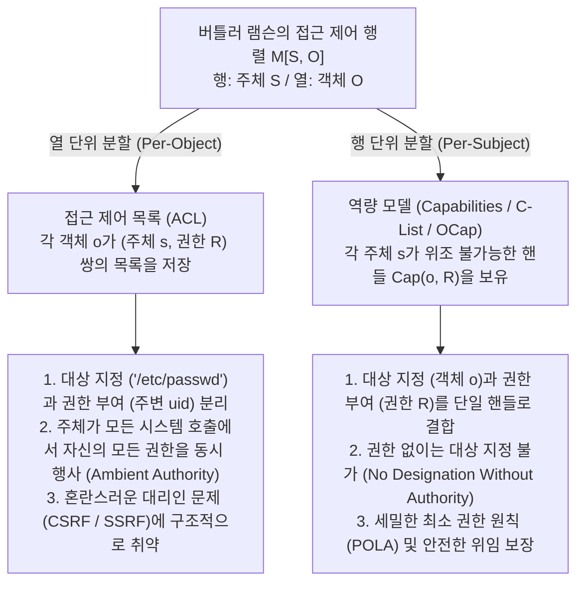

현대 운영체제, 클라우드 인프라, 웹 애플리케이션에서 발생하는 치명적인 보안 침해 사고들은 놀라울 정도로 반복적인 구조적 패턴을 보입니다. 사이트 간 요청 위조(CSRF), 서버 측 요청 위조(SSRF), SQL 및 명령어 인젝션, 컨테이너 탈출, 그리고 `npm`이나 `PyPI` 생태계의 소프트웨어 공급망 공격은 겉보기에 전혀 다른 계층의 문제처럼 보이지만, 그 이면에는 동일한 아키텍처적 결함이 자리 잡고 있습니다.

그 결함은 지난 반세기 동안 컴퓨터 시스템이 의존해 온 <strong>접근 제어 목록(Access Control Lists, ACL)</strong>과 <strong>주변 권한(Ambient Authority)</strong> 패러다임입니다. 즉, <strong>"무엇을 보유하고 있는가(What You Hold)"</strong>가 아니라 <strong>"당신이 누구인가(주체 신원, Subject Identity)"</strong>에 따라 접근 여부를 결정하며, <strong>대상 지정(Designation, 위조 가능한 문자열 경로나 URL)</strong>과 <strong>권한 부여(Authority, 호출자가 지닌 암묵적 신원 권한)</strong>를 분리해 놓은 설계입니다.

이 글에서는 이러한 구조적 취약점을 근본적으로 제거하는 대안 패러다임인 <strong>역량 기반 보안(Capability-Based Security)</strong>을 체계적으로 해부합니다. 버틀러 램슨(Butler Lampson)의 1971년 접근 제어 행렬 $M[S, O]$의 수학적 분해에서 출발하여, 놈 하디(Norm Hardy)의 1988년 고전 논문인 '혼란스러운 대리인 문제(Confused Deputy Problem)', 마크 밀러(Mark S. Miller)의 객체 역량(OCap) 모델과 최소 권한 원칙(POLA), 권한 감쇠(Facet) 및 즉각적·전이적 철회(Caretaker와 Membrane) 코드 패턴을 살펴보고, 형식 검증 마이크로커널 <strong>seL4</strong>, <strong>FreeBSD Capsicum</strong>, <strong>CHERI / ARM Morello</strong> 하드웨어 역량 포인터, <strong>WebAssembly WASI</strong>의 현대적 구현을 분석합니다.

---

## 1. 권한의 두 가지 패러다임: 신분증 명부 vs. 발레파킹 키(Valet Key)

운영체제 이론으로 들어가기 전에 물리적 세계의 두 가지 보안 통제 방식을 비교해 봅시다.

### 패러다임 A: 신분증과 출입 명부 (ACL 모델)
모든 문 앞에 경비원이 출입 허가자 명단(<strong>접근 제어 목록, ACL</strong>)을 들고 서 있는 고보안 빌딩을 상상해 보십시오. 당신이 "302호 문을 열어주시오"라고 말하면, 경비원은 당신의 사원증(<strong>Identity / `uid`</strong>)을 확인하고 명부에 이름이 있으면 문을 열어줍니다.

이제 인턴(보조 프로그램이나 서드파티 라이브러리)에게 302호 캐비닛에서 `Q3_Budget.pdf` 파일 하나만 가져오도록 시키고 싶다고 가정해 봅시다. 인턴은 명부에 없으므로, 당신은 자신의 사원증을 인턴에게 빌려주어야 합니다(UNIX의 `setuid` 또는 현재 사용자 권한으로 프로세스 실행). 인턴이 당신의 사원증을 패용하고 302호에 들어가는 순간, 인턴은 그 방 안의 <strong>모든 기밀 문서</strong>에 대한 <strong>주변 권한(Ambient Authority)</strong>을 자동으로 획득합니다. 더 심각한 것은 외부 공격자가 메모지를 바꿔치기해 인턴에게 `Payroll_Master.db`(급여 마스터 DB)를 가져오라고 속이더라도, 경비원은 인턴이 당신의 사원증을 차고 있다는 이유만으로 이를 허용한다는 점입니다!

### 패러다임 B: 자동차 발레파킹 키 (Capability 모델)
반면 호텔에 도착해 주차 요원에게 차를 맡길 때를 생각해 보십시오. 당신은 차량 등록소에 전화해 주차 요원의 신원을 등록하지도 않고, 자신의 주민등록증을 건네지도 않습니다. 대신 <strong>발레파킹 전용 키(Valet Key)</strong>를 건넵니다. 이 키는 세 가지 핵심 아키텍처 속성을 지닙니다.
1. <strong>지정과 권한의 통합(Unification of Designation and Authority)</strong>: 키는 조작할 특정 차량을 지정함과 동시에 시동을 걸 권한을 부여합니다. 차량은 키를 쥔 사람이 누구인지 묻지 않으며, 위조 불가능한 토큰의 소지 자체가 권한의 필요충분조건입니다.
2. <strong>권한 감쇠(Attenuation / 최소 권한)</strong>: 마스터 키와 달리 발레파킹 키는 트렁크나 글로브 박스를 열 수 없으며 최고 속도를 제한하기도 합니다. 주차에 필요한 최소한의 권한만 부여합니다.
3. <strong>분산형 위임(Decentralized Delegation)</strong>: 첫 번째 요원이 교대할 때 중앙 데이터베이스를 수정할 필요 없이 두 번째 요원에게 키를 건네주기만 하면 됩니다.

컴퓨터 과학에서 패러다임 A가 <strong>ACL 모델</strong>이며, 패러다임 B가 <strong>역량 기반 보안(Capability) 모델</strong>입니다.

---

## 2. 버틀러 램슨의 접근 제어 행렬 $M[S, O]$와 두 가지 분해 방식

1971년 튜링상 수상자 버틀러 램슨은 논문 *"Protection"*에서 운영체제의 보호 메커니즘을 표현하는 보편적 수학 모델로 <strong>접근 제어 행렬(Access Control Matrix)</strong>을 제시했습니다. 시스템의 보호 상태는 삼중쌍 $(S, O, M)$으로 정의됩니다.
- <strong>주체 집합 $S = \{s_1, s_2, \dots, s_m\}$</strong>: 연산을 시작하는 능동적 개체(사용자, 프로세스, 스레드, 소프트웨어 모듈).
- <strong>객체 집합 $O = \{o_1, o_2, \dots, o_n\}$</strong>: 보호 대상 자원(파일, 메모리 세그먼트, IPC 소켓, 하드웨어 장치). 일반적으로 $S \subseteq O$입니다.
- <strong>권한 집합 $\mathcal{R} = \{\mathsf{read}, \mathsf{write}, \mathsf{execute}, \mathsf{append}, \mathsf{grant}, \mathsf{own}\}$</strong>: 객체에 대해 허용될 수 있는 개별 연산들입니다.
- <strong>접근 제어 행렬 $M : S \times O \to 2^{\mathcal{R}}$</strong>: 각 원소 $M[s, o] \subseteq \mathcal{R}$는 주체 $s \in S$가 객체 $o \in O$에 대해 수행할 수 있는 권한 부분집합을 지정합니다.

예를 들어 세 주체 $S = \{\text{Alice}, \text{Compiler}, \text{Logger}\}$와 세 파일 객체 $O = \{\texttt{src.f}, \texttt{/SYSX/STAT}, \texttt{/SYSX/BILL}\}$의 행렬은 다음과 같습니다.

$$
M[S, O] = \begin{array}{c|ccc}
 & \texttt{src.f} & \texttt{/SYSX/STAT} & \texttt{/SYSX/BILL} \\
\hline
\text{Alice} & \{\mathsf{read}, \mathsf{write}\} & \emptyset & \emptyset \\
\text{Compiler} & \{\mathsf{read}\} & \{\mathsf{append}\} & \{\mathsf{read}, \mathsf{write}\} \\
\text{Logger} & \emptyset & \{\mathsf{read}, \mathsf{write}\} & \emptyset
\end{array}
$$

실제 시스템에서 $M[S, O]$는 거대하고 대부분이 공집합($\emptyset$)인 희소 행렬이므로, 이를 2차원 배열로 저장하는 대신 두 축 중 하나를 따라 분해해야 합니다. 즉, <strong>열 단위 분할(객체에 목록 부착)</strong> 또는 <strong>행 단위 분할(주체에 토큰 부여)</strong>입니다.



### 2.1 열 단위 분할: 접근 제어 목록 (ACL)
행렬 $M[S, O]$를 <strong>열(Column)</strong> 기준으로 수직 분할하면 각 객체 $o \in O$에 비어 있지 않은 항목들의 목록이 연결됩니다.

$$
\text{ACL}(o) = \bigl\{ (s, M[s, o]) \;\big|\; s \in S,\; M[s, o] \neq \emptyset \bigr\}
$$

UNIX/POSIX 권한, Windows NTFS DACL, 클라우드 IAM 정책이 모두 여기에 해당합니다. 열 분할은 <strong>대상 지정(Designation)과 권한(Authority)의 분리</strong>를 강제합니다. 프로그램은 위조 가능한 전역 문자열 경로(`"/SYSX/BILL"`)로 객체를 지정하고, 커널의 참조 모니터는 호출 프로세스의 <strong>주변 신원(Ambient Identity, `uid`)</strong>을 확인합니다. 그 결과 프로세스는 매 시스템 호출마다 자신의 행 전체에 걸친 모든 권한의 합집합 $\bigcup_{o \in O} M[s, o]$를 동시에 휘두르는 <strong>주변 권한(Ambient Authority)</strong>을 갖게 됩니다.

### 2.2 행 단위 분할: 역량 (Capabilities, Dennis & Van Horn 1966)
1966년 Jack B. Dennis와 Earl C. Van Horn은 행렬 $M[S, O]$를 <strong>행(Row)</strong> 기준으로 수평 분할하는 쌍대(dual) 모델을 제시했습니다. 각 주체 $s \in S$는 자신의 행에 속한 비어 있지 않은 항목들로 구성된 <strong>역량 공간(CSpace 또는 C-List)</strong>을 보유합니다.

$$
\text{CSpace}(s) = \bigl\{ \text{Cap}(o, R) \;\big|\; o \in O,\; R = M[s, o] \neq \emptyset \bigr\}
$$

각 원소 $c = \text{Cap}(o, R)$는 <strong>역량(Capability)</strong>이라 불리는 <strong>위조 불가능한 권한 토큰</strong>으로, 특정 객체 $o$에 대한 <strong>지정(참조 포인터/핸들)</strong>과 허용된 <strong>권한 집합 $R \subseteq \mathcal{R}$</strong>을 하나의 분리 불가능한 참조로 묶습니다. 순수 역량 시스템에는 전역 파일 경로 네임스페이스도 없고 접근 시점에 검사하는 주변 `uid`도 없습니다. 주체 $s$가 객체 $o$에 대한 역량을 보유하지 않으면 $o$의 이름을 부르거나 주소를 지정하는 것조차 불가능합니다. 즉, <strong>"권한 없이는 지정할 수 없고, 지정 없이는 권한도 없다(No Designation Without Authority)"</strong>라는 공리가 성립합니다.

| 아키텍처 차원 | 접근 제어 목록 (ACL — 열 분할) | 역량 기반 보안 (Capabilities / OCap — 행 분할) |
| :--- | :--- | :--- |
| <strong>$M[S, O]$ 분해 방식</strong> | 각 보호 객체 $o \in O$마다 열(Column) 단위로 저장 | 각 주체 $s \in S$가 보유한 행(Row) 단위로 저장 |
| <strong>핵심 인가 철학</strong> | <strong>당신은 누구인가(Who You Are)</strong>: 호출자의 `uid`/신원 확인 | <strong>무엇을 가졌는가(What You Hold)</strong>: 제시된 역량 토큰 확인 |
| <strong>지정과 권한의 관계</strong> | <strong>분리됨</strong> (위조 가능한 문자열 경로 + 주변 신원) | <strong>통합됨</strong> (위조 불가능한 핸들이 $o$ 지정과 $R$ 부여를 겸함) |
| <strong>권한 활성화 모델</strong> | <strong>주변 권한(Ambient Authority)</strong>: 모든 권한이 상시 활성화 | <strong>선택적 권한(Selective Authority)</strong>: 명시적으로 전달된 핸들만 활성 |
| <strong>혼란스러운 대리인 취약성</strong> | <strong>구조적으로 취약함</strong> (CSRF, SSRF, `setuid` 권한 상승) | <strong>구조적으로 면역됨</strong> (클라이언트가 권한 핸들을 직접 전달해야 함) |
| <strong>대표적 시스템</strong> | UNIX/POSIX ACL, Windows NTFS DACL, AWS IAM | KeyKOS, seL4, FreeBSD Capsicum, Fuchsia Zircon, CHERI, WASI |

---

## 3. 혼란스러운 대리인 문제 (Confused Deputy): 1988년 놈 하디의 사례와 현대적 변종

대상 지정과 권한을 분리하는 것이 왜 위험할까요? 컴퓨터 아키텍트 놈 하디(Norm Hardy)는 1988년 *ACM SIGOPS Operating Systems Review*에 발표한 논문 <strong>*"The Confused Deputy (or why capabilities might have been invented)"</strong>*에서 1970년대 중반 상용 Tymshare 운영체제에서 발생한 실제 보안 참사를 소개했습니다.

### 3.1 `/SYSX/FORT` 포트란 컴파일러의 과금 DB 파괴 사건
Tymshare 시스템에서 포트란 컴파일러는 `/SYSX/FORT`에 위치해 있었습니다.
1. <strong>통계 기록 요구사항</strong>: 시스템 관리자는 사용자가 컴파일할 때마다 `/SYSX/STAT` 파일에 사용 통계를 추가하도록 `/SYSX/FORT`를 설계했습니다.
2. <strong>주변 권한 부여</strong>: 이를 위해 `/SYSX/FORT` 실행 파일에는 `/SYSX` 디렉터리 전체에 대한 <strong>주변 쓰기 권한</strong>(UNIX의 `setuid`와 유사한 *home files license*)이 부여되었습니다.
3. <strong>사용자 지정 출력 파일명</strong>: 컴파일러는 디버깅 출력을 저장할 파일 경로 문자열을 사용자로부터 인자로 받았습니다(예: `FORT(SRC="prog.f", OUT="listing.txt")`).
4. <strong>핵심 자산 `/SYSX/BILL`</strong>: 같은 `/SYSX` 디렉터리 안에는 모든 고객의 요금 청구 내역을 담은 마스터 과금 데이터베이스 <strong>`/SYSX/BILL`</strong>이 저장되어 있었으며, 일반 사용자는 쓰기 권한이 없었습니다.

어느 날 한 사용자가 `/SYSX/FORT`를 실행하면서 출력 파일명 인자로 문자열 <strong>`"/SYSX/BILL"`</strong>을 넘겼습니다. 컴파일러가 `open("/SYSX/BILL", WRITE)`를 호출하자, 운영체제 ACL 모니터는 *"현재 실행 중인 `/SYSX/FORT`가 `/SYSX`에 쓸 권한이 있는가?"*를 검사했고, 컴파일러의 주변 권한 때문에 이를 <strong>허용</strong>했습니다! 그 결과 <strong>컴파일러는 회사의 마스터 과금 데이터베이스 `/SYSX/BILL`을 포트란 컴파일러 진단 메시지로 덮어써 파괴해 버렸습니다!</strong>



```mermaid
flowchart TD
    subgraph ACL_WORLD["ACL + 주변 권한 모델 (혼란스러운 대리인 발생)"]
        U1["악의적 사용자<br/>(/SYSX/BILL 접근 권한 없음)"] -->|"1. 문자열 경로 OUT='/SYSX/BILL' 전달"| D1["대리인: 컴파일러 /SYSX/FORT<br/>(주변 권한: /SYSX/* 쓰기 가능)"]
        D1 -->|"2. open('/SYSX/BILL', WRITE)<br/>자신의 주변 권한을 암묵적으로 행사"| OS1["OS 참조 모니터 (ACL 검사)"]
        OS1 -->|"3. 컴파일러의 /SYSX 쓰기 권한 확인 -> 허용!"| BILL1["마스터 과금 DB /SYSX/BILL<br/>[덮어쓰기로 파괴됨!]"]
    end

    subgraph CAP_WORLD["역량 모델 (지정과 권한의 통합)"]
        U2["일반 사용자<br/>(자신의 파일에 대한 역량만 보유)"] -->|"1. 출력 파일 역량 핸들 cap_out 전달<br/>(사용자는 /SYSX/BILL 역량이 없으므로 전달 불가!)"| D2["대리인: 컴파일러 /SYSX/FORT<br/>(설치 시 오직 cap_stat 역량만 부여받음)"]
        D2 -->|"2a. write(cap_out, debug_output)<br/>사용자가 명시적으로 건넨 권한만 사용"| OUT2["사용자 출력 파일 listing.txt"]
        D2 -->|"2b. append(cap_stat, usage_stats)<br/>내부 전용 역량 cap_stat 사용"| STAT2["통계 파일 /SYSX/STAT"]
    end
```

### 3.2 왜 컴파일러는 '혼란'에 빠졌는가? 그리고 현대 취약점들과의 동형성
하디는 `/SYSX/FORT`가 <strong>서로 다른 두 주체(시스템 관리자와 호출 사용자)를 동시에 대리</strong>하면서, 어느 주체의 권한으로 어느 파일을 여는지 구분할 수 없었기 때문에 <strong>혼란스러운 대리인(Confused Deputy)</strong>이 되었다고 분석했습니다. 반면 역량 아키텍처에서는 컴파일러에 오직 $c_{\text{stat}} = \text{Cap}(\texttt{/SYSX/STAT}, \{\mathsf{append}\})$만 부여하고, 사용자는 자신이 열 수 있는 출력 파일의 쓰기 역량 핸들 $c_{\text{out}} = \text{Cap}(f_{\text{out}}, \{\mathsf{write}\})$을 직접 전달해야 하므로 이 취약점이 원천적으로 불가능합니다.

현대의 치명적인 보안 취약점들은 모두 혼란스러운 대리인의 변종입니다.
- <strong>사이트 간 요청 위조(CSRF)</strong>: 웹 브라우저는 혼란스러운 대리인입니다. `evil.example`의 스크립트가 `https://bank.example/transfer`로 요청을 보낼 때, 브라우저는 대상 URL 문자열만 보고 사용자의 주변 권한(세션 쿠키)을 자동으로 첨부합니다. CSRF 토큰은 폼 자체가 위조 불가능한 역량 토큰을 제시하도록 강제함으로써 이를 해결합니다.
- <strong>서버 측 요청 위조(SSRF)</strong>: 클라우드 웹 서버가 사용자가 입력한 URL 문자열(`"http://169.254.169.254/latest/meta-data/"`)을 가져올 때, 서버 자신의 내부 VPC 주변 네트워크 권한을 사용하여 IAM 자격 증명을 탈취당합니다.
- <strong>소프트웨어 공급망 공격(`npm` / `PyPI` 악성 패키지)</strong>: 단 20줄짜리 문자열 패딩 라이브러리가 `~/.ssh/id_rsa`를 읽어 외부로 유출할 수 있는 이유는, POSIX ACL 하에서 프로세스 내의 모든 서드파티 함수가 사용자 `uid`의 전체 주변 권한과 전역 네임스페이스를 그대로 상속받기 때문입니다.

---

## 4. 객체 역량(OCap) 모델과 최소 권한 원칙(POLA), 감쇠 및 철회 패턴

1975년 Saltzer와 Schroeder는 <strong>최소 권한 원칙(Principle of Least Privilege, 역량 학계에서는 최소 권한 부여 원칙 POLA)</strong>을 정립했습니다. 2006년 마크 밀러(Mark S. Miller)는 존스 홉킨스 대학교 박사 학위 논문 *"Robust Composition"*에서 <strong>메모리 안전한 객체 지향 언어의 객체 참조(Object Reference) 자체가 이미 개별 객체 및 메서드 호출 단위로 POLA를 강제할 수 있는 역량</strong>임을 증명했습니다.

### 4.1 OCap 시스템의 3대 불변식과 참조 획득의 3법칙
메모리 안전 언어(Hardened JavaScript / SES, E 언어, Wasm 컴포넌트 등)가 진정한 <strong>객체 역량(OCap) 시스템</strong>이 되려면 세 가지 불변식을 충족해야 합니다.
1. <strong>참조 위조 불가(No Forged References)</strong>: 정수 주소를 포인터로 캐스팅하거나 배열 경계를 넘는 포인터 연산으로 참조를 만들 수 없습니다.
2. <strong>가변 전역 상태 및 주변 권한 제거(Zero Ambient Authority)</strong>: 전역 스코프에 가변 변수나 임의의 I/O 모듈(`fs`, `net`)이 없어야 하며, 기본 프로토타입(`Object.prototype`)은 깊이 동결(`Object.freeze`)되어야 합니다.
3. <strong>절대적 캡슐화(Absolute Encapsulation)</strong>: 클로저 내부의 어휘적 상태나 프라이빗 필드는 외부 리플렉션으로 접근할 수 없어야 합니다.

이 조건 하에서 객체 그래프 $G = (V, E)$의 새로운 간선 $(A \to C)$는 오직 세 가지 경로로만 생성됩니다. <strong>1. 생성(Parenthood, `new C()`)</strong>, <strong>2. 초기 부여(Endowment, 클로저 생성 시 주입)</strong>, <strong>3. 소개(Introduction, $B \to A$와 $B \to C$를 모두 가진 소개자 $B$가 메시지 전달을 통해 $C$를 $A$에게 전달)</strong>입니다.

$$
\text{소개의 법칙 (Law of Introduction)}: \quad (B \to A) \;\land\; (B \to C) \;\;\Longrightarrow\;\; B \text{는 } (A \to C) \text{를 수립할 수 있다}
$$

### 4.2 Facet을 통한 권한 감쇠와 Redell의 Caretaker / Membrane 철회 패턴
"역량은 한 번 넘겨주면 제한하거나 철회할 수 없다"는 통념은 완전히 잘못된 미신입니다. 데이비드 리델(David D. Redell)은 이미 1974년 UC 버클리 박사 논문에서 <strong>관리인 패턴(Caretaker Pattern)</strong>을 통해 즉각적인 역량 철회를 구현했습니다.

```javascript
// 1. 권한 감쇠 패싯 (Attenuating Facet): 특정 접두사 키에 대한 읽기 전용 권한만 노출
function makeScopedReadFacet(fullStorageCap, allowedPrefix) {
  return Object.freeze({
    read(key) {
      if (typeof key !== "string" || !key.startsWith(allowedPrefix)) {
        throw new Error(`접근 거부: 키는 '${allowedPrefix}'로 시작해야 합니다`);
      }
      return fullStorageCap.read(key);
    }
    // write()와 deleteAll() 메서드는 패싯에서 완전히 제외됨!
  });
}

// 2. Redell (1974) Caretaker 패턴: O(1) 시간에 즉각적인 역량 철회 수행
function makeCaretaker(targetCap) {
  let currentTarget = targetCap; // 클로저 내부에 캡슐화된 가변 참조
  const caretaker = Object.freeze({
    read(...args) {
      if (currentTarget === null) throw new Error("RevokedCapabilityError: 철회된 역량입니다");
      return currentTarget.read(...args);
    },
    write(...args) {
      if (currentTarget === null) throw new Error("RevokedCapabilityError: 철회된 역량입니다");
      return currentTarget.write(...args);
    }
  });
  const revoker = Object.freeze({
    revoke() { currentTarget = null; } // 참조 연결을 끊고 GC 대상이 되게 함
  });
  return Object.freeze({ caretaker, revoker });
}
```

만약 하위 디렉터리 역량을 반환하는 디렉터리 객체처럼 복잡한 객체 그래프 전체를 전이적으로 철회해야 한다면, 마크 밀러의 <strong>철회 가능한 멤브레인(Revocable Membrane)</strong> 패턴을 사용합니다. `Proxy`와 `WeakMap`을 이용해 게이트를 통과하는 모든 반환값과 인자를 재귀적으로 감싸며, `revoke()`를 호출하는 즉시 하위 그래프의 모든 파생 참조가 동시에 무효화됩니다.

---

## 5. 현대 산업계 구현: seL4, FreeBSD Capsicum, CHERI 및 WebAssembly WASI

먼저 흔한 용어 혼동을 바로잡아야 합니다. 리눅스 커널의 `capabilities(7)`(`CAP_NET_ADMIN` 등)은 <strong>객체 역량이 아닙니다</strong>. 이는 단지 `root`의 주변 권한을 약 41개의 스레드 플래그로 쪼갠 것일 뿐 특정 객체를 지정하지 않으며 혼란스러운 대리인 문제를 전혀 해결하지 못합니다. 진정한 역량 기반 보안은 다음 네 가지 현대 시스템에서 구현되어 있습니다.

1. <strong>형식 검증 마이크로커널 seL4</strong>: Isabelle/HOL 정리 증명기로 기능적 정확성과 무결성이 완벽히 수학적으로 증명된 최초의 OS 커널입니다. seL4는 주변 권한이 전혀 없으며, 스레드 제어 블록(TCB), 주소 공간(VSpace), IPC 엔드포인트, 물리 메모리 프레임 등 모든 자원은 스레드의 <strong>CSpace(CNode 테이블)</strong>에 저장된 역량을 통해서만 접근됩니다. `seL4_CNode_Mint`로 권한을 감쇠하거나 위조 불가능한 배지(Badge)를 부착하며, 커널 내 <strong>역량 파생 트리(CDT)</strong>를 통해 `seL4_CNode_Revoke`로 전이적 철회를 수행합니다.
2. <strong>FreeBSD Capsicum 샌드박스</strong>: 케임브리지 대학교와 구글이 개발한 프레임워크로, UNIX 파일 디스크립터(`fd`)를 진정한 역량으로 승격시켰습니다. 프로세스가 `cap_enter()` 시스템 호출을 실행하면 커널은 전역 네임스페이스에 접근하는 모든 시스템 호출(`open()`, `connect()`, `bind()` 등)을 `ECAPMODE` 오류로 차단합니다. 이후 프로세스는 이미 보유한 파일 디스크립터와 `openat(dir_fd, ...)`를 통한 하위 상대 경로만 조작할 수 있으며, `cap_rights_limit(fd, &rights)`로 60여 개의 정밀한 권한 비트를 비가역적으로 축소합니다.
3. <strong>실리콘 하드웨어 역량 포인터 CHERI와 ARM Morello</strong>: 케임브리지 대학교와 SRI가 설계하고 ARM이 <strong>Morello</strong> 프로세서 보드 및 <strong>CHERIoT-RISC-V</strong>로 구현한 하드웨어 아키텍처입니다. CHERI는 64비트 정수 포인터를 <strong>128비트 하드웨어 역량 + 1비트 대역 외 유효성 태그(Tag Bit)</strong>로 대체합니다.

$$
\underbrace{\text{Tag (1 bit)}}_{\text{하드웨어 출처 태그}} \;\Big|\; \underbrace{\text{Permissions (18 bits)}}_{\text{로드/스토어/실행 권한}} \;\Big|\; \underbrace{\text{Object Type (18 bits)}}_{\text{하드웨어 봉인 타입}} \;\Big|\; \underbrace{\text{Compressed Bounds (28 bits)}}_{\text{압축된 경계 [Base, Top)}} \;\Big|\; \underbrace{\text{Address Cursor (64 bits)}}_{\text{64비트 가상 주소}}
$$

CPU는 모든 메모리 접근 시 단일 사이클 내에 주소가 `[Base, Top)` 범위 내에 있는지와 권한 비트를 병렬 검증합니다. 일반 정수 스토어 명령어로 역량 메모리를 1바이트라도 덮어쓰면 하드웨어가 즉시 Tag 비트를 `0`으로 지워 포인터 위조와 버퍼 오버플로우, ROP 공격을 실리콘 수준에서 원천 봉쇄합니다.
4. <strong>WebAssembly WASI와 클라우드 Macaroons</strong>: WASI 런타임은 전역 파일시스템 접근을 불허하며 호스트가 명시적으로 주입한 디렉터리 역량 디스크립터만 사용할 수 있습니다. 또한 분산 클라우드 환경에서 구글의 <strong>Macaroons</strong>는 연쇄 HMAC 서명을 통해 중앙 서버 조회 없이도 토큰 보유자가 스스로 조건(Caveats)을 추가해 권한을 감쇠할 수 있는 암호학적 역량을 제공합니다.
