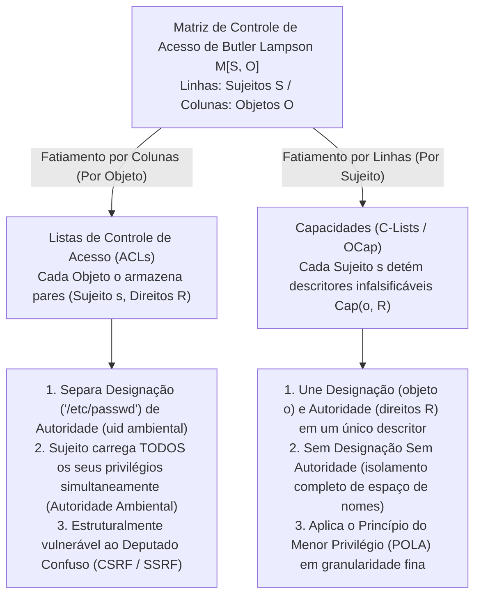

Nos sistemas operacionais modernos, infraestruturas de nuvem e aplicações web, falhas catastróficas de segurança seguem um padrão surpreendentemente repetitivo. Cross-Site Request Forgery (CSRF), Server-Side Request Forgery (SSRF), injeção de SQL e de comandos, fugas de contêineres e ataques à cadeia de suprimentos de software em ecossistemas como `npm` ou `PyPI` parecem pertencer a camadas completamente distintas da pilha de software. Contudo, sob os detalhes superficiais reside uma única falha arquitetônica compartilhada.

Essa falha é a nossa dependência, há meio século, de <strong>Listas de Controle de Acesso (Access Control Lists, ACLs)</strong> acopladas à <strong>Autoridade Ambiental (Ambient Authority)</strong> — o paradigma de projeto no qual as decisões de acesso dependem de <strong>Quem Você É (Identidade do Sujeito)</strong> em vez de <strong>O Que Você Possui</strong>, e no qual a <strong>Designação</strong> (nomear um recurso por meio de um caminho de string ou URL falsificável) é separada da <strong>Autoridade</strong> (a permissão ambiental carregada pelo chamador).

Neste artigo, examinamos sistematicamente o paradigma alternativo que elimina essa vulnerabilidade estrutural pela raiz: a <strong>Segurança Baseada em Capacidades (Capability-Based Security)</strong>. Partindo da decomposição matemática da Matriz de Controle de Acesso $M[S, O]$ de Butler Lampson (1971), analisamos o clássico *Problema do Deputado Confuso (Confused Deputy Problem)* de Norm Hardy (1988), formulamos o modelo Object-Capability (OCap) de Mark S. Miller e o Princípio do Menor Privilégio (POLA), construímos padrões concretos de código para atenuação (facetas) e revogação imediata ou transitiva (Caretaker de Redell e Membranas) e revisamos implantações industriais modernas no microkernel formalmente verificado <strong>seL4</strong>, <strong>FreeBSD Capsicum</strong>, ponteiros de hardware <strong>CHERI / ARM Morello</strong> e <strong>WebAssembly WASI</strong>.

---

## 1. Dois Paradigmas de Autoridade: Crachás de Identidade vs. Chaves de Manobrista (Valet Key)

Antes de mergulhar na teoria formal de sistemas operacionais, comparemos duas formas opostas de aplicar segurança física no mundo cotidiano.

### Paradigma A: Crachás de Identidade e Listas nas Portas (O Modelo ACL)
Imagine um edifício corporativo de alta segurança onde cada porta é vigiada por um guarda segurando uma prancheta com a lista de funcionários autorizados a entrar na Sala 302 (uma <strong>Lista de Controle de Acesso</strong>). Quando você pede para entrar, o guarda inspeciona seu crachá (<strong>Identidade / `uid`</strong>) e verifica se seu nome consta na lista.

Suponha agora que você queira que um estagiário (um programa auxiliar ou biblioteca de terceiros) busque um único arquivo, `Q3_Budget.pdf`, em um armário dentro da Sala 302. Como o estagiário não está na lista, você precisa emprestar seu próprio crachá ao estagiário (equivalente ao `setuid` no UNIX ou a executar código sob sua própria identidade). No instante em que o estagiário entra na Sala 302 usando seu crachá, ele adquire automaticamente <strong>Autoridade Ambiental (Ambient Authority)</strong> sobre tudo naquela sala, incluindo `Payroll_Master.db`. Pior ainda: se um invasor externo trocar o bilhete do estagiário para enganá-lo e fazê-lo buscar `Payroll_Master.db`, o guarda permitirá, pois o estagiário está usando o seu crachá!

### Paradigma B: A Chave de Manobrista / Valet Key (O Modelo de Capacidades)
Compare isso com chegar a um hotel e entregar seu carro ao manobrista. Você não liga para o departamento de trânsito para registrar a carteira do manobrista em uma lista anexada ao veículo, nem entrega seus documentos pessoais. Em vez disso, você entrega uma <strong>Chave de Manobrista (Valet Key)</strong>, que incorpora três propriedades arquitetônicas profundas:
1. <strong>Unificação de Designação e Autoridade</strong>: A chave designa simultaneamente *qual* veículo específico deve ser operado e *autoriza* o portador a dar a partida. O carro não se importa com *quem* segura a chave; a posse do token infalsificável é prova necessária e suficiente de autoridade.
2. <strong>Atenuação (Menor Privilégio)</strong>: Ao contrário da chave mestra, a chave de manobrista não abre o porta-malas nem o porta-luvas e pode limitar a velocidade máxima. Ela concede exatamente a autoridade mínima necessária para estacionar o veículo.
3. <strong>Delegação Descentralizada</strong>: Se o primeiro manobrista precisar que um colega busque o carro no check-out, basta entregar-lhe a chave sem editar nenhum banco de dados central.

Na ciência da computação, o Paradigma A é o modelo <strong>ACL</strong>, enquanto o Paradigma B é o modelo de <strong>Segurança Baseada em Capacidades (Capabilities)</strong>.

---

## 2. A Matriz de Controle de Acesso $M[S, O]$ de Butler Lampson e Suas Duas Decomposições

Em 1971, o vencedor do Prêmio Turing Butler Lampson publicou *"Protection"*, introduzindo a <strong>Matriz de Controle de Acesso</strong> como abstração matemática universal para mecanismos de proteção. O estado de proteção de um sistema é definido por uma tripla $(S, O, M)$:
- <strong>Um conjunto de Sujeitos $S = \{s_1, s_2, \dots, s_m\}$</strong>: Entidades ativas capazes de iniciar operações (usuários, processos, threads, módulos de software).
- <strong>Um conjunto de Objetos $O = \{o_1, o_2, \dots, o_n\}$</strong>: Recursos protegidos (arquivos, segmentos de memória, sockets IPC, dispositivos), geralmente com $S \subseteq O$.
- <strong>Um conjunto universal de Direitos $\mathcal{R} = \{\mathsf{read}, \mathsf{write}, \mathsf{execute}, \mathsf{append}, \mathsf{grant}, \mathsf{own}\}$</strong>: As operações discretas que podem ser autorizadas sobre um objeto.
- <strong>Uma Matriz de Controle de Acesso $M : S \times O \to 2^{\mathcal{R}}$</strong>: Cada entrada $M[s, o] \subseteq \mathcal{R}$ especifica o conjunto exato de operações que o sujeito $s \in S$ está autorizado a realizar no objeto $o \in O$.

Considere um sistema com três sujeitos $S = \{\text{Alice}, \text{Compiler}, \text{Logger}\}$ e três objetos de arquivo $O = \{\texttt{src.f}, \texttt{/SYSX/STAT}, \texttt{/SYSX/BILL}\}$:

$$
M[S, O] = \begin{array}{c|ccc}
 & \texttt{src.f} & \texttt{/SYSX/STAT} & \texttt{/SYSX/BILL} \\
\hline
\text{Alice} & \{\mathsf{read}, \mathsf{write}\} & \emptyset & \emptyset \\
\text{Compiler} & \{\mathsf{read}\} & \{\mathsf{append}\} & \{\mathsf{read}, \mathsf{write}\} \\
\text{Logger} & \emptyset & \{\mathsf{read}, \mathsf{write}\} & \emptyset
\end{array}
$$

Como $M[S, O]$ é extremamente esparsa em qualquer sistema real, todo arquiteto deve decompô-la ao longo de um de seus dois eixos: <strong>fatiar por colunas (anexando listas aos Objetos)</strong>, ou <strong>fatiar por linhas (anexando tokens aos Sujeitos)</strong>.



### 2.1 Fatiamento por Colunas: Listas de Controle de Acesso (ACLs)
Quando fatiamos a matriz $M[S, O]$ verticalmente <strong>por colunas</strong>, associamos a cada objeto $o \in O$ uma lista das entradas não vazias de sua coluna:

$$
\text{ACL}(o) = \bigl\{ (s, M[s, o]) \;\big|\; s \in S,\; M[s, o] \neq \emptyset \bigr\}
$$

Permissões UNIX/POSIX, DACLs do Windows NTFS e políticas IAM em nuvem seguem esse modelo, forçando a <strong>separação entre Designação e Autoridade</strong>: um programa designa um objeto usando uma string pública falsificável como `"/SYSX/BILL"`, enquanto o monitor de referência do kernel verifica a identidade ambiental (`uid`) do processo chamador. Assim, o processo exerce continuamente a união de todas as permissões de sua linha inteira $\bigcup_{o \in O} M[s, o]$ em cada chamada de sistema: a <strong>Autoridade Ambiental (Ambient Authority)</strong>.

### 2.2 Fatiamento por Linhas: Capacidades (Dennis & Van Horn 1966)
Em 1966, Jack B. Dennis e Earl C. Van Horn introduziram a decomposição dual: fatiar horizontalmente $M[S, O]$ <strong>por linhas</strong>. A cada sujeito $s \in S$ associamos um <strong>Espaço de Capacidades (CSpace ou C-List)</strong>:

$$
\text{CSpace}(s) = \bigl\{ \text{Cap}(o, R) \;\big|\; o \in O,\; R = M[s, o] \neq \emptyset \bigr\}
$$

Cada elemento $c = \text{Cap}(o, R)$ é uma <strong>Capacidade (Capability)</strong> — um <strong>token infalsificável de autoridade</strong> que une <strong>Designação</strong> (um ponteiro ou descritor direto para o objeto $o$) e <strong>Autoridade</strong> (o subconjunto permitido de direitos $R \subseteq \mathcal{R}$) em uma referência indivisível. Se o sujeito $s$ não detém uma capacidade para o objeto $o$, ele sequer pode nomear ou endereçar $o$: <strong>Sem Designação Sem Autoridade; Sem Autoridade Sem Designação</strong>.

| Dimensão Arquitetônica | Listas de Controle de Acesso (ACLs — Colunas) | Capacidades (OCap / C-Lists — Linhas) |
| :--- | :--- | :--- |
| <strong>Decomposição de $M[S, O]$</strong> | Armazenada por coluna em cada Objeto $o \in O$ | Armazenada por linha detida por cada Sujeito $s \in S$ |
| <strong>Filosofia de Autorização</strong> | <strong>Quem Você É (Who You Are)</strong>: Identidade / `uid` do chamador | <strong>O Que Você Possui (What You Hold)</strong>: O token de capacidade apresentado |
| <strong>Designação vs. Autoridade</strong> | <strong>Separadas</strong> (Caminho de string falsificável + Identidade ambiental) | <strong>Unificadas</strong> (Descritor infalsificável nomeia $o$ e concede $R$) |
| <strong>Modelo de Autoridade</strong> | <strong>Autoridade Ambiental</strong>: Todos os direitos do `uid` ativos sempre | <strong>Autoridade Seletiva</strong>: Apenas o descritor passado explicitamente atua |
| <strong>Vulnerabilidade ao Deputado Confuso</strong> | <strong>Estruturalmente Vulnerável</strong> (CSRF, SSRF, escalonamento `setuid`) | <strong>Estruturalmente Imune</strong> (Cliente deve passar um descritor autorizado) |
| <strong>Sistemas Representativos</strong> | ACLs UNIX/POSIX, Windows NTFS DACL, AWS IAM | KeyKOS, seL4, FreeBSD Capsicum, Fuchsia Zircon, CHERI, WASI |

---

## 3. O Problema do Deputado Confuso (Confused Deputy): O Clássico de Norm Hardy (1988)

Por que separar Designação de Autoridade é tão perigoso? O arquiteto de computadores Norm Hardy publicou a explicação definitiva em outubro de 1988 na *ACM SIGOPS Operating Systems Review* sob o título <strong>*"The Confused Deputy (or why capabilities might have been invented)"</strong>*, relatando um desastre real ocorrido em meados da década de 1970 no sistema operacional comercial Tymshare.

### 3.1 Anatomia do Desastre do Compilador `/SYSX/FORT`
No sistema Tymshare, o compilador Fortran residia em `/SYSX/FORT`:
1. <strong>Requisito de Estatísticas</strong>: Os administradores queriam registrar estatísticas de uso fazendo com que `/SYSX/FORT` anexasse um registro ao arquivo `/SYSX/STAT` a cada compilação.
2. <strong>Concessão de Autoridade Ambiental</strong>: O executável `/SYSX/FORT` recebeu <strong>autoridade ambiental de escrita sobre todo o diretório `/SYSX`</strong> (semelhante ao `setuid` do UNIX).
3. <strong>Nome de Arquivo de Saída Fornecido pelo Usuário</strong>: O compilador aceitava uma string do usuário especificando onde gravar a saída de depuração (ex.: `FORT(SRC="prog.f", OUT="listing.txt")`).
4. <strong>As Joias da Coroa em `/SYSX/BILL`</strong>: No mesmo diretório `/SYSX` ficava o banco de dados mestre de faturamento de clientes, <strong>`/SYSX/BILL`</strong>.

Certo dia, um usuário invocou `/SYSX/FORT` e passou a string <strong>`"/SYSX/BILL"`</strong> como nome do arquivo de saída. Quando o compilador executou `open("/SYSX/BILL", WRITE)`, o monitor de referência ACL do sistema operacional perguntou: *“O processo ativo (`/SYSX/FORT`) tem permissão para escrever em `/SYSX`?”* A resposta foi <strong>Sim</strong> — e <strong>o compilador obedientemente sobrescreveu o banco de dados mestre de faturamento `/SYSX/BILL` da empresa com diagnósticos do compilador Fortran!</strong>



```mermaid
flowchart TD
    subgraph ACL_WORLD["Modelo ACL + Autoridade Ambiental (O Deputado Confuso)"]
        U1["Usuário Malicioso<br/>(Sem acesso a /SYSX/BILL)"] -->|"1. Passa string OUT='/SYSX/BILL'"| D1["Deputado: Compilador /SYSX/FORT<br/>(Autoridade Ambiental: Escrita em /SYSX/*)"]
        D1 -->|"2. open('/SYSX/BILL', WRITE)<br/>Usa implicitamente sua própria autoridade ambiental"| OS1["Monitor de Referência do SO (Checagem ACL)"]
        OS1 -->|"3. Compilador tem permissão em /SYSX -> PERMITIDO!"| BILL1["Banco de Faturamento /SYSX/BILL<br/>[CORROMPIDO / SOBRESCRITO!]"]
    end

    subgraph CAP_WORLD["Modelo de Capacidades (Designação e Autoridade Unificadas)"]
        U2["Usuário<br/>(Detém capacidades apenas de seus arquivos)"] -->|"1. Passa capacidade de saída cap_out<br/>(Não pode passar Cap para /SYSX/BILL pois não a possui!)"| D2["Deputado: Compilador /SYSX/FORT<br/>(Dotado APENAS de cap_stat)"]
        D2 -->|"2a. write(cap_out, debug_output)<br/>Usa autoridade fornecida explicitamente pelo usuário"| OUT2["Arquivo de saída listing.txt"]
        D2 -->|"2b. append(cap_stat, usage_stats)<br/>Usa capacidade privada recebida na instalação"| STAT2["Arquivo de estatísticas /SYSX/STAT"]
    end
```

### 3.2 Por Que o Compilador Estava "Confuso"? E Seus Descendentes Modernos
Hardy chamou `/SYSX/FORT` de <strong>Deputado Confuso (Confused Deputy)</strong> porque ele atuava como agente servindo a dois principais distintos (o administrador do sistema e o usuário invocador) simultaneamente, sem poder separar suas autoridades ao abrir um caminho de texto. Sob uma arquitetura de capacidades, o compilador recebe apenas a capacidade privada $c_{\text{stat}} = \text{Cap}(\texttt{/SYSX/STAT}, \{\mathsf{append}\})$, e o usuário deve passar diretamente um descritor de capacidade de escrita $c_{\text{out}} = \text{Cap}(f_{\text{out}}, \{\mathsf{write}\})$, tornando o bug impossível.

As classes de vulnerabilidades mais devastadoras da cibersegurança moderna são instâncias diretas do Deputado Confuso:
- <strong>Cross-Site Request Forgery (CSRF)</strong>: O navegador web é um deputado confuso que anexa automaticamente sua autoridade ambiental (o cookie de sessão de `bank.example`) a uma requisição disparada por `evil.example`. Tokens CSRF corrigem isso exigindo que o formulário apresente um token de capacidade infalsificável.
- <strong>Server-Side Request Forgery (SSRF)</strong>: Um servidor web busca uma URL fornecida pelo usuário (`"http://169.254.169.254/latest/meta-data/"`) usando sua própria autoridade ambiental de rede dentro da VPC da nuvem para extrair credenciais IAM.
- <strong>Ataques à Cadeia de Suprimentos (`npm` / `PyPI`)</strong>: Uma minúscula biblioteca de terceiros consegue ler `~/.ssh/id_rsa` porque sob ACLs POSIX toda função rodando dentro do seu processo herda toda a autoridade ambiental do seu `uid`.

---

## 4. O Modelo Object-Capability (OCap), Atenuação e Revogação

Em sua tese de doutorado de 2006 na Universidade Johns Hopkins (*"Robust Composition"*), Mark S. Miller demonstrou que <strong>linguagens orientadas a objetos com segurança de memória já possuem o mecanismo exato necessário para impor o Princípio do Menor Privilégio (POLA) até o nível de objetos individuais: a própria referência de objeto</strong>.

### 4.1 Três Invariantes OCap e as Três Leis de Aquisição de Capacidades
Para que uma linguagem com segurança de memória (como Hardened JavaScript / SES, E ou componentes Wasm) seja um verdadeiro sistema <strong>Object-Capability (OCap)</strong>, o runtime deve garantir três invariantes:
1. <strong>Sem Referências Falsificadas</strong>: Não é possível fabricar uma referência convertendo um inteiro em ponteiro ou fazendo aritmética de ponteiros fora dos limites.
2. <strong>Sem Estado Global Mutável (Zero Autoridade Ambiental)</strong>: O escopo global não deve conter variáveis mutáveis nem poderes de E/S ambientais (`fs`, `net`), e os protótipos primordiais (`Object.prototype`) devem ser profundamente congelados (`Object.freeze`).
3. <strong>Encapsulamento Absoluto</strong>: O estado léxico privado dentro de uma closure ou campos `#private` não podem ser inspecionados externamente.

No grafo de referências $G = (V, E)$, uma nova aresta $(A \to C)$ só pode surgir de três maneiras: <strong>1. Paternidade (Criação, `new C()`)</strong>, <strong>2. Dotação (Endowment ao criar uma closure)</strong>, ou <strong>3. Introdução (um introdutor $B$ com $(B \to A)$ e $(B \to C)$ passa $C$ como argumento em uma mensagem para $A$)</strong>:

$$
\text{Lei da Introdução (Law of Introduction)}: \quad (B \to A) \;\land\; (B \to C) \;\;\Longrightarrow\;\; B \text{ pode estabelecer } (A \to C)
$$

### 4.2 Atenuação via Facetas e Revogação com Caretaker de Redell e Membranas
Ao contrário do mito comum, capacidades permitem atenuação e revogação instantâneas, resolvidas já em 1974 por <strong>David D. Redell</strong> com o padrão <strong>Caretaker (Zelador)</strong> e generalizadas pelas <strong>Membranas Revogáveis</strong> de Mark S. Miller:

```javascript
// 1. Faceta de Atenuação (Attenuating Facet): somente leitura restrita a um prefixo
function makeScopedReadFacet(fullStorageCap, allowedPrefix) {
  return Object.freeze({
    read(key) {
      if (typeof key !== "string" || !key.startsWith(allowedPrefix)) {
        throw new Error(`Acesso negado: a chave deve começar com '${allowedPrefix}'`);
      }
      return fullStorageCap.read(key);
    }
    // write() e deleteAll() são completamente omitidos da faceta!
  });
}

// 2. Padrão Caretaker de Redell (1974) para revogação instantânea em O(1)
function makeCaretaker(targetCap) {
  let currentTarget = targetCap; // Ponteiro privado mutável dentro da closure
  const caretaker = Object.freeze({
    read(...args) {
      if (currentTarget === null) throw new Error("RevokedCapabilityError: Acesso revogado");
      return currentTarget.read(...args);
    },
    write(...args) {
      if (currentTarget === null) throw new Error("RevokedCapabilityError: Acesso revogado");
      return currentTarget.write(...args);
    }
  });
  const revoker = Object.freeze({
    revoke() { currentTarget = null; } // Corta o vínculo e permite coleta de lixo (GC)
  });
  return Object.freeze({ caretaker, revoker });
}
```

Se uma capacidade retorna novas capacidades (como um diretório abrindo subdiretórios), uma <strong>Membrana Revogável</strong> usa `Proxy` e `WeakMap` para envolver transitivamente todos os valores de retorno e argumentos que cruzam a fronteira, desativando todo o subgrafo instantaneamente quando `revoke()` é chamado.

---

## 5. Implantações Industriais: seL4, FreeBSD Capsicum, CHERI e WebAssembly WASI

Esclareçamos primeiro uma confusão terminológica: as `capabilities(7)` do Linux (`CAP_NET_ADMIN`, etc.) <strong>NÃO são capacidades de objetos</strong>! Elas apenas dividem o privilégio ambiental do `root` em cerca de 41 flags por thread sem designar nenhum objeto específico. As verdadeiras arquiteturas de capacidades industriais estão presentes em quatro sistemas:

1. <strong>O Microkernel Formalmente Verificado seL4</strong>: Primeiro kernel de sistema operacional com prova matemática completa verificada por máquina (no Isabelle/HOL). No seL4 há zero autoridade ambiental: todos os recursos (threads, espaços de endereço, endpoints IPC, quadros de memória) são acessados exclusivamente por meio de capacidades no <strong>CSpace (tabelas CNode)</strong> da thread, com atenuação via `seL4_CNode_Mint` e revogação transitiva pela árvore de derivação <strong>CDT (`seL4_CNode_Revoke`)</strong>.
2. <strong>FreeBSD Capsicum</strong>: Criado na Universidade de Cambridge e no Google, o Capsicum eleva descritores de arquivo UNIX (`fd`) a verdadeiras capacidades. Quando um processo chama <strong>`cap_enter()`</strong>, o kernel bloqueia irreversivelmente qualquer chamada de sistema que acesse espaços de nomes globais (`open()`, `connect()`, `bind()` retornam `ECAPMODE`). O processo só pode operar sobre descritores que já detém (e subcaminhos relativos via `openat(dir_fd, ...)` sem escape `".."`), restringindo mais de 60 direitos granulares com `cap_rights_limit(fd, &rights)`.
3. <strong>Capacidades no Silício: CHERI e ARM Morello</strong>: Desenvolvido pela SRI International e pela Universidade de Cambridge e implementado em silício pela ARM no processador <strong>Morello</strong> e no <strong>CHERIoT-RISC-V</strong>, o CHERI substitui ponteiros de 64 bits por <strong>capacidades de hardware de 128 bits mais uma tag de validade fora de banda de 1 bit (Tag Bit)</strong>:

$$
\underbrace{\text{Tag (1 bit)}}_{\text{Bit de proveniência HW}} \;\Big|\; \underbrace{\text{Permissions (18 bits)}}_{\text{Load, Store, Exec, Cap-RW}} \;\Big|\; \underbrace{\text{Object Type (18 bits)}}_{\text{Selagem em hardware}} \;\Big|\; \underbrace{\text{Compressed Bounds (28 bits)}}_{\text{Limites comprimidos [Base, Top)}} \;\Big|\; \underbrace{\text{Address Cursor (64 bits)}}_{\text{Endereço virtual de 64 bits}}
$$

Em cada acesso à memória, a CPU verifica em um único ciclo se o endereço está dentro de `[Base, Top)` e respeita as permissões. Se uma instrução inteira sobrescrever sequer um byte de uma capacidade na RAM, o controlador de memória limpa automaticamente o bit Tag para `0`, impedindo a desreferenciação de ponteiros forjados e erradicando buffer overflows e ataques ROP no próprio silício.
4. <strong>WebAssembly (WASI) e Macaroons</strong>: Módulos WASI rodam sem autoridade ambiental e só acessam descritores de diretórios pré-abertos injetados explicitamente pelo host. Na nuvem distribuída, os <strong>Macaroons</strong> do Google utilizam cadeias de assinaturas HMAC aninhadas que permitem ao portador atenuar autonomamente seus tokens adicionando restrições contextuais (Caveats) sem consultar um banco de dados central.
