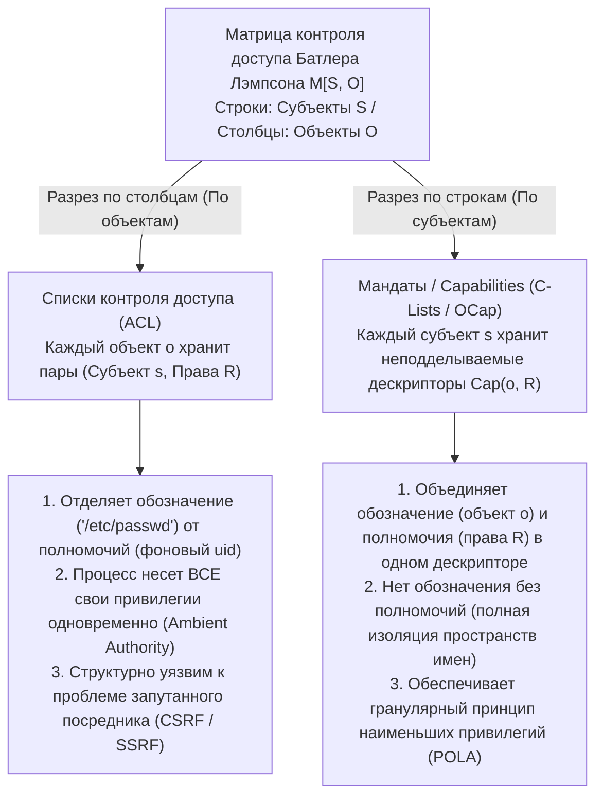

В современных операционных системах, облачных инфраструктурах и веб-приложениях катастрофические уязвимости безопасности следуют удивительно повторяющемуся шаблону. Межсайтовая подделка запросов (CSRF), серверная подделка запросов (SSRF), SQL- и командные инъекции, побеги из контейнеров и атаки на цепочки поставок ПО в экосистемах `npm` или `PyPI` на первый взгляд относятся к совершенно разным уровням программного стека. Однако под поверхностными деталями скрывается один и тот же фундаментальный архитектурный изъян.

Этот изъян заключается в полувековой зависимости индустрии от <strong>списков контроля доступа (Access Control Lists, ACL)</strong> в сочетании с <strong>фоновыми (окружающими) полномочиями (Ambient Authority)</strong> — парадигмы проектирования, в которой решение о доступе зависит от того, <strong>кто вы (идентичность субъекта)</strong>, а не от того, <strong>чем вы владеете (предъявленный мандат)</strong>, и в которой <strong>обозначение ресурса (Designation)</strong> через подделываемый строковый путь или URL оторвано от <strong>полномочий (Authority)</strong>.

В этой статье мы систематически разберем альтернативную парадигму, устраняющую эту структурную уязвимость на корню: <strong>безопасность на основе мандатов / возможностей (Capability-Based Security)</strong>. Начав с математической декомпозиции матрицы контроля доступа Батлера Лэмпсона $M[S, O]$ (1971), мы проследим классическую *проблему запутанного посредника (Confused Deputy Problem)* Норма Харди (1988), сформулируем объектно-мандатную модель (OCap) Марка Миллера и принцип наименьших полномочий (POLA), построим конкретные шаблоны кода для редукции прав (фасеты) и мгновенного или транзитивного отзыва (Caretaker Ределла и мембраны), а также рассмотрим современные промышленные реализации в формально верифицированном микроядре <strong>seL4</strong>, <strong>FreeBSD Capsicum</strong>, аппаратных указателях <strong>CHERI / ARM Morello</strong> и <strong>WebAssembly WASI</strong>.

---

## 1. Две парадигмы полномочий: удостоверения личности против сервисного ключа парковщика (Valet Key)

Прежде чем углубляться в формальную теорию операционных систем, сравним два противоположных способа обеспечения физической безопасности в реальном мире.

### Парадигма A: Удостоверения личности и дверные ведомости (Модель ACL)
Представьте себе строго охраняемое корпоративное здание, где у каждой двери стоит охранник со списком сотрудников, допущенных в комнату 302 (<strong>список контроля доступа, ACL</strong>). Когда вы просите открыть комнату 302, охранник проверяет ваш пропуск (<strong>Identity / `uid`</strong>) и сверяет ваше имя со списком.

Допустим, вы хотите поручить стажеру (вспомогательной программе или сторонней библиотеке) принести один-единственный файл `Q3_Budget.pdf` из шкафа в комнате 302. Поскольку стажера нет в списке, вам приходится одолжить ему собственный пропуск (аналог `setuid` в UNIX или запуска кода от имени вашего пользователя). В тот момент, когда стажер входит в комнату 302 с вашим пропуском, он автоматически получает <strong>фоновые полномочия (Ambient Authority)</strong> над всеми документами в этой комнате, включая базу зарплат `Payroll_Master.db`. Хуже того, если злоумышленник подменит записку стажера и обманом заставит его вынести `Payroll_Master.db`, охранник спокойно пропустит его, ведь на стажере надет ваш пропуск!

### Парадигма B: Сервисный ключ парковщика / Valet Key (Мандатная модель Capability)
Сравните это с передачей автомобиля парковщику у отеля. Вы не звоните в дорожную инспекцию, чтобы внести права парковщика в список доступа вашей машины, и не отдаете ему свой паспорт. Вместо этого вы вручаете ему <strong>сервисный ключ парковщика (Valet Key)</strong>, воплощающий три фундаментальных архитектурных свойства:
1. <strong>Единство обозначения и полномочий (Unification of Designation and Authority)</strong>: Ключ одновременно *указывает*, какой именно автомобиль нужно завести, и *уполномочивает* владельца ключа запустить двигатель. Машине все равно, *кто* держит ключ; обладание неподделываемым токеном является необходимым и достаточным доказательством прав.
2. <strong>Редукция / ослабление прав (Attenuation / Least Privilege)</strong>: В отличие от мастер-ключа, ключ парковщика не открывает багажник или бардачок и ограничивает максимальную скорость. Он предоставляет ровно тот минимум полномочий, который необходим для парковки.
3. <strong>Децентрализованное делегирование</strong>: При смене дежурства первый парковщик просто передает ключ второму без редактирования центральной базы данных.

В информатике парадигма A — это модель <strong>ACL</strong>, а парадигма B — модель <strong>Capability-Based Security</strong>.

---

## 2. Матрица контроля доступа Батлера Лэмпсона $M[S, O]$ и два способа её декомпозиции

В 1971 году лауреат премии Тьюринга Батлер Лэмпсон опубликовал работу *"Protection"*, предложив <strong>матрицу контроля доступа (Access Control Matrix)</strong> в качестве универсальной математической абстракции механизмов защиты. Состояние защиты системы задается тройкой $(S, O, M)$:
- <strong>Множество субъектов $S = \{s_1, s_2, \dots, s_m\}$</strong>: Активные сущности, инициирующие операции (пользователи, процессы, потоки, программные модули).
- <strong>Множество объектов $O = \{o_1, o_2, \dots, o_n\}$</strong>: Защищаемые ресурсы (файлы, сегменты памяти, сокеты IPC, устройства), обычно $S \subseteq O$.
- <strong>Универсальное множество прав $\mathcal{R} = \{\mathsf{read}, \mathsf{write}, \mathsf{execute}, \mathsf{append}, \mathsf{grant}, \mathsf{own}\}$</strong>: Дискретные операции над объектами.
- <strong>Матрица контроля доступа $M : S \times O \to 2^{\mathcal{R}}$</strong>: Каждая ячейка $M[s, o] \subseteq \mathcal{R}$ определяет точное подмножество операций, которые субъект $s \in S$ вправе выполнять над объектом $o \in O$.

Рассмотрим систему с тремя субъектами $S = \{\text{Alice}, \text{Compiler}, \text{Logger}\}$ и тремя файлами $O = \{\texttt{src.f}, \texttt{/SYSX/STAT}, \texttt{/SYSX/BILL}\}$:

$$
M[S, O] = \begin{array}{c|ccc}
 & \texttt{src.f} & \texttt{/SYSX/STAT} & \texttt{/SYSX/BILL} \\
\hline
\text{Alice} & \{\mathsf{read}, \mathsf{write}\} & \emptyset & \emptyset \\
\text{Compiler} & \{\mathsf{read}\} & \{\mathsf{append}\} & \{\mathsf{read}, \mathsf{write}\} \\
\text{Logger} & \emptyset & \{\mathsf{read}, \mathsf{write}\} & \emptyset
\end{array}
$$

Поскольку в реальных ОС матрица $M[S, O]$ огромна и крайне разрежена, архитекторы вынуждены разлагать её вдоль одной из двух осей: <strong>разрезать по столбцам (прикрепляя списки к объектам)</strong> или <strong>разрезать по строкам (раздавая мандаты субъектам)</strong>.



### 2.1 Разрезание по столбцам: списки контроля доступа (ACL)
Разрезая матрицу $M[S, O]$ вертикально <strong>по столбцам</strong>, мы связываем с каждым объектом $o \in O$ список непустых элементов его столбца:

$$
\text{ACL}(o) = \bigl\{ (s, M[s, o]) \;\big|\; s \in S,\; M[s, o] \neq \emptyset \bigr\}
$$

Права UNIX/POSIX, Windows NTFS DACL и политики облачного IAM построены по столбцам. Это порождает <strong>разделение обозначения и полномочий</strong>: программа указывает объект с помощью публичной строки вроде `"/SYSX/BILL"`, а монитор обращений ядра проверяет фоновую идентичность (`uid`) вызывающего процесса. В результате процесс при каждом системном вызове автоматически применяет объединение всех прав своей строки $\bigcup_{o \in O} M[s, o]$ — <strong>фоновые полномочия (Ambient Authority)</strong>.

### 2.2 Разрезание по строкам: мандаты / Capabilities (Деннис и Ван Хорн, 1966)
В 1966 году Джек Деннис и Эрл Ван Хорн предложили двойственную декомпозицию: горизонтальное разрезание $M[S, O]$ <strong>по строкам</strong>. Каждому субъекту $s \in S$ сопоставляется <strong>пространство мандатов (CSpace или C-List)</strong>:

$$
\text{CSpace}(s) = \bigl\{ \text{Cap}(o, R) \;\big|\; o \in O,\; R = M[s, o] \neq \emptyset \bigr\}
$$

Каждый элемент $c = \text{Cap}(o, R)$ представляет собой <strong>мандат (Capability)</strong> — <strong>неподделываемый токен полномочий</strong>, неразрывно связывающий <strong>обозначение</strong> (прямой указатель или дескриптор объекта $o$) и <strong>полномочия</strong> (разрешенное подмножество прав $R \subseteq \mathcal{R}$). Если субъект $s$ не владеет мандатом на объект $o$, он не может даже назвать или адресовать $o$: <strong>Нет обозначения без полномочий; нет полномочий без обозначения</strong>.

| Архитектурное измерение | Списки контроля доступа (ACL — по столбцам) | Мандаты / Capabilities (OCap — по строкам) |
| :--- | :--- | :--- |
| <strong>Декомпозиция $M[S, O]$</strong> | Хранится по столбцам при каждом объекте $o \in O$ | Хранится по строкам у каждого субъекта $s \in S$ |
| <strong>Философия авторизации</strong> | <strong>Кто вы (Who You Are)</strong>: проверка `uid` вызывающего | <strong>Чем вы владеете (What You Hold)</strong>: предъявленный токен-мандат |
| <strong>Обозначение и полномочия</strong> | <strong>Разделены</strong> (Подделываемый строковый путь + Фоновый `uid`) | <strong>Объединены</strong> (Дескриптор именует $o$ и дает права $R$) |
| <strong>Модель полномочий</strong> | <strong>Фоновые полномочия</strong>: все права `uid` активны всегда | <strong>Избирательные полномочия</strong>: активен лишь переданный мандат |
| <strong>Уязвимость к Confused Deputy</strong> | <strong>Структурно уязвима</strong> (CSRF, SSRF, `setuid`-эскалация) | <strong>Структурно иммунна</strong> (Клиент обязан передать готовый дескриптор) |
| <strong>Примеры систем</strong> | UNIX/POSIX ACL, Windows NTFS DACL, AWS IAM | KeyKOS, seL4, FreeBSD Capsicum, Fuchsia Zircon, CHERI, WASI |

---

## 3. Проблема запутанного посредника (Confused Deputy): классика Норма Харди (1988)

Почему разделение обозначения и полномочий так опасно? Компьютерный архитектор Норм Харди дал исчерпывающее объяснение в октябре 1988 года в журнале *ACM SIGOPS Operating Systems Review* в статье <strong>*"The Confused Deputy (or why capabilities might have been invented)"</strong>*, описав реальную катастрофу середины 1970-х годов в коммерческой ОС Tymshare.

### 3.1 Анатомия катастрофы с компилятором `/SYSX/FORT`
В системе Tymshare компилятор Фортрана находился по пути `/SYSX/FORT`:
1. <strong>Требование сбора статистики</strong>: Администраторы хотели, чтобы при каждой компиляции `/SYSX/FORT` дописывал статистическую запись в файл `/SYSX/STAT`.
2. <strong>Предоставление фоновых полномочий</strong>: Для этого исполняемому файлу `/SYSX/FORT` были даны <strong>фоновые права на запись во весь каталог `/SYSX`</strong> (аналог бита `setuid` в UNIX).
3. <strong>Пользовательское имя выходного файла</strong>: Компилятор принимал от пользователя строковый аргумент с путем файла для записи отладочного листинга (например, `FORT(SRC="prog.f", OUT="listing.txt")`).
4. <strong>Главная ценность в `/SYSX/BILL`</strong>: В том же каталоге `/SYSX` хранилась главная база данных биллинга клиентов <strong>`/SYSX/BILL`</strong>.

Однажды пользователь запустил `/SYSX/FORT` и передал строку <strong>`"/SYSX/BILL"`</strong> в качестве имени файла для отладочного вывода. Когда компилятор вызвал `open("/SYSX/BILL", WRITE)`, монитор ACL операционной системы проверил: *«Имеет ли процесс `/SYSX/FORT` право записи в `/SYSX`?»* Ответ был <strong>«Да»</strong> — и <strong>компилятор послушно перезаписал главную базу биллинга компании `/SYSX/BILL` диагностическими сообщениями Фортрана!</strong>



```mermaid
flowchart TD
    subgraph ACL_WORLD["Модель ACL + Фоновые полномочия (Запутанный посредник)"]
        U1["Злоумышленник<br/>(Нет доступа к /SYSX/BILL)"] -->|"1. Передает строку пути OUT='/SYSX/BILL'"| D1["Посредник: Компилятор /SYSX/FORT<br/>(Фоновые права: запись в /SYSX/*)"]
        D1 -->|"2. open('/SYSX/BILL', WRITE)<br/>Неявно использует свои фоновые полномочия"| OS1["Монитор обращений ОС (Проверка ACL)"]
        OS1 -->|"3. У компилятора есть права на /SYSX -> РАЗРЕШЕНО!"| BILL1["База биллинга /SYSX/BILL<br/>[УНИЧТОЖЕНА / ПЕРЕЗАПИСАНА!]"]
    end

    subgraph CAP_WORLD["Мандатная модель (Единство обозначения и полномочий)"]
        U2["Пользователь<br/>(Владеет мандатами только на свои файлы)"] -->|"1. Передает выходной мандат cap_out<br/>(Не может передать мандат на /SYSX/BILL, так как не владеет им!)"| D2["Посредник: Компилятор /SYSX/FORT<br/>(Наделен ТОЛЬКО мандатом cap_stat)"]
        D2 -->|"2a. write(cap_out, debug_output)<br/>Использует полномочия, явно переданные пользователем"| OUT2["Выходной файл listing.txt"]
        D2 -->|"2b. append(cap_stat, usage_stats)<br/>Использует приватный мандат, выданный при установке"| STAT2["Файл статистики /SYSX/STAT"]
    end
```

### 3.2 Почему компилятор «запутался»? И современные потомки этой уязвимости
Харди назвал `/SYSX/FORT` <strong>запутанным посредником (Confused Deputy)</strong>, поскольку он одновременно действовал от лица двух доверителей (системного администратора и пользователя), но из-за разделения строкового пути и полномочий ОС применила высокие привилегии компилятора к вредоносному пути пользователя. В мандатной архитектуре эта ошибка невозможна: компилятор наделяется только приватным мандатом $c_{\text{stat}} = \text{Cap}(\texttt{/SYSX/STAT}, \{\mathsf{append}\})$, а пользователь обязан сам открыть выходной файл и передать готовый мандат записи $c_{\text{out}} = \text{Cap}(f_{\text{out}}, \{\mathsf{write}\})$.

Самые разрушительные классы современных уязвимостей — это прямые воплощения запутанного посредника:
- <strong>Cross-Site Request Forgery (CSRF)</strong>: Браузер выступает запутанным посредником, автоматически прикрепляя ваши фоновые полномочия (сессионные cookie сайта `bank.example`) к запросу, инициированному страницей `evil.example`. CSRF-токены решают проблему, требуя от самой формы предъявить неподделываемый мандат.
- <strong>Server-Side Request Forgery (SSRF)</strong>: Облачный веб-сервер запрашивает переданный пользователем URL (`"http://169.254.169.254/latest/meta-data/"`), используя собственные фоновые сетевые права внутри облачной VPC для кражи ключей IAM.
- <strong>Атаки на цепочки поставок (`npm` / `PyPI`)</strong>: Крошечная библиотека форматирования строк может прочитать `~/.ssh/id_rsa`, потому что в модели POSIX ACL любая функция внутри процесса наследует все фоновые права вашего `uid`.

---

## 4. Объектно-мандатная модель (OCap), редукция прав и отзыв мандатов

В своей докторской диссертации 2006 года в Университете Джонса Хопкинса (*"Robust Composition"*) Марк С. Миллер доказал, что <strong>объектно-ориентированные языки с безопасной работой с памятью уже содержат точный механизм для реализации принципа наименьших полномочий (POLA) на уровне отдельных объектов: саму объектную ссылку</strong>.

### 4.1 Три инварианта OCap и три закона приобретения мандатов
Чтобы язык с безопасной памятью (например, Hardened JavaScript / SES, язык E или компоненты Wasm) стал полноценной системой <strong>Object-Capability (OCap)</strong>, среда выполнения должна обеспечивать три инварианта:
1. <strong>Невозможность подделки ссылок</strong>: Нельзя сконструировать ссылку из целого числа или с помощью адресной арифметики.
2. <strong>Отсутствие изменяемого глобального состояния (Нулевые фоновые полномочия)</strong>: Глобальная область видимости не должна содержать изменяемых переменных или фоновых модулей ввода-вывода (`fs`, `net`), а базовые прототипы (`Object.prototype`) должны быть глубоко заморожены (`Object.freeze`).
3. <strong>Абсолютная инкапсуляция</strong>: Приватные переменные лексического замыкания или поля `#private` недоступны извне через рефлексию.

В графе ссылок $G = (V, E)$ новая дуга $(A \to C)$ может появиться только тремя путями: <strong>1. Порождение (Parenthood, `new C()`)</strong>, <strong>2. Наделение при создании (Endowment в замыкании)</strong> или <strong>3. Знакомство (Introduction, когда посредник $B$, владеющий $(B \to A)$ и $(B \to C)$, передает $C$ как аргумент сообщения для $A$)</strong>:

$$
\text{Закон знакомства (Law of Introduction)}: \quad (B \to A) \;\land\; (B \to C) \;\;\Longrightarrow\;\; B \text{ может установить } (A \to C)
$$

### 4.2 Редукция прав через фасеты и отзыв через Caretaker Ределла и мембраны
Вопреки распространенному мифу, мандаты легко ограничиваются и отзываются, что еще в 1974 году показал <strong>Дэвид Ределл</strong> с помощью шаблона <strong>Caretaker (Смотритель)</strong> и обобщил Марк Миллер с помощью <strong>отзываемых мембран (Revocable Membranes)</strong>:

```javascript
// 1. Ослабляющий фасет (Attenuating Facet): чтение только ключей с заданным префиксом
function makeScopedReadFacet(fullStorageCap, allowedPrefix) {
  return Object.freeze({
    read(key) {
      if (typeof key !== "string" || !key.startsWith(allowedPrefix)) {
        throw new Error(`Отказ в доступе: ключ должен начинаться с '${allowedPrefix}'`);
      }
      return fullStorageCap.read(key);
    }
    // методы write() и deleteAll() полностью отсутствуют в фасете!
  });
}

// 2. Шаблон Caretaker Ределла (1974) для мгновенного отзыва мандата за O(1)
function makeCaretaker(targetCap) {
  let currentTarget = targetCap; // Приватный изменяемый указатель внутри замыкания
  const caretaker = Object.freeze({
    read(...args) {
      if (currentTarget === null) throw new Error("RevokedCapabilityError: Доступ отозван");
      return currentTarget.read(...args);
    },
    write(...args) {
      if (currentTarget === null) throw new Error("RevokedCapabilityError: Доступ отозван");
      return currentTarget.write(...args);
    }
  });
  const revoker = Object.freeze({
    revoke() { currentTarget = null; } // Разрывает связь и освобождает объект для GC
  });
  return Object.freeze({ caretaker, revoker });
}
```

Если мандат возвращает дочерние мандаты (например, каталог возвращает подкаталоги), <strong>отзываемая мембрана</strong> с помощью `Proxy` и `WeakMap` транзитивно оборачивает все возвращаемые значения и аргументы, мгновенно отключая весь подграф при вызове `revoke()`.

---

## 5. Промышленные реализации: seL4, FreeBSD Capsicum, CHERI и WebAssembly WASI

Прежде всего устраним путаницу в терминах: `capabilities(7)` в ядре Linux (`CAP_NET_ADMIN` и др.) <strong>НЕ являются объектными мандатами</strong>! Они лишь дробят фоновые привилегии `root` на ~41 битовый флаг потока без привязки к конкретным объектам. Истинные промышленные мандатные архитектуры воплощены в четырех системах:

1. <strong>Формально верифицированное микроядро seL4</strong>: Первое в мире ядро ОС с полным машинно-проверенным математическим доказательством корректности (в Isabelle/HOL). В seL4 нет фоновых полномочий: доступ ко всем ресурсам (потокам, адресным пространствам, портам IPC, физическим страницам) осуществляется исключительно через мандаты в <strong>CSpace (таблицах CNode)</strong> потока с редукцией прав через `seL4_CNode_Mint` и транзитивным отзывом через дерево деривации <strong>CDT (`seL4_CNode_Revoke`)</strong>.
2. <strong>FreeBSD Capsicum</strong>: Разработанный в Кембриджском университете и Google механизм Capsicum превращает файловые дескрипторы UNIX (`fd`) в настоящие мандаты. После вызова <strong>`cap_enter()`</strong> ядро необратимо блокирует любые системные вызовы к глобальным пространствам имен (`open()`, `connect()`, `bind()` возвращают `ECAPMODE`). Процесс может работать только с уже открытыми дескрипторами (и относительными путями внутри них через `openat(dir_fd, ...)` без выхода по `".."`), сужая более 60 битов прав вызовом `cap_rights_limit(fd, &rights)`.
3. <strong>Мандаты в кремнии: CHERI и ARM Morello</strong>: Совместный проект SRI International и Кембриджского университета, реализованный компанией ARM в процессоре <strong>Morello</strong> и в <strong>CHERIoT-RISC-V</strong>, заменяет 64-битные указатели на <strong>128-битные аппаратные мандаты с 1-битным внеполосным тегом достоверности (Tag Bit)</strong>:

$$
\underbrace{\text{Tag (1 bit)}}_{\text{Аппаратный бит подлинности}} \;\Big|\; \underbrace{\text{Permissions (18 bits)}}_{\text{Load, Store, Exec, Cap-RW}} \;\Big|\; \underbrace{\text{Object Type (18 bits)}}_{\text{Аппаратная печать}} \;\Big|\; \underbrace{\text{Compressed Bounds (28 bits)}}_{\text{Сжатые границы [Base, Top)}} \;\Big|\; \underbrace{\text{Address Cursor (64 bits)}}_{\text{64-битный виртуальный адрес}}
$$

При каждом обращении к памяти процессор за один такт проверяет вхождение адреса в интервал `[Base, Top)` и биты разрешений. Попытка перезаписать хотя бы один байт мандата в RAM обычной целочисленной инструкцией автоматически сбрасывает бит Tag в `0`, делая поддельный указатель непригодным для разыменования и физически искореняя переполнения буфера и ROP-атаки.
4. <strong>WebAssembly (WASI) и криптографические Macaroons</strong>: Модули WASI запускаются с нулевыми фоновыми полномочиями и имеют доступ только к явно переданным хостом дескрипторам открытых каталогов. В распределенных облачных средах токены <strong>Macaroons</strong> от Google используют вложенные цепочки HMAC-подписей, позволяя клиенту самостоятельно ослаблять полномочия токена добавлением контекстных ограничений (Caveats) без обращения к центральному серверу.
