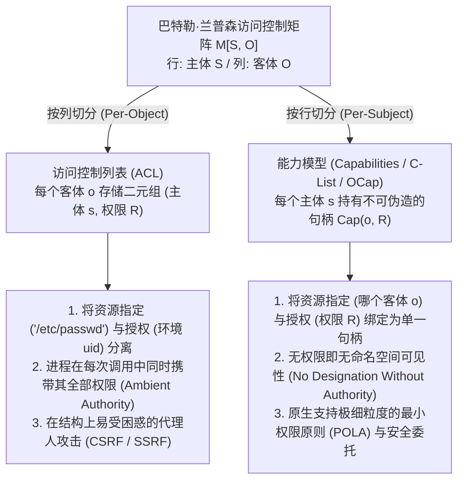
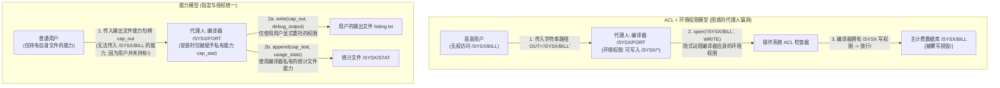

在现代操作系统、云基础设施与Web应用程序中，毁灭性的安全漏洞往往呈现出惊人相似的结构模式。跨站请求伪造（CSRF）、服务端请求伪造（SSRF）、SQL与命令注入、容器逃逸，以及 `npm` 或 `PyPI` 生态中的软件供应链攻击，表面上处于软件栈的不同层级，但其底层却共享着同一个架构缺陷。

这一缺陷源于计算机工业半个多世纪以来对<strong>访问控制列表（Access Control Lists, ACL）</strong>与<strong>环境权限（Ambient Authority）</strong>的过度依赖——即根据<strong>“你是谁（主体身份 Subject Identity）”</strong>而非<strong>“你持有什么（所持凭证 What You Hold）”</strong>来裁决访问权限，并将<strong>资源指定（Designation，如可伪造的字符串路径或URL）</strong>与<strong>访问授权（Authority，调用方携带的环境身份）</strong>彻底割裂。

本文将系统剖析能够从根源上消除这一结构性漏洞的替代范式：<strong>基于能力的安全（Capability-Based Security）</strong>。我们将从巴特勒·兰普森（Butler Lampson）1971年提出的访问控制矩阵 $M[S, O]$ 的数学分解出发，还原诺姆·哈迪（Norm Hardy）1988年经典的“困惑的代理人问题（Confused Deputy Problem）”，阐述马克·米勒（Mark S. Miller）的对象能力模型（OCap）与最小权限原则（POLA），展示权限衰减（Facet）与即时/传递性撤销（Redell Caretaker 与 Membrane）的代码模式，并考察形式化验证微内核 <strong>seL4</strong>、<strong>FreeBSD Capsicum</strong>、<strong>CHERI / ARM Morello</strong> 硬件能力指针以及 <strong>WebAssembly WASI</strong> 的现代工程实现。

---

## 1. 两种权限范式：身份胸牌 vs. 泊车钥匙（Valet Key）

在进入操作系统形式化理论之前，不妨对比现实物理世界中的两种安防机制。

### 范式 A：身份胸牌与门禁名册（ACL 模型）
假设在一座高安全级别的办公大楼里，每扇门前都有一名保安手持登记册（即<strong>访问控制列表 ACL</strong>）。当你要求进入 302 室时，保安检查你的员工胸牌（<strong>身份 Identity / `uid`</strong>），核对你的名字是否在 302 室的准入名单上。

现在，你想让一名实习生（辅助程序或第三方库）去 302 室的文件柜里取一份 `Q3_Budget.pdf`。由于实习生不在名单上，你只能把自己的员工胸牌借给实习生（如同 UNIX 的 `setuid` 或以当前用户身份运行子程序）。一旦实习生戴上你的胸牌进入 302 室，他就自动获得了对该房间内<strong>所有机密文件</strong>的<strong>环境权限（Ambient Authority）</strong>。更糟的是，如果外部攻击者篡改了便签，诱骗实习生去取走 `Payroll_Master.db`（主薪资数据库），门口的保安依然会放行，因为实习生佩戴着你的合法胸牌！

### 范式 B：汽车代客泊车钥匙（Capability 模型）
对比之下，当你把车交给酒店泊车员时，你不会去车管所修改车辆的访问控制名单，也不会把自己的身份证交给泊车员，而是递给他一把<strong>泊车钥匙（Valet Key）</strong>。这把钥匙体现了三个核心架构特性：
1. <strong>指定与授权的统一（Unification of Designation and Authority）</strong>：钥匙既唯一指定了要操作哪辆车，又同时授予了启动引擎的权限。车辆不关心持有人是谁，持有不可伪造的钥匙本身就是权限的充要证明。
2. <strong>权限衰减（Attenuation / 最小权限）</strong>：泊车钥匙无法打开后备箱或手套箱，甚至限制了最高车速。它仅授予完成泊车所需的最小权限。
3. <strong>去中心化委托（Decentralized Delegation）</strong>：泊车员交接班时，只需直接传递这把钥匙，无需修改任何中央权限数据库。

在计算机科学中，范式 A 即 <strong>ACL 模型</strong>，而范式 B 则是<strong>基于能力的安全（Capability）模型</strong>。

---

## 2. 兰普森访问控制矩阵 $M[S, O]$ 的两种正交分解

1971年，图灵奖得主巴特勒·兰普森发表了《Protection》，提出了<strong>访问控制矩阵（Access Control Matrix）</strong>作为操作系统保护机制的通用数学抽象（后经 Harrison、Ruzzo 与 Ullman 形式化为 HRU 模型）。系统的保护状态由三元组 $(S, O, M)$ 定义：
- <strong>主体集合 $S = \{s_1, s_2, \dots, s_m\}$</strong>：发起操作的主动实体（用户、进程、线程、软件模块）。
- <strong>客体集合 $O = \{o_1, o_2, \dots, o_n\}$</strong>：受保护的资源（文件、内存段、IPC 端点、套接字、硬件设备）。通常 $S \subseteq O$。
- <strong>权限全集 $\mathcal{R} = \{\mathsf{read}, \mathsf{write}, \mathsf{execute}, \mathsf{append}, \mathsf{grant}, \mathsf{own}\}$</strong>：允许在客体上执行的离散操作。
- <strong>访问控制矩阵 $M : S \times O \to 2^{\mathcal{R}}$</strong>：矩阵元素 $M[s, o] \subseteq \mathcal{R}$ 定义了主体 $s \in S$ 对客体 $o \in O$ 拥有的确切权限子集。

例如，包含三个主体 $S = \{\text{Alice}, \text{Compiler}, \text{Logger}\}$ 与三个文件客体 $O = \{\texttt{src.f}, \texttt{/SYSX/STAT}, \texttt{/SYSX/BILL}\}$ 的矩阵如下：

$$
M[S, O] = \begin{array}{c|ccc}
 & \texttt{src.f} & \texttt{/SYSX/STAT} & \texttt{/SYSX/BILL} \\
\hline
\text{Alice} & \{\mathsf{read}, \mathsf{write}\} & \emptyset & \emptyset \\
\text{Compiler} & \{\mathsf{read}\} & \{\mathsf{append}\} & \{\mathsf{read}, \mathsf{write}\} \\
\text{Logger} & \emptyset & \{\mathsf{read}, \mathsf{write}\} & \emptyset
\end{array}
$$

在实际系统中，$|S|$ 与 $|O|$ 动辄数百万且矩阵极度稀疏，直接存储二维数组需要 $\mathcal{O}(|S| \times |O|)$ 空间。因此，架构师必须沿着两个正交维度之一对稀疏矩阵 $M[S, O]$ 进行切分：<strong>按列切分（依附于客体的列表）</strong>，或<strong>按行切分（由主体持有的令牌）</strong>。



### 2.1 按列切分：访问控制列表（ACL）
沿着矩阵 $M[S, O]$ 的<strong>列（Column）</strong>垂直切分，即为每个客体 $o \in O$ 关联一份非空权限条目列表：

$$
\text{ACL}(o) = \bigl\{ (s, M[s, o]) \;\big|\; s \in S,\; M[s, o] \neq \emptyset \bigr\}
$$

UNIX/POSIX 权限、Windows NTFS DACL 与云端 IAM 资源策略均采用按列切分。这种设计导致了<strong>指定（Designation）与授权（Authority）的分离</strong>：程序通过全局公开的字符串路径（如 `"/SYSX/BILL"`）指定目标，而内核引用监控器（Reference Monitor）则检查调用方进程的<strong>环境身份</strong>（`uid`、`euid`、会话 Cookie）是否在目标的 ACL 中。这意味着进程在每一次系统调用中都默认挥舞着其整行权限的并集 $\bigcup_{o \in O} M[s, o]$，即<strong>环境权限（Ambient Authority）</strong>。

### 2.2 按行切分：能力（Capabilities，Dennis & Van Horn 1966）
1966年，Jack B. Dennis 与 Earl C. Van Horn 在论文《Programming Semantics for Multiprogrammed Computations》中提出了对偶方案：沿着矩阵 $M[S, O]$ 的<strong>行（Row）</strong>水平切分，为每个主体 $s \in S$ 分配一个<strong>能力空间（CSpace 或 C-List）</strong>：

$$
\text{CSpace}(s) = \bigl\{ \text{Cap}(o, R) \;\big|\; o \in O,\; R = M[s, o] \neq \emptyset \bigr\}
$$

其中每个元素 $c = \text{Cap}(o, R)$ 称为一个<strong>能力（Capability）</strong>——它是一个<strong>不可伪造的权限令牌</strong>，将<strong>指定</strong>（指向特定客体 $o$ 的指针或句柄）与<strong>授权</strong>（允许的操作子集 $R \subseteq \mathcal{R}$）不可分割地绑定在一起。在纯能力系统中，没有全局文件路径命名空间，访问时也不检查调用者的用户身份。若主体 $s$ 未持有客体 $o$ 的能力，它甚至无法在命名空间中“指名”客体 $o$。这确立了能力安全的核心公理：<strong>无授权即无指定，无指定即无授权（No Designation Without Authority）</strong>。

| 架构维度 | 访问控制列表（ACL —— 按列切分） | 基于能力的安全（Capabilities / OCap —— 按行切分） |
| :--- | :--- | :--- |
| <strong>矩阵 $M[S, O]$ 的分解方式</strong> | 按列存储在每个受保护客体 $o \in O$ 上 | 按行存储在每个主体 $s \in S$ 的能力空间中 |
| <strong>核心授权哲学</strong> | <strong>你是谁（Who You Are）</strong>：检查调用方身份 `uid` | <strong>你持有什么（What You Hold）</strong>：检查出示的能力令牌 |
| <strong>资源指定与授权的关系</strong> | <strong>彻底分离</strong>（可伪造的字符串路径 + 环境身份） | <strong>完全统一</strong>（不可伪造的句柄同时指定 $o$ 并授予 $R$） |
| <strong>权限激活模型</strong> | <strong>环境权限（Ambient Authority）</strong>：所有权限时刻激活 | <strong>选择性权限（Selective Authority）</strong>：仅显式传递的句柄生效 |
| <strong>困惑的代理人脆弱性</strong> | <strong>结构性脆弱</strong>（易触发 CSRF、SSRF、`setuid` 提权） | <strong>结构性免疫</strong>（调用方必须亲自传递已授权的客体句柄） |
| <strong>代表性系统实现</strong> | UNIX/POSIX ACL, Windows NTFS DACL, AWS IAM | KeyKOS, seL4, FreeBSD Capsicum, Fuchsia Zircon, CHERI, WASI |

---

## 3. 困惑的代理人问题（Confused Deputy）：Norm Hardy 的 1988 经典案例与现代变体

为什么分离“指定”与“授权”会带来灾难？计算机架构师诺姆·哈迪（Norm Hardy）在1988年10月发表于 *ACM SIGOPS Operating Systems Review* 的经典论文《The Confused Deputy (or why capabilities might have been invented)》中，记录了20世纪70年代中期发生在 Tymshare 商业操作系统上的一起真实安全事故。

### 3.1 `/SYSX/FORT` 编译器覆写计费数据库事故
在 Tymshare 系统中，Fortran 编译器位于 `/SYSX/FORT`：
1. <strong>统计收集需求</strong>：系统管理员希望每次用户编译程序时，编译器都能向 `/SYSX/STAT` 文件追加一条统计记录。
2. <strong>授予环境权限</strong>：为此，管理员为 `/SYSX/FORT` 可执行文件授予了对整个 `/SYSX` 目录的<strong>环境写入权限</strong>（类似于 UNIX 的 `setuid`）。
3. <strong>用户自定义输出路径</strong>：编译器允许用户传入一个字符串文件名参数，用于保存调试列表输出（例如 `FORT(SRC="prog.f", OUT="listing.txt")`）。
4. <strong>核心资产 `/SYSX/BILL`</strong>：同一个 `/SYSX` 目录下还存放着记录所有客户欠款的主计费数据库 <strong>`/SYSX/BILL`</strong>，普通用户对其没有任何写权限。

某天，一名用户调用 `/SYSX/FORT`，并将输出文件名指定为字符串 <strong>`"/SYSX/BILL"`</strong>。编译器随后执行了 `open("/SYSX/BILL", WRITE)`。操作系统的 ACL 引用监控器拦截该调用并询问：*“当前进程（`/SYSX/FORT`）是否有权写入 `/SYSX` 目录？”* 答案是<strong>肯定的</strong>！于是内核放行，<strong>编译器忠实地用 Fortran 调试输出覆盖并摧毁了公司的核心计费数据库 `/SYSX/BILL`！</strong>



### 3.2 为什么编译器会“困惑”？以及现代漏洞的同构性
哈迪将 `/SYSX/FORT` 称为<strong>困惑的代理人（Confused Deputy）</strong>，因为它同时充当了两个委托人（系统管理员与调用用户）的代理人，但由于操作系统分离了指定（字符串路径）与授权（环境权限），编译器在打开用户指定的路径时，操作系统自动动用了管理员赋予编译器的环境权限。

在能力架构下，这一漏洞从根本上无法被表达：编译器在安装时仅被赋予单个文件句柄 $c_{\text{stat}} = \text{Cap}(\texttt{/SYSX/STAT}, \{\mathsf{append}\})$；用户调用编译器时，必须自己在命名空间中打开输出文件，并将写能力句柄 $c_{\text{out}} = \text{Cap}(f_{\text{out}}, \{\mathsf{write}\})$ 传给编译器。用户没有 `/SYSX/BILL` 的能力句柄，自然无法将其传递给编译器。

现代网络安全中最具破坏力的漏洞类别，本质上都是困惑的代理人：
- <strong>跨站请求伪造（CSRF）</strong>：浏览器是困惑的代理人。当恶意网站 `evil.example` 向 `https://bank.example/transfer` 发起请求时，浏览器看到目标域名字符串，便自动附加上用户的环境权限（`bank.example` 的会话 Cookie）。CSRF Token 之所以有效，正是因为它要求请求显式携带不可伪造的能力令牌。
- <strong>服务端请求伪造（SSRF）</strong>：Web 服务器作为代理人接收用户传入的 URL 字符串（如 `"http://169.254.169.254/latest/meta-data/"`），并动用服务器自身在云内网中的环境网络权限去读取 IAM 密钥。
- <strong>软件供应链攻击（`npm` / `PyPI` 恶意依赖）</strong>：一个仅 20 行代码的字符串格式化第三方库，之所以能读取 `~/.ssh/id_rsa` 并外发，是因为在 POSIX ACL 模型下，进程内的每一个函数都无条件继承了当前用户 `uid` 的全部环境权限。

---

## 4. 对象能力模型（OCap）与权限衰减、即时撤销模式

1975年，Saltzer 与 Schroeder 提出了<strong>最小权限原则（Principle of Least Privilege，在能力社区中更精确地称为最小授权原则 POLA，Principle of Least Authority）</strong>。2006年，马克·米勒（Mark S. Miller）在其约翰斯·霍普金斯大学博士论文《Robust Composition》中证明：<strong>内存安全的面向对象语言天然具备在单个对象与方法调用粒度上实施 POLA 的机制——对象引用（Object Reference）本身就是一种能力。</strong>

### 4.1 满足 OCap 的三大语言不变量与引用传播三定律
要使内存安全语言（如 Hardened JavaScript / SES、E 语言、Wasm 组件或受限 Rust）成为严格的<strong>对象能力（OCap）系统</strong>，运行时必须满足三条不变量：
1. <strong>不可伪造引用（No Forged References）</strong>：禁止将整数强转为对象指针或越界内存访问。
2. <strong>无可变全局状态与零环境权限（No Mutable Global State）</strong>：全局作用域不得包含可变的共享属性或直接调用的 I/O 模块（如 `fs`、`net`），内置原型链必须深度冻结（`Object.freeze`）。
3. <strong>绝对封装（Absolute Encapsulation）</strong>：对象的私有词法闭包状态或私有字段无法从外部通过反射窃取。

在 OCap 引用图 $G = (V, E)$ 中，主体 $A$ 获得客体 $C$ 的引用 $(A \to C)$ 只有三种途径：<strong>1. 创造（Parenthood，`new C()`）</strong>；<strong>2. 禀赋（Endowment，创建闭包时注入）</strong>；<strong>3. 介绍（Introduction，同时持有 $B \to A$ 与 $B \to C$ 的介绍人 $B$ 通过消息传递将 $C$ 交给 $A$）</strong>：

$$
\text{介绍定律 (Law of Introduction)}: \quad (B \to A) \;\land\; (B \to C) \;\;\Longrightarrow\;\; B \text{ 可建立 } (A \to C)
$$

### 4.2 权限衰减（Facet）与 Redell 看门人撤销模式（Caretaker & Membrane）
传统教科书常有一个误区：*“能力一旦交给不可信方，就无法限制其用途，也无法撤销。”* 事实上，David D. Redell 早在1974年的伯克利博士论文中就解决了能力撤销问题。利用词法闭包与代理，我们可以用十余行代码同时实现<strong>细粒度衰减（Facet）</strong>与<strong>即时撤销（Caretaker）</strong>：

```javascript
// 1. 权限衰减切面 (Attenuating Facet): 仅暴露特定前缀的只读能力
function makeScopedReadFacet(fullStorageCap, allowedPrefix) {
  return Object.freeze({
    read(key) {
      if (typeof key !== "string" || !key.startsWith(allowedPrefix)) {
        throw new Error(`拒绝访问: 键名必须以 '${allowedPrefix}' 开头`);
      }
      return fullStorageCap.read(key);
    }
    // write() 与 deleteAll() 被彻底隐藏在闭包之外！
  });
}

// 2. Redell (1974) 看门人模式 (Caretaker Pattern): 实现 O(1) 即时权限撤销
function makeCaretaker(targetCap) {
  let currentTarget = targetCap; // 闭包内的私有可变引用
  const caretaker = Object.freeze({
    read(...args) {
      if (currentTarget === null) throw new Error("能力已被撤销 (Revoked)");
      return currentTarget.read(...args);
    },
    write(...args) {
      if (currentTarget === null) throw new Error("能力已被撤销 (Revoked)");
      return currentTarget.write(...args);
    }
  });
  const revoker = Object.freeze({
    revoke() { currentTarget = null; } // 切断引用链并允许垃圾回收
  });
  return Object.freeze({ caretaker, revoker });
}
```

若目标能力是一个会返回子对象引用的复杂对象图（例如目录句柄通过 `getSubDir()` 返回子目录句柄），马克·米勒提出的<strong>可撤销膜模式（Revocable Membrane）</strong>利用 `Proxy` 与 `WeakMap` 递归地将所有跨过膜边界的返回值与回调参数自动包裹在同一层撤销门控中。一旦调用 `revoke()`，整个子图的所有衍生引用在瞬间全部失效。

---

## 5. 现代工业级部署：seL4、FreeBSD Capsicum、CHERI 与 WebAssembly WASI

首先必须澄清一个常见的术语混淆：Linux 内核中的 `capabilities(7)`（如 `CAP_NET_ADMIN`、`CAP_DAC_OVERRIDE`）<strong>并不是对象能力</strong>，它们只是将 `root` 的环境权限拆分为约 41 个线程级标志位，不指定任何具体客体，依然完全暴露于困惑的代理人漏洞之下。真正的工业级能力架构体现在以下四大系统中：

1. <strong>seL4 形式化验证微内核</strong>：全球首个拥有完整 Isabelle/HOL 机器证明的操作系统微内核。seL4 内核实行零环境权限，所有内核资源（线程控制块 TCB、虚拟地址空间 VSpace、IPC 端点、物理内存页帧）均只能通过线程 <strong>CSpace（CNode 表）</strong>中的能力句柄访问。通过 `seL4_CNode_Mint` 可对能力进行权限位掩码衰减或附加不可伪造的身份徽章（Badge），并通过内核维护的<strong>能力派生树（CDT）</strong>执行传递性撤销 `seL4_CNode_Revoke`。
2. <strong>FreeBSD Capsicum 沙箱框架</strong>：由剑桥大学与 Google 研发，将标准 UNIX 文件描述符（`fd`）提升为真正的能力。进程调用 `cap_enter()` 进入能力模式后，内核将无条件拦截所有访问全局命名空间的系统调用（如 `open()`、`connect()`、`bind()`，返回 `ECAPMODE` 错误）。进程只能操作已持有的文件描述符，并通过 `openat(dir_fd, "sub/file", ...)` 在受限子目录内进行相对查找（严禁 `".."` 逃逸），同时利用 `cap_rights_limit(fd, &rights)` 细粒度剥离超过 60 种描述符权限位。
3. <strong>CHERI 与 ARM Morello 硅片级硬件能力指针</strong>：由剑桥大学与 SRI 联合设计、ARM 在 <strong>Morello</strong> 处理器（7nm 四核架构）及 <strong>CHERIoT-RISC-V</strong> 中流片实现的硬件架构。CHERI 将传统的 64 位整数指针替换为 <strong>128 位硬件能力寄存器 + 1 位带外有效性标签（Tag Bit）</strong>：

$$
\underbrace{\text{Tag (1 bit)}}_{\text{硬件防伪标签位}} \;\Big|\; \underbrace{\text{Permissions (18 bits)}}_{\text{读写执行权限掩码}} \;\Big|\; \underbrace{\text{Object Type (18 bits)}}_{\text{硬件封装类型}} \;\Big|\; \underbrace{\text{Compressed Bounds (28 bits)}}_{\text{浮点压缩基址与上界 [Base, Top)}} \;\Big|\; \underbrace{\text{Address Cursor (64 bits)}}_{\text{64位虚拟地址游标}}
$$

每次内存加载、存储或取指时，CPU 在单周期内并行校验地址游标是否严格位于 `[Base, Top)` 区间内且符合权限掩码；若程序试图用普通整数指令篡改内存中的能力字节，内存控制器硬件会自动将该地址的 1 位带外 Tag 清零，使伪造的指针彻底无法解引用，从物理硅片层面根除了缓冲区溢出与 ROP 攻击。
4. <strong>WebAssembly WASI 与云端 Macaroons</strong>：WebAssembly 模块默认处于零环境权限沙箱中，WASI 运行时要求宿主显式注入预打开的目录能力描述符（如 `--dir /var/app/data`），模块无法打开任何未授权路径。而在分布式云微服务中，Google 提出的 <strong>Macaroons</strong> 利用嵌套 HMAC 链式签名实现了无需中央数据库协助的客户端自主权限衰减（附加时间、IP、只读等上下文限制条件 Caveats），成为现代零信任云架构的核心基石。
