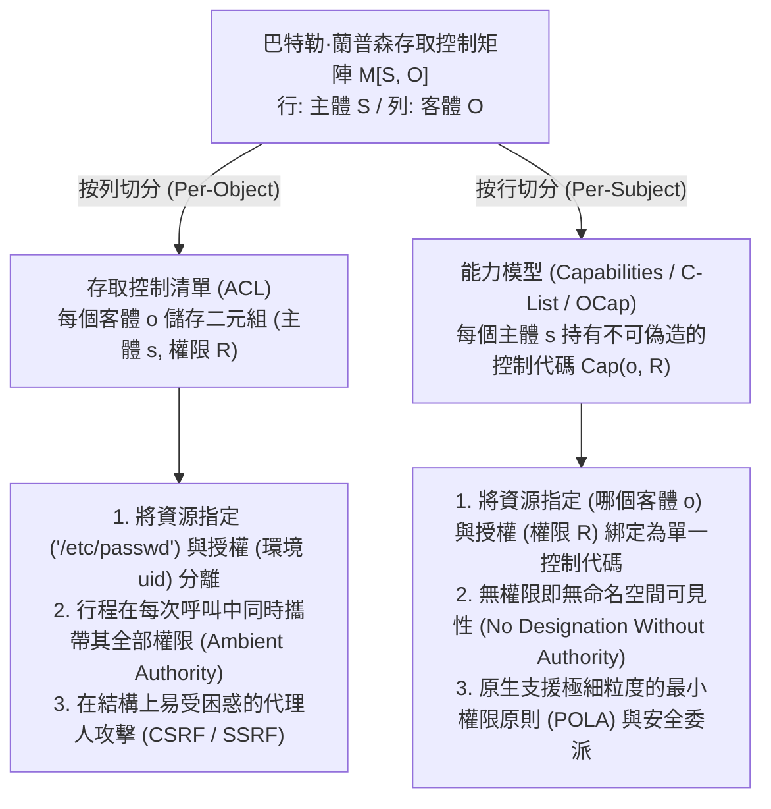
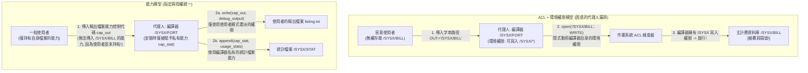

在現代作業系統、雲端基礎設施與 Web 應用程式中，毀滅性的資安漏洞往往呈現出驚人相似的結構模式。跨站請求偽造（CSRF）、伺服器端請求偽造（SSRF）、SQL 與命令注入、容器逃逸，以及 `npm` 或 `PyPI` 生態系中的軟體供應鏈攻擊，表面上處於軟體堆疊的不同層級，但其底層卻共享著同一個架構缺陷。

這項缺陷源於電腦工業半個多世紀以來對<strong>存取控制清單（Access Control Lists, ACL）</strong>與<strong>環境權限（Ambient Authority）</strong>的過度依賴——亦即根據<strong>「你是誰（主體身分 Subject Identity）」</strong>而非<strong>「你持有什麼（所持憑證 What You Hold）」</strong>來裁決存取權限，並將<strong>資源指定（Designation，如可偽造的字串路徑或 URL）</strong>與<strong>存取授權（Authority，呼叫方攜帶的環境身分）</strong>徹底割裂。

本文將系統剖析能夠從根源上消除此一結構性漏洞的替代範式：<strong>基於能力的安全（Capability-Based Security）</strong>。我們將從巴特勒·蘭普森（Butler Lampson）1971 年提出的存取控制矩陣 $M[S, O]$ 的數學分解出發，還原諾姆·哈迪（Norm Hardy）1988 年經典的「困惑的代理人問題（Confused Deputy Problem）」，闡述馬克·米勒（Mark S. Miller）的物件能力模型（OCap）與最小權限原則（POLA），展示權限衰減（Facet）與即時/傳遞性撤銷（Redell Caretaker 與 Membrane）的程式碼模式，並考察形式化驗證微核心 <strong>seL4</strong>、<strong>FreeBSD Capsicum</strong>、<strong>CHERI / ARM Morello</strong> 硬體能力指標以及 <strong>WebAssembly WASI</strong> 的現代工程實現。

---

## 1. 兩種權限範式：身分識別證 vs. 代客泊車鑰匙（Valet Key）

在進入作業系統形式化理論之前，不妨對比現實物理世界中的兩種安防機制。

### 範式 A：身分識別證與門禁名冊（ACL 模型）
假設在一棟高安全級別的辦公大樓裡，每扇門前都有一名警衛手持登記冊（即<strong>存取控制清單 ACL</strong>）。當你要求進入 302 室時，警衛檢查你的員工識別證（<strong>身分 Identity / `uid`</strong>），核對你的名字是否在 302 室的准入名單上。

現在，你想讓一名實習生（輔助程式或第三方函式庫）去 302 室的檔案櫃裡取一份 `Q3_Budget.pdf`。由於實習生不在名單上，你只能把自己的員工識別證借給實習生（如同 UNIX 的 `setuid` 或以當前使用者身分執行子程式）。一旦實習生戴上你的識別證進入 302 室，他就自動獲得了對該房間內<strong>所有機密檔案</strong>的<strong>環境權限（Ambient Authority）</strong>。更糟的是，如果外部攻擊者竄改了便條紙，誘騙實習生去取走 `Payroll_Master.db`（主薪資資料庫），門口的警衛依然會放行，因為實習生配戴著你的合法識別證！

### 範式 B：汽車代客泊車鑰匙（Capability 模型）
對比之下，當你把車交給飯店泊車員時，你不會去監理所修改車輛的存取控制名單，也不會把自己的身分證交給泊車員，而是遞給他一把<strong>代客泊車鑰匙（Valet Key）</strong>。這把鑰匙體現了三個核心架構特性：
1. <strong>指定與授權的統一（Unification of Designation and Authority）</strong>：鑰匙既唯一指定了要操作哪輛車，又同時授予了啟動引擎的權限。車輛不在乎持有人是誰，持有不可偽造的鑰匙本身就是權限的充要證明。
2. <strong>權限衰減（Attenuation / 最小權限）</strong>：泊車鑰匙無法打開後車廂或手套箱，甚至限制了最高車速。它僅授予完成泊車所需的最小權限。
3. <strong>去中心化委派（Decentralized Delegation）</strong>：泊車員交接班時，只需直接傳遞這把鑰匙，無需修改任何中央權限資料庫。

在電腦科學中，範式 A 即 <strong>ACL 模型</strong>，而範式 B 則是<strong>基於能力的安全（Capability）模型</strong>。

---

## 2. 蘭普森存取控制矩陣 $M[S, O]$ 的兩種正交分解

1971 年，圖靈獎得主巴特勒·蘭普森發表了《Protection》，提出了<strong>存取控制矩陣（Access Control Matrix）</strong>作為作業系統保護機制的通用數學抽象（後經 Harrison、Ruzzo 與 Ullman 形式化為 HRU 模型）。系統的保護狀態由三元組 $(S, O, M)$ 定義：
- <strong>主體集合 $S = \{s_1, s_2, \dots, s_m\}$</strong>：發起操作的主動實體（使用者、行程、執行緒、軟體模組）。
- <strong>客體集合 $O = \{o_1, o_2, \dots, o_n\}$</strong>：受保護的資源（檔案、記憶體區段、IPC 端點、Socket、硬體設備）。通常 $S \subseteq O$。
- <strong>權限全集 $\mathcal{R} = \{\mathsf{read}, \mathsf{write}, \mathsf{execute}, \mathsf{append}, \mathsf{grant}, \mathsf{own}\}$</strong>：允許在客體上執行的離散操作。
- <strong>存取控制矩陣 $M : S \times O \to 2^{\mathcal{R}}$</strong>：矩陣元素 $M[s, o] \subseteq \mathcal{R}$ 定義了主體 $s \in S$ 對客體 $o \in O$ 擁有的確切權限子集。

例如，包含三個主體 $S = \{\text{Alice}, \text{Compiler}, \text{Logger}\}$ 與三個檔案客體 $O = \{\texttt{src.f}, \texttt{/SYSX/STAT}, \texttt{/SYSX/BILL}\}$ 的矩陣如下：

$$
M[S, O] = \begin{array}{c|ccc}
 & \texttt{src.f} & \texttt{/SYSX/STAT} & \texttt{/SYSX/BILL} \\
\hline
\text{Alice} & \{\mathsf{read}, \mathsf{write}\} & \emptyset & \emptyset \\
\text{Compiler} & \{\mathsf{read}\} & \{\mathsf{append}\} & \{\mathsf{read}, \mathsf{write}\} \\
\text{Logger} & \emptyset & \{\mathsf{read}, \mathsf{write}\} & \emptyset
\end{array}
$$

在實際系統中，$|S|$ 與 $|O|$ 動輒數百萬且矩陣極度稀疏，直接儲存二維陣列需要 $\mathcal{O}(|S| \times |O|)$ 空間。因此，架構師必須沿著兩個正交維度之一對稀疏矩陣 $M[S, O]$ 進行切分：<strong>按列切分（依附於客體的清單）</strong>，或<strong>按行切分（由主體持有的權杖）</strong>。



### 2.1 按列切分：存取控制清單（ACL）
沿著矩陣 $M[S, O]$ 的<strong>列（Column）</strong>垂直切分，即為每個客體 $o \in O$ 關聯一份非空權限條目清單：

$$
\text{ACL}(o) = \bigl\{ (s, M[s, o]) \;\big|\; s \in S,\; M[s, o] \neq \emptyset \bigr\}
$$

UNIX/POSIX 權限、Windows NTFS DACL 與雲端 IAM 資源政策均採用按列切分。這種設計導致了<strong>指定（Designation）與授權（Authority）的分離</strong>：程式透過全域公開的字串路徑（如 `"/SYSX/BILL"`）指定目標，而核心參考監控器（Reference Monitor）則檢查呼叫方行程的<strong>環境身分</strong>（`uid`、`euid`、Session Cookie）是否在目標的 ACL 中。這意味著行程在每一次系統呼叫中都預設揮舞著其整行權限的聯集 $\bigcup_{o \in O} M[s, o]$，即<strong>環境權限（Ambient Authority）</strong>。

### 2.2 按行切分：能力（Capabilities，Dennis & Van Horn 1966）
1966 年，Jack B. Dennis 與 Earl C. Van Horn 在論文《Programming Semantics for Multiprogrammed Computations》中提出了對偶方案：沿著矩陣 $M[S, O]$ 的<strong>行（Row）</strong>水平切分，為每個主體 $s \in S$ 分配一個<strong>能力空間（CSpace 或 C-List）</strong>：

$$
\text{CSpace}(s) = \bigl\{ \text{Cap}(o, R) \;\big|\; o \in O,\; R = M[s, o] \neq \emptyset \bigr\}
$$

其中每個元素 $c = \text{Cap}(o, R)$ 稱為一個<strong>能力（Capability）</strong>——它是一個<strong>不可偽造的權限權杖</strong>，將<strong>指定</strong>（指向特定客體 $o$ 的指標或控制代碼）與<strong>授權</strong>（允許的操作子集 $R \subseteq \mathcal{R}$）不可分割地綁定在一起。在純能力系統中，沒有全域檔案路徑命名空間，存取時也不檢查呼叫者的使用者身分。若主體 $s$ 未持有客體 $o$ 的能力，它甚至無法在命名空間中「指名」客體 $o$。這確立了能力安全的核心公理：<strong>無授權即無指定，無指定即無授權（No Designation Without Authority）</strong>。

| 架構維度 | 存取控制清單（ACL —— 按列切分） | 基於能力的安全（Capabilities / OCap —— 按行切分） |
| :--- | :--- | :--- |
| <strong>矩陣 $M[S, O]$ 的分解方式</strong> | 按列儲存在每個受保護客體 $o \in O$ 上 | 按行儲存在每個主體 $s \in S$ 的能力空間中 |
| <strong>核心授權哲學</strong> | <strong>你是誰（Who You Are）</strong>：檢查呼叫方身分 `uid` | <strong>你持有什麼（What You Hold）</strong>：檢查出示的能力權杖 |
| <strong>資源指定與授權的關係</strong> | <strong>徹底分離</strong>（可偽造的字串路徑 + 環境身分） | <strong>完全統一</strong>（不可偽造的控制代碼同時指定 $o$ 並授予 $R$） |
| <strong>權限啟動模型</strong> | <strong>環境權限（Ambient Authority）</strong>：所有權限時刻啟動 | <strong>選擇性權限（Selective Authority）</strong>：僅顯式傳遞的控制代碼生效 |
| <strong>困惑的代理人脆弱性</strong> | <strong>結構性脆弱</strong>（易觸發 CSRF、SSRF、`setuid` 提權） | <strong>結構性免疫</strong>（呼叫方必須親自傳遞已授權的客體控制代碼） |
| <strong>代表性系統實現</strong> | UNIX/POSIX ACL, Windows NTFS DACL, AWS IAM | KeyKOS, seL4, FreeBSD Capsicum, Fuchsia Zircon, CHERI, WASI |

---

## 3. 困惑的代理人問題（Confused Deputy）：Norm Hardy 的 1988 經典案例與現代變體

為什麼分離「指定」與「授權」會帶來災難？電腦架構師諾姆·哈迪（Norm Hardy）在 1988 年 10 月發表於 *ACM SIGOPS Operating Systems Review* 的經典論文《The Confused Deputy (or why capabilities might have been invented)》中，記錄了 1970 年代中期發生在 Tymshare 商業作業系統上的一起真實資安事故。

### 3.1 `/SYSX/FORT` 編譯器覆寫計費資料庫事故
在 Tymshare 系統中，Fortran 編譯器位於 `/SYSX/FORT`：
1. <strong>統計收集需求</strong>：系統管理員希望每次使用者編譯程式時，編譯器都能向 `/SYSX/STAT` 檔案追加一條統計記錄。
2. <strong>授予環境權限</strong>：為此，管理員為 `/SYSX/FORT` 可執行檔授予了對整個 `/SYSX` 目錄的<strong>環境寫入權限</strong>（類似於 UNIX 的 `setuid`）。
3. <strong>使用者自訂輸出路徑</strong>：編譯器允許使用者傳入一個字串檔名參數，用於儲存除錯清單輸出（例如 `FORT(SRC="prog.f", OUT="listing.txt")`）。
4. <strong>核心資產 `/SYSX/BILL`</strong>：同一個 `/SYSX` 目錄下還存放著記錄所有客戶欠款的主計費資料庫 <strong>`/SYSX/BILL`</strong>，一般使用者對其沒有任何寫入權限。

某天，一名使用者呼叫 `/SYSX/FORT`，並將輸出檔名指定為字串 <strong>`"/SYSX/BILL"`</strong>。編譯器隨後執行了 `open("/SYSX/BILL", WRITE)`。作業系統的 ACL 參考監控器攔截該呼叫並詢問：*「當前行程（`/SYSX/FORT`）是否有權寫入 `/SYSX` 目錄？」* 答案是<strong>肯定的</strong>！於是核心放行，<strong>編譯器忠實地用 Fortran 除錯輸出覆蓋並摧毀了公司的核心計費資料庫 `/SYSX/BILL`！</strong>



### 3.2 為什麼編譯器會「困惑」？以及現代漏洞的同構性
哈迪將 `/SYSX/FORT` 稱為<strong>困惑的代理人（Confused Deputy）</strong>，因為它同時充當了兩個委託人（系統管理員與呼叫使用者）的代理人，但由於作業系統分離了指定（字串路徑）與授權（環境權限），編譯器在打開使用者指定的路徑時，作業系統自動動用了管理員賦予編譯器的環境權限。

在能力架構下，此一漏洞從根本上無法被表達：編譯器在安裝時僅被賦予單個檔案控制代碼 $c_{\text{stat}} = \text{Cap}(\texttt{/SYSX/STAT}, \{\mathsf{append}\})$；使用者呼叫編譯器時，必須自己在命名空間中打開輸出檔案，並將寫入能力控制代碼 $c_{\text{out}} = \text{Cap}(f_{\text{out}}, \{\mathsf{write}\})$ 傳給編譯器。使用者沒有 `/SYSX/BILL` 的能力控制代碼，自然無法將其傳遞給編譯器。

現代網路安全中最具破壞力的漏洞類別，本質上都是困惑的代理人：
- <strong>跨站請求偽造（CSRF）</strong>：瀏覽器是困惑的代理人。當惡意網站 `evil.example` 向 `https://bank.example/transfer` 發起請求時，瀏覽器看到目標網域字串，便自動附加上使用者的環境權限（`bank.example` 的 Session Cookie）。CSRF Token 之所以有效，正是因為它要求請求顯式攜帶不可偽造的能力權杖。
- <strong>伺服器端請求偽造（SSRF）</strong>：Web 伺服器作為代理人接收使用者傳入的 URL 字串（如 `"http://169.254.169.254/latest/meta-data/"`），並動用伺服器自身在雲端內網中的環境網路權限去讀取 IAM 金鑰。
- <strong>軟體供應鏈攻擊（`npm` / `PyPI` 惡意套件）</strong>：一個僅 20 行程式碼的字串格式化第三方套件，之所以能讀取 `~/.ssh/id_rsa` 並外傳，是因為在 POSIX ACL 模型下，行程內的每一個函式都無條件繼承了當前使用者 `uid` 的全部環境權限。

---

## 4. 物件能力模型（OCap）與權限衰減、即時撤銷模式

1975 年，Saltzer 與 Schroeder 提出了<strong>最小權限原則（Principle of Least Privilege，在能力社群中更精確地稱為最小授權原則 POLA，Principle of Least Authority）</strong>。2006 年，馬克·米勒（Mark S. Miller）在其約翰斯·霍普金斯大學博士論文《Robust Composition》中證明：<strong>記憶體安全的物件導向語言天然具備在單一物件與方法呼叫粒度上實施 POLA 的機制——物件參照（Object Reference）本身就是一種能力。</strong>

### 4.1 滿足 OCap 的三大語言不變量與參照傳播三定律
要使記憶體安全語言（如 Hardened JavaScript / SES、E 語言、Wasm 元件或受限 Rust）成為嚴格的<strong>物件能力（OCap）系統</strong>，執行期必須滿足三條不變量：
1. <strong>不可偽造參照（No Forged References）</strong>：禁止將整數強制轉型為物件指標或越界記憶體存取。
2. <strong>無可變全域狀態與零環境權限（No Mutable Global State）</strong>：全域作用域不得包含可變的共享屬性或直接呼叫的 I/O 模組（如 `fs`、`net`），內建原型鏈必須深度凍結（`Object.freeze`）。
3. <strong>絕對封裝（Absolute Encapsulation）</strong>：物件的私有詞法閉包狀態或私有欄位無法從外部透過反射竊取。

在 OCap 參照圖 $G = (V, E)$ 中，主體 $A$ 獲得客體 $C$ 的參照 $(A \to C)$ 只有三種途徑：<strong>1. 創造（Parenthood，`new C()`）</strong>；<strong>2. 稟賦（Endowment，建立閉包時注入）</strong>；<strong>3. 介紹（Introduction，同時持有 $B \to A$ 與 $B \to C$ 的介紹人 $B$ 透過訊息傳遞將 $C$ 交給 $A$）</strong>：

$$
\text{介紹定律 (Law of Introduction)}: \quad (B \to A) \;\land\; (B \to C) \;\;\Longrightarrow\;\; B \text{ 可建立 } (A \to C)
$$

### 4.2 權限衰減（Facet）與 Redell 看門人撤銷模式（Caretaker & Membrane）
傳統教科書常有一個誤區：*「能力一旦交給不可信方，就無法限制其用途，也無法撤銷。」* 事實上，David D. Redell 早在 1974 年的柏克萊博士論文中就解決了能力撤銷問題。利用詞法閉包與代理，我們可以用十餘行程式碼同時實現<strong>細粒度衰減（Facet）</strong>與<strong>即時撤銷（Caretaker）</strong>：

```javascript
// 1. 權限衰減切面 (Attenuating Facet): 僅暴露特定前綴的唯讀能力
function makeScopedReadFacet(fullStorageCap, allowedPrefix) {
  return Object.freeze({
    read(key) {
      if (typeof key !== "string" || !key.startsWith(allowedPrefix)) {
        throw new Error(`拒絕存取: 鍵名必須以 '${allowedPrefix}' 開頭`);
      }
      return fullStorageCap.read(key);
    }
    // write() 與 deleteAll() 被徹底隱藏在閉包之外！
  });
}

// 2. Redell (1974) 看門人模式 (Caretaker Pattern): 實現 O(1) 即時權限撤銷
function makeCaretaker(targetCap) {
  let currentTarget = targetCap; // 閉包內的私有可變參照
  const caretaker = Object.freeze({
    read(...args) {
      if (currentTarget === null) throw new Error("能力已被撤銷 (Revoked)");
      return currentTarget.read(...args);
    },
    write(...args) {
      if (currentTarget === null) throw new Error("能力已被撤銷 (Revoked)");
      return currentTarget.write(...args);
    }
  });
  const revoker = Object.freeze({
    revoke() { currentTarget = null; } // 切斷參照鏈並允許垃圾回收
  });
  return Object.freeze({ caretaker, revoker });
}
```

若目標能力是一個會回傳子物件參照的複雜物件圖（例如目錄控制代碼透過 `getSubDir()` 回傳子目錄控制代碼），馬克·米勒提出的<strong>可撤銷膜模式（Revocable Membrane）</strong>利用 `Proxy` 與 `WeakMap` 遞迴地將所有跨過膜邊界的回傳值與回呼參數自動包裹在同一層撤銷門控中。一旦呼叫 `revoke()`，整個子圖的所有衍生參照在瞬間全部失效。

---

## 5. 現代工業級部署：seL4、FreeBSD Capsicum、CHERI 與 WebAssembly WASI

首先必須澄清一個常見的術語混淆：Linux 核心中的 `capabilities(7)`（如 `CAP_NET_ADMIN`、`CAP_DAC_OVERRIDE`）<strong>並不是物件能力</strong>，它們只是將 `root` 的環境權限拆分為約 41 個執行緒級旗標位元，不指定任何具體客體，依然完全暴露於困惑的代理人漏洞之下。真正的工業級能力架構體現在以下四大系統中：

1. <strong>seL4 形式化驗證微核心</strong>：全球首個擁有完整 Isabelle/HOL 機器證明的作業系統微核心。seL4 核心實行零環境權限，所有核心資源（執行緒控制區塊 TCB、虛擬位址空間 VSpace、IPC 端點、實體記憶體頁框）均只能透過執行緒 <strong>CSpace（CNode 表）</strong>中的能力控制代碼存取。透過 `seL4_CNode_Mint` 可對能力進行權限位元遮罩衰減或附加不可偽造的身分徽章（Badge），並透過核心維護的<strong>能力派生樹（CDT）</strong>執行傳遞性撤銷 `seL4_CNode_Revoke`。
2. <strong>FreeBSD Capsicum 沙箱框架</strong>：由劍橋大學與 Google 研發，將標準 UNIX 檔案描述元（`fd`）提升為真正的能力。行程呼叫 `cap_enter()` 進入能力模式後，核心將無條件攔截所有存取全域命名空間的系統呼叫（如 `open()`、`connect()`、`bind()`，回傳 `ECAPMODE` 錯誤）。行程只能操作已持有的檔案描述元，並透過 `openat(dir_fd, "sub/file", ...)` 在受限子目錄內進行相對查找（嚴禁 `".."` 逃逸），同時利用 `cap_rights_limit(fd, &rights)` 細粒度剝離超過 60 種描述元權限位元。
3. <strong>CHERI 與 ARM Morello 矽晶片級硬體能力指標</strong>：由劍橋大學與 SRI 聯合設計、ARM 在 <strong>Morello</strong> 處理器（7nm 四核心架構）及 <strong>CHERIoT-RISC-V</strong> 中實現的硬體架構。CHERI 將傳統的 64 位元整數指標替換為 <strong>128 位元硬體能力暫存器 + 1 位元帶外有效性標籤（Tag Bit）</strong>：

$$
\underbrace{\text{Tag (1 bit)}}_{\text{硬體防偽標籤位元}} \;\Big|\; \underbrace{\text{Permissions (18 bits)}}_{\text{讀寫執行權限遮罩}} \;\Big|\; \underbrace{\text{Object Type (18 bits)}}_{\text{硬體封裝類型}} \;\Big|\; \underbrace{\text{Compressed Bounds (28 bits)}}_{\text{浮點壓縮基底與上界 [Base, Top)}} \;\Big|\; \underbrace{\text{Address Cursor (64 bits)}}_{\text{64位元虛擬位址游標}}
$$

每次記憶體載入、儲存或取指時，CPU 在單週期內平行校驗位址游標是否嚴格位於 `[Base, Top)` 區間內且符合權限遮罩；若程式試圖用一般整數指令竄改記憶體中的能力位元組，記憶體控制器硬體會自動將該位址的 1 位元帶外 Tag 清零，使偽造的指標徹底無法解參照，從實體晶片層面根除了緩衝區溢位與 ROP 攻擊。
4. <strong>WebAssembly WASI 與雲端 Macaroons</strong>：WebAssembly 模組預設處於零環境權限沙箱中，WASI 執行期要求宿主顯式注入預先開啟的目錄能力描述元（如 `--dir /var/app/data`），模組無法開啟任何未授權路徑。而在分散式雲端微服務中，Google 提出的 <strong>Macaroons</strong> 利用巢狀 HMAC 鏈式簽章實現了無需中央資料庫協助的用戶端自主權限衰減（附加時間、IP、唯讀等脈絡限制條件 Caveats），成為現代零信任雲端架構的核心基石。
